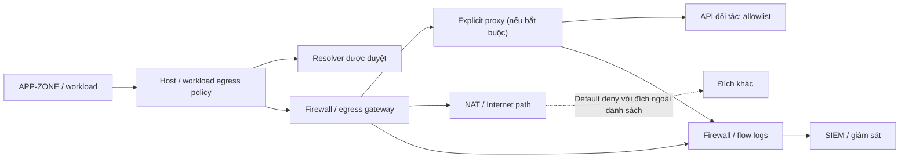

# Kiểm tra egress theo allowlist

**Egress** là lưu lượng đi ra từ một vùng tin cậy, workload hoặc mạng nguồn tới vùng/đích bên ngoài ranh giới đang xét. **Egress allowlist** là chính sách chỉ cho phép những luồng đi ra đã được phê duyệt, thường được mô tả bằng nguồn, đích, dịch vụ, giao thức, danh tính và ngữ cảnh; những luồng không thuộc danh sách cho phép sẽ bị chặn theo chính sách. Kiểm tra egress theo allowlist nhằm chứng minh rằng **luồng hợp lệ đi được** và **luồng không được phê duyệt thực sự bị chặn**, qua tất cả những đường đi có ý nghĩa.

Ví dụ, máy chủ ứng dụng xử lý thanh toán chỉ cần gọi API của đối tác qua HTTPS và DNS của tổ chức. Nếu máy chủ vẫn có thể thiết lập kết nối trực tiếp tới một đích bất kỳ trên Internet, allowlist chưa đạt mục tiêu dù rule cho đối tác đã hoạt động.

Trong chương **Kiểm thử và xác minh bảo mật mạng** thuộc module `SECURITY_NETWORK_SECURITY`, nội dung này kết nối thiết kế firewall, phân đoạn, VPN, DNS, IDS/IPS, kiến trúc mạng cloud và giám sát lưu lượng thành một bài kiểm chứng thực tế. Bài học giả định các phép thử được chủ hệ thống cho phép, dùng endpoint kiểm thử do tổ chức quản lý và giới hạn mức ảnh hưởng tới dịch vụ.

Sau bài học, người học có thể:

- Biến yêu cầu “chỉ cho phép luồng cần thiết” thành ma trận thử nghiệm có kết quả mong đợi và bằng chứng tương ứng.
- Phân biệt allowlist theo IP/CIDR, port, FQDN, ứng dụng, danh tính và proxy; nắm giới hạn của từng loại.
- Kiểm chứng đường đi thực tế khi có NAT, proxy, DNS, IPv6, VPN, cloud egress gateway hoặc nhiều lớp firewall.
- Đối chiếu kết quả máy nguồn, máy đích, rule hit, flow log và log IDS/IPS để kết luận chính xác.
- Nhận diện cách cấu hình quá rộng, đường đi ngoài kiểm soát và rủi ro thay đổi danh sách cho phép.

## 1. Những khái niệm cần phân biệt

| Khái niệm | Ý nghĩa | Lỗi suy luận thường gặp |
| --- | --- | --- |
| **Ingress** | Lưu lượng đi *vào* một vùng hoặc dịch vụ | Cho rằng kiểm soát ingress đã đủ để quản lý lưu lượng đi *ra*. |
| **Egress** | Lưu lượng đi *ra* khỏi vùng nguồn đang xét | Chỉ kiểm tra Internet, bỏ qua luồng tới VPC/VNet, VPN, đối tác hoặc mạng nội bộ khác. |
| **Allowlist** | Điều kiện luồng được phép theo chính sách | Coi chỉ định một cổng, chẳng hạn TCP/443, là hạn chế đủ chặt về đích. |
| **Default deny** | Từ chối luồng không khớp quy tắc cho phép | Tưởng rule deny hiện diện trên giấy là đã chặn mọi đường đi thực tế. |
| **Stateful filtering** | Theo dõi trạng thái kết nối để xử lý lưu lượng phản hồi | Nhầm cổng nguồn tạm thời của kết nối trả lời là quyền mở egress tùy ý. |
| **Policy enforcement point** | Điểm thực thi quy tắc: firewall, proxy, gateway, host firewall, cloud policy... | Chỉ nhìn một firewall rồi khẳng định mọi luồng đều đi qua nó. |
| **Test vantage point** | Thiết bị/mạng/identity khởi tạo phép thử | Test từ bastion khác subnet/VRF, khiến kết quả không đại diện workload thật. |

**Allowlist khác blocklist:** blocklist cố gắng cấm các đích xấu đã biết; allowlist khởi đầu từ những đích được phê duyệt. Allowlist có thể giới hạn khả năng gọi ra ngoài từ máy bị xâm nhập, nhưng không tự loại bỏ mọi nguy cơ rò rỉ dữ liệu: dữ liệu vẫn có thể bị gửi qua **dịch vụ được phép** nếu thiếu kiểm soát ở tầng ứng dụng và giám sát nội dung phù hợp.

### 1.1. Đối tượng cần kiểm soát không chỉ là IP đích

Một quy tắc egress đủ rõ thường được mô tả bằng một tập thuộc tính:

```text
Nguồn (zone / subnet / workload / identity)
    + Đích (IP / prefix / FQDN / service / tenant)
    + Giao thức và cổng đích
    + Đường đi (gateway / proxy / VRF / VPN)
    + Điều kiện ứng dụng và thời gian (nếu có)
    -> Quyết định: ALLOW hoặc DENY + ghi log
```

Ví dụ chính sách:

- Workload `APP-PAYMENT` chỉ gửi TCP/443 tới API đối tác được phê duyệt.
- Workload chỉ truy vấn DNS qua resolver nội bộ được chỉ định, không tự gửi DNS trực tiếp ra Internet.
- Toàn bộ đích và giao thức khác bị từ chối theo cơ chế đã thiết kế; các phụ thuộc bắt buộc như thời gian, xác thực, cập nhật hoặc giám sát phải được liệt kê cụ thể nếu có.

Ở lớp mạng, `destination port = 443` chỉ chứng minh một loại lưu lượng; nó **không xác thực** tên miền, ứng dụng, nội dung hay chủ thể đích. Kiểm soát FQDN/TLS/HTTP cần hỗ trợ của proxy hoặc firewall có khả năng nhận diện và cần hiểu rõ giới hạn mã hóa.

## 2. Thiết kế allowlist từ nhu cầu nghiệp vụ

Trước khi kiểm thử, cần lập **bản đồ luồng được phê duyệt**, không dùng snapshot các kết nối hiện tại làm chính sách tự động. Những kết nối quan sát được có thể bao gồm tác vụ cũ, shadow IT, rủi ro hoặc sự cố.

| Trường | Ví dụ minh họa | Mục đích |
| --- | --- | --- |
| `flow_id` | `EGR-01` | Kết nối một yêu cầu nghiệp vụ với test case và rule. |
| Chủ luồng/ứng dụng | Nhóm vận hành dịch vụ thanh toán | Xác nhận lý do cần kết nối và người phê duyệt. |
| Nguồn | `APP-ZONE / 10.10.20.0/24` | Hạn chế đúng vùng hoặc workload được cấp quyền. |
| Đích | API đối tác xác định, IP hoặc FQDN theo hợp đồng | Không cho phép toàn Internet hoặc CIDR quá rộng. |
| Giao thức, cổng | TCP/443 | Xác định dịch vụ đích, không nhầm cổng nguồn. |
| Đường đi | Egress firewall → NAT gateway → Internet | Xác định điểm log, NAT và điểm cưỡng chế chính sách. |
| Cơ chế phân giải | Resolver nội bộ, FQDN policy có hỗ trợ | Phát hiện thay đổi IP và vùng ngoại lệ DNS. |
| Định danh | Workload identity, proxy account hoặc service principal | Tách quyền ứng dụng khác nhau ngay cả khi cùng subnet. |
| Chu kỳ sử dụng | Liên tục hoặc cửa sổ vận hành cụ thể | Tránh giữ rule mở vô hạn sau công việc tạm thời. |
| Kỳ vọng log | ID rule, action, source/destination, thời gian, NAT mapping | Chuẩn bị chứng cứ kiểm thử. |

Tính cả các kết nối phụ thuộc: DNS, NTP, OCSP/CRL hoặc dịch vụ xác minh chứng chỉ khi ứng dụng cần, hệ thống nhận secret, package registry, telemetry nội bộ, IdP và endpoint để cập nhật. Chỉ cho phép theo **phụ thuộc đã xác minh**; không mở tất cả những nhóm này theo mặc định.

### 2.1. Ranh giới và điểm thực thi



Sơ đồ là **mô hình logic**: không phải mọi triển khai đều đi qua proxy; resolver và NAT có thể nằm ở vị trí khác. Vẽ lại đường đi thực tế từ route table, subnet/VRF, VPN, cloud gateway, policy routing và vị trí firewall. Điểm nguy hiểm cần kiểm tra là **đường ra thứ hai**: interface khác, IPv6 default route, split-tunnel VPN, proxy trực tiếp, mạng cloud peering hoặc Internet gateway được cấu hình song song.

## 3. Các kiểu allowlist và giới hạn kỹ thuật

| Kiểu allowlist | Phù hợp khi | Giới hạn cần kiểm tra |
| --- | --- | --- |
| IP đơn/CIDR và L4 port | Đích ổn định, mạng nội bộ hoặc endpoint có IP cố định | IP thay đổi, NAT, IP được chia sẻ, CIDR quá rộng; không khẳng định ứng dụng nào dùng IP. |
| DNS/FQDN-aware firewall | Đích được chỉ định bằng tên, IP động | Policy phụ thuộc cơ chế phân giải, cache/TTL, ánh xạ nhiều IP và cách thiết bị xử lý thay đổi; DNS lookup không chứng minh ứng dụng thực sự kết nối đúng dịch vụ. |
| HTTP/HTTPS proxy | Cần kiểm soát theo hostname, URL/path, người dùng và log ứng dụng | Cần cưỡng chế sử dụng proxy; HTTP CONNECT hoặc TLS mã hóa có thể làm giảm khả năng nhìn sâu; phụ thuộc cấu hình và tính năng thực tế. |
| TLS SNI-based | Có thể nhận diện hostname trong TLS ClientHello khi hiển thị | SNI không tự chứng thực đích; không phải mọi kết nối cung cấp SNI quan sát được, đặc biệt khi ECH được sử dụng. |
| Application-aware NGFW | Có yêu cầu nhận diện giao thức/ứng dụng, ràng buộc dịch vụ | Chữ ký ứng dụng và phiên bản phần mềm có giới hạn; thiếu giải mã có thể giảm mức phân biệt. |
| Identity/workload policy | Nhiều workload dùng chung subnet hoặc môi trường động | Cần identity đủ tin cậy và chính sách nhất quán qua host, container, gateway. |

**Chính sách dựa vào FQDN không tương đương xác thực máy chủ bằng TLS.** Kết quả DNS có thể trả về nhiều IP, đổi theo vùng hoặc qua CDN. Ở chiều ngược lại, một IP của dịch vụ chia sẻ có thể phục vụ nhiều hostname; việc cho phép IP đó có thể vô tình cho phép các dịch vụ khác trên cùng địa chỉ. Muốn khẳng định quyền theo tên ứng dụng phải xét điểm cưỡng chế, các thuộc tính xác thực và khả năng phân biệt tenant/hostname của sản phẩm.

### 3.1. DNS và những luồng vòng qua điểm kiểm soát

Với chính sách “chỉ DNS qua resolver nội bộ”, cần kiểm tra:

- UDP/TCP 53 tới resolver nội bộ có hoạt động đúng không; DNS có thể sử dụng cả hai giao thức.
- Truy vấn trực tiếp UDP/TCP 53 tới resolver khác có bị chặn theo ranh giới đã duyệt hay không.
- DNS over TLS (DoT, thường TCP/853) và DNS over HTTPS (DoH, thường HTTPS/443) có được chính sách xử lý không.
- Workload dùng DNS cache hoặc IP hardcoded có đi qua bộ lọc dựa trên tên miền hay không.
- DNS64/NAT64 trong mạng IPv6 có thay đổi đường đi và cách đối chiếu địa chỉ hay không.

**Không thể chứng minh đã chặn DoH chỉ bằng việc chặn cổng 53 hoặc 853**, vì DoH dùng HTTPS và có thể đi qua cổng 443 vốn được phép. Việc kiểm soát chính xác đòi hỏi quản lý proxy/endpoint, resolver, danh tính dịch vụ hoặc lớp ứng dụng phù hợp; tránh tuyên bố có thể nhận diện tuyệt đối mọi luồng DoH chỉ từ cổng.

### 3.2. IPv6, UDP/443 và kênh khác

Một số thiết bị lọc IPv4 tốt nhưng **bỏ trống IPv6**. Khi hệ điều hành có cả IPv4 và IPv6, ứng dụng có thể chọn IPv6 theo kết quả phân giải hoặc chính sách kết nối. Thử IPv4 bị chặn chưa chứng minh toàn bộ egress bị chặn. Nếu có IPv6, phải mô tả nguồn, prefix, route và điểm cưỡng chế tương ứng.

QUIC/HTTP/3 thường dùng UDP/443; kết quả chặn TCP/443 không phản ánh UDP/443. Ngoài ra, các đường VPN, tunnel và proxy có thể tạo **kết nối tới điểm trung gian được phép** nhưng chuyển tiếp yêu cầu tới đích cuối không nằm trong danh sách. Vì vậy, khi kiến trúc có relay, phải xác định chính sách cho cả **đích trung gian** và **đích cuối** nếu điểm thực thi hỗ trợ, đồng thời ghi rõ giới hạn bảo đảm.

## 4. Xây dựng phạm vi kiểm thử và giả thuyết

Đầu vào gồm danh sách tài sản được phê duyệt, sơ đồ luồng, rule/route/NAT, địa chỉ nguồn thử, thời gian thử và **đích kiểm thử có quyền sử dụng**. Đặc biệt đối với production, ưu tiên endpoint canary hoặc máy chủ kiểm tra do tổ chức quản lý thay vì gửi lưu lượng thử tùy ý ra Internet.

Ví dụ lab có ba vùng:

- `APP-ZONE`: client thử `10.10.20.23`; mạng `10.10.20.0/24`.
- `TEST-SERVICE-ALLOW`: máy chủ do tổ chức quản lý tại `10.60.50.10`, chỉ dùng TCP/443, certificate khớp `allowed.service.test`.
- `TEST-SERVICE-DENY`: máy chủ do tổ chức quản lý tại `10.60.50.20`, cùng khả năng phục vụ TCP/443; chỉ khác điều kiện **không có trong allowlist**.
- `RESOLVER`: DNS nội bộ `10.10.0.53`.
- `EGRESS-FW`: điểm áp dụng rule giữa APP-ZONE và TEST-ZONE; các log đều dùng thời gian UTC.

Các tên thuộc miền `.test` dành cho kiểm thử và giá trị IP RFC1918 trong ví dụ chỉ minh họa, **không phải endpoint thật**. Để kiểm thử, cần triển khai endpoint lab thực, kiểm tra route và cấp quyền rõ ràng.

Giả thuyết chính:

> Từ `10.10.20.23`, luồng TCP/443 đến `10.60.50.10` được phép; luồng TCP/443 đến `10.60.50.20` bị firewall từ chối. Quyết định phải có log đối chiếu và không còn đường đi được phép ngoài ranh giới đã thống nhất.

Cả hai endpoint cần **đang chạy và có thể kiểm chứng hoạt động từ một nguồn đối chứng được phép**, nếu không phép thử deny có thể “thành công” chỉ vì dịch vụ đích bị tắt.

### 4.1. Ma trận test case

| ID | Điểm nguồn → đích | Kiểm tra | Kết quả mong đợi | Bằng chứng cần |
| --- | --- | --- | --- | --- |
| `E01` | APP → Allow service TCP/443 | Luồng được phê duyệt | **ALLOW**, nhận response hợp lệ | Client result, server log, firewall session/rule. |
| `E02` | APP → Deny service TCP/443 | Cùng giao thức nhưng đích ngoài danh sách | **DENY** | Client không tạo phiên thành công; firewall deny đúng source/destination. |
| `E03` | APP → Allow service TCP/80 | Cổng không được phép tới cùng đích | **DENY** | Rule deny, không có giao dịch HTTP từ APP. |
| `E04` | APP → Resolver nội bộ UDP/TCP 53 | Hỗ trợ DNS chính thức | **ALLOW** theo policy | Resolver query log, firewall allow. |
| `E05` | APP → Resolver ngoài danh sách UDP/TCP 53 | DNS trực tiếp ra ngoài | **DENY** | Firewall log theo giao thức; đích là máy thử được phép đánh giá. |
| `E06` | APP → endpoint test DoT TCP/853 | Truy vấn DNS qua kênh khác | **DENY**, nếu không được duyệt | Rule decision, log endpoint và đường đi. |
| `E07` | APP → endpoint test UDP/443 | QUIC/UDP không thuộc luồng được phép | **DENY** | Đúng giao thức UDP, log deny hoặc policy tương ứng. |
| `E08` | APP (IPv6) → IPv6 endpoint ngoài danh sách | Kiểm tra phủ IPv6 **khi mạng có IPv6** | **DENY** | IPv6 flow log, route và policy áp dụng. |
| `E09` | APP → đường proxy/VPN/secondary gateway | Kiểm tra đường egress thay thế | Không có đường đi ngoài chính sách | Route/policy, log gateway/proxy, kiểm tra đích do tổ chức sở hữu. |
| `E10` | Workload khác cùng subnet → Allow service | Quyền theo workload/role nếu chính sách phân biệt | **DENY** cho workload không được cấp | Identity/host policy, gateway log, evidence nguồn. |

Các hàng E05–E10 chỉ được chạy khi **nằm trong phạm vi và được phép**. Một môi trường không có IPv6 không cần ép tạo IPv6 để “đủ bài”; khi đó ghi `not applicable` và lý do. Tránh lấy `not run` hoặc `inconclusive` làm `pass`.

## 5. Quy trình kiểm thử có kiểm soát

### Bước 1: Xác nhận phạm vi và cấu hình nền

- Xác định nguồn thử nằm đúng subnet/VRF, namespace/container, VPN group hoặc workload identity; kiểm tra địa chỉ và tuyến mặc định.
- Ghi nhận rule hiện hành, thứ tự rule, NAT, proxy, DNS, routing, IPv4/IPv6 và chính sách cloud liên quan.
- Chốt điểm đích do tổ chức sở hữu, giao thức/cổng, khung giờ, người trực NOC/SOC, tốc độ thử và điều kiện dừng.
- Xác minh log nguồn, firewall, proxy/NAT, đích có thời gian đồng bộ, có thể truy xuất; tạo correlation ID cho phép thử nếu tầng ứng dụng hỗ trợ.

### Bước 2: Kiểm tra luồng được phép (positive control)

Từ **đúng nguồn đã chỉ định**, tạo một request hợp lệ tới endpoint thuộc allowlist và thu:

1. Kết quả ứng dụng (ví dụ response HTTPS đúng nội dung thử nghiệm).
2. Log kết nối hoặc request ở endpoint đích.
3. Log `allow` trên firewall/proxy tương ứng, bao gồm rule ID và đường đi.
4. NAT mapping hoặc địa chỉ nguồn được dịch khi cần đối chiếu.
5. Log DNS và proxy nếu các lớp này nằm trong đường đi thực.

**Một phiên HTTPS thành công không tự chứng minh đúng rule đang được thực thi.** Kết nối có thể đi qua proxy khác hoặc rule quá rộng; phải đối chiếu rule được match.

### Bước 3: Kiểm tra luồng bị từ chối (negative control)

Tạo kết nối giới hạn tới **endpoint ngoài allowlist nhưng thuộc quyền kiểm thử**, với giao thức/cổng giống positive control, để cô lập yếu tố **đích**. Nếu chính sách dùng thêm điều kiện port, protocol, workload identity thì thay đổi đúng **một biến mỗi lượt**.

Một phép thử deny có chất lượng cần:

- Máy đích đã xác nhận đang hoạt động và route tới đó là khả thi khi kiểm tra từ nguồn đối chứng được phép.
- Kết nối từ nguồn thử không thành công **đúng vì policy**, có log `deny/drop/reject` tương ứng hoặc bằng chứng kỹ thuật khác.
- Log không chỉ ra luồng được phép đi qua rule chung, proxy khác hay gateway dự phòng.
- Không có dấu vết ứng dụng thành công ở endpoint đích khi tương quan thời gian và ID.

**Timeout không đồng nghĩa bị firewall chặn.** Timeout có thể do route hỏng, DNS sai, host down, TLS, MTU, IDS/IPS, rate limit hoặc mất gói. Lỗi DNS resolution cũng không chứng minh firewall L3/L4 đã chặn kết nối tới một IP cụ thể.

### Bước 4: Kiểm tra các đường thay thế

Tùy kiến trúc, kiểm tra đường IPv6, policy routing, nhiều NIC, VPN split tunnel, NAT gateway dự phòng, explicit/transparent proxy, cloud Internet gateway, service mesh và container network policy. Mục tiêu là kiểm tra **độ phủ điểm cưỡng chế**, không cố tình tìm cách khai thác hoặc thoát khỏi môi trường được phép.

Một firewall đúng rule trên một route chưa đủ kết luận nếu workload có route khác không đi qua nó. Khi phát hiện đường phụ ngoài phạm vi, ghi nhận, ngừng thử chủ động trên đường đó và xin cập nhật scope trước khi tiếp tục.

### Bước 5: Đối chiếu và xác định trạng thái

Ghép dữ liệu theo `timestamp_utc`, `test_id`, `src/dst_ip`, `src/dst_port`, `protocol`, `policy_id`, `device_id`, `session_id` và thông tin NAT. Với máy đích nằm sau load balancer, cần thêm ID dịch vụ hoặc request nếu có.

Chỉ đánh dấu **PASS** khi có chứng cứ đủ để xác minh hành vi đúng như kỳ vọng. **FAIL** khi quan sát được ngoại lệ có bằng chứng; **INCONCLUSIVE** khi không phân biệt được nguyên nhân; **NOT RUN** khi chưa thực hiện. Báo cáo các trạng thái này riêng.

## 6. Ví dụ thao tác trong phòng lab được phê duyệt

Các lệnh dưới đây **chỉ là minh họa kiểm tra kết nối nhẹ**, dùng trên client do nhóm quản trị kiểm soát với các endpoint kiểm thử được triển khai theo phần 4. Không sử dụng địa chỉ trong ví dụ nếu mạng lab thực tế chưa được thiết lập.

Để kiểm tra phân giải tên và kết nối HTTPS hợp lệ:

```bash
# Kiểm tra DNS bằng resolver nội bộ đã chỉ định trong lab.
nslookup allowed.service.test 10.10.0.53

# Chỉ gửi một yêu cầu HEAD tới endpoint thử nghiệm.
curl --head --max-time 5 https://allowed.service.test/
```

Với kiểm tra **allow/deny chỉ ở lớp IP và TCP**, có thể giữ nguyên tên miền nhưng ép dùng địa chỉ lab cụ thể. Lưu ý rằng `--resolve` bỏ qua DNS cho hostname được chỉ định, vì thế **không dùng kết quả này để kết luận về kiểm soát DNS**:

```bash
# Dự kiến kết nối HTTPS đến endpoint đã allow thành công.
curl --head --max-time 5 \
  --resolve allowed.service.test:443:10.60.50.10 \
  https://allowed.service.test/

# Dự kiến yêu cầu thử này bị chặn do đích không nằm trong allowlist.
# Endpoint 10.60.50.20 phải đang chạy và thuộc quyền kiểm thử.
curl --head --max-time 5 \
  --resolve denied.service.test:443:10.60.50.20 \
  https://denied.service.test/
```

Để đối chiếu, cần lưu cả exit code, stderr, thời gian và log gateway. Khi dùng biến thể `curl` khác nhau hoặc qua proxy, hành vi `--resolve` có thể không cho kết quả tương đương với đường kết nối trực tiếp. Hãy kiểm tra cấu hình proxy của môi trường và giữ nguyên điểm xuất phát.

Không dùng `curl -k` để bỏ kiểm tra chứng chỉ rồi ghi “HTTPS an toàn”. Nếu chứng chỉ lab chưa hợp lệ, đó là hạn chế của môi trường cần sửa hoặc tách thành bài kiểm tra kết nối L4, không thể xem chứng minh end-to-end TLS.

### 6.1. Ghi nhận kết quả dưới dạng bảng

| Test ID | Bằng chứng máy nguồn | Firewall / proxy | Máy đích | Kết luận |
| --- | --- | --- | --- | --- |
| `E01` | HTTPS trả HTTP 200 từ endpoint lab | `ALLOW` rule `APP-API-443` | Có request ID tương ứng | **PASS** nếu đúng đường và rule. |
| `E02` | TCP không kết nối được | `DENY` rule `APP-EGRESS-DEFAULT` | Không có request, endpoint vẫn khỏe | **PASS** cho kết nối được thử. |
| `E03` | TCP/80 không kết nối được | Không có log, route chưa xác minh | Không có log | **INCONCLUSIVE**. |
| `E08` | Không có địa chỉ/route IPv6 | Không có dữ liệu IPv6 | Không chạy | **NOT APPLICABLE**, cần lý do. |

Các trạng thái chỉ mô tả ví dụ. Kết luận về **toàn bộ egress** chỉ hợp lệ nếu toàn bộ đường đi được xác định và coverage đáp ứng phạm vi kiểm thử.

## 7. Đối chiếu log và NAT: tránh đọc nhầm dấu vết

Giả sử luồng kiểm thử E01 được NAT từ nguồn ứng dụng `10.10.20.23:54022` sang địa chỉ gateway `198.51.100.10:62001` trước khi tới endpoint dịch vụ do tổ chức sở hữu. `198.51.100.0/24` là dải dành cho tài liệu, ví dụ này hoàn toàn giả lập.

```text
APP client
10.10.20.23:54022   ->   203.0.113.20:443   (TCP)
         |
         |  Egress firewall: ALLOW / policy APP-API-443
         |
NAT gateway
198.51.100.10:62001 ->  203.0.113.20:443   (TCP)
         |
Server access log:
src=198.51.100.10:62001, request_id=egress-test-e01
```

Địa chỉ IP của server trong ví dụ cũng thuộc dải tài liệu, không dùng để gửi traffic thật.

Một log chuẩn hóa minh họa:

```json
{
  "timestamp_utc": "2026-11-28T03:20:15.124Z",
  "test_id": "E01",
  "device_id": "FW-EGRESS-01",
  "source_zone": "APP-ZONE",
  "source_ip": "10.10.20.23",
  "source_port": 54022,
  "destination_ip": "203.0.113.20",
  "destination_port": 443,
  "protocol": "TCP",
  "policy_id": "APP-API-443",
  "action": "allow",
  "nat_source_ip": "198.51.100.10",
  "nat_source_port": 62001,
  "session_id": "lab-session-e01"
}
```

Cần xác nhận thiết bị ghi `source_ip` trước hay sau NAT. Log ứng dụng tại đích có thể chỉ thấy IP public của NAT, proxy hoặc gateway; **khác IP nguồn không đồng nghĩa hai sự kiện không liên quan**. Nối log dựa trên mapping NAT, 5-tuple, thời gian hiệu lực và session ID; tránh đối chiếu chỉ bằng IP và mốc thời gian gần nhau.

### 7.1. Khi log nói “deny” nhưng đích vẫn nhận request

Những giả thuyết cần kiểm tra trước khi khẳng định firewall hoạt động sai:

- Một lần thử khác cùng thời điểm được cho phép, còn log deny thuộc request khác.
- Workload có đường đi thay thế: IPv6, VPN, secondary NIC, proxy, gateway cloud.
- Rule chỉ áp dụng cho một chiều, một zone hoặc một interface.
- Log đích đang được gửi qua reverse proxy/CDN; nguồn trong log là proxy, không phải client trực tiếp.
- Đồng hồ lệch, session ID không khớp, NAT mapping được tái sử dụng, hoặc có log bị thiếu.

Khác biệt giữa log và hành vi không nên được giải quyết bằng cách chọn một nguồn làm “chân lý” mà không xác minh pipeline.

## 8. Kiểm thử trong cloud, container và mô hình hybrid

### 8.1. Cloud VPC/VNet

Egress có thể bị ảnh hưởng bởi **route table**, security group, network ACL, cloud firewall, NAT gateway, Internet gateway, peering, private endpoint và các kết nối hybrid. Mỗi lớp có ngữ nghĩa khác nhau; ví dụ có hệ thống lọc stateful và stateless, có lớp ràng buộc theo resource, lớp khác ràng buộc theo subnet.

Khi lập phạm vi, ghi rõ:

- Cloud account/subscription/project, region, VPC/VNet, subnet, workload ID và địa chỉ gắn với thời điểm thử.
- Egress route thực tế và những đường đi failover.
- Policy nào là **nguồn quyết định cuối cùng**, policy nào chỉ là log/telemetry.
- Luồng private-service endpoint, cloud API, metadata service hoặc dịch vụ nội bộ cần kiểm soát riêng.
- Log flow và audit của cloud có ghi đủ mức chi tiết để truy được rule/đường đi không.

**Không mặc định flow log ghi mọi gói hoặc mọi nguyên nhân bị chặn**. Nó có thể tổng hợp theo khoảng thời gian hoặc thiếu thông tin ở một số tầng. Đối chiếu với log firewall/proxy và kết quả client/server.

### 8.2. Kubernetes hoặc workload động

Workload có thể đổi Pod IP khi được triển khai lại. Nếu chính sách chỉ allowlist IP Pod tĩnh, vòng đời workload sẽ làm policy lỗi thời. Cần xem xét namespace, label, service account, CNI/network policy, egress gateway hoặc service mesh và giới hạn thực tế của mỗi cơ chế.

Chẳng hạn, Kubernetes `NetworkPolicy` phụ thuộc CNI hỗ trợ và semantics của policy; policy dạng namespace/pod selector phải được kiểm tra với chính Pod chạy test. Không mặc định NetworkPolicy xác thực FQDN hoặc ngăn mọi đường egress ra host/node khi cơ chế thực thi không hỗ trợ điều đó.

### 8.3. Proxy và SaaS

Nếu hệ thống dùng proxy bắt buộc, kiểm thử phải xác nhận:

1. Workload chỉ kết nối được tới địa chỉ proxy được duyệt.
2. Không thể đi trực tiếp ra đích qua đường bỏ qua proxy trong phạm vi.
3. Proxy có chính sách hostname/method/user phù hợp với nhu cầu.
4. Các kết nối tới CDN/hosting dùng chung được phân biệt đúng tới mức proxy hỗ trợ.
5. Việc xác thực proxy, log và xử lý lỗi không tạo chế độ **fail-open** ngoài thiết kế.

Quy tắc “chỉ HTTPS qua proxy” không bảo đảm endpoint cuối luôn hợp lệ nếu proxy được cấu hình cho phép CONNECT không giới hạn hoặc bỏ qua hostname policy.

## 9. Giới hạn và tình huống dễ đánh giá sai

| Quan sát | Kết luận sai dễ gặp | Cách kiểm tra đúng |
| --- | --- | --- |
| Kết nối tới đích ngoài danh sách timeout | “Firewall đã chặn.” | Xác nhận route/đích khỏe từ nguồn đối chứng và log deny khớp luồng. |
| Đích hợp lệ trả HTTP 200 | “Allowlist đã đúng hoàn toàn.” | Đối chiếu rule ID, nguồn, NAT, hostname và các phép thử deny. |
| Không thấy DNS trực tiếp ngoài tổ chức | “Không có đường DNS khác.” | Xem DoH/DoT, policy proxy, IPv6 và endpoint resolver có quản lý. |
| Chỉ TCP/443 được bật | “Chỉ HTTPS tới đối tác.” | Kiểm tra IP/FQDN đích, UDP/443, proxy, dịch vụ dùng chung và SNI/ECH. |
| Một VPC subnet có SG chặn | “Mọi workload đều bị chặn.” | Xem route, ACL, host policy, egress gateway, workload có nhiều interface. |
| NAT log cho thấy một địa chỉ nguồn public | “Đã xác định máy nguồn.” | Ghép mapping NAT tại thời điểm và nguồn/workload identity. |
| IDS không sinh cảnh báo | “Không có lưu lượng đi ra trái phép.” | Kiểm tra sensor coverage, log pipeline, rule và điểm quan sát. |
| FQDN đang resolve đúng IP allowlist | “Mọi lần kết nối sẽ đúng đích.” | Kiểm tra TTL, cache, thay đổi bản ghi, redirect, HTTPS/TLS identity và proxy policy. |

Hai rủi ro vận hành cần quản lý đồng thời:

- **False allow:** lưu lượng không được phê duyệt vẫn đi được. Đây là vấn đề bảo vệ cần ưu tiên xác minh rule quá rộng, bypass hoặc phụ thuộc thiếu kiểm soát.
- **False deny:** lưu lượng nghiệp vụ hợp lệ bị chặn. Đây là vấn đề khả dụng; phải rà soát dependency, DNS, TLS, route, log và quy trình phê duyệt thay đổi, không mở mặc định `0.0.0.0/0` hoặc `::/0` chỉ để dịch vụ chạy lại.

Trên firewall stateful, một phiên đã mở **trước khi đổi rule** có thể tiếp tục theo session table. Khi nghiệm thu thay đổi, phải kiểm tra **phiên mới** và cân nhắc trạng thái phiên cũ theo kế hoạch vận hành; không tự xóa session production hàng loạt nếu chưa được duyệt.

## 10. Quy trình phản ứng khi phép thử phát hiện sai lệch

1. **Dừng ở bằng chứng tối thiểu:** khi thấy đường ngoài allowlist thông hoặc dịch vụ bị ảnh hưởng, ghi lại `test_id`, timestamp, nguồn/đích, kết quả và rule đã match. Không thử truy cập dữ liệu đích nếu chưa được phép.
2. **Xác nhận log và mức ảnh hưởng:** kiểm tra điểm cưỡng chế, đường dự phòng, NAT, IPv6/proxy; phân biệt lỗi chính sách với sai lệch phép đo.
3. **Đánh giá mức độ ưu tiên:** hỏi luồng ngoài danh sách có đi qua dữ liệu nhạy cảm, vùng quản trị, endpoint bên thứ ba hay không; xác định rủi ro và chủ tài sản.
4. **Đề xuất thay đổi tối thiểu:** điều chỉnh rule cụ thể, scope nguồn, đích, giao thức, thời hạn; xét phụ thuộc dịch vụ.
5. **Triển khai bằng change được duyệt:** có phương án rollback và NOC/SOC theo dõi; không sửa production tùy tiện trong buổi kiểm thử.
6. **Kiểm tra lại cả positive và negative controls:** xác minh kết nối hợp lệ vẫn dùng được và luồng không hợp lệ bị chặn; ghi evidence trước/sau.
7. **Cập nhật inventory/owner:** rule ngoại lệ cần có người chịu trách nhiệm, thời hạn xem lại và lý do nghiệp vụ.

Nếu một test case bị dừng do sự cố, báo cáo `NOT RUN` hoặc `INCONCLUSIVE` theo thực tế; không tự động ghi `PASS`.

## 11. Mẫu báo cáo và chỉ số độ phủ

```yaml
assessment:
  id: "EGRESS-LAB-2026-01"
  scope: "APP-ZONE to organization-controlled TEST-ZONE"
  policy_version: "v3"
  window_utc: "2026-11-28T03:00:00Z/2026-11-28T04:00:00Z"
  enforcement_points: ["FW-EGRESS-01", "host-policy-app"]
  result:
    test_id: "E02"
    source: "10.10.20.23"
    destination: "10.60.50.20"
    protocol: "TCP"
    destination_port: 443
    expected_action: "deny"
    observed_client: "connection not established"
    observed_firewall: "deny matched policy APP-EGRESS-DEFAULT"
    destination_health: "verified from approved control source"
    status: "pass"
    evidence_refs: ["client-e02", "fw-e02", "dest-health-e02"]
    limitations: "Only this source, destination, protocol and test window"
```

Mẫu này là dữ liệu giả; khi báo cáo thực tế cần đính kèm kết quả log/điều kiện thử phù hợp, ẩn thông tin nhạy cảm và giữ provenance của chứng cứ.

Có thể đo độ phủ theo:

| Chỉ số | Cách tính/đọc | Giới hạn |
| --- | --- | --- |
| **Positive coverage** | Số luồng allow đã kiểm chứng / số luồng allow nằm trong scope | Cần phân biệt tested và not run, không gộp nhiều role. |
| **Negative coverage** | Số trường hợp deny có chứng cứ / tổng deny test case đã duyệt | Không thể thử toàn bộ không gian đích Internet; chọn trường hợp đại diện theo rủi ro. |
| **Enforcement-path coverage** | Số đường egress đã kiểm tra / số đường egress đã xác nhận | Phụ thuộc inventory đầy đủ và thay đổi định tuyến. |
| **Protocol coverage** | Kiểm thử theo TCP/UDP, IPv4/IPv6, DNS, proxy khi liên quan | Không được khẳng định phủ IPv6 khi chỉ kiểm IPv4. |
| **Policy exception age** | Thời gian ngoại lệ còn hiệu lực hoặc chưa được rà soát | Ngoại lệ “tạm thời” có thể thành quyền vĩnh viễn. |
| **Inconclusive count** | Số phép thử thiếu chứng cứ hoặc điều kiện không đạt | Giúp tránh đánh đồng thiếu quan sát với kết quả tốt. |

Kết luận nên viết ở mức quan sát thực tế: “Từ workload A, trong cửa sổ T, luồng TCP/443 tới endpoint test B khớp rule deny R và không tạo phiên tại đích”, thay vì “mọi lưu lượng không nằm trong allowlist đều không thể ra ngoài”.

## 12. Checklist nghiệm thu egress allowlist

- [ ] Luồng nghiệp vụ được duyệt có owner, nguồn, đích, cổng, giao thức và lý do.
- [ ] Nguồn thử đúng subnet/VRF, VPN, workload identity hoặc namespace được áp dụng policy.
- [ ] Danh sách destination và các ngoại lệ đã được kiểm tra độ rộng; không có rule mặc định `any-any allow` ngoài chính sách.
- [ ] Đã định vị đầy đủ firewall, host policy, route, NAT, proxy, cloud gateway và đường dự phòng.
- [ ] Mọi endpoint thử thuộc quyền kiểm thử; có RoE, thời gian, ngưỡng tải và người liên hệ.
- [ ] Positive control xác nhận ứng dụng hợp lệ còn hoạt động, đúng đường đi và đúng rule.
- [ ] Negative control dùng đích hoạt động, có thể reach từ nguồn đối chứng, và ghi nhận deny thực tế.
- [ ] Đã kiểm tra cổng/protocol khác, DNS trực tiếp, DoT/DoH, QUIC/UDP 443 nếu liên quan.
- [ ] IPv6, NAT64, VPN, proxy bypass, cloud peering và đường egress thứ hai được xem xét đúng kiến trúc.
- [ ] Log có UTC, rule ID, action, IP/cổng trước/sau NAT (nếu cần), test ID và session ID đủ đối chiếu.
- [ ] Mọi `PASS`, `FAIL`, `INCONCLUSIVE`, `NOT RUN` và `N/A` đều có căn cứ.
- [ ] Các thay đổi policy có phê duyệt, rollback, người chịu trách nhiệm và ngày rà soát ngoại lệ.
- [ ] Báo cáo nêu rõ những luồng/đường chưa kiểm thử và giới hạn của kết luận.

**Nguyên tắc cốt lõi:** Kiểm tra egress theo allowlist phải chứng minh đồng thời *đúng luồng được phép đi* và *luồng ngoài danh sách bị từ chối* tại các điểm thực thi có liên quan. Kết quả đáng tin cậy phải được đối chiếu từ hành vi thực, policy và log; một timeout hay một rule “deny” đứng riêng chưa đủ xác minh an toàn của toàn bộ hệ thống.

## Tài liệu tham khảo

- [NIST SP 800-115 — Technical Guide to Information Security Testing and Assessment](https://csrc.nist.gov/pubs/sp/800/115/final): quy trình đánh giá, phạm vi và chứng cứ kiểm thử.
- [NIST SP 800-53 Rev. 5 — Security and Privacy Controls](https://csrc.nist.gov/pubs/sp/800/53/r5/upd1/final): các nhóm kiểm soát SC (System and Communications Protection), AC và AU.
- [NIST SP 800-41 Rev. 1 — Guidelines on Firewalls and Firewall Policy](https://csrc.nist.gov/pubs/sp/800/41/r1/final): quản lý quy tắc firewall và chính sách lọc mạng.
- [RFC 1918 — Address Allocation for Private Internets](https://datatracker.ietf.org/doc/html/rfc1918): địa chỉ IPv4 riêng cho ví dụ lab.
- [RFC 5737 — IPv4 Address Blocks Reserved for Documentation](https://datatracker.ietf.org/doc/html/rfc5737): các địa chỉ tài liệu không dùng làm đích kiểm thử thực.
- [RFC 8484 — DNS Queries over HTTPS (DoH)](https://datatracker.ietf.org/doc/html/rfc8484): DNS qua HTTPS.
- [RFC 7858 — Specification for DNS over TLS (DoT)](https://datatracker.ietf.org/doc/html/rfc7858): DNS qua TLS.
- [RFC 9000 — QUIC: A UDP-Based Multiplexed and Secure Transport](https://datatracker.ietf.org/doc/html/rfc9000): đặc điểm giao thức QUIC.
