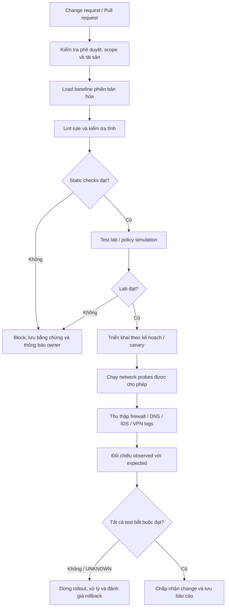

# Tự động hóa network security regression test

## 1. Network security regression test là gì?

Trong môi trường doanh nghiệp, cấu hình mạng thay đổi liên tục: mở thêm một dịch vụ, cập nhật firewall rule, thay tuyến VPN, phân đoạn VLAN, thay chính sách DNS, nâng phiên bản firmware hoặc điều chỉnh hệ thống phát hiện xâm nhập (IDS/IPS). Mỗi thay đổi có thể làm **mất khả năng bảo vệ đã tồn tại** dù chức năng mới vẫn hoạt động.

**Network security regression test** là tập hợp các phép kiểm thử được chạy lại có hệ thống để bảo đảm những thuộc tính bảo mật mạng đã được chấp nhận vẫn đúng sau mỗi thay đổi. “Regression” ở đây có nghĩa là phát hiện hành vi bảo mật **bị suy giảm so với yêu cầu đã thống nhất**, chẳng hạn:

- Máy người dùng truy cập được giao diện quản trị vốn chỉ dành cho VLAN quản trị.
- Rule firewall mới vô tình cho phép kết nối từ vùng khách sang cơ sở dữ liệu nội bộ.
- Sau cập nhật VPN, người dùng thông thường nhận quyền truy cập rộng hơn nhóm được cấp.
- Tên miền độc hại trong danh sách kiểm thử không còn bị chặn bởi bộ lọc DNS.
- IDS/IPS không còn phát cảnh báo cho một mẫu lưu lượng kiểm thử hợp lệ đã được chuẩn bị.
- Thiết bị mạng bật lại giao thức quản trị không được phép sau nâng cấp.

Kiểm thử hồi quy khác với việc quét lỗ hổng định kỳ. Quét lỗ hổng tìm các vấn đề đã biết; kiểm thử hồi quy xác minh **bất biến và kỳ vọng cụ thể** của kiến trúc bảo mật, bao gồm cả đường đi phải hoạt động và đường đi phải bị chặn.

Trong module `SECURITY_NETWORK_SECURITY`, phương pháp này nối các lớp phòng vệ — phân đoạn mạng, firewall, VPN, IDS/IPS, DNS, Wi-Fi, xác thực quản trị và cloud — thành một hệ thống có thể kiểm chứng liên tục.

### Kết quả học tập

Sau bài này, người học có thể:

1. Xây dựng baseline và ma trận luồng truy cập mong đợi làm nguồn dữ liệu kiểm thử.
2. Phân biệt kiểm thử **positive**, **negative**, kiểm tra cấu hình và xác minh telemetry.
3. Tổ chức pipeline kiểm thử tự động trước/sau thay đổi và đặt tiêu chí chặn triển khai.
4. Thiết kế dữ liệu, ví dụ mã và bằng chứng để phát hiện hồi quy mà không nhầm lỗi môi trường với kết quả “bị chặn”.
5. Quản lý phạm vi được phép, tác động vận hành, ngoại lệ, độ ổn định của phép thử và vòng phản hồi.

## 2. Nguồn chuẩn: kiểm thử cái gì là đúng?

Không thể đánh giá hồi quy nếu không có **expected behavior** (hành vi mong đợi) đã được xác nhận trước. Chạy thử ngày hôm nay rồi mặc định mọi kết quả hiện tại là đúng sẽ có nguy cơ biến một lỗi cấu hình thành “baseline hợp lệ”.

### 2.1. Bốn nguồn xây dựng baseline

| Nguồn | Thông tin cần lấy | Ví dụ |
| --- | --- | --- |
| Kiến trúc mạng và phân vùng tin cậy | Vùng người dùng, dịch vụ, DMZ, quản trị, khách, cloud | Guest → Management: từ chối |
| Chính sách và yêu cầu bảo mật | Quyền truy cập, giao thức được phép, phân đoạn, mã hóa | SSH quản trị chỉ đi từ bastion được cấp quyền |
| Thay đổi đã được phê duyệt | Rule, dịch vụ, ngoại lệ, thời hạn, chủ sở hữu | Cho phép App → DB TCP/5432 từ đúng workload |
| Tài sản và cấu hình thực tế | Asset ID, tag, subnet, DNS, account cloud, rule ID | Xác định chính xác app server đang chạy ở đâu |

Baseline cần được **phiên bản hóa** và gắn với ticket, chủ sở hữu cùng thời điểm phê duyệt. Một thay đổi chính sách có chủ ý phải cập nhật kỳ vọng bằng một thay đổi được review; không tự sửa assertion chỉ để pipeline xanh.

### 2.2. Bất biến bảo mật và hành vi được phép

Một test case có thể mô tả thành:

`CASE = (nguồn, đích, giao thức, cổng, danh tính, ngữ cảnh, hành động mong đợi, bằng chứng)`

Ví dụ:

| Bất biến | Kỳ vọng | Loại test |
| --- | --- | --- |
| VLAN Guest không quản trị được switch | Guest → switch TCP/22 bị từ chối | Negative connectivity |
| Bastion quản trị được switch theo chính sách | Bastion → switch TCP/22 được phép | Positive connectivity |
| Frontend gọi được API qua HTTPS | Frontend → API TCP/443 được phép | Positive |
| Frontend không kết nối trực tiếp DB | Frontend → DB TCP/5432 bị từ chối | Negative |
| Máy chủ ứng dụng kết nối DB theo phạm vi | App → DB TCP/5432 được phép | Positive |
| Quản trị HTTPS dùng TLS phù hợp | Giao diện quản trị không chấp nhận cấu hình TLS bị cấm | Configuration/protocol |
| Firewall policy có logging | Sự kiện deny quan trọng được ghi và chuyển về nơi giám sát | Telemetry |

Nếu chỉ thử các đường “được phép”, một firewall bị mở rộng quá mức vẫn có thể vượt qua mọi bài kiểm tra. Nếu chỉ thử các đường “bị chặn”, sự cố khiến toàn mạng không kết nối được có thể bị hiểu lầm là bảo mật tốt. Vì vậy **positive và negative tests cần được ghép cặp**.

## 3. Phân lớp kiểm thử hồi quy

Một bộ test đủ tin cậy thường gồm các lớp từ nhanh đến gần thực tế:

| Lớp | Kiểm tra | Ưu điểm | Giới hạn |
| --- | --- | --- | --- |
| **Static policy lint** | Cú pháp, rule quá rộng, thứ tự ưu tiên, service/port, nguồn/đích, cấu hình hardening | Nhanh, có thể chạy trên pull request | Chưa chứng minh trạng thái triển khai thực tế |
| **Policy simulation / unit test** | So sánh tập rule với ma trận allow/deny trong lab hoặc công cụ mô phỏng | Phát hiện xung đột và thay đổi ý nghĩa rule sớm | Mô hình có thể không bao phủ NAT, route hoặc stateful behavior |
| **Integration test** | Kiểm tra luồng giữa các vùng trong môi trường staging | Xác minh kết hợp routing, ACL, NAT, firewall | Môi trường staging có thể khác production |
| **Runtime connectivity test** | Kết nối thật từ nguồn kiểm thử được duyệt đến đích, theo cổng/giao thức giới hạn | Phản ánh đường đi mạng thực tế | Cần kiểm soát phạm vi và tải |
| **Security control / telemetry test** | Xác minh DNS filtering, IDS/IPS, SIEM, log sự kiện, cảnh báo | Kiểm tra cả kiểm soát phát hiện | Phụ thuộc vào log pipeline và đồng bộ thời gian |
| **Resilience test có kiểm soát** | Dự phòng firewall, đường VPN, failover và khả năng rollback | Phát hiện lỗi khi trạng thái mạng chuyển đổi | Chỉ chạy theo kế hoạch được duyệt, tránh gián đoạn ngoài dự kiến |

**Static lint không chứng minh packet thực sự bị chặn.** Ngược lại, một lần timeout từ probe không chứng minh firewall đã từ chối đúng rule: đích có thể down, DNS lỗi, routing sai hoặc probe ở sai vùng mạng.

Một mạng đa lớp thường cần kết hợp kết quả từ nguồn kiểm thử, phía đích và firewall/IDS logs để khẳng định nguyên nhân.

## 4. Kiến trúc tự động hóa tham khảo



Các khối logic:

- **Test specification repository:** lưu danh sách case, kỳ vọng và phiên bản baseline.
- **Inventory và scope service:** xác định asset ID, nguồn/đích, VLAN/VRF, cloud tenant và quyền kiểm thử hợp lệ.
- **Orchestrator:** sắp thứ tự static → lab → pre/post-deploy, giới hạn song song, đặt thời hạn.
- **Probe runner:** chạy từ đúng vùng mạng với danh tính riêng, chỉ thực hiện phương thức đã được cho phép.
- **Evidence collector:** nhận kết quả probe và telemetry (firewall, VPN, DNS resolver, IDS/IPS, cloud flow logs).
- **Assertion engine:** đối chiếu từng phép thử với yêu cầu; phân biệt PASS, FAIL, ERROR và UNKNOWN.
- **Policy gate:** ngăn triển khai tiếp hoặc chuyển giao xử lý sự cố khi bất biến bắt buộc bị vi phạm.

Không cần triển khai mọi thành phần thành hệ thống riêng. Với mạng nhỏ, file test + runner + nhật ký có thể đủ. Yêu cầu cốt lõi là **tập kỳ vọng có thể review, runner có phạm vi rõ ràng, kết quả có bằng chứng, và quyết định khi test không đạt**.

## 5. Xây ma trận regression test

Nên ghi từng ca dưới dạng dữ liệu thay vì hard-code hành vi riêng trong script. Những trường quan trọng:

| Trường | Vai trò |
| --- | --- |
| `case_id` | Định danh ổn định của ca kiểm thử |
| `requirement_id` | Liên kết tới điều khoản kiến trúc/chính sách |
| `source` | Zone, subnet, asset hoặc identity *thực sự phát sinh lưu lượng* |
| `destination` | Asset ID, service FQDN/IP, zone, cổng và giao thức |
| `expected` | `allowed`, `denied` hoặc dạng yêu cầu telemetry cụ thể |
| `method` | Phương pháp quan sát đã được cho phép: TCP connect, DNS lookup, config read... |
| `environment` | Lab, staging, production; account, VPC/VRF, IPv4/IPv6 |
| `approval_ref` | Tham chiếu RoE, change ticket và thời hạn kiểm thử |
| `evidence` | Nguồn chứng minh kết quả: probe ID, log ID, config snapshot |
| `criticality` | Mức độ ảnh hưởng tới release gate |

### Bộ ca tham khảo cho hệ thống ba vùng

Giả sử tổ chức có vùng `guest`, `app`, `db` và `mgmt`, có bastion dùng để quản trị. Tất cả địa chỉ trong ví dụ chỉ là minh họa bằng dải địa chỉ dành cho tài liệu; thực hiện kiểm thử thực tế phải có phạm vi đã được duyệt.

| ID | Nguồn → Đích | Kỳ vọng | Điều cần xác minh |
| --- | --- | --- | --- |
| NET-001 | Guest → switch MGMT TCP/22 | Deny | Phân đoạn mạng và ACL quản trị |
| NET-002 | Bastion → switch MGMT TCP/22 | Allow | Đường quản trị hợp lệ vẫn hoạt động |
| NET-003 | Guest → DB TCP/5432 | Deny | Không mở đường từ vùng ít tin cậy |
| NET-004 | App → DB TCP/5432 | Allow | Chức năng kết nối ứng dụng hoạt động |
| NET-005 | Frontend → API TCP/443 | Allow | Lưu lượng phục vụ nghiệp vụ |
| NET-006 | Frontend → DB TCP/5432 | Deny | Không cho vượt lớp dịch vụ |
| NET-007 | VPN user thường → MGMT | Deny | Phân quyền VPN không bị mở rộng |
| NET-008 | VPN admin → bastion đúng port | Allow | Luồng quản trị đã cấp quyền |
| NET-009 | DNS client → resolver nội bộ | Allow | Truy vấn DNS qua đường chuẩn |
| NET-010 | DNS client → resolver trái phép | Deny | Kiểm soát DNS egress, tùy chính sách |
| NET-011 | Guest Wi-Fi → internal service | Deny | Isolation giữa SSID khách và mạng nội bộ |
| NET-012 | VM cloud không được cấp → control plane | Deny | Cloud SG/NACL/firewall ở vùng quản trị |
| NET-013 | Thiết bị mạng: Telnet/SNMPv1-v2c | Disabled | Baseline hardening thiết bị |
| NET-014 | Kiểm thử telemetry IDS/IPS đã duyệt | Có sự kiện mong đợi | Detection pipeline không bị mất |

Đây là **ma trận giả định** để giải thích nguyên tắc. Tổ chức có thể dùng cổng DB khác, cổng quản trị khác hoặc chính sách DNS khác; tất cả phải theo kiến trúc thật và được phê duyệt.

### Độ hạt và giới hạn của assertion

Không viết test `allow src-zone -> dst-zone` quá chung nếu chỉ một workload được phép. Phải ràng buộc đủ chặt bằng địa chỉ/danh tính, protocol, port, chiều kết nối và điều kiện IAM/VPN nếu có. Cũng không nên yêu cầu “mọi gói ICMP đều bị chặn” khi thực tế ICMP cần cho Path MTU Discovery.

Với firewall trạng thái, xác minh **kết nối được khởi tạo từ nguồn** và chiều trả lời tương ứng, tránh diễn giải một gói hồi đáp hợp lệ thành kết nối được khởi tạo ngược chiều. Với NAT hoặc load balancer, ghi cả tên dịch vụ và đích được dịch khi cần.

## 6. Biểu diễn ca kiểm thử dưới dạng dữ liệu

Ví dụ sau dùng JSON để minh họa file `expected_flows.json`. Nó không phụ thuộc hãng thiết bị và dùng địa chỉ tài liệu (RFC 5737):

```json
[
  {
    "id": "NET-001",
    "requirement": "SEG-MGMT-01",
    "source": "guest-probe@vrf-guest",
    "destination": "192.0.2.10",
    "protocol": "tcp",
    "port": 22,
    "expected": "denied",
    "environment": "staging",
    "approval_ref": "ROE-LAB-014",
    "critical": true
  },
  {
    "id": "NET-002",
    "requirement": "SEG-MGMT-02",
    "source": "bastion-probe@vrf-mgmt",
    "destination": "192.0.2.10",
    "protocol": "tcp",
    "port": 22,
    "expected": "allowed",
    "environment": "staging",
    "approval_ref": "ROE-LAB-014",
    "critical": true
  },
  {
    "id": "NET-003",
    "requirement": "SEG-DB-01",
    "source": "guest-probe@vrf-guest",
    "destination": "192.0.2.30",
    "protocol": "tcp",
    "port": 5432,
    "expected": "denied",
    "environment": "staging",
    "approval_ref": "ROE-LAB-014",
    "critical": true
  }
]
```

Những giá trị trên **chưa phải lệnh tạo lưu lượng**. Một adapter cụ thể của probe runner sẽ nhận các case đủ điều kiện, xác thực nguồn/đích, so scope và RoE, rồi quan sát kết nối. Trong môi trường mạng thực, việc chạy test cần giới hạn phương thức và tác động, đặc biệt với firewall/IDS/IPS/VPN production.

Sau khi runner hoàn thành, giả sử xuất file `observed_flows.json`:

```json
[
  {
    "id": "NET-001",
    "result": "denied",
    "evidence_id": "probe-001+fwlog-101"
  },
  {
    "id": "NET-002",
    "result": "allowed",
    "evidence_id": "probe-002+serverlog-102"
  },
  {
    "id": "NET-003",
    "result": "unknown",
    "evidence_id": "probe-003-timeout"
  }
]
```

Ở ví dụ này, NET-003 **không được xem là PASS** dù connection timeout. Chưa có đủ thông tin xác nhận chính sách đã chặn; có thể do lỗi kết nối, DNS hoặc đích không hoạt động. Runner cần giải thích vì sao kết luận `denied`, chẳng hạn có bằng chứng rule deny trên thiết bị và kiểm thử control cùng tuyến đang thành công.

## 7. Ví dụ tự động kiểm tra kết quả bằng Python

Đoạn mã dưới đây sử dụng thư viện chuẩn Python và **chỉ đọc hai file JSON**. Nó không gửi gói tin hoặc tự quét mạng. Mục đích là minh họa một assertion engine dễ tái sử dụng trong CI.

```python
import json
import sys
from pathlib import Path

EXPECTED_FILE = Path("expected_flows.json")
OBSERVED_FILE = Path("observed_flows.json")
VALID_EXPECTED = {"allowed", "denied"}
VALID_RESULTS = {"allowed", "denied", "unknown", "error"}

expected_cases = json.loads(EXPECTED_FILE.read_text(encoding="utf-8"))
observations = json.loads(OBSERVED_FILE.read_text(encoding="utf-8"))

errors = []
expected_by_id = {}
observed_by_id = {}

for item in expected_cases:
    case_id = item["id"]
    if case_id in expected_by_id:
        errors.append(f"Duplicate expected case: {case_id}")
    expected_by_id[case_id] = item
    if item.get("expected") not in VALID_EXPECTED:
        errors.append(f"{case_id}: invalid expected verdict")

for item in observations:
    case_id = item["id"]
    if case_id in observed_by_id:
        errors.append(f"Duplicate observation: {case_id}")
    observed_by_id[case_id] = item

for case_id, spec in expected_by_id.items():
    observed = observed_by_id.get(case_id)
    if observed is None:
        errors.append(f"{case_id}: MISSING result")
        continue
    if observed.get("result") not in VALID_RESULTS:
        errors.append(f"{case_id}: invalid result value")
        continue
    if not observed.get("evidence_id"):
        errors.append(f"{case_id}: MISSING evidence")
        continue
    if observed["result"] in {"unknown", "error"}:
        errors.append(f"{case_id}: INCONCLUSIVE / ERROR")
        continue
    if observed["result"] != spec["expected"]:
        errors.append(
            f"{case_id}: FAIL expected={spec['expected']} "
            f"observed={observed['result']}"
        )
        continue
    print(f"{case_id}: PASS ({observed['result']})")

for case_id in sorted(observed_by_id.keys() - expected_by_id.keys()):
    errors.append(f"{case_id}: UNRECOGNIZED observation")

if errors:
    for error in errors:
        print(error, file=sys.stderr)
    sys.exit(1)

print(f"PASS: {len(expected_by_id)} cases")
```

Trong dữ liệu mẫu, script trả exit code **1** do NET-003 có kết quả `unknown`. CI có thể dùng exit code để đánh dấu gate thất bại. Để mở rộng thành sản phẩm thực tế, cần thêm validation schema, kiểm tra thời gian phê duyệt, quyền sở hữu target, tính xác thực của evidence, kiểm tra nguồn runner, kiểm tra log correlation, chống sửa dữ liệu kết quả và xác minh không dùng evidence cũ.

Mã này **chỉ đánh giá dữ liệu đầu vào được tin cậy**: nếu người ghi file báo `denied` sai sự thật, script không thể phát hiện điều đó. Việc xác định verdict từ probe và log là trách nhiệm riêng của evidence collector cùng các phép đối soát độc lập.

## 8. Làm sao xác minh kết quả allow/deny đáng tin cậy?

Một phép thử không chỉ có hai kết quả “kết nối được” hoặc “không kết nối được”:

| Quan sát | Ý nghĩa tiềm năng | Cách xử lý |
| --- | --- | --- |
| TCP handshake thành công với đúng endpoint | Đường kết nối có thể truy cập | Đối chiếu danh tính/dịch vụ và rule liên quan; nếu expected deny thì FAIL |
| Có bằng chứng firewall explicit deny cho flow đúng tuple và test khác trên cùng đường hoạt động | Kết nối bị chặn theo policy | Có thể kết luận DENIED nếu đủ điều kiện tin cậy |
| Timeout, không có log deny | Có thể do drop, routing, probe, target hoặc telemetry lỗi | UNKNOWN; không đánh dấu PASS cho deny |
| Connection refused | Đã tới host nhưng service không lắng nghe hoặc bị reset | Không đủ để kết luận firewall deny |
| DNS lookup thất bại | Có thể DNS lỗi hoặc domain bị lọc | Cần đối chiếu log resolver và mẫu kiểm soát |
| HTTP 403 | Ứng dụng từ chối yêu cầu ở tầng ứng dụng | Không chứng minh firewall/network segment đã chặn |
| Probe runner không khởi động | Vấn đề hạ tầng kiểm thử | ERROR; không coi là DENIED |
| Không có IDS event dù probe đã chạy | Kiểm soát phát hiện có thể lỗi, hoặc sự kiện bị mất/đến muộn | Đối chiếu probe marker, log pipeline, policy và cửa sổ chờ |

### Quy tắc đánh giá kết quả

- **PASS:** observed khớp expected, bằng chứng đủ tin cậy, các điều kiện scope và thời gian hợp lệ.
- **FAIL:** observed đáng tin cậy nhưng vi phạm bất biến; ví dụ một luồng phải bị chặn lại kết nối thành công.
- **ERROR:** hệ thống kiểm thử không thực hiện được phép đo có ý nghĩa.
- **UNKNOWN / INCONCLUSIVE:** có đo nhưng chưa thể khẳng định allow/deny theo yêu cầu.
- **SKIPPED:** test không được chạy theo quyết định có ghi nhận (ví dụ mục tiêu chưa được duyệt hoặc môi trường không phù hợp).

Với các ca kiểm thử quan trọng, gate cần xử lý `FAIL`, `ERROR`, `UNKNOWN` và `SKIPPED` theo chính sách rõ ràng; thường **không tự động cho qua** khi không có bằng chứng đạt yêu cầu. Một ngoại lệ có thời hạn phải được duyệt, có owner, giải thích rủi ro và ngày hết hạn; không được sửa ngầm kỳ vọng để che lỗi.

## 9. Quy trình đưa regression test vào CI/CD

### 9.1. Trước thay đổi: kiểm tra từ pull request

Khi có đề xuất sửa firewall policy, IaC, ACL, network security group hoặc cấu hình VPN:

1. Xác định file/chính sách thay đổi và những vùng mạng, dịch vụ liên quan.
2. Kiểm tra cấu hình bằng linter, schema validator và rule kiểm soát bất biến.
3. Tính diff quyền truy cập: thêm đường nào, bỏ đường nào, thay đổi logging hay hành động mặc định nào.
4. Chạy policy simulation hoặc test trong lab với các ca liên quan.
5. Yêu cầu review của chủ sở hữu chính sách và người vận hành trước khi triển khai.

Ví dụ, khi PR thêm rule cho App → DB, test nên đồng thời xác minh Guest → DB và Frontend → DB vẫn bị chặn, thay vì chỉ kiểm tra App → DB được phép.

### 9.2. Trong triển khai: chạy canary có kiểm soát

Đối với thiết bị hoặc cloud policy cho phép triển khai theo nhóm, chọn phạm vi nhỏ trước. Sau khi triển khai canary, chạy nhóm test bắt buộc từ các nguồn đã chuẩn bị, đối chiếu log và giám sát tác động. Nếu thất bại, dừng rollout, xác định nguyên nhân và đánh giá rollback theo runbook.

Trong mạng production, tránh các bài kiểm tra xâm nhập sâu hoặc gây tải ngoài RoE. Chỉ dùng probe giới hạn, danh sách đích được phê duyệt và cửa sổ thời gian hợp lệ. Không chạy test ảnh hưởng khả năng sẵn sàng chỉ vì pipeline được kích hoạt tự động.

### 9.3. Sau triển khai và định kỳ

Chạy regression suite sau thay đổi có thể tác động bảo mật, sau nâng cấp firmware hoặc thay đổi routing, IAM/VPN, DNS, nhóm cloud, đồng thời kiểm tra định kỳ theo lịch vận hành đã thống nhất. Các test định kỳ giúp phát hiện **configuration drift** hoặc thay đổi ngoài quy trình.

Một pipeline mô tả bằng YAML giả lập:

```yaml
pipeline:
  preflight:
    - verify_approved_scope
    - verify_change_window
    - verify_inventory_and_dns_snapshot
    - validate_test_schema
  pre_deploy:
    - lint_network_policy
    - compare_policy_diff
    - run_lab_regression
  deploy:
    - apply_approved_canary
  post_deploy:
    - run_authorized_connectivity_probes
    - collect_firewall_and_ids_evidence
    - compare_expected_vs_observed
    - enforce_release_gate
  on_failure:
    - stop_rollout
    - notify_change_owner
    - evaluate_approved_rollback
  archive:
    - store_report_and_evidence
```

Đây là **pseudocode quy trình**. Mỗi hành động phải được ánh xạ thành job cụ thể, có secrets quản lý riêng, quyền tối thiểu, kiểm tra phê duyệt và các biện pháp hạn chế tác động.

## 10. Các nhóm kiểm thử theo lớp bảo vệ mạng

### 10.1. Network segmentation, firewall và ACL

Kiểm tra cả chiều được phép lẫn bị chặn giữa các zone; dùng bộ mẫu TCP/UDP/ICMP phù hợp chính sách, lưu ý stateful firewall, NAT, IPv6 và rule order. Đối chiếu effective rule sau triển khai, không chỉ mã cấu hình đầu vào. Khi có thay đổi định tuyến hoặc SD-WAN, cần thử từ những điểm quan sát thể hiện đúng đường đi thực tế.

### 10.2. VPN và zero-trust access

Kiểm tra việc nhóm người dùng/thiết bị nhận đúng tài nguyên sau xác thực; xác minh người dùng bị thu hồi quyền không truy cập được tài nguyên không còn được cấp. Kết quả phụ thuộc token, phiên đang mở và cache, vì vậy kiểm thử phải ghi tình trạng phiên và thời điểm thu hồi. Có thể kết hợp kiểm tra cấu hình MFA, certificate và chính sách split tunnel ở mức được cho phép.

### 10.3. IDS/IPS và logging

Sử dụng các marker/lưu lượng thử nghiệm an toàn được nhóm giám sát và chủ sở hữu cho phép để kiểm tra tạo sự kiện, mức ưu tiên, rule ID, nguồn/đích, timestamp và thời gian gửi đến SIEM. Tách yêu cầu **detect** với **block**: IDS có thể chỉ ghi sự kiện, còn IPS có thể thực thi chặn tùy chế độ. Một cảnh báo giả hoặc log không ghép được với test run không đủ chứng minh kết quả.

### 10.4. DNS security

Kiểm tra đường truy vấn tới resolver cho phép, chặn resolver trái phép nếu chính sách yêu cầu, bộ lọc DNS trên các miền kiểm thử do tổ chức kiểm soát và tính sẵn sàng của DNS hợp lệ. Khi so kết quả, lưu cả DNS response, resolver thực dùng, cache/TTL và log chính sách. Tránh dùng tên miền độc hại thực hoặc đích không được phép làm test fixture.

### 10.5. Wi-Fi, thiết bị mạng và hardening

Kiểm tra phân tách SSID khách/nội bộ, chính sách truy cập mạng, bảo vệ management plane và việc tắt dịch vụ Telnet, HTTP quản trị không mã hóa, SNMP phiên bản yếu theo yêu cầu. Những kiểm tra cấu hình có thể chạy qua API hoặc read-only command bằng tài khoản ít quyền, giảm nhu cầu quét chủ động trên thiết bị nhạy cảm.

### 10.6. Cloud, container và hybrid network

Kiểm tra security group, network ACL, cloud firewall, private endpoint, ingress/egress, chính sách Kubernetes NetworkPolicy và đường kết nối on-prem ↔ cloud. Cần quan sát **effective permissions**, vì nhiều lớp policy kết hợp khác nhau giữa sản phẩm. Tài sản động phải được gắn với resource ID, account/project, tags và version inventory; không tái sử dụng máy/IP cũ làm bằng chứng cho tài sản mới.

## 11. Thiết kế môi trường chạy test

### 11.1. Đúng nguồn, đúng đích, đúng điều kiện

Firewall và segmentation quyết định dựa trên các thuộc tính như source/destination, giao thức, cổng, interface, zone, identity hoặc device posture. Vì vậy runner phải ở **đúng vùng nguồn** và có đúng danh tính. Một probe chạy từ laptop trong mạng quản trị không đại diện cho user tại VLAN Guest.

Với cùng một case, cần ghi:

- Runner ID, source IP, VLAN/VRF/SSID hoặc VPC/namespace, identity và mức quyền.
- Destination resource ID, IP/FQDN đã phân giải, port, protocol, hostname/SNI khi liên quan.
- Policy version, deployment ID, ticket, cửa sổ thời gian, timezone và đồng hồ đồng bộ.
- Kết quả trực tiếp, log correlation ID, quyết định kiểm thử và nguyên nhân không xác định.

### 11.2. Khả năng lặp lại và tính độc lập

Giữ dữ liệu thử nghiệm nhất quán, service đích kiểm soát được, thời gian chờ hợp lý và runner không có quyền truy cập đặc biệt làm sai lệch phép thử. Nếu một test phụ thuộc DNS hay hệ thống IAM, kiểm tra trạng thái phụ thuộc trước khi đánh giá. Tính độc lập giữa ca test hạn chế việc ca trước thay đổi cấu hình hoặc phiên ảnh hưởng ca sau.

**Không dùng bản thân sự cố hệ thống làm bằng chứng thành công cho negative test.** Tạo cặp positive control từ cùng vùng nguồn tới một dịch vụ dự kiến hoạt động để nhận biết sự cố kết nối rộng hơn.

### 11.3. Giảm nhiễu và kiểm soát tải

Giới hạn số kết nối song song, tốc độ, timeout và tổng thời lượng; không quét toàn bộ mạng nếu mục tiêu chỉ là một thay đổi nhỏ. Test tác động thấp có thể chạy thường xuyên; test failover, stress hoặc mô phỏng sự cố phải có lịch và phê duyệt riêng. Khi có suy giảm dịch vụ, runner phải có điều kiện dừng rõ ràng.

## 12. Xử lý test không ổn định (flaky tests)

Một test lúc PASS, lúc FAIL có thể gây mất niềm tin vào pipeline. Cần điều tra trước khi quyết định tăng retry:

| Triệu chứng | Khả năng nguyên nhân | Cách kiểm tra |
| --- | --- | --- |
| Timeout thay đổi theo lần chạy | Tải đích, runner, tuyến, packet loss | So probe và service health, kiểm tra cùng đường khác |
| DNS lúc ra IP này lúc IP khác | Load balancing, TTL, split-horizon | Lưu response và so với inventory/scope mỗi lần |
| IDS event đến chậm | Queue, pipeline log, SIEM ingestion | Theo dõi test marker và delay có giới hạn |
| Mất quyền sau vài phút | Token, session timeout, IAM propagation | Ghi thời điểm và identity của phiên |
| Kiểm tra fail chỉ khi chạy song song | Rate limit, tài nguyên runner, state table | Giảm concurrency và cô lập mẫu thử |
| Lúc chặn, lúc cho phép giữa các nút | Policy drift hoặc deployment chưa đồng bộ | Ghi policy version trên từng điểm thực thi |

Retry có thể phù hợp với lỗi hạ tầng tạm thời đã được phân loại nhưng **không được che một lần kết nối thành công trái phép**. Với negative test, chỉ một bằng chứng đáng tin cậy cho thấy đường bị cấm đã mở cũng cần được điều tra; không lấy đa số những lần timeout để cho PASS.

## 13. Đánh giá mức độ ưu tiên và quyết định release gate

Một mô hình tham khảo:

| Nhóm test | Ví dụ | Phản ứng khi FAIL/UNKNOWN |
| --- | --- | --- |
| **Critical security invariant** | Guest vào mạng quản trị; public vào DB | Chặn rollout, điều tra ngay; chỉ ngoại lệ theo quy trình có thẩm quyền |
| **Critical availability** | Bastion không quản trị được thiết bị; App không kết nối DB | Chặn triển khai hoặc rollback theo runbook |
| **Detection / observability** | Thiếu log deny, mất sự kiện IDS | Chặn hoặc đánh giá có kiểm soát tùy chính sách dịch vụ |
| **Advisory drift** | Khác biệt nhãn hoặc trường không tác động bảo mật tức thời | Ghi nhận, giao owner và thời hạn khắc phục |

Không được mặc định advisory cho bất kỳ test thất bại nào chỉ vì nó thường xuyên flaky. Mức quan trọng phải do chủ sở hữu kiểm soát xác nhận trước. Một waiver phải liên kết tới case ID, phiên bản policy, tài sản, nguyên nhân, biện pháp giảm thiểu, người duyệt và thời hạn. Hết hạn waiver phải khiến gate kiểm tra lại thay vì âm thầm chấp nhận.

### Hướng xử lý khi thất bại

1. **Cô lập vấn đề:** xác định FAIL về phân quyền, đường đi, dịch vụ, telemetry hay lỗi runner.
2. **Ngăn lan rộng:** dừng rollout, giữ bản snapshot cấu hình và quy trình rollback sẵn có.
3. **Phân tích diff:** so baseline, policy deploy thực tế và đường truyền của case thất bại.
4. **Khắc phục:** chỉnh rule, khôi phục cấu hình hoặc xử lý sự cố hạ tầng đã phát hiện.
5. **Chạy lại các ca liên quan:** xác minh cả luồng gây lỗi lẫn luồng chức năng, kiểm tra tác dụng phụ.
6. **Lưu bằng chứng:** nêu rõ nguyên nhân gốc, kết quả và hành động theo dõi.

## 14. Báo cáo và chỉ số chất lượng

Báo cáo một lần chạy nên đủ để người không trực tiếp viết test vẫn đánh giá được:

| Trường báo cáo | Giá trị cần lưu |
| --- | --- |
| Run ID và revision | Bộ test, commit, bản policy và deployment |
| Scope / approval | Ticket, chủ sở hữu, vùng mạng, thời gian, source/destination |
| Coverage | Số yêu cầu chính sách được map, số ca critical đã chạy |
| Kết quả | PASS, FAIL, ERROR, UNKNOWN, SKIPPED tách biệt |
| Evidence | Probe log, log policy, telemetry, timestamps/correlation ID |
| Gate decision | Cho phép, chặn, chờ xác minh hoặc waiver được duyệt |
| Follow-up | Owner, ticket khắc phục, rollback, thời hạn |

Các chỉ số nên theo dõi gồm tỷ lệ coverage các bất biến critical, tỷ lệ regression được phát hiện trước production, thời gian phát hiện từ lúc thay đổi, tỷ lệ UNKNOWN/ERROR, tỷ lệ flaky, thời gian xử lý và số ngoại lệ hết hạn. **Tỷ lệ PASS cao không đồng nghĩa mức bảo vệ cao** nếu phần lớn yêu cầu chưa có test hoặc evidence kém chất lượng.

Ví dụ thông báo kết quả:

```text
RUN: NETREG-2026-11-28-014
POLICY_REV: change-481
SCOPE: ROE-LAB-014
CASES: 14
PASS: 11
FAIL: 1       (NET-001: đường guest -> mgmt được phép trái chính sách)
UNKNOWN: 1    (NET-003: timeout nhưng không có bằng chứng deny)
ERROR: 1      (NET-014: collector IDS không phản hồi)
GATE: BLOCKED
ACTION: Stop rollout; điều tra NET-001, NET-003, NET-014
```

Số liệu trong báo cáo là ví dụ giả định và cho thấy lý do pipeline phải thể hiện rõ những kết quả chưa xác định.

## 15. Những sai lầm phổ biến

| Sai lầm | Rủi ro | Cải thiện |
| --- | --- | --- |
| Chỉ thử kết nối được phép | Không phát hiện rule quá rộng | Kết hợp allow/deny và kiểm thử vượt phân đoạn |
| Coi mọi timeout là “blocked” | Test xanh khi đích hỏng hoặc route sai | Có positive control và log đối chiếu |
| Thay expected theo kết quả vừa quan sát | Hợp thức hóa lỗi regression | Review baseline độc lập, liên kết yêu cầu/chủ sở hữu |
| Chỉ đọc cấu hình, không kiểm tra hành vi | Bỏ sót policy effective, NAT, routing, state | Kết hợp static, integration và runtime |
| Runner ở sai zone hoặc sai identity | Kết quả không đại diện cho người dùng thật | Có runner đại diện từng trust boundary |
| Dùng dữ liệu IP/DNS cũ | Quét sai tài sản và so sánh sai scope | Kiểm tra inventory/approval ngay trước khi chạy |
| Ignore IPv6 hoặc đường cloud | Để hở kênh song song không kiểm thử | Ghi coverage theo stack, môi trường và đường đi |
| Bỏ qua log/detection | Không nhận ra IDS/IPS hoặc SIEM ngừng hoạt động | Kiểm thử telemetry và correlation |
| Chạy tự động quá rộng trên production | Gây tải, gián đoạn hoặc vượt RoE | Chia lớp test và giới hạn mức tác động |
| Chấp nhận UNKNOWN như PASS | Mất hiệu lực release gate | Fail closed cho test quan trọng, quản lý waiver |

## 16. Bài thực hành thiết kế

**Bối cảnh:** sau một yêu cầu thay đổi, nhóm mạng muốn cho phép một ứng dụng nội bộ mới kết nối tới DB trên TCP/5432. Firewall nằm giữa các vùng `app`, `db` và `guest`; một bastion quản trị firewall. Nhóm chỉ được kiểm thử trong staging với phạm vi đã duyệt.

**Nhiệm vụ:**

1. Viết một ca positive test cho `app → db:5432` và hai ca negative test cho `guest → db:5432`, `frontend → db:5432`.
2. Thêm một ca xác minh đường `bastion → firewall management` vẫn hợp lệ, và một ca bảo đảm `guest → firewall management` bị chặn.
3. Định nghĩa nguồn runner/VRF, danh tính, tài sản cụ thể, phương thức kiểm thử, bằng chứng và thời hạn hợp lệ.
4. Giả sử negative test có timeout nhưng không thấy firewall log: xác định trạng thái và cách thu thập bằng chứng bổ sung.
5. Nêu điều kiện cho phép rollout sang production, cách xử lý nếu kết quả critical FAIL và khi nào cần rollback.

**Định hướng đánh giá:** bộ test tốt bao phủ cả yêu cầu chức năng và bất biến bảo mật; negative test không được PASS chỉ vì timeout; phạm vi và quyền phải rõ ràng; việc phát hiện truy cập trái phép phải chặn rollout đến khi được xử lý.

## 17. Checklist vận hành trước khi bật tự động hóa

- [ ] Baseline là kết quả của yêu cầu/chính sách đã duyệt và được version hóa.
- [ ] Từng critical invariant có test case, nguồn/đích và điều kiện cụ thể.
- [ ] Có cặp positive/negative ở các trust boundary quan trọng.
- [ ] Mỗi phép thử có scope và RoE hợp lệ, runner đúng zone và identity.
- [ ] Static checks và simulation chạy trước probe có tác động mạng.
- [ ] Kết quả deny không được suy ra chỉ từ timeout, thiếu DNS hay lỗi runner.
- [ ] Log và evidence có timestamp, test ID, policy revision và correlation ID.
- [ ] Pipeline phân biệt PASS / FAIL / ERROR / UNKNOWN / SKIPPED.
- [ ] Release gate chặn các trường hợp vi phạm bất biến quan trọng.
- [ ] Có chính sách waiver và cơ chế hết hạn rõ ràng.
- [ ] Tải kiểm thử, parallelism, thời gian và điều kiện dừng được kiểm soát.
- [ ] Sau khắc phục hoặc rollback, chạy lại các ca liên quan và lưu báo cáo.

## 18. Câu hỏi tự kiểm tra

**Câu 1.** Vì sao một bộ test chỉ kiểm tra các dịch vụ hoạt động bình thường không đủ đánh giá hồi quy bảo mật?

*Gợi ý:* Vì rule bị mở rộng quá mức vẫn cho luồng hợp lệ đi qua. Cần kiểm thử đường **phải bị từ chối** để xác nhận phân đoạn và đặc quyền.

**Câu 2.** Một probe TCP timeout tới DB, trong khi service DB đang down. Có thể đánh dấu negative test PASS không?

*Gợi ý:* Không. Timeout không chứng minh firewall deny. Kết quả UNKNOWN/ERROR tùy tình huống, cần đối chiếu trạng thái đích, policy và telemetry.

**Câu 3.** Một PR cố ý mở đường App → DB. Baseline cũ yêu cầu deny; có nên tự sửa expected thành allow sau khi pipeline fail?

*Gợi ý:* Cần phê duyệt chính sách mới, review quyền và phạm vi, cập nhật baseline có kiểm soát. Vẫn phải xác minh các đường Guest/Frontend → DB giữ nguyên deny.

**Câu 4.** Vì sao cần chạy test từ Guest VLAN thay vì máy quản trị có thể truy cập nhiều vùng?

*Gợi ý:* Firewall phụ thuộc nguồn, zone và danh tính; test từ máy quản trị không phản ánh quyền của guest.

**Câu 5.** Một test IDS không có sự kiện, nhưng probe runner đã phát traffic thử nghiệm hợp lệ. Nêu ít nhất ba nguyên nhân có thể xảy ra.

*Gợi ý:* Rule detection thay đổi; IDS ở sai đường đi hoặc không nhận gói; pipeline log lỗi/đến muộn; marker chưa khớp; đồng hồ hoặc correlation ID sai.

## Kết luận

Tự động hóa network security regression test biến những yêu cầu bảo mật mạng thành **bộ bất biến có thể chạy lại và chứng minh bằng dữ liệu**. Thành công phụ thuộc vào baseline được phê duyệt, ma trận allow/deny đủ chi tiết, runner ở đúng vị trí, bằng chứng phân biệt rõ kết quả quan sát với lỗi môi trường, cùng release gate xử lý nghiêm những vi phạm quan trọng. Khi được tích hợp vào quy trình thay đổi mạng, kiểm thử hồi quy giúp phát hiện sớm cấu hình mở quyền sai, mất phân đoạn hoặc suy giảm giám sát trước khi chúng trở thành sự cố vận hành.
