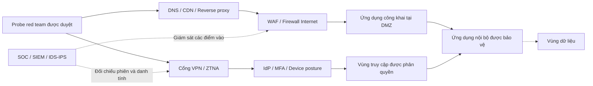
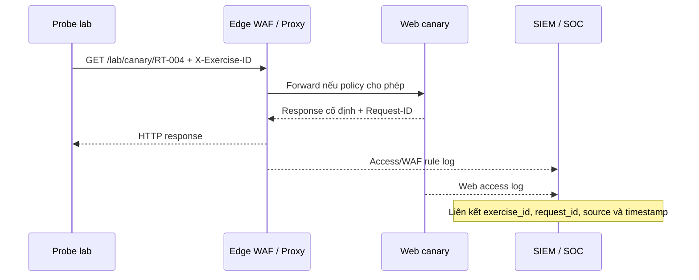
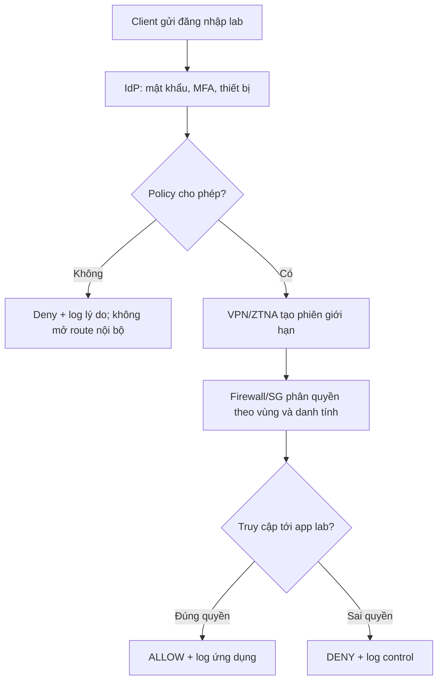

# Mô phỏng initial access qua network

## 1. Initial access là gì và vì sao phải mô phỏng?

**Initial access** (truy cập ban đầu) là giai đoạn đối tượng tấn công tạo được một điểm truy cập đầu tiên vào môi trường mục tiêu, chẳng hạn qua ứng dụng công khai, dịch vụ truy cập từ xa hoặc quan hệ kết nối với bên thứ ba. Trong MITRE ATT&CK, đây là chiến thuật **TA0001 – Initial Access**. Điểm truy cập đầu tiên có thể là phiên đăng nhập, quyền truy cập vào một dịch vụ nội bộ hoặc một vị trí thực thi trong môi trường đích. Nó không mặc nhiên cho phép di chuyển ngang, chiếm quyền quản trị hay lấy được dữ liệu.

Trong module **SECURITY_NETWORK_SECURITY**, bài học này gắn việc mô phỏng initial access với các lớp phòng vệ mạng: phân đoạn và firewall quyết định đường vào; VPN và xác thực quyết định ai được truy cập từ xa; WAF, IDS/IPS và giám sát lưu lượng cung cấp tín hiệu phát hiện; DNS, hệ thống không dây và hạ tầng đám mây mở thêm các bề mặt phơi lộ cần kiểm soát. Mục tiêu không chỉ là “đường mạng có mở không”, mà là xác định **đường vào thực tế, điều kiện bảo vệ, dấu vết giám sát và phản ứng phòng thủ**.

Bài học hướng dẫn mô phỏng trong **lab được phép hoặc bài diễn tập red team có quy tắc triển khai rõ ràng**, dùng dịch vụ canary và tài khoản thử nghiệm để kiểm tra các giả thuyết an ninh. Các ví dụ tránh việc khai thác lỗ hổng thật, đoán mật khẩu hàng loạt hay kiểm soát hệ thống không được giao.

Sau khi học, người học có thể:

1. Mô tả chuỗi initial access dựa trên đường đi network và các ranh giới tin cậy.
2. Xây dựng giả thuyết mô phỏng từ dịch vụ công khai, VPN và điểm kết nối cloud/bên thứ ba.
3. Thiết kế phép thử an toàn có tiêu chí thành công, điểm dừng và bằng chứng kiểm chứng được.
4. Phân biệt **reachability**, **authenticated access**, **unauthorized access** và **foothold**.
5. Đối chiếu firewall, WAF, DNS, VPN, IdP, IDS/IPS, endpoint và SIEM để đánh giá phát hiện/phản ứng.
6. Viết báo cáo phát hiện kèm tác động, giới hạn bằng chứng và cách kiểm thử lại.

## 2. Phân biệt các mức độ tiếp cận

Nhiều bài diễn tập báo cáo “đã initial access” chỉ vì một cổng TCP trả lời. Cách ghi đó dễ làm sai đánh giá rủi ro.

| Mức | Quan sát | Có thể kết luận | Chưa thể kết luận |
| --- | --- | --- | --- |
| **1. Exposure** | DNS hoặc cấu hình cho thấy tên miền/IP công khai | Có một bề mặt công bố cần xem xét | Dịch vụ thực tế có thể truy cập và đang có lỗ hổng |
| **2. Reachability** | Bắt tay TCP/TLS hoặc yêu cầu HTTP tới dịch vụ đích có phản hồi | Đường đi đã tới được dịch vụ/tầng tương ứng | Đã vượt xác thực hay chiếm quyền |
| **3. Authorized access** | Tài khoản kiểm thử hợp lệ đăng nhập đúng quyền | Luồng đăng nhập hoạt động theo chính sách đã cấp | Tồn tại truy cập trái phép |
| **4. Policy bypass / unauthorized access** | Trong lab, một phiên có quyền vượt quá chính sách dự kiến và có bằng chứng độc lập | Có khoảng trống kiểm soát trong điều kiện thử | Tự động có toàn quyền hệ thống hoặc dữ liệu thật |
| **5. Controlled foothold** | Môi trường giả lập cố ý tạo phiên/vị trí bám trụ được giới hạn theo kịch bản | Các tuyến phát hiện và ứng phó đối với “đã có foothold” có thể được kiểm tra | Foothold này được tạo do một lỗ hổng thật ngoài môi trường thử |

Đặc biệt, **HTTP 200**, **port 443 open**, **VPN gateway reachable** hoặc **WAF cho qua một yêu cầu vô hại** chỉ là bằng chứng ở mức kết nối/ứng dụng. Để chứng minh *initial access không được phép*, bài diễn tập phải chỉ ra một quyền truy cập ngoài chính sách bằng bằng chứng thực tế, trong phạm vi được cấp phép. Nếu dùng **giả định đã có foothold** để kiểm tra giám sát, phải báo cáo rõ đây là điều kiện dựng sẵn.

## 3. Mô hình tấn công ban đầu qua các đường network

Một hệ thống có thể có nhiều lối vào. Điều quan trọng là vẽ được luồng traffic và điểm thực thi kiểm soát thay vì chỉ liệt kê các lỗ hổng.



Sơ đồ cho thấy các tuyến khả dĩ, **không** có nghĩa một probe từ Internet phải truy cập được APP hay DB. Policy phân đoạn có thể cấm các bước tiếp theo; đây là phần cần được xác minh.

### 3.1 Các đường vào thường gặp

| Tuyến | Kịch bản giả định | Điểm phòng thủ | Mô phỏng được phép |
| --- | --- | --- | --- |
| Ứng dụng public-facing | Lỗi cấu hình hoặc lỗ hổng ở web/API tiếp nhận truy cập Internet | WAF, quản lý bản vá, API gateway, reverse proxy, host controls | Gửi yêu cầu canary tới endpoint lab; xác minh telemetry và phản ứng |
| Remote service | VPN, VDI, RDP gateway hoặc SSH bastion bị cấu hình quá rộng | MFA, IdP, chính sách thiết bị, giới hạn nguồn, phân quyền | Kiểm tra đăng nhập bằng tài khoản thử và điều kiện posture được duyệt |
| Valid accounts | Một danh tính có quyền nhiều hơn yêu cầu | IdP, RBAC, conditional access, PAM | So sánh quyền của hai tài khoản giả lập theo ma trận cho phép/từ chối |
| Trusted relationship | Kết nối nhà cung cấp hoặc đối tác có đường vào riêng | VPN/peering, phân đoạn, thời hạn quyền, log nhà cung cấp | Dùng mô hình sandbox để kiểm thử phạm vi quyền của vai trò đối tác |
| Cloud public endpoint | Load balancer, API, dịch vụ hoặc cổng quản trị cloud phơi lộ | SG/NACL, cloud firewall, identity policy, private endpoint | Đối chiếu cấu hình và kiểm thử endpoint lab với lưu lượng ít |
| Wi-Fi/network edge | Người dùng thuộc mạng khách hoặc VLAN sai có thể nhìn thấy dịch vụ nội bộ | NAC/802.1X, guest isolation, firewall, DNS segmentation | Thử luồng ALLOW/DENY từ thiết bị kiểm thử thuộc đúng SSID/VLAN |

Các ví dụ MITRE ATT&CK có liên quan gồm **T1190 – Exploit Public-Facing Application**, **T1133 – External Remote Services**, **T1078 – Valid Accounts** và **T1199 – Trusted Relationship**. Đây là nhãn để mô tả giả thuyết và liên kết với tình báo phòng thủ; cùng một tình huống có thể cần nhiều nhãn, và nhãn không thay thế bằng chứng hành vi.

### 3.2 Những phụ thuộc làm đường vào khác sơ đồ

- **DNS và CDN:** FQDN có thể trỏ tới CDN/WAF, trong khi origin có IP khác. Phải kiểm tra luồng từ ngoài tới địa chỉ được công bố và từ proxy tới origin, trong phạm vi được duyệt.
- **IPv4 và IPv6:** chính sách firewall IPv4 không bao phủ IPv6; hostname dual-stack có thể khiến probe chọn đường khác.
- **NAT và load balancer:** IP/port quan sát bởi server có thể là địa chỉ đã dịch. Cần ghép request ID, session và thông tin NAT.
- **VPN/ZTNA:** chính sách phân nhóm, MFA và tình trạng thiết bị có thể dẫn một người dùng tới các phân đoạn khác nhau.
- **Cloud và hybrid:** peering, transit gateway, private endpoint và site-to-site VPN tạo đường network ngoài perimeter truyền thống.
- **Firewall host/EDR:** tầng mạng cho phép kết nối không đồng nghĩa ứng dụng hay endpoint sẽ cho thực thi hành động.

## 4. Quy tắc triển khai bài diễn tập (Rules of Engagement)

Red team là hoạt động có **phạm vi và mục tiêu kiểm chứng cụ thể**. Trước khi tạo traffic, thống nhất các điều kiện sau:

| Nhóm | Nội dung phải có |
| --- | --- |
| Chủ đích | Giả thuyết rủi ro và biện pháp phòng thủ được kiểm tra |
| Tài sản | Danh sách hostname/IP, subnet, tài khoản lab, zone và các endpoint được phép |
| Phương thức | Những loại request/đăng nhập/canary được duyệt và các hành vi không được thực hiện |
| Khung giờ | Thời gian UTC bắt đầu, kết thúc, người vận hành và đầu mối SOC/on-call |
| Giới hạn | Tần suất thấp, timeout ngắn, giới hạn băng thông, không tạo tải vào production |
| Dữ liệu | Chỉ dùng dữ liệu giả lập; không thu mật khẩu thật, token người dùng hay dữ liệu khách hàng |
| Dừng khẩn cấp | Dừng khi thấy bất thường tài nguyên, phản ứng ngoài dự kiến hoặc tác động dịch vụ |
| Bằng chứng | Log tại client và các control, mã chạy, mốc UTC, cách lưu và người có quyền truy cập |
| Phối hợp | Chọn chế độ purple team có thông báo hoặc red team ẩn danh trong phạm vi đã phê duyệt |

**Ví dụ phạm vi lab** của bài này:

- Probe bên ngoài: `192.0.2.50` (khối IP tài liệu).
- Web ingress: `portal.example.test` tương ứng `198.51.100.20`.
- VPN/ZTNA lab: `access.example.test` tương ứng `198.51.100.30`.
- Mạng APP: `10.20.20.0/24`; DATA: `10.20.30.0/24`, chỉ tồn tại trong môi trường mô phỏng.
- Account kiểm thử: `rt-web-user` và `rt-vpn-user` có quyền tối thiểu, có thể thu hồi tức thời.
- Tất cả sự kiện gắn `exercise_id=RT-004`, không dùng hệ thống công khai bên ngoài lab.

Các dải `192.0.2.0/24`, `198.51.100.0/24` và tên miền `.test` dành cho ví dụ tài liệu. Để thực hành, thay bằng host lab đã được giao và kiểm tra rằng tên miền trỏ đúng môi trường thử.

## 5. Thiết kế kịch bản theo giả thuyết, bằng chứng và mục tiêu

Một bài diễn tập cần ít nhất **ca dương tính**, **ca âm tính** và **đối chứng**. Không nên chỉ thử điều người vận hành nghĩ là dễ thành công.

| ID | Tình huống | Kỳ vọng | Bằng chứng chính |
| --- | --- | --- | --- |
| IA-01 | Probe Internet gửi request vô hại tới web canary được công bố | ALLOW đến canary, có log WAF và web | Request ID + HTTP response + WAF/access log |
| IA-02 | Probe Internet thử tới cổng quản trị lab không được công bố | DENY hoặc không có reachability theo chính sách | Client observation + firewall/edge log + đối chứng |
| IA-03 | Tài khoản VPN lab có MFA và thiết bị đạt điều kiện đăng nhập | ALLOW vào vùng thử đã giới hạn | IdP sign-in + VPN session + route/ACL |
| IA-04 | Cùng tài khoản nhưng thiếu điều kiện MFA hoặc posture trong môi trường lab | DENY theo policy | IdP deny reason + VPN/session telemetry |
| IA-05 | Tài khoản đã vào vùng APP thử truy cập dịch vụ DATA bị cấm | DENY ở ranh giới APP→DATA | Firewall/flow logs + log đích |
| IA-06 | SOC nhận sự kiện mô phỏng initial access đã gắn nhãn từ nguồn lab | Phát hiện và phân loại đúng, không nhầm với sự cố thật | SIEM alert, triage, thời gian phát hiện |

**Giả thuyết IA-01:** “Đường HTTPS công khai tới endpoint canary là luồng được phép; hệ thống phải ghi đủ dấu vết để phân biệt traffic kiểm thử với traffic lạ”. Kết quả web trả 200 không phải thành công của khai thác, mà là thành công của **kiểm chứng ingress và visibility**.

**Giả thuyết IA-04:** “Một kết nối VPN không đáp ứng chính sách xác thực không được mở phiên network”. Nếu IdP từ chối nhưng một tunnel vẫn được cấp route nội bộ, đó là phát hiện cần điều tra. Việc xuất hiện trang đăng nhập không phải bằng chứng policy đã được thực thi.

### 5.1 Mẫu mô tả ca kiểm thử

```yaml
id: IA-04
exercise_id: RT-004
scenario: "Kiểm tra điều kiện MFA / posture đối với VPN lab"
source_zone: EXTERNAL_TEST
destination: access.example.test
test_identity: rt-vpn-user
expected: deny_without_required_condition
allowed_actions:
  - "Thử đăng nhập theo quy trình test account đã duyệt"
  - "Quan sát trạng thái phiên, policy và telemetry"
evidence:
  - "IdP sign-in log"
  - "VPN/ZTNA session event"
  - "Client result"
  - "Gateway policy decision"
stop_conditions:
  - "Thiết bị hoặc tài khoản ngoài phạm vi"
  - "Dịch vụ lab bất ổn"
  - "Xuất hiện dữ liệu thật"
```

Đây là định dạng mô tả kế hoạch; không phải cấu hình chạy trực tiếp trên VPN, IdP hay firewall.

## 6. Kịch bản thực hành A: cửa vào ứng dụng web công khai

### 6.1 Chuẩn bị điểm vào kiểm thử

Trong lab, đội vận hành tạo một endpoint **canary chỉ đọc**, ví dụ `GET /lab/canary/RT-004`, phản hồi dữ liệu cố định, không chạy lệnh, không yêu cầu bí mật và không truy cập DB. Reverse proxy và ứng dụng ghi `exercise_id` hoặc header thử nghiệm vào log đã phân quyền.

Trước khi chạy, xác nhận:

1. Dịch vụ web canary đã được phát hành trong lab, có DNS và TLS đúng tên miền.
2. Đã ghi trạng thái dự kiến của WAF/CDN, firewall và load balancer.
3. SOC biết cửa sổ thời gian và định dạng nhận diện sự kiện nếu diễn tập có thông báo.
4. Probe được chạy từ mạng bên ngoài phù hợp kịch bản, không chạy từ cùng VLAN với web server.

### 6.2 Kiểm tra kết nối ở mức thấp

Các lệnh sau chỉ dành cho máy lab và dịch vụ được giao:

```bash
# Kiểm tra hostname và đường DNS của lab
getent ahosts portal.example.test

# Kiểm tra TLS/HTTP header với timeout ngắn
curl -I --connect-timeout 3 --max-time 8 https://portal.example.test/

# Gửi một yêu cầu canary có thể đối chiếu trên các lớp log
curl -i --connect-timeout 3 --max-time 8 -H 'X-Exercise-ID: RT-004-IA-01' https://portal.example.test/lab/canary/RT-004
```

Từ Windows, có thể kiểm tra tầng TCP ban đầu:

```powershell
# Chạy trên máy thử đã được phê duyệt
Test-NetConnection portal.example.test -Port 443
```

`curl` và `Test-NetConnection` **không** chứng minh rằng initial access đã chiếm được quyền nào. Chúng chỉ cung cấp điểm bắt đầu để kiểm tra chính sách cửa vào, chất lượng TLS và các hệ thống ghi nhận lưu lượng.

**Một số cách đọc kết quả:**

- `200 OK` từ canary: endpoint nhận yêu cầu theo cấu hình mong đợi; xác minh log proxy/WAF/web app.
- `301/302`: có chuyển hướng; cần xem đích có còn đúng phạm vi và TLS không.
- `401/403`: request có thể đã đến reverse proxy, WAF hoặc ứng dụng, nhưng không được cấp quyền; tìm lớp đưa ra quyết định.
- `404`: có thể endpoint sai hoặc bị gateway chuyển hướng, không tự kết luận rằng segmentation đang chặn.
- `timeout`: có thể do ACL, route, DNS, server down hoặc đường phản hồi; cần log mạng đối chứng.

### 6.3 Đối chiếu ingress telemetry



Mẫu sự kiện **giả lập**, không phải log của hệ thống thật:

```json
{
  "timestamp_utc": "2026-11-28T07:20:01Z",
  "exercise_id": "RT-004",
  "scenario": "IA-01",
  "src_ip": "192.0.2.50",
  "dst_service": "portal.example.test",
  "http_method": "GET",
  "path": "/lab/canary/RT-004",
  "edge_action": "allow",
  "http_status": 200,
  "request_id": "lab-rt004-0001"
}
```

Ghi nhận hostname, SNI, IP đích, source IP **như từng control nhìn thấy**, policy/rule ID, request ID và khoảng thời gian UTC. Nếu dùng CDN hoặc NAT, `src_ip` tại backend có thể là IP proxy. Header `X-Forwarded-For` chỉ đáng tin khi được đặt và chuẩn hóa bởi proxy thuộc miền tin cậy; không dùng header người dùng tự gửi làm bằng chứng nguồn chính thức.

### 6.4 Kiểm tra đường ngoài dự kiến

Nếu sơ đồ yêu cầu người dùng chỉ tới WAF rồi mới vào web, nhóm mạng cần xác minh origin bị chặn truy cập trực tiếp từ Internet. Có thể kiểm chứng bằng **route/config/flow log** và một probe giới hạn tới **origin lab đã được phê duyệt**, không thử đoán địa chỉ origin của hệ thống thật. Đây là bài kiểm tra chống bỏ qua điểm kiểm soát. Nếu origin chấp nhận trực tiếp traffic ngoài chính sách, báo cáo **control bypass**, chưa mặc nhiên là chiếm quyền hệ thống.

## 7. Kịch bản thực hành B: initial access qua VPN/ZTNA

Remote access thường có ba điểm kiểm soát riêng: **chứng thực người dùng**, **kiểm tra điều kiện phiên** (MFA, thiết bị, nguồn, risk score) và **quyền mạng sau khi kết nối**. Mô phỏng cần đánh giá đủ cả ba.

### 7.1 Hai vai trò, ba trường hợp

Tạo sẵn trong môi trường thử:

- `rt-vpn-user`: tài khoản quyền thấp, chỉ thấy một ứng dụng lab theo chính sách.
- `rt-vpn-admin`: tài khoản quản trị giả lập, chỉ dùng bởi người phụ trách kiểm thử và không dùng trên production.
- Một thiết bị thử đạt posture và một trạng thái posture cố tình không đạt trong sandbox.

| Ca | Identity / điều kiện | Kỳ vọng | Kiểm chứng |
| --- | --- | --- | --- |
| VPN-A | User thử + MFA hợp lệ + thiết bị compliant | Được tạo phiên với route/ứng dụng hạn chế | IdP success, VPN session, ACL đúng |
| VPN-B | User thử thiếu điều kiện MFA/posture | Bị từ chối cấp quyền truy cập mạng | IdP deny, VPN no session/no internal route |
| VPN-C | User thử có phiên hợp lệ, kết nối tới vùng DATA không được cấp quyền | Bị chặn ở segmentation | Firewall deny, không có phiên DATA tại đích |

Không cần dùng kỹ thuật vượt MFA hoặc khai thác cổng VPN để xác minh các mục tiêu trên. Đối với VPN-B, người thực hành nên thay đổi **trạng thái tài khoản/thiết bị thử** theo cơ chế quản trị hợp lệ trong lab, rồi dùng chính luồng đăng nhập chuẩn. Không thực hiện thử mật khẩu liên tục vì có thể khóa tài khoản hoặc làm sai thống kê bảo mật.

### 7.2 Bằng chứng phải liên kết được cùng một phiên

Trình tự quan sát mong muốn:



Lưu cả `session_id` hoặc identifier tương đương, policy version, thiết bị, thời gian UTC và quyền mạng được cấp. Hai phiên có cùng username nhưng khác trạng thái thiết bị có thể đi theo policy khác nhau. Việc thấy kết quả đăng nhập thành công trong IdP không chứng minh đường mạng tới DATA được cho phép; hãy chạy ca thử segmentation từ **bên trong đúng phiên** và kiểm tra log.

### 7.3 Kiểm tra ngăn truy cập ngoài phạm vi

Trong phiên VPN đã được duyệt, có thể thử một phép kết nối TCP đơn giản tới **cổng lab thuộc ma trận DENY**, ví dụ:

```bash
# Chỉ chạy từ client VPN lab theo test case VPN-C
nc -vz -w 3 10.20.30.10 5432
```

Nếu trả timeout, không tự kết luận firewall chặn đúng: phải kiểm tra control dự kiến và thử đối chứng tới DATA từ nguồn được phép. Nếu kết nối thành công ngoài chính sách, **dừng ở bằng chứng TCP**, không dùng tài khoản DB và không truy xuất dữ liệu; báo cáo là lỗi phân đoạn/authorization cần khắc phục.

## 8. Kịch bản thực hành C: dấu vết “foothold giả lập” cho SOC

Bài IA-01 chỉ đo visibility, bài VPN-A/B/C đo enforcement. Để huấn luyện giám sát **sau một sự kiện initial access**, đội diễn tập có thể mô phỏng bằng **log fixture** hoặc một agent canary đã cài đặt từ trước trong hệ thống lab. Cần phân biệt hành vi giả lập với lỗ hổng thực.

Ví dụ mô phỏng một chuỗi có kiểm soát:

| Mốc thời gian UTC | Sự kiện mô phỏng | Tầng chứng cứ | Tín hiệu SOC mong đợi |
| --- | --- | --- | --- |
| 07:30:00 | Request canary xuất hiện ở web ingress | WAF/access log | Nhận diện entry point |
| 07:30:04 | Một phiên test identity được tạo hợp lệ | IdP/VPN/session log | Liên kết principal với địa chỉ và policy |
| 07:30:08 | Fixture “foothold simulated” được đưa vào SIEM hoặc agent lab | Test harness/endpoint log | Phân biệt dữ liệu simulation với incident thật |
| 07:30:12 | Phiên thử kết nối tới DATA ngoài chính sách và bị chặn | Firewall/flow log | Correlate ngữ cảnh initial access và deny |
| 07:31:00 | SOC ghi nhận, triage và phân loại | Case/ticket log | Đủ evidence, đúng mức độ ưu tiên |

**Không** cần tải payload điều khiển từ xa hay tạo persistence để diễn tập mục tiêu này. Có thể phát các sự kiện log tổng hợp có **exercise_id**, nguồn thử và quy ước schema rõ ràng. Nếu SIEM nhận sự kiện tổng hợp, cần gắn `simulation=true` để phân biệt với telemetry gốc và ghi rõ alert nào là “được kích hoạt từ dữ liệu giả lập”.

### 8.1 Nhiệm vụ của blue team

Blue team cần trả lời:

1. Entry point nào nhận request? Có bypass WAF hoặc đường quản trị ngoài ý định không?
2. Tài khoản và thiết bị nào liên quan? Có MFA, posture hoặc policy từ chối?
3. Có bằng chứng vượt quyền, kết nối ngoài phạm vi hoặc thay đổi cấu hình thực không?
4. Log ở WAF, IdP, VPN, firewall, endpoint và DNS có liên kết cùng thời gian/phiên không?
5. Khi giả định “đã có foothold”, playbook nào tạo ticket, kiểm tra phạm vi, hạn chế phiên và bảo toàn chứng cứ?
6. Có nhận diện chính xác các sự kiện mô phỏng để không báo nhầm một sự cố production không?

### 8.2 Quy trình ứng phó an toàn khi phát hiện sự cố thật trong lúc diễn tập

Nếu thấy sự kiện đáng ngờ không thuộc danh sách thao tác thử, tạm dừng bài diễn tập, thông báo đầu mối vận hành được giao và xử lý theo quy trình incident response. Không tự xóa log hay reset thiết bị khi chưa thống nhất cách bảo toàn bằng chứng. Quy tắc dừng này giúp tránh trộn traffic mô phỏng với một cuộc tấn công thật.

## 9. Thu thập và đối chiếu dữ liệu theo các lớp

Red team đánh giá **điểm vào đã quan sát được**, còn purple team dùng cùng một timeline để tìm khoảng trống phát hiện. Các nguồn dữ liệu thường dùng:

| Nguồn telemetry | Trường cần lấy | Câu hỏi phòng thủ |
| --- | --- | --- |
| DNS resolver | FQDN, bản ghi A/AAAA, client, resolver, thời điểm | Client chọn IP nào, có DNS split-horizon? |
| CDN/WAF/API gateway | HTTP method, route, action, rule ID, request ID, SNI, status | Request tới lớp nào và được xử lý ra sao? |
| Firewall/NGFW | Zone, 5-tuple, NAT tuple, action, rule, session, interface | Đường ingress và đường phản hồi có đúng policy? |
| VPN/ZTNA | Identity, role, assigned IP, device posture, tunnel/session ID | Phiên nào được cấp, được phép tới mạng nào? |
| Identity provider | Tài khoản, MFA result, conditional access, sign-in outcome | Người dùng đã thực hiện xác thực nào? |
| IDS/IPS/NDR | Alert, flow metadata, sensor location, confidence | Hệ thống có nhìn thấy và phân loại traffic thử? |
| Web/app/endpoint | Request ID, status, auth principal, event ID, workload | Traffic đã tới ứng dụng hoặc agent thực tế chưa? |
| Cloud flow logs | Interface, source/destination, port, accept/reject, thời gian | Security group/NACL/route có dấu vết gì? |
| SIEM/case system | Correlation, alert time, acknowledgement, triage, case ID | Phát hiện kịp thời và xử lý có căn cứ? |

Cần đồng bộ thiết bị bằng nguồn thời gian đáng tin cậy; lưu UTC kèm múi giờ/offset và độ lệch đồng hồ đã biết. Log có thể có độ trễ, lấy mẫu hoặc không chứa payload. Không dựa vào một dòng `ACCEPT` trên flow log để tuyên bố truy cập ứng dụng thành công.

### 9.1 Xem lưu lượng giới hạn trong lab

Khi được cấp quyền thu packet, dùng capture ngắn ở đúng interface để đối chiếu handshake và đường đi. Ví dụ:

```bash
# Chỉ trên host/sensor lab, chỉ quan sát tối đa 12 gói đến web ingress
sudo tcpdump -nni eth0 -c 12 'host 198.51.100.20 and tcp port 443'
```

TLS giúp bảo vệ nội dung nhưng không tự ẩn toàn bộ metadata của luồng. Capture phía client thường chỉ chứng minh gói đã rời client hoặc nhận phản hồi; để xác định control chặn, cần log rule/session ở thiết bị đường đi hoặc capture ở phía còn lại.

Các điều cần đặc biệt chú ý:

- **NAT:** địa chỉ nguồn tại WAF có thể khác client; dùng session ID và NAT mapping.
- **Reverse proxy:** request log ứng dụng thường có IP của proxy; kiểm tra chuỗi proxy đáng tin.
- **TLS termination:** WAF thấy HTTP còn firewall ngoài có thể chỉ thấy TLS metadata.
- **Asymmetric route:** gói phản hồi có thể đi qua thiết bị khác, làm log stateful khó diễn giải.
- **IPv6:** cùng tên miền có thể kết nối qua AAAA mặc dù bài kiểm thử IPv4 thành công.
- **Cloud:** dòng flow log có thể được giao trễ và tổng hợp; phải chú ý time window.

## 10. Thiết kế logic phát hiện và chấm điểm

Một phép thử detection engineering tốt được mô tả bằng **điều kiện, nguồn dữ liệu, tín hiệu kỳ vọng, thời gian phát hiện và cách giảm false positive**. Không chỉ yêu cầu SOC “có thấy alert không”.

| Use case | Dữ liệu | Logic ở mức ý tưởng | Điều kiểm tra |
| --- | --- | --- | --- |
| Truy cập web canary | WAF + web log | Cùng request ID hoặc exercise ID xuất hiện tại ingress và ứng dụng | Tính đầy đủ của visibility |
| VPN bị deny | IdP + gateway | Deny do thiếu MFA/posture, không có session/route nội bộ tương ứng | Enforcement và telemetry phù hợp |
| Tài khoản có quyền không mong đợi | IdP + RBAC + app log | Quyền đã cấp vượt vai trò lab trong policy baseline | Authorization gap |
| Kết nối trái phép sau VPN | Firewall + flow log + VPN session | Nguồn từ phiên VPN truy cập vùng DATA ngoài danh sách ALLOW | Segmentation gap hoặc deny đúng |
| Đường vào không qua WAF | Proxy + app + edge flow | Ứng dụng ghi nhận ingress nhưng không ghép được yêu cầu với reverse proxy hợp lệ | Cần điều tra khả năng bypass |
| Simulation fixture | SIEM/test harness | Sự kiện mang simulation flag/ID được nhận và phân loại theo quy ước | Pipeline và playbook hoạt động |

Một logic đối chiếu đơn giản có thể biểu diễn như sau:

```text
FOR each test_case in approved_exercise:
    client_event = find_event(test_case.exercise_id, source="client")
    enforcement_event = find_matching_control_log(
        test_case, timestamp_window, network_tuple_or_session_id
    )
    destination_event = find_matching_destination_log(test_case)

    IF evidence_is_incomplete:
        verdict = "INCONCLUSIVE"
    ELSE IF observed_behavior_matches_expected_policy:
        verdict = "PASS"
    ELSE:
        verdict = "FAIL"

    record_test_id_time_window_evidence_and_limitations()
```

Đây là **mã giả**, không phải phần mềm phát sinh traffic hoặc truy vấn SIEM cụ thể. Các phép ghép cần điều chỉnh theo schema của nhà cung cấp, clock skew, NAT, session lifetime và khả năng lấy mẫu.

### 10.1 Chỉ số đánh giá

- **Coverage:** bao nhiêu tuyến initial access quan trọng trong threat model đã có ca kiểm thử hợp lệ?
- **Visibility:** bao nhiêu ca có đủ log tại ít nhất một điểm thực thi và ứng dụng/IdP liên quan?
- **Detection rate:** bao nhiêu ca kỳ vọng sinh cảnh báo đã được phát hiện đúng?
- **Time to detect/triage:** tính từ lúc telemetry thật xuất hiện đến alert hoặc case được ghi nhận; nêu rõ các độ trễ log.
- **False positives:** cảnh báo cho traffic thử hợp lệ hoặc fixture không mang tính tấn công có bị phân loại quá mức?
- **Control enforcement:** có ca DENY nào vẫn đạt được quyền/kết nối trái chính sách?
- **Evidence quality:** tỷ lệ kết luận có đầy đủ nguồn, đích, thời gian, policy ID, trạng thái và bằng chứng đối chứng.

## 11. Phân loại kết quả và tránh báo cáo vượt bằng chứng

| Kết luận | Tiêu chuẩn | Ví dụ |
| --- | --- | --- |
| **PASS — Control** | Hành vi thực tế khớp expected, có log từ control liên quan | VPN không đạt posture bị deny và không mở phiên |
| **PASS — Detection** | Alert/triage được tạo từ sự kiện đúng kịch bản với đầy đủ evidence | SOC liên kết request ID WAF và ứng dụng |
| **FAIL — Control** | Đường hoặc quyền trái chính sách vẫn hoạt động và được xác minh độc lập | Role lab không được cấp quyền vẫn vào được vùng dữ liệu |
| **FAIL — Detection** | Sự kiện kiểm thử có thể quan sát nhưng không sinh cảnh báo đã được yêu cầu | Fixture cần alert đã nhập SIEM nhưng rule không kích hoạt |
| **INCONCLUSIVE** | Chưa có đủ log hoặc điểm thử chưa chứng minh điều kiện | Timeout nhưng không biết packet bị chặn ở đâu |
| **NOT TESTED** | Chưa chạy đúng kịch bản hoặc không có phê duyệt | Chưa có probe IPv6 ở zone tương ứng |

Không dùng **PASS** để tuyên bố hệ thống “không thể bị tấn công”. Kết quả chỉ có giá trị đối với nguồn, đích, thời gian, phiên bản policy, phương pháp và điều kiện cụ thể của bài diễn tập.

### 11.1 Mẫu evidence record

```yaml
exercise_id: RT-004
test_case: IA-04
date_utc: "2026-11-28T07:40:00Z"
source_zone: EXTERNAL_TEST
test_identity: rt-vpn-user
target: access.example.test
expected: deny_without_required_condition
observed:
  idp_policy: deny
  vpn_session: not_created
  internal_route: not_granted
control_evidence:
  - "idp-event-reference"
  - "vpn-gateway-event-reference"
verdict: PASS
limitations:
  - "Không đại diện cho mọi nhóm tài khoản và mọi trạng thái thiết bị"
  - "Dữ liệu minh họa trong môi trường lab"
```

Hạn chế lưu thông tin nhạy cảm trong log/báo cáo. Dùng mã tham chiếu thay cho mật khẩu, session token và nội dung cá nhân. Nếu cần giữ packet capture, phải có chính sách lưu giữ và quyền truy cập phù hợp.

## 12. Quy trình phân tích một phát hiện initial access

Giả sử bài IA-04 mong đợi từ chối VPN khi thiết bị không đạt posture. IdP ghi `deny`, nhưng gateway lại có một session được cấp IP nội bộ sau thời điểm đó. Đây là **tín hiệu mâu thuẫn cần điều tra**, không mặc nhiên kết luận đã bypass MFA: hai log có thể thuộc các lần đăng nhập khác nhau hoặc có phiên còn tồn tại trước đó.

Cách xử lý:

1. **Xác nhận danh tính và phiên:** ghép correlation ID, account lab, device ID, session start/stop, thời điểm và địa chỉ được cấp. Kiểm tra có phiên cũ hoặc token còn hiệu lực không.
2. **Kiểm tra policy tại thời điểm thử:** MFA, posture, group mapping, exception, vùng truy cập và trạng thái rule đã triển khai. Đừng chỉ nhìn cấu hình hiện tại nếu policy vừa thay.
3. **Đối chiếu đường network:** xác định client có thực sự được cấp route hay chỉ có control-plane session; thử một luồng test lành tính tới ứng dụng lab theo ma trận.
4. **Xác định tác động thực tế:** quyền truy cập giới hạn tới đâu? Có chạm được APP/DATA ngoài phạm vi không? Dừng tại mức chứng cứ cần thiết.
5. **Khắc phục và kiểm thử lại:** thu hồi session thử, sửa logic policy/ngoại lệ, xác nhận deny với trạng thái posture không đạt, allow với trạng thái hợp lệ và không còn quyền vượt phạm vi.
6. **Báo cáo rõ giới hạn:** ghi sự kiện nào quan sát trực tiếp, giả thuyết nào chưa xác minh và điều kiện có thể tái lập trong lab.

Một phát hiện chất lượng tốt phải chỉ rõ **đường vào, ranh giới kiểm soát, bằng chứng trái kỳ vọng, tác động và hành động sửa**. Viết “VPN không an toàn” mà không nêu session, policy, thời gian và phạm vi sẽ khó khắc phục.

## 13. Một bài thực hành tổng hợp

Bối cảnh: công ty có `portal.example.test` nằm sau WAF, `access.example.test` dùng VPN/IdP/MFA, hệ thống APP ở vùng riêng và DATA tách biệt bằng firewall. Bộ phận bảo mật muốn biết (a) traffic Internet tới web có được quan sát; (b) remote access có thực thi MFA/posture; (c) sau khi có phiên hợp lệ, tài khoản quyền thấp có bị chặn khỏi DATA; và (d) SOC có ghép được sự kiện mô phỏng.

**Nhiệm vụ của người học:**

1. Vẽ đường đi từ probe Internet tới WEB, từ VPN client tới APP và từ APP tới DATA; đánh dấu nơi đặt WAF, IdP, firewall và sensor.
2. Viết ma trận ít nhất năm ca gồm ca ALLOW, DENY, một ca control-plane thành công nhưng data-plane phải bị chặn, và một ca cần alert detection.
3. Mô tả bằng chứng cần thu để chứng minh IA-01 chỉ là ingress hợp lệ và IA-04 thực sự bị deny.
4. Đề xuất cách phân biệt log từ fixture `simulation=true` với event thật khi đưa vào SIEM.
5. Giải thích vì sao HTTP 200 ở canary và timeout khi thử DATA chưa đủ để khẳng định một lỗ hổng đã được khai thác hoặc segmentation đã an toàn.
6. Viết báo cáo một trang nêu phạm vi, kết quả, bằng chứng và đề xuất khắc phục.

**Gợi ý đánh giá:** Ma trận phải gắn nguồn và danh tính với từng chính sách; mỗi PASS/FAIL có event từ control phù hợp; NOT TESTED/INCONCLUSIVE được ghi riêng; không yêu cầu exploit code hoặc tài khoản sản xuất.

## 14. Checklist nghiệm thu bài mô phỏng

- [ ] Có mục tiêu kinh doanh, giả thuyết kiểm soát và quyền thử nghiệm được phê duyệt.
- [ ] Danh sách hostname, IP, account và đường truy cập thử rõ ràng, có giới hạn tần suất và điểm dừng.
- [ ] Đã phân biệt reachability, authenticated access, unauthorized access và foothold dựng sẵn.
- [ ] Có ca ALLOW, DENY, đối chứng và điều kiện chấm PASS/FAIL/INCONCLUSIVE.
- [ ] Đã xác định điểm kiểm soát ingress: DNS, WAF, firewall, VPN, IdP, cloud controls, host policy.
- [ ] Đã kiểm tra logic chiều đi/chiều về, NAT, proxy, IPv6 và đường phụ quan trọng.
- [ ] Có telemetry đồng bộ UTC, request/session ID, policy ID và dữ liệu đủ ghép giữa các lớp.
- [ ] Đã ghi rõ cảnh báo nào được sinh từ traffic thật trong lab, cảnh báo nào từ fixture mô phỏng.
- [ ] Không truy xuất dữ liệu thật, không để lại tài khoản/quyền tạm ngoài thời gian bài diễn tập.
- [ ] Đã gửi phát hiện cho chủ sở hữu control, kiểm thử lại sau sửa và lưu giới hạn kết luận.

## 15. Câu hỏi tự đánh giá

1. Vì sao một cổng VPN mở và phản hồi TLS chưa đủ để khẳng định initial access đã thành công?
2. Phân biệt tình huống ứng dụng công khai bị lộ với việc đã đạt được một foothold trong hệ thống.
3. Khi WAF ghi “allow” nhưng ứng dụng trả 403, kết luận nào thuộc network, kết luận nào thuộc authorization?
4. Một sự kiện IdP `deny` và VPN `session_created` có thể cùng đúng trong những điều kiện nào? Cần ghép thêm trường nào?
5. Vì sao traffic từ probe Internet cần thử cả IPv4 lẫn IPv6 nếu hostname dual-stack?
6. Tại sao một ca bị timeout nên ghi INCONCLUSIVE khi không có log tại control dự kiến?
7. Dùng canary request và fixture event kiểm thử được những điều gì, và điều gì vẫn cần một pentest/đánh giá chuyên sâu đã được phê duyệt?
8. Nếu một user VPN tới được DB ngoài chính sách nhưng không thực hiện truy vấn, bằng chứng nào đủ để báo lỗi segmentation mà không đụng tới dữ liệu thật?

**Tài liệu tham khảo định hướng:** MITRE ATT&CK Enterprise (TA0001 – Initial Access, T1190, T1133, T1078, T1199); NIST SP 800-115 (*Technical Guide to Information Security Testing and Assessment*); tài liệu triển khai WAF, IDS/IPS, VPN/ZTNA, IdP và các cơ chế segmentation tương ứng với nền tảng đang vận hành.

