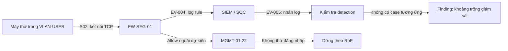

# Kết quả cần bàn giao sau mô phỏng tấn công mạng

Một cuộc diễn tập **red team / mô phỏng tấn công mạng** chỉ tạo ra giá trị lâu dài khi những gì đã quan sát được trở thành **bằng chứng có thể kiểm tra, kết luận có giới hạn, trách nhiệm khắc phục cụ thể và kế hoạch kiểm chứng lại**. Báo cáo “đã tấn công thành công” hoặc danh sách lỗ hổng đơn lẻ không đủ để người quản lý, SOC, đội mạng và chủ ứng dụng quyết định cần cải thiện điều gì.

Trong phạm vi module `SECURITY_NETWORK_SECURITY`, kết quả cần bàn giao phải mô tả được hiệu quả của các lớp phòng vệ như **phân đoạn mạng, firewall, VPN, AAA, IDS/IPS, bảo vệ DNS, mạng không dây và kiểm soát cloud**, đồng thời chỉ rõ các điểm phát hiện, giám sát và ứng cứu đã hoạt động ra sao. Bài viết tập trung vào **đầu ra sau mô phỏng**; mọi kịch bản được giả định đã được phê duyệt, thực hiện theo phạm vi và Rules of Engagement (RoE).

Sau khi học, bạn có thể xác định thành phần tối thiểu của một bộ hồ sơ bàn giao, đọc và kiểm chứng chuỗi bằng chứng, phân biệt mức độ đạt mục tiêu với độ nghiêm trọng của phát hiện, đo năng lực phát hiện/phản ứng và lập kế hoạch khắc phục có người chịu trách nhiệm.

## 1. Mục đích bàn giao: từ sự kiện tới quyết định

Bàn giao là quá trình chuyển những quan sát của nhóm mô phỏng thành thông tin **có thể dùng để hành động** cho các bên liên quan:

- **Lãnh đạo/đại diện rủi ro:** Rủi ro nào được chứng minh? Mục tiêu diễn tập đạt đến đâu? Ảnh hưởng tiềm năng và quyết định ưu tiên là gì?
- **Chủ hệ thống/network team:** Luồng nào đi qua phân đoạn, firewall, VPN hoặc cloud policy? Có cấu hình, giả định tin cậy hay ngoại lệ nào cần sửa?
- **SOC/Blue Team/IR:** Tín hiệu nào đã xuất hiện? Alert, triage và containment diễn ra khi nào? Mắt xích nào bị bỏ sót?
- **Chủ ứng dụng/định danh:** Quyền hạn hoặc cấu hình nào cho phép chuỗi hành động tiếp diễn? Ai chịu trách nhiệm sửa?
- **Đơn vị kiểm toán/nghiệm thu:** Dữ liệu có nguồn gốc, thời gian, người lưu giữ và giới hạn kết luận rõ ràng không?

Kết quả tốt không nhất thiết là “red team đạt mọi mục tiêu”. Một mô phỏng **bị firewall ngăn đúng chỗ**, có cảnh báo kịp thời và điều phối ứng cứu tốt vẫn tạo ra bằng chứng hữu ích. Ngược lại, nếu nhóm red team không đạt mục tiêu do lỗi môi trường thử, thiếu quyền, thiếu thời gian hoặc hệ thống đích không sẵn sàng, không được tự suy ra phòng thủ đã đạt.

### 1.1. Phân biệt bốn loại kết quả

| Nhóm | Câu hỏi trả lời | Ví dụ |
| --- | --- | --- |
| **Outcome của kịch bản** | Mục tiêu đã đạt, đạt một phần, bị chặn hay chưa xác định? | Không thể truy cập dịch vụ quản trị từ vùng người dùng trong cửa sổ diễn tập. |
| **Phát hiện bảo mật (finding)** | Điểm yếu, sai lệch kiểm soát hoặc khoảng trống vận hành nào được chứng minh? | Một rule firewall cho phép nguồn rộng hơn chính sách. |
| **Hiệu quả phòng thủ** | Giám sát, cảnh báo, triage, containment và trao đổi sự cố hoạt động ra sao? | SOC nhận sự kiện nhưng không liên kết được với phiên VPN. |
| **Khuyến nghị & kiểm chứng** | Ai cần sửa gì, bao giờ, và bằng thử nghiệm nào sẽ xác nhận đã sửa? | Thu hẹp rule, bổ sung log rồi chạy lại một test case có kiểm soát. |

Một finding có thể giải thích nhiều bước trong kịch bản. Một bước có thể tạo nhiều sự kiện IDS, firewall và EDR. Tránh đếm từng alert thành một lỗ hổng riêng hoặc gộp tất cả vào nhãn chung “hệ thống bị xâm nhập”.

## 2. Bộ sản phẩm bàn giao tối thiểu

Bộ bàn giao có thể được tổ chức thành các tài liệu và kho chứng cứ liên kết với nhau; không bắt buộc tất cả nội dung nằm trong một file. Mỗi tài liệu cần có **phiên bản, người soạn, ngày chốt, mức phân loại thông tin và nơi lưu được kiểm soát**.

| Thành phần | Người dùng chính | Cần có |
| --- | --- | --- |
| **01. Executive summary** | Lãnh đạo, chủ rủi ro | Mục tiêu, kết quả tổng quan, tác động kinh doanh giả định/được quan sát, rủi ro trọng yếu, quyết định cần đưa ra. |
| **02. Scope & RoE recap** | Chủ hệ thống, điều phối, kiểm toán | Tài sản in/out-of-scope, thời gian, tài khoản thử, phương pháp, ngoại lệ, thay đổi được duyệt. |
| **03. Attack narrative / timeline** | Network team, SOC/IR | Diễn tiến từng bước, điểm nguồn/đích, điều kiện bắt đầu/kết thúc, kết quả quan sát và mối liên hệ giữa các bước. |
| **04. Findings register** | Chủ kiểm soát, đội khắc phục | Mã phát hiện, điều kiện, nguyên nhân, bằng chứng, tác động, mức ưu tiên, người chịu trách nhiệm và phương thức xác minh. |
| **05. Evidence inventory & bảo toàn** | Điều tra số, audit, chủ hệ thống | Danh mục PCAP/log/screenshot/config, hash, thời gian, nguồn, phân quyền, chuỗi xử lý và bản đã che dữ liệu. |
| **06. Detection/response assessment** | SOC, detection engineering, IR | Sự kiện đã/không được thấy, đường đi alert, thời điểm xử lý, độ phủ, kết quả containment và lỗ hổng telemetry. |
| **07. Remediation plan** | Network, IAM, cloud, ứng dụng | Hành động, mức ưu tiên, owner, phụ thuộc, thời hạn mục tiêu, rủi ro triển khai và tiêu chí nghiệm thu. |
| **08. Cleanup & residual-risk record** | Vận hành, security owner | Tài khoản/agent/dữ liệu test đã dọn, cấu hình hoàn nguyên, ngoại lệ tồn đọng, xác nhận trách nhiệm. |
| **09. Retest plan & closure** | Chủ dự án, blue/purple team | Kịch bản kiểm tra lại, điều kiện pass/fail, bằng chứng mới, quy trình chấp nhận rủi ro còn lại. |
| **10. Technical appendix / handover manifest** | Người triển khai & kiểm toán | Mapping ATT&CK có căn cứ, danh mục công cụ ở mức cần thiết, ticket/correlation ID, phiên bản môi trường, nguồn tham chiếu. |

Một cuộc diễn tập phạm vi nhỏ có thể gộp mục 03–06 vào một báo cáo kỹ thuật nhưng vẫn phải bảo đảm thông tin truy vết được. Nếu có nhiều nhóm nhận bàn giao, nên phát hành **bản điều hành đã lược bỏ dữ liệu nhạy cảm** cùng với **phụ lục kỹ thuật giới hạn quyền đọc**.

## 3. Khóa lại scope và điều kiện diễn tập

Báo cáo chỉ có ý nghĩa khi người đọc biết chính xác điều gì được thử và điều gì chưa được thử. Bản chốt cần đối chiếu với phê duyệt trước diễn tập, ghi rõ thay đổi đã thông qua trong khi thực hiện.

| Trường | Nội dung cần ghi |
| --- | --- |
| `exercise_id`, tên, version | Định danh nhất quán giữa timeline, evidence, findings và ticket. |
| Đơn vị phê duyệt, chủ tài sản | Thẩm quyền kiểm thử và người chấp nhận rủi ro. |
| Mục tiêu, tiêu chí thành công | Ví dụ: kiểm chứng khả năng chặn tiếp cận management plane từ một VLAN xác định. |
| Tài sản/zone | IP/prefix, FQDN, VLAN/VRF, VPN group, cloud account/VPC, DNS, sensor hoặc hệ thống nằm trong scope. |
| Điểm khởi tạo | Máy test, subnet, danh tính thử, route và đường VPN; nhất quán với mục tiêu. |
| Thời gian | Bắt đầu/kết thúc bằng UTC; cửa sổ hoạt động thụ động/chủ động, mốc dừng hoặc tạm hoãn. |
| Kỹ thuật và giới hạn | Phép thử được phép, mức tải, loại dữ liệu thử, hành động cấm, stop condition và đầu mối NOC/SOC. |
| Các ngoại lệ | Thiết bị loại trừ, tính năng phải tắt/tạm bật có chấp thuận, phạm vi bị thay đổi hoặc không hoàn tất. |
| Độ bao phủ | Danh sách kịch bản chạy, không chạy, bị dừng, không có đủ chứng cứ. |

**Ví dụ về giới hạn kết luận:** Nếu chỉ thử kết nối từ `VLAN-USER` tới `MGMT-01:22/TCP`, không thể báo cáo “toàn bộ phân đoạn quản trị đã an toàn”. Kết luận chỉ áp dụng cho **đường đi, nguồn, đích, giao thức và thời điểm** đã được quan sát.

### 3.1. Tình trạng cuối của từng mục tiêu

Không ép mọi mục tiêu vào hai nhãn “thành công/thất bại”. Một bộ trạng thái hữu ích là:

- **ACHIEVED:** đạt tiêu chí đã chốt, có bằng chứng đúng phạm vi.
- **PREVENTED:** kiểm soát phòng vệ đã ngăn bước/mục tiêu được kiểm thử và có bằng chứng đối chiếu.
- **PARTIALLY ACHIEVED:** chỉ một phần tiêu chí thành công được đáp ứng.
- **NOT ACHIEVED:** đã thực thi kịch bản hợp lệ nhưng không đạt tiêu chí; nguyên nhân cần được phân tích.
- **INCONCLUSIVE:** thiếu bằng chứng, điều kiện môi trường không phù hợp hoặc tín hiệu mâu thuẫn.
- **NOT RUN:** không thực hiện vì ngoài scope, phụ thuộc, thời gian hoặc yêu cầu dừng.

`NOT RUN` và `INCONCLUSIVE` không được tính như `PREVENTED`. Việc phòng thủ chặn được một bước không chứng minh mọi biến thể của kỹ thuật tương tự đều bị chặn.

## 4. Viết executive summary cho người ra quyết định

Phần tóm tắt điều hành nên đọc độc lập được trong vài phút. Tránh đưa payload, câu lệnh hoặc dump dài; tập trung vào kết luận có bằng chứng và hành động cần quyết định.

Cấu trúc khuyến nghị:

1. **Bối cảnh:** mục tiêu nghiệp vụ và lớp kiểm soát được đánh giá.
2. **Phạm vi:** vị trí thử, mạng/ứng dụng liên quan và các giới hạn quan trọng.
3. **Kết quả:** mục tiêu nào đạt/bị chặn/chưa kết luận, với độ tin cậy phù hợp.
4. **Ảnh hưởng:** đường truy cập hoặc khả năng tác động tiềm năng, phân biệt với ảnh hưởng **đã thực sự xảy ra**.
5. **Khả năng phòng thủ:** phát hiện, phản ứng và kiểm soát nào hoạt động/không hoạt động.
6. **Ưu tiên và quyết định:** 2–5 hành động quan trọng, chủ sở hữu và mốc xác nhận.
7. **Rủi ro còn lại:** phần chưa đánh giá hoặc đang chờ phê duyệt/khắc phục.

Ví dụ diễn đạt trong một **diễn tập giả lập**:

> Trong cửa sổ được phê duyệt, nhóm diễn tập kiểm tra ranh giới giữa mạng người dùng và mạng quản trị. Một luồng TCP tới cổng quản trị của thiết bị thử được firewall cho phép trái với chính sách dự kiến; bằng chứng gồm log policy và phiên kết nối có ID tương ứng. Nhóm không thực hiện thao tác thay đổi cấu hình thiết bị. SOC có sự kiện cho phép kết nối nhưng không gắn cảnh báo ưu tiên cao. Kết quả chứng minh **một đường truy cập trái chính sách** và khoảng trống giám sát tại đường đó; chưa chứng minh có cá nhân bên ngoài đã xâm nhập hoặc dữ liệu sản xuất bị truy cập. Đề xuất thu hẹp ACL, thêm detection và kiểm tra lại từ cùng nguồn thử.

Một báo cáo không nên ghi “chiếm quyền toàn bộ mạng” khi quan sát chỉ chứng minh có đường kết nối tới một dịch vụ. Những tính từ như “nghiêm trọng”, “không có khả năng phát hiện” cần được giải thích bằng bằng chứng, phạm vi và kịch bản thực tế.

## 5. Attack narrative: chuỗi hành động và đường đi mạng

**Attack narrative** giải thích *vì sao mỗi bước được chọn và bước trước dẫn tới bước sau như thế nào*, ở mức đủ để nhóm phòng thủ hiểu, tái kiểm thử và cải thiện kiểm soát. Báo cáo tập trung vào các **quan sát và điểm quyết định**, không cần cung cấp chỉ dẫn khai thác nguy hiểm hoặc bí mật xác thực.

Mỗi sự kiện nên có:

- ID bước và mục tiêu tương ứng;
- thời điểm UTC, múi giờ và độ lệch đồng hồ nếu có;
- nguồn, đích, network zone/VRF, tài khoản test hoặc workload identity;
- hành động kiểm thử đã được cho phép;
- kết quả quan sát, quyết định cho phép/từ chối của control;
- nguồn bằng chứng, log/event ID, lưu ý về độ chắc chắn;
- tác động tới bước tiếp theo hoặc lý do dừng.

### 5.1. Ví dụ timeline của một cuộc mô phỏng có kiểm soát

Tình huống minh họa: kiểm tra khả năng hạn chế truy cập từ `VLAN-USER 10.10.10.0/24` tới mạng quản trị `10.10.30.0/24` qua firewall `FW-SEG-01`. Mọi dữ liệu là **giả lập**; đích thử có quyền kiểm thử và tài khoản dùng trong test là danh tính phòng lab.

| UTC | Bước | Quan sát | Kết luận hỗ trợ | Evidence |
| --- | --- | --- | --- | --- |
| `2026-11-20T02:00:00Z` | `S01` — Bắt đầu & xác minh nguồn | Máy test ở đúng `VLAN-USER`; route qua `FW-SEG-01`. | Đúng điểm xuất phát đã được phê duyệt. | `EV-001` |
| `02:03:12Z` | `S02` — Kiểm tra một cổng quản trị | Kết nối TCP từ test client tới `MGMT-01:22` được thiết lập. | Có đường tiếp cận dịch vụ quản trị trong điều kiện đã thử. | `EV-002`, `EV-003` |
| `02:03:13Z` | `S03` — Đối chiếu rule | Firewall log cho thấy policy `USER-TO-MGMT-EXCEPTION` cho phép phiên. | Rule này góp phần tạo ngoại lệ; cần kiểm tra phạm vi nguồn của rule. | `EV-004` |
| `02:05:00Z` | `S04` — Kiểm tra telemetry | SIEM nhận log allow nhưng không sinh alert tương ứng; SOC xác nhận không có case. | Khoảng trống detection cho sự kiện đã kiểm chứng trong kịch bản. | `EV-005`, `EV-006` |
| `02:06:00Z` | `S05` — Dừng tại ngưỡng chứng minh | Không xác thực vào thiết bị hoặc thay đổi cấu hình. | Mô phỏng dừng trước hoạt động có tác động cao hơn. | `EV-007` |
| `02:15:00Z` | `S06` — Bàn giao nóng | Đầu mối network/SOC nhận finding và ticket khắc phục. | Đã thông báo; trạng thái khắc phục cần theo dõi riêng. | `EV-008` |

**Diễn giải đúng:** phiên TCP thành công không chứng minh đã có quyền đăng nhập SSH, thực thi lệnh hay kiểm soát thiết bị. Không có alert ở SIEM trong cửa sổ thử không chứng minh hệ thống “không bao giờ phát hiện”; cần xác nhận rule, routing telemetry, điều kiện kích hoạt, xử lý độ trễ và ảnh hưởng của RoE.

### 5.2. Minh họa liên hệ giữa quan sát và kiểm soát



Sơ đồ phải khớp với hiện trạng thực tế: nếu đường đi gồm NAT, VPN, proxy hoặc routing policy khác thì thêm các điểm đó. Chỉ vẽ đường mũi tên “thành công” khi có chứng cứ tương ứng.

### 5.3. Mapping ATT&CK có giới hạn

Có thể gắn hành vi **đã quan sát** với tactic/technique của MITRE ATT&CK để hỗ trợ đội detection sử dụng chung thuật ngữ. Mapping phải phân biệt:

- `attempted` — có thực hiện thử, chưa chứng minh thành công;
- `observed` — hệ thống hoặc đội test ghi nhận được hành vi;
- `confirmed` — có bằng chứng đủ về điều kiện/mục tiêu của bước;
- `not tested` — chỉ là giả thuyết hoặc khả năng theo mô hình đe dọa.

Ví dụ, việc có route tới SSH **không tự động** chứng minh kỹ thuật sử dụng tài khoản hợp lệ hay di chuyển ngang đã xảy ra. Một giả thuyết về hành vi sau đó không được ghi thành “đã thực hiện”. Nếu báo cáo dùng ATT&CK ID/tên, cần nêu phiên bản và căn cứ mapping; ATT&CK là từ vựng mô tả hành vi, **không phải phương pháp chấm điểm mức độ nghiêm trọng**.

## 6. Evidence pack: bảo toàn và truy nguyên

**Evidence pack** là tập chứng cứ có thể xác minh, dùng để chứng minh sự kiện, xác định giới hạn và phục vụ retest. Bằng chứng nên được gắn bằng ID ổn định như `EV-004` rồi tham chiếu từ timeline, finding và recommendation.

| Loại bằng chứng | Nội dung có thể hữu ích | Giới hạn/điều kiện |
| --- | --- | --- |
| PCAP hoặc trích xuất flow | 5-tuple, timestamp, hướng kết nối, điểm quan sát | TLS/QUIC mã hóa nội dung; PCAP có thể chứa dữ liệu cá nhân, secret hoặc lưu lượng ngoài scope. |
| Firewall/IPS/syslog | Rule ID, action, zone, NAT, alert/deny reason | Có thể chỉ ghi gói đầu, một chiều hoặc sự kiện tổng hợp; cần hiểu semantics. |
| VPN/AAA/IdP audit | Danh tính test, phiên, mức quyền và thời gian | Tài khoản là định danh đăng nhập, chưa tự chứng minh người trực tiếp thao tác. |
| SIEM/EDR/SOAR | Event ID, rule, case/ticket, analyst activity, containment | Có thể chậm chuyển log, deduplicate, suppress hoặc bị ảnh hưởng bởi lịch bảo trì. |
| Snapshot cấu hình | Chính sách tại thời điểm thử, rule ordering, ACL, security group, route | Che secret; ghi version/commit/change ID, phân biệt dự kiến và trạng thái đang chạy. |
| Ảnh chụp màn hình | Giao diện cấu hình, thông báo lỗi, biểu đồ cảnh báo | Phải kèm thời gian, bối cảnh; screenshot đơn lẻ dễ thiếu thông tin. |
| Ticket/chat vận hành | Mốc phê duyệt, thông báo, yêu cầu dừng và quyết định khắc phục | Phân biệt “đã báo” với “đã xử lý”; tôn trọng quyền truy cập người nhận. |
| Dữ liệu canary giả lập | Chứng minh một luồng test đã đi tới điểm kiểm thử | Không sử dụng dữ liệu thực/nhạy cảm khi không cần thiết. |

### 6.1. Metadata tối thiểu của một evidence item

```json
{
  "exercise_id": "RT-NET-LAB-2026-01",
  "evidence_id": "EV-004",
  "related_step_ids": ["S03"],
  "related_finding_ids": ["F-01"],
  "captured_at_utc": "2026-11-20T02:03:13Z",
  "collector_role": "authorized-test-observer",
  "source_system": "FW-SEG-01",
  "source_type": "firewall-log",
  "observation_point": "USER-to-MGMT policy boundary",
  "original_timestamp": "2026-11-20T02:03:13Z",
  "time_accuracy_note": "checked with infrastructure time source",
  "artifact_uri": "restricted://evidence/EV-004",
  "sha256": "CALCULATE_FROM_THE_ACTUAL_ARTIFACT",
  "redaction": "sensitive identifiers redacted in report copy",
  "custody_note": "original retained read-only; access logged"
}
```

Đây là **cấu trúc minh họa**, không phải chứng cứ thật. Giá trị `sha256` phải được tính từ **bytes của đúng file thực tế**, không sao chép một chuỗi giả hay dùng hash của bản đã biên tập thay cho bản gốc. Nếu trích xuất và che dữ liệu, lưu bản gốc bảo vệ nghiêm ngặt và ghi riêng checksum của bản trích/bản che.

Cần ghi nhận ai thu thập, bằng công cụ gì, từ hệ thống nào, ở mốc nào; nhật ký thao tác chuyển, nhận, giải mã hoặc chuyển định dạng; cơ chế lưu giữ và thời hạn bảo quản. Không khẳng định chain of custody hoàn chỉnh khi thiếu bước hoặc thiếu chứng cứ bàn giao.

### 6.2. Cách xử lý thông tin nhạy cảm

- Phân loại tài liệu: tóm tắt điều hành rộng hơn; log, sơ đồ mạng chi tiết, cấu hình và nội dung canary ở kho giới hạn.
- Che mật khẩu, private key, bearer token, session cookie, thông tin định danh không cần thiết và dữ liệu khách hàng.
- Nếu vô tình quan sát dữ liệu thật ngoài scope, dừng hoạt động liên quan, báo đầu mối xử lý theo RoE và áp dụng quy tắc giảm thiểu lưu giữ.
- Giữ những yếu tố tối thiểu để tái xác minh: ID phiên, mốc thời gian UTC, IP/port hoặc token giả lập đã phê duyệt và mã băm bằng chứng.
- Tránh đưa payload khai thác có thể tái sử dụng hoặc bí mật xác thực vào báo cáo phân phối rộng; có thể lưu bản kỹ thuật được kiểm soát nếu thực sự cần cho khắc phục và được cho phép.

### 6.3. Những gì chứng cứ không tự chứng minh

Một dòng `ALLOW` không đồng nghĩa ứng dụng đích đã nhận dữ liệu. Một kết nối TCP tới port 22 không chứng minh phiên SSH xác thực thành công. Không có PCAP không có nghĩa không có lưu lượng. Tên tài khoản trong log không xác nhận người thật đang ngồi trước máy. **Mức độ chắc chắn của báo cáo phải phản ánh đúng khoảng quan sát được**.

## 7. Bàn giao riêng kết quả Detection & Response

Đánh giá red team hữu ích khi đo được quá trình **phát hiện – phân tích – ứng cứu** đối với hoạt động mô phỏng, kể cả khi một lớp phòng vệ đã chặn sớm. Không nên chỉ báo cáo “SOC phát hiện/không phát hiện” mà thiếu định nghĩa về thời gian, nguồn log, rule và giới hạn quan sát.

### 7.1. Detection scorecard

| Thành phần | Câu hỏi/đầu ra |
| --- | --- |
| **Điểm cảm biến** | Gói tin/sự kiện có đi qua nơi IDS/IPS, firewall, DNS monitor, EDR, VPN hoặc cloud flow log có thể quan sát không? |
| **Telemetry tới nơi nhận** | Log có được tạo và chuyển tới SIEM không? Nếu trễ hoặc thất lạc, ở tầng nào? |
| **Detection rule** | Có rule liên quan không, có được bật trong cửa sổ mô phỏng không, có suppress/dedup không? |
| **Alert** | Có phát cảnh báo phù hợp? Độ ưu tiên, timestamp và event ID là gì? |
| **Triage** | Analyst có nhận, phân loại và liên kết ngữ cảnh tài sản/identity không? |
| **Escalation / containment** | Có thông báo/chặn/khóa phiên theo runbook không, ai phê duyệt, thời điểm nào? |
| **Recovery / learning** | Có kết luận nguyên nhân, sửa detection, bổ sung playbook và kiểm chứng lại không? |

**Lưu ý:** việc red team đã thông báo trước toàn bộ mốc, mẫu traffic hoặc tên tài khoản test có thể khiến kết quả đo sự phát hiện khác với hoạt động thường nhật. Phải ghi rõ kiểu bài tập: *blind*, *assumed breach*, *purple team* hay *known test*, thời điểm blue team được chia sẻ thông tin.

### 7.2. Công thức và mốc thời gian

Gọi:

- `t0`: thời điểm **hành vi mục tiêu có thể phát hiện** thực sự xảy ra tại điểm quan sát;
- `t1`: thời điểm alert có ý nghĩa đầu tiên được sinh;
- `t2`: thời điểm analyst nhận/ghi nhận xử lý;
- `t3`: thời điểm containment được xác nhận hoàn tất.

Nếu định nghĩa mốc nhất quán:

```text
Detection latency  = t1 - t0
Acknowledgment lag = t2 - t1
Containment time   = t3 - t0
```

Trong một cuộc diễn tập giả lập, `t0=02:03:12Z`, `t1=02:04:00Z`, `t2=02:05:30Z` và `t3=02:09:00Z` cho kết quả:

| Chỉ số của **sự kiện ví dụ** | Kết quả |
| --- | --- |
| Thời gian từ hành vi tới alert | 48 giây |
| Từ alert tới khi analyst ghi nhận | 90 giây |
| Từ hành vi tới containment đã xác nhận | 5 phút 48 giây |

Đây là thời gian của **một sự kiện**, không phải Mean Time to Detect (MTTD) hay Mean Time to Respond (MTTR) của cả tổ chức. Muốn dùng giá trị trung bình, cần thống nhất tập mẫu, mẫu số, định nghĩa mốc và cách xử lý sự kiện không phát hiện. Không ghi “MTTD = 0” khi không có alert; khi đó thời gian tới phát hiện **chưa quan sát được** trong cửa sổ.

Nếu containment chỉ do điều phối viên chỉ đạo hoặc tester tự dừng, cần ghi rõ **response được kích hoạt nhờ diễn tập**, không coi là SOC tự động/độc lập khống chế tấn công.

### 7.3. Các mức đánh giá có thể tái sử dụng

| Trạng thái | Ý nghĩa |
| --- | --- |
| **Observed & alerted** | Tín hiệu tới hệ thống giám sát và sinh alert liên quan, có ID đối chiếu. |
| **Observed but not alerted** | Có log/telemetry nhưng thiếu alert phù hợp trong khoảng theo dõi. |
| **Alerted but not triaged** | Có alert nhưng chưa có phản hồi analyst được xác nhận. |
| **Triaged but not contained** | Analyst đã xem nhưng containment chưa hoàn tất trong phạm vi/khung giờ đo. |
| **Prevented at enforcement point** | Firewall/IPS/IAM đã chặn thao tác với log xác nhận, không nhất thiết cần SOC xử lý. |
| **No observability / inconclusive** | Không có điểm thu đủ dữ liệu để khẳng định đã/không phát hiện. |

Nên đối chiếu các bản ghi ở **nhiều tầng**. Ví dụ IDS không có alert vì gói đã bị firewall chặn ở phía trước là kết quả khác với sensor có nhìn thấy lưu lượng nhưng detection rule không kích hoạt.

## 8. Findings register: viết phát hiện có thể khắc phục

Mỗi finding cần **một phát biểu kiểm soát cụ thể có bằng chứng**, giải thích điều kiện để tái tạo theo cách an toàn và nêu tác động phù hợp với phạm vi. Các trường quan trọng:

| Trường | Nội dung cần có |
| --- | --- |
| `finding_id`, tiêu đề, tình trạng | Ngắn gọn, duy nhất, open/mitigating/resolved/accepted. |
| Liên kết mục tiêu và bước | `exercise_id`, `step_ids`, tactic/technique nếu có chứng cứ. |
| Tài sản/đường mạng | Nguồn, đích, vùng, thành phần thực thi chính sách, phiên bản cấu hình. |
| Điều kiện và quan sát | Điều gì phải đúng để tái hiện và test đã quan sát gì. |
| Expected vs actual | Chính sách mong muốn khác hành vi thực tế thế nào. |
| Bằng chứng | `evidence_ids`, log/event/ticket hoặc config snapshot. |
| Nguyên nhân | Rule quá rộng, định tuyến sai, thiếu logging, role sai... với mức chắc chắn. |
| Tác động | Khả năng ảnh hưởng đến Confidentiality/Integrity/Availability; nói rõ điều gì chỉ là giả thuyết. |
| Ưu tiên | Mức độ rủi ro, phạm vi, khả năng khai thác, độ quan trọng của hệ thống, biện pháp bù và độ chắc chắn. |
| Chủ xử lý và đề xuất | Hành động cụ thể, owner, thời hạn và phụ thuộc. |
| Kiểm chứng lại | Test case, điều kiện pass/fail, log phải xuất hiện, tiêu chí đóng finding. |

### 8.1. Ví dụ finding hoàn chỉnh ở mức cần thiết

**`F-01 — Rule cho phép truy cập quản trị rộng hơn chính sách`**

- **Mục tiêu:** xác minh cách ly `VLAN-USER` và `MGMT`.
- **Kỳ vọng:** kết nối quản trị tới `MGMT-01:22/TCP` từ `VLAN-USER` phải bị chặn.
- **Quan sát:** ở `S02`, test client `10.10.10.25` thiết lập được kết nối TCP tới `10.10.30.10:22`; firewall `FW-SEG-01` ghi `ALLOW` theo `USER-TO-MGMT-EXCEPTION`. Bằng chứng `EV-002`–`EV-004`.
- **Giới hạn:** nhóm không đăng nhập SSH, không sửa thiết bị. Phát hiện chỉ xác nhận **đường kết nối và rule liên quan**; chưa kết luận quyền thực thi lệnh hay truy cập dữ liệu.
- **Nguyên nhân sơ bộ:** điều kiện nguồn của một rule exception quá rộng; cần xác nhận với chủ rule và lịch sử thay đổi trước khi kết luận nguyên nhân gốc.
- **Rủi ro:** tăng bề mặt tiếp cận giao diện quản trị từ vùng ít tin cậy hơn. Độ ưu tiên phụ thuộc độ nhạy của thiết bị, cơ chế xác thực và các biện pháp bù.
- **Khắc phục:** thu hẹp nguồn của rule tới jump host đã duyệt, rà soát nhu cầu exception và bảo đảm default deny theo policy hiện hành.
- **Retest:** xác minh test client bị deny trên TCP/22, jump host được phép vẫn quản trị thành công, cả hai có log/rule ID tương ứng; theo dõi gián đoạn dịch vụ quản trị hợp lệ.
- **Owner:** network control owner; SOC nhận riêng finding về detection nếu thiếu cảnh báo.

### 8.2. Đánh giá ưu tiên nhất quán

Có thể dùng ma trận của tổ chức theo các yếu tố: **tài sản quan trọng, điều kiện khai thác, quyền cần có, khả năng đi từ vùng tin cậy thấp, khả năng quan sát/ứng cứu, phạm vi tác động và rủi ro vận hành khi sửa**.

Ví dụ:

| Nhóm ưu tiên | Cách diễn giải định tính | Phản ứng mong đợi |
| --- | --- | --- |
| **P0 / Critical theo quy định nội bộ** | Có đường ảnh hưởng kinh doanh khẩn cấp và chứng cứ đủ; cần phối hợp ứng cứu theo ngưỡng của tổ chức | Escalate trực tiếp theo quy trình sự cố và xử lý ưu tiên cao nhất. |
| **P1 / High** | Sai lệch kiểm soát quan trọng, có khả năng dẫn tới truy cập trái phép theo điều kiện thực tế | Chủ hệ thống lập biện pháp giảm thiểu và mốc retest gần. |
| **P2 / Medium** | Rủi ro xác định nhưng cần điều kiện phụ hoặc có biện pháp bù đáng kể | Đưa vào backlog có owner, mốc thực hiện, test xác nhận. |
| **P3 / Low / Improvement** | Vấn đề hạn chế hoặc cải tiến độ quan sát/khả năng vận hành | Xử lý theo chu kỳ và tiêu chí chấp nhận rủi ro. |

Không gán P0/P1 chỉ vì chuỗi mô phỏng “có thể” dẫn tới một kết quả giả định mà chưa có điều kiện thực tế. **CVSS** có thể áp dụng khi đánh giá một lỗ hổng phù hợp; nó không tự đại diện cho toàn bộ rủi ro của đường tấn công, thời gian phát hiện hoặc mức tác động vận hành.

### 8.3. Tránh trùng finding

Nếu ba bước thử cho thấy cùng một rule rộng quá mức, có thể có **một finding chính** với ba đường/bằng chứng hỗ trợ. Ngược lại, log firewall không được gửi SIEM và rule firewall quá rộng là **hai vấn đề độc lập** với owner, cách sửa và cách retest khác nhau.

## 9. Bàn giao gap về phòng thủ theo từng lớp

Trong môn an ninh mạng, remediation nên gắn vào điểm kiểm soát tương ứng để người nhận có thể thực thi.

| Lớp | Điểm cần xác minh từ mô phỏng | Gợi ý bàn giao |
| --- | --- | --- |
| **Segmentation / VLAN / VRF** | Luồng east–west và quản trị có đi qua vùng bị cấm không? | Diagram trước/sau, rule gây sai lệch, test từ đúng nguồn/đích. |
| **Firewall / NAT / egress** | Default deny, zone policy, NAT, outbound allowlist có hiệu lực không? | Policy ID, 5-tuple, route, log allow/deny, exception owner. |
| **VPN / remote access** | Truy cập từ xa có giới hạn theo danh tính, nhóm và thiết bị không? | Group mapping, IP pool, route, kiểm tra phân quyền và audit đăng nhập. |
| **AAA / Management plane** | Ai đăng nhập, có MFA, giới hạn lệnh, accounting và break-glass đúng chính sách không? | Role table, phiên test, log AAA, quyền và tình trạng tài khoản khẩn cấp. |
| **DNS** | Resolver, policy domain, DNS log và khả năng bỏ qua qua DoH/DoT có phù hợp mục tiêu không? | Log query/response, policy và giới hạn nhận diện lưu lượng mã hóa. |
| **Wireless / NAC** | Guest/employee SSID có tách VLAN, identity và kiểm soát truy cập như thiết kế không? | SSID/VLAN mapping, NAC decision và kết quả kết nối có kiểm soát. |
| **IDS/IPS / NDR** | Sensor có thấy traffic, rule có phát hiện, alert tới SOC và analyst có triage không? | Sensor placement, rule ID, event ID, thời gian phát hiện và xử lý. |
| **Cloud / hybrid** | Security group/NACL/cloud firewall, route và peering có ràng buộc đúng workload không? | Config state, route table, flow log, chủ tài sản và phiên bản policy. |
| **Logging / SIEM** | Có đủ nguồn, timestamp, rule, identity và context để đối chiếu? | Mapping telemetry, retention, parser/detection gap và kế hoạch test lại. |

Các đề xuất phải tính đến chi phí vận hành: thu hẹp một firewall rule có thể làm hỏng luồng phụ thuộc hợp lệ; triển khai MFA/AAA sai thứ tự có thể khóa quản trị viên khỏi thiết bị. Đề xuất nên kèm **rollback, chủ thay đổi, cửa sổ bảo trì và positive control** để xác nhận hoạt động nghiệp vụ vẫn bình thường.

## 10. Remediation plan và tiêu chí chấp nhận

Một danh sách “nên tăng cường bảo mật” không thể nghiệm thu. Mỗi việc cần hành động **định lượng hoặc kiểm tra được**, có người nhận, mức ưu tiên, phụ thuộc và trạng thái.

| ID | Hành động | Owner | Bằng chứng nghiệm thu | Phụ thuộc |
| --- | --- | --- | --- | --- |
| `R-01` | Thu hẹp `USER-TO-MGMT-EXCEPTION` theo nguồn jump host được phê duyệt | Network | Kết quả negative test từ user VLAN và positive test từ jump host; log rule tương ứng | Xác nhận danh sách host quản trị hợp lệ, change và rollback. |
| `R-02` | Tạo/tinh chỉnh detection cho truy cập management plane trái zone | SOC / detection engineering | Test event khớp rule, alert có context, analyst nhận đúng queue | Parser, tài sản MGMT, mapping zone và quyền đọc log. |
| `R-03` | Bổ sung trường `src_zone`, `dst_zone`, `policy_id` vào pipeline SIEM nếu log có hỗ trợ | Logging / SIEM | Event end-to-end có đủ trường và thời gian UTC nhất quán | Cấu hình nguồn log, schema và retention. |
| `R-04` | Rà toàn bộ rule exception cùng nhóm mục đích | Network control owner | Danh sách rule có owner, lý do nghiệp vụ, thời hạn, kiểm tra độ rộng | Inventory và lịch sử thay đổi. |
| `R-05` | Bổ sung test case segmentation vào kiểm tra sau thay đổi | Network QA / security | Test chạy lại được và lưu bằng chứng pass/fail | Test harness, endpoint có quyền kiểm thử. |

Các cột thực tế nên có thêm `priority`, `target_date`, `ticket_id`, `risk_acceptance` và `retest_status`. Khi một finding có nhiều hành động, phải thống nhất **điều kiện đóng finding**; việc sửa xong ticket không chứng minh kiểm soát đã hiệu quả.

### 10.1. Bản kế hoạch theo giai đoạn

- **Xử lý tức thời theo quy trình sự cố:** với nguy cơ đang xảy ra hoặc dấu hiệu ngoài giả lập, chuyển cho chủ hệ thống/IR; ghi rõ điều gì đã được xử lý và điều gì chưa.
- **Ngắn hạn:** loại bỏ rule ngoại lệ sai, khóa danh tính thử chưa được gỡ, bổ sung log bị thiếu, kiểm tra tính khả dụng sau thay đổi.
- **Trung hạn:** củng cố phân đoạn, RBAC/AAA, bộ quy tắc IDS/IPS, kiểm soát DNS/egress và tối ưu playbook SOC.
- **Dài hạn:** thiết kế thử nghiệm hồi quy tự động, soát policy theo chu kỳ, đào tạo điều phối và diễn tập lại để đo tiến bộ.

Thời hạn cụ thể phải do chủ rủi ro và đội triển khai chấp thuận dựa trên môi trường thực, không mặc định “mọi P1 phải sửa trong X ngày” khi tổ chức chưa quy định.

## 11. Cleanup và khôi phục: đầu ra bắt buộc

Một cuộc mô phỏng chưa kết thúc về mặt vận hành khi nhóm red team đã dừng thử. Tài khoản, key, agent, route, rule, file thử hoặc dữ liệu giả có thể còn tồn tại. **Cleanup report** cần nêu từng đối tượng và tình trạng thực tế.

| Hạng mục | Cần xác nhận | Chứng cứ bàn giao |
| --- | --- | --- |
| Tài khoản/credential thử | Tắt hoặc thu hồi tài khoản, token, khóa SSH/API đã cấp; đổi secret nếu RoE yêu cầu | Audit từ IAM/AAA/IdP hoặc ticket change. |
| Phần mềm/agent kiểm thử | Gỡ công cụ/agent do nhóm test triển khai trong phạm vi; xác minh không còn dịch vụ/tác vụ test | Danh sách cài đặt và xác nhận chủ endpoint. |
| Thay đổi cấu hình tạm | Hoàn nguyên rule, route, proxy exception, tunnel và cấu hình logging thay đổi để thử | Diff cấu hình trước/sau và phê duyệt rollback. |
| Dữ liệu canary | Xóa/thu hồi marker, file giả lập, bản sao được phép; xác nhận dữ liệu thật không bị động tới | Biên bản xác nhận chủ dữ liệu. |
| Log và evidence | Giữ chứng cứ cần cho audit, giới hạn quyền và có thời hạn lưu; xóa bản sao không kiểm soát | Manifest, chính sách retention, hồ sơ bàn giao. |
| Dịch vụ và cảnh báo | Kiểm tra health, trạng thái alert/suppression rule, kết nối hợp lệ sau test | Monitoring snapshot, xác nhận NOC/SOC. |
| Phiên và kênh liên lạc | Đóng test session, cập nhật incident/change ticket, báo hết cửa sổ | Ticket closure, xác nhận điều phối viên. |

Nếu không thể gỡ hoàn toàn một thành phần hoặc còn ngoại lệ, phải ghi **residual item** với chủ sở hữu, lý do, hạn xử lý và rủi ro. Không tự tuyên bố “đã sạch 100%” nếu không có log hoặc chủ tài sản xác minh.

Với trường hợp hành vi diễn tập chạm hệ thống ngoài phạm vi hay gây gián đoạn, cần thực hiện đúng quy trình báo cáo và khôi phục đã được thỏa thuận; tài liệu bàn giao phải giữ mốc sự kiện và các quyết định thực tế.

## 12. Retest: kiểm chứng rằng cải tiến thật sự hiệu quả

Retest không chỉ là lặp lại thao tác mô phỏng ban đầu. Cần đo **hai chiều**:

1. **Negative control:** luồng/hành động trước đây trái chính sách nay bị chặn.
2. **Positive control:** hoạt động hợp lệ vẫn vận hành, tránh sửa an ninh bằng cách làm hỏng dịch vụ.
3. **Detection/response:** telemetry tạo được alert đúng ngữ cảnh, SOC nhận và xử lý theo runbook nếu mục tiêu có phần phát hiện.
4. **Regression:** không mở ra đường đi phụ hoặc lỗ hổng tương đương trên IPv6, VPN, cloud gateway, API hay rule dự phòng khi có liên quan.

Mỗi lần retest cần chốt **phiên bản policy và môi trường** cùng evidence ID mới. Khi một finding chưa thể sửa, trạng thái phải là **open**, **mitigated with compensating control** hoặc **risk accepted** theo quyết định có thẩm quyền; không chuyển `resolved` chỉ vì đã soạn kế hoạch.

### Ví dụ tiêu chí đóng `F-01`

| Trường hợp | Mục tiêu | Chứng cứ cần |
| --- | --- | --- |
| Từ `VLAN-USER` → `MGMT-01:22` | TCP không được thiết lập; firewall chặn theo rule dự kiến | Kết quả client, log deny, nguồn/đích/thời gian trùng khớp. |
| Từ jump host được duyệt → `MGMT-01:22` | Kết nối và xác thực được phép theo role | Log allow + AAA, xác nhận vận hành hợp lệ. |
| Phiên trái zone phát sinh test | SOC nhận alert khi policy yêu cầu | Alert/case ID, thời điểm, asset/zone context, kết quả triage. |
| Kiểm tra đường khác nếu scope có | Không bypass qua VPN/IPv6/route thứ hai | Route, policy và test log cho mỗi đường đã được duyệt. |

Nếu một endpoint đích đang down, kết nối thất bại **không đủ** chứng minh rule deny hoạt động. Nếu log deny thuộc phiên cũ hoặc luồng khác, kết luận cũng chưa đủ cơ sở.

## 13. Quy trình bàn giao và nghiệm thu

### 13.1. Trình tự đề xuất

1. **Đóng cửa sổ diễn tập:** xác nhận stop condition, hoạt động đã dừng, dữ liệu test được bảo quản, vận hành không còn ảnh hưởng ngoài dự kiến.
2. **Kiểm tra nội bộ kết quả:** đối chiếu timeline, evidence ID, log từ red/blue, đích test, bản ghi NAT và trạng thái hệ thống; tách quan sát khỏi suy luận.
3. **Rà soát kỹ thuật với chủ kiểm soát:** kiểm tra phiên bản cấu hình, đầu mối sửa lỗi, phụ thuộc và những giả thuyết cần xác minh.
4. **Bàn giao nóng đối với rủi ro cấp bách:** báo trực tiếp theo quy trình ứng cứu nếu có tình huống cần can thiệp, lưu ticket.
5. **Chốt báo cáo điều hành và phụ lục:** rà mức độ tin cậy, loại trừ, che dữ liệu nhạy cảm và giới hạn phân phối.
6. **Giao remediation register:** owner, mốc xử lý, chấp nhận rủi ro, test case nghiệm thu và nơi theo dõi ticket.
7. **Xác nhận cleanup:** owner của tài sản, tài khoản test, các rule tạm và kho evidence ký nhận hoặc ghi tồn đọng.
8. **Họp lessons learned/purple-team:** xem các điểm không phát hiện, quy trình giao tiếp, triage và khả năng phục hồi; thống nhất những detection test cần thêm.
9. **Retest và đóng finding:** dùng bằng chứng mới, xác nhận cả kiểm soát chặn và hoạt động hợp lệ; cập nhật trạng thái cuối.

Nên tổ chức **hai phiên trao đổi** với nội dung phù hợp: một buổi ngắn cho người quyết định rủi ro và một buổi kỹ thuật cho network/SOC/IR/app owner. Cả hai dùng cùng `exercise_id`, `finding_id` và số liệu đã xác minh để tránh diễn giải khác nhau.

### 13.2. Tiêu chí chấp nhận bộ bàn giao

Bộ bàn giao có thể coi là **đủ thông tin để tiếp nhận** khi:

- Mọi mục tiêu trong RoE đều có trạng thái cuối hoặc lý do không chạy.
- Mọi kết luận quan trọng trỏ tới bằng chứng có nguồn, thời gian và vị trí lưu.
- Không có câu chữ khẳng định tác động vượt quá quan sát.
- Findings có owner hoặc nơi chờ phân công và cách kiểm chứng, không chỉ mô tả hiện tượng.
- Kết quả detection ghi rõ điểm có/không có telemetry, mốc đo và giới hạn.
- Mọi hoạt động được cho phép đã đóng, cleanup hoàn tất hoặc có residual record.
- Danh mục file, mức phân loại, quyền nhận và phiên bản được xác nhận.
- Những điểm bất đồng giữa red team, network và SOC được ghi nhận, không tự sửa lời kể để “khớp” khi thiếu chứng cứ.

**Nghiệm thu tài liệu** không đồng nghĩa **chấp nhận rủi ro bảo mật**, và cũng không đồng nghĩa **đã sửa xong toàn bộ finding**. Ba quyết định này thuộc những quy trình/đầu mối khác nhau.

## 14. Ví dụ mẫu bàn giao có cấu trúc

Dưới đây là một mẫu YAML **thuần mô tả**. Tên thiết bị, ID và thời điểm hoàn toàn giả lập. Cần bảo vệ dữ liệu thực và dùng hệ thống quản lý chứng cứ phù hợp.

```yaml
exercise:
  id: "RT-NET-LAB-2026-01"
  title: "Simulation of USER-to-MGMT segmentation"
  status: "completed"
  scenario_type: "authorized-red-team-simulation"
  report_version: "1.0"
  finalized_at_utc: "2026-11-20T09:00:00Z"
  scope:
    source_zone: "VLAN-USER"
    target_asset: "MGMT-01"
    enforcement_point: "FW-SEG-01"
    approved_window_utc: "2026-11-20T02:00:00Z/2026-11-20T03:00:00Z"
    excluded_actions: ["device-login", "configuration-change"]
  objectives:
    - id: "OBJ-01"
      description: "Check management-plane segmentation"
      outcome: "achieved"
      outcome_note: "TCP access path observed; no SSH login attempted"
      evidence: ["EV-002", "EV-003", "EV-004"]
  steps:
    - id: "S02"
      timestamp_utc: "2026-11-20T02:03:12Z"
      action: "bounded-connectivity-check"
      observation: "tcp-connection-established"
      evidence: ["EV-002", "EV-003"]
  findings:
    - id: "F-01"
      title: "Overly broad USER-to-MGMT firewall exception"
      status: "open"
      observation: "Unexpected allow at firewall policy boundary"
      evidence: ["EV-002", "EV-003", "EV-004"]
      owner: "network-policy-owner"
      remediation: "Restrict source to approved management hosts"
      retest_case: "RT-F01-VERIFY"
  defensive_observations:
    - id: "D-01"
      result: "observed-but-not-alerted"
      evidence: ["EV-005", "EV-006"]
      improvement_owner: "soc-detection-owner"
  cleanup:
    status: "verified-with-exceptions"
    pending_items: ["Confirm retention expiry of redacted test export"]
    responsible_owner: "exercise-coordinator"
  limitations:
    - "One approved source, destination and TCP port"
    - "No authentication or command execution tested"
    - "No inference about untested network paths"
```

**Chú ý ngữ nghĩa:** `outcome: achieved` ở đây chỉ nói mục tiêu **chứng minh đường kết nối theo kịch bản** đã đạt. Nó không đại diện cho việc giành quyền quản trị thiết bị. `completed` là trạng thái diễn tập; finding vẫn có thể `open` và cleanup vẫn có mục chờ.

### 14.1. Danh mục file bàn giao (gợi ý tên logic)

```text
RT-NET-LAB-2026-01/
  README-HANDOVER.md
  01-EXECUTIVE-SUMMARY.pdf
  02-SCOPE-AND-ROE.pdf
  03-TECHNICAL-TIMELINE.md
  04-FINDINGS-REGISTER.csv
  05-DETECTION-RESPONSE-SCORECARD.csv
  06-REMEDIATION-AND-RETEST.csv
  07-CLEANUP-AND-RESIDUAL-RISK.md
  EVIDENCE-MANIFEST.csv
  evidence-restricted/   # Access-controlled original artifacts
```

Đây là **cấu trúc minh họa**, không phải yêu cầu phải sinh các file trên trong bài học. File manifest cần ánh xạ các `EV-xxx` với URI, hash, nguồn và phân quyền. Không đưa log thô hoặc thông tin nhạy cảm vào bản executive chỉ để người nhận “có đủ tài liệu”.

## 15. Các lỗi thường gặp trong bàn giao

| Lỗi | Hậu quả | Cách sửa |
| --- | --- | --- |
| Chỉ ghi “red team thành công” | Người quản lý không biết điểm yếu và mức chứng minh | Nêu mục tiêu, bước, bằng chứng và phạm vi đúng nghĩa. |
| Chỉ đính ảnh chụp màn hình | Khó xác minh nguồn, thời gian và phiên | Thêm evidence manifest, event ID, log và checksum. |
| Gộp sự kiện giả định với hành động thật | Thổi phồng kết luận, nguy cơ quyết định sai | Gắn `attempted/observed/confirmed/not tested`. |
| Chỉ báo cáo khai thác mà bỏ phòng thủ | Không biết monitoring/response đã hoạt động ra sao | Có detection scorecard và mốc thời gian theo định nghĩa. |
| Dùng “không alert” thay cho “không có log” | Kết luận sai về điểm thiếu | Kiểm tra sensor placement, pipeline, rule và triage. |
| Khuyến nghị chung chung | Không có việc có thể nghiệm thu | Ghi action, owner, target, dependency và retest case. |
| Không ghi cleanup | Để lại tài khoản, ngoại lệ hoặc agent test | Có kiểm tra từ chủ tài sản và residual risk record. |
| Dùng CVSS như thước đo duy nhất cho toàn chiến dịch | Ưu tiên sai và bỏ qua yếu tố phòng thủ/kinh doanh | Đánh giá rủi ro theo bối cảnh, kết quả thực và biện pháp bù. |
| Không phân loại/chỉnh quyền nhận | Lộ sơ đồ mạng, credential hoặc chứng cứ nhạy cảm | Tách executive và technical annex; che dữ liệu và kiểm soát truy cập. |
| Đóng finding ngay khi có ticket “Done” | Không chứng minh fix hiệu quả hoặc không làm hỏng dịch vụ | Retest negative/positive, đối chiếu log và ghi version. |

## 16. Checklist cuối trước khi phát hành

- [ ] Có `exercise_id`, phiên bản, ngày chốt, chủ tài liệu, mức phân loại và quyền nhận.
- [ ] Scope, RoE, cửa sổ thử nghiệm, nguồn/đích, tài khoản và ngoại lệ đã được chốt.
- [ ] Mỗi mục tiêu có trạng thái ACHIEVED/PREVENTED/PARTIALLY ACHIEVED/NOT ACHIEVED/INCONCLUSIVE/NOT RUN và lý do.
- [ ] Timeline có UTC, nguồn/đích, điều kiện, kết quả, event ID và liên kết evidence.
- [ ] Attack narrative chỉ ghi hành động đã xảy ra, tách giả thuyết hoặc bước dừng theo RoE.
- [ ] Evidence pack có provenance, hash khi phù hợp, custody, vùng lưu và bản che dữ liệu.
- [ ] SOC scorecard có điểm quan sát, alert, triage, response và giới hạn của các chỉ số thời gian.
- [ ] Findings có expected/actual, nguyên nhân ở mức tin cậy hợp lý, tác động, ưu tiên và owner.
- [ ] Khuyến nghị chỉ rõ thay đổi cấu hình/policy/quy trình, rollback và tiêu chí nghiệm thu.
- [ ] Cleanup được chủ tài sản xác nhận hoặc có residual items với người chịu trách nhiệm.
- [ ] Retest có test case, môi trường, positive/negative controls, log dự kiến và trạng thái cuối.
- [ ] Tóm tắt điều hành không có bí mật, dữ liệu cá nhân không cần thiết hoặc thuật ngữ phóng đại.
- [ ] Các bên đã nhận bàn giao đúng phiên bản; các quyết định chấp nhận rủi ro được ghi riêng.

**Nguyên tắc cốt lõi:** Giá trị của một mô phỏng tấn công mạng nằm ở việc **liên kết mục tiêu → quan sát → bằng chứng → lỗ hổng kiểm soát → quyết định → kiểm chứng lại**. Bàn giao thành công giúp tổ chức cải thiện cả khả năng **ngăn chặn**, **phát hiện** lẫn **phản ứng**, trong đúng giới hạn mà cuộc diễn tập đã chứng minh.

## Tài liệu tham khảo

- [NIST SP 800-115 — Technical Guide to Information Security Testing and Assessment](https://csrc.nist.gov/pubs/sp/800/115/final): định hướng lập kế hoạch, triển khai và báo cáo đánh giá an ninh.
- [MITRE ATT&CK — Enterprise Matrix](https://attack.mitre.org/matrices/enterprise/): từ vựng tactic/technique giúp diễn giải những hành vi đã được quan sát.
- [MITRE ATT&CK — Data Sources](https://attack.mitre.org/datasources/): liên hệ hành vi với loại telemetry cần để phát hiện.
- [NIST Cybersecurity Framework 2.0](https://www.nist.gov/cyberframework): các chức năng quản trị, nhận diện, bảo vệ, phát hiện, ứng cứu và phục hồi.
- [NIST SP 800-53 Rev. 5 — Security and Privacy Controls](https://csrc.nist.gov/pubs/sp/800/53/r5/upd1/final): nhóm kiểm soát AC, AU, CA, IR, RA, SC và SI dùng để gắn phát hiện với biện pháp xử lý.
- [PTES — Reporting](http://www.pentest-standard.org/index.php/Reporting): cấu trúc báo cáo và truyền đạt phát hiện trong kiểm thử bảo mật.
