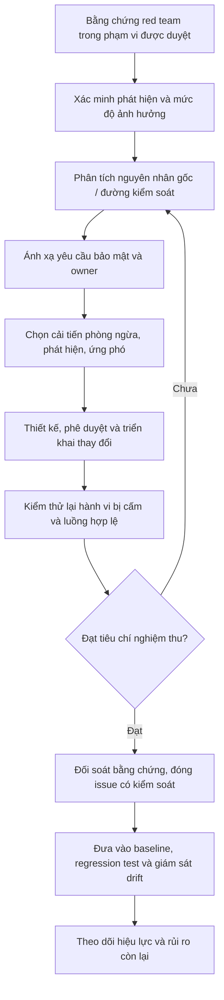

# Chuyển phát hiện thành cải tiến control

## 1. Vì sao red team chỉ thực sự có giá trị khi control được cải tiến?

Trong một cuộc diễn tập **red team và mô phỏng tấn công mạng** được cấp phép, nhóm kiểm thử cố gắng kiểm chứng liệu một kịch bản đe dọa có thể vượt qua các lớp bảo vệ hay không. Một phát hiện như “luồng từ VLAN người dùng đến giao diện quản trị firewall vẫn truy cập được” là bằng chứng hữu ích, nhưng tự nó chưa làm giảm rủi ro. Rủi ro chỉ được kiểm soát tốt hơn khi tổ chức xác định nguyên nhân, điều chỉnh cơ chế phòng vệ, chứng minh kết quả và duy trì hiệu lực sau những lần thay đổi hệ thống.

**Control** trong bài này là biện pháp kiểm soát bảo mật được thiết kế để **ngăn chặn**, **phát hiện**, **ứng phó** hoặc **khôi phục** trước hành vi và sự cố không mong muốn. Nó có thể là rule firewall, phân đoạn mạng, điều kiện truy cập VPN, phân quyền quản trị, bộ lọc DNS, cảnh báo IDS/IPS, quy trình SOC, hoặc cách quản lý cấu hình và thay đổi.

Trong module `SECURITY_NETWORK_SECURITY`, bài học tập trung vào các lớp phòng vệ mạng: segmentation, firewall, VPN, IDS/IPS, DNS, Wi-Fi, cloud network và luồng quản trị thiết bị. Mục tiêu là giúp kết quả red team trở thành **thay đổi có người chịu trách nhiệm, tiêu chí nghiệm thu đo được và kiểm thử hồi quy**.

### Kết quả học tập

Sau khi hoàn thành bài, bạn có thể:

1. Phân biệt **quan sát**, **phát hiện đã xác minh**, **nguyên nhân gốc**, **khoảng trống control** và **biện pháp cải tiến**.
2. Xây dựng hồ sơ phát hiện có bằng chứng, giới hạn phạm vi và liên kết tới yêu cầu bảo mật.
3. Chọn giải pháp phù hợp giữa sửa cấu hình, bổ sung lớp phòng vệ, tăng khả năng phát hiện và cải thiện ứng phó.
4. Định nghĩa tiêu chí nghiệm thu cùng phép kiểm thử tái xác minh, tránh đóng issue chỉ vì đã triển khai một rule.
5. Đưa bài học từ red team vào backlog, quy trình thay đổi, giám sát và regression test của hệ thống mạng.

## 2. Chuỗi chuyển đổi từ phát hiện sang kiểm soát đã được xác minh

Một báo cáo red team tốt trả lời **điều gì đã xảy ra**, **vì sao có thể xảy ra** và **hậu quả trong phạm vi kiểm thử**. Đội blue team và chủ sở hữu hệ thống tiếp tục trả lời **phải sửa lớp kiểm soát nào**, **đo hiệu quả thế nào** và **ai chịu trách nhiệm duy trì**.



Mỗi bước cần có kết quả rõ ràng:

| Bước | Câu hỏi chủ đạo | Tạo tác đầu ra |
| --- | --- | --- |
| Xác minh | Phát hiện có tái hiện được và nằm trong RoE không? | Bằng chứng và mô tả tác động |
| Phân tích | Hệ thống đã cho phép điều gì trái chính sách? | Root cause và danh sách control liên quan |
| Thiết kế | Phải thay đổi hành vi nào, tại lớp nào? | Kế hoạch cải tiến và đánh giá tác động |
| Triển khai | Ai được phép sửa, vào thời điểm nào? | Change ticket, diff cấu hình, phê duyệt |
| Nghiệm thu | Hành vi không mong muốn có còn xảy ra không? | Kết quả retest, negative và positive control |
| Duy trì | Một thay đổi tương lai có làm lỗi quay lại không? | Baseline, regression case và cảnh báo drift |

Điểm then chốt: **“Đã triển khai bản sửa” khác với “đã chứng minh control hoạt động.”** Trạng thái issue phải phản ánh bằng chứng nghiệm thu, không chỉ lịch sử thao tác của người vận hành.

## 3. Chuẩn hóa phát hiện trước khi tạo remediation

Red team thường thu thập tín hiệu từ nhiều nguồn: packet capture được phép, ảnh chụp cấu hình, log firewall, flow log cloud, sự kiện VPN, DNS resolver, IDS/IPS và timeline bài diễn tập. Thông tin phải được chuẩn hóa để đội phụ trách có thể kiểm tra lại mà không cần suy đoán.

### 3.1. Phân biệt năm tầng thông tin

| Tầng | Ví dụ | Không được nhầm với |
| --- | --- | --- |
| **Observation (quan sát)** | Một kết nối TCP tới cổng quản trị trả lời | Chưa đủ chứng minh có thể đăng nhập quản trị |
| **Validated finding** | Kết nối từ zone ngoài chính sách đến đúng endpoint quản trị được ghi nhận nhiều nguồn | Chưa chứng minh nguyên nhân cấu hình cụ thể |
| **Root cause** | Rule cho phép quá rộng và thứ tự match ưu tiên hơn deny | Không đồng nghĩa mọi thành phần đều sai |
| **Control gap** | Chính sách chặn management plane chưa được áp dụng đúng ở điểm thực thi | Chưa xác định chắc giải pháp kỹ thuật tối ưu |
| **Improvement** | Thu hẹp rule, giới hạn nguồn, test lại hai chiều và theo dõi thay đổi | Chưa được coi là hoàn tất nếu thiếu kiểm chứng |

### 3.2. Những trường bắt buộc trong một hồ sơ phát hiện

| Trường | Nội dung cần ghi |
| --- | --- |
| ID và tên phát hiện | Mã duy nhất, tiêu đề có thể tìm kiếm |
| Mục tiêu diễn tập | Kịch bản, giả thuyết, giới hạn RoE, thời gian |
| Phạm vi | Asset ID, zone, account cloud, IP/FQDN liên quan đã được duyệt |
| Quan sát có timestamp | Hành động được phép đã thực hiện và phản hồi quan sát |
| Bằng chứng | Log ID, rule ID, ảnh/snapshot, flow tuple, phiên bản policy |
| Kỳ vọng chuẩn | Yêu cầu bảo mật hoặc policy mô tả hành vi đúng |
| Tác động | Quyền truy cập trái phép tiềm năng, vùng rủi ro và điều kiện tiền đề |
| Mức chắc chắn | Đã tái xác minh/đang cần xác minh, các giả thuyết chưa kiểm chứng |
| Root cause giả định/đã kết luận | Thay đổi mạng, thứ tự rule, NAT, IAM, cấu hình sai |
| Chủ sở hữu | Người chịu trách nhiệm control, tài sản và thay đổi |
| Điều kiện đóng | Hành vi được phép, hành vi bị cấm và bằng chứng telemetry cần đạt |

**Không đưa bí mật, dữ liệu cá nhân hoặc bản sao dữ liệu nhạy cảm không cần thiết vào ticket.** Lưu bằng chứng theo phân quyền, thời hạn lưu giữ và cách chia sẻ của tổ chức; có thể dùng phiên bản đã che thông tin để nhóm triển khai tiếp cận an toàn.

## 4. Từ chuỗi tấn công sang bản đồ control

Một phát hiện có thể đi qua nhiều lớp phòng vệ; cần ánh xạ từng điểm ra quyết định để xác định **control nào nên chặn, control nào nên phát hiện, control nào nên kích hoạt phản ứng**.

Ví dụ mô phỏng: trong phạm vi lab được duyệt, một thiết bị thuộc mạng khách có thể truy cập TCP tới giao diện quản trị một thiết bị hạ tầng. Mục đích không phải hướng dẫn tấn công, mà là phân tích vì sao một đường quản trị đáng lẽ bị tách biệt lại lộ ra.

| Lớp | Hành vi kỳ vọng | Phát hiện có thể cho thấy | Hướng cải tiến |
| --- | --- | --- | --- |
| Segmentation / routing | Guest không có đường tới management | Có route và path đi qua vùng đáng tin cậy | Thu hẹp route/VRF/ACL theo thiết kế |
| Firewall | Deny Guest → management, chỉ allow bastion hợp lệ | Rule ưu tiên cao hoặc object-group quá rộng | Sửa nguồn/đích/port, thứ tự rule và default deny |
| Device management | Chỉ mở quản trị từ điểm được phép | Interface dịch vụ listen trên mạng không phù hợp | Bind quản trị vào management interface, hạn chế source |
| Authentication / authorization | Danh tính không có quyền bị từ chối | Truy cập TCP được nhưng chưa xác định khả năng xác thực | Cứng hóa AAA, MFA, role, session và account |
| IDS/SIEM | Có sự kiện khi truy cập bất thường | Sự kiện không phát hoặc không được chuyển đến SOC | Bổ sung coverage, correlation, dashboard và owner |
| Incident response | Triage kịp thời, xác minh và chặn khi cần | Alert có nhưng không ai nhận | Cập nhật runbook, escalation và đo phản ứng |

Không phải phát hiện nào cũng cần sửa tất cả lớp. Cách làm tốt là xác định điểm kiểm soát chính phải ngăn được hành vi, các lớp hỗ trợ, và rủi ro nếu một lớp bị sai trong tương lai.

### Ánh xạ kịch bản, không chỉ liệt kê kỹ thuật

Có thể sử dụng khung phân loại như MITRE ATT&CK để mô tả kỹ thuật trong một chuỗi diễn tập và giúp các đội sử dụng cùng ngôn ngữ. Tuy nhiên, **nhãn kỹ thuật không phải bằng chứng một control đã thất bại**. Một phát hiện có thể liên quan nhiều kỹ thuật, trong khi remediation phải bám vào luồng mạng, điều kiện chính sách và bằng chứng cụ thể.

Lập bảng mapping theo cấu trúc:

| Thành phần | Câu hỏi |
| --- | --- |
| Kịch bản | Đối tượng đe dọa đang cố đạt mục tiêu gì? |
| Điều kiện đầu vào | Cần vị trí mạng, danh tính, cấu hình nào? |
| Hành vi được quan sát | Dòng sự kiện nào đã xảy ra trong cuộc diễn tập? |
| Control dự kiến | Chính sách, thiết bị hoặc đội nào phải ngăn/phát hiện? |
| Lỗ hổng kiểm soát | Hành vi nào trái kỳ vọng được chứng minh? |
| Thay đổi kiểm soát | Làm gì để ngăn hoặc quan sát sớm hơn? |
| Test nghiệm thu | Sau sửa, đo gì để chứng minh hiệu quả? |

## 5. Tìm nguyên nhân gốc: đừng dừng ở triệu chứng

Nếu rule firewall trông đúng nhưng một đường truy cập bị cấm vẫn thành công, chỉ thêm một rule deny có thể không giải quyết vấn đề. Hãy kiểm tra **effective behavior** của toàn tuyến:

1. **Định danh đúng traffic:** source/destination, protocol, port, hướng kết nối, IPv4/IPv6, thời điểm và VPN/VRF/VLAN.
2. **Đường đi thực tế:** packet đi qua những thiết bị và lớp chính sách nào? NAT, load balancer, routing hoặc cloud egress có thay đổi đích không?
3. **Rule và độ ưu tiên:** rule nào match sau khi triển khai? Có shadowed rule, object-group mở rộng hoặc policy đặc biệt không?
4. **Trạng thái cấu hình:** rule chạy thực tế có cùng phiên bản với kho quản lý IaC không? Có sửa trực tiếp ngoài quy trình?
5. **Khả năng phát hiện:** firewall và IDS có log? Log có được forward và correlate tới đúng ca diễn tập?
6. **Quy trình:** nguyên nhân cấu hình này đi qua review, kiểm thử, phê duyệt và giám sát như thế nào?

Ví dụ phân tích “5 Why” rút gọn:

| Câu hỏi | Phát hiện giả định |
| --- | --- |
| Vì sao Guest tới được management IP? | Một rule cho phép vùng Guest tới object chứa management subnet |
| Vì sao rule tồn tại? | Rule tạm phục vụ bảo trì được cấu hình với phạm vi rộng |
| Vì sao chưa bị thu hồi? | Ticket thay đổi không có thời hạn hết hiệu lực |
| Vì sao review không phát hiện? | Không có test Guest → management dạng negative trong pipeline |
| Vì sao SOC không thấy? | Logging deny/allow theo vùng này chưa được đưa vào ca cảnh báo |

Phân tích này **chỉ là giả thuyết minh họa**, phải xác minh qua diff, hit count, log, timeline và thông tin thay đổi thực tế. Kết quả là một nhóm hành động: sửa quyền hiện tại, ngăn lỗi tái xuất hiện và tăng giám sát.

## 6. Phân loại cải tiến control

### 6.1. Preventive control — ngăn sự việc xảy ra

Mục tiêu là làm cho đường tấn công hoặc hành động trái chính sách không thể thành công trong điều kiện kiểm thử:

- Phân đoạn đúng VLAN/VRF, policy giữa trust zones và cloud VPC/VNet.
- Thu hẹp ACL/firewall rule theo nguồn, đích, cổng, giao thức và thời gian; tránh quyền tràn từ object-group.
- Giới hạn management plane vào mạng hoặc bastion riêng; tắt dịch vụ không cần thiết.
- Cứng hóa VPN, policy theo nhóm và xác thực/ủy quyền truy cập quản trị.
- Kiểm soát DNS egress và resolver được chấp thuận; bảo vệ đường quản trị và tài khoản dịch vụ.
- Kiểm tra các ràng buộc tương đương trên IPv4/IPv6, mạng không dây, API quản trị và cloud.

**Acceptance:** hành vi bị cấm phải bị từ chối tại điểm kiểm soát dự kiến; luồng hợp lệ có liên quan vẫn hoạt động.

### 6.2. Detective control — phát hiện hành vi đáng ngờ

Khi phòng ngừa chưa đủ, giảm khả năng hoạt động bất thường diễn ra âm thầm:

- Cấu hình log cho các đường quản trị, deny rule nhạy cảm, VPN authentication và thay đổi policy.
- Bổ sung detection rule có độ tin cậy phù hợp cho IDS/IPS, DNS, cloud flow logs và SIEM.
- Ghép event theo source, destination, identity, session, policy/rule ID và asset criticality.
- Điều chỉnh ngưỡng và lọc nhiễu dựa trên traffic thực tế; không chỉ kiểm tra rule có tồn tại.
- Tạo nguồn telemetry độc lập tại endpoint, firewall hoặc identity provider khi một cảm biến không nhìn thấy toàn tuyến.

**Acceptance:** hoạt động thử nghiệm đã được duyệt sinh được tín hiệu đúng nguồn, trong cửa sổ thời gian chấp nhận; SOC nhìn thấy và phân loại chính xác.

### 6.3. Responsive control — rút ngắn thời gian phản ứng

Một alert có thể xuất hiện nhưng vẫn vô dụng nếu không ai sở hữu. Cần:

- Quy tắc severity và routing tới đội trực có trách nhiệm.
- Runbook chỉ dẫn xác minh scope, kiểm tra log, cô lập tài sản hoặc vô hiệu hóa quyền theo thẩm quyền.
- Kênh escalation, lịch trực và quy trình phối hợp network/SOC/cloud/identity.
- Cơ chế dừng điều kiện nguy hiểm và đánh giá rollback khi có thay đổi phòng vệ.
- Ghi timeline xử lý, hành động và kết quả để rút kinh nghiệm.

**Acceptance:** alert đến đúng queue, người trực nhận và xử lý trong thời gian mục tiêu; hành động phản ứng không vượt quyền hoặc ảnh hưởng ngoài phạm vi.

### 6.4. Recovery và governance — duy trì hiệu lực

Kiểm soát phục hồi gồm backup cấu hình, rollback được kiểm tra, khôi phục đường quản trị an toàn và diễn tập phục hồi có phê duyệt. Kiểm soát quản trị gồm policy-as-code, review bắt buộc, thời hạn rule tạm, drift detection, quản lý tài sản và lịch retest. Chúng giúp ngăn việc cùng một sai sót quay lại sau vài tháng.

## 7. Ưu tiên remediation theo rủi ro thực tế

Không phải phát hiện nào cũng cần xử lý cùng thời hạn. Đánh giá dựa trên **khả năng khai thác trong môi trường thực, tác động tới tài sản và độ phơi lộ của đường tiếp cận**, chứ không chỉ tiêu đề hay điểm số của một công cụ.

| Yếu tố | Câu hỏi minh họa |
| --- | --- |
| Khả năng tiếp cận | Đường tấn công ở Internet, mạng khách, VPN người dùng hay vùng quản trị? |
| Điều kiện cần | Có cần danh tính đặc quyền, quyền vật lý hoặc một lỗi khác trước đó? |
| Tác động | Mất phân đoạn, lộ quản trị, gián đoạn dịch vụ hay chỉ thiếu telemetry? |
| Phạm vi | Một host lab hay nhiều hệ thống production, đặc biệt là tài sản trọng yếu? |
| Control bù trừ | Có chặn ở lớp khác không, có bằng chứng hiệu quả không? |
| Tính chắc chắn | Tác động đã được quan sát hay vẫn là suy đoán? |
| Tính khả thi | Có thể sửa nhanh nhưng an toàn, hay cần đổi kiến trúc hoặc downtime? |

Ví dụ khung ưu tiên:

| Ưu tiên | Dạng tình huống | Hướng xử lý |
| --- | --- | --- |
| Khẩn cấp | Đường bị cấm mở vào thiết bị quản trị production từ vùng ít tin cậy | Xác nhận tác động, giảm phơi lộ và triển khai thay đổi kiểm soát theo quy trình khẩn |
| Cao | Phân đoạn bị sai ở nhiều zone, logging cho luồng nguy hiểm bị thiếu | Owner lập remediation, regression test và hạn hoàn thành rõ |
| Trung bình | Phát hiện/ứng phó chậm nhưng có lớp chặn khác đáng tin cậy | Nâng coverage, giảm độ trễ, kiểm thử thực tế |
| Thấp | Thiếu metadata, dashboard chưa đầy đủ nhưng không ảnh hưởng trực tiếp control | Đưa vào backlog, có ngày xem xét lại |

Mức ưu tiên trong bảng chỉ là ví dụ. Tổ chức có thể dùng khung quản trị rủi ro riêng; thay đổi mức ưu tiên và chấp nhận rủi ro cần người có thẩm quyền quyết định, ghi lại cơ sở và ngày xem xét.

## 8. Tình huống thực hành xuyên suốt: đường Guest đến management

### 8.1. Bối cảnh và bằng chứng

Trong lab có phê duyệt, nhóm red team kiểm tra thuộc tính “Guest không được kết nối tới giao diện quản trị”. Dùng một probe an toàn, tốc độ thấp, họ quan sát được TCP handshake thành công tới cổng quản trị trên địa chỉ được cấp phép. Firewall log cho thấy lưu lượng match rule allow tạm; dịch vụ ứng dụng chưa được xác thực, nên **chỉ kết luận ranh giới mạng không chặn theo yêu cầu**, không suy diễn rằng tài khoản quản trị đã bị chiếm.

| Trường | Ví dụ minh họa |
| --- | --- |
| Finding ID | RT-NET-012 |
| Phạm vi | Guest zone → thiết bị quản trị trong staging |
| Quan sát | TCP/443 được chấp nhận từ nguồn không được cấp quyền |
| Bằng chứng | Probe log, firewall policy hit, timestamp, rule ID |
| Yêu cầu | Chỉ management bastion được kết nối tới HTTPS quản trị |
| Giới hạn kết luận | Chưa chứng minh đăng nhập hoặc truy cập cấu hình |
| Owner | Nhóm Network Security và chủ sở hữu thiết bị |

### 8.2. Đề xuất cải tiến có lớp

1. **Ngăn chặn:** thu hẹp rule cho phép nguồn bastion chính thức; tách management interface khỏi Guest, kiểm tra route, NAT và IPv6 nếu liên quan.
2. **Phát hiện:** bật log truy cập tới management plane, cảnh báo kết nối bất thường từ zone ít tin cậy và sự kiện thay đổi rule bảo vệ.
3. **Ứng phó:** gán alert tới NOC/SOC, có runbook đối soát rule, xác định người thay đổi, giới hạn luồng khi xác thực sự cố.
4. **Chống tái phát:** ràng buộc rule tạm với ticket và hạn sử dụng, review diff tự động, thêm ca Guest → Management dạng negative vào pipeline.

### 8.3. Tiêu chí nghiệm thu

| ID | Điều kiện | Kỳ vọng |
| --- | --- | --- |
| AC-01 | Guest probe → management TCP/443 | DENIED, có bằng chứng rule/policy thực thi |
| AC-02 | Bastion hợp lệ → management TCP/443 | ALLOWED, dịch vụ quản trị sẵn sàng |
| AC-03 | Guest probe → management qua đường IPv6 nếu được sử dụng | DENIED |
| AC-04 | Firewall rule tạm ngoài phạm vi chính sách | Được thu hồi hoặc thu hẹp, có change diff |
| AC-05 | Probe bất thường đã được duyệt | Tạo event liên kết đúng nguồn/đích và đến SOC |
| AC-06 | Thay đổi policy trong lần triển khai sau | Test AC-01/AC-02 tự chạy lại và chặn regression quan trọng |

**Không coi timeout đơn lẻ là bằng chứng DENIED.** Host có thể down hoặc routing lỗi. Cần kiểm chứng rule match, logs và một positive control từ bastion (khi nằm trong phạm vi cho phép) để phân biệt chặn đúng chính sách với sự cố hạ tầng.

## 9. Ví dụ khác: phát hiện không đồng nghĩa kiểm soát ngăn chặn thất bại

Trong một diễn tập khác, IPS tạo cảnh báo chính xác cho một mẫu traffic mô phỏng đã được duyệt, nhưng SOC không nhận được ticket vì bộ định tuyến sự kiện bị lỗi. Ở đây, không nên mô tả rằng “IPS không phát hiện” nếu log cục bộ vẫn tồn tại. Đường đi sự kiện là:

```text
Traffic thử nghiệm trong phạm vi cho phép
    └──► IDS/IPS: nhận diện và sinh event  [PASS]
             └──► Collector: nhận event    [PASS]
                      └──► SIEM: chuẩn hóa  [PASS]
                               └──► Correlation/triage queue  [FAIL]
                                        └──► SOC: không nhận ticket
```

Remediation phù hợp có thể là sửa mapping severity, routing rule, event enrichment hoặc cơ chế retry; bổ sung health check cho đường phát hiện và kiểm tra đến tận queue của người nhận. Sau sửa, cần test cả event giả lập hợp lệ và quy trình SOC tiếp nhận, không chỉ chứng minh sensor ghi log.

Tương tự, nếu VPN xác thực đúng nhưng một nhóm người dùng được gán subnet quá rộng, lỗi chính có thể ở **authorization scope**, không phải authentication. Ánh xạ đúng nguyên nhân giúp tránh triển khai biện pháp không giải quyết được nguy cơ.

## 10. Viết cải tiến thành yêu cầu có thể nghiệm thu

Một ticket kiểu “tăng cường firewall” không đủ cụ thể. Ticket hiệu quả nên diễn tả **điều kiện, hành vi mong đợi, cách đo và người nghiệm thu**.

Sử dụng mẫu Given–When–Then:

> **Given** nguồn thử nghiệm thuộc vùng Guest, trong khung thời gian và phạm vi được duyệt; **When** gửi kết nối TCP được phép thử tới HTTPS quản trị của switch; **Then** đường đi bị chặn ở điểm thực thi xác định và có bản ghi kiểm toán tương ứng.

Kèm một ca đối chứng:

> **Given** nguồn bastion quản trị được cấp quyền; **When** gửi yêu cầu kết nối tới dịch vụ quản trị; **Then** đường đi cho phép vẫn hoạt động và không có hồi quy về tính sẵn sàng.

Yêu cầu nghiệm thu phải đủ chính xác để hai nhóm độc lập đi đến cùng kết luận:

- Tài sản, zone, identity, cổng và giao thức nào?
- Điều kiện nào là bắt buộc (thời gian, phiên bản rule, đường đi, chính sách IAM)?
- Quan sát gì được coi PASS, FAIL hoặc UNKNOWN?
- Bằng chứng nào chứng minh kết quả (probe log, firewall event, config snapshot, SIEM event)?
- Ai chấp nhận kết quả, trong phạm vi và thời gian nào?

Không cố gắng nghiệm thu một yêu cầu có thể gây tác động lên hệ thống bên thứ ba hoặc ngoài RoE; thay thế bằng kiểm tra tĩnh, lab hoặc bằng chứng khác đã được duyệt.

## 11. Hồ sơ remediation dạng dữ liệu

Ví dụ YAML dưới đây là **mẫu quản lý cải tiến** cho tài liệu và backlog, không phải cấu hình có thể nạp trực tiếp vào firewall hay SIEM:

```yaml
finding:
  id: RT-NET-012
  title: "Guest zone can reach management HTTPS in staging"
  source: "authorized-red-team-exercise"
  scope_reference: "ROE-STAGING-026"
  risk_owner: "network-security-owner"
  evidence_refs:
    - "probe-2026-11-28-12"
    - "fwlog-2026-11-28-45"
  expected_security_property: "guest-to-management-is-denied"
  observed: "tcp-handshake-succeeded"
  confidence: "validated"

root_cause:
  primary: "temporary-firewall-allow-rule-too-broad"
  contributing:
    - "no-expiry-for-temporary-rules"
    - "missing-negative-regression-test"
  analysis_owner: "network-platform-team"

remediation:
  change_ticket: "CHG-0264"
  owner: "network-platform-team"
  reviewer: "security-control-owner"
  prevention:
    - "restrict-management-allowlist-to-approved-bastion"
    - "remove-expired-temporary-rule"
  detection:
    - "alert-on-unapproved-management-zone-access"
  governance:
    - "enforce-expiry-and-review-of-temporary-rules"

acceptance:
  tests:
    - id: "AC-01"
      expected: "denied"
      evidence: ["probe-result", "firewall-rule-log"]
      mandatory: true
    - id: "AC-02"
      expected: "allowed"
      evidence: ["probe-result", "service-health"]
      mandatory: true
    - id: "AC-05"
      expected: "alert-delivered"
      evidence: ["sensor-event", "soc-queue-record"]
      mandatory: true
  baseline_revision: "netreg-staging-r3"
  retest_required: true
  residual_risk_review_required: true
```

Một record có đầy đủ trường chưa đủ chứng minh đã khắc phục: trạng thái `validated` hoặc `denied` trong dữ liệu là thông tin phải có bằng chứng xác thực từ hệ thống kiểm thử và được review. Không tự dùng kết quả một script để thay thế phê duyệt hay đánh giá rủi ro.

## 12. Xác minh hiệu quả sau khi sửa control

### 12.1. Kiểm thử lại phát hiện gốc

Lặp lại *cùng điều kiện đã được phép và đủ tương đương*: nguồn/đích, zone, danh tính, giao thức, policy version và giới hạn vận hành. Kỳ vọng được xác định **trước** khi chạy. Nếu nguồn hoặc tài sản đã thay đổi, phải xác minh inventory và phê duyệt lại thay vì giả định tương đương.

### 12.2. Test ngược và test tích cực

Một rule deny mới có thể chặn cả đường quản trị hợp lệ, gây sự cố vận hành. Vì vậy test phải gồm:

| Loại | Mục đích |
| --- | --- |
| Negative | Luồng trái chính sách thực sự bị từ chối |
| Positive | Luồng phục vụ nghiệp vụ và quản trị hợp lệ vẫn hoạt động |
| Configuration | Rule deployed, thứ tự, object group và logging đúng như thiết kế |
| Detection | Event được tạo, đến đúng hệ thống và được phân loại |
| Response | Runbook, escalation, ownership và thời gian phản ứng đáp ứng yêu cầu |
| Regression | Lần thay đổi sau không đưa lỗi đã sửa quay trở lại |

### 12.3. Không đánh đồng kết quả không quan sát được với thành công

Một kiểm thử nên trả về ít nhất bốn trạng thái:

| Trạng thái | Ý nghĩa | Quyết định |
| --- | --- | --- |
| **PASS** | Có bằng chứng tin cậy đáp ứng tiêu chí | Đạt tiêu chí cụ thể |
| **FAIL** | Có bằng chứng trái với kỳ vọng | Mở lại việc khắc phục, đánh giá rollback |
| **UNKNOWN** | Quan sát chưa đủ kết luận | Bổ sung bằng chứng, chưa nghiệm thu |
| **ERROR** | Test runner, scope hoặc telemetry bị lỗi | Sửa hệ thống đo, kiểm thử lại |

Đối với control quan trọng, `UNKNOWN` và `ERROR` không được tự động biến thành PASS. Nếu thiết bị không hỗ trợ một phép kiểm thử, có thể dùng biện pháp xác minh thay thế được chủ sở hữu phê duyệt, kèm giải thích hạn chế.

## 13. Ví dụ kiểm tra hồ sơ nghiệm thu ngoại tuyến bằng Python

Đoạn mã sau chỉ **đối chiếu dữ liệu kết quả đã thu thập**, không kết nối mạng và không chạy kỹ thuật tấn công. Giả sử có file `acceptance_results.json`:

```json
{
  "finding_id": "RT-NET-012",
  "tests": [
    {"id": "AC-01", "expected": "denied", "observed": "denied",
     "evidence_refs": ["probe-01", "fwlog-01"]},
    {"id": "AC-02", "expected": "allowed", "observed": "allowed",
     "evidence_refs": ["probe-02", "health-02"]},
    {"id": "AC-05", "expected": "alert-delivered", "observed": "unknown",
     "evidence_refs": ["sensor-05"]}
  ]
}
```

Chương trình dưới đây trả exit code khác 0 nếu có test bắt buộc chưa đạt:

```python
import json
import sys
from pathlib import Path

required = {
    "AC-01": "denied",
    "AC-02": "allowed",
    "AC-05": "alert-delivered",
}

data = json.loads(
    Path("acceptance_results.json").read_text(encoding="utf-8")
)
results = data.get("tests", [])
seen = {}
issues = []

for item in results:
    test_id = item.get("id")
    if test_id in seen:
        issues.append(f"{test_id}: duplicate test")
    seen[test_id] = item

for test_id, expected in required.items():
    item = seen.get(test_id)
    if item is None:
        issues.append(f"{test_id}: missing result")
        continue
    if item.get("expected") != expected:
        issues.append(f"{test_id}: expectation changed")
        continue
    if not item.get("evidence_refs"):
        issues.append(f"{test_id}: missing evidence")
        continue
    observed = item.get("observed")
    if observed in {"unknown", "error", None}:
        issues.append(f"{test_id}: inconclusive ({observed})")
    elif observed != expected:
        issues.append(f"{test_id}: FAIL ({observed})")
    else:
        print(f"{test_id}: PASS")

if issues:
    for issue in issues:
        print(issue, file=sys.stderr)
    sys.exit(1)

print(f"PASS: all {len(required)} mandatory acceptance tests")
```

Trong ví dụ, AC-01 và AC-02 đạt nhưng AC-05 chưa có bằng chứng alert đến SOC, nên chương trình trả mã lỗi. **Không thể đóng toàn bộ phát hiện nếu nghiệm thu yêu cầu cả detection.**

Code này chỉ là **validator ngoại tuyến**. Nó chưa xác minh tính xác thực, thời gian, phạm vi của evidence; hệ thống thực tế cần liên kết evidence ID với log gốc, đồng bộ thời gian, kiểm tra scope/approval và ngăn ghi đè kết quả. Việc đóng issue cuối cùng vẫn cần người sở hữu control chấp nhận.

## 14. Đưa phát hiện vào backlog và quy trình thay đổi

### 14.1. Phân công trách nhiệm rõ ràng

Một finding có thể liên quan nhiều đội. Cần phân biệt:

- **Finding owner:** chịu trách nhiệm bảo đảm phát hiện được xử lý và không thất lạc.
- **Control owner:** chịu trách nhiệm yêu cầu an toàn và chất lượng kiểm soát.
- **Implementation owner:** triển khai sửa đổi theo change đã duyệt.
- **Validation owner:** tổ chức retest khách quan, lưu bằng chứng.
- **Risk owner:** quyết định chấp nhận rủi ro còn lại, ngoại lệ và hạn hiệu lực theo thẩm quyền.

Một người có thể giữ nhiều vai trò khi phù hợp, nhưng đối với thay đổi đặc quyền hoặc ảnh hưởng diện rộng nên có review độc lập để tránh tự xác nhận kết quả của chính mình.

### 14.2. Trạng thái công việc thực tế

```text
NEW → TRIAGED → VALIDATED → PLAN_APPROVED → IMPLEMENTING
                                        → READY_FOR_RETEST
                                        → VERIFIED → CLOSED
                              └────────→ REOPENED nếu retest FAIL
TRIAGED/VALIDATED → RISK_ACCEPTED (ngoại lệ có hạn, có người duyệt)
```

Quy trình cụ thể có thể khác theo công ty; điều cốt lõi là phân biệt rõ **phát hiện đã xác minh**, **đã triển khai**, **đã kiểm thử lại** và **đã đóng**. Một ticket hết hạn do không được cập nhật không đồng nghĩa rủi ro đã hết.

### 14.3. Theo dõi exception và rủi ro còn lại

Có trường hợp không thể sửa ngay do hạ tầng cũ hoặc cần downtime. Khi ấy phải có quyết định chấp nhận rủi ro hoặc control bù trừ được phê duyệt, bao gồm:

1. Phạm vi tài sản, mức rủi ro, lý do chưa sửa.
2. Control bù trừ đã có bằng chứng hoạt động.
3. Người sở hữu rủi ro và người có thẩm quyền duyệt.
4. Hạn xem xét lại, điều kiện hết hiệu lực và kế hoạch xử lý lâu dài.
5. Điều kiện tái mở ticket nếu threat landscape, phơi lộ hoặc control thay đổi.

Không được tự đổi trạng thái `PASS` hay `CLOSED` chỉ vì được gia hạn ngoại lệ. Cần biểu diễn rõ ràng `RISK_ACCEPTED` và đánh giá lại định kỳ.

## 15. Tích hợp cải tiến vào regression test và monitoring

Một sửa đổi có giá trị lâu dài nên tạo thêm **bất biến bảo mật** và cơ chế phát hiện hồi quy. Ví dụ:

- Guest không bao giờ truy cập được management plane, kể cả qua IPv6 và đường VPN phụ.
- Chỉ bastion đã được cấp phép được kết nối tới cổng quản trị của nhóm switch cụ thể.
- Cloud security group không được mở inbound quản trị ra mọi nguồn.
- VPN role thông thường không được truy cập subnet quản trị.
- Rule firewall tạm phải có owner, ticket, hạn hiệu lực và quy trình rà soát.
- IDS/SIEM phải phát hiện và chuyển sự kiện kiểm thử đã duyệt đến SOC trong mức trễ cho phép.

Trong pipeline thay đổi mạng:

1. **Trước triển khai:** lint, kiểm tra policy diff, mô phỏng rule và đối chiếu bất biến.
2. **Khi triển khai:** giới hạn đợt/canary, snapshot và rollback plan.
3. **Sau triển khai:** probe trong phạm vi được duyệt, positive/negative tests và đối soát log.
4. **Định kỳ:** kiểm tra drift, kiểm tra waiver hết hạn và diễn tập telemetry từ đầu tới cuối.

Tránh chạy probe chủ động không có phê duyệt chỉ vì pipeline chạy tự động. Một test run cần ghi scope, nguồn probe, thời gian, danh tính, phiên bản policy và điều kiện dừng. Nếu điều kiện không đạt, đánh dấu `SKIPPED/ERROR` phù hợp và báo cho owner.

## 16. Đo hiệu quả cải tiến control

Các chỉ số phải đo **kết quả giảm rủi ro**, không chỉ số lượng ticket đã đóng.

| Nhóm chỉ số | Ví dụ | Cách diễn giải |
| --- | --- | --- |
| Remediation | Thời gian từ validated finding đến verified closure | Tốt khi rủi ro quan trọng được xử lý kịp thời |
| Coverage | Tỷ lệ phát hiện quan trọng có acceptance test và regression case | Thấp cho thấy thiếu kiểm soát duy trì |
| Prevention | Tỷ lệ negative tests đạt, số đường truy cập trái policy còn mở | Đo trực tiếp hiệu quả của chặn/phân đoạn |
| Detection | Tỷ lệ kịch bản mô phỏng tạo alert, thời gian từ event đến SOC | Đo tính đầy đủ và độ trễ giám sát |
| Response | Thời gian nhận, phân loại, xử lý cảnh báo mô phỏng | Đo hiệu quả của runbook và escalation |
| Stability | Số lần cùng root cause tái xuất hiện, drift hoặc rule tạm hết hạn | Đo khả năng chống tái phát |
| Evidence quality | Tỷ lệ retest có log đủ để khẳng định PASS/FAIL | Tránh quyết định dựa trên timeout/mô tả chủ quan |

Ví dụ công thức:

\[
\text{Coverage} = \frac{\text{Số finding quan trọng có retest và regression case}}{\text{Tổng finding quan trọng cần theo dõi}} \times 100\%
\]

Chỉ tính trong một giai đoạn và tập phát hiện được xác định trước; tránh làm đẹp tỷ lệ bằng cách loại những finding khó xử lý. Chất lượng quan trọng hơn lượng: **100% ticket đóng nhưng không có bằng chứng retest** không chứng minh hệ thống an toàn hơn.

## 17. Sai lầm thường gặp

| Sai lầm | Vì sao nguy hiểm | Thực hành tốt hơn |
| --- | --- | --- |
| Sửa triệu chứng bằng rule deny đơn lẻ | Lỗi gốc và đường vòng khác vẫn tồn tại | Phân tích đường đi và effective policy |
| Chỉ cải thiện prevention, bỏ qua telemetry | Lần tái diễn sau không được phát hiện | Kiểm tra cả logging, alert và SOC queue |
| Mô tả tác động vượt quá bằng chứng | Ưu tiên sai và dễ gây tranh cãi | Tách điều quan sát được khỏi giả thuyết |
| Chỉ retest bằng timeout | Host down vẫn có thể làm test “đạt” | Đối soát rule hit, logs và positive control |
| Đóng issue khi merge cấu hình | Deploy có thể thất bại hoặc không đúng tuyến | Xác minh hành vi sau triển khai |
| Không kiểm tra đường hợp lệ | Rule chặn mới có thể gây gián đoạn dịch vụ | Chạy positive và negative regression |
| Không rõ owner | Ticket tồn đọng, alert không ai xử lý | Giao người chịu trách nhiệm, deadline và escalation |
| Không quản lý rule tạm | Ngoại lệ tồn tại lâu hơn mục đích | Đặt thời hạn, kiểm tra owner và tự cảnh báo |
| Tự sửa baseline cho khớp kết quả | Hợp thức hóa control suy giảm | Baseline phải được duyệt độc lập |
| Nhầm risk accepted với fixed | Báo cáo sai hiệu quả bảo vệ | Ghi rủi ro còn lại, ngoại lệ và hạn xem xét |
| Retest ngoài phạm vi được duyệt | Ảnh hưởng hệ thống và mất tính hợp lệ | Kiểm tra RoE, inventory và giới hạn trước khi chạy |

## 18. Bài thực hành: viết kế hoạch cải tiến từ một phát hiện

**Tình huống:** trong diễn tập được phép tại staging, nhóm red team phát hiện một service account VPN thuộc nhóm vận hành thông thường có thể kết nối tới subnet quản trị thiết bị mạng; đồng thời các log liên quan không được đưa vào dashboard SOC. Người dùng hợp lệ được phép truy cập ứng dụng nội bộ qua VPN, nhưng không được phép truy cập subnet quản trị.

Hãy thực hiện:

1. Viết finding gồm phạm vi, observed behavior, expected behavior, bằng chứng, điều chưa được chứng minh.
2. Đề xuất ít nhất hai giả thuyết root cause: ví dụ ánh xạ group sai, ACL/VPN policy quá rộng hoặc trust zone không được thực thi.
3. Lập hai cải tiến preventive, một cải tiến detective và một bước responsive.
4. Viết acceptance test cho **VPN user thường → management: DENIED** và **VPN user thường → ứng dụng được cấp: ALLOWED**.
5. Nêu bằng chứng chứng minh alert đi đến dashboard SOC; phân biệt mất log tại nguồn với lỗi pipeline.
6. Xác định owner, severity có căn cứ, thời hạn, điều kiện đóng và một regression test để ngăn lỗi tái xuất hiện.

**Gợi ý đánh giá:** phương án tốt không suy đoán việc chiếm quyền điều khiển thiết bị nếu bằng chứng chỉ cho thấy khả năng kết nối; remediation phải gắn với đúng control và có positive control để tránh làm hỏng truy cập VPN hợp lệ.

## 19. Câu hỏi tự kiểm tra

**Câu 1.** Vì sao finding “quét thấy cổng quản trị mở” chưa đủ để kết luận attacker đã có đặc quyền quản trị?

*Gợi ý:* Mở cổng chỉ cho thấy dịch vụ có thể nhận kết nối từ nguồn quan sát; còn cần xác thực, phân quyền và bằng chứng truy cập thực sự. Không suy diễn vượt phạm vi kiểm thử.

**Câu 2.** Đội vận hành đã cập nhật rule firewall theo ticket, có nên đóng finding ngay?

*Gợi ý:* Chưa. Cần kiểm tra rule có hiệu lực trên tuyến thực, negative test chặn đúng luồng trái policy, positive test bảo đảm dịch vụ hợp lệ và bằng chứng logging theo tiêu chí nghiệm thu.

**Câu 3.** IDS đã sinh sự kiện, SIEM nhận được nhưng SOC không thấy alert. Control nào cần cải tiến?

*Gợi ý:* Có thể nằm ở correlation, severity, routing tới queue hoặc runbook tiếp nhận; không mặc định sensor IDS không hoạt động.

**Câu 4.** Một hệ thống cũ chưa thể nâng cấp trong tháng này. Làm thế nào phản ánh rủi ro đúng?

*Gợi ý:* Đánh giá control bù trừ, lập kế hoạch remediation, ghi quyết định chấp nhận rủi ro có thời hạn và người duyệt. Không đánh dấu fixed hoặc PASS nếu chưa đạt tiêu chí.

**Câu 5.** Vì sao phải đưa phát hiện đã khắc phục vào regression test?

*Gợi ý:* Vì những lần thay đổi cấu hình, NAT, IAM, VPN hoặc cloud về sau có thể tái mở đường từng bị chặn. Regression test biến bài học thành bất biến được kiểm tra lại.

## 20. Checklist nghiệm thu cuối cùng

- [ ] Finding có bằng chứng hợp lệ, scope rõ, mô tả đúng giới hạn kết luận.
- [ ] Root cause được điều tra và có owner; không chỉ ghi triệu chứng.
- [ ] Lỗ hổng được ánh xạ đến preventive/detective/responsive controls liên quan.
- [ ] Mọi thay đổi có review, ticket, rollback plan và phạm vi phù hợp.
- [ ] Negative retest chứng minh hành vi trái policy không còn được cho phép.
- [ ] Positive retest xác minh đường nghiệp vụ/quản trị hợp lệ vẫn hoạt động.
- [ ] Logging, SIEM/IDS và SOC workflow đáp ứng yêu cầu giám sát.
- [ ] Kết quả PASS/FAIL/UNKNOWN/ERROR có bằng chứng và được đối soát.
- [ ] Regression case được đưa vào baseline hoặc có kế hoạch rõ để triển khai.
- [ ] Risk owner xem xét rủi ro còn lại và mọi waiver có thời hạn.
- [ ] Chỉ đóng finding sau khi chủ sở hữu control xác nhận nghiệm thu.

## Kết luận

Mục tiêu của red team không dừng ở việc chỉ ra một đường tấn công có thể xảy ra, mà là giúp tổ chức **thay đổi hành vi của hệ thống phòng vệ theo cách kiểm chứng được**. Bắt đầu từ phát hiện có bằng chứng, phân tích nguyên nhân gốc và khoảng trống control, triển khai biện pháp phòng ngừa/phát hiện/ứng phó với người chịu trách nhiệm rõ ràng, rồi kiểm thử lại cả đường bị cấm và đường hợp lệ. Khi những tiêu chí này trở thành regression tests, giám sát drift và quy trình quản lý rủi ro còn lại, kết quả diễn tập sẽ tiếp tục có giá trị sau khi báo cáo red team được đóng.
