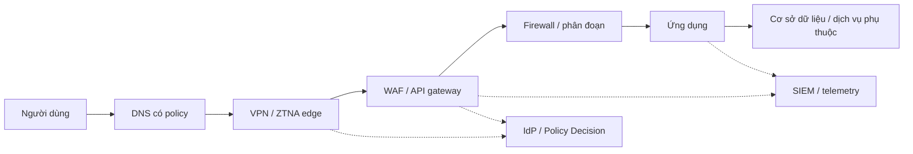

# Đánh đổi giữa bảo mật và độ trễ

Trong chương **Quyết định kiến trúc bảo mật mạng** của module **SECURITY_NETWORK_SECURITY**, người thiết kế phải đồng thời đáp ứng hai yêu cầu: **bảo vệ hệ thống trước các mối đe dọa** và **duy trì trải nghiệm, tính sẵn sàng, hiệu năng đủ tốt cho nghiệp vụ**. Firewall, VPN, IDS/IPS, WAF, kiểm soát truy cập Zero Trust, bảo vệ DNS, giám sát xâm nhập và các lớp kiểm soát trong cloud đều có thể ảnh hưởng đến thời gian xử lý lưu lượng. Tác động này thay đổi theo cách triển khai, tải, vị trí đặt thiết bị và loại traffic.

Đánh đổi giữa bảo mật và độ trễ (*security–latency trade-off*) không phải là lựa chọn tùy ý giữa “bật bảo mật” hoặc “bật hiệu năng”. Đây là một **quyết định kiến trúc có căn cứ**: hiểu rủi ro, xác định mức độ bảo vệ tối thiểu, đo chi phí trên đường đi thực tế, thử nghiệm các phương án và chấp nhận rủi ro còn lại theo thẩm quyền.

**Tình huống mở đầu:** Một ứng dụng giao dịch nội bộ phải có xác thực danh tính, mã hóa, kiểm soát phân đoạn và phát hiện lưu lượng độc hại. Đặt tất cả thành phần kiểm tra trên một đường đi đồng bộ có thể khiến người dùng cảm nhận hệ thống chậm hơn, nhất là lúc cao điểm hoặc khi một dịch vụ kiểm tra gặp sự cố. Nhưng việc bỏ qua kiểm soát để rút vài mili giây có thể tạo đường truy cập trái phép hoặc làm mất khả năng phát hiện tấn công. Kiến trúc sư cần tìm **cấu hình và vị trí kiểm soát** vừa đạt mục tiêu an ninh, vừa giữ độ trễ trong ngân sách cho phép.

## 1. Kết quả học tập

Sau bài học, người học có thể:

1. Phân biệt **độ trễ (latency)**, **thông lượng (throughput)**, **jitter**, **mức sẵn sàng** và **tỷ lệ lỗi**, tránh tối ưu sai chỉ số.
2. Giải thích cơ chế mà TLS/mTLS, VPN, firewall stateful, WAF, IPS, proxy, DNS và chính sách Zero Trust có thể tác động đến độ trễ.
3. Xây dựng **ngân sách độ trễ** (*latency budget*) dựa trên SLO và đường đi quan trọng (*critical path*).
4. Phân tích sự thay đổi của p50/p95/p99 dưới tải, đặc biệt khi hàng đợi và chuỗi gọi đồng bộ tăng lên.
5. So sánh phương án kiến trúc theo **rủi ro bảo mật, độ trễ, tính sẵn sàng, chi phí và khả năng vận hành**.
6. Thiết kế thử nghiệm A/B hoặc trước–sau đủ kiểm soát để xác định chi phí bổ sung của một biện pháp bảo mật.
7. Ghi quyết định dưới dạng **Architecture Decision Record (ADR)** với giả định, bằng chứng, phương án, kiểm soát bù đắp và điều kiện xem xét lại.

## 2. Định nghĩa đúng các chỉ số hiệu năng

| Chỉ số | Diễn giải | Lưu ý khi đánh đổi với bảo mật |
|---|---|---|
| **Latency / response time** | Thời gian một yêu cầu cần để nhận kết quả theo một ranh giới đo được | Cần xác định đo từ client, gateway hay backend |
| **RTT** | Thời gian khứ hồi giữa hai điểm | Ảnh hưởng đến số vòng bắt tay TLS, xác thực và gọi dịch vụ xa |
| **Throughput** | Số request/gói/bit xử lý được trong một đơn vị thời gian | Băng thông cao không bảo đảm p99 latency tốt |
| **Jitter** | Mức biến thiên thời gian đến/trễ giữa các gói hoặc yêu cầu | Quan trọng với thoại, video, kết nối tương tác |
| **p50/p95/p99** | Mốc thời gian mà tương ứng 50%/95%/99% mẫu có độ trễ không vượt quá | Tail latency thường bộc lộ tắc nghẽn ở các bộ phận kiểm tra |
| **Error rate** | Tỷ lệ lỗi như 5xx, timeout, rớt kết nối | Một biện pháp chặn đúng có thể trả 403/429; phải phân loại riêng |
| **Availability** | Tỷ lệ thời gian/đề nghị dịch vụ đáp ứng theo tiêu chí quy định | Lỗi của thành phần bảo mật inline có thể ảnh hưởng đường đi chính |

**Ranh giới đo:** “Độ trễ HTTP” có thể là thời gian từ gửi request đến phản hồi hoàn tất, hoặc chỉ *time to first byte (TTFB)*. “Thời gian bắt tay” có thể gồm DNS lookup, TCP connect, TLS và xác thực ứng dụng. Những giá trị này không được so sánh lẫn nhau nếu cách đo khác nhau.

Ví dụ: p95 250 ms nghĩa là trong tập mẫu đo, khoảng 95% yêu cầu hoàn tất trong không quá 250 ms, còn khoảng 5% lâu hơn. Nó **không** có nghĩa mọi yêu cầu đều mất 250 ms hoặc hệ thống có thêm 250 ms do bảo mật.

### 2.1. Độ trễ không đơn giản là tổng của các p95

Đối với một request cụ thể đi tuần tự qua nhiều thành phần:

\[
T_{\text{request}} \approx T_{\text{network}} + T_{\text{handshake}} +
T_{\text{security}} + T_{\text{application}} + T_{\text{dependencies}} + T_{\text{queue}}
\]

Đây là cách phân rã hữu ích để đo lường, nhưng **p95 của tổng không bằng tổng các p95** nói chung, vì các mẫu có tương quan và peak của từng thành phần không nhất thiết trùng nhau. Với các nhánh thực thi song song, thời gian request còn phụ thuộc nhánh chậm nhất và điểm đồng bộ; cộng mọi thời gian của tất cả nhánh sẽ phóng đại độ trễ thực.

Cần dùng trace phân tán hoặc log có correlation ID để đo **đúng critical path** của cùng một request. Phân tích thống kê tổng thể giúp thấy xu hướng, còn tracing giúp xác định thành phần làm chậm request cụ thể.

### 2.2. Độ trễ tăng phi tuyến khi gần giới hạn năng lực

Một gateway kiểm tra lưu lượng có thể bổ sung chỉ vài mili giây khi lưu lượng thấp, nhưng tăng rất nhiều lúc CPU, bộ nhớ, worker hoặc hàng đợi gần đầy. Theo mô hình hàng đợi M/M/1 mang tính minh họa:

\[
W = \frac{1}{\mu-\lambda}
\]

Trong đó `λ` là tốc độ yêu cầu đến và `μ` là tốc độ phục vụ, giả định `λ < μ` và các giả định đơn giản của M/M/1 được thỏa mãn. Khi `λ` tiến sát `μ`, thời gian trong hệ thống tăng mạnh. **Không** dùng công thức đó để dự báo chính xác cho một thiết bị thực tế đa luồng/có bộ đệm/hardware acceleration, nhưng nó giải thích vì sao mức sử dụng CPU cao có thể tạo tail latency rất lớn.

Ví dụ giả lập: một bộ kiểm tra có năng lực lý thuyết 100 request/giây. Trong mô hình M/M/1, ở 50 RPS, `W = 1/(100-50) = 0,02 s`; ở 90 RPS, `W = 1/(100-90) = 0,10 s`. Tải tăng 1,8 lần nhưng thời gian trong hệ thống tăng 5 lần. Bài học chính là cần **dự trữ dung lượng** và đo ở nhiều mức tải, nhất là tải cao điểm.

## 3. Những thành phần bảo mật tạo độ trễ ở đâu?

### 3.1. Mã hóa TLS/mTLS

TLS bảo vệ tính bí mật, toàn vẹn và xác thực phía máy chủ; mTLS bổ sung xác thực chứng chỉ phía client. Tác động độ trễ có thể đến từ:

- **Bắt tay** khi tạo phiên mới: cần trao đổi thông điệp, xác minh chứng chỉ, có thể có thêm RTT.
- **Tính toán mật mã:** mã hóa/giải mã, xác minh chữ ký và chứng chỉ; thường nhỏ trên thiết bị có hỗ trợ phù hợp nhưng tăng khi số kết nối mới rất lớn.
- **Tra cứu chính sách/chứng chỉ:** kiểm tra trạng thái, gọi IdP hoặc hệ thống quyết định truy cập nếu nằm trên đường đi đồng bộ.
- **Nhiều lần kết thúc và thiết lập TLS:** khi CDN, WAF, service mesh proxy và backend đều tạo kết nối riêng.

Không nên dùng việc tắt TLS làm một “tối ưu” mặc định. Thay vào đó, xem xét **tái sử dụng kết nối, session resumption, TLS 1.3, keep-alive, pooling**, lựa chọn bộ mã hóa/chứng chỉ phù hợp và giảm số lần proxy bắt tay lại. Cần tuân thủ cấu hình bảo mật được hỗ trợ và kiểm tra khả năng tương thích.

**Cảnh báo về TLS 1.3 0-RTT:** cơ chế gửi dữ liệu sớm có thể giảm độ trễ ở một số tình huống tái kết nối nhưng có rủi ro *replay*. Không dùng 0-RTT cho thao tác thay đổi trạng thái, giao dịch tài chính hoặc API không bảo đảm an toàn trước replay nếu chưa có kiểm soát phù hợp. Một kết nối mTLS được tái sử dụng và định danh nhất quán thường là đòn bẩy tốt hơn việc loại bỏ xác thực.

### 3.2. VPN và mã hóa đường hầm

VPN (IPsec/WireGuard/TLS VPN tùy thiết kế) có thể thay đổi:

- **Đường đi:** traffic vòng qua concentrator ở một vùng xa tạo hairpin hoặc thêm hop.
- **Đóng gói:** tunnel header làm tăng kích thước gói, giảm MTU hiệu dụng.
- **Mật mã và chuyển tiếp:** xử lý mã hóa, giải mã, kiểm soát phiên và NAT.
- **Đường dự phòng/failover:** một tunnel hoặc gateway quá tải khiến ứng dụng chậm.
- **TCP bên trong TCP:** một số mô hình tunnel trên TCP có thể tạo tương tác phục hồi không thuận lợi khi mất gói; phụ thuộc giao thức và cấu hình.

Nếu đường vật lý RTT thấp nhưng VPN xa làm RTT tăng, việc đổi địa điểm concentrator hoặc định tuyến truy cập theo vùng gần người dùng có thể giảm độ trễ **mà vẫn duy trì mã hóa**.

**MTU/PMTUD:** tunnel overhead có thể gây phân mảnh hoặc gói lớn bị bỏ nếu Path MTU Discovery hoạt động sai. Biểu hiện thường là ứng dụng chậm/treo với payload lớn nhưng ping gói nhỏ vẫn bình thường. Kiểm tra PMTUD, MSS clamping theo nền tảng, cấu hình MTU và ICMP cần thiết; tránh tắt tùy tiện những thông điệp điều khiển bắt buộc.

### 3.3. Firewall stateful và phân đoạn mạng

Firewall stateful phải xác định rule, theo dõi phiên, NAT và đôi khi nhận dạng ứng dụng. Tác động phụ thuộc:

- Vị trí trong đường đi và số lần cùng một luồng đi qua firewall.
- Cấu hình rule, kết hợp NAT, zone, deep inspection và tải phiên.
- Giới hạn phần cứng: PPS, CPS, tổng session, offload và phần mềm.
- Thiết kế định tuyến: một chính sách phân đoạn có thể tạo đường vòng dài nếu luồng giữa các subnet phải đi qua một điểm tập trung xa.

**Phân đoạn không mặc nhiên làm ứng dụng chậm.** Thiết kế đặt kiểm soát tại ranh giới hợp lý có thể tạo rất ít overhead. Độ trễ cao thường đến từ cấu trúc luồng qua nhiều chokepoint, thiết bị thiếu dung lượng hoặc cấu hình cần thêm kiểm tra sâu.

### 3.4. IDS/IPS, WAF và kiểm tra nội dung

| Kiểm soát | Vị trí thường gặp | Tác động độ trễ | Giới hạn chức năng |
|---|---|---|---|
| **IDS thụ động** | Tap/SPAN, nhận bản sao lưu lượng | Không trực tiếp ở đường chuyển tiếp dữ liệu thông thường; có chi phí thu thập/giám sát riêng | Phát hiện/cảnh báo; không tự chặn nếu không phối hợp cơ chế khác |
| **IPS inline** | Giữa các vùng hoặc tại ingress/egress | Phân tích gói/phiên, có thể thêm xử lý, hàng đợi hoặc drop khi quá tải | Hiệu quả phụ thuộc policy, chữ ký, khả năng giải mã và vị trí |
| **WAF/reverse proxy** | Trước HTTP/HTTPS app/API | TLS termination, phân tích request, rule evaluation, bot detection và đôi khi gọi dịch vụ bên ngoài | Chủ yếu bảo vệ ứng dụng web theo khả năng engine |
| **DPI** | Edge/NGFW/secure web gateway | Phân tích protocol, payload, giải mã khi cho phép; có thể tăng CPU/latency | Không thể quan sát đầy đủ payload được mã hóa nếu không giải mã hợp lệ |
| **DLP/proxy kiểm tra file** | Web/email/download path | Quét nội dung hoặc file lớn; có thể tăng TTFB/total time | Có quy định riêng về quyền riêng tư và dữ liệu nhạy cảm |

IDS nhận bản sao lưu lượng ngoài đường đi chính không tạo một đoạn chờ đồng bộ bắt buộc cho mọi request. Tuy nhiên, **hệ thống ghi log, mirror traffic hoặc thiết bị chia sẻ tài nguyên** vẫn có thể gây tác động gián tiếp khi thiết kế không đủ năng lực. Không khẳng định giải pháp “không có overhead” mà không kiểm tra topology.

Chính sách kiểm tra TLS cần cân nhắc yêu cầu bảo vệ, quyền riêng tư, quản lý chứng chỉ và tính tương thích; giải mã lưu lượng để kiểm tra có thể tăng rủi ro tập trung dữ liệu hoặc làm đứt end-to-end trust nếu triển khai sai.

### 3.5. Zero Trust, IAM và kiểm tra chính sách

Mô hình Zero Trust đặt việc xác minh danh tính, thiết bị, ngữ cảnh và quyền truy cập vào trung tâm quyết định. Chi phí có thể nằm ở:

- Trao đổi xác thực ban đầu với IdP, MFA và thiết lập phiên.
- Policy Decision Point (PDP) khi một yêu cầu cần tra cứu trạng thái quyền/thiết bị.
- Policy Enforcement Point (PEP) trên tuyến dữ liệu; có thể là proxy, sidecar, agent hoặc gateway.
- Kiểm tra token/chứng chỉ và quyền truy cập backend.

Một kiến trúc cần **phân biệt kiểm soát theo phiên** với **kiểm soát theo request**. Việc gọi mạng sang IdP ở mọi request có thể tạo phụ thuộc đồng bộ và tăng p99. Thường có thể xác minh chữ ký token cục bộ hoặc cache quyết định có thời hạn phù hợp, nhưng phải xác định **yêu cầu thu hồi quyền, thay đổi trạng thái thiết bị và rủi ro token bị đánh cắp** trước khi chọn TTL.

Ví dụ: cache quyết định 60 giây có thể giảm lượt gọi PDP, nhưng cũng có thể khiến quyền đã thu hồi tiếp tục được dùng trong cửa sổ cache nếu kiến trúc không có cơ chế invalidation khác. Độ trễ thấp hơn đi kèm **độ trễ hiệu lực của quyết định thu hồi quyền**; cần mô tả rõ và được chấp nhận theo mức nhạy cảm của thao tác.

### 3.6. DNS bảo mật và quan sát mạng

DNS filtering, RPZ, DNSSEC validation, encrypted DNS hoặc proxy truy vấn có thể thêm xử lý và truy vấn ngoài, đặc biệt ở lần truy vấn chưa cache. Trong khi đó, đặt resolver gần ứng dụng, cache hợp lý, tối ưu tuyến tới upstream và dùng timeout hợp lý có thể giảm độ trễ. TTL/cache phải cân bằng hiệu năng với tính mới của record và **thời gian hiệu lực của thay đổi chính sách DNS**.

Hệ thống giám sát/log thường chạy bất đồng bộ để giảm chờ trên đường request. Tuy nhiên, hàng đợi log không giới hạn có thể làm đầy bộ nhớ hoặc đánh mất dữ liệu; đồng thời, một số log/audit bắt buộc phải được xác nhận trước khi thao tác nhạy cảm được coi là thành công. Cần phân loại sự kiện nào là **bắt buộc đồng bộ**, sự kiện nào được phép đưa vào pipeline bất đồng bộ với độ bền được bảo đảm.

## 4. Sơ đồ đường đi và điểm phát sinh overhead



**Đọc sơ đồ:** tuyến liền biểu diễn một ví dụ đường dữ liệu; đường nét đứt biểu diễn các tích hợp chính sách/telemetry có thể phát sinh đồng bộ **hoặc** bất đồng bộ tùy thiết kế. DNS resolution thường xảy ra trước khi thiết lập kết nối, không nhất thiết xuất hiện trên mỗi HTTP request. Chỉ đo đạc topology thực mới xác định thành phần nào nằm trong critical path.

Một truy vấn đến backend có thể không đi qua tất cả khối ở sơ đồ. Khi một lớp bảo vệ được đặt ở cả edge lẫn giữa các service, cần tránh kiểm tra lặp cùng một rủi ro nếu không có mục đích riêng; ngược lại, mỗi lớp bảo vệ các ranh giới tin cậy khác nhau có thể vẫn cần thiết.

## 5. Định nghĩa mục tiêu an ninh trước khi chọn phương án

Tối ưu độ trễ mà không biết điều gì cần bảo vệ dễ dẫn đến quyết định sai. Trước khi so sánh kiến trúc, xác định:

1. **Tài sản và dữ liệu:** ví dụ API tra cứu công khai, API giao dịch, tài khoản quản trị firewall, máy chủ DNS hay VPN.
2. **Đối thủ/đường tấn công:** credential stuffing, khai thác HTTP, chiếm phiên, lateral movement, DNS abuse, DDoS hoặc xâm nhập đường truyền.
3. **Ranh giới tin cậy:** Internet–DMZ, nhân viên–mạng quản trị, vùng ứng dụng–cơ sở dữ liệu, cloud–on-prem.
4. **Yêu cầu kiểm soát không thể thỏa hiệp:** mã hóa dữ liệu cần bảo vệ, xác thực, phân quyền, phân đoạn, nhật ký phục vụ điều tra và các yêu cầu pháp lý/hợp đồng áp dụng.
5. **Rủi ro còn lại chấp nhận được:** nguy cơ sau khi đã triển khai kiểm soát, người có thẩm quyền phê duyệt và bằng chứng.

| Tình huống | Kiểm soát nên được bảo toàn | Vị trí tối ưu hóa ưu tiên |
|---|---|---|
| API quản trị router/firewall | Mạng quản trị, xác thực mạnh, RBAC, audit và nguồn được phép | Truy cập qua bastion gần thiết bị, tái sử dụng phiên, giảm policy round-trip |
| API công khai chống khai thác web | TLS, WAF theo rủi ro, rate limit, backend authorization | Tối ưu rule, cache hợp lý, đặt edge gần client |
| Lưu lượng service-to-service nhạy cảm | mTLS, service identity, phân đoạn/authorization | Pooling, session resumption, policy check cục bộ có kiểm soát |
| DNS resolver cho nhiều site | Kiểm soát truy vấn, DNSSEC validation khi yêu cầu, phát hiện abuse | Resolver nội bộ theo vùng, cache và upstream tốt |
| DDoS volumetric | Bảo vệ ISP/CDN/scrubbing trước điểm nghẽn | Đặt lọc upstream, tránh đẩy toàn bộ về trung tâm quá xa |
| Giám sát IDS/IPS | Tầm nhìn, chất lượng phát hiện và cơ chế ứng cứu | Chọn passive/inline đúng rủi ro, tăng capacity và tối ưu rule |

**Nguyên tắc:** tách yêu cầu bảo mật thành *mục tiêu cần đạt*, sau đó tìm cơ chế ít làm chậm nhất mà vẫn đạt mục tiêu. Không nên đánh đồng “ít thiết bị hơn” với “ít rủi ro hơn”.

## 6. Xây dựng ngân sách độ trễ (*latency budget*)

### 6.1. Từ SLO xuống từng đoạn trong critical path

Giả sử dịch vụ nội bộ có mục tiêu:

- **SLO:** p95 end-to-end dưới hoặc bằng **300 ms** ở mức tải được xác định.
- **Giới hạn cảnh báo:** p99 không vượt **600 ms** tại vùng áp dụng.
- **Độ sẵn sàng:** yêu cầu theo SLO riêng; thời gian phản hồi không thay thế tỷ lệ thành công.
- **Khối lượng tải:** được đo bằng RPS/concurrency thật, với các tuyến API và số lượng người dùng xác định.

Một ngân sách **tham chiếu** cho thời gian trung bình của request tiêu biểu:

| Phần thời gian | Ngân sách mục tiêu minh họa |
|---|---:|
| Network RTT và truyền tải | 45 ms |
| Handshake/thiết lập phiên phân bổ theo workload | 20 ms |
| Gateway/WAF + policy/security checks | 30 ms |
| Ứng dụng và API logic | 80 ms |
| Database/service dependencies | 70 ms |
| Dự phòng cho biến động/hàng đợi | 55 ms |
| **Tổng kế hoạch** | **300 ms** |

Bảng này là **budget engineering**, không phải đẳng thức p95: không được cộng p95 của từng hàng và khẳng định thành p95 toàn tuyến. Để kiểm chứng SLO p95, phải đo phân phối thời gian **end-to-end trên cùng tập request**. Ngân sách giúp định hướng điều tra nguyên nhân và quyết định mức overhead có thể dành cho lớp bảo vệ.

### 6.2. Ngân sách phải tính tải cao điểm và phân bố người dùng

p95 ở một khu vực gần data center có thể đạt, còn người dùng ở vùng địa lý xa lại vượt SLO. Một CDN đặt gần người dùng có thể rút RTT cho API công khai nhưng không thay thế chính sách xác thực backend. Với ứng dụng VPN doanh nghiệp, cần đo từ nhiều vị trí người dùng và so sánh đường split tunnel/full tunnel theo yêu cầu bảo mật dữ liệu.

SLO nên được xác định theo nhóm giao dịch phù hợp: đăng nhập lạnh, request đã xác thực với kết nối giữ lâu, truy vấn thường, truy vấn nặng, tác vụ quản trị. Không trộn một tỷ lệ lớn request cache hit rất nhanh với request nghiệp vụ quan trọng để che khuất p99 của nhóm nhạy cảm.

### 6.3. Dự trữ tài nguyên cho bảo vệ cao điểm

Một gateway hoạt động ở 95% công suất khi bình thường sẽ ít khoảng trống cho burst hoặc failover. Độ dự phòng cần xét theo **CPS/PPS, TLS handshakes/s, số phiên, throughput inspection và hiệu năng rule thực tế**, không chỉ thông số Gbps trên brochure. Nếu IPS đang bật giải mã TLS hoặc signature set phức tạp, thông lượng đo được có thể khác thông số chuyển tiếp gói cơ bản.

## 7. So sánh các phương án kiến trúc

Với một API được bảo vệ, có nhiều cách đặt kiểm soát nhưng cùng hướng đến mục tiêu hạn chế khai thác và quản lý danh tính.

| Phương án | Mô tả | Bảo vệ | Độ trễ/độ phức tạp | Điều kiện chấp nhận |
|---|---|---|---|---|
| **A. WAF/IdP tập trung một vùng xa** | Request đi qua gateway chung | Quản trị tập trung, điểm quan sát thống nhất | Tăng RTT/hairpin; khả năng tạo nút nghẽn | Cần đủ capacity, HA và đáp ứng SLO của mọi vùng |
| **B. WAF edge theo vùng + kiểm soát backend** | WAF phân tán gần client, authorization vẫn ở service | Lọc sớm, giảm tải origin, quyền dữ liệu vẫn kiểm tra | Phức tạp quản trị policy đồng nhất; phụ thuộc CDN/edge | Có cấu hình tập trung, log, test parity và đường origin được khóa |
| **C. ZTNA + service authorization** | Kiểm tra danh tính/ngữ cảnh khi vào; backend giữ quyền chi tiết | Phù hợp truy cập nội bộ/quản trị | Có thể tăng thời gian đăng nhập ban đầu, ít tốn ở request sau nếu thiết kế tốt | Kiểm soát phiên, revocation, kiểm tra proxy bypass |
| **D. IPS inline ở mọi phân đoạn** | Nhiều điểm kiểm tra đồng bộ | Phát hiện/chặn theo ranh giới nếu có đủ tầm nhìn | Thêm hop, xử lý, nguy cơ nút nghẽn và HA phức tạp | Threat model cần kiểm tra inline ở từng ranh giới; có capacity và bypass/failover policy rõ |
| **E. IDS thụ động + chặn tại edge** | Cảm biến nhận bản sao, chặn ở điểm khác | Quan sát/phát hiện; edge làm nhiệm vụ chặn | Giảm kiểm tra đồng bộ trên một số tuyến | Chấp nhận độ trễ phát hiện/ứng cứu, có cơ chế containment hiệu quả |

Không phải các phương án hoàn toàn thay thế nhau: WAF, IPS, Zero Trust và firewall giải quyết những lớp rủi ro khác nhau. Kiến trúc phù hợp thường **kết hợp** chúng nhưng giảm các vòng đi xa, số proxy không cần thiết và kiểm tra trùng không tạo thêm hiệu quả.

### 7.1. Quyết định không chỉ dựa vào số mili giây

Một phương án giảm 15 ms nhưng làm mất kiểm soát truy cập quản trị, hoặc khiến việc thu hồi quyền mất 30 phút thay vì gần thời gian thực, có thể không phù hợp với mức rủi ro. Ngược lại, tăng một lớp proxy nhưng không giảm được đường tấn công đáng kể có thể tạo chi phí vận hành không cần thiết.

Đánh giá phải ghi **lợi ích bảo vệ có thể kiểm chứng**, kết quả đo độ trễ, chi phí vận hành, tính sẵn sàng và rủi ro khi thành phần bảo vệ hỏng.

## 8. Những đòn bẩy giảm độ trễ vẫn giữ mục tiêu bảo mật

### 8.1. Tối ưu kiến trúc mạng và vị trí kiểm soát

- **Đặt gateway/PoP gần nguồn dùng** để giảm RTT và hairpin, với lưu lượng nhạy cảm vẫn đi đúng ranh giới kiểm soát.
- **Loại bỏ tuyến đi vòng:** bảo đảm VPN concentrator, WAF, service mesh và firewall có đường đi hợp lý qua các vùng, tránh bắt traffic quay lại một data center xa.
- **Chia tải và HA đúng vùng:** sử dụng nhiều instance/cụm có capacity phù hợp, đồng bộ policy và giám sát failover.
- **Giảm kiểm tra trùng lặp:** loại bỏ xử lý lặp không mang lại giá trị phòng vệ, nhưng giữ kiểm soát ở mỗi ranh giới cần thiết.
- **Tách luồng quản trị và dữ liệu:** kênh điều khiển mạng đi qua bastion/vùng quản trị; data plane không bị kéo qua toàn bộ dịch vụ kiểm tra vốn chỉ dành cho quản trị.

### 8.2. Tối ưu kết nối và mật mã

- Tái sử dụng kết nối TLS/HTTP hợp lệ, giảm bắt tay mới.
- Dùng phiên bản giao thức an toàn được hỗ trợ, cấu hình cert chain phù hợp, tránh chuỗi chứng chỉ thừa hoặc thao tác xác minh từ xa không cần thiết.
- Dùng HTTP/2 hoặc HTTP/3 khi phù hợp với hạ tầng, kiểm tra head-of-line blocking, proxy/CDN và khả năng quan sát. Không coi một giao thức mới luôn nhanh hơn ở mọi mạng.
- Đặt các chính sách mTLS tại ranh giới tin cậy thực, đo tác động của sidecar và pooling.
- Xử lý MTU/MSS/PMTUD đúng cho VPN, tránh phân mảnh hoặc black-hole.

### 8.3. Tối ưu quyết định bảo mật

- **Policy evaluation cục bộ:** xác minh chữ ký token đúng cách tại gateway/service, cache JWKS và chính sách có thời hạn khi được phép.
- **Policy cache có giới hạn:** TTL dựa trên mức độ nhạy cảm, cơ chế thu hồi và yêu cầu cập nhật; ghi nhận khoảng thời gian quyền có thể còn hiệu lực.
- **Phân tầng kiểm tra:** kiểm tra cấu trúc/rate limit đơn giản ở edge trước, kiểm tra nặng chỉ cho request cần thiết, vẫn có authorization bắt buộc tại backend.
- **Tuning WAF/IPS theo bằng chứng:** tối ưu rule gây false positive hoặc tốn CPU, cập nhật chữ ký, giảm trùng rule và giám sát tác động.
- **Asynchronous telemetry có bảo đảm:** đưa log không chặn vào queue bền vững có giới hạn; giữ kiểm tra bắt buộc ở đường đồng bộ.

**Không được biến “cache authorization” thành quyền vĩnh viễn.** Khi token hết hạn, người dùng bị khóa hoặc chính sách thay đổi, hệ thống cần áp dụng cơ chế hết hạn/thu hồi phù hợp với thời gian rủi ro được chấp nhận.

### 8.4. Bảo vệ backend khi quá tải

Thêm rate limit, concurrency limit, timeout, circuit breaker và retry budget tại điểm phù hợp có thể **giảm** p99 khi tải cao bằng cách ngăn hàng đợi tăng vô hạn. Tuy nhiên, throttle sẽ làm một phần request không được phục vụ; cần tách **SLO độ trễ** khỏi **tỷ lệ thành công của request hợp lệ**, tránh ghi nhận “latency cải thiện” chỉ vì trả 429/503 rất nhanh.

## 9. Phân tích fail-open, fail-closed và tính sẵn sàng

Khi thành phần kiểm soát bảo mật không còn sẵn sàng, có ít nhất hai nhóm lựa chọn:

- **Fail-closed:** từ chối thao tác nếu không xác minh được điều kiện an ninh. Giữ mục tiêu bảo vệ, có thể gây gián đoạn.
- **Fail-open:** cho phép tiếp tục thao tác khi bộ phận kiểm tra thất bại. Có thể giữ tính sẵn sàng trước mắt nhưng tăng rủi ro truy cập trái phép.

Không có một lựa chọn duy nhất cho mọi loại traffic. Với lệnh cấu hình firewall hoặc giao dịch nhạy cảm, việc không thể xác minh danh tính/ủy quyền thường cần **từ chối an toàn**. Với telemetry thụ động, có thể cho phép dataplane tiếp tục nhưng phát cảnh báo suy giảm khả năng quan sát, lưu buffer có giới hạn và thực hiện quy trình xử lý. Một số thiết bị IPS có chế độ bypass theo điều kiện vật lý, cần thiết kế theo threat model và quy định hoạt động.

| Tình huống | Chiến lược cần cân nhắc | Tác động phải đo |
|---|---|---|
| IdP không sẵn sàng lúc tạo phiên quản trị mới | Từ chối cấp phiên mới hoặc dùng đường khẩn cấp kiểm soát riêng | Login success, thời gian khôi phục, khả năng truy vết |
| Policy decision service chậm | Cache quyết định hợp lệ thời hạn ngắn nếu chính sách cho phép; timeout chặt | p99 authz, revocation delay, tỷ lệ cache hit |
| WAF một vùng mất kết nối | Chuyển sang WAF edge/vùng khác có policy tương đương | Failover time, latency, tỷ lệ yêu cầu bị chặn sai |
| IDS thụ động mất telemetry | Duy trì chuyển tiếp nếu rủi ro cho phép, cảnh báo và xử lý khoảng trống | Visibility gap, thời gian khôi phục |
| IPS inline lỗi/thiếu capacity | HA hoặc tuyến dự phòng theo phương án an ninh đã phê duyệt | Drop, packet loss, bypass state và security coverage |
| Dịch vụ log/SIEM chậm | Buffer/backpressure có giới hạn, phân loại audit bắt buộc | Queue length, mất sự kiện, chi phí trên request |

**Độ trễ thấp không có nghĩa hệ thống đáng tin cậy** nếu một lớp bảo vệ thường xuyên bị bỏ qua do timeout hoặc fail-open âm thầm. Dashboard cần hiển thị thời điểm các kiểm soát bị vô hiệu, chuyển chế độ hoặc mất tầm nhìn.

## 10. Phương pháp đo và phân lập overhead do bảo mật

### 10.1. Thiết kế phép thử so sánh

Để ước lượng tác động của một lớp bảo vệ, lựa chọn **baseline** và **candidate** có cùng giao dịch, lượng tải, loại kết nối, vùng mạng và cấu hình backend càng giống nhau càng tốt. Tốt nhất thử trong staging gần production và thay đổi **một yếu tố** tại mỗi lần đo.

Một runbook tối thiểu:

1. Ghi SLO, threat model, policy đã bật, sơ đồ đường đi và phiên bản cấu hình.
2. Chọn các giao dịch đại diện (đăng nhập lạnh, request ấm, truy vấn nặng, request từ VPN, request ở vùng xa).
3. Cố định tải: RPS, số VU, tỷ lệ route, payload, thời gian test và nguồn sinh tải.
4. Ghi log cấu hình, version, mốc UTC, baseline CPU/RTT, tổng lỗi.
5. Đo khi lớp bảo vệ hoạt động ở baseline; đo candidate sau khi tuning hoặc chuyển vị trí.
6. Lặp phép đo ở nhiều thời điểm để giảm ảnh hưởng biến động ngẫu nhiên và warm-up.
7. Phân tích p50/p95/p99 **end-to-end**, phân tách lỗi/throttle, tracing và metrics theo thành phần.
8. Kiểm tra cả **hiệu lực bảo mật** (rule match, blocked test cases, authz, alert) trước khi kết luận.

Không thay đổi bảo vệ thật ở production để “đo không có bảo mật” nếu việc đó tạo nguy cơ không được phê duyệt. Có thể so sánh với **môi trường lab được cách ly** hoặc dùng dữ liệu quan sát có kiểm soát, nêu rõ giới hạn của so sánh.

### 10.2. Lệnh quan sát đơn giản với curl

Lệnh sau đo các mốc thời gian cho **một request** tới endpoint mà người vận hành có quyền kiểm thử:

```bash
curl --silent --show-error --output /dev/null \
  --write-out 'dns=%{time_namelookup}s connect=%{time_connect}s tls=%{time_appconnect}s ttfb=%{time_starttransfer}s total=%{time_total}s http=%{http_code}\n' \
  --max-time 10 \
  https://example.internal/health
```

Các giá trị thời gian `time_namelookup`, `time_connect`, `time_appconnect` và `time_starttransfer` là **mốc tích lũy từ đầu phép đo**, không phải các đoạn thời gian độc lập để cộng lại. Chẳng hạn, với kết nối HTTPS TCP mới, có thể ước lượng phần TCP sau DNS bằng `time_connect - time_namelookup` và phần TLS sau TCP bằng `time_appconnect - time_connect`, nhưng cần kiểm tra cách curl xử lý proxy, reuse, HTTP/3 và các trường hợp giao thức cụ thể. Trên request tái sử dụng kết nối, nhiều thành phần thời gian có thể bằng 0 hoặc không có cùng ý nghĩa.

Một lần chạy curl chỉ có giá trị khảo sát; không suy được p95/p99 từ một mẫu. Muốn kết luận tail latency, dùng bộ đo có nhiều mẫu, tải ổn định và nguồn quan sát tin cậy.

### 10.3. Thử nghiệm tải nhỏ trong môi trường có quyền

Ví dụ k6 cho một endpoint **đọc** ở staging, tạo tối đa khoảng 300 request theo lịch trong 30 giây với 10 RPS nếu máy phát tải đáp ứng; phải giảm cấu hình nếu hệ thống yếu hơn hoặc thay đổi phù hợp phạm vi được phép:

```javascript
import http from 'k6/http';
import { check } from 'k6';

export const options = {
  scenarios: {
    steady: {
      executor: 'constant-arrival-rate',
      rate: 10,
      timeUnit: '1s',
      duration: '30s',
      preAllocatedVUs: 5,
      maxVUs: 10,
      gracefulStop: '2s'
    }
  },
  thresholds: {
    http_req_duration: ['p(95)<300', 'p(99)<600'],
    http_req_failed: ['rate<0.01']
  }
};

export default function () {
  const target = __ENV.TARGET_URL || 'http://127.0.0.1:8080/health';
  const response = http.get(target, {
    timeout: '5s',
    tags: { group: 'security-latency-lab' }
  });

  check(response, {
    'status 200': (r) => r.status === 200
  });
}
```

Chạy thử trong lab:

```bash
k6 run security-latency-lab.js
```

**Giải thích:** các ngưỡng 300/600 ms và 1% là minh họa SLO, không phải chuẩn chung. Phải ghi cả `dropped_iterations`, số request **thực phát**, 5xx, 401/403/429, timeout và lỗi ở client để biết việc đạt ngưỡng có phải do tải thực thấp hơn dự tính. Nếu policy cố ý chặn một loại request, cần phân tách response bị chặn đúng khỏi lỗi hệ thống; không để thống kê chung che lấp false positive.

### 10.4. Phải có quan sát phía server

| Thành phần | Chỉ số bắt buộc nên thu | Cách sử dụng |
|---|---|---|
| Client/load generator | RTT, DNS/TCP/TLS, TTFB/total, request thực, lỗi | Đo trải nghiệm đầu cuối và hiệu suất công cụ |
| VPN/edge | Tunnel RTT, CPU crypto, interface drops, PMTU, CPS | Tìm overhead đường hầm và thiết bị biên |
| Firewall/IPS | Session/conntrack, policy hit, PPS, CPU, packet drops | Phân biệt tắc mạng với tác động kiểm tra |
| WAF/gateway | Upstream request count, authz time, queue, 403/429/5xx | Xác định latency phát sinh trước/đến backend |
| IdP/PDP | Policy evaluation time, cache hit/miss, timeouts | Chẩn đoán sự chậm trễ kiểm tra quyền |
| Application | Tracing, worker queue, CPU, GC, DB latency | Tách chi phí của ứng dụng và thành phần bảo mật |
| SIEM/telemetry | Log ingest delay, buffer depth, event loss | Phát hiện quan sát bị chậm hoặc mất khi tải tăng |

Việc “thêm WAF làm p95 tăng 20 ms” chỉ có cơ sở khi lưu lượng, backend, thời gian thử, phân bố vùng và phép đo đủ so sánh. Nếu CPU backend tăng do một job khác trong cùng thời gian, cần lặp thử hoặc ghi nhận kết quả chưa xác định.

## 11. Tình huống tính toán: WAF và policy authorization

Một ứng dụng giao dịch nội bộ chạy trên cloud. Cổng truy cập dùng TLS, WAF và gateway xác thực token; service backend thực hiện kiểm soát quyền cho mỗi giao dịch. Đội kiến trúc đang đánh giá cách đặt WAF và policy decision sao cho đáp ứng SLO.

**Mục tiêu giả lập:**

- p95 request hợp lệ ≤ **300 ms**; p99 ≤ **600 ms** trong tải vận hành chuẩn.
- Quyền truy cập dữ liệu phải được kiểm tra tại backend.
- WAF phải chặn được tập mẫu kiểm thử có thể kiểm soát và ghi log đủ truy vết.
- Không có endpoint quản trị mở trực tiếp cho Internet.
- Chính sách về tính mới của quyền và thu hồi token phải được giữ theo yêu cầu bảo mật.

### 11.1. Dữ liệu thử nghiệm minh họa

Các số liệu là giả lập để học phương pháp ra quyết định, không đại diện hiệu năng một sản phẩm thật. Mỗi phương án dùng cùng loại giao dịch, số lượng request và tải đã kiểm soát:

| Chỉ số | P0: kiến trúc hiện tại | P1: thêm WAF tập trung xa | P2: WAF tại edge + policy cục bộ có kiểm soát |
|---|---:|---:|---:|
| p50 end-to-end (ms) | 105 | 142 | 117 |
| p95 end-to-end (ms) | 210 | 325 | 238 |
| p99 end-to-end (ms) | 420 | 680 | 470 |
| Lỗi 5xx/timeout (%) | 0,2 | 0,4 | 0,2 |
| Tỷ lệ request hợp lệ bị chặn sai trong bộ test (%) | Không có WAF mới | 0,5 | 0,1 |
| WAF chặn bộ mẫu thử độc hại | Chưa kiểm soát theo yêu cầu | Đạt mẫu quy định | Đạt mẫu quy định |
| Đường quản trị / authz backend | Có policy riêng | Giữ policy | Giữ policy |

Nhìn vào p95, P1 tăng **115 ms** so với P0; P2 tăng **28 ms**. Đây là **chênh lệch các percentile quan sát**, không phải khẳng định mỗi request trong P1 có thêm chính xác 115 ms. P1 vượt cả ngưỡng p95 300 ms và p99 600 ms, nên chưa đạt mục tiêu trong điều kiện thử. P2 đáp ứng các ngưỡng độ trễ minh họa và có tỷ lệ chặn sai thấp hơn P1 trên bộ mẫu. Tuy vậy, muốn quyết định P2 phải kiểm tra **tính tương đương về hiệu quả bảo vệ**, cơ chế quản lý rule giữa edge node, khả năng ghi log, sẵn sàng và rủi ro origin bypass.

### 11.2. Phân tích nguyên nhân chứ không chỉ chọn số nhỏ nhất

Kết quả tracing ở P1 (giả lập) chỉ ra phần lớn chênh lệch do **đường vòng qua vùng tập trung**, cộng với thời gian gateway gọi PDP ở một vùng khác. Cách cải tiến P2 gồm:

1. Đặt WAF edge gần nguồn request, giữ backend authorization bắt buộc.
2. Hạn chế truy cập trực tiếp origin, để policy không bị bỏ qua qua một hostname/IP khác.
3. Dùng xác minh token cục bộ khi thích hợp, có cache/JWKS và cơ chế hết hạn/thu hồi theo rủi ro.
4. Tập trung quản trị rule và log mà không tạo thêm chuyến đi đồng bộ cho mọi request.
5. Bổ sung thử nghiệm failover, CDN cache miss, route thay thế và endpoint nhạy cảm.

Chỉ giảm p95 là chưa đủ nếu rule kiểm thử bị bỏ, nếu PEP không chặn truy cập không hợp lệ, hoặc nếu việc thu hồi quyền mất quá lâu.

### 11.3. Tiêu chí quyết định

P2 có thể được đề xuất nếu:

- Các kiểm thử an ninh đạt yêu cầu, false positive nằm trong biên chấp nhận được.
- Cả p95/p99 và tỷ lệ thành công của request hợp lệ đạt SLO trong nhiều lần đo có ý nghĩa.
- Việc vô hiệu hóa một edge node không làm mất coverage hoặc dẫn đến đường vòng không được kiểm soát.
- Origin được hạn chế truy cập theo chính sách và mọi đường quản trị riêng được bảo vệ.
- Có phương án rollback, version hóa policy và owner chịu trách nhiệm.

Nếu chưa chứng minh được các điều kiện này, kết quả nên ghi **INCONCLUSIVE** để tiếp tục kiểm tra, thay vì chấp nhận chỉ dựa trên bảng latency.

## 12. Đánh đổi theo loại ứng dụng và mức độ nhạy cảm

Không nên áp một chính sách hiệu năng giống nhau cho mọi đường kết nối:

| Loại ứng dụng | Mục tiêu hiệu năng nổi bật | Rủi ro chủ đạo | Thiết kế cân bằng |
|---|---|---|---|
| API ngân hàng/giao dịch | Độ trễ ổn định, tính đúng đắn, tỷ lệ thành công | Gian lận, truy cập sai quyền, replay | Authz rõ ràng, TLS, chống replay, WAF phù hợp; không bỏ kiểm soát giao dịch |
| Giao diện quản trị network/security | An toàn và khả năng audit; độ trễ tương tác chấp nhận được | Thay đổi cấu hình trái phép, chiếm thiết bị | Bastion/ZTNA, MFA, ACL nguồn; tối ưu vị trí jump host |
| VoIP/video thời gian thực | Jitter, packet loss, RTT | Nghe lén, chiếm phiên, suy giảm dịch vụ | Mã hóa media, QoS, đường tối ưu; hạn chế xử lý inline không phù hợp với media |
| API tra cứu công khai | TTFB, cache hit, scale | DDoS, bot, khai thác HTTP | CDN/WAF/rate limit ở edge, bảo vệ origin |
| Đồng bộ dữ liệu giữa data center | Thông lượng và tính toàn vẹn | Rò rỉ/giả mạo/gián đoạn kết nối | VPN/mTLS, định tuyến hiệu quả, parallelism có giới hạn, kiểm tra MTU |
| DNS hạ tầng | QPS và latency tra cứu | Abuse, cache poisoning, spoofing | Resolver gần client, xác minh DNSSEC khi cần, cache và giới hạn truy vấn |

Với VoIP, một IPS kiểm tra sâu cả gói media có thể không có nhiều giá trị bằng phân đoạn, mã hóa, kiểm soát signaling và phát hiện bất thường đúng chỗ. Với API cấu hình thiết bị, thời gian truy cập dài thêm vài chục mili giây thường ít quan trọng hơn việc bảo toàn xác thực mạnh và audit. Đây là ví dụ phải dựa trên yêu cầu nghiệp vụ và threat model cụ thể, không phải quy tắc áp dụng tự động.

## 13. Mô hình đánh giá nhiều tiêu chí

Một bảng quyết định nên xem xét cả yếu tố định lượng và định tính:

| Tiêu chí | Câu hỏi đánh giá | Nguồn bằng chứng |
|---|---|---|
| **Khả năng giảm rủi ro** | Chặn được đường tấn công nào, ở mức tin cậy nào? | Threat model, security test, rule coverage |
| **Latency & tail latency** | p95/p99 ở tải và vùng thật ra sao? | Load test, synthetic monitoring, trace |
| **Tính sẵn sàng** | Thành phần bảo vệ hỏng có ảnh hưởng toàn tuyến không? | HA/failover test, error budget |
| **Khả năng mở rộng** | RPS, CPS, PPS, TLS handshake/s tăng được bao nhiêu? | Benchmark thực tế với policy bật |
| **Chi phí** | Hạ tầng, egress, license, vận hành, on-call là bao nhiêu? | TCO, báo cáo tài chính/kỹ thuật |
| **Khả năng vận hành** | Có cách cập nhật rule, rollback và điều tra sự cố không? | Runbook, log, config management |
| **Tuân thủ và dữ liệu** | TLS inspection, lưu log có đáp ứng yêu cầu dữ liệu? | Đánh giá pháp lý/bảo mật nội bộ |
| **Độ linh hoạt** | Có triển khai theo vùng, môi trường, loại tài sản không? | Kiến trúc, deployment test |

Nếu dùng điểm trọng số, phải định nghĩa **ngưỡng bắt buộc** trước. Ví dụ, một phương án vi phạm kiểm soát truy cập quản trị thì không được “bù” bằng điểm latency cao. Điểm số phục vụ trao đổi, không thay thế đánh giá rủi ro và phê duyệt.

### 13.1. Cách sử dụng Pareto frontier

Hai phương án A và B có thể đánh đổi khác nhau: A giảm latency nhưng có mức độ phòng vệ thấp hơn; B bảo vệ tốt hơn nhưng chậm hơn. **Pareto frontier** gồm những phương án mà không có phương án khác tốt ít nhất bằng trên mọi tiêu chí và tốt hơn rõ ở một tiêu chí. Việc xác định tập phương án đáng xem xét giúp tập trung thảo luận; quyết định cuối vẫn phụ thuộc ngưỡng bắt buộc và ưu tiên nghiệp vụ.

Chẳng hạn, tối ưu vị trí WAF edge có thể vừa **giảm độ trễ** vừa **giữ coverage** so với đặt WAF quá xa: đây là cải tiến rõ ràng. Không phải mọi bài toán đều chỉ có hai cực “an toàn nhưng chậm” hoặc “nhanh nhưng kém an toàn”.

## 14. Ghi quyết định dưới dạng ADR

Mẫu Architecture Decision Record ngắn sau mô tả quyết định giả lập:

```markdown
# ADR-NS-002: Đặt WAF gần người dùng, giữ authorization tại backend

- Status: Proposed
- Date: 2026-11-28
- Context:
  API nội bộ có p95 SLO <= 300 ms và p99 <= 600 ms
  trong tải đã xác định; cần TLS, WAF, authz và audit.
- Decision:
  Dùng WAF tại edge theo vùng; origin chỉ nhận lưu lượng
  từ đường đã kiểm soát; xác minh quyền dữ liệu tại backend.
  Cache policy/token validation có TTL và revocation phù hợp.
- Alternatives:
  (1) WAF tập trung ở một vùng;
  (2) IPS inline trên mọi đoạn;
  (3) WAF edge có policy đồng nhất.
- Evidence:
  Test P0/P1/P2; p95 lần lượt 210/325/238 ms;
  p99 lần lượt 420/680/470 ms;
  security test và false-positive test theo biên bản.
- Security constraints:
  Không mở origin bypass; luôn có TLS và backend authz;
  theo dõi rule đồng nhất, sự cố edge, quyền thu hồi.
- Consequences:
  Giảm RTT/hairpin; tăng chi phí phân phối/điều phối policy.
- Verification:
  Load test nhiều vùng, test HA, policy parity, blocked cases,
  chứng cứ log và kiểm tra route bypass.
- Rollback:
  Quay về cấu hình WAF đã được phê duyệt; bảo toàn TLS,
  authz và đường quản trị; kích hoạt theo điều kiện dừng.
- Owners:
  Network Security + Platform + Application Owner
- Review triggers:
  SLO vi phạm, thay kiến trúc, phát hiện bypass,
  thay yêu cầu revocation hoặc chi phí vận hành đáng kể.
```

ADR có thể ở dạng Markdown/YAML theo quy ước dự án, nhưng nội dung cần đủ để người mới đến sau hiểu **vì sao chọn phương án này và khi nào phải xem lại**. Con số p95/p99 trong ADR phải dẫn tới kết quả thử cụ thể, kèm điều kiện tải, vùng và ngày đo; trong ví dụ trên chúng là dữ liệu giả lập.

## 15. Kiểm thử hậu triển khai và vận hành lâu dài

Một quyết định bảo mật–độ trễ không kết thúc khi merge cấu hình. Độ trễ và rủi ro thay đổi khi lưu lượng tăng, xuất hiện payload mới, upgrade IPS, thay region, thay chính sách IdP hay có thêm service mesh hop.

### 15.1. Theo dõi liên tục

- **Theo trải nghiệm:** p50/p95/p99, TTFB, TLS handshake, lỗi/timeouts theo region, route, user segment.
- **Theo thành phần bảo mật:** tỷ lệ WAF/IPS block, false positive, policy eval p95/p99, cache hit/miss, trạng thái fail-open/bypass, signature version.
- **Theo năng lực:** CPU dataplane/crypto, TPS/CPS/PPS, active sessions, queue length, dropped packets, egress throughput.
- **Theo tính sẵn sàng:** failover time, tỷ lệ request hợp lệ thành công, điều kiện rollback, trạng thái các đường quản trị/khẩn cấp.
- **Theo an ninh:** authz denials, privilege changes, truy cập origin trực tiếp, các nguồn không hợp lệ, chất lượng log.

Đừng đánh giá một biện pháp bảo mật chỉ bằng CPU trung bình thấp; có thể nó làm tăng p99 do một truy vấn policy xa hiếm xảy ra. Ngược lại, không nên kết luận WAF “vô dụng” vì ít rule match trong ngày bình thường; phải kết hợp threat model và kiểm thử mẫu độc hại có kiểm soát.

### 15.2. Cảnh báo và điều kiện xem lại

Một số trigger hữu ích:

1. p95/p99 vượt SLO trong cửa sổ đo đủ mẫu và phân bố request ổn định.
2. CPU/queue/session usage tại gateway tăng sát giới hạn an toàn, kể cả trước khi SLO vi phạm.
3. Số 403/429 trên yêu cầu hợp lệ tăng do rule mới hoặc thay đổi nhóm người dùng.
4. Chính sách fail-open/bypass bị kích hoạt hoặc thành phần kiểm tra ngừng nhận telemetry.
5. Thay đổi IdP, TLS/cert, VPN route, CDN/region hoặc công cụ bảo vệ làm khác critical path.
6. Phát hiện lỗ hổng mới hoặc kiểu tấn công khiến yêu cầu bảo vệ phải nâng lên.
7. SLO có thay đổi theo loại giao dịch hay quy mô traffic; cần cập nhật latency budget và capacity plan.

Sau sự cố hiệu năng, tạo timeline gồm thời điểm thay đổi rule, deployment, tải, kết nối VPN, log bảo mật và metric backend. Đồng bộ đồng hồ và phân biệt event time với ingest time để tránh đổ nguyên nhân sai.

## 16. Các sai lầm phổ biến

| Sai lầm | Vì sao nguy hiểm | Hướng xử lý |
|---|---|---|
| Tắt TLS/mTLS để giảm latency | Mất bí mật/xác thực trên đường truyền | Tái sử dụng kết nối, tối ưu handshake và crypto |
| Cộng p95 từng hop thành p95 end-to-end | Percentile của tổng không cộng trực tiếp | Đo request end-to-end và critical path bằng trace |
| Chỉ đo p50 khi không tải | Bỏ sót queue và p99 ở giờ cao điểm | Đo nhiều mức tải và phân bố người dùng |
| Đặt tất cả policy ở gateway xa | Hairpin, tăng RTT và phụ thuộc tập trung | Đưa kiểm soát phù hợp đến edge/vùng gần client |
| Tắt IPS hoặc WAF chỉ vì có overhead | Mất giảm thiểu rủi ro chưa được đánh giá | Tuning, capacity, placement, kiểm thử security coverage |
| Chỉ đo khi gateway hoạt động bình thường | Không biết failover có chặn sai/mở bypass | Thử HA, timeout và cơ chế suy giảm được phê duyệt |
| Cache authz vô hạn | Quyền bị thu hồi vẫn có thể dùng | TTL có giới hạn, invalidation/revocation, audit |
| Coi mọi 403/429 là lỗi ứng dụng | Sai nhận định latency và bảo vệ | Tách block đúng, false positive và lỗi 5xx |
| Gắn mọi chậm trễ cho firewall | Có thể do DNS, TCP, backend, DB hoặc mạng | Dùng tracing, packet metrics và phép thử kiểm soát |
| Lấy thông số throughput quảng cáo để suy latency | Không phản ánh TLS inspection, chữ ký, payload, CPS | Benchmark với policy và workload thật |
| Đo chênh lệch trước–sau khi đồng thời đổi backend | Không xác định được yếu tố gây thay đổi | Cố định môi trường, thay đổi từng yếu tố |
| Không ghi lại quyết định/rủi ro còn lại | Nhóm sau khó bảo trì và xem xét lại | ADR có owner, dữ liệu đo và review trigger |

## 17. Bài tập áp dụng

### Bài tập 1 — Tính ngân sách độ trễ

Một ứng dụng có mục tiêu **p95 end-to-end ≤ 250 ms**. Đội kỹ thuật chia ngân sách tham chiếu theo thời gian tiêu biểu như sau: mạng 35 ms, gateway 25 ms, app 85 ms, DB 70 ms, dự phòng 35 ms.

1. Tổng ngân sách có đúng 250 ms không?
2. Nếu gateway ước tính tăng thêm 15 ms ở request điển hình, bạn sẽ điều chỉnh phương án nào trước?
3. Vì sao không thể lấy tổng p95 của từng thành phần để khẳng định đáp ứng SLO?

*Gợi ý:* Tổng 35 + 25 + 85 + 70 + 35 = **250 ms**. Có thể giảm hairpin, tái sử dụng TLS, tối ưu policy check, tăng capacity, giảm truy vấn ứng dụng hoặc phân bổ lại dự phòng; chọn dựa trên profiling và mức bảo vệ. p95 cần được đo trên phân phối end-to-end cùng tập request.

### Bài tập 2 — Tác động của một gateway

Thử nghiệm giả lập:

| Chỉ số | Trước tối ưu | Sau tối ưu |
|---|---:|---:|
| p50 | 100 ms | 106 ms |
| p95 | 260 ms | 225 ms |
| p99 | 750 ms | 470 ms |
| Tỷ lệ lỗi | 0,5% | 0,3% |

1. Vì sao p50 tăng nhưng p95/p99 lại giảm?
2. Có thể giải thích bằng cơ chế rate limit/concurrency cap bảo vệ backend không?
3. Bạn cần số liệu gì để loại trừ khả năng mẫu test sau tối ưu ít request nặng hơn?

*Gợi ý:* Một lớp kiểm tra có thể thêm chi phí nhỏ cho mọi request nhưng giảm hàng đợi/timeout khi peak, làm tail tốt hơn. Cần so sánh RPS, route mix, payload, concurrency, request thành công, 429/403 và backend metrics trước–sau.

### Bài tập 3 — Cache quyền và thời gian thu hồi

Một gateway gọi PDP 12 ms ở trung bình, p99 90 ms. Nhóm dự kiến cache quyết định cho 5 phút và giảm lượt gọi PDP ở request thường.

1. Độ trễ có thể cải thiện ở đâu?
2. Rủi ro khi một tài khoản bị khóa ngay sau khi cache được tạo là gì?
3. Hãy đề xuất TTL và cơ chế invalidation phù hợp cho API đọc bình thường và API thay đổi cấu hình firewall.

*Gợi ý:* Không thể chọn TTL chỉ bằng lợi ích latency. API quản trị nhạy cảm có thể yêu cầu kiểm tra mới hơn hoặc thu hồi theo sự kiện; API đọc ít nhạy cảm có thể dùng cache có giới hạn nếu được phê duyệt. Cần đo p99 PDP, cache hit, thời gian quyền bị thu hồi thực sự có hiệu lực và hành vi khi PDP lỗi.

### Bài tập 4 — Đường VPN xa

Nhân viên ở khu vực A truy cập ứng dụng trong khu vực A, nhưng VPN concentrator đặt ở khu vực B khiến mọi traffic đi A → B → A. Đề xuất cải tiến giảm RTT vẫn bảo toàn yêu cầu bảo mật; mô tả cách đo so sánh có xét tới TLS, DNS, MTU, route và session.

*Gợi ý:* Xem xét VPN/secure edge theo vùng hoặc định tuyến được phê duyệt, xác thực cùng chuẩn, bảo vệ origin và log tập trung. Đo từ điểm người dùng, kiểm tra ranh giới tin cậy và chính sách trước/sau thay đổi.

### Bài tập 5 — Lập ADR

Chọn một trong ba tình huống: bảo vệ API công khai bằng WAF, bảo vệ quản trị router qua ZTNA/bastion, hoặc kiểm soát dịch vụ nội bộ bằng mTLS và IPS. Viết ADR gồm bối cảnh, threat model, hai phương án thay thế, tiêu chí security pass/fail, latency budget, số liệu cần thu, rủi ro còn lại, rollback và trigger xem xét lại.

## 18. Câu hỏi tự kiểm tra

1. Tại sao một thiết bị firewall có throughput cao vẫn có thể làm p99 latency xấu đi?
2. Độ trễ TLS khi kết nối mới và khi tái sử dụng phiên khác nhau thế nào?
3. Vì sao một IDS thụ động thường không thêm bước kiểm tra đồng bộ vào dataplane?
4. Một WAF đặt xa người dùng có thể thêm overhead từ những nguồn nào ngoài thời gian kiểm tra rule?
5. Khi nào việc kiểm tra authorization theo request là cần thiết, và cache quyết định có rủi ro nào?
6. Tại sao p95 thành phần không thể cộng trực tiếp thành p95 của request?
7. Khi nào cần fail-closed, và phải có phương án vận hành nào để giảm tác động tới availability?
8. Làm sao xác nhận độ trễ tăng là do IPS chứ không phải backend hoặc traffic mix?
9. Đâu là dấu hiệu cho thấy rate limit đang cải thiện p99 nhưng lại chặn sai người dùng hợp lệ?
10. Một ADR về bảo mật–độ trễ cần ghi những bằng chứng gì để có thể xem xét lại sau sáu tháng?

**Điểm cốt lõi của bài học:** quyết định kiến trúc bảo mật mạng phải bắt đầu từ rủi ro và SLO đo được, sau đó lựa chọn vị trí, thuật toán, capacity và cơ chế dự phòng phù hợp cho từng kiểm soát. Cải thiện độ trễ bền vững đến từ việc hiểu critical path và giảm overhead không tạo thêm hiệu quả bảo vệ; hiệu lực phòng vệ, quyền truy cập và khả năng điều tra vẫn phải được xác minh bằng bằng chứng.
