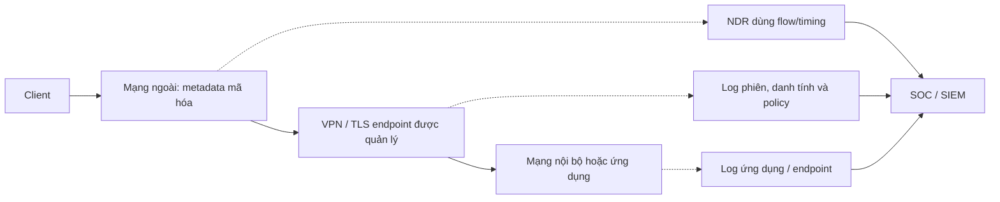
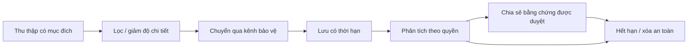
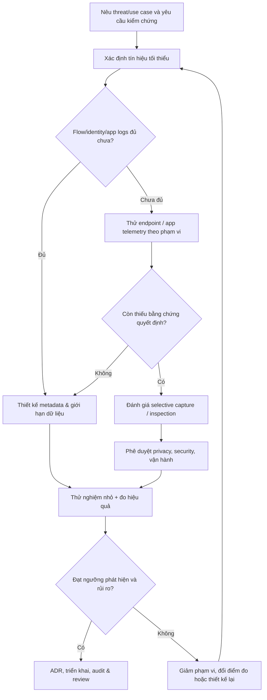
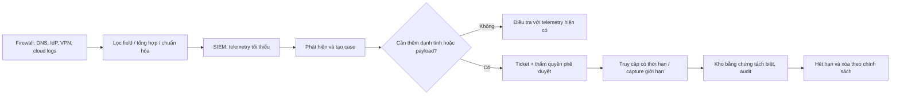

# Đánh đổi giữa visibility và privacy

## 1. Bài toán kiến trúc: quan sát đủ để bảo vệ, thu thập vừa đủ để tôn trọng riêng tư

Trong an ninh mạng, **visibility** là khả năng nhìn thấy trạng thái, luồng kết nối và các sự kiện cần thiết để phát hiện, điều tra, phản ứng và đánh giá hiệu quả của kiểm soát. **Privacy** là yêu cầu giới hạn cách thu thập, suy luận, sử dụng, chia sẻ và lưu giữ thông tin có thể liên quan đến cá nhân hoặc hoạt động nhạy cảm. Hai mục tiêu hỗ trợ nhau ở nhiều điểm: bảo mật tốt giúp bảo vệ dữ liệu riêng tư khỏi bị xâm nhập; tuy nhiên việc thu thập tràn lan để tăng visibility cũng tạo thêm dữ liệu nhạy cảm, quyền truy cập và rủi ro rò rỉ.

Trong module **SECURITY_NETWORK_SECURITY**, quyết định này xuất hiện khi thiết kế phân đoạn mạng, firewall, VPN/ZTNA, IDS/IPS/NDR, bảo vệ DNS, mạng Wi-Fi, kết nối cloud và hệ thống giám sát lưu lượng. Ví dụ, một NDR có thể phát hiện luồng kết nối bất thường nhờ flow metadata mà không cần giải mã nội dung; trái lại, một số cuộc điều tra liên quan đến mã độc truyền qua HTTP có thể cần thêm bằng chứng từ proxy, endpoint hoặc bản sao lưu lượng được thu có kiểm soát.

Câu hỏi kiến trúc cốt lõi không phải **“thu càng nhiều dữ liệu càng tốt?”**, mà là:

> Để phát hiện và xử lý một rủi ro đã xác định, chúng ta cần **tín hiệu tối thiểu nào**, lấy ở đâu, ai được xem, lưu bao lâu và chứng minh hiệu quả bằng cách nào?

### Mục tiêu học tập

Sau bài học, người học có thể:

1. Phân biệt visibility ở mức **metadata, giao thức, nội dung và danh tính**, cùng rủi ro riêng tư tương ứng.
2. Giải thích tác động của TLS, HTTPS, DNS mã hóa, QUIC và VPN đối với cảm biến mạng.
3. So sánh phương án giám sát flow, DNS, proxy, endpoint, full packet capture và TLS inspection theo yêu cầu phát hiện.
4. Áp dụng **data minimization, purpose limitation, retention, least privilege, audit** và kiểm soát truy cập có thời hạn.
5. Ghi một **Architecture Decision Record (ADR)** nêu giả định, phương án, đánh đổi, kiểm chứng và điều kiện xem xét lại.
6. Thiết kế bài đo lường phát hiện và rủi ro riêng tư mà không mặc nhiên coi việc đọc được payload là mục tiêu.

## 2. Xác định tài sản, đối tượng và mối đe dọa

Kiến trúc visibility cần xuất phát từ **threat model**. Chẳng hạn, đơn vị vận hành muốn phát hiện máy trạm bị nhiễm mã độc kết nối ra ngoài, truy cập trái phép từ Wi-Fi khách đến mạng nội bộ, lạm dụng VPN hoặc hành vi tải dữ liệu bất thường. Mỗi giả thuyết cần tín hiệu khác nhau.

| Đối tượng | Cần bảo vệ hoặc hiểu rõ | Rủi ro khi quan sát quá rộng |
| --- | --- | --- |
| Máy trạm, người dùng | Dấu hiệu bị xâm nhập, truy cập mạng sai chính sách | Lộ lịch sử duyệt web, thói quen làm việc, địa chỉ truy cập và dữ liệu cá nhân |
| Máy chủ ứng dụng | Đường kết nối, hành vi đáng ngờ, lỗi xác thực | Lộ payload API, session token, thông tin khách hàng |
| Quản trị viên | Thay đổi firewall/VPN/DNS, truy cập đặc quyền | Nhật ký có thể chứa tác vụ nhạy cảm hoặc thông tin định danh chi tiết |
| Khách, BYOD, đối tác | Phân tách mạng và phát hiện lạm dụng hạ tầng | Theo dõi quá mức thiết bị không thuộc tổ chức |
| Đội SOC và vận hành | Điều tra, tương quan cảnh báo, khắc phục | Tích tụ dữ liệu trong SIEM, lưu lại bằng chứng quá lâu hoặc phân quyền quá rộng |
| Nhà cung cấp giám sát/cloud | Cung cấp dịch vụ và công cụ bảo mật | Chuyển dữ liệu tới bên thứ ba, thay đổi nơi lưu trữ và người có quyền truy cập |

**Một mục tiêu “phát hiện bất thường” quá chung chung chưa đủ để lựa chọn cảm biến.** Cần nêu cụ thể hành vi, dữ liệu dự kiến, tiêu chí thành công và mức sai lệch chấp nhận được.

Ví dụ hai giả thuyết:

- *H1 — Vượt phân đoạn:* thiết bị ở mạng GUEST không được kết nối TCP đến subnet quản trị. Cần log firewall/ACL và flow metadata, **không cần** đọc payload của người dùng.
- *H2 — Đưa dữ liệu mật ra khỏi ứng dụng:* tài khoản nội bộ gửi tệp nhạy cảm ra dịch vụ ngoài được phép. Flow metadata có thể giúp phát hiện tốc độ/dung lượng bất thường nhưng khó xác nhận loại nội dung; có thể cần DLP tại endpoint hoặc tại ứng dụng, chính sách dữ liệu và điều tra có phê duyệt.

Từ threat model, xác định cả **tài sản cần bảo vệ** và **chủ thể chịu ảnh hưởng về privacy**, rồi mới quyết định độ sâu quan sát.

## 3. Các tầng visibility và dữ liệu có thể tiết lộ

Không phải dữ liệu “metadata” nào cũng vô hại. Kết hợp địa chỉ IP, thời gian, danh tính, hostname và kích thước truyền tải có thể suy ra thói quen hoặc quan hệ giữa những người dùng.

| Tầng quan sát | Ví dụ trường dữ liệu | Khả năng hỗ trợ phòng thủ | Ảnh hưởng privacy và giới hạn |
| --- | --- | --- | --- |
| **Counter tổng hợp** | Số luồng/byte bị chặn theo zone, rule | Đánh giá lưu lượng và hiệu lực phân đoạn | Ít chi tiết; không đủ điều tra từng phiên |
| **Flow metadata** | 5-tuple, chiều phiên, byte/packet, thời lượng, action | Phát hiện scan, bất thường east-west, lưu lượng ra bất thường | IP, thời gian và vị trí mạng vẫn có thể nhận diện cá nhân/thiết bị |
| **DNS telemetry** | Client/resolver, domain được hỏi, loại bản ghi, response | Phát hiện domain rủi ro, DNS tunneling theo dấu hiệu, lỗi phân giải | Domain có thể bộc lộ hoạt động nhạy cảm; query từ resolver không nhất thiết quy về client |
| **TLS/QUIC metadata** | IP, cổng, thông tin bắt tay hiện ra, phiên, độ dài và nhịp lưu lượng | Phân tích hành vi mã hóa, tìm bất thường | Không nhìn được nội dung; một số trường đang được mã hóa/ẩn thêm |
| **HTTP/proxy metadata** | Method, host, path khi có quyền nhìn thấy, status, request ID | Điều tra lỗi gateway, WAF, truy cập sai tài nguyên | Path và tham số có thể chứa định danh/tìm kiếm/token |
| **Endpoint/identity telemetry** | Tiến trình tạo kết nối, user/role, posture, sign-in result | Gắn network flow với tiến trình và quyền truy cập | Dữ liệu danh tính, hành vi cá nhân; đòi hỏi quản trị truy cập |
| **Packet headers / PCAP** | Header IP/TCP/UDP, gói ứng dụng, có thể cả nội dung chưa mã hóa | Điều tra handshake, giao thức và sự cố chuyên sâu | PCAP có thể chứa cookie, mật khẩu, tệp và dữ liệu riêng tư |
| **Giải mã TLS / nội dung ứng dụng** | URL đầy đủ, request/response body ở nơi giải mã hợp lệ | DLP/IPS ở tầng nội dung trong các luồng được phép kiểm tra | Xâm nhập nội dung nhiều nhất; rủi ro khóa, bí mật, chứng chỉ, pháp lý và vận hành cao |

Các loại dữ liệu trên có thể bị **lấy mẫu**, gộp theo khoảng thời gian hoặc bị NAT/proxy làm thay đổi góc nhìn. Vì thế “có log” chưa bảo đảm log đủ chính xác để quy sự kiện cho đúng chủ thể.

### 3.1 Ví dụ: cùng một kết nối HTTPS ở các vị trí khác nhau

Giả sử máy trạm `192.0.2.25` truy cập `https://portal.example.test/account` qua proxy của tổ chức.

- **Firewall L3/L4** thường biết địa chỉ và cổng đích, thời điểm, số byte và action. Thiết bị không mặc nhiên đọc được URL `/account` bên trong TLS.
- **DNS resolver được quản lý** có thể thấy máy khách hỏi tên miền tương ứng, nếu truy vấn đi qua resolver đó. Cache, DoH và proxy có thể làm thay đổi khả năng đối chiếu.
- **Proxy chấm dứt TLS hợp lệ** có thể thấy HTTP path và nội dung tại điểm đó; đội vận hành cần kiểm soát việc log những trường nào.
- **Endpoint agent** có thể biết tiến trình đang mở phiên, danh tính người dùng hoặc mức rủi ro của tiến trình, nhưng dữ liệu này cũng có giá trị nhạy cảm.
- **Ứng dụng đích** có thể có request ID, tài khoản đăng nhập và kết quả xác thực; đây thường là bằng chứng chính xác hơn để đánh giá một hành động nghiệp vụ.

Chọn điểm đo đúng có thể giảm nhu cầu thu thập nội dung. Nếu mục tiêu là xác minh firewall chặn GUEST → DATA, log rule và điểm probe trong từng vùng là đủ mạnh hơn việc giải mã HTTPS của tất cả người dùng.

## 4. Mã hóa và sự thay đổi giới hạn quan sát trên mạng

Mã hóa đầu cuối giúp bảo vệ tính riêng tư và toàn vẹn dữ liệu trong quá trình truyền. Đồng thời, nó làm giảm phần dữ liệu mà thiết bị trung gian có thể phân tích.

### 4.1 TLS 1.3 và HTTPS

TLS 1.3 bảo vệ nội dung ứng dụng và nhiều phần của quá trình bắt tay. Một cảm biến thụ động trên đường mạng nhìn thấy một số metadata kết nối nhưng thường **không thể** giải mã HTTP body chỉ vì sở hữu packet capture. TLS có thể được chấm dứt tại reverse proxy hoặc endpoint được quản lý; lúc đó nội dung khả dụng tại điểm chấm dứt và cần được xử lý theo chính sách riêng tư.

**SNI** có thể xuất hiện ở dạng rõ trong một số kết nối TLS nhưng không phải lúc nào cũng vậy; **Encrypted ClientHello (ECH)** được thiết kế để che thông tin ClientHello nhạy cảm khi được triển khai. Không nên thiết kế hệ thống bắt buộc mọi kết nối đều tiết lộ hostname trong TLS.

### 4.2 DNS mã hóa: DoH và DoT

**DNS-over-HTTPS (DoH)** và **DNS-over-TLS (DoT)** bảo vệ nội dung truy vấn DNS trên đường truyền tới resolver. Cảm biến mạng giữa client và resolver có thể không thấy tên miền được hỏi. Tuy nhiên, **resolver** vẫn xử lý tên miền ở điểm kết thúc truy vấn, và quản trị viên có thể dùng DNS telemetry của resolver tổ chức nếu được phép và cấu hình phù hợp.

Thiết kế bảo mật DNS cần cân nhắc:

1. Tổ chức có resolver tin cậy cung cấp lọc domain độc hại và nhật ký tối thiểu cần thiết không?
2. Thiết bị BYOD/guest có bắt buộc dùng resolver tổ chức không, và yêu cầu này có phù hợp chính sách riêng tư không?
3. Có thể dùng thống kê và cảnh báo DNS ở mức zone mà không lưu mọi truy vấn gắn danh tính cá nhân không?
4. Nếu client dùng resolver ngoài, có cách kiểm soát chính sách bằng endpoint, gateway hoặc quản trị ứng dụng hợp lệ không?

Cấm mọi DNS mã hóa chỉ để đọc nội dung truy vấn có thể làm giảm khả năng bảo vệ người dùng trên mạng không tin cậy. Quyết định phải bám vào mục tiêu bảo vệ và bối cảnh sử dụng.

### 4.3 QUIC, HTTP/3, VPN và overlay

QUIC (thường qua UDP 443) bảo vệ phần lớn thông tin điều khiển và dữ liệu bằng mật mã; một bộ phân tích chỉ hiểu TCP/HTTP có thể bỏ sót traffic HTTP/3. VPN/IPsec/WireGuard tạo thêm một lớp mã hóa giữa các điểm tunnel. Ở bên ngoài tunnel, cảm biến thường thấy endpoint tunnel, kích thước và nhịp lưu lượng; ở nơi giải đóng gói hợp lệ có thể quan sát thêm đường nội bộ.



**Không nhìn thấy payload** không đồng nghĩa không thể phát hiện tấn công. Có thể kết hợp metadata, kết quả policy, identity events, danh tiếng đích, lưu lượng lệch chuẩn và nhật ký tại endpoint/ứng dụng. Tuy nhiên, cũng không được quảng bá phân tích lưu lượng mã hóa như khả năng phát hiện chính xác mọi malware hay dữ liệu bị đánh cắp.

## 5. So sánh những phương án kiến trúc

| Phương án | Tín hiệu chính | Điểm mạnh | Chi phí và rủi ro |
| --- | --- | --- | --- |
| **A. Tổng hợp rule counters/flow** | Volume, zone, rule action, 5-tuple khi cần | Dễ triển khai, phù hợp kiểm tra segmentation và bất thường mạng | Hạn chế phát hiện payload; flow có thể vẫn liên quan tới cá nhân |
| **B. Flow + DNS resolver + IdP/VPN** | Kết nối, tên miền từ resolver, danh tính, policy | Tương quan được nhiều kịch bản mà không mở nội dung HTTPS | Cần quản lý ghép danh tính, độ đầy đủ resolver log và thời gian lưu |
| **C. B + endpoint/ứng dụng** | Tiến trình, request ID, thao tác nghiệp vụ, phiên | Giảm mù nội dung mã hóa; truy vết theo nguồn phát sinh | Đòi hỏi quản trị agent, phân quyền ứng dụng, bảo vệ dữ liệu cá nhân |
| **D. Packet capture theo sự kiện** | Gói tin ở zone/host cụ thể, cửa sổ ngắn | Điều tra kết nối và phân tích sâu có điều kiện | Dữ liệu rất nhạy cảm, chi phí lưu lớn, rủi ro lộ bí mật |
| **E. TLS inspection có giới hạn** | Nội dung HTTPS qua gateway được chỉ định | Hỗ trợ DLP/IPS ở nơi có yêu cầu thực sự | Hạ mức bảo mật đầu cuối ở chặng được giải mã, tăng rủi ro tập trung, tương thích và riêng tư |
| **F. Giải mã đại trà và giữ full PCAP lâu dài** | Nội dung phần lớn traffic đủ điều kiện kỹ thuật | Tối đa hóa một số dạng quan sát payload | Diện lộ dữ liệu, chi phí, nghĩa vụ quản trị và tác động tin cậy rất lớn; thường khó biện minh |

**Phương án có visibility cao nhất không mặc nhiên có mức an toàn tổng thể cao nhất.** Ví dụ hệ thống giải mã đại trà trở thành nơi tập trung nội dung bí mật, khóa/chứng chỉ và log, có thể là mục tiêu có giá trị cao cho kẻ tấn công hoặc người nội bộ lạm quyền.

### 5.1 Những câu hỏi phải trả lời trước khi chọn TLS inspection

1. Rủi ro nào **thực sự cần payload**? Metadata, proxy log hay endpoint DLP có thể đáp ứng không?
2. Đường nào được phép giải mã: thiết bị do tổ chức quản lý, egress theo zone, ứng dụng nghiệp vụ hay chỉ môi trường lab?
3. Những trường hợp **không nên/chưa được phép** giải mã theo yêu cầu chính sách và luật áp dụng là gì?
4. Hệ thống xử lý quyền riêng tư của khách, nhân viên, BYOD, dữ liệu nhạy cảm và giao tiếp bên thứ ba thế nào?
5. Ai quản lý CA/chứng chỉ, khóa, quy trình xoay vòng và thu hồi? Cơ chế nào bảo vệ nội dung tại proxy?
6. Ứng dụng dùng certificate pinning, mTLS hoặc giao thức không tương thích sẽ hoạt động thế nào?
7. Khi bộ kiểm tra lỗi hoặc quá tải, luồng sẽ **fail-open** hay **fail-closed**? Tác động tới an ninh và tính sẵn sàng ra sao?
8. Có giới hạn phạm vi, kiểm toán, thời hạn lưu và cơ chế ngừng/rollback nếu phát hiện rủi ro mới không?

TLS inspection thường làm proxy trở thành điểm kết thúc một phiên TLS và thiết lập phiên TLS khác tới đích, với yêu cầu quản lý tin cậy và kiểm tra chứng chỉ đúng cách. Nó không phải “xem trộm TLS thụ động”, và việc triển khai sai có thể làm suy yếu xác thực server hoặc làm lộ nội dung.

## 6. Privacy by design trong vòng đời telemetry

Một bản ghi có thể vô hại khi đứng riêng lẻ nhưng trở nên nhạy cảm sau khi ghép với bảng IP–thiết bị–nhân viên hoặc danh tính VPN. Cần kiểm soát **vòng đời từ phát sinh đến xóa**, kể cả bản sao trong SIEM, data lake, ticket và công cụ phản ứng sự cố.



### 6.1 Nguyên tắc áp dụng

- **Purpose limitation:** viết rõ mục đích cho từng nguồn log. Một bộ dữ liệu thu để phát hiện tấn công không tự động được phép dùng đánh giá năng suất hoặc theo dõi hoạt động cá nhân.
- **Data minimization:** chỉ giữ trường, mức chi tiết và thời lượng đủ chứng minh detection/response. Bỏ query parameters, body hoặc header không cần thiết; tránh lưu token và cookie.
- **Least privilege:** SOC tier 1 xem cảnh báo đã giảm chi tiết; chỉ nhà phân tích được giao mới mở dữ liệu có khả năng nhận diện khi điều tra.
- **Retention có phân tầng:** số liệu tổng hợp có thể lưu lâu hơn, flow chi tiết ngắn hơn, PCAP ngắn và giới hạn hơn nữa; thời hạn dựa trên rủi ro, luật và yêu cầu điều tra, không chọn số ngày tùy tiện.
- **Bảo vệ đường truyền và lưu trữ:** TLS khi chuyển log, mã hóa at rest, quản lý khóa tách biệt, bảo vệ bản sao và hạn chế xuất dữ liệu.
- **Audit & accountability:** log người truy cập, trường dữ liệu đã xem/xuất, lý do và ticket liên quan; đánh giá truy cập định kỳ.
- **Transparency & governance:** thông báo phù hợp, cơ sở xử lý dữ liệu, đánh giá tác động privacy và rà soát với bộ phận chịu trách nhiệm trước khi mở rộng.
- **Deletion:** xóa trong nguồn chính và bản sao thuộc phạm vi kiểm soát theo lịch/điều kiện pháp lý; không chỉ ẩn record trên giao diện.

### 6.2 Redaction, pseudonymization và aggregation

| Kỹ thuật | Ví dụ | Lợi ích | Hạn chế |
| --- | --- | --- | --- |
| **Redaction** | Loại bỏ `Authorization`, cookie, token khỏi HTTP log | Giảm rò rỉ bí mật trực tiếp | Có thể còn thông tin nhạy cảm trong URL, body hoặc header khác |
| **Masking/truncation** | Thay địa chỉ IP người dùng bằng prefix khi không cần chi tiết | Giảm khả năng quy trực tiếp tới thiết bị | Một số rủi ro phụ thuộc địa chỉ đầy đủ; prefix có thể vẫn nhận diện |
| **Pseudonymization** | Thay user ID bằng mã do dịch vụ nội bộ quản lý | Tương quan theo phiên mà không phơi danh tính mặc định | Có thể tái định danh khi có bảng ánh xạ; không phải ẩn danh tuyệt đối |
| **Aggregation** | Thống kê số deny theo zone và khoảng thời gian | Ít chi tiết, phù hợp dashboard | Mất dữ liệu để điều tra từng phiên, nhóm quá nhỏ vẫn dễ suy đoán |
| **Access gating** | Chỉ mở trường định danh sau phê duyệt ticket | Hạn chế người xem dữ liệu nhạy cảm | Phải bảo vệ quyền duyệt và kiểm toán hành vi đọc |
| **Sampling** | Lấy mẫu flow để theo dõi xu hướng | Giảm dung lượng và phạm vi dữ liệu | Có thể bỏ sót sự kiện hiếm; cần công bố mức coverage |

**Hash IP hoặc username không tự động thành dữ liệu ẩn danh.** Nếu giá trị gốc có miền nhỏ hoặc khóa băm dùng lại lâu dài, các bản ghi vẫn có thể được liên kết hoặc suy đoán. Pseudonymization cần quản lý khóa/bảng ánh xạ, quyền truy cập và vòng đời dữ liệu.

### 6.3 Phác thảo một event schema giảm thiểu dữ liệu

Ví dụ event theo dõi policy DENY giữa hai zone, không chứa payload:

```json
{
  "event_time_utc": "2026-11-28T07:00:00Z",
  "event_type": "network_policy_decision",
  "source_zone": "GUEST",
  "destination_zone": "MGMT",
  "destination_service": "tcp/22",
  "policy_id": "FW-GUEST-DENY-MGMT",
  "decision": "deny",
  "session_reference": "evt-6b12",
  "bytes_observed": 0,
  "identity_reference": null,
  "payload_collected": false
}
```

Schema minh họa này đủ cho dashboard kiểm tra đường cấm ở mức zone. Khi sự cố cần truy ra host cụ thể, hệ thống có thể liên kết `session_reference` với một nguồn dữ liệu được bảo vệ riêng và mở quyền có kiểm soát. Nếu phát hiện đòi hỏi nguồn/đích IP chi tiết, phải chứng minh nhu cầu rồi thêm trường tương ứng; không gắn danh tính theo mặc định cho mọi loại log.

## 7. Khung ra quyết định dựa trên rủi ro và tính cần thiết

Một quyết định tốt trả lời đồng thời ba nhóm câu hỏi:

- **Security efficacy:** nguồn dữ liệu có giúp phát hiện hoặc ngăn hành vi rủi ro mà cách ít xâm lấn hơn không làm được không?
- **Privacy & trust:** những ai chịu ảnh hưởng, dữ liệu nào có thể suy ra, ai được truy cập và việc sử dụng có phù hợp quy định/thoả thuận không?
- **Feasibility:** hạ tầng chịu được chi phí, độ trễ, sai lệch chẩn đoán, tương thích ứng dụng, bảo trì và thời gian khôi phục không?

Một lộ trình lựa chọn:



### 7.1 Bảng so sánh có trọng số: ví dụ minh họa

Giả sử tổ chức cần phát hiện **kết nối đi ngoài chính sách của máy trạm** và **phát hiện dữ liệu nhạy cảm gửi qua một số ứng dụng SaaS do công ty quản lý**. Hai use case có thể dùng các điểm đo khác nhau.

Dùng thang **1–5 (5 = đáp ứng tốt)** để phác thảo quyết định; các điểm số chỉ minh họa và phải được thay bằng dữ liệu thực khi thử nghiệm:

| Tiêu chí | Trọng số ví dụ | A: Flow + IdP + DNS | B: A + Endpoint DLP chọn lọc | C: TLS inspection rộng |
| --- | ---: | ---: | ---: | ---: |
| Phát hiện kết nối sai zone | 25% | 5 | 5 | 5 |
| Nhận diện vi phạm nội dung SaaS do công ty quản lý | 25% | 2 | 4 | 4 |
| Bảo vệ riêng tư (ít nội dung bị thu) | 25% | 5 | 4 | 1 |
| Tương thích và khả năng vận hành | 15% | 5 | 4 | 2 |
| Chi phí triển khai/duy trì | 10% | 5 | 3 | 1 |
| **Tổng điểm minh họa** | **100%** | **4,3** | **4,2** | **2,9** |

Cách tính tổng điểm trọng số: với mỗi phương án, lấy `điểm tiêu chí × trọng số` rồi cộng. Ví dụ A: `5×0,25 + 2×0,25 + 5×0,25 + 5×0,15 + 5×0,10 = 4,25`, làm tròn một chữ số thành **4,3**. Nếu có chênh lệch do làm tròn trong báo cáo, phải sử dụng một quy tắc nhất quán.

Điểm số **không phải** bằng chứng rằng A luôn tốt hơn B. Nếu tổ chức đặt nội dung SaaS thành rủi ro không chấp nhận được, phương án B có thể đáp ứng yêu cầu cốt lõi tốt hơn dù tổng điểm gần nhau. Có thể đặt điều kiện loại trừ: phương án thiếu kiểm soát tuân thủ bắt buộc, không đạt detection coverage tối thiểu hoặc không có mô hình phân quyền được chấp nhận sẽ không được chọn, bất kể tổng điểm.

## 8. Các tình huống thiết kế cụ thể

### 8.1 Kiểm tra phân đoạn GUEST → INTERNAL

**Vấn đề:** Wi-Fi khách không được truy cập subnet quản trị và máy chủ dữ liệu.

**Visibility cần:** log firewall/ACL theo nguồn zone, đích zone, action, protocol, port, mốc UTC; probe trong SSID/VLAN khách để xác minh ALLOW/DENY; log IDS/IPS khi có dấu hiệu scan.

**Không cần theo mặc định:** giải mã HTTPS của người dùng khách hoặc lưu toàn bộ PCAP web browsing.

**Đánh đổi:** có thể thiếu chi tiết khi truy vết thiết bị guest cụ thể; cần cơ chế DHCP/NAC mapping có giới hạn và chỉ truy cập trong tình huống điều tra được phê duyệt. Network segmentation được kiểm tra bằng data plane, không thông qua việc thu thập nội dung cá nhân.

### 8.2 VPN/ZTNA cho nhân viên và bên thứ ba

**Vấn đề:** phát hiện đăng nhập bất thường và truy cập trái vùng sau xác thực.

**Visibility cần:** sự kiện IdP/MFA, phiên VPN, assigned IP, device posture, route/ACL, role, flow bị từ chối, timestamp và session ID. Kết nối được chấm dứt ở VPN gateway cho phép quan sát đường nội bộ phù hợp.

**Đánh đổi:** ghép identity với flow giúp điều tra tốt nhưng tạo lịch sử hành vi gắn với cá nhân; nên phân tầng truy cập vào trường định danh, giới hạn retention, phân biệt quyền quản trị với nhân viên thường và giám sát người truy cập dữ liệu.

### 8.3 NDR trên mạng east-west của trung tâm dữ liệu

**Vấn đề:** nhận biết di chuyển ngang hoặc dịch vụ không được khai báo giữa các ứng dụng.

**Visibility cần:** NetFlow/IPFIX hoặc sensor flow theo zone, dịch vụ, số lượng kết nối, tần suất và biến động baseline; đối chiếu inventory, service identity và log host.

**Đánh đổi:** flow không đọc được nội dung TLS giữa các service, nhưng nhiều hành vi như một workload mới kết nối hàng loạt subnet có thể phát hiện qua metadata. Khi cần phân tích payload, thu có thời hạn tại workload/sensor riêng, sau khi kiểm tra quyền truy cập và mức độ nhạy cảm của data plane.

### 8.4 DNS protection cho máy trạm và BYOD

**Vấn đề:** chặn truy vấn tới domain đã xác định độc hại, phát hiện máy trạm liên hệ hạ tầng điều khiển.

**Visibility cần:** kết quả resolver doanh nghiệp, domain theo chính sách, số lần truy vấn, mã phản hồi, cảnh báo threat intel và sự kiện endpoint. Có thể lưu log chi tiết ngắn hạn hơn thống kê số lượng theo phòng ban/zone.

**Đánh đổi:** DNS log đầy đủ có thể chứa dữ liệu rất nhạy cảm về hành vi duyệt web; DoH/DoT làm thay đổi điểm quan sát. Thiết bị cá nhân cần chính sách thông báo, phân tách hoặc lựa chọn cấu hình phù hợp thay vì thu mọi URL.

### 8.5 Dịch vụ đám mây và API xử lý dữ liệu nhạy cảm

**Vấn đề:** phát hiện lượng dữ liệu outbound bất thường và truy cập sai role từ workload cloud.

**Visibility cần:** cloud flow logs, VPC route/SG/NACL decisions, cloud audit trail, API gateway request ID, IAM events và application audit logs. Tại ứng dụng, có thể ghi loại thao tác và số bản ghi thay vì nội dung dữ liệu đã trả.

**Đánh đổi:** cloud provider có thể đặt dữ liệu telemetry trong tài khoản/khu vực lưu trữ khác; cần xem quyền truy cập bên thứ ba, chính sách lưu, phân vùng tài khoản và cơ chế xóa. Log API có thể chứa URL path hoặc query secrets nếu cấu hình không cẩn thận.

### 8.6 Xử lý sự cố cần PCAP hoặc payload

**Vấn đề:** SOC không giải thích được một dấu hiệu mạng dù đã có log flow, DNS, endpoint.

**Phương án:** kích hoạt capture ở host/zone cụ thể trong cửa sổ thời gian ngắn, chỉ IP/port/sensor liên quan, giới hạn số byte/gói và chặn ghi các dữ liệu đã xác định không cần thiết khi công cụ hỗ trợ.

**Đánh đổi:** một PCAP vẫn có thể chứa payload nhạy cảm hoặc traffic của người không liên quan. Cần ticket, người phê duyệt, key mã hóa, danh sách truy cập, thời gian hết hạn và tài liệu xử lý chứng cứ. Không kích hoạt mirror toàn bộ vùng production trong thời gian vô hạn chỉ để tiện tra cứu về sau.

## 9. Thiết kế telemetry theo hai cấp và mở khóa điều tra

Có thể thiết kế hệ thống với **mức giám sát thường ngày** và **mức điều tra có điều kiện**:



Ở mô hình này, **SIEM tier 1** có thể thấy sự kiện được giảm chi tiết, còn người điều tra đã được giao case và thẩm quyền phù hợp mới có thể truy cập định danh trực tiếp hoặc dữ liệu capture. Quy trình mở quyền không nên trở thành nút nghẽn khiến sự cố nghiêm trọng không xử lý kịp; có thể thiết kế cơ chế **break-glass** kiểm soát chặt, giới hạn thời gian và kiểm toán sau sử dụng.

### 9.1 Mẫu policy ở mức ý tưởng

```yaml
policy_name: "network-observability-minimum-required"
purpose:
  - "Phát hiện kết nối trái segmentation policy"
  - "Phân tích dấu hiệu xâm nhập qua flow và identity events"
default_collection:
  include:
    - event_time_utc
    - source_zone
    - destination_zone
    - protocol
    - destination_port
    - action
    - rule_id
  exclude:
    - http_body
    - cookies
    - authorization_headers
    - file_payload
investigation_escalation:
  requires:
    - case_id
    - scoped_asset_and_time_window
    - approved_role
    - expiry_and_audit
retention:
  metadata: "Theo chính sách được phê duyệt; rà soát định kỳ"
  incident_evidence: "Theo yêu cầu điều tra và lịch xóa hiện hành"
```

Đây là **mã mô tả chính sách**, không phải cấu hình hợp lệ cho một vendor cụ thể. Phần thực thi phải phản ánh năng lực hệ thống, legal/privacy review và threat model thực tế. Những trường cần cho xác định nguồn, chẳng hạn IP, có thể được bổ sung có điều kiện tại điểm thu thay vì cấm tuyệt đối.

### 9.2 Khi cần bảo toàn chứng cứ

Một số vụ việc đòi hỏi giữ dữ liệu nhiều hơn thời hạn mặc định theo quy trình xử lý sự cố, điều tra hoặc yêu cầu pháp lý. Khi đó cần có quyết định có thẩm quyền, phạm vi rõ, audit, giới hạn người truy cập và điều kiện kết thúc giữ dữ liệu. **Retention ngắn theo mặc định** và **giữ chứng cứ có điều kiện** có thể cùng tồn tại trong một kiến trúc được quản trị tốt.

## 10. Kiểm chứng hiệu quả trước và sau khi triển khai

Không thể đánh giá trade-off bằng cảm nhận “SOC thấy nhiều log hơn”. Cần chỉ số vừa phản ánh hiệu quả phòng thủ, vừa phản ánh rủi ro riêng tư và chi phí vận hành.

| Nhóm đo | Chỉ số gợi ý | Cách thu |
| --- | --- | --- |
| **Detection** | Coverage use case, tỷ lệ phát hiện bài thử, thời gian nhận và phân loại alert | Diễn tập tình huống đã phê duyệt, so sánh event và alert |
| **Investigation** | Thời gian tìm đúng session/host, tỷ lệ case thiếu bằng chứng | Ticket, correlation ID, phản hồi analyst |
| **False positives** | Số cảnh báo sai theo nguồn và policy | Review theo use case, xác minh với chủ sở hữu dịch vụ |
| **Privacy** | Số trường dữ liệu trực tiếp nhận diện, số quyền xem nội dung, lần mở khóa, sự kiện xuất dữ liệu | Data inventory, audit logs, kiểm tra policy |
| **Retention** | Phần trăm dữ liệu hết hạn đã xóa, backup/copy coverage | Kiểm tra lifecycle và các kho dữ liệu liên quan |
| **Performance** | CPU/memory sensor, tăng latency, packet loss, throughput | Benchmark ở tải đại diện và thử failover |
| **Cost** | Ingest GB/ngày, storage, egress, nhân lực vận hành | Log pipeline, cloud billing, capacity planning |

**Thử nghiệm có kiểm soát:**

1. Lập baseline: hiện tại từ flow/firewall/DNS/identity có thể phát hiện những kịch bản nào?
2. Thiết kế bộ test trong lab hoặc cửa sổ được duyệt: guest segmentation deny, VPN sign-in không hợp lệ, endpoint phát sinh kết nối bất thường, SaaS upload giả lập với dữ liệu phi nhạy cảm.
3. Chạy A/B theo phạm vi: giải pháp metadata-only, giải pháp thêm endpoint/ứng dụng và selective inspection nếu được phép.
4. Đo alert accuracy, thời gian xác minh và dữ liệu nhạy cảm được tạo thêm. Kiểm tra log có ghi URL/token ngoài ý muốn không.
5. Đo độ trễ và lỗi ứng dụng, nhất là QUIC, mTLS, certificate pinning, BYOD và failover thiết bị kiểm tra.
6. Chọn phương án đáp ứng mục tiêu phòng thủ và giới hạn privacy; ghi bằng chứng, giả định và điều kiện rollback.
7. Sau thay đổi, chạy lại bộ test và kiểm tra quyền truy cập, retention, xóa dữ liệu thực tế.

Không tự động xem **không phát hiện** là **không có rủi ro**; cần xem độ bao phủ của sensor, nguồn log bị tắt, điểm mù encryption và tỷ lệ lấy mẫu.

## 11. Architecture Decision Record (ADR) mẫu

Một quyết định có thể được ghi lại ngắn gọn để người đến sau hiểu **vì sao chọn** và khi nào cần xét lại.

```markdown
# ADR-SEC-003: Telemetry mạng cho phân đoạn và truy cập từ xa

Trạng thái: Proposed
Ngày: 2026-11-28
Chủ sở hữu: Network Security Architecture
Đối tượng phê duyệt: Security, SOC, Privacy, Platform Operations

## Bối cảnh
Cần phát hiện guest->internal bypass, truy cập VPN ngoài role,
và lưu lượng outbound bất thường. Hạ tầng có TLS 1.3,
QUIC và ứng dụng quản lý qua cloud.

## Phương án cân nhắc
A. Firewall/flow + DNS/IdP/VPN logs, chuẩn hóa tại SIEM
B. A + endpoint/app events tại nhóm hệ thống ưu tiên
C. Giải mã TLS và full packet capture trên toàn bộ egress

## Quyết định đề xuất
Chọn B theo giai đoạn; giới hạn field và retention theo
data classification. Chỉ thu capture theo incident ticket.
Mọi selective inspection mới cần review riêng.

## Hệ quả
+ Đủ tín hiệu cho phần lớn bài test segmentation/VPN.
+ Giảm thu payload người dùng theo mặc định.
- Phụ thuộc độ phủ endpoint/app logs và tương quan session.
- Một số đe dọa nội dung vẫn có thể chưa được phát hiện.

## Kiểm chứng
Diễn tập deny/allow giữa zone và remote access,
đo detection time, data fields, latency, retention deletion.

## Điều kiện xét lại
Coverage xuống dưới ngưỡng được duyệt; thay đổi threat model;
phát sinh quy định dữ liệu mới; đổi giao thức/thiết kế cloud.
```

Điểm quan trọng của ADR là **bảo toàn lý do quyết định**, không chỉ ghi công nghệ đã mua. Nếu mục tiêu phát hiện thay đổi, phải đánh giá lại những dữ liệu thật sự cần và tác động privacy mới.

## 12. Tình huống phân tích: một đề xuất giải mã HTTPS toàn công ty

Một công ty muốn phát hiện dữ liệu nhạy cảm bị gửi ra SaaS. Đề xuất ban đầu là bắt tất cả lưu lượng HTTPS của nhân viên đi qua thiết bị TLS inspection, giải mã và giữ PCAP 180 ngày. Hạ tầng có laptop doanh nghiệp, BYOD, khách Wi-Fi, VPN, cloud app và một số dịch vụ dùng mTLS. SOC đang có firewall flow log, IdP audit và ứng dụng nội bộ có audit trail.

**Yêu cầu:**

1. Nêu ba rủi ro từ việc giải mã và lưu PCAP đại trà.
2. Chọn ít nhất hai tín hiệu hiện có giúp phát hiện một phần rủi ro mà chưa cần đọc payload.
3. Đề xuất một phương án tăng coverage cho luồng SaaS được quản lý với phạm vi privacy rõ.
4. Xác định điều kiện cần đạt trước khi cân nhắc selective TLS inspection.
5. Nêu bộ test chứng minh quyết định hiệu quả và có cách rollback.

**Gợi ý lập luận:**

- Full PCAP có thể giữ dữ liệu cá nhân, bí mật và token; thiết bị inspection tập trung nội dung có thể thành điểm rủi ro; không tương thích mTLS/certificate pinning có thể làm hỏng ứng dụng; chi phí lưu giữ, quyền truy cập và nghĩa vụ quản lý tăng lớn.
- Flow log cho biết đích và lưu lượng tăng bất thường; IdP/app audit cho biết ai đăng nhập, tải gì theo *loại hành động*, role và số lượng. Endpoint DLP chỉ ở laptop doanh nghiệp có thể theo dõi việc gửi dữ liệu đã phân loại, giảm nhu cầu thu nội dung từ BYOD.
- Giai đoạn đầu: B (flow + identity + endpoint/app) với trường dữ liệu tối thiểu. Sau thử nghiệm, chỉ xem xét inspection tại proxy được quản lý cho nhóm ứng dụng được phê duyệt và use case DLP thật sự cần payload.
- Trước khi giải mã: xác định cơ sở xử lý dữ liệu, phạm vi, thông báo, ngoại lệ nhạy cảm, chủ sở hữu dữ liệu, chính sách giữ/xóa, bảo vệ CA/khóa, kiểm tra tương thích và xử lý fail-open/fail-closed.
- Test với **dữ liệu giả** để xác minh DLP detection, tính chính xác, false positive, độ trễ và tỷ lệ luồng bị giải mã đúng chính sách. Kiểm tra hệ thống không thu payload của khách/BYOD nếu chúng ngoài phạm vi, đồng thời xác minh log hết hạn được xóa.

Một phương án đủ khả năng phát hiện nhưng không có quyền truy cập, retention và khả năng xóa được kiểm chứng **chưa phải kiến trúc sẵn sàng triển khai**.

## 13. Những sai lầm kiến trúc thường gặp

| Nhận định sai | Vấn đề thực tế | Cách sửa |
| --- | --- | --- |
| “Traffic mã hóa thì không thể giám sát.” | Flow, IdP, app logs, endpoint events vẫn có tín hiệu phòng thủ | Xây dựng detection theo hành vi và điểm cuối, chấp nhận giới hạn payload |
| “Metadata hoàn toàn không có rủi ro privacy.” | Ghép IP/domain/giờ/danh tính có thể tái nhận diện | Minimize, aggregate, giới hạn truy cập và thời gian lưu |
| “PCAP thu càng lâu càng tốt.” | Dung lượng, dữ liệu nhạy cảm và diện tấn công tăng | On-demand capture, cửa sổ ngắn, retention và xóa tự động |
| “Có TLS inspection thì sẽ bắt được mọi tấn công.” | Không phải luồng nào cũng giải mã được; malware có thể dùng kỹ thuật/đường khác | Dùng nhiều nguồn telemetry, kiểm tra coverage bằng diễn tập |
| “Chỉ cần hash user ID là đã ẩn danh.” | Hash có thể bị liên kết/tái định danh | Pseudonymization có khóa quản trị, giảm chi tiết khi đủ |
| “WAF cho phép request tức là an toàn.” | WAF không thay thế authorization và host security | Kết hợp logs ingress, app, identity và control |
| “Lưu log trong SIEM là đủ.” | Nhà cung cấp, backup, export, dashboard và ticket tạo thêm bản sao | Quản trị vòng đời và quyền trên toàn bộ pipeline |
| “Bật đầy đủ logging không ảnh hưởng hệ thống.” | Ingest có chi phí, sensor có thể rớt gói hoặc tăng độ trễ | Capacity test, sampling có chủ đích và kiểm tra failover |

## 14. Checklist rà soát quyết định visibility–privacy

- [ ] Đã xác định hành vi đe dọa, tài sản và điểm kiểm soát cần chứng minh.
- [ ] Có ma trận **use case → tín hiệu tối thiểu → nguồn log → người xử lý → giới hạn dữ liệu**.
- [ ] Đã cân nhắc flow/identity/DNS/app/endpoint trước khi đề xuất capture nội dung.
- [ ] Đã đánh giá TLS 1.3, ECH, DoH/DoT, QUIC, VPN, NAT, cloud overlay và giới hạn cảm biến.
- [ ] Đã liệt kê loại dữ liệu cá nhân/nhạy cảm và những bên có khả năng truy cập hoặc nhận dữ liệu.
- [ ] Đã chọn nơi thu, lọc, mã hóa, lưu, chia sẻ và xóa; có dữ liệu kiểm chứng việc xóa.
- [ ] Đã có phân quyền theo vai trò/case, thời hạn, kiểm toán và cơ chế xử lý khẩn cấp.
- [ ] Nếu có TLS inspection, đã xác định phạm vi, ngoại lệ, quản lý trust/khóa, tương thích và failover.
- [ ] Đã thử detection coverage, false positives, latency, resource usage và privacy exposure bằng bài test có kiểm soát.
- [ ] Đã ghi ADR gồm phương án, bằng chứng, người phê duyệt, giả định, rủi ro còn lại và tiêu chí review.
- [ ] Đã xác nhận quy trình xử lý sự cố thật cho phép giữ chứng cứ theo thẩm quyền và vẫn bảo vệ riêng tư.

## 15. Câu hỏi tự đánh giá

1. Vì sao một flow log chỉ có IP, cổng và timestamp vẫn có thể là dữ liệu liên quan tới cá nhân?
2. Khi kiểm chứng GUEST không thể truy cập DATA, thu payload HTTPS có cần thiết không? Bằng chứng thay thế là gì?
3. Vì sao việc triển khai DoH hoặc ECH có thể thay đổi kết quả phân tích của NDR đặt giữa client và Internet?
4. So sánh rủi ro privacy khi dùng endpoint telemetry với TLS inspection tại gateway chung.
5. Nếu SIEM có log flow mà không có app log, trường hợp nào dễ bị đánh giá quá mức về kết quả truy cập?
6. Giải thích sự khác nhau giữa redaction, pseudonymization và aggregation; tại sao hash username chưa chắc ẩn danh?
7. Những câu hỏi nào phải trả lời khi quyết định fail-open hoặc fail-closed với TLS inspection?
8. Với phát hiện outbound data exfiltration, bạn sẽ thiết kế thử nghiệm nào để định lượng detection coverage mà không dùng dữ liệu thật?
9. Nếu chỉ số phát hiện tăng nhưng số người được xem payload cũng tăng mạnh, quyết định nên được xem xét lại dựa trên nguyên tắc nào?
10. Khi một vụ việc cần giữ PCAP lâu hơn mặc định, cần xác định phạm vi, người phê duyệt và điểm kết thúc lưu giữ ra sao?

**Tài liệu tham khảo định hướng:** NIST Privacy Framework (quản lý rủi ro privacy), NIST Cybersecurity Framework (quản lý rủi ro an ninh), NIST SP 800-53 (các nhóm kiểm soát audit, access control, system and communications protection), RFC 8446 (TLS 1.3), RFC 9000 (QUIC), RFC 8484 (DNS over HTTPS), RFC 7858 (DNS over TLS) và tài liệu bảo mật của firewall, SIEM/NDR, VPN, DNS resolver, cloud platform được tổ chức sử dụng. Chính sách xử lý dữ liệu và thời hạn lưu phải được đối chiếu với quy định áp dụng và yêu cầu tổ chức tại thời điểm triển khai.

