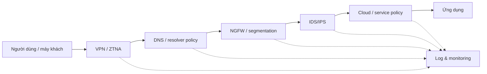

# Chi phí vận hành của nhiều lớp bảo vệ

## 1. Tại sao chi phí vận hành là một quyết định kiến trúc bảo mật?

Trong thiết kế **bảo mật mạng nhiều lớp (defense in depth)**, một dịch vụ có thể được bảo vệ đồng thời bởi phân đoạn mạng, firewall, VPN hoặc ZTNA, IDS/IPS, kiểm soát DNS, bảo vệ mạng không dây, chính sách cloud và giám sát tập trung. Nếu một lớp không chặn được hành vi nguy hiểm, lớp khác có cơ hội tiếp tục hạn chế hoặc phát hiện tác động. Tuy nhiên, mỗi lớp cũng tạo thêm cấu hình, cảnh báo, bản vá, phụ thuộc, thủ tục thay đổi và việc cần xử lý khi xảy ra sự cố.

Ví dụ, thêm một thiết bị IPS vào giữa mạng người dùng và hệ thống nghiệp vụ không chỉ tạo chi phí mua sắm. Đội vận hành còn phải thiết kế vị trí đặt IPS, duy trì cập nhật, điều chỉnh chữ ký, giảm false positive, giám sát độ trễ, lưu nhật ký, xử lý lỗi phần cứng và bảo đảm có đường khôi phục khi IPS gây gián đoạn.

Trong module `SECURITY_NETWORK_SECURITY`, bài học thuộc chương **Quyết định kiến trúc bảo mật mạng** nhằm trả lời câu hỏi: **một lớp bảo vệ mới giảm được rủi ro gì, và tổ chức cần bỏ bao nhiêu công sức để nó tiếp tục có hiệu lực?**

Sau bài này, người học có thể:

1. Phân biệt chi phí đầu tư ban đầu, chi phí vận hành định kỳ và chi phí do độ phức tạp gây ra.
2. Nhận diện tác động vận hành của firewall, segmentation, VPN, IDS/IPS, DNS, Wi-Fi và cloud controls.
3. Lập mô hình **total cost of ownership (TCO)** có giả định, đơn vị và khoảng thời gian rõ ràng.
4. Đánh giá trade-off giữa tăng chiều sâu phòng vệ với khả năng quản trị, hiệu năng và độ sẵn sàng.
5. Viết một quyết định kiến trúc có lựa chọn thay thế, bằng chứng kiểm thử, chủ sở hữu và cách rà soát sau triển khai.

## 2. Defense in depth không đồng nghĩa với càng nhiều lớp càng tốt

**Defense in depth** là chủ đích tạo nhiều cơ chế bảo vệ bổ trợ cho nhau trước các dạng lỗi, sai sót hoặc đường tấn công khác nhau. Chất lượng của chiến lược phụ thuộc vào **mức độc lập giữa các lớp**, độ phủ theo kịch bản đe dọa và khả năng chúng được vận hành đúng.

Nếu firewall và IDS/IPS cùng dùng một danh sách ngoại lệ quá rộng, hai sản phẩm không tạo hai cơ chế độc lập. Nếu các thiết bị cùng phụ thuộc một hệ thống quản lý danh tính, lỗi cấu hình IdP có thể ảnh hưởng đồng thời nhiều lớp. Nếu hai tầng chặn đều gây đứt kết nối khi mất log collector, việc thêm tầng có thể làm hệ thống kém sẵn sàng hơn.

Để đánh giá một lớp mới, cần trả lời:

- **Nó ngăn hoặc phát hiện kịch bản nào** mà các lớp hiện tại chưa xử lý tốt?
- **Nó độc lập đến đâu** với các lớp khác về rule, quản trị, phiên bản, vùng lỗi và người vận hành?
- **Nó tăng khả năng phục hồi hay tạo thêm điểm lỗi?**
- **Có năng lực duy trì không**: đội trực, tài liệu, thay đổi, giám sát, kiểm thử và ngân sách?
- **Có cách đơn giản hơn đạt cùng mục tiêu**: thu hẹp rule, phân đoạn lại, chuẩn hóa danh tính hoặc tận dụng tính năng đã có?

Một lớp bảo vệ không có người chịu trách nhiệm, không được kiểm chứng hiệu quả và thường xuyên bị tắt để “giải quyết sự cố” có thể làm kiến trúc phức tạp mà không đem lại mức giảm rủi ro tương ứng.

## 3. Phân loại chi phí của các lớp bảo vệ

Chi phí cần được nhìn theo toàn bộ vòng đời thay vì chỉ so hóa đơn giấy phép hoặc chi phí thiết bị.

| Nhóm | Nội dung | Ví dụ |
| --- | --- | --- |
| **Đầu tư ban đầu** | Thiết bị, license khởi tạo, thiết kế, triển khai, chuyển đổi và đào tạo | Mua firewall HA, xây VRF, triển khai sensor IDS |
| **Chi phí định kỳ trực tiếp** | Subscription, support, bảo trì, phần cứng thay thế, mạng và hạ tầng | NGFW subscription, DNS filtering, cloud log ingestion |
| **Nhân sự vận hành** | Theo dõi, tinh chỉnh, nâng cấp, rà soát rule, xử lý sự cố và trực ca | Network engineer, SOC analyst, cloud platform engineer |
| **Quản lý thay đổi** | Kiểm thử, phê duyệt, lập lịch, rollback, cập nhật tài liệu | Một rule phải qua nhiều firewall và proxy |
| **Telemetry & dữ liệu** | Thu thập, truyền, lưu, phân tích, retention và xóa dữ liệu | Flow logs, PCAP chọn lọc, IDS alerts, SIEM |
| **Độ sẵn sàng & hiệu năng** | Dự phòng, dung lượng, latency, khôi phục và kiểm thử lỗi | Active/standby IPS, tối ưu TLS inspection |
| **Rủi ro vận hành** | Sai cấu hình, cảnh báo giả, gián đoạn, phụ thuộc nhà cung cấp | False block làm ngừng ứng dụng; thay đổi bị rollback |
| **Tuân thủ & quản trị** | Chứng minh hiệu lực, kiểm toán, rà soát quyền, lưu bằng chứng | Audit ACL, review VPN groups, exception review |
| **Kết thúc vòng đời** | Di chuyển dữ liệu, gỡ agent/rule, hủy dịch vụ, tháo dỡ phụ thuộc | Decommission sensor, xóa route và IAM binding |

Chi phí nhân sự cần tính theo **full-loaded FTE** (tổng chi phí nhân sự phù hợp với mô hình ngân sách), không chỉ số giờ thao tác trực tiếp. Chi phí ẩn thường nằm ở tương tác giữa các lớp: mỗi thay đổi phải thử đi thử lại qua firewall, DNS, VPN, proxy, IAM và cloud security group.

**CAPEX/OPEX** là cách phân loại tài chính có thể thay đổi theo hợp đồng và chính sách kế toán. Trong phân tích kỹ thuật, hãy tách **một lần** và **lặp lại** trước; kế toán có thể xác định cách hạch toán sau.

## 4. Một bản đồ chi phí theo từng lớp

| Lớp bảo vệ | Công việc vận hành chính | Nguồn chi phí dễ bị bỏ sót | Rủi ro nếu thiếu vận hành |
| --- | --- | --- | --- |
| **Segmentation (VLAN/VRF/ACL)** | Duy trì ma trận luồng, routing, ACL, exception và kiểm thử chặn/cho phép | Tăng số thay đổi liên nhóm, sai lệch CMDB, xử lý kết nối giữa vùng | Rule chồng chéo, đường vòng, đứt luồng nghiệp vụ |
| **NGFW / firewall** | Rule lifecycle, object groups, firmware, capacity, HA, NAT | Kiểm tra thứ tự rule, TLS inspection, false positive, license tính năng | Mở quyền quá mức hoặc chặn nhầm |
| **VPN / ZTNA** | Identity, MFA, group mapping, posture, certificate, client support | Helpdesk, lỗi thiết bị người dùng, thu hồi token, split tunnel | Quyền rộng, gián đoạn đăng nhập và truy cập |
| **IDS/IPS / NDR** | Sensor placement, tuning detection, xử lý alert, bản cập nhật | SPAN/TAP, storage, noise, triage và log correlation | Không thấy traffic hoặc gây chặn nhầm |
| **DNS protection** | Policy theo nhóm, resolver, domain exception, cache và telemetry | Truy vấn bị lọc sai, split-horizon, roaming client, DoH | Bỏ lọt domain nguy hiểm hoặc phá dịch vụ hợp lệ |
| **Wi-Fi security / NAC** | SSID, certificate, onboarding, guest isolation, posture | Thiết bị không quản lý, roaming, hỗ trợ người dùng | Phân vùng sai, mất kết nối hàng loạt |
| **Cloud networking** | Security group, NACL, cloud firewall, private endpoint, tag/policy | Cloud egress, cross-zone traffic, flow logs, quyền đa account | Drift, bypass qua account hoặc VPC khác |
| **SIEM / SOAR** | Ingestion, retention, use case, parser, response automation | Chi phí theo volume, false positive, runbook bảo trì | Alert tồn đọng, không thể điều tra đáng tin cậy |
| **Management plane / AAA** | Phân quyền operator, bastion, rotation, logging, recovery | Quy trình cấp quyền, break-glass, kiểm tra failover | Khóa nhầm quyền quản trị hoặc đặc quyền quá rộng |

Không nên kết luận một sản phẩm có chi phí vận hành thấp chỉ vì giá niêm yết thấp. Năng lực đội ngũ, mức tự động hóa, hợp đồng hỗ trợ, vị trí triển khai và khả năng tích hợp quyết định tổng chi phí thực tế.

## 5. Các chi phí tăng theo số lượng lớp và mối quan hệ

Chi phí thường tăng nhanh khi xuất hiện nhiều **điểm thực thi chính sách (policy enforcement points)**. Ví dụ, để cho phép một API mới, đội vận hành có thể phải sửa:

1. Route hoặc microsegmentation giữa application zone và service zone.
2. Firewall rule và NAT.
3. Gateway VPN/ZTNA nếu dịch vụ có người dùng từ xa.
4. DNS record hoặc DNS policy.
5. Cloud security group và network ACL.
6. IDS/IPS allowlist phù hợp để tránh chặn nhầm.
7. Alert, dashboard và regression tests liên quan.

Một thay đổi cần bảy bước không có nghĩa “bảy lần an toàn hơn”. Nếu chủ sở hữu không rõ, cùng một dịch vụ có thể hoạt động ở môi trường này nhưng bị chặn ở môi trường khác.

### 5.1. Độ phức tạp kết hợp

Số quan hệ cần quản lý có thể tăng theo nhiều chiều:

- **Số control:** bao nhiêu điểm có thể cho phép hoặc từ chối một kết nối?
- **Số miền quản lý:** on-prem, cloud account, cluster, VPN, Wi-Fi, đối tác.
- **Số danh tính:** người dùng, service identity, device identity và role.
- **Số vùng bảo mật:** các trust zone có bao nhiêu luồng giao tiếp hợp lệ?
- **Số lần thay đổi:** chính sách có được cập nhật thường xuyên không?

Một cách xem đơn giản là đồ thị các phụ thuộc. Mỗi cạnh giữa hai lớp có thể cần tài liệu, regression test và quy trình xử lý lỗi. Không thể suy ra chính xác công sức từ số lớp bằng một công thức duy nhất; cần đo **số điểm cần đổi, số owner phối hợp và thời gian khôi phục** từ các change thực tế.

### 5.2. Luồng sự cố đi qua nhiều lớp



Sơ đồ là một **luồng minh họa các điểm kiểm soát**, không khẳng định DNS nằm trên đường dữ liệu của mọi kết nối hoặc IDS/IPS đều inline. Trong nhiều hệ thống, DNS là bước phân giải độc lập và IDS có thể quan sát traffic qua bản sao thay vì chặn trực tiếp.

Nếu ứng dụng lỗi, người xử lý phải phân biệt mất quyền VPN, DNS phân giải sai, NAT/routing bất thường, firewall deny, IPS false positive và ứng dụng down. Chi phí triage sẽ tăng nếu mỗi thành phần lưu log theo múi giờ, định dạng hoặc mã nhận diện khác nhau.

## 6. Mô hình tổng chi phí sở hữu (TCO)

Để so sánh các phương án, dùng cùng **thời hạn, đơn vị tiền, phạm vi và giả định**.

Một mô hình chưa chiết khấu:

\[
\operatorname{TCO}_{N} = I_0 + \sum_{t=1}^{N} \left(L_t + O_t + D_t + T_t + G_t\right)
\]

Trong đó:

| Ký hiệu | Ý nghĩa |
| --- | --- |
| \(I_0\) | Đầu tư và chi phí triển khai một lần |
| \(L_t\) | Giấy phép, thuê bao, hỗ trợ và thiết bị duy trì năm \(t\) |
| \(O_t\) | Nhân sự, trực ca và hỗ trợ vận hành |
| \(D_t\) | Thu thập dữ liệu, lưu log, network/egress và compute |
| \(T_t\) | Test, change management, đào tạo và khắc phục vận hành |
| \(G_t\) | Quản trị, kiểm toán, chi phí duy trì quy trình và governance |

Khi lập business case tài chính, có thể tính hiện giá bằng hệ số \(1/(1+r)^t\) cho khoản phát sinh mỗi năm, với \(r\) là tỷ lệ chiết khấu phù hợp. Cần ghi rõ chi phí nào đã được phân bổ chung để không **đếm hai lần** chi phí người trực hoặc hạ tầng SIEM.

**TCO là chi phí duy trì phương án, chưa tự động bao gồm tổn thất do sự cố bảo mật.** Muốn đánh giá rủi ro kinh tế, có thể xây một mô hình riêng cho expected loss, ảnh hưởng tuân thủ và gián đoạn nghiệp vụ, sau đó phân tích kịch bản. Những giá trị này có bất định lớn và cần tránh trình bày như khoản tiết kiệm được bảo đảm.

## 7. Ví dụ tính TCO ba năm cho hai kiến trúc

Giả sử một doanh nghiệp giả định có một trung tâm dữ liệu, mạng văn phòng, kết nối VPN và một số workload cloud. Đội kiến trúc đang so sánh:

- **Phương án A — lớp cơ bản:** NGFW, VPN, rule phân đoạn hiện có và hệ thống log đang vận hành.
- **Phương án B — nhiều lớp bổ sung:** phương án A cộng phân đoạn chi tiết hơn, DNS protection, IDS/IPS và tích hợp telemetry tốt hơn.

Đây là **số liệu giả định để học cách tính**, tính bằng **nghìn USD**, chưa tính thuế, lạm phát hoặc chiết khấu. Mức chi phí FTE minh họa là 60 nghìn USD/năm.

| Khoản mục | Phương án A | Phương án B |
| --- | ---: | ---: |
| Đầu tư/triển khai ban đầu \(I_0\) | 35 | 95 |
| Giấy phép và hỗ trợ mỗi năm | 22 | 39 |
| Nhân sự vận hành (A: 0,75 FTE; B: 1,25 FTE) | 45 | 75 |
| Log, lưu trữ và phân tích mỗi năm | 8 | 20 |
| Hạ tầng mạng, cloud/egress mỗi năm | 5 | 10 |
| Thay đổi, kiểm thử và kiểm toán mỗi năm | 6 | 12 |
| **Tổng chi phí định kỳ mỗi năm** | **86** | **156** |
| **TCO 3 năm = ban đầu + 3 × định kỳ** | **293** | **563** |

Kiểm tra phép tính:

```text
A: 22 + 45 + 8 + 5 + 6 = 86 (nghìn USD/năm)
   35 + 3 × 86 = 293 (nghìn USD/3 năm)

B: 39 + 75 + 20 + 10 + 12 = 156 (nghìn USD/năm)
   95 + 3 × 156 = 563 (nghìn USD/3 năm)

Chênh lệch TCO ba năm = 563 - 293 = 270 (nghìn USD)
                = 60 chi phí ban đầu + 3 × 70 chi phí định kỳ
```

### 7.1. Diễn giải đúng kết quả

Phương án B đòi hỏi **270 nghìn USD** bổ sung trong ba năm theo mô hình trên. Chưa thể kết luận B tốt hay xấu nếu chưa biết các lớp mới giảm loại rủi ro nào, phục vụ yêu cầu nghiệp vụ nào và liệu A đã đáp ứng mức kiểm soát tối thiểu hay chưa.

Nếu chỉ xét **giá trị tổn thất kỳ vọng được tránh**, chưa chiết khấu, phần giảm tổn thất trung bình cần đạt khoảng **90 nghìn USD/năm** để bù đúng chênh lệch chi phí ba năm. Đây là ngưỡng tính học thuật, **không phải dự báo xác suất sự cố hay khuyến nghị tự động bỏ phương án B**. Yêu cầu pháp lý, mức tổn thất cực đoan, độ tin cậy của doanh nghiệp và ngưỡng rủi ro được chấp nhận cũng ảnh hưởng quyết định.

### 7.2. Phương án B có tự động hóa

Giả sử muốn giảm công việc thủ công bằng policy-as-code, tự động phát hiện drift, phân luồng alert và chuẩn hóa log:

- Chi phí triển khai automation bổ sung: 20 nghìn USD một lần.
- Tiết kiệm nhân sự: 0,25 FTE × 60 = 15 nghìn USD/năm.
- Tiết kiệm telemetry sau tối ưu: 9 nghìn USD/năm.
- Bảo trì automation bổ sung: 4 nghìn USD/năm.

Khi đó chi phí định kỳ của B còn \(156-15-9+4=136\) nghìn USD/năm; đầu tư ban đầu là \(95+20=115\). TCO ba năm của phương án **B tối ưu** là \(115+3\times136=523\) nghìn USD, thấp hơn B ban đầu 40 nghìn USD. Giả định tiết kiệm nhân sự ở đây có nghĩa **năng lực làm việc được giải phóng có giá trị và không được tính trùng**; không mặc nhiên đồng nghĩa giảm biên chế.

### 7.3. Mã Python tính lại mô hình

Đoạn mã sau chạy **ngoại tuyến**, chỉ tính số học cho các giả định đã nêu:

```python
from dataclasses import dataclass

@dataclass(frozen=True)
class ArchitectureCost:
    name: str
    initial_kusd: float
    license_kusd: float
    staff_fte: float
    loaded_fte_kusd: float
    telemetry_kusd: float
    network_kusd: float
    governance_kusd: float

    def annual_kusd(self) -> float:
        return (
            self.license_kusd
            + self.staff_fte * self.loaded_fte_kusd
            + self.telemetry_kusd
            + self.network_kusd
            + self.governance_kusd
        )

    def tco_kusd(self, years: int = 3) -> float:
        return self.initial_kusd + years * self.annual_kusd()

options = [
    ArchitectureCost("A", 35, 22, 0.75, 60, 8, 5, 6),
    ArchitectureCost("B", 95, 39, 1.25, 60, 20, 10, 12),
    # B + automation: thêm 20 đầu tư, giảm 0,25 FTE,
    # giảm 9 telemetry và thêm 4 bảo trì vào governance.
    ArchitectureCost("B-optimized", 115, 39, 1.0, 60, 11, 10, 16),
]

for option in options:
    print(
        f"{option.name}: annual={option.annual_kusd():.1f}k USD, "
        f"3-year TCO={option.tco_kusd():.1f}k USD"
    )

# A: annual=86.0k USD, 3-year TCO=293.0k USD
# B: annual=156.0k USD, 3-year TCO=563.0k USD
# B-optimized: annual=136.0k USD, 3-year TCO=523.0k USD
```

Đây là mô hình khởi đầu; thực tế cần cộng chi phí triển khai từng giai đoạn, thay thiết bị, lạm phát, thời gian chuyển đổi, ràng buộc hợp đồng và chiết khấu nếu có. Không dùng con số giả định làm báo giá.

## 8. Khi nào thêm một lớp có giá trị?

Giá trị một lớp mới cần được chứng minh bằng **khoảng trống kiểm soát cụ thể**. Ví dụ:

| Vấn đề thực tế | Cải tiến có thể cân nhắc | Điều cần chứng minh |
| --- | --- | --- |
| Internet access tới các dịch vụ nội bộ quá rộng | Phân đoạn, chính sách nguồn/đích chặt hơn, private access | Đường không được phép bị chặn mà đường hợp lệ còn hoạt động |
| Không nhìn thấy hành vi bất thường giữa các zone | Sensor IDS/NDR hoặc flow logging tại điểm quan sát đúng | Detection đạt coverage, SOC nhận được tín hiệu |
| VPN cấp quyền mạng quá lớn | ZTNA hoặc phân quyền dựa trên ứng dụng/danh tính | User chỉ tới tài nguyên được cấp, xử lý offboarding hiệu quả |
| DNS egress không được kiểm soát | Resolver và DNS protection theo chính sách | DNS traffic đi qua đường được cho phép; không phá dịch vụ hợp lệ |
| Nhiều thiết bị Wi-Fi không quản lý | NAC, certificate và phân vùng phù hợp | Đúng nhóm thiết bị nhận đúng quyền, onboarding đạt SLO |
| Cloud policy khác nhau giữa các account | Policy-as-code, cloud-native guardrails và drift detection | Có ngăn cấu hình trái baseline và test runtime |

Đầu tư có giá trị khi control mới làm giảm **rủi ro còn lại** với mức chi phí, tác động vận hành và phụ thuộc có thể chấp nhận. Không nhất thiết mua sản phẩm mới: nâng hiệu lực control sẵn có, đặt sensor đúng vị trí hoặc loại bỏ quyền quá rộng có thể đạt kết quả tốt hơn.

## 9. Mối quan hệ giữa số lớp, độ sẵn sàng và hiệu năng

### 9.1. Thêm nhiều điểm inline có thể tăng khả năng gián đoạn

Nếu lưu lượng phải đi qua VPN gateway, NGFW, proxy và IPS inline, một lỗi tại bất kỳ điểm bắt buộc nào có thể làm ảnh hưởng chuỗi kết nối. Trong mô hình lý tưởng với các thành phần mắc nối tiếp và **giả định độc lập**, độ sẵn sàng của chuỗi là:

\[
A_{\text{path}} = \prod_{i=1}^{m} A_i
\]

Ví dụ hai điểm bắt buộc đều có availability \(99{,}9\%\), mô hình độc lập đơn giản cho \(A_{\text{path}}=0{,}999^2\approx 99{,}8001\%\). Công thức chỉ minh họa chiều hướng: sản phẩm thực tế có HA, bypass, routing dự phòng, lỗi chung nguồn điện hoặc lỗi thay đổi cấu hình, nên không thể suy ra SLA chỉ từ phép nhân.

Khi thiết kế thêm lớp phải xác định:

- Điểm nào **inline** có khả năng chặn traffic và điểm nào chỉ **out-of-band** giám sát?
- Nếu control hỏng, hệ thống **fail-open** hay **fail-closed** và lý do chọn?
- Có HA, đường dự phòng, kiểm thử failover và giới hạn phạm vi lỗi không?
- Các control cùng nằm ở một vùng hỏng (shared identity, điện, network management, cloud region) hay độc lập?
- Cách thay đổi, rollback và kiểm thử mà không gây lỗi dây chuyền?

**Fail-open** có thể ảnh hưởng bảo mật; **fail-closed** có thể ảnh hưởng sẵn sàng. Quyết định phải bám theo luồng nghiệp vụ, mức rủi ro và thiết kế khôi phục; không có một đáp án đúng cho mọi điểm trong mạng.

### 9.2. Độ trễ và dung lượng

TLS inspection, IPS inline, proxy, tunnel encryption và phân tuyến qua vùng tập trung đều có thể làm tăng độ trễ hoặc tiêu thụ CPU. Đội kiến trúc cần đo:

| Chỉ số | Phép đo hữu ích |
| --- | --- |
| Throughput | Lưu lượng thực tế theo profile, không chỉ thông số tối đa của hãng |
| Latency | p50/p95/p99 trước và sau bổ sung control |
| Concurrency | Số phiên, phiên mới/giây, throughput khi bật tính năng kiểm tra |
| Resource headroom | CPU/RAM/SSL offload và dung lượng dự phòng |
| Availability | Tỷ lệ lỗi, downtime, failover time, RTO/RPO nếu liên quan |
| User experience | Thời gian truy cập VPN, DNS lookup, tải ứng dụng |

Một thiết bị được quảng cáo throughput cao nhưng throughput thấp hơn khi bật threat inspection đầy đủ có thể gây yêu cầu nâng cấp phần cứng sớm. Dung lượng cần được dự trù theo **các tính năng thực sự bật** và mô hình lưu lượng cao điểm.

## 10. Chi phí telemetry, giám sát và cảnh báo

Tăng số sensor thường làm tăng lượng log và alert. Các yếu tố chi phí gồm ingestion theo GB/event, lưu trữ nóng/lạnh, parsing, index, replication, query, truyền dữ liệu cross-region và nhân sự xử lý.

Ví dụ tính dung lượng thô: 80 thiết bị, mỗi thiết bị 50 sự kiện/phút, kích thước trung bình 500 byte/sự kiện:

\[
80\times50\times500\times60\times24 =
2\,880\,000\,000\ \text{byte/ngày}\approx2{,}88\ \text{GB/ngày}
\]

Trong 30 ngày là khoảng **86,4 GB dữ liệu thô** theo đơn vị thập phân; dung lượng thực tế có thể lớn hơn khi tính metadata, index, bản sao, chuyển đổi định dạng và retention khác nhau. Nếu log bị nhân đôi qua nhiều pipeline, chi phí tăng mà năng lực phát hiện chưa chắc tăng tương ứng.

### 10.1. Alert fatigue là chi phí nhân sự

Giả sử 120 alert/ngày, mỗi alert cần trung bình 6 phút phân loại: \(120 \times 6=720\) phút, tương đương **12 giờ làm việc/ngày** trước khi tính điều tra sâu, ca trực và báo cáo. Mục tiêu không nên là giảm mọi alert; cần giảm alert **không có giá trị hành động**, đồng thời không làm mất tín hiệu quan trọng.

Có thể tối ưu bằng:

- Chuẩn hóa event schema và correlation ID giữa firewall, DNS, VPN, IDS và cloud.
- Loại bỏ trùng lặp có kiểm soát, enrichment danh tính và asset criticality.
- Điều chỉnh chính sách logging theo nhu cầu phát hiện, điều tra và retention.
- Thiết kế cảnh báo có owner, độ ưu tiên và runbook.
- Kiểm tra detection regression để biết liệu tối ưu ingest có vô tình làm mất sự kiện hay không.

Không tắt log quan trọng chỉ để giảm chi phí: yêu cầu điều tra sự cố, kiểm toán và thời gian lưu giữ phải là ràng buộc của phương án tối ưu.

## 11. Độ phức tạp vận hành của thay đổi firewall và segmentation

Một thay đổi phân đoạn hiệu quả cần biết đường đi và luồng hợp lệ. Khi nhiều lớp cùng kiểm soát, lỗi không chỉ nằm ở rule cho phép mà còn ở **thứ tự policy, object mapping, NAT, route, stateful behavior, IPv6 và sự khác biệt giữa thiết kế với cấu hình đang chạy**.

Đề xuất một quy trình có thể lặp lại:

1. **Nêu yêu cầu theo luồng:** nguồn, đích, ứng dụng, cổng, identity, thời hạn, owner.
2. **Tính tác động:** các control nào nằm trên đường đi và quyền nào sẽ thay đổi?
3. **So với baseline:** có tạo đường đi trái chính sách hoặc làm mất luồng quan trọng?
4. **Thử trước:** lint, policy simulation và lab/staging nếu có.
5. **Triển khai có kiểm soát:** ticket, lịch, snapshot, cách rollback.
6. **Kiểm thử sau:** positive tests cho luồng hợp lệ và negative tests cho luồng phải bị chặn.
7. **Theo dõi:** log, performance, thời hạn exception và drift.

Chi phí này nên đo bằng **thời gian hoàn tất một thay đổi an toàn** và **tỷ lệ thay đổi phải rollback**, thay vì chỉ đếm số lần cấu hình rule.

## 12. Chi phí nhân sự, kỹ năng và lịch trực

Kiến trúc nhiều lớp yêu cầu hiểu biết về mạng, danh tính, hệ điều hành thiết bị, cloud, detection, logging và tự động hóa. Doanh nghiệp có thể bị phụ thuộc vào một vài chuyên gia nắm chuỗi cấu hình; khi họ vắng mặt, khả năng ứng phó và tiến độ thay đổi giảm.

| Nhu cầu | Vấn đề nếu thiếu | Biện pháp quản trị |
| --- | --- | --- |
| Chủ sở hữu từng control | Không rõ ai sửa cấu hình và xác minh | RACI, service ownership, runbook |
| Nhân sự có kỹ năng đa nền tảng | Triage chậm khi lỗi xuyên firewall/VPN/cloud | Đào tạo chéo, diễn tập bàn giao |
| Trực và escalation | Alert đến nhưng không được xử lý đúng lúc | SLO phản ứng, rotation và on-call rõ |
| Tự động hóa | Thay đổi thủ công dễ sai và tốn thời gian | Policy-as-code, chuẩn hóa validation |
| Quản lý quyền | Tài khoản đặc quyền tồn tại lâu, thiếu truy vết | RBAC, JIT khi khả thi, audit và break-glass |
| Kiểm soát nhà cung cấp | Nâng cấp và hỗ trợ phụ thuộc bên ngoài | SLA hỗ trợ, exit plan và kiểm thử recovery |

Cần tính thời gian **đào tạo, chuyển giao và diễn tập** thành chi phí có kế hoạch. Một sản phẩm được đánh giá tốt về tính năng nhưng không có ai vận hành hiệu quả có thể làm tăng rủi ro thực tế.

## 13. Chi phí vận hành đặc thù của cloud và hybrid network

Với cloud, giá license chỉ là một phần:

- **Network egress/ingress có tính phí theo chiều và điểm dịch vụ:** một thiết kế bắt tất cả traffic qua cloud firewall hoặc qua on-prem có thể thay đổi đáng kể chi phí truyền dữ liệu.
- **Cross-AZ/cross-region:** đi vòng qua sensor tập trung có thể tăng latency và chi phí truyền tải tùy nhà cung cấp.
- **Flow log:** bật log ở nhiều subnet và account có thể nhân số lượng bản ghi; retention và phân tích cần được lập ngân sách.
- **Cloud-native policy:** security group, NACL, route table, private endpoint, service mesh và IAM có mô hình thực thi khác nhau, cần đo hiệu lực đồng thời.
- **Tài sản động:** autoscaling, pod IP, serverless và workload tag cần kiểm soát bằng policy-as-code; kiểm tra thủ công từng IP sẽ nhanh chóng lạc hậu.
- **Đa account/multicloud:** chủ sở hữu, billing, IAM, vùng dữ liệu và quy trình thay đổi có thể khác nhau.

Trước khi chọn thiết kế hub-and-spoke có inspection tập trung, cần lập bản đồ **tuyến lưu lượng thực tế** cùng chi phí một lần đi qua mỗi dịch vụ. Nếu dùng phân tán, cần đo chi phí duy trì nhất quán policy trên nhiều môi trường.

## 14. Lựa chọn kiểm soát tập trung hay phân tán

| Thuộc tính | Tập trung | Phân tán |
| --- | --- | --- |
| Quản lý chính sách | Có thể dễ thống nhất tại một điểm | Cần chuẩn hóa policy và tooling giữa nhiều điểm |
| Kiểm soát traffic | Dễ quan sát traffic đi qua hub | Gần workload hơn, giảm nhu cầu backhaul |
| Phụ thuộc | Có nguy cơ bottleneck hoặc vùng lỗi chung | Nhiều thành phần và bản cấu hình cần giám sát |
| Chi phí | Có thể tăng phí trung chuyển, HA và compute tập trung | Có thể tăng số lượng license/sensor và công việc điều phối |
| Khả năng mở rộng | Nâng capacity điểm trung tâm | Mở rộng theo vùng/ứng dụng, cần automation tốt |
| Điều tra sự cố | Log tập trung nhưng root cause có thể phức tạp do backhaul | Cần correlation xuyên nhiều nguồn |

Không có phương án thắng trong mọi tình huống. Ví dụ: kiểm soát egress tập trung hữu ích cho một số hệ thống, trong khi phân đoạn workload ở ngay lớp cloud-native có thể giảm số đường đi và giảm quyền mở rộng ngoài ý muốn. Kiến trúc lai thường cần xác định **chỗ nào bắt buộc tập trung** và **chỗ nào có thể thực thi tại nguồn**.

## 15. Giảm chi phí mà vẫn giữ hiệu lực bảo vệ

Nên ưu tiên loại bỏ **công việc thừa** và **sự chồng chéo không có giá trị** trước khi cắt phạm vi kiểm soát quan trọng.

### 15.1. Chuẩn hóa và tự động hóa

- **Policy-as-code:** lưu thay đổi trong phiên bản có review, lint và test tự động.
- **Quản lý rule lifecycle:** owner, ticket, ngày hết hạn, hit count, review định kỳ.
- **Dùng định danh ổn định:** resource ID, workload identity và tag được quản trị thay vì danh sách IP tĩnh khổng lồ.
- **Golden configuration:** chuẩn hardening, log, NTP, AAA, quản trị và backup có kiểm tra.
- **Regression test:** chặn lỗi trước khi production, giảm chi phí rollback và phân tích sự cố.
- **Runbook tự động có giới hạn:** các bước kiểm tra và thu thập bằng chứng, quyền tối thiểu, có kiểm toán.

### 15.2. Hợp nhất có chọn lọc

Một nền tảng tích hợp có thể giảm số agent, console và kênh support, nhưng cũng tăng **vendor concentration risk** và có thể tạo một điểm lỗi chung. Chỉ hợp nhất nếu đáp ứng tính năng bắt buộc, khả năng độc lập cần thiết, dữ liệu giám sát, phương án thoát và SLO.

### 15.3. Giảm lưu lượng và log không cần thiết

Phân loại traffic theo nhu cầu xử lý, lựa chọn điểm đặt sensor, tránh hairpin không cần thiết và xây chính sách retention theo yêu cầu. Tối ưu phải được đánh giá bằng **coverage của kịch bản đe dọa và khả năng điều tra**, không chỉ hóa đơn hàng tháng.

### 15.4. Gỡ control đã hết mục đích

Một sản phẩm hoặc rule nên được xem xét gỡ khi chức năng đã chuyển sang cơ chế khác, tài sản không còn, hoặc lớp này không còn tạo đóng góp rõ ràng. Trước khi gỡ phải xác định phụ thuộc, có baseline và test cho bất biến bảo mật liên quan, cập nhật runbook và quy trình rollback.

## 16. Làm thế nào đo hiệu quả vận hành?

Mỗi quyết định thêm lớp nên đặt **metric mục tiêu trước triển khai**, có baseline và cách thu thập rõ.

| Nhóm đo lường | Metric ví dụ | Cần diễn giải thế nào? |
| --- | --- | --- |
| Độ phủ bảo mật | Tỷ lệ critical flows có allow/deny regression test | Số test nhiều chưa chắc coverage tốt |
| Hiệu quả ngăn chặn | Số đường không được phép còn mở trong test scope | Cần thử từ đúng nguồn/identity |
| Phát hiện | Tỷ lệ detection scenario tạo event và tới SOC | Phải kiểm tra end-to-end, không chỉ sensor |
| Công việc quản trị | Giờ thay đổi/rule, số owner phải phối hợp | Giảm công việc nhưng vẫn phải đạt quality gate |
| Độ ổn định | Change failure rate, số lần rollback do policy | Theo dõi theo độ phức tạp và loại thay đổi |
| Ứng phó | MTTD, MTTR cho sự cố liên quan control | Định nghĩa điểm bắt đầu/kết thúc thống nhất |
| Hiệu năng | p95 latency, throughput ở peak, packet loss | Đo trước/sau dưới tải đại diện |
| Chi phí | OPEX hằng tháng, telemetry USD/GB, chi phí theo workload | Cần tránh chuyển chi phí sang đội khác rồi coi là tiết kiệm |
| Chất lượng cảnh báo | Alert actionable, false positive, backlog, time-to-triage | Giữ khả năng phát hiện tín hiệu quan trọng |
| Rủi ro hệ thống | Số lỗi có common cause, độ lệ thuộc vendor | HA không loại bỏ lỗi cấu hình chung |

Một dashboard có 99% rule “compliant” không chứng minh kiến trúc đã đạt mục tiêu nếu vẫn tồn tại một đường Guest → Management được phép. Kết hợp metric tổng hợp với **ca kiểm thử đại diện cho rủi ro quan trọng**.

## 17. Đánh giá chi phí và rủi ro bằng kịch bản

Để tránh đưa ra quyết định dựa trên một ước tính thiếu chắc chắn, lập ít nhất ba kịch bản: thận trọng, trung bình, xấu.

| Biến số | Kịch bản thấp | Kịch bản cơ sở | Kịch bản cao |
| --- | --- | --- | --- |
| Lưu lượng qua inspection | Ít workload nhạy cảm | Một phần workload | Hầu hết traffic nội bộ và cloud |
| Số thay đổi/tháng | 10 | 40 | 120 |
| Log và alert | Đã tối ưu tốt | Có nhiễu cần tuning | Phát sinh nhiều alert và ingest |
| Nhu cầu trực | Giờ hành chính + hỗ trợ | Trực mở rộng | SOC/NOC 24/7 |
| Tỷ lệ tăng trưởng | Ổn định | Tăng vừa | Tăng nhanh, đa cloud |
| Sự cố liên quan control | Ít ảnh hưởng | Cần can thiệp từng đợt | Có nguy cơ gián đoạn diện rộng |

Những giá trị là **mô tả kịch bản, không phải số liệu thống kê**. Có thể biến chúng thành tham số cho TCO bằng cách lấy dữ liệu từ CMDB, hóa đơn, hệ thống ticket và log; so kết quả để biết yếu tố nào làm quyết định đổi chiều.

Ngoài chi phí trực tiếp, cần xem các rủi ro khó quy đổi ra tiền: vi phạm yêu cầu hợp đồng, sự cố ảnh hưởng uy tín, gián đoạn hệ thống trọng yếu hoặc tình huống mất khả năng khôi phục. Kết luận phải có người sở hữu rủi ro xác nhận.

## 18. Mẫu Architecture Decision Record (ADR)

ADR giúp lưu lại **vì sao chọn kiến trúc này vào thời điểm này** và điều kiện nào sẽ khiến cần xem xét lại.

```yaml
adr:
  id: "ADR-NETSEC-011"
  title: "Bổ sung lớp bảo vệ cho east-west traffic"
  status: "proposed"
  owner: "network-security-architecture"
  date: "2026-11-28"

context:
  problem: "Thiếu kiểm soát và quan sát các luồng giữa vùng ứng dụng"
  scope: "Các zone và workload trong tài liệu phê duyệt"
  objectives:
    - "Giảm đường truy cập trái chính sách giữa các zone"
    - "Duy trì SLO truy cập dịch vụ quan trọng"
    - "Có bằng chứng phát hiện và kiểm toán"
  constraints:
    - "Không tự mở phạm vi quét ngoài RoE"
    - "Có phương án rollback, HA và kiểm tra failover"
    - "Ngân sách được duyệt theo chu kỳ ba năm"

options:
  - id: "A"
    description: "Tối ưu NGFW và segmentation hiện có"
  - id: "B"
    description: "Thêm inspection, DNS control và telemetry"
  - id: "B-optimized"
    description: "Phương án B với policy-as-code và log optimization"

decision:
  selected_option: null
  justification: "Chờ đối chiếu threat coverage, TCO và phép đo POC"
  reviewers:
    - "network-platform"
    - "security-operations"
    - "application-owner"
    - "risk-owner"

acceptance:
  - "Negative tests với các luồng bị cấm đạt yêu cầu"
  - "Positive tests với ứng dụng hợp lệ không bị hồi quy"
  - "Telemetry kiểm thử xuất hiện tại SOC"
  - "Không vượt các SLO và ngân sách đã duyệt"

review_triggers:
  - "Lưu lượng hoặc số workload tăng đáng kể"
  - "Có sự cố do policy hoặc false positive"
  - "Cloud hoặc VPN architecture thay đổi"
  - "Control không đạt test hồi quy"
```

Ví dụ có `selected_option: null` vì chưa có đủ dữ liệu để quyết định. Trong ADR thực tế, sau khi đánh giá và duyệt cần ghi phương án được chọn, lý do loại bỏ phương án còn lại, những giới hạn còn chấp nhận và ngày xem xét lại.

## 19. Quy trình đưa phân tích chi phí vào quyết định kiến trúc

### Bước 1 — Xác định mục tiêu và yêu cầu không thể bỏ

Ghi asset criticality, luồng nghiệp vụ, mô hình đe dọa, yêu cầu phân đoạn, tính sẵn sàng, kiểm toán và giới hạn pháp lý/hợp đồng nếu có. Không so chi phí một phương án không đáp ứng baseline với một phương án bắt buộc phải đáp ứng baseline như hai lựa chọn tương đương.

### Bước 2 — Lập sơ đồ điểm thực thi và vùng lỗi

Vẽ những lớp thực sự nằm trên data path và những thành phần chỉ quan sát. Ghi rõ owner, dependency, HA, DNS, identity, log pipeline, management plane và phương án khôi phục.

### Bước 3 — Ước tính TCO theo cùng đơn vị

Gộp chi phí ban đầu, định kỳ, nhân sự, dữ liệu, thay đổi, kiểm thử và kết thúc vòng đời. Ghi nguồn giả định, chi phí phân bổ và các khoản đã bao gồm để tránh trùng lặp.

### Bước 4 — POC có phép đo và phạm vi

Dùng lab hoặc staging với bằng chứng ủy quyền. Kiểm tra allow/deny theo trust zone, hiệu năng ở tải đại diện, failover, log ingestion, alert noise, công sức cập nhật rule và rollback.

### Bước 5 — So sánh các phương án có bằng chứng

Đánh giá cùng lúc **giảm rủi ro, thời gian thay đổi, năng lực vận hành, SLO và TCO**. Khi yêu cầu còn mơ hồ, ghi điều kiện cần xác minh và chưa chốt ADR.

### Bước 6 — Triển khai dần và đo sau khi vận hành

Triển khai theo giai đoạn, có canary và regression test. Theo dõi 30/60/90 ngày hoặc mốc phù hợp với tổ chức để so chi phí thực tế với dự báo, ghi lỗi phát sinh và cập nhật quyết định khi điều kiện thay đổi.

## 20. Bài thực hành: chọn phương án cho mạng nhiều vùng

**Bối cảnh:** doanh nghiệp có ba nhóm mạng: Office, Guest và Production; dùng VPN để truy cập từ xa; ứng dụng production đang chạy cả on-prem và cloud. Firewall hiện tại có rule theo zone nhưng chưa có kiểm thử hồi quy tự động. IDS chỉ quan sát traffic tại Internet edge. Nhóm bảo mật đề nghị triển khai sensor bổ sung và một sản phẩm DNS protection cho toàn bộ thiết bị.

Hãy thiết kế quyết định kiến trúc bằng cách:

1. Liệt kê ba kịch bản rủi ro cụ thể: ví dụ Guest → Management, Office → Production DB, và DNS egress đi ngoài resolver được duyệt.
2. Xác định control đang có, control còn thiếu và liệu sensor IDS mới cần inline hay out-of-band.
3. So sánh **tối ưu segmentation hiện có** với **thêm sản phẩm mới**, theo TCO ba năm, ảnh hưởng SLO và số bước phải thay đổi.
4. Đề xuất ít nhất hai positive và hai negative tests để đánh giá hiệu lực, kèm nguồn probe và phạm vi được duyệt.
5. Lập plan quản trị log: loại log thiết yếu, retention, correlation, owner và ước tính volume.
6. Viết ADR với quyết định tạm thời, điều kiện chấp nhận, rollback và mốc rà soát.

**Gợi ý:** phương án hợp lý có thể bổ sung lớp quan sát ở vùng có khoảng trống thực sự, đồng thời cải thiện segmentation, logging và quy trình thay đổi. Không tự động chọn sản phẩm có nhiều tính năng nhất; cần chứng minh control hoạt động trên những đường tấn công thực tế.

## 21. Câu hỏi tự kiểm tra

**Câu 1.** Vì sao tính TCO chỉ bằng giá thiết bị và license là chưa đủ?

*Gợi ý:* Chưa phản ánh nhân sự, trực ca, log, hạ tầng, rule lifecycle, kiểm thử, thay đổi, sự cố, nâng cấp và decommission.

**Câu 2.** Hai lớp firewall giống nhau trên cùng data path có phải luôn mang lại gấp đôi khả năng bảo vệ?

*Gợi ý:* Không. Phải xét độc lập về policy, lỗi chung, điểm thực thi, HA, đường vòng và mục tiêu phòng vệ; cùng một lỗi cấu hình có thể ảnh hưởng cả hai.

**Câu 3.** Vì sao một negative test bị timeout chưa đủ kết luận firewall đã chặn đúng?

*Gợi ý:* Đích có thể down, DNS/routing lỗi hoặc probe sai zone. Cần đối chiếu rule hit/log và positive control để có bằng chứng phù hợp.

**Câu 4.** Trong ví dụ TCO, tại sao phương án B chi phí cao hơn A không đồng nghĩa phải loại B?

*Gợi ý:* B có thể đáp ứng yêu cầu rủi ro hoặc kiểm soát mà A chưa đạt. Phải xác định threat coverage, yêu cầu tối thiểu, tác động nghiệp vụ và khả năng giảm tổn thất cùng độ bất định.

**Câu 5.** Nếu giảm log ingestion khiến SIEM không còn nhận được cảnh báo kiểm thử, đó có phải tối ưu thành công?

*Gợi ý:* Không. Chi phí giảm nhưng detection coverage bị suy giảm. Phải có regression test và tiêu chí telemetry để đánh giá tối ưu.

**Câu 6.** Khi bổ sung IPS inline, kiến trúc sư cần kiểm tra những gì ngoài tỷ lệ phát hiện?

*Gợi ý:* Throughput khi bật inspection, p95 latency, false positive, failover, khả năng bypass/rollback, HA, chi phí tuning và tác động tới ứng dụng hợp lệ.

## 22. Checklist trước khi phê duyệt thêm một lớp bảo vệ

- [ ] Có kịch bản đe dọa và khoảng trống control cụ thể.
- [ ] Đã khảo sát cải tiến control hiện có và các phương án thay thế.
- [ ] Đã nhận diện điểm thực thi, đường đi, phụ thuộc và vùng lỗi chung.
- [ ] Có chủ sở hữu, runbook, nhân sự và kênh escalation cho lớp mới.
- [ ] Đã tính chi phí triển khai và định kỳ trên cùng thời hạn TCO.
- [ ] Có chi phí telemetry, mạng, nhân sự, test, HA và decommission.
- [ ] Đã đo ảnh hưởng latency, capacity và SLO dưới tải đại diện.
- [ ] Có positive/negative regression tests và bằng chứng detection.
- [ ] Có quản lý rule lifecycle, exception, drift và quyền quản trị.
- [ ] Có rollback, failover và chiến lược khôi phục được kiểm tra.
- [ ] Có ADR ghi quyết định, trade-off, owner, giả định và mốc review.
- [ ] Có cơ chế đối chiếu chi phí và hiệu lực thực tế sau triển khai.

## Kết luận

Nhiều lớp bảo vệ giúp tăng chiều sâu phòng vệ khi từng lớp giải quyết một khoảng trống rủi ro rõ ràng và có cơ chế vận hành đáng tin cậy. Mỗi lớp cũng làm tăng chi phí giấy phép, dữ liệu, nhân sự, thay đổi, điều tra sự cố và phụ thuộc về sẵn sàng. Một quyết định kiến trúc tốt vì vậy phải cân nhắc **giá trị giảm rủi ro, độ độc lập của các control, TCO toàn vòng đời và khả năng duy trì hiệu lực bằng kiểm thử**. Hãy chọn kiến trúc mà đội ngũ thực sự có thể vận hành, giám sát và khôi phục, rồi đo lại giả định sau khi triển khai.
