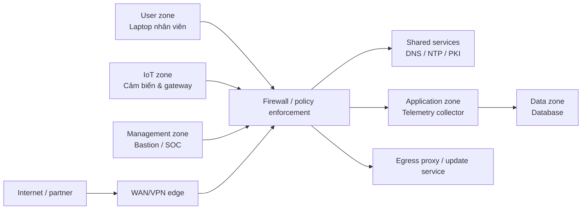
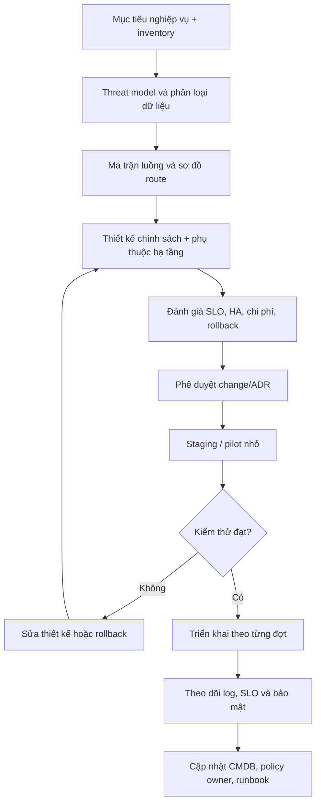

# Đánh giá tác động khi thêm một trust zone

Trong kiến trúc bảo mật mạng, **trust zone** (vùng tin cậy) là tập hợp tài sản hoặc luồng kết nối được áp dụng một mức chính sách và phạm vi kiểm soát tương đối thống nhất. Khi bổ sung một trust zone mới, tổ chức không chỉ thêm VLAN, subnet hay một cặp interface vào firewall. Quyết định đó tạo ra **ranh giới tin cậy mới**, kéo theo thay đổi ở định tuyến, quy tắc truy cập, quản trị danh tính, giám sát, hiệu năng, mức sẵn sàng và quy trình ứng cứu sự cố.

Bài học thuộc chương **Quyết định kiến trúc bảo mật mạng** của module **SECURITY_NETWORK_SECURITY**. Trong phạm vi module, các lớp firewall, VPN, IDS/IPS, DNS, phân đoạn mạng, Wi-Fi và hạ tầng đám mây đều phải được xem xét khi thêm zone. Mục tiêu là biết cách **đánh giá tác động trước khi triển khai**, thay vì chỉ nhìn sơ đồ mạng sau khi chia thêm subnet.

Ví dụ xuyên suốt: doanh nghiệp muốn tách các thiết bị IoT tại nhà máy khỏi mạng nhân viên và máy chủ ứng dụng bằng một zone mới. Các thiết bị cần gửi dữ liệu đến bộ thu qua MQTT/TLS, truy vấn DNS, đồng bộ NTP và nhận bản vá, nhưng không được tự do kết nối đến mạng quản trị hoặc cơ sở dữ liệu.

## 1. Kết quả học tập

Sau bài học, người học có thể:

1. Phân biệt trust zone, security boundary, VLAN, subnet, VRF, VPC/VNet, policy group và nguyên tắc Zero Trust.
2. Xác định nhu cầu nghiệp vụ, tài sản, luồng dữ liệu, chủ sở hữu và độ tin cậy trước khi tạo zone.
3. Thiết kế ma trận nguồn–đích–giao thức–hành động theo nguyên tắc **default deny** và quyền tối thiểu.
4. Phân tích ảnh hưởng đến định tuyến, NAT, firewall state, VPN, DNS, IPv4/IPv6, giám sát và quản trị thiết bị.
5. Ước lượng chi phí về độ trễ, throughput, session capacity, HA, vận hành và thay đổi quy trình ứng cứu.
6. Lập threat model cho nguy cơ di chuyển ngang, đường vòng chính sách, lộ dữ liệu và lỗi phân đoạn.
7. Chuẩn bị kế hoạch thay đổi theo từng giai đoạn, kiểm thử dương/âm tính và rollback.
8. Viết Architecture Decision Record (ADR) với giả định, bằng chứng, tiêu chí chấp nhận và thời điểm đánh giá lại.

## 2. Trust zone thực chất là gì?

### 2.1. Trust zone là ranh giới chính sách

Một trust zone thường gồm các tài sản có tính chất tương đồng về **độ nhạy cảm**, **mức phơi nhiễm**, **quyền được cấp** hoặc **chức năng nghiệp vụ**. Một số ví dụ:

| Zone | Tài sản thường gặp | Rủi ro tiêu biểu | Nguyên tắc quản lý |
|---|---|---|---|
| **Internet/Untrusted** | Nguồn truy cập từ bên ngoài | Không kiểm soát được endpoint nguồn | Kiểm soát tại biên, không tin chỉ vì kết nối thành công |
| **DMZ** | Reverse proxy, WAF, dịch vụ công khai | Bị tấn công từ Internet, nguy cơ pivot vào nội bộ | Giới hạn đường vào và đường ra |
| **User** | Laptop nhân viên, thiết bị văn phòng | Phishing, malware, thiết bị bị chiếm quyền | Không mặc định có quyền vào server/management |
| **Application** | Web service, API, worker | Lỗi ứng dụng, bí mật dịch vụ | Chỉ gọi các đích phụ thuộc cụ thể |
| **Data** | Database, secret store | Rò rỉ hoặc sửa dữ liệu | Chỉ principal/service hợp lệ qua đường kiểm soát |
| **Management** | Bastion, controller, giao diện quản trị | Chiếm quyền hạ tầng | Nguồn, danh tính, quyền và nhật ký nghiêm ngặt |
| **IoT/OT** | Cảm biến, controller, thiết bị nhúng | Firmware cũ, giao thức đặc thù, vòng đời dài | Phân đoạn chặt, bảo đảm yêu cầu vận hành an toàn |
| **Partner** | Đường kết nối nhà cung cấp/đối tác | Phụ thuộc bên thứ ba, khó đánh giá endpoint | Hợp đồng truy cập, scope và thời hạn rõ |

Một máy chủ có thể sở hữu nhiều interface hoặc endpoint phục vụ các mục đích khác nhau. **Không nên suy rằng chỉ vì tài sản nằm trong cùng subnet thì chúng có mức tin cậy và quyền giống nhau**. Một subnet “được tin cậy” không làm mọi tài khoản hay tiến trình trong đó tự động đáng tin.

### 2.2. So sánh zone với các cơ chế mạng

| Khái niệm | Mục đích chính | Có tự tạo ranh giới bảo mật hoàn chỉnh? |
|---|---|---|
| **VLAN** | Phân tách miền quảng bá Layer 2 | **Không.** Cần kiểm soát inter-VLAN routing, cấu hình switch và đường nối khác |
| **Subnet IPv4/IPv6** | Phân bổ địa chỉ và phạm vi định tuyến | **Không.** Router có thể cho phép lưu lượng giữa các subnet |
| **VRF** | Tách bảng định tuyến | Giúp cô lập tuyến; route leaking và quản trị vẫn cần kiểm soát |
| **Firewall security zone** | Gắn interface/segment vào tập chính sách | Có thể là điểm thực thi; còn phụ thuộc rule, thứ tự, bypass và HA |
| **VPC/VNet/cloud subnet** | Ranh giới mạng logic trên cloud | Cần security group/NSG, route, firewall và IAM phù hợp |
| **Microsegmentation** | Kiểm soát kết nối ở mức workload/identity | Chi tiết hơn; cần nguồn danh tính chính xác và thực thi nhất quán |
| **Zero Trust** | Xác minh tường minh từng yêu cầu theo ngữ cảnh, quyền tối thiểu | Là nguyên tắc kiến trúc, không đồng nghĩa một VLAN hoặc sản phẩm đơn lẻ |

**Điểm then chốt:** trust zone là **quyết định phân nhóm và ranh giới chính sách**; VLAN, VRF, firewall, security group và danh tính là những cơ chế thực hiện quyết định đó. Chúng phải được thiết kế thống nhất.

### 2.3. Vì sao cần thêm zone?

Có những lý do hợp lý:

- Một nhóm tài sản có **mức rủi ro khác biệt**: IoT khó cập nhật so với laptop được quản lý.
- Một loại dữ liệu có **yêu cầu kiểm soát nghiêm ngặt hơn**: secret, dữ liệu cá nhân, thông tin vận hành OT.
- Cần giảm **blast radius** khi endpoint bị xâm nhập: máy khách bị chiếm quyền không thể dễ dàng di chuyển ngang tới máy chủ quan trọng.
- Cần cô lập **đối tác/nhà thầu** trong thời hạn và phạm vi dịch vụ cụ thể.
- Cần **môi trường quản trị riêng** hoặc ngăn traffic workload với control plane.
- Cần đáp ứng kiểm soát nội bộ, yêu cầu khách hàng hoặc nghĩa vụ pháp lý đã xác định.

Thêm zone **không tự động giảm rủi ro** nếu các rule mới lại cho phép mọi nguồn sang mọi đích, hoặc có một đường truy cập thẳng đi vòng điểm thực thi chính sách.

## 3. Thiết lập bối cảnh trước khi thiết kế

Một quyết định thêm zone cần trả lời các câu hỏi về **nghiệp vụ, tài sản, liên kết và trách nhiệm**.

### 3.1. Thông tin đầu vào tối thiểu

| Câu hỏi | Bằng chứng cần thu |
|---|---|
| Vì sao phải tạo zone? | Mục tiêu giảm rủi ro, yêu cầu phân đoạn, vấn đề ở kiến trúc hiện tại |
| Zone chứa gì? | Asset inventory, CMDB, IP/MAC, workload, OS/firmware, chủ sở hữu |
| Ai sử dụng zone? | Người dùng, tài khoản dịch vụ, thiết bị, nhà thầu, nhóm vận hành |
| Luồng nào cần hoạt động? | Flow log, sơ đồ ứng dụng, port/protocol, lịch backup/DR, dependencies |
| Thông tin gì được xử lý? | Phân loại dữ liệu, nơi lưu, đường truyền, chính sách mã hóa |
| Cơ chế quản trị ra sao? | Bastion/VPN, AAA/IdP, đường OOB, logging và vòng đời quyền |
| Thay đổi tại đâu? | Switch, router, firewall, VPN, cloud, Wi-Fi, DNS, load balancer, host |
| Ai quyết định và ai xác minh? | Owner nghiệp vụ, Network, Security, Platform, Change Approver |
| Điều gì không được gián đoạn? | SLO, ứng dụng trọng yếu, thời gian bảo trì, phục hồi/rollback |

**Không dựa hoàn toàn vào lưu lượng đang thấy:** một luồng backup mỗi tháng hoặc dịch vụ khôi phục chỉ chạy khi sự cố có thể không xuất hiện trong cửa sổ flow log ngắn. Cần kết hợp tài liệu ứng dụng, owner và lịch vận hành.

### 3.2. Xác định ranh giới vào/ra và mức tin cậy

Với mỗi zone, mô tả:

1. **Ingress:** nguồn nào được tạo kết nối tới zone, để làm gì?
2. **Egress:** workload trong zone được khởi tạo kết nối đi đâu?
3. **East–west:** các endpoint *bên trong cùng zone* được tự do giao tiếp hay tiếp tục có kiểm soát?
4. **Quản trị:** ai có quyền SSH/HTTPS/API/SNMP và phải đi qua đường nào?
5. **Điều khiển và hạ tầng:** DNS, NTP, DHCP, PKI, cập nhật, syslog, monitoring, directory service.
6. **Khẩn cấp:** cần đường kết nối nào khi firewall, VPN, DNS hoặc IdP chính bị lỗi?

Một zone với egress quá rộng có thể bị dùng để **exfiltration**, gọi command-and-control hoặc thăm dò nội bộ; vì vậy phải đánh giá cả chiều đi ra. Một zone được bảo vệ inbound chặt nhưng tự do đi Internet và đi ngang sang vùng khác vẫn còn nhiều rủi ro.

## 4. Mô hình kiến trúc trước và sau khi thêm zone

### 4.1. Trước thay đổi

Giả sử mạng của doanh nghiệp cho phép các cảm biến IoT dùng chung mạng user; nhiều đường inter-VLAN chưa có rule chi tiết. Một cảm biến bị xâm nhập có thể tiếp cận nhiều dịch vụ mà nó không cần để gửi dữ liệu.

### 4.2. Sau thay đổi

Thiết kế mới tạo **IoT Zone** với subnet riêng, gateway và firewall policy kiểm soát luồng đến dịch vụ tiếp nhận dữ liệu.



**Ý nghĩa sơ đồ:** các kết nối qua firewall là đường có thể áp chính sách; sơ đồ **không** ngụ ý mọi cặp zone đều được phép. IoT chỉ kết nối đến các đích và dịch vụ tối thiểu đã xét. Một collector phía application có thể tiếp tục gửi dữ liệu đến database theo chính sách **riêng**; IoT không được truy cập database trực tiếp.

Đối với VLAN/switch thực tế, cần xác định điểm định tuyến giữa các zone. Nếu hai workload cùng nằm trên một VLAN và chuyển tiếp trực tiếp ở L2, firewall giữa VLAN có thể **không** nhìn thấy traffic đó. Muốn kiểm soát giữa các endpoint cùng zone, cần microsegmentation, host firewall, private VLAN hoặc cơ chế tương đương.

## 5. Threat model: tác động đến nguy cơ tấn công

### 5.1. Tài sản, đối thủ và đường đi

Với IoT Zone, có thể giả định một cảm biến bị chiếm quyền do firmware lỗi thời. Mục tiêu bảo mật không phải “cảm biến trở nên an toàn”, mà là **giới hạn khả năng của một endpoint bị xâm nhập** và tăng khả năng phát hiện.

| Kịch bản | Khi IoT nằm chung zone user | Sau khi có zone mới | Kiểm soát cần xác minh |
|---|---|---|---|
| Thiết bị bị chiếm quyền quét mạng nhân viên | Có thể tiếp cận nhiều endpoint cùng segment | Đường IoT → User bị chặn | L3/L4 deny, microsegmentation nếu cần, log |
| IoT kết nối thẳng database | Đường đi có thể tồn tại nếu rule rộng | Chỉ IoT → collector; database chỉ nhận từ application | Firewall/SG, app authentication |
| IoT phát tán ra Internet | Outbound rộng, khó truy vết | Egress giới hạn theo proxy/update | Egress ACL, DNS policy, monitoring |
| Tấn công qua kênh quản trị thiết bị | Quyền SSH/HTTPS có thể phân tán | Chỉ bastion/management subnet | Management ACL, MFA/AAA, audit |
| Di chuyển ngang giữa hai cảm biến | Có thể ở cùng L2 | **Có thể vẫn xảy ra** nếu cùng IoT VLAN | Host policy, switch isolation, endpoint hardening |
| Một rule quá rộng vào IoT Zone | Khó nhìn vì policy chung | Rule mới có thể phá mục tiêu phân đoạn | Rule review, test âm tính, owner approval |
| Thiết bị giả mạo địa chỉ nguồn | Có thể thử lách policy dựa trên IP | ACL L3 không tự xác thực thiết bị | 802.1X/NAC, DHCP snooping, IP Source Guard khi phù hợp |

### 5.2. Những ranh giới tin cậy bị tạo ra

Khi thêm zone, phải đánh giá **mỗi đường băng qua ranh giới**:

- **IoT → Application:** cần xác thực thiết bị/chứng chỉ hoặc token, TLS và quyền giới hạn ở ingestion.
- **Application → IoT:** ứng dụng có thật sự cần khởi tạo kết nối vào cảm biến không? Nếu cần, qua cổng/endpoint nào và có rủi ro điều khiển không?
- **Management → IoT:** quyền cấu hình chỉ cho thiết bị quản lý; tránh mở web admin từ mạng nhân viên.
- **IoT → Shared Services:** resolver, NTP, PKI và hệ thống cập nhật có cần thiết không? Nếu cần, chỉ mở đến nguồn dịch vụ được duyệt.
- **IoT → Internet:** chính sách deny mặc định; nếu có nhu cầu cập nhật firmware, dùng proxy/endpoint kiểm soát.
- **IoT ↔ IoT:** có giao tiếp peer-to-peer nào cần thiết cho quy trình nghiệp vụ? Nếu không, xét cô lập nội zone.

### 5.3. “Zone đáng tin cậy” không thay thế xác thực

Nếu một cảm biến nằm trong IoT Zone, collector vẫn cần bảo vệ trước dữ liệu giả mạo và gửi vượt tốc độ. Một attacker chiếm được địa chỉ nguồn đúng subnet có thể vượt qua ACL chỉ dựa trên IP. Do đó, cần **defense in depth**: xác thực thiết bị, ủy quyền theo loại thiết bị, mã hóa, schema validation, rate limit, giám sát và quy trình thu hồi định danh.

## 6. Thiết kế ma trận luồng dữ liệu

Ma trận truy cập là căn cứ quan trọng nhất để nhận diện tác động. Mỗi mục phải có **nguồn, đích, giao thức/cổng, chiều kết nối, mục đích và owner**.

### 6.1. Ví dụ ma trận cho IoT Zone

Các địa chỉ sau **chỉ là ví dụ lab**. Giả sử IoT Zone dùng `10.80.40.0/24`; collector nằm tại `10.20.30.12`, DNS `10.20.5.53`, NTP `10.20.5.123`, bastion `10.20.10.10`.

| Nguồn | Đích | Giao thức | Quyết định | Chủ sở hữu/lý do |
|---|---|---|---|---|
| IoT `10.80.40.0/24` | Collector `10.20.30.12` | TCP 8883 (MQTT/TLS) | **Allow** | Telemetry service; gửi số liệu |
| IoT `10.80.40.0/24` | DNS `10.20.5.53` | UDP/TCP 53 | **Allow** | Infra; phân giải tên |
| IoT `10.80.40.0/24` | NTP `10.20.5.123` | UDP 123 | **Allow** | Infra; đồng bộ thời gian |
| Bastion `10.20.10.10` | Giao diện quản trị IoT được duyệt | TCP 443/22 tùy thiết bị | **Allow có điều kiện** | Network Ops; quản trị |
| Monitoring được phê duyệt | Thiết bị IoT được giám sát | Cổng agent/SNMPv3 thực sự cần | **Allow có điều kiện** | SOC/NOC; health/telemetry |
| IoT `10.80.40.0/24` | Database zone | Mọi dịch vụ | **Deny** | Không có nhu cầu truy cập trực tiếp |
| IoT `10.80.40.0/24` | User/Management zone | Mọi dịch vụ không nằm trong ngoại lệ | **Deny** | Ngăn di chuyển ngang |
| IoT `10.80.40.0/24` | Internet bất kỳ | Mọi dịch vụ | **Deny theo thiết kế** | Chỉ dùng egress proxy có phê duyệt |
| Nguồn khác | IoT Zone | Không thuộc rule được phép | **Deny** | Default deny |

**Cần làm rõ “allow”:** kết nối trong trạng thái **đã thiết lập** có thể được firewall stateful cho phép lưu lượng trả về. Không nên mở rule inbound rộng để “cho phản hồi”, nhưng với ACL stateless, hướng trả về có thể cần rule đối ứng. Phải xác nhận cơ chế thực tế của thiết bị.

Với DHCP: nếu IoT dùng DHCP, DHCP broadcast thường cần relay hoặc dịch vụ nội zone theo topology. Không thể suy luận rằng chỉ mở UDP 53 và 123 đã đáp ứng mọi nhu cầu hạ tầng.

### 6.2. Phân loại luồng cần và không cần

Nên ghi một trong các trạng thái cho mỗi luồng:

- **REQUIRED:** chứng minh được nhu cầu nghiệp vụ và owner.
- **CONDITIONAL:** cần trong một mode, lịch hoặc sự cố cụ thể; phải xác định cách kích hoạt.
- **PROHIBITED:** có lý do bảo mật rõ để chặn.
- **UNKNOWN:** cần thu thập thêm log, tài liệu hoặc xác nhận owner.

Không chuyển **UNKNOWN thành ALLOW ALL** chỉ để triển khai nhanh. Nếu còn luồng chưa xác định, có thể dùng giai đoạn quan sát với log được kiểm soát và trì hoãn cắt chuyển cho đến khi có bằng chứng phù hợp. Đối với hệ thống an toàn vận hành, cần phối hợp với người chịu trách nhiệm OT để tránh ảnh hưởng vật lý.

### 6.3. Ma trận phải phản ánh traffic thực

Một số luồng dễ bị bỏ sót:

- Phân giải tên nội bộ, NTP/PTP, CRL/OCSP hoặc PKI cần cho TLS.
- DHCP relay, DHCPv6, IPv6 Router Advertisement/Neighbor Discovery theo topology.
- Syslog, metrics, SNMPv3, NetFlow/IPFIX hoặc sensor heartbeat.
- Firmware update, artifact repository, license server, proxy.
- Backup, khôi phục, quét cấu hình, vulnerability scanner được phép.
- VPN concentrator, bastion, AAA/IdP, PAM và emergency console.
- Cluster/HA replication, load balancer health check, service discovery.
- Thông báo sự kiện hoặc message queue qua trung gian ứng dụng.

Các giao thức dùng broadcast/multicast hoặc địa chỉ link-local có thể **không** đi qua router thông thường. Phải đánh giá khả năng hoạt động sau khi tách VLAN và thiết kế relay/proxy khi thực sự cần; tuyệt đối không mở multicast toàn mạng bằng rule rộng thiếu kiểm soát.

## 7. Tác động đến định tuyến, VLAN, VRF, NAT và firewall

### 7.1. Đường đi dữ liệu trước và sau khi thêm zone

Với mỗi luồng trong ma trận, vẽ đường đi thực tế:

```text
IoT host
  -> access switch / Wi-Fi AP
  -> IoT gateway / SVI
  -> firewall zone interface
  -> routed network
  -> application collector
  -> (backend policy riêng) database
```

Cần xác nhận:

1. Địa chỉ mạng và gateway mới không trùng các dải hiện có, bao gồm VPC/VNet/VPN peer.
2. Route đến zone và route **đường về** được truyền đúng; không tạo đường vòng tránh firewall.
3. Gateway/SVI ở đâu, interface nào thực thi policy, có trunk/VLAN tag đúng không.
4. NAT/SNAT/DNAT có làm thay đổi IP mà firewall hoặc ứng dụng quan sát không.
5. Có đường phụ như VPN, peering, SD-WAN, OOB, IPv6 hoặc public endpoint không đi qua điểm chặn dự kiến.
6. Khi có HA hoặc ECMP, đường chiều đi và về có giữ được trạng thái theo hành vi của firewall không.

**Asymmetric routing:** firewall stateful có thể từ chối gói chiều về nếu không quan sát phiên chiều đi, tùy thiết kế đồng bộ state và chính sách. Tách zone có thể khiến đường đi bị kéo qua hai firewall khác nhau. Kiểm tra traceroute, route table, session table và log policy ở cả chiều.

### 7.2. Policy evaluation và rule ordering

Một cấu hình mới cần được đánh giá cùng toàn bộ **rule đang có hiệu lực**. Ví dụ, policy cũ `Internal → any: allow` có thể bao phủ cả subnet IoT mới nếu IoT được thêm vào object “Internal”. Khi đó rule deny cụ thể có thể không đạt mục tiêu do thứ tự hoặc cách engine xét match.

Phải kiểm tra:

- Có rule wildcard/CIDR rộng đã bao trùm zone mới không?
- Security group, network ACL và firewall trung tâm được kết hợp theo điều kiện nào?
- Rule có tính **stateful** hay **stateless**, ưu tiên theo thứ tự hay đánh giá khác?
- NAT được xử lý trước hay sau policy lookup, và log hiển thị IP nào?
- IPv6 có chính sách tương ứng với IPv4?
- Có management-plane/local-in policy riêng để bảo vệ chính thiết bị không?

**Không coi deny ở một điểm là đủ** nếu lưu lượng có thể đi theo một đường khác. Kết quả mong muốn là đường đi hợp lệ tới collector được phép và mọi đường khác không nằm trong ma trận bị kiểm soát.

### 7.3. MTU, fragmentation và lưu lượng đặc thù

Zone mới có thể tạo thêm tunnel (IPsec, VXLAN, GRE), thay đổi MTU hiệu dụng hoặc đưa traffic qua inspection proxy. Một số ứng dụng hoạt động với gói nhỏ nhưng thất bại với payload lớn do PMTUD bị chặn hoặc MSS không phù hợp. Khi kiểm thử, cần có gói và payload đại diện, đo retransmission, drop, MTU, TCP reset và độ trễ. Không chặn bừa các thông điệp ICMP/ICMPv6 cần thiết cho chẩn đoán và hoạt động mạng.

## 8. Tác động đến tính sẵn sàng, phụ thuộc và khôi phục

Zone mới có thể tạo **điểm lỗi chung**: nếu mọi luồng hợp lệ phải qua một firewall, proxy hay DNS resolver mới, lỗi của thành phần đó sẽ ảnh hưởng toàn bộ zone.

| Thành phần | Câu hỏi kiến trúc | Kịch bản thử |
|---|---|---|
| **Firewall/segmentation gateway** | Có HA, đồng bộ state và capacity failover? | Chuyển node, kiểm tra phiên mới/đang hoạt động |
| **DNS/Service discovery** | Resolver nào phục vụ zone, có dự phòng? | DNS primary lỗi, xác minh resolver dự phòng |
| **NTP/PTP** | Thiết bị có duy trì thời gian chính xác? | Kiểm tra đồng bộ và tác động đến TLS/log |
| **PKI/identity** | Cert validation, token issuance có reachable? | Kiểm tra chứng chỉ và thu hồi quyền |
| **Collector/backend** | Có queue/buffer và cơ chế retry hợp lý? | Collector lỗi, kiểm tra buffering, mất bản ghi |
| **Management/OOB** | Có còn cấu hình được thiết bị khi firewall chính lỗi? | Truy cập break-glass qua đường độc lập |
| **Monitoring/logging** | Alert và log có được chuyển qua ranh giới mới? | Gây một sự kiện lab, kiểm tra log và thông báo |
| **Update/backup** | Firmware, backup và cấu hình định kỳ có chạy? | Thử job hợp lệ và khôi phục trong lab |

### 8.1. Fail-open, fail-closed và trạng thái suy giảm

Với ranh giới bảo mật, **fail-closed** thường giúp duy trì quyết định chặn khi không thể kiểm chứng quyền, nhưng có thể tạo gián đoạn. **Fail-open** có thể giữ dịch vụ trong một số thiết kế nhưng làm mất hiệu quả cô lập. Sự lựa chọn phụ thuộc tài sản, mối đe dọa, yêu cầu an toàn vận hành và quyền phê duyệt.

Ví dụ: nếu gateway IoT mất khả năng xác minh policy, cho phép `IoT → database:any` như một fallback là thay đổi rủi ro rất lớn. Phương án tốt hơn thường là **dịch vụ thu nhận dự phòng có giới hạn**, buffer cục bộ và quy trình khôi phục được kiểm soát. Không thiết kế ngoại lệ vô thời hạn với nhãn “khẩn cấp” rồi để nó trở thành đường đi bình thường.

### 8.2. Xác định SLO và failure domain

Các tiêu chí có thể gồm:

- **Availability:** xác suất collector nhận được dữ liệu hợp lệ.
- **Latency:** p95/p99 của đường telemetry IoT → collector.
- **Data loss:** số bản ghi bị mất hoặc trễ quá hạn cho phép.
- **Recovery time:** thời gian khôi phục khi gateway hoặc firewall failover.
- **Detection latency:** thời gian từ vi phạm policy đến alert.
- **Administrative access:** khả năng truy cập khẩn cấp hợp lệ, có ghi log.

Một zone mới có thể cải thiện **blast radius bảo mật** nhưng đồng thời thêm **failure domain vận hành**. Quyết định tốt cần đo cả hai.

## 9. Tác động hiệu năng và dung lượng

### 9.1. Độ trễ mới phát sinh từ đâu?

Tách zone có thể đưa traffic qua router/firewall/IPS, inspection proxy hoặc VPN tunnel vốn không nằm trên đường cũ. Chi phí có thể gồm:

- RTT tăng do đường vòng qua trung tâm kiểm soát.
- Độ trễ xử lý rule, stateful connection, TLS termination hoặc DPI khi được bật.
- Queue trên thiết bị lúc peak hoặc khi chỉ còn một node HA.
- Chi phí DNS, proxy hoặc kiểm tra danh tính nếu phải gọi đồng bộ.
- MTU/PMTUD và tái truyền khi topology thay đổi.

**Không được cộng p95 của từng hop và gọi đó là p95 end-to-end.** Percentile không cộng đơn giản; phải đo trên cùng tập request/transaction hoặc dùng tracing cho đường đi thực.

### 9.2. Ví dụ ngân sách độ trễ

Giả sử ứng dụng có **SLO p95 của luồng telemetry hợp lệ ≤ 250 ms** trong điều kiện tải xác định. Đội kiến trúc đặt ngân sách tham chiếu cho một request tiêu biểu:

| Thành phần | Ngân sách minh họa |
|---|---:|
| Mạng IoT nội bộ và uplink | 45 ms |
| Định tuyến/segmentation gateway | 20 ms |
| Kiểm tra tại firewall/IPS | 25 ms |
| Collector xử lý và ghi nhận | 100 ms |
| Dự phòng biến động/queue | 60 ms |
| **Tổng ngân sách kỹ thuật** | **250 ms** |

Đây là **ước tính thiết kế**, không phải phép chứng minh SLO p95. Để chứng minh, cần đo phân phối end-to-end khi ứng dụng thực sự chạy trên zone mới, so sánh cùng payload, loại thiết bị, thời gian tải và tỷ lệ lỗi.

Nếu phải thêm thiết bị inline, đo cả khi **inspection rules được bật đúng như production** và khi tải gần cao điểm dự kiến. Thông số throughput “không bật IPS” có thể không đại diện hiệu năng khi kiểm tra TLS, chữ ký hoặc log chi tiết.

### 9.3. Capacity phải bao phủ nhiều chỉ số

Không chỉ xem Gbps. Một gateway có thể đủ bandwidth nhưng thiếu khả năng xử lý **CPS, PPS, TLS handshake/s, session table hoặc CPU control plane**.

| Chỉ số | Vì sao cần đo |
|---|---|
| Gbps/bps | Tránh quá tải đường và thiết bị |
| PPS | Các gói nhỏ có thể tạo áp lực xử lý lớn |
| CPS/new sessions | Hệ thống có nhiều thiết bị khởi tạo phiên cùng lúc |
| Concurrent sessions/conntrack | Phân đoạn mới có thể gom state từ nhiều luồng |
| CPU/RAM dataplane & management | Cảnh báo thiếu headroom khi peak/failover |
| Drop/retransmission/timeouts | Phát hiện nghẽn không thể hiện ở RTT trung bình |
| p95/p99 latency và jitter | Đánh giá trải nghiệm và ứng dụng nhạy thời gian |

Cần bảo lưu dự trữ dung lượng cho burst, cập nhật hàng loạt, thiết bị reconnect sau mất điện và kịch bản một node HA phải gánh toàn bộ tải.

## 10. Tác động đến DNS, VPN, Wi-Fi, IoT và quản trị

### 10.1. DNS và hạ tầng nền

Khi chuyển một thiết bị sang subnet mới:

- DHCP scope/relay có thể thay đổi; cần kiểm tra cấp phát đúng IP/gateway/DNS.
- Resolver nội bộ phải có đường từ zone, nhưng chỉ mở đúng DNS service cần thiết.
- DNS policy, split-horizon, DNSSEC validation, service discovery hoặc forwarder có thể xử lý khác theo subnet nguồn.
- Đồng bộ NTP và chứng chỉ TLS có thể lỗi nếu thời gian thiết bị sai.
- Các endpoint firmware/license có thể cần egress proxy và chính sách TLS rõ ràng.

Cần kiểm tra **khả năng phân giải tên và truy cập địa chỉ đích thực**, thay vì chỉ ping. Một kết nối bằng IP có thể thành công trong khi ứng dụng dùng DNS không hoạt động.

### 10.2. VPN và kết nối từ xa

Zone mới có thể nằm sau VPN site-to-site hoặc được truy cập bởi kỹ sư qua VPN/ZTNA quản trị. Cần kiểm tra các selector/routes/policy của IPsec hoặc SD-WAN có bao phủ subnet mới không; tránh cho phép toàn bộ pool VPN nhân viên vào zone mới chỉ để kỹ sư kiểm thử. Mọi quyền mới cần owner và nguyên tắc tối thiểu.

### 10.3. Wi-Fi, switch và endpoint

Nếu IoT nằm trên SSID/VLAN riêng, kiểm tra:

- Mapping SSID → VLAN, dynamic VLAN và quyền của switch access port.
- NAC/802.1X/MAB, phương án nhận diện thiết bị nếu không có 802.1X.
- Broadcast/multicast, discovery protocol và yêu cầu AP/controller thực tế.
- ACL giữa client cùng SSID/VLAN khi muốn chặn east–west.
- Khả năng quản trị AP/controller từ management zone.
- Độ ổn định roaming hoặc reconnect trong bài kiểm thử có kiểm soát.

**Một SSID riêng không đồng nghĩa mọi IoT đều bị cô lập.** Nếu cùng VLAN với nhau và không có client isolation, nhiều thiết bị vẫn có thể trao đổi trực tiếp.

### 10.4. Quản trị và cập nhật phần mềm

Cần chỉ rõ host nào được cấu hình thiết bị trong zone và qua đường nào. Ví dụ bastion có MFA → management API của IoT controller, chứ không mở SSH/HTTPS từ toàn bộ mạng nhân viên. Nếu thiết bị chỉ hỗ trợ giao thức quản trị cũ, cần có biện pháp bù đắp (giới hạn nguồn, gateway chuyên dụng, lịch thay thế) và risk acceptance.

## 11. Tác động trong môi trường cloud, hybrid và container

### 11.1. Cloud VPC/VNet không tự tạo deny hoàn chỉnh

Khi thêm subnet cho workload cloud, cần xem đồng thời:

- **Route table:** local route, peering, transit gateway, VPN/direct connect, internet/NAT gateway.
- **Security group/NSG:** điều kiện nguồn–đích–port theo workload/network interface.
- **Network ACL hoặc network firewall:** cách kiểm soát stateless/stateful và rule precedence.
- **Identity/IAM:** dịch vụ nào có thể gọi API cloud để sửa cấu hình và đọc secret.
- **Private endpoint/service endpoint:** đường đi trực tiếp đến managed services.
- **Log:** flow logs, cloud audit, WAF/network firewall events và quyền truy cập log.
- **IPv6:** internet egress, inbound rules, route và chính sách khác IPv4.

Một security group mồ côi, rule `0.0.0.0/0` hay public IP còn tồn tại có thể tạo đường vòng. Việc gắn một workload vào subnet mới mà vẫn giữ quyền IAM và network route rộng chưa chắc giảm đáng kể blast radius.

### 11.2. Kubernetes và microsegmentation

Trong Kubernetes, namespace **không mặc nhiên là ranh giới cô lập mạng**. NetworkPolicy chỉ có tác dụng khi CNI hỗ trợ và triển khai đúng; mặc định có thể cho phép pod liên lạc rộng. Nếu tạo một “zone” cho nhóm workload:

1. Định nghĩa nhãn workload và danh sách ingress/egress cần thiết.
2. Áp NetworkPolicy default deny phù hợp cho cả hai chiều, sau đó mở các luồng thật sự cần.
3. Giữ DNS và dependencies nền đủ hoạt động.
4. Đánh giá tác động đến ingress gateway, service mesh, node-local DNS, metrics và health check.
5. Kiểm tra NetworkPolicy có bao phủ traffic mong muốn giữa pod–pod, pod–host, egress ra ngoài và các ngoại lệ theo khả năng CNI.

Tương tự cloud network, chính sách mạng phải đi cùng service identity, RBAC, secrets và log; việc tách namespace đơn thuần không ngăn truy cập trái quyền vào một API nếu ứng dụng thiếu authorization.

### 11.3. Hybrid: ranh giới logic phải đi cùng đường đi vật lý

Khi zone nằm một phần on-prem và một phần cloud, cần tính đầy đủ đường đi qua IPSec/SD-WAN, firewall doanh nghiệp, cloud network firewall, transit/peering và proxy. Việc áp nhiều lớp chặn khác nhau có thể gây **asymmetric routing**, hairpin hoặc khó đọc log. Nên có một sơ đồ đường đi được kiểm chứng bằng route tables/flow logs và một ma trận policy dùng chung làm nguồn sự thật.

## 12. Giám sát và khả năng điều tra sau khi thêm zone

Trust zone mới phải là một **đơn vị quan sát có ý nghĩa**. SOC/NOC cần biết có bao nhiêu luồng bị chặn, từ nguồn nào, tại ranh giới nào và vì sao.

### 12.1. Nguồn log và chỉ số cần có

| Nguồn | Dữ liệu quan trọng | Mục đích |
|---|---|---|
| Firewall/ACL | Rule ID, zone vào/ra, IP nguồn/đích, protocol, action, bytes, session | Xác minh segmentation và điều tra blocked flows |
| IDS/IPS | Cảnh báo, signature/rule, nguồn/đích, mức độ tin cậy | Phát hiện traffic bất thường từ zone mới |
| DNS resolver | Query, response, source subnet, policy hit | Phát hiện domain bất thường/khó phân giải |
| VPN/ZTNA/bastion | Danh tính, nhóm, IP sau tunnel/NAT, phiên, hành động | Liên kết nguồn kỹ thuật với người vận hành |
| EDR/IoT management | Tình trạng thiết bị, firmware, kết nối, thay đổi cấu hình | Đánh giá thiết bị bị chiếm quyền hoặc mất quản lý |
| Cloud flow/audit | Luồng, security group, IAM/API changes | Chẩn đoán đường vòng và thay đổi không mong muốn |
| Metrics hệ thống | p95/p99 latency, drops, CPU, conntrack, DNS errors | Theo dõi rủi ro gián đoạn do phân đoạn |

Log nên dùng **UTC** hoặc có khả năng chuyển về UTC, giữ timestamp nguồn và ngữ nghĩa thời gian (event time hay ingestion time). Khi có NAT, ghi địa chỉ ở điểm áp rule và mapping phù hợp để tái dựng đường đi.

### 12.2. Những cảnh báo có giá trị

- Một thiết bị IoT thử mở kết nối mới tới Data/Management zone.
- Tỷ lệ deny từ IoT tăng đột ngột sau thay đổi firmware.
- IP không có trong CMDB xuất hiện trong subnet IoT hoặc port switch không phù hợp.
- Có rule allow mới từ zone IoT tới `any`, hoặc bật truy cập internet trực tiếp.
- DNS query tới resolver ngoài chính sách, tăng bất thường lưu lượng egress.
- IoT mất khả năng đồng bộ thời gian, ghi log hoặc kiểm tra cập nhật.
- Firewall session table gần hết, CPU cao hoặc failover làm tăng latency.

Cần tránh biến việc ghi mọi gói bị deny thành flood log. Có thể dùng counters, sampling/rate limit và cảnh báo theo ngưỡng nhưng vẫn phải giữ log thay đổi cấu hình và hoạt động quản trị quan trọng.

## 13. Đánh giá chi phí, lợi ích và rủi ro còn lại

### 13.1. Những gì được và mất

| Chiều đánh giá | Lợi ích có thể đạt | Chi phí/hệ quả cần quản lý |
|---|---|---|
| **Bảo mật** | Giảm đường di chuyển ngang, bảo vệ dữ liệu, tăng khả năng chặn egress | Rule sai hoặc bypass có thể làm hiệu quả bằng 0 |
| **Hiệu năng** | Ít broadcast hơn, kiểm soát luồng bất thường sớm | Thêm hop, inspection, queue, NAT hoặc VPN |
| **Availability** | Sự cố mạng/tấn công có thể bị khoanh vùng | Firewall/gateway/shared services trở thành phụ thuộc mới |
| **Vận hành** | Rõ owner, traffic matrix và ranh giới giám sát | Tăng số rule, chính sách, cấu hình và công việc troubleshooting |
| **Chi phí** | Giảm thiệt hại kỳ vọng do lateral movement | License, thiết bị, cloud egress, HA, logging, nhân sự |
| **Audit/Compliance** | Dễ chứng minh dữ liệu nằm trong phạm vi kiểm soát | Phải duy trì bằng chứng cấu hình và kiểm thử |
| **Thay đổi ứng dụng** | Làm rõ phụ thuộc, chuẩn hóa kết nối | Có thể cần sửa discovery, proxy, certificate, endpoint |

**Không được coi số lượng zone càng nhiều càng tốt.** Mỗi zone bổ sung tạo thêm policy edges và công việc vận hành. Quá nhiều zone với danh sách ngoại lệ chằng chịt sẽ khó hiểu, khó test và tăng khả năng misconfiguration. Mục tiêu là **độ phân tách tương xứng rủi ro** với số ranh giới kiểm soát được.

### 13.2. Ma trận rủi ro sơ bộ

Thang minh họa: `Likelihood` và `Impact` từ 1 đến 5; `Score = Likelihood × Impact`. Các điểm số chỉ phục vụ thảo luận nội bộ, **không** tự chứng minh mức giảm rủi ro.

| Nguy cơ | Trước (L × I) | Sau dự kiến | Điều kiện để đạt lợi ích |
|---|---:|---:|---|
| IoT bị chiếm quyền truy cập User zone | 4 × 4 = 16 | 2 × 4 = 8 | Deny và test đường IoT → User |
| IoT truy cập thẳng Database | 3 × 5 = 15 | 1 × 5 = 5 | Chỉ cho IoT → collector, không có route bypass |
| Rò rỉ dữ liệu ra Internet | 3 × 4 = 12 | 2 × 4 = 8 | Egress proxy/policy và logging đủ coverage |
| Gián đoạn do gateway mới | 2 × 4 = 8 | 3 × 4 = 12 | HA, capacity, monitoring và rollback |
| Sai chính sách do rule phức tạp | 2 × 4 = 8 | 3 × 4 = 12 | IaC review, kiểm thử tự động và owner |

Ví dụ cho thấy **một số rủi ro giảm nhưng rủi ro vận hành mới có thể tăng**. Hành động là bổ sung HA và quy trình thay đổi, sau đó đánh giá lại. Không chỉ trình bày một điểm rủi ro tổng nếu nó che khuất rủi ro có tác động nghiêm trọng.

## 14. Quy trình triển khai và kiểm chứng theo từng giai đoạn

### 14.1. Chuỗi công việc



### 14.2. Trước thay đổi

1. Chụp cấu hình switch/router/firewall, route, NAT, ACL, SG/NSG và trạng thái kết nối.
2. Kiểm kê asset, dependencies và rule của các zone liên quan.
3. Xác nhận kế hoạch địa chỉ, VLAN, DHCP/DNS, IPv6 và tuyến VPN/cloud.
4. Thống nhất SLO và test acceptance với owner ứng dụng và bảo mật.
5. Chuẩn bị **console/OOB**, snapshot/backup policy và lệnh/biện pháp rollback.
6. Chỉ định người có quyền phê duyệt, thực hiện, giám sát và quyết định dừng.
7. Xác nhận an toàn vận hành khi liên quan OT/IoT: không gián đoạn chức năng an toàn hoặc điều khiển thiết bị thật.

### 14.3. Pilot có giới hạn

Không di chuyển tất cả endpoint cùng lúc. Có thể bắt đầu bằng một nhóm IoT test không điều khiển chức năng nguy hiểm, chuyển vào subnet mới, áp rule đúng ma trận, quan sát log và kết quả ứng dụng.

**Thứ tự triển khai thực tế tùy nền tảng**, nhưng cần bảo đảm dịch vụ nền và đường khôi phục đã sẵn sàng trước khi đổi default gateway. Theo dõi những kết nối chỉ xuất hiện sau một khoảng thời gian như cập nhật firmware, backup hoặc reconnect sau mất mạng.

### 14.4. Cắt chuyển theo đợt

Sau pilot đạt, chuyển nhóm endpoint theo vùng/thiết bị/nhóm nghiệp vụ, với mỗi đợt có:

- Danh sách tài sản cụ thể và người chịu trách nhiệm.
- Cấu hình dự kiến, mốc thời gian, cấu hình gốc/phiên bản.
- Các test bắt buộc theo dịch vụ.
- Ngưỡng cảnh báo và điều kiện dừng/rollback.
- Nhật ký thực hiện, kết quả, lỗi và quyết định chuyển đợt tiếp.

### 14.5. Rollback có kiểm chứng

Rollback cần tính cả **policy, network addressing, DHCP/route, NAT, DNS và đường quản trị**. Chỉ hoàn nguyên một rule firewall có thể chưa khôi phục được kết nối nếu endpoint đã nhận gateway khác hoặc route của VPN chưa hoàn nguyên.

Một rollback thành công phải chứng minh:

1. Các luồng nghiệp vụ tối thiểu hoạt động lại.
2. Không để lại rule tạm mở rộng phạm vi quản trị hoặc traffic giữa zone.
3. Log và phiên bản cấu hình có thể đối chiếu.
4. Owner xác nhận service health, người vận hành đóng/khoanh vùng sự cố.

## 15. Ma trận kiểm thử trước và sau khi thêm zone

Cần kiểm cả đường **được phép** lẫn đường **phải bị chặn**. Các lệnh bên dưới chỉ dùng trên tài sản/lab có quyền quản lý.

| Test ID | Nguồn | Đích / thao tác | Kỳ vọng | Bằng chứng |
|---|---|---|---|---|
| T01 | IoT pilot | Collector TCP 8883 | Kết nối TLS và gửi telemetry thành công | App/collector log, thời gian và client ID |
| T02 | IoT pilot | DNS resolver UDP/TCP 53 | Phân giải tên đúng | Query log, kết quả phân giải |
| T03 | IoT pilot | NTP nội bộ | Đồng bộ thời gian ổn định | Trạng thái NTP và log |
| T04 | Bastion được phê duyệt | Cổng quản trị IoT cần thiết | Đăng nhập có xác thực, ghi log | AAA/VPN/bastion log |
| T05 | User zone | Cổng quản trị IoT | Bị chặn | Firewall log/rule counter |
| T06 | IoT pilot | Data zone trực tiếp | Bị chặn | Deny log từ chính điểm thực thi |
| T07 | IoT pilot | Internet trực tiếp ngoài proxy | Bị chặn | Egress log và route |
| T08 | IoT pilot | Collector qua IPv6 (nếu dùng) | Đúng policy tương ứng | IPv6 route, ACL, app log |
| T09 | Endpoint IoT khác trong zone | Kết nối east–west không được phép | Bị chặn nếu thiết kế yêu cầu isolation | Switch/CNI/host policy evidence |
| T10 | Monitoring/backup | Dịch vụ được phép | Hoạt động bình thường | Job/alert/metrics |
| T11 | HA gateway | Failover kiểm soát | Không mất kiểm soát, đạt recovery target | Session/route/SLO/alert |
| T12 | IoT pilot | Payload lớn/PMTU | Ứng dụng không treo do MTU | Packet traces và application result |
| T13 | Nguồn không thuộc pilot | Một cổng không có trong ma trận | Bị chặn | Policy hit và client observation |
| T14 | SOC | Tạo sự kiện deny thử hợp lệ | Sự kiện tới SIEM, có zone/source/action | Log và alert correlation |

### 15.1. Một số lệnh kiểm tra đọc/kiểm thử kết nối

Từ một host kiểm thử hợp lệ trong IoT Zone:

```bash
# Kiểm tra địa chỉ và route hiện tại (Linux).
ip address show
ip route show
ip -6 route show

# Truy vấn DNS resolver nội bộ được phép.
dig @10.20.5.53 collector.example.internal

# Kiểm tra TCP đến collector trên cổng MQTT/TLS.
nc -vz -w 3 10.20.30.12 8883

# Kiểm tra TLS tại một dịch vụ có TLS chuẩn và chứng chỉ hợp lệ.
openssl s_client -connect 10.20.30.12:8883 \
  -servername collector.example.internal -brief
```

Lệnh `openssl s_client` chỉ kiểm tra phần kết nối TLS, **không chứng minh** client đã gửi dữ liệu MQTT thành công hoặc được ứng dụng cấp quyền. Nếu hệ thống dùng mTLS, cần dùng bộ chứng chỉ **test đã phê duyệt** và xác minh log phía collector.

Lệnh thử âm tính có thể kiểm tra TCP đến một host lab tượng trưng Data zone:

```bash
# Chỉ thử tới host lab/đích được cấp quyền kiểm tra.
nc -vz -w 3 10.20.50.20 5432
```

Một timeout đơn lẻ **không chứng minh firewall deny**: host có thể tắt, route có thể lỗi hoặc dịch vụ không nghe cổng. Cần đối chiếu **rule counter/deny log**, route và hoạt động của cùng dịch vụ từ một nguồn hợp lệ. Tương tự, `Connection refused` cũng không đồng nghĩa có policy chặn; có thể đích đã nhận kết nối rồi từ chối vì không có listener.

### 15.2. Kiểm thử hiệu năng

Chọn traffic đại diện, lưu mốc UTC, payload, tỷ lệ request và vùng nguồn. So sánh **trước/sau** với cùng loại tải, có ít nhất:

- p50/p95/p99 latency và jitter của telemetry hợp lệ.
- Tỷ lệ kết nối gửi dữ liệu thành công, timeout, retry và mất bản ghi.
- CPU, memory, PPS, CPS, session table của firewall/collector.
- DNS query latency, lỗi NTP/TLS và cập nhật firmware.
- Failover time, packet drop và mức ảnh hưởng các vùng không thay đổi.

Trường hợp p95 tăng nhưng chức năng đạt không phải lúc nào cũng là thất bại; cần so với **SLO đã thỏa thuận**. Nếu bảo mật chưa đạt, độ trễ thấp cũng không phải là điều kiện PASS.

### 15.3. Kiểm thử chính sách bằng khai báo

Một cách giảm lỗi thủ công là thể hiện ma trận ở dạng chính sách khai báo để review và sinh test case. Ví dụ bên dưới là **định dạng giả lập để mô tả yêu cầu**, không phải cú pháp có thể áp trực tiếp cho một sản phẩm:

```yaml
zone:
  name: iot-isolated
  cidr_v4: 10.80.40.0/24
  business_owner: factory-operations
  security_owner: network-security

policy:
  default_ingress: deny
  default_egress: deny
  # Cho phép chỉ các luồng nghiệp vụ cần thiết:
  rules:
    - id: allow-telemetry
      source_zone: iot-isolated
      destination_ip: 10.20.30.12
      protocol: tcp
      destination_port: 8883
      action: allow
      owner: telemetry-service

    - id: allow-dns
      source_zone: iot-isolated
      destination_ip: 10.20.5.53
      protocol: udp-tcp
      destination_port: 53
      action: allow
      owner: infra

    - id: allow-ntp
      source_zone: iot-isolated
      destination_ip: 10.20.5.123
      protocol: udp
      destination_port: 123
      action: allow
      owner: infra

verification:
  required:
    - iot-to-collector-tls
    - iot-to-dns
    - iot-to-ntp
  forbidden:
    - iot-to-database
    - user-to-iot-admin
    - iot-to-internet-direct
```

**Giới hạn của YAML mẫu:** chưa mô tả DHCP, IPv6, return traffic, NAT, logging, identity, các luồng monitoring/management có điều kiện hoặc chính sách cho east–west. Một kiến trúc thật phải bổ sung các trường đó theo topology và cơ chế firewall cụ thể. Ưu điểm của policy khai báo là có thể giữ cùng nguồn dữ liệu cho review, triển khai và kiểm thử phù hợp với nền tảng.

## 16. Tình huống ra quyết định kiến trúc: tách IoT khỏi User Zone

### 16.1. Bối cảnh

Tổ chức có 600 cảm biến IoT trong ba phân xưởng. Các cảm biến đang dùng chung mạng nhân viên; một số loại firmware khó vá và nhà cung cấp chỉ hỗ trợ thay đổi cấu hình ở khung giờ bảo trì. Bộ thu dữ liệu nằm trong Application zone và cần đạt độ tin cậy cao. Nhóm Security đề xuất một trust zone IoT riêng.

**Giả định trong ví dụ:**

- Cảm biến gửi dữ liệu TCP 8883 tới collector nội bộ.
- Đa số không cần truy cập Internet trực tiếp.
- Cần DNS, NTP, firmware update qua proxy và quản trị qua bastion.
- Nhà máy có giới hạn thời gian gián đoạn chặt chẽ.
- Không có yêu cầu bắt buộc hai cảm biến giao tiếp trực tiếp; việc này cần owner xác nhận riêng.

### 16.2. Ba phương án được xem xét

| Phương án | Thiết kế | Lợi ích | Hạn chế |
|---|---|---|---|
| **A. Giữ chung User Zone, chỉ bổ sung host firewall** | Không đổi mạng, chủ yếu dùng agent/host ACL | Ít tác động route ban đầu | Endpoint IoT có thể không hỗ trợ agent, L2 visibility và sai cấu hình endpoint |
| **B. IoT VLAN riêng + firewall policy tập trung** | Tách subnet, route qua gateway có kiểm soát | Ranh giới rõ, triển khai phù hợp thiết bị cũ | Tăng công việc mạng, phụ thuộc gateway và có thể tạo bottleneck |
| **C. IoT Zone riêng + microsegmentation bổ sung** | Như B nhưng còn cô lập nhóm thiết bị/điểm thu theo identity/port | Hạn chế east–west và rủi ro lateral movement tốt hơn nếu thực thi đúng | Chi phí quản lý, khả năng tương thích IoT và troubleshooting cao |

Phương án B có thể là điểm khởi đầu hợp lý khi thiết bị không hỗ trợ agent. Với những nhóm rủi ro cao, C có thể bổ sung switch port isolation hoặc network enforcement gần endpoint. Cần đánh giá trước khi cam kết.

### 16.3. Dữ liệu tác động minh họa

Dữ liệu dưới đây là **giả lập để học cách đánh giá**, không phải kết quả đo thực tế:

| Chỉ số | A: chung zone | B: zone + firewall | C: zone + kiểm soát nội zone |
|---|---:|---:|---:|
| p95 telemetry latency | 105 ms | 130 ms | 142 ms |
| p99 telemetry latency | 205 ms | 255 ms | 290 ms |
| Collector delivery success | 99,95% | 99,93% | 99,90% |
| Mức giới hạn IoT → User/Data | Kém/khó nhất quán | Tốt qua L3 boundary | Tốt cả L3 và nội zone nếu triển khai đúng |
| Độ phức tạp vận hành | Thấp ban đầu | Trung bình | Cao |
| Khả năng tạo failure domain mới | Thấp | Có gateway | Có gateway + nhiều điểm thực thi |
| Tính phù hợp IoT cũ | Có thể dùng | Thường khả thi | Cần xác minh từng nhóm thiết bị |

Giả sử SLO p95 cho telemetry là **≤ 180 ms** và mục tiêu bảo mật bắt buộc là chặn IoT → User/Data. Cả B và C đều có p95 dưới ngưỡng minh họa, nhưng C cần chứng minh lợi ích chặn east–west vượt trội tương xứng với độ phức tạp. Nếu một số cảm biến cần giao tiếp trực tiếp, C có thể tạo lỗi nghiệp vụ và phải có rule đặc biệt.

**Không được chọn phương án dựa duy nhất vào p95 thấp nhất.** Phương án A có độ trễ tốt nhưng có thể không đạt yêu cầu phân đoạn. Các phương án cần được đánh giá trên cùng mức tải và kiểm thử an ninh tương đương, kể cả deny tests và kiểm tra đường bypass.

### 16.4. Đề xuất triển khai có điều kiện

Chọn **B làm pilot** nếu:

- Ma trận luồng đã được owner xác nhận, bao gồm cả firmware, monitoring và bảo trì.
- Không có đường quản trị/Internet bypass ngoài chính sách.
- p95/p99, tỷ lệ giao dữ liệu và thời gian failover đạt SLO đã duyệt.
- Các luồng cần được phép vẫn hoạt động và các luồng cấm bị chặn có log.
- Có kế hoạch kiểm soát east–west giữa các IoT bằng cơ chế phù hợp nếu threat model yêu cầu.
- Có runbook rollback và nhóm OT xác nhận không ảnh hưởng chức năng an toàn.

Nếu pilot cho thấy các cảm biến bị mất telemetry do broadcast discovery hay giao tiếp peer-to-peer, phải **điều tra phụ thuộc thực** và điều chỉnh thiết kế, không mở `any-to-any` cho toàn bộ IoT Zone.

## 17. Mẫu Architecture Decision Record (ADR)

```markdown
# ADR-NS-014: Tách thiết bị IoT vào trust zone riêng

- Status: Proposed
- Date: 2026-11-28

## Context
IoT đang dùng chung User Zone, firmware khó cập nhật;
cần giảm khả năng di chuyển ngang và giới hạn egress.
Collector nằm trong Application Zone.

## Decision
Tạo IoT VLAN/subnet riêng, định tuyến qua firewall policy;
default deny giữa IoT, User, Data, Internet.
Chỉ mở các luồng đã được owner xác nhận:
telemetry TLS tới collector, DNS/NTP, firmware qua proxy,
monitoring và quản trị qua bastion.

## Alternatives
A. Giữ chung zone và dùng host firewall.
B. Tách IoT VLAN + firewall tập trung.
C. Tách zone và microsegmentation bổ sung.

## Security constraints
- Chặn IoT trực tiếp tới User/Data/Management.
- Không có origin hoặc IPv6 path bypass.
- Cần danh tính/quyền của thiết bị tại collector.
- Log được từ chối, thay đổi rule và truy cập quản trị.

## Performance and availability
- SLO latency/availability do owner xác định.
- Kiểm thử có tải đại diện và failure mode của gateway.
- Có DNS/NTP, backup, firmware, monitoring hoạt động.

## Rollout
Pilot thiết bị ít rủi ro; kiểm thử dương/âm tính;
triển khai từng đợt theo phân xưởng; rollback bằng
config snapshot, VLAN/gateway/DHCP/route và firewall policy.

## Residual risks
IoT cùng VLAN vẫn có thể giao tiếp nội zone nếu chưa cô lập.
Firewall/gateway có thể trở thành điểm lỗi mới.

## Ownership and review triggers
Owners: Network Security, Factory Operations, Platform.
Review khi có thiết bị/luồng mới, SLO vi phạm, sự cố firewall,
thay firmware/đường WAN hoặc phát hiện bypass.
```

Mẫu ADR nêu mục tiêu, quyết định, lựa chọn thay thế, hệ quả và rủi ro còn lại. Trên hệ thống thực, cần đính kèm **sơ đồ trước/sau, ma trận luồng, kết quả kiểm thử, ticket phê duyệt, cấu hình/commit ID và người chấp nhận rủi ro**. ADR không thay thế quy trình quản lý thay đổi; nó lưu căn cứ cho quyết định kiến trúc.

## 18. Lỗi phổ biến khi tạo trust zone

| Sai lầm | Hệ quả | Cách phòng tránh |
|---|---|---|
| Xem VLAN mới là đủ cô lập | Inter-VLAN routing hoặc bridge vẫn cho kết nối | Kiểm tra điểm thực thi và test deny |
| Chỉ thiết kế inbound, bỏ qua egress | Thiết bị bị xâm nhập vẫn đi ra Internet/dữ liệu | Ma trận hai chiều, default deny theo nhu cầu |
| Rule `Internal:any` bao phủ zone mới | Policy cũ vô hiệu mục tiêu phân đoạn | Rà soát effective policy và object groups |
| Không xét IPv6 | Đường đi IPv6 mở ngoài ma trận | Rà soát route, ACL, listener IPv6 |
| Không tính NAT/VPN/cloud peering | Log không khớp IP, có đường bypass | Kiểm tra IP tại điểm thực thi và route toàn tuyến |
| Quên DHCP/DNS/NTP/PKI | Thiết bị có IP nhưng app/TLS không hoạt động | Kiểm thử dịch vụ nền và khởi động lại thiết bị trong lab |
| Quên monitoring/backup/firmware | Mất telemetry hoặc không thể cập nhật | Xác nhận owner và lịch tác vụ hiếm |
| Không kiểm tra east–west cùng zone | IoT bị chiếm quyền di chuyển ngang trong VLAN | Client isolation, host policy hoặc microsegmentation |
| Đo hiệu năng chỉ khi không tải | p99/queue xấu ở cao điểm | Đo RPS/CPS/PPS, peak và failover |
| Không chuẩn bị OOB/rollback | Có thể mất quyền sửa rule sai | Console/OOB, snapshot và rollback toàn bộ path |
| Thử một lần từ một IP | Bỏ sót route phụ, IPv6, NAT, HA | Bộ test theo nhiều nguồn/đường đi |
| Ghi mọi deny packet vô hạn | SIEM và thiết bị log có thể bị quá tải | Counters, sampling, alert có ngưỡng |
| Tạo quá nhiều zone không rõ owner | Rule chằng chịt, vận hành khó | Phân vùng theo rủi ro và quản trị vòng đời policy |

## 19. Bài tập áp dụng

### Bài tập 1 — Phân biệt zone với VLAN

Một doanh nghiệp tạo VLAN 300 cho máy chủ Database, nhưng router lõi vẫn có route và ACL `permit ip any any` giữa VLAN User và VLAN 300. Hỏi ranh giới tin cậy mới có đạt mục tiêu không? Cần kiểm tra những gì?

*Gợi ý:* Chưa đạt mục tiêu ngăn truy cập User → Data. VLAN tách broadcast, không tự chặn L3. Cần chính sách nguồn–đích cụ thể, test deny từ User, chỉ allow luồng ứng dụng được duyệt, kiểm tra IPv6 và đường phụ.

### Bài tập 2 — Sửa traffic matrix

IoT Zone mới có các luồng sau:

1. Cảm biến → collector TCP 8883, cần thiết.
2. Cảm biến → database TCP 5432, do cấu hình cũ để lại.
3. Bastion → thiết bị IoT TCP 443, quản trị hợp lệ.
4. IoT → Internet bất kỳ TCP 443, dùng cho cập nhật firmware.
5. IoT → DNS resolver nội bộ UDP/TCP 53.

Hãy phân loại `REQUIRED/CONDITIONAL/PROHIBITED/UNKNOWN` cho từng luồng và đề xuất cách xử lý số 4 mà không mở Internet tùy ý.

*Gợi ý:* (1), (3), (5) thường required có điều kiện owner xác nhận; (2) prohibited nếu collector là đường duy nhất tới DB; (4) cần xác định máy chủ cập nhật, proxy/allowlist, certificate và cách ghi log. Không tự gán “TCP 443” là an toàn khi đích là bất kỳ.

### Bài tập 3 — Đánh giá hiệu năng

Trước khi thêm zone, p95 telemetry là 100 ms; sau pilot là 150 ms. SLO là p95 ≤ 180 ms, nhưng số timeout tăng từ 0,1% lên 2%.

Hệ thống đã “PASS” chưa? Những bằng chứng nào cần thu tiếp?

*Gợi ý:* Chưa thể PASS chỉ nhờ p95. Phải xét tỷ lệ giao dữ liệu thành công/timeout, route và DNS, firewall drops, retransmissions, session table, MTU, tải và sự thay đổi distribution; đồng thời xác minh yêu cầu phân đoạn.

### Bài tập 4 — Failover và đường vòng

Firewall A/B bảo vệ IoT Zone. Trong lúc failover, đường trả về đi qua firewall A trong khi đường đi đã chuyển sang B. Phân tích hệ quả với stateful filtering và đề xuất kiểm chứng/biện pháp kỹ thuật.

*Gợi ý:* Có thể drop do thiếu state hoặc asymmetric routing; cần kiểm tra HA state synchronization, route convergence, session continuity và test failover thực tế, không chỉ xem VIP đã chuyển.

### Bài tập 5 — Cloud + Zero Trust

Một workload được chuyển sang subnet cloud mới và SG chỉ cho phép từ application subnet, nhưng workload có public IP và quyền IAM rộng. Có đủ cơ sở để khẳng định vùng mới an toàn hơn không?

*Gợi ý:* Phải kiểm tra inbound/outbound, public route, SG/NSG/NACL, private endpoints, peering/transit, IAM, workload authorization, egress và log. Ranh giới mạng và danh tính cần phối hợp.

### Bài tập 6 — Viết ADR

Chọn tình huống mở **Partner Zone** cho một nhà cung cấp bảo trì hoặc **Management Zone** riêng cho firewall/router. Viết ADR có:

1. Mục tiêu bảo mật, chủ sở hữu và threat model.
2. Sơ đồ trước/sau và inventory.
3. Ma trận luồng cần, cấm và chưa xác định.
4. Đánh đổi bảo mật–độ trễ–availability–chi phí.
5. Phương án thay thế, lựa chọn và rủi ro còn lại.
6. Kế hoạch pilot, test âm/dương tính, rollback.
7. Bằng chứng, người chấp nhận và điều kiện xem xét lại.

## 20. Câu hỏi tự kiểm tra

1. Trust zone khác VLAN, subnet và VRF ở điểm nào?
2. Vì sao tách hai VLAN không tự bảo đảm chặn di chuyển ngang?
3. Tại sao ma trận kết nối phải đánh giá cả egress và traffic nội zone?
4. Những dịch vụ nền nào dễ bị bỏ sót khi chuyển thiết bị sang zone mới?
5. NAT và asymmetric routing ảnh hưởng đến firewall stateful như thế nào?
6. Một rule cũ `Internal → any` có thể phá chính sách zone mới ra sao?
7. Vì sao cần kiểm thử IPv6, VPN và public endpoint riêng?
8. Thêm firewall inline có thể tạo rủi ro availability mới như thế nào?
9. Vì sao p95 từng hop không thể cộng trực tiếp thành p95 của giao dịch?
10. Làm sao chứng minh một kết nối bị chặn bởi policy thay vì do service tắt?
11. IDS thụ động, IPS inline và microsegmentation đóng vai trò gì khác nhau khi tách zone?
12. Tại sao việc có ACL mạng không thay thế xác thực và ủy quyền ở collector?
13. Trong Kubernetes, vì sao namespace không tự tạo một ranh giới mạng đầy đủ?
14. Một ADR cần ghi gì để người vận hành hiểu và đánh giá lại quyết định sau sáu tháng?

**Điểm cốt lõi:** thêm một trust zone là **thay đổi mô hình tin cậy của hệ thống**, không chỉ đổi địa chỉ IP hoặc số VLAN. Quyết định chỉ có chất lượng khi mô tả rõ tài sản và luồng dữ liệu, xác minh quyền qua các ranh giới, lượng hóa chi phí về hiệu năng và độ sẵn sàng, giữ được dịch vụ nền/đường khôi phục, đồng thời có bằng chứng kiểm thử các kết nối **được phép** và **bị cấm** trên mọi đường đi liên quan.
