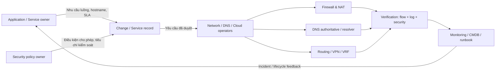
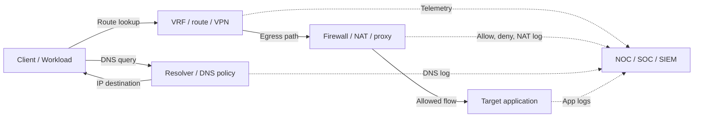
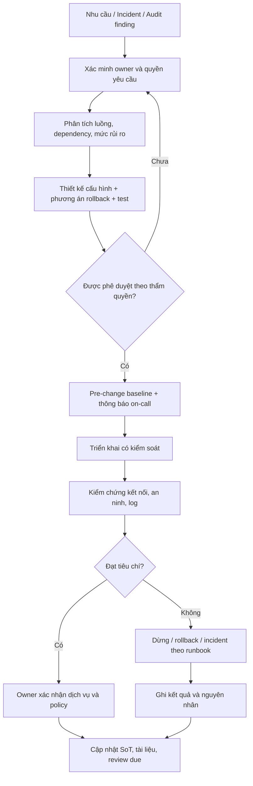

# Ownership của firewall, DNS và routing trong vận hành mạng an toàn

Một hệ thống mạng có thể cấu hình firewall chặt chẽ, DNS có dự phòng và routing hội tụ nhanh nhưng vẫn vận hành thiếu an toàn nếu không xác định rõ **ai sở hữu chính sách**, **ai có quyền thay đổi**, **ai chịu trách nhiệm khi sự cố xảy ra** và **ai xác nhận dịch vụ đã được khôi phục**. Tình huống phổ biến là firewall rule do một nhóm tạo, bản ghi DNS do nhóm khác quản lý, đường đi mạng do một nhóm thứ ba thay đổi; khi ứng dụng ngừng hoạt động, mỗi nhóm chỉ thấy một phần sự cố.

**Ownership** trong vận hành mạng là tập hợp trách nhiệm giải trình, quyền ra quyết định, phạm vi quản trị và nghĩa vụ duy trì một đối tượng hoặc dịch vụ trong toàn bộ vòng đời của nó. Nội dung này thuộc chương **Quản trị vận hành mạng an toàn**, trong module `SECURITY_NETWORK_SECURITY`: liên kết phân đoạn mạng, firewall, VPN, IDS/IPS, DNS, hạ tầng cloud và giám sát để vận hành nhất quán, có kiểm soát và có khả năng khôi phục.

Ví dụ, ứng dụng `payment-api` chuyển từ địa chỉ cũ sang địa chỉ mới. Chủ ứng dụng yêu cầu đổi DNS, network team đổi route, security team rà soát firewall. Nếu chỉ đổi bản ghi DNS mà route chưa sẵn sàng, người dùng có thể nhận IP mới nhưng truy cập thất bại. Nếu firewall mở rộng quá mức để “chạy cho kịp”, rủi ro an ninh tăng lên. Ownership cho phép quyết định **thay đổi nào cần phối hợp**, điều kiện thực hiện và người chịu trách nhiệm ở mỗi bước.

Sau bài học, người học có thể:

- Phân biệt `service owner`, `policy owner`, `technical owner`, `operator` và người chịu trách nhiệm theo ca trực.
- Lập ma trận RACI và danh mục quyền quyết định đối với firewall rule, DNS zone/record, routing policy, peering, VRF và cloud networking.
- Thiết kế bản ghi ownership trong hệ thống quản lý cấu hình/nguồn dữ liệu chuẩn (*source of truth*).
- Xây dựng quy trình thay đổi, rollback, giám sát, xử lý sự cố và đánh giá quyền/ngoại lệ định kỳ.
- Nhận diện sự phụ thuộc giữa DNS, routing, NAT, firewall, VPN và mô hình zero trust để tránh lỗi khi bàn giao liên nhóm.

## 1. Ownership là trách nhiệm đối với quyết định và kết quả

Phải phân biệt **sở hữu nghiệp vụ**, **sở hữu chính sách**, **vận hành kỹ thuật** và **quyền thao tác**. Một nhóm có quyền SSH vào firewall không có nghĩa nhóm đó được tự quyết mọi ngoại lệ bảo mật. Một nhóm quản lý bản ghi DNS cũng không mặc nhiên sở hữu ứng dụng mà tên miền trỏ đến.

| Vai trò | Câu hỏi cần trả lời | Trách nhiệm ví dụ |
| --- | --- | --- |
| **Service owner / business owner** | Dịch vụ này phục vụ ai, mục đích gì, chấp nhận rủi ro và gián đoạn ra sao? | Xác nhận endpoint thanh toán là cần thiết, phê duyệt thời gian thay đổi nghiệp vụ. |
| **Policy owner** | Quy tắc nào được phép, nguyên tắc nào phải tuân thủ, ngoại lệ nào có thể chấp nhận? | Security architect hoặc network security owner duyệt chính sách phân đoạn và egress. |
| **Technical owner / platform owner** | Nền tảng, cấu hình chuẩn và vòng đời công nghệ do ai duy trì? | Network team quản lý thiết bị firewall/router; DNS team quản lý authoritative resolver. |
| **Operator / implementer** | Ai thực thi thao tác cụ thể, đối chiếu và ghi log? | Kỹ sư on-call cập nhật rule hoặc DNS record theo change đã duyệt. |
| **Accountable owner** | Ai chịu trách nhiệm cuối cùng cho kết quả ở một phạm vi quyết định? | Chủ firewall service chịu trách nhiệm tính sẵn sàng; chủ chính sách chịu trách nhiệm tiêu chí cho phép. |
| **Incident commander / duty lead** | Khi sự cố vượt nhiều nhóm, ai điều phối, phân ưu tiên và quyết định escalation? | Trưởng ca sự cố phối hợp DNS, network, SOC và application team. |
| **Auditor / reviewer** | Ai xác nhận thông tin, quyền và bằng chứng vẫn phù hợp? | Reviewer độc lập kiểm tra rule hết hạn, audit log và kết quả retest. |

Một người hoặc một nhóm có thể giữ nhiều vai trò ở tổ chức nhỏ. Tuy nhiên, **quyền phê duyệt ngoại lệ và quyền tự thực thi** nên được tách khi có thể; nếu không tách được thì cần kiểm soát bù như phê duyệt trước, log bất biến và rà soát sau thay đổi.

### 1.1. Ba tầng ownership cần ghi riêng

1. **Service ownership:** trách nhiệm về khả dụng, mục tiêu dịch vụ và kế hoạch duy trì. Ví dụ DNS nội bộ cần có service owner chịu trách nhiệm resolver hoạt động và kế hoạch dự phòng.
2. **Configuration/policy ownership:** trách nhiệm về nội dung chính sách. Ví dụ firewall rule `FW-R-104` cần nêu nguồn, đích, rủi ro, người yêu cầu và người phê duyệt.
3. **Operational ownership:** trách nhiệm về lịch trực, phát hiện, thay đổi, khôi phục, bảo trì và xử lý cảnh báo trong ca cụ thể.

Thiếu một tầng gây lỗi khác nhau: cấu hình “mồ côi” không ai rà soát, máy chủ có người quản trị nhưng không có người quyết định chính sách, hoặc dịch vụ có chủ nhưng không có đầu mối trực khi sự cố xảy ra.

### 1.2. Tài sản nào cần owner?

Không chỉ phần cứng cần owner. Một router có thể có owner nền tảng, trong khi **route policy**, **BGP peer**, **VRF**, **tunnel VPN**, **prefix được quảng bá** hoặc **peering cloud** có các chủ chính sách riêng.

| Nhóm | Đối tượng ownership | Trách nhiệm cần gắn |
| --- | --- | --- |
| Firewall | Device/cluster, zone, policy, NAT, object, certificate, rule exception | Duy trì cấu hình, phê duyệt luồng, log, hết hạn rule và rollback. |
| DNS | Authoritative zone, record, resolver, forwarder, DNSSEC key/DS, delegation | Quyền với zone, độ chính xác bản ghi, phân giải và vòng đời khóa. |
| Routing | Router, VRF, route table, prefix, BGP peer/policy, IGP adjacency, static route, cloud route | Khả năng reachability, tính đúng đắn đường đi, chống route leak và hội tụ. |
| Liên kết đa lớp | VPN pool, load balancer, proxy, NAT gateway, cloud endpoint | Khớp giữa danh tính dịch vụ, IP, route, firewall và thực thi bảo mật. |

## 2. Các ranh giới trách nhiệm: không nhầm thiết bị với chính sách

Đối tượng vật lý có thể do network team quản lý, nhưng chính sách gắn với dịch vụ lại thuộc nhiều nhóm.



Sơ đồ là mô hình trách nhiệm logic, không biểu diễn quyền cấu hình chéo giữa nhóm. Thay đổi có thể được thực hiện qua Infrastructure as Code, API hoặc giao diện thiết bị; quy trình vẫn phải xác định owner và kiểm chứng.

**Câu hỏi kiểm tra độ rõ:** Nếu firewall rule `R-104` bị nghi là quá rộng, ai có quyền quyết định thu hẹp? Ai có quyền áp dụng? Ai xác nhận ứng dụng vẫn hoạt động? Ai xử lý sự cố do thay đổi? Nếu thiếu bất kỳ câu trả lời nào, ownership chưa đầy đủ.

## 3. Ma trận RACI và quyền quyết định

RACI mô tả vai trò trong một hoạt động:

- **R — Responsible:** người/nhóm thực hiện công việc.
- **A — Accountable:** đầu mối chịu trách nhiệm cuối cùng cho việc hoàn tất và kết quả quyết định.
- **C — Consulted:** người/nhóm phải được hỏi ý kiến trước quyết định.
- **I — Informed:** người/nhóm cần được cập nhật kết quả.

Với từng hàng của ma trận, nên xác định **một đầu mối A** rõ ràng để tránh tình trạng không ai chịu trách nhiệm cuối cùng. Người A có thể giao việc cho R nhưng trách nhiệm giải trình không biến mất.

Ma trận dưới đây là **ví dụ để tham khảo**, cần điều chỉnh theo cơ cấu và quyền phê duyệt của tổ chức.

| Hoạt động | Chủ dịch vụ (APP) | Security (SEC) | Network (NET) | DNS team (DNS) | SOC/NOC |
| --- | --- | --- | --- | --- | --- |
| Định nghĩa nhu cầu kết nối mới | **A/R** | C | C | C (nếu cần tên miền) | I |
| Phê duyệt ngoại lệ phân đoạn/firewall | C | **A/R** | C | I | I |
| Áp dụng firewall rule đã duyệt | I | C | **A/R** | I | I |
| Phê duyệt nội dung record của ứng dụng | **A/R** | C nếu nhạy cảm | C | C | I |
| Áp dụng thay đổi record DNS | C | I | C nếu đổi route/NAT | **A/R** | I |
| Định nghĩa route/peering trong phạm vi network | C | C | **A/R** | C nếu tác động DNS | I |
| Giám sát và phát hiện bất thường chung | I | C | C | C | **A/R** |
| Điều phối sự cố đa hệ thống | C | C | C | C | **A/R** theo quy trình incident |
| Xác nhận ứng dụng vận hành sau thay đổi | **A/R** | I | C | C | I |

Trong thực tế, **A của phát hành route** có thể nằm ở kiến trúc mạng, còn **A của rủi ro khi mở egress** nằm ở security; do đó cần chia hoạt động đủ nhỏ, tránh gộp những quyết định khác nhau vào một hàng.

RACI **không thay thế** ACL, RBAC, MFA hoặc phê duyệt thực thi. Một kỹ sư có role `network-admin` có thể thao tác cấu hình nhưng vẫn cần change record và approval cho thay đổi thuộc diện kiểm soát.

### 3.1. Decision rights và escalation

Ngoài RACI, mỗi nhóm nên công bố quyền ra quyết định:

| Quyết định | Người có quyền | Khi có bất đồng |
| --- | --- | --- |
| Mở luồng từ guest sang management | Chủ chính sách an ninh trong phạm vi thẩm quyền; ngoại lệ cần phê duyệt riêng | Escalate qua risk owner; không mở trước rồi xin sau. |
| Chuyển bản ghi DNS của ứng dụng sang endpoint khác | Chủ ứng dụng phê duyệt nội dung; DNS operator kiểm tra điều kiện kỹ thuật | Escalate theo change owner và business owner. |
| Quảng bá một prefix BGP ra ngoài tổ chức | Chủ routing policy và chủ prefix/cổng kết nối được xác nhận | Escalate tới network architecture và đơn vị vận hành upstream. |
| Tạm thời chặn luồng khi có sự cố đang diễn ra | Vai trò incident/security on-call được ủy quyền theo runbook | Ghi lại quyết định, thời hạn và kiểm tra hậu kiểm. |
| Chấp nhận rủi ro còn lại sau kiểm thử | Risk owner có thẩm quyền | Lưu risk acceptance và ngày rà soát; không coi là cấu hình đã sửa. |

## 4. Source of Truth và danh mục ownership

**Source of Truth (SoT)** là nơi lưu dữ liệu có thẩm quyền về đối tượng mạng và quan hệ giữa chúng. Có thể dùng CMDB/IPAM, Git repository cho cấu hình khai báo, hệ thống change management và inventory cloud. Điều quan trọng là **xác định trường nào được quản lý ở hệ thống nào** và cách đồng bộ; không nên duy trì ba danh sách owner mâu thuẫn mà không có nguồn ưu tiên.

### 4.1. Trường dữ liệu tối thiểu

| Thuộc tính | Ý nghĩa |
| --- | --- |
| `object_id`, `object_type` | ID ổn định cho rule/zone/record/route/peer, không chỉ tên hiển thị. |
| `service_id`, `environment` | Dịch vụ, team và môi trường chịu ảnh hưởng; ví dụ production hoặc staging. |
| `technical_owner`, `policy_owner`, `accountable_owner` | Phân biệt bên vận hành, bên đặt quy tắc và bên chịu trách nhiệm cuối cùng. |
| `on_call_group`, `escalation_contact` | Điểm liên hệ trực 24/7 nếu dịch vụ cần; không dùng email một cá nhân đã nghỉ việc. |
| `asset_scope` | Thiết bị, zone, VRF, VPC/VNet, subnet, hostname hoặc interface gắn với đối tượng. |
| `business_justification` | Lý do nghiệp vụ, mức quan trọng và nguồn phê duyệt. |
| `change_id`, `policy_version`, `last_verified_at` | Truy nguyên ai phê duyệt, cấu hình nào và lần xác minh cuối. |
| `expiry_at`, `review_due_at` | Thời hạn exception/rule tạm và mốc review; phân biệt `null` thật với giá trị quên điền. |
| `dependencies`, `rollback_ref` | Các thành phần liên quan và cách trở về trạng thái an toàn. |
| `audit_evidence_refs` | Log hoặc tài liệu đối chiếu với bản ghi SoT. |

### 4.2. Mẫu ownership record trung lập hệ thống

Ví dụ YAML dưới đây là **mô hình dữ liệu**, không phải cấu hình áp dụng trực tiếp cho firewall, DNS hay router.

```yaml
object_id: "FW-R-104"
object_type: "firewall-policy-rule"
service_id: "payment-api"
environment: "production"
scope:
  device_group: "fw-dmz-cluster"
  source_zone: "APP"
  destination_zone: "PARTNER"
  protocol: "tcp"
  destination_port: 443
  destination_reference: "payment-partner-approved-endpoint"
ownership:
  accountable_owner: "network-security-policy-lead"
  policy_owner: "security-architecture"
  technical_owner: "network-platform-team"
  service_owner: "payments-team"
  on_call_group: "network-oncall"
change:
  change_id: "CHG-EXAMPLE-104"
  policy_version: "2026-11-example"
  last_verified_at_utc: "2026-11-20T03:00:00Z"
  expiry_at_utc: null
  review_due_at_utc: "2027-02-20T00:00:00Z"
dependencies:
  - "DNS-REC-PAYMENT-01"
  - "ROUTE-PARTNER-01"
verification:
  positive_test_id: "NET-ALLOW-01"
  negative_test_id: "NET-DENY-01"
  evidence_refs: ["EV-ALLOW-01", "EV-DENY-01"]
rollback_ref: "RUNBOOK-FW-ROLLBACK-104"
```

Các ID, nhóm và thời điểm đều là ví dụ. Một record thực phải được xác nhận với người quản lý chính thức; không nên coi `payments-team` trong bản mẫu là owner của một hạ tầng thật.

### 4.3. Kiểm soát chất lượng SoT

- Cấm tạo rule hoặc route “vĩnh viễn” mà không có owner và lý do; trường hợp emergency cần được bổ sung metadata sau sự kiện theo quy trình.
- Phát hiện **orphan objects**: owner không còn tồn tại, nhóm bị giải tán, dịch vụ đã ngừng nhưng rule/record/route còn hiệu lực.
- So sánh trạng thái **desired** (Git/CMDB/change) với **observed** (running config/API/export thực) để phát hiện drift.
- Tạo liên kết giữa ticket thay đổi, rule ID, record DNS, route và bằng chứng nghiệm thu.
- Gán chủ sở hữu theo nhóm/role để duy trì sau khi nhân sự thay đổi; vẫn lưu danh tính người thao tác trong audit log.
- Phân quyền đọc/ghi SoT; che secret và không đặt credential trong phần metadata.

## 5. Ownership của firewall: từ rule tới vòng đời ngoại lệ

Firewall quản lý cả **luồng được phép** lẫn **ranh giới tin cậy**. Ownership cần tồn tại ở cấp **chính sách** và **từng rule quan trọng**, không chỉ cấp thiết bị.

### 5.1. Trách nhiệm điển hình

| Đối tượng | Chủ quyết định | Chủ triển khai/giám sát |
| --- | --- | --- |
| Baseline segmentation, default deny | Security policy owner; chủ rủi ro với ngoại lệ | Firewall platform team áp dụng; SOC/NOC giám sát. |
| Rule cho ứng dụng | Service owner xác nhận nhu cầu; security duyệt chính sách | Network operator triển khai, ứng dụng xác minh kết nối. |
| Egress allowlist | Chủ ứng dụng yêu cầu đích; security đánh giá danh sách đích | Firewall/proxy owner thực thi; SOC giám sát traffic ngoài dự kiến. |
| NAT/VIP/load balancer relation | Chủ service và network architecture xác nhận mô hình | Network/load balancer operator kiểm tra mapping và route. |
| Rule tạm, emergency override | Đầu mối incident được ủy quyền và policy owner theo RoE | On-call triển khai, ghi hạn và tự động/định kỳ rà soát. |
| Firmware, HA, backup firewall | Technical owner của nền tảng | Network platform, SOC và change manager phối hợp. |

**Ví dụ:** rule `APP → DB:5432` có thể do security duyệt nhưng chủ DB phải xác nhận đó là dịch vụ thực sự cần kết nối. Người thao tác firewall phải kiểm tra đúng subnet, cổng, hướng và thứ tự rule; một approval không thay thế kiểm tra kỹ thuật.

### 5.2. Các trường cần xem khi review một rule

Một rule nên có: `rule_id`, `source`, `destination`, `zone`, `service/protocol/port`, `action`, `logging`, `owner`, `justification`, `ticket`, `created_at`, `last_hit` khi có dữ liệu, `review_due` và `expiry_at` với rule tạm.

Không nên tự động xóa rule chỉ vì `last_hit=0`. Một rule DR có thể chỉ sử dụng khi failover; log hit counter có thể bị reset sau reboot/upgrade hoặc không ghi đầy đủ. Cần kết hợp dependency map, owner confirmation, giám sát và quy trình thay đổi có rollback.

### 5.3. Quy trình thay đổi firewall

1. Ứng dụng mô tả kết nối: nguồn và đích thực, giao thức, cổng, môi trường, thời gian cần, người sở hữu.
2. Network security xác định vùng tin cậy, mức quyền tối thiểu, khả năng dùng proxy/identity, các rule liên quan và rủi ro.
3. Owner có thẩm quyền phê duyệt thay đổi và phương pháp kiểm thử; ngoại lệ tạm phải có hạn.
4. Operator xác nhận đường đi qua firewall, NAT, định tuyến, IPv4/IPv6, thứ tự rule và cơ chế HA.
5. Áp dụng qua thay đổi có kiểm soát; lưu diff/cấu hình trước và sau, ID người thực thi, mốc UTC.
6. Kiểm tra **positive control** cho luồng hợp lệ và **negative control** cho luồng không được cấp quyền; đối chiếu log.
7. Service owner xác nhận tính khả dụng; policy owner xác nhận kết quả bảo mật; cập nhật SoT, ticket và kế hoạch review.

## 6. Ownership của DNS: zone, record và resolver

DNS có ít nhất hai nhóm trách nhiệm khác nhau:

- **Authoritative DNS:** phục vụ các bản ghi thuộc zone mà tổ chức kiểm soát; cần quản lý nội dung record, delegation, thay đổi hostname, DNSSEC và lifecycle của tên miền.
- **Recursive resolver / DNS forwarding:** trả lời truy vấn của client bằng cách truy vấn/caching; cần quản lý truy cập resolver, chính sách lọc DNS, độ khả dụng, logging, DNSSEC validation khi triển khai và kênh upstream.

Cả hai có thể vận hành bởi một team, nhưng quyền quyết định **record này có nên trỏ tới endpoint X?** khác với trách nhiệm **resolver có hoạt động đúng và an toàn?**

### 6.1. Phân tách owner của DNS

| Đối tượng | Quyền quyết định nội dung | Quyền kỹ thuật/vận hành |
| --- | --- | --- |
| Zone nội bộ `corp.example` | Chủ không gian tên hoặc DNS governance owner | DNS platform team kiểm soát zone, replication và access. |
| `A/AAAA` của `api.corp.example` | Chủ ứng dụng xác nhận endpoint và mốc chuyển | DNS operator kiểm tra record, TTL, phân giải từ các view. |
| `CNAME`, `TXT` phục vụ xác thực dịch vụ | Chủ dịch vụ/identity xác nhận mục đích và thời hạn | DNS team triển khai, kiểm tra giới hạn và dọn record hết hạn. |
| `MX` và các record email-related | Chủ dịch vụ email phê duyệt | DNS team kiểm tra các record liên quan và tác động. |
| Delegation, `NS`, `DS`, DNSSEC key | Chủ zone/domain và security governance | DNS platform vận hành theo quy trình đổi khóa và kiểm chứng. |
| Resolver, forwarder, RPZ/DNS filtering | Chủ dịch vụ DNS và policy owner của DNS security | DNS/network operator triển khai, SOC giám sát hành vi bất thường. |
| Split-horizon DNS | Chủ ứng dụng và chủ kiến trúc mạng xác nhận view | DNS team kiểm tra từ từng vị trí mạng, VPN và cloud. |

Các tên miền `*.example` dùng để minh họa, không đại diện tên miền thật.

### 6.2. Thay đổi DNS phải có điều kiện trước và sau

Khi đổi `api.corp.example` từ `10.20.30.10` sang `10.20.40.10`:

1. Chủ ứng dụng xác nhận endpoint mới đang khỏe, chứng chỉ TLS và backend sẵn sàng.
2. Network team kiểm tra route, NAT, firewall/ACL, VPN hoặc cloud connectivity tới IP mới.
3. DNS team xác nhận zone/view, TTL và cách thay đổi; nếu muốn hạ TTL để chuyển đổi nhanh hơn, cần thực hiện **trước đủ thời gian cho cache cũ hết hạn**.
4. Operator thay đổi record có phê duyệt, ghi version, thời gian UTC và log.
5. Kiểm chứng từ **các resolver/vị trí thực tế** (LAN, VPN, cloud, branch) và cả IPv4/IPv6 khi có.
6. Chủ ứng dụng kiểm tra thành công của request mới, lỗi và độ trễ; network/SOC kiểm tra flow và cảnh báo.
7. Chỉ dừng endpoint cũ khi hết phụ thuộc và các điều kiện rollback đã được đánh giá.

**TTL không bảo đảm mọi cache đều cập nhật ngay tại giây kết thúc TTL**: còn ứng dụng tự cache, negative caching, triển khai DNS không tuân thủ hoặc đường proxy. Vì vậy, phải thiết kế khoảng quan sát và fallback thực tế.

### 6.3. Rủi ro vận hành DNS mà ownership cần quản lý

- **Record mồ côi:** tên DNS còn trỏ tới tài nguyên đã xóa, tạo nguy cơ lỗi truy cập hoặc takeover trong những trường hợp dịch vụ có thể được bên khác đăng ký lại.
- **Sai quyền cập nhật:** quá nhiều nhóm có quyền sửa cả zone, khiến một thao tác gây ảnh hưởng nhiều ứng dụng; cần RBAC ở mức phù hợp, quy trình review và nhật ký.
- **Split-horizon/view:** một hostname trả kết quả khác nhau giữa LAN/VPN/Internet; test từ một resolver chưa đại diện cho tất cả client.
- **DNSSEC:** thay đổi key, DS, delegation hoặc thuật toán sai thứ tự có thể làm resolver có xác thực từ chối dữ liệu hợp lệ; cần runbook rollover, kiểm thử và phương án khôi phục.
- **Upstream và filtering:** DNS trả lời được chưa chứng minh kết nối ứng dụng thành công; firewall/proxy/routing có thể chặn endpoint được phân giải.
- **Đăng ký tên miền:** renewal, registrar lock, MFA, quyền quản trị registrar và contact khôi phục cần có owner riêng; domain hết hạn có thể tạo sự cố dù authoritative server vẫn khỏe.

## 7. Ownership của routing: địa chỉ đến được và đường đi an toàn

Routing là **control plane** quyết định đường chuyển tiếp; chính sách định tuyến cùng bảng FIB thực tế ảnh hưởng trực tiếp tới nơi lưu lượng đi qua, điểm firewall có thể quan sát và khả năng đáp ứng của ứng dụng.

Một thay đổi route có thể vô tình đưa traffic đi qua đường không có kiểm soát mong muốn, tạo **asymmetric routing**, blackhole, route leak hoặc vòng lặp. Quyền vận hành router phải gắn với ownership của prefix, VRF, peering và chính sách quảng bá/nhập route.

### 7.1. Các đối tượng cần chủ sở hữu

| Đối tượng | Ai cần chịu trách nhiệm | Cần xác nhận |
| --- | --- | --- |
| Static route / default route | Chủ mạng/site hoặc cloud network owner | Mục tiêu, next-hop, reachability, HA và rollback. |
| IGP (OSPF/IS-IS) policy/adjacency | Chủ routing domain | Authentication khi hỗ trợ, neighbor, tổng hợp route, convergence và phạm vi phát tán. |
| BGP peering | Chủ edge/upstream hoặc cloud connectivity | Neighbor, ASN, import/export policy, prefix filter, max-prefix và cách xử lý sự cố. |
| Prefix public/quảng bá BGP | Chủ tài nguyên địa chỉ và routing policy | Quyền quảng bá, IRR/RPKI/ROA khi áp dụng, lọc prefix và kiểm soát route leak. |
| VRF / route leaking | Network architecture và security policy owner | Ranh giới tin cậy; luồng được phép qua VRF và firewall tương ứng. |
| VPN / SD-WAN route | Chủ kết nối VPN/SD-WAN và service owner | Split/full tunnel, đường dự phòng, route propagation, tính nhất quán với ACL. |
| Cloud route table/peering/transit gateway | Chủ cloud network và app/team dùng subnet | Region/account, security group/firewall, route propagation và đường egress. |

**BGP không tự bảo đảm an toàn đường đi.** Các kiểm soát như prefix filters, RPKI origin validation (nếu phù hợp), giới hạn prefix, nhận diện bất thường, thay đổi có kiểm soát và theo dõi route phải có owner và runbook. ROA sai có thể khiến tuyến hợp lệ bị đánh giá không hợp lệ bởi các mạng thực thi validation; thay đổi cần phối hợp chủ prefix và chủ BGP.

### 7.2. Checklist trước và sau thay đổi route

Trước thay đổi:

- Xác nhận prefix/VRF, chủ đích, đường hiện tại, chính sách firewall/ACL đang dựa trên route nào.
- Phân tích ảnh hưởng tới DNS resolver, NAT gateway, IDS/IPS sensor, VPN và các nhánh/cloud liên quan.
- Kiểm tra điều kiện BGP/IGP adjacency, import/export, tóm tắt prefix, mức ưu tiên và đường dự phòng.
- Có baseline về connectivity, latency, packet loss, route table và đường đi; không chỉ dựa vào “neighbor up”.
- Chuẩn bị rollback, người trực site/ISP/cloud và khung giờ giám sát.

Sau thay đổi:

- Đối chiếu control plane với **forwarding path thực tế**; route có trong bảng điều khiển không tự chứng minh data plane đã chuyển tiếp đúng.
- Kiểm tra từ nhiều nguồn/đích phù hợp, bao gồm chiều trả lời để phát hiện asymmetric routing.
- Xác nhận traffic vẫn đi qua điểm kiểm soát firewall/IDS/egress gateway theo thiết kế.
- Theo dõi route churn, flap, BGP session resets, latency, retransmission, error rate và business transaction.
- Cập nhật SoT, sơ đồ mạng và evidence; đóng change sau khi service owner xác nhận.

## 8. Sự phụ thuộc chéo: vì sao không thể bàn giao riêng lẻ

Cùng một luồng ứng dụng phụ thuộc vào **DNS resolution, routing, NAT, firewall policy và trạng thái dịch vụ**. Những chủ sở hữu khác nhau cần chung mô hình luồng để tránh “mỗi lớp đều đúng nhưng dịch vụ vẫn lỗi”.



### 8.1. Ma trận phụ thuộc các kiểu thay đổi

| Thay đổi gốc | Tác động tiềm ẩn tới lớp khác | Ai cần tham gia |
| --- | --- | --- |
| DNS record đổi IP | Route, NAT, firewall allowlist theo IP, certificate/TLS, health check | App, DNS, Network, Security, Load Balancer nếu có. |
| Firewall rule đổi nguồn/đích | VPN pool, NAT mapping, VRF, workload route, DNS resolver egress | Security, Network, App/VPN owner. |
| Đổi BGP export hoặc default route | Đường ra khác firewall/IDS, NAT source IP đổi, đối tác/ISP lọc nguồn | Routing owner, Security, ISP/Partner, SOC. |
| VPN split-tunnel thay đổi | DNS nội bộ, phân đoạn, nguồn IP sau NAT, egress security | VPN, DNS, Firewall, End-user/Endpoint security. |
| Chuyển ứng dụng sang cloud | Private DNS, SG/NACL, cloud route/peering, firewall, IAM | App, Cloud, DNS, Security, Network. |
| Chuyển DNS resolver/forwarder | Firewall UDP/TCP 53, DoT/DoH, DHCP options, VPN policy, conditional forwarding | DNS, Network, Security, Client/Device team. |
| HA failover thiết bị mạng | Route reconvergence, session/NAT state, logging, split brain | Network platform, Security, SOC, App owner. |

**Quy tắc:** Mỗi change request nên khai báo **đối tượng phụ thuộc** và các bước kiểm tra xuyên lớp. Không được coi phê duyệt thay đổi DNS là sự cho phép mặc định để mở mọi firewall port mới.

## 9. Quy trình quản trị thay đổi xuyên firewall, DNS và routing

Một quy trình vận hành an toàn có thể dùng các trạng thái:



### 9.1. Hợp đồng thay đổi tối thiểu

| Trường | Bắt buộc trả lời |
| --- | --- |
| Requester và service owner | Ai cần thay đổi, vì sao và ai xác nhận kết quả? |
| Object ID và current state | Rule/record/route nào, môi trường nào, hiện tại ra sao? |
| Proposed state | Trạng thái mới cụ thể; bản diff hoặc mô tả đủ để review. |
| Policy/security approval | Ai duyệt rủi ro và ngoại lệ? Điều kiện/hiệu lực tới khi nào? |
| Blast radius | Zone, site, tenant, VPN user, ứng dụng, IP và dependency liên quan. |
| Change window & on-call | Thời điểm UTC, đầu mối, điều kiện dừng và kênh thông báo. |
| Preflight | Backup/snapshot, trạng thái HA, log, hệ thống health và đường OOB. |
| Rollback | Điều kiện kích hoạt, người được phép quyết định, thao tác an toàn và tác động trở lại. |
| Validation | Test case luồng hợp lệ/bị cấm, DNS từ đúng view, routing thực tế và log. |
| Evidence/closure | ID ticket, thời gian, người thực thi, kết quả, xác nhận của owner và trạng thái cuối. |

**Change khẩn cấp** được thực hiện theo chính sách emergency change của tổ chức; cần ghi nguyên nhân, người có thẩm quyền, tác động, thời hạn và post-implementation review. Khẩn cấp không có nghĩa mọi thay đổi được miễn trách nhiệm giải trình hoặc ghi log.

### 9.2. Phân biệt nghiệm thu kỹ thuật và nghiệp vụ

- **NET/DNS platform:** cấu hình được áp dụng đúng, route/record/policy khớp SoT, HA khỏe, telemetry hoạt động.
- **Security policy owner:** không mở đường ngoài yêu cầu, điểm cưỡng chế đúng, negative control và log kiểm chứng đạt.
- **Service owner:** người dùng/ứng dụng hoạt động, transaction hợp lệ, SLA/SLO không giảm bất thường.
- **Incident/change owner:** quyết định cuối, bằng chứng, rollback nếu thất bại và ngày theo dõi lại được ghi nhận.

Một lệnh cấu hình chạy thành công **không chứng minh** thay đổi đã thành công ở cả bốn góc nhìn.

## 10. Một tình huống phối hợp thực tế (giả lập)

Dịch vụ `orders-api.corp.example` chạy trong `APP-VRF`, ban đầu trỏ đến `10.20.30.10`. Do nâng cấp hệ thống, nhóm ứng dụng chuyển endpoint sang `10.20.40.10` trong một subnet khác. Các địa chỉ IPv4 ví dụ thuộc dải riêng RFC1918, hostname `.example` chỉ dùng minh họa.

### 10.1. Ai làm gì?

| Hạng mục | Chủ trách nhiệm | Tiền đề | Bằng chứng nghiệm thu |
| --- | --- | --- | --- |
| Phê duyệt endpoint mới | App/service owner | Backend mới hoạt động, TLS và health check hợp lệ | App test/canary kết quả OK. |
| Route từ `APP-VRF` đến subnet mới | Network routing owner | Next-hop, VRF leaking, path qua firewall đúng thiết kế | Route/forwarding table, kết quả path test. |
| Rule firewall `APP → API:443` | Security policy owner + firewall operator | Chỉ nguồn/đích cần thiết; không tạo `any-any` | Policy ID, allow/deny logs, negative/positive test. |
| DNS record `orders-api.corp.example` | DNS team, nội dung do app owner duyệt | Route/firewall/endpoint sẵn sàng, TTL/caching plan | Phân giải từ các DNS view; log thay đổi. |
| Giám sát trong cửa sổ | NOC/SOC và App on-call | Correlation ID, dashboard, cảnh báo và rollback plan | Metrics request success, firewall deny, DNS errors, route health. |
| Quyết định hoàn tất | Change owner + app/service owner | Cả kỹ thuật, bảo mật, nghiệp vụ đạt | Change closure và bằng chứng đối chiếu. |

### 10.2. Trình tự triển khai tránh gián đoạn

1. **Chuẩn bị:** App owner kiểm thử backend mới bằng đường có quyền, network team tạo và xác minh route có giới hạn, firewall operator áp dụng rule được phê duyệt, SOC chuẩn bị giám sát.
2. **Kiểm chứng trước chuyển DNS:** từ client canary được phép, xác minh endpoint mới có thể tiếp cận qua đường đúng firewall/route; kiểm tra TLS theo hostname, logs, audit và deny controls. Không tự sửa DNS hay bỏ qua chứng chỉ để “test nhanh”.
3. **Chuyển DNS có kiểm soát:** DNS operator cập nhật record qua change; giữ endpoint cũ sẵn sàng trong khoảng cần thiết nếu thiết kế cho phép.
4. **Quan sát:** test từ LAN/VPN/cloud view liên quan, đối chiếu DNS resolution, route/NAT, firewall session và chỉ số ứng dụng.
5. **Quyết định:** nếu lỗi vượt ngưỡng đã duyệt, change/incident lead kích hoạt rollback theo runbook; đánh giá cả vấn đề cache DNS và route/firewall trước khi đảo record.
6. **Kết thúc:** cập nhật record ownership, bản đồ dependency, hướng dẫn trực, review rule cũ và lịch gỡ tài nguyên không cần thiết.

### 10.3. Ba cách chẩn đoán sai cần tránh

| Hiện tượng | Suy luận hấp tấp | Bằng chứng cần |
| --- | --- | --- |
| `nslookup` trả IP mới nhưng client timeout | “DNS bị lỗi.” | Kiểm tra route, firewall deny, TLS, ứng dụng và IP nguồn thực. |
| Router có route tới subnet mới | “Mạng chắc chắn đi được.” | Kiểm tra FIB/forwarding, chiều trả lời, NAT, ACL và health đích. |
| Firewall có log `ALLOW` | “Ứng dụng thành công.” | Kiểm tra handshake, request/response, TLS cert, log ứng dụng và trải nghiệm người dùng. |

## 11. Incident ownership: ai nhận việc khi mạng gặp sự cố?

Khi lỗi liên quan nhiều lớp, không nên chuyển ticket vòng tròn giữa nhóm DNS, network và security. Một **incident commander / duty lead** chịu trách nhiệm điều phối cho tới khi có giải pháp và chủ sở hữu hành động rõ ràng.

### 11.1. Mẫu quy trình triage

1. **Phân loại ảnh hưởng:** số dịch vụ/site/user bị tác động, bắt đầu lúc nào, có dấu hiệu tấn công hay chỉ sai lệch vận hành; xác lập độ ưu tiên theo quy định.
2. **Khoanh thời gian và change:** kiểm tra các thay đổi DNS, firewall, routing, VPN/cloud gần sự kiện; không mặc định thay đổi mới nhất là nguyên nhân.
3. **Chứng minh điểm nghẽn theo từng lớp:** phân giải tên, route table/data plane, firewall rule/NAT, ứng dụng đích, log IDS/IPS và telemetry.
4. **Phân công action owner:** mỗi giả thuyết có người kiểm tra và mốc báo cáo; incident lead theo dõi kết quả và quyết định tiếp theo.
5. **Khôi phục có kiểm soát:** rollback hoặc dùng tuyến/endpoint dự phòng nếu đủ điều kiện; tránh mở rộng quyền mạng vô thời hạn.
6. **Đối chiếu và đóng sự cố:** chủ dịch vụ xác nhận khôi phục; chủ chính sách xác nhận không để lại ngoại lệ nguy hiểm; có incident timeline và postmortem.

### 11.2. Kịch bản và đầu mối chính

| Triệu chứng | Owner xử lý đầu tiên | Nhóm phối hợp | Cần xác nhận |
| --- | --- | --- | --- |
| Tên miền chỉ lỗi khi người dùng kết nối VPN | DNS resolver/view owner | VPN/Network, App | Conditional forwarder, DNS suffix, split DNS, route DNS qua tunnel. |
| Chỉ một subnet bị chặn ứng dụng | Network/firewall on-call theo vị trí nghi ngờ | App, Security, Routing | Policy match, zone, NAT, route/return path và phiên thực. |
| BGP peer flap hoặc mất quảng bá prefix | Routing/BGP owner | ISP, Security, NOC | Neighbor state, filter/policy, prefix, route propagation và failover. |
| Sau cập nhật DNSSEC có SERVFAIL | DNS authoritative/resolver owner | Domain registrar, security DNS | Key/DS chain, validation, thời gian và zone signing. |
| Firewall HA chuyển node gây lỗi session | Firewall platform owner | Routing/NOC/App/SOC | HA health, state sync, route convergence, NAT và ứng dụng. |
| Nghi ngờ lưu lượng đi ra bất thường | SOC/incident owner | Firewall, DNS, Proxy, App | Log egress, resolver, process/workload identity và quyền thay đổi khẩn cấp. |
| Route qua vùng khác bỏ qua sensor | Routing architecture + Security policy | SOC, Firewall operator | Path thực, điểm kiểm soát, route propagation, VRF và audit. |

**Ownership không được gián đoạn bởi lịch làm việc.** Dịch vụ quan trọng cần nhóm trực, backup contact, kênh escalations và cơ chế chuyển giao ca trực. Nếu không có quyền trực tiếp tác động vào thiết bị nhà cung cấp, cần có contract/escalation path để báo sự cố và nhận ETA từ bên cung cấp.

## 12. Runbook và on-call handoff

Runbook phải giúp người trực ca **đủ thông tin để chẩn đoán và khôi phục** mà không phụ thuộc trí nhớ của một cá nhân. Một runbook tốt thường có:

- Đối tượng, owner, mức ưu tiên, mô tả chức năng, dependency và liên hệ dự phòng.
- Sơ đồ ranh giới: zone, VRF/VLAN, IP/prefix, resolver, VPN, peering và những đường dự phòng.
- Dấu hiệu sức khỏe: metric/alert, dashboard, vị trí log, ngưỡng hành động.
- Chẩn đoán read-only: kiểm tra DNS theo view, route, policy, NAT, trạng thái HA và log tương quan.
- Quy trình thực thi/rollback: điều kiện dừng, thẩm quyền, thứ tự khôi phục, cách xác nhận không làm mất an toàn.
- Các thay đổi đang diễn ra, exception tạm và rủi ro còn lại.
- Checklist xác minh sau khôi phục, ticket và postmortem.

### 12.1. Mẫu bàn giao giữa hai ca

```text
Shift handover: Network Security Operations
Time (UTC): 2026-11-28T08:00:00Z
Current incident: INC-EXAMPLE-42 (DNS resolution intermittent via VPN)
Service owner: remote-access-service
Duty lead: network-incident-oncall
DNS owner: dns-platform-oncall
VPN owner: vpn-network-oncall

Current observations:
- LAN resolver responses are healthy.
- Selected VPN clients see intermittent SERVFAIL.
- Firewall deny count for resolver path not yet correlated.

Changes/risks:
- CHG-EXAMPLE-77: conditional forwarder updated.
- Rollback has been prepared but not authorized.
- No broad firewall bypass is approved.

Next actions:
- DNS owner: compare resolver views and timestamps.
- VPN owner: verify assigned DNS and route over tunnel.
- Incident lead: decide mitigation after new evidence.

Evidence refs: EV-DNS-01, EV-VPN-02, EV-FW-03
Next update: per incident communications plan
```

Tránh ghi password, token, private key hoặc thông tin nhạy cảm vào nội dung handoff. Khi người nhận ca tiếp quản, nên xác nhận đã nhận trách nhiệm và biết kênh escalations.

## 13. Quyền thay đổi, bảo vệ quản trị và audit

Ownership trên giấy không ngăn thao tác trái phép. Nền tảng firewall, DNS và router cần áp dụng **AAA/RBAC**, tài khoản cá nhân hoặc danh tính workload, MFA khi phù hợp, logging và giới hạn đường truy cập quản trị.

| Lớp | Kiểm soát đề xuất |
| --- | --- |
| Management access | Chỉ quản trị qua VRF/VLAN/OOB hoặc bastion được duyệt; SSH/HTTPS an toàn, không dùng Telnet. |
| Identity / permission | Role đọc/ghi/phê duyệt tách nhau khi khả thi; tài khoản automation có quyền tối thiểu và secret được quản lý. |
| Change traceability | Mỗi thay đổi liên kết ticket/PR, người phê duyệt, người triển khai, version/diff và thời gian UTC. |
| High-impact actions | Quản trị DNSSEC/delegation, BGP export, firewall global policy cần review và kiểm soát tương xứng mức ảnh hưởng. |
| Logging | Gửi log vào hệ thống tập trung, có giám sát tính toàn vẹn, retention và truy cập giới hạn. |
| Emergency access | Tài khoản break-glass lưu an toàn, điều kiện sử dụng và hậu kiểm cụ thể; loại bỏ quyền tạm sau sự cố. |
| Configuration drift | So sánh cấu hình thực với SoT; cảnh báo thay đổi ngoài quy trình, tránh tự động áp dụng sửa sai không kiểm soát trong production. |

Không đồng nhất quyền `write` trong Git với quyền `deploy` trên thiết bị. Quy trình CI/CD áp dụng cấu hình phải kiểm tra approval, validation, phân biệt môi trường và lưu audit; cần cơ chế khóa thay đổi đồng thời hoặc phát hiện conflict trên cùng rule/zone/route.

## 14. Đo hiệu quả ownership bằng dữ liệu vận hành

Không nên đánh giá chất lượng ownership chỉ bằng số lượng ticket “đã đóng”. Các chỉ số hữu ích phản ánh **độ đầy đủ của trách nhiệm**, **kỷ luật thay đổi**, **khả năng phát hiện** và **kết quả khôi phục**.

| Chỉ số | Cách đo | Diễn giải và giới hạn |
| --- | --- | --- |
| **Owner coverage** | Số đối tượng thuộc scope có owner hợp lệ / tổng số đối tượng cần quản lý | Tách theo firewall rule, DNS record/zone, route/peer; không chỉ đếm thiết bị. |
| **Orphan object count** | Rule/record/route không có owner hoặc liên hệ không còn hợp lệ | Nên điều tra trước khi xóa; một số đối tượng dự phòng không có hit thường xuyên. |
| **Policy review compliance** | Đối tượng đến hạn đã được rà soát / tổng đối tượng đến hạn | Review phải có quyết định/evidence; không chỉ cập nhật ngày. |
| **Unapproved change rate** | Thay đổi phát hiện không có authorization / thay đổi quan sát | Phụ thuộc phát hiện drift và log đủ tin cậy. |
| **Change failure rate** | Thay đổi gây sự cố hoặc phải rollback / số thay đổi đủ điều kiện | Cần định nghĩa thống nhất và tách độ phức tạp/thời gian. |
| **Restore/ack latency** | Từ lúc biết sự cố đến khi nhận/khôi phục theo mốc định nghĩa | Không lấy số trung bình từ sự kiện đơn lẻ; phân biệt nhận, giảm thiểu và khôi phục. |
| **Exception age/expiry** | Số exception quá hạn và tuổi trung vị của ngoại lệ | Ngoại lệ không có hạn có thể tồn tại âm thầm. |
| **Validation coverage** | Thay đổi có positive/negative test và log đối chiếu / tổng thay đổi cần test | Phân biệt `PASS`, `FAIL`, `INCONCLUSIVE` và `NOT RUN`. |
| **Cross-team escalation delay** | Thời gian từ phát hiện tới khi đúng owner nhận xử lý | Giúp thấy vấn đề ở sơ đồ trách nhiệm và runbook. |

Ví dụ: 980 trên 1.000 đối tượng trong scope có owner hợp lệ thì `owner_coverage = 98%`. Con số này chỉ đo độ đầy đủ metadata; **không chứng minh** 98% chính sách đúng hoặc mạng an toàn. Cần dùng cùng drift, audit và kết quả kiểm thử thực tế.

## 15. Kiểm toán và rà soát định kỳ

Ownership thay đổi khi hệ thống chuyển cloud, sát nhập tổ chức, nhân sự đổi vị trí hoặc dịch vụ dừng. Vì vậy, quyền sở hữu phải có **vòng đời**, không tạo một lần rồi bỏ mặc.

### 15.1. Quy trình rà soát theo chu kỳ

1. **Lấy inventory hiện hành:** export rule, zone, record, resolver, route, neighbor, VRF và cloud policy theo phạm vi.
2. **Ghép SoT:** tìm đối tượng thiếu owner, thiếu business purpose, thiếu expiry/review hoặc drift.
3. **Hỏi đúng chủ:** owner xác nhận còn cần đối tượng, phạm vi vẫn tối thiểu và phụ thuộc còn hoạt động.
4. **Đánh giá rủi ro:** rule quá rộng, route leak, DNS stale record, TTL/caching, VPN bypass, logging disabled, credential tồn đọng.
5. **Tạo action:** sửa/thu hẹp/gỡ theo change được duyệt; có test và rollback.
6. **Lưu quyết định:** ID, ngày UTC, người duyệt, bằng chứng, hạn review tiếp và rủi ro được chấp nhận nếu có.

### 15.2. Một số dấu hiệu cần ưu tiên xem xét

- Firewall rule `any-any allow` hoặc object mạng rộng mà không có service owner rõ ràng.
- DNS `CNAME` hoặc `A/AAAA` trỏ vào dịch vụ/địa chỉ đã hủy; delegation và registrar không có owner.
- Static route trỏ next-hop đã thay đổi; BGP peer/prefix chưa cập nhật filter hoặc contact upstream.
- VPN route/ACL cho phép truy cập subnet quản trị vượt nhu cầu; route đột ngột chuyển đường vòng qua điểm kiểm soát khác.
- Exception “tạm” kéo dài không hạn và không có người ký xác nhận.
- Tài khoản quản trị chung hoặc automation dùng credential không được theo dõi vòng đời.
- Log thiếu ID rule, context zone, NAT mapping hoặc đồng hồ không đồng bộ, khiến khó điều tra ai thay đổi gì.

**Không tự xóa đối tượng ngay khi phát hiện vấn đề:** cần xác định mục đích vận hành, kế hoạch chuyển đổi và khả năng ảnh hưởng đến DR/failover.

## 16. Bài tập tình huống: xác định owner khi ba hệ thống cùng báo lỗi

**Đề bài giả lập:** Sau khi chuyển `api.corp.example` sang endpoint mới, người dùng VPN không truy cập được ứng dụng, nhưng người dùng LAN vẫn hoạt động. Các nhóm đưa ra ba nhận định:

- DNS team: “Tên miền đã trả IP mới trong hệ thống authoritative.”
- Routing team: “Có route đến subnet mới trong core router.”
- Firewall team: “Rule `ALLOW APP-to-API 443` vẫn tồn tại.”

### 16.1. Cần hỏi gì trước?

| Câu hỏi | Ai phải trả lời | Vì sao quan trọng |
| --- | --- | --- |
| VPN client nhận IP nào từ resolver nào? | DNS + VPN owner | Split DNS/forwarding/cache có thể khác LAN. |
| VPN pool được gán route và VRF nào? | VPN + Routing owner | Core route có thể không áp dụng cho VPN context. |
| Lưu lượng từ pool VPN tới IP mới qua zone/firewall nào? | Network + Firewall owner | Có thể khớp rule khác hoặc thiếu policy/NAT. |
| Firewall có log từ nguồn VPN đúng IP/cổng/thời điểm? | Firewall operator + SOC | Xác nhận traffic thực sự đến enforcement point. |
| Endpoint mới phản hồi đúng TLS/HTTP và đường trả về? | App owner + Network | Đường đi một chiều chưa đủ xác nhận giao dịch. |
| Thay đổi DNS/route/firewall nào vừa áp dụng? | Change owner + các operator | Xác định timeline, cơ sở rollback và rủi ro. |

### 16.2. Một kết luận có thể xác minh

Giả sử log cho thấy VPN client phân giải ra IP mới, route của VPN pool dẫn đúng gateway nhưng firewall có `DENY` do source zone `VPN-REMOTE` không nằm trong rule mới. Khi đó:

- **Quan sát:** deny với 5-tuple/thời điểm khớp phiên thử.
- **Điểm thiếu:** điều kiện nguồn của firewall rule không bao gồm VPN pool đã được phê duyệt.
- **Owner:** service owner xác nhận VPN là luồng hợp lệ; security policy owner duyệt scope bổ sung; firewall operator áp dụng; VPN/route owner xác minh đường đi.
- **Kiểm chứng:** VPN có thể truy cập HTTPS hợp lệ, LAN vẫn hoạt động; luồng từ nguồn ngoài allowlist vẫn bị chặn; log và ticket được lưu.
- **Giới hạn:** không kết luận mọi lỗi VPN đều do firewall; bằng chứng áp dụng cho phiên và điều kiện đã thử.

### 16.3. Bài học rút ra

Ownership đúng giúp nhóm xử lý **một luồng đầu cuối** thay vì đóng ticket theo từng thiết bị. Chủ sở hữu không nhất thiết là người trực tiếp sửa lỗi, nhưng phải bảo đảm thay đổi, kiểm thử và bằng chứng được chuyển đến đúng người.

## 17. Checklist vận hành thực tế

- [ ] Mỗi firewall rule/exception, DNS zone/record quan trọng, route/VRF/BGP peer có owner và mục đích nghiệp vụ xác định.
- [ ] Service owner, policy owner, technical owner và nhóm trực ca được phân biệt trong SoT.
- [ ] RACI có đầu mối chịu trách nhiệm cuối cùng, có quyền quyết định và đường escalation.
- [ ] Quyền quản trị được áp dụng bằng RBAC/AAA, MFA/identity theo khả năng thiết bị và policy.
- [ ] Mỗi thay đổi gắn ticket, approval, version, diff, người thực hiện, thời gian UTC và bằng chứng.
- [ ] Thay đổi DNS được rà cùng routing, NAT, firewall, VPN, TLS/ứng dụng và vùng DNS view liên quan.
- [ ] Thay đổi route/peering được kiểm tra chiều đi/về, điểm thực thi security và đường dự phòng.
- [ ] Rule firewall có điều kiện nguồn/đích/cổng tối thiểu, owner, ngày review và hạn exception.
- [ ] Có positive và negative controls; không đánh đồng “route tồn tại”, “DNS trả lời” hoặc “ALLOW log” với ứng dụng thành công.
- [ ] NOC/SOC nhận log từ firewall, DNS, router, VPN/cloud và giám sát drift/bất thường theo khả năng hạ tầng.
- [ ] Có on-call và backup contact cho dịch vụ quan trọng; runbook đủ cho người nhận ca xử lý.
- [ ] Incident/change owner có quyền dừng/rollback theo điều kiện được duyệt; kết quả được lưu.
- [ ] Danh sách orphan objects, stale DNS, exception quá hạn và route policy được soát định kỳ.
- [ ] Bản đồ phụ thuộc và SoT được cập nhật sau mỗi thay đổi hoặc incident lớn.
- [ ] Báo cáo/audit mô tả rõ phát hiện, hành động, owner, thời hạn và kết quả retest.

**Nguyên tắc cốt lõi:** Firewall quyết định luồng được phép, DNS định hướng tên tới địa chỉ, routing xác định đường đi. Ba lớp này phải được quản trị bằng **ownership rõ ràng, quyết định có thẩm quyền, thay đổi có kiểm chứng và khả năng phối hợp khôi phục**. Một nền tảng chỉ thực sự được vận hành an toàn khi biết ai chịu trách nhiệm với cả cấu hình lẫn kết quả đầu cuối.

## Tài liệu tham khảo

- [NIST SP 800-41 Rev. 1 — Guidelines on Firewalls and Firewall Policy](https://csrc.nist.gov/pubs/sp/800/41/r1/final): kiến trúc, quản trị chính sách và vận hành firewall.
- [NIST SP 800-81-2 — Secure Domain Name System (DNS) Deployment Guide](https://csrc.nist.gov/pubs/sp/800/81/2/final): triển khai và bảo vệ DNS.
- [NIST SP 800-53 Rev. 5 — Security and Privacy Controls](https://csrc.nist.gov/pubs/sp/800/53/r5/upd1/final): các nhóm kiểm soát CM, AC, AU, SC, IR và CP liên quan đến vận hành, quyền và chứng cứ.
- [RFC 1912 — Common DNS Operational and Configuration Errors](https://datatracker.ietf.org/doc/html/rfc1912): lỗi cấu hình và vận hành DNS thường gặp.
- [RFC 4035 — Protocol Modifications for the DNS Security Extensions](https://datatracker.ietf.org/doc/html/rfc4035): các cơ chế DNSSEC và kiểm tra dữ liệu.
- [RFC 7454 — BGP Operations and Security](https://datatracker.ietf.org/doc/html/rfc7454): vận hành và tăng cường bảo mật BGP.
- [RFC 6811 — BGP Prefix Origin Validation](https://datatracker.ietf.org/doc/html/rfc6811): đánh giá tính hợp lệ nguồn gốc prefix khi áp dụng RPKI.
- [RFC 1918 — Address Allocation for Private Internets](https://datatracker.ietf.org/doc/html/rfc1918): địa chỉ ví dụ nội bộ dùng trong bài.
