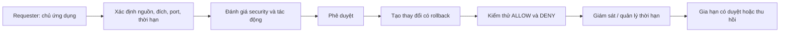
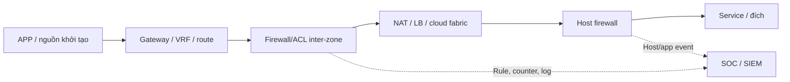
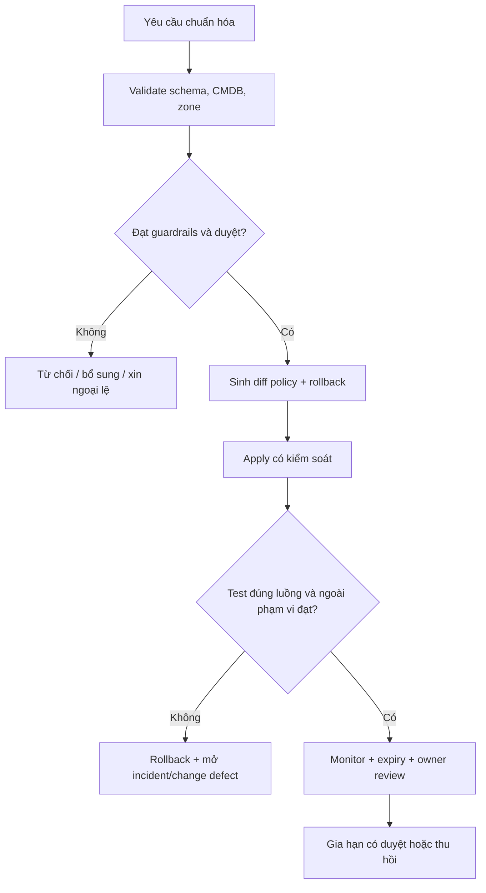

# Quy trình yêu cầu mở port

## 1. Vì sao mở port là một thay đổi bảo mật?

Một yêu cầu “mở port 443” nghe đơn giản nhưng có thể làm thay đổi ranh giới tin cậy giữa nhiều vùng mạng. Chỉ một quy tắc firewall cho phép nguồn quá rộng, sai hướng hoặc không có thời hạn có thể tạo đường truy cập ngoài dự kiến tới dịch vụ nhạy cảm. Ngược lại, từ chối mọi yêu cầu kết nối cũng làm gián đoạn nghiệp vụ và khuyến khích người dùng tạo đường vòng khó kiểm soát.

Trong chương **Quản trị vận hành mạng an toàn** thuộc module **SECURITY_NETWORK_SECURITY**, quy trình mở port là một phần của quản trị kiến trúc mạng an toàn: phải gắn nhu cầu ứng dụng với phân đoạn mạng, firewall/ACL, VPN/ZTNA, IDS/IPS, DNS, Wi-Fi và hạ tầng đám mây. Mỗi thay đổi cần được đánh giá, phê duyệt, triển khai, xác minh trên **đường đi thực tế**, giám sát và thu hồi khi không còn cần thiết.

**Nguyên tắc chính:** mở đúng luồng từ **nguồn xác định → đích xác định → giao thức/cổng xác định**, trong phạm vi và thời gian cần thiết; lưu được bằng chứng ai yêu cầu, ai quyết định, cấu hình nào thay đổi và kết quả sau thay đổi.

Sau bài học, người học có thể:

1. Chuyển một yêu cầu “mở port” mơ hồ thành bản ghi luồng kết nối có thể kiểm chứng.
2. Đánh giá mức độ rủi ro theo vùng nguồn/đích, độ nhạy cảm dịch vụ, phương thức xác thực và thời hạn.
3. Phân công trách nhiệm giữa chủ dịch vụ, đội mạng, đội an ninh và bộ phận quản trị thay đổi.
4. Chuẩn bị kế hoạch thay đổi, kiểm tra trước/sau, rollback và giám sát.
5. Xử lý các biến thể như NAT, IPv6, VPN, security group đám mây, Kubernetes, UDP và kết nối qua proxy.
6. Tự động hóa quản lý thời hạn và kiểm soát cấu hình trôi lệch (*configuration drift*).

## 2. Phải hiểu chính xác port, service và flow

**Port** là một trường trong giao thức vận chuyển như TCP hoặc UDP dùng để phân biệt điểm cuối giao tiếp. Port 443 thường phục vụ HTTPS, 22 thường phục vụ SSH, 5432 thường phục vụ PostgreSQL; tuy nhiên **cổng không xác thực loại ứng dụng**. Một dịch vụ bất kỳ có thể lắng nghe trên port 443, còn HTTPS có thể chạy trên port khác.

Ở mức chính sách L3/L4, một luồng thường được mô tả qua **5-tuple**:

```text
(source_ip, source_port, destination_ip, destination_port, protocol)
```

Khi viết yêu cầu thay đổi, cần bổ sung thông tin mà 5-tuple chưa có: nguồn khởi tạo phiên, zone/VRF/VPC, ứng dụng và chủ sở hữu, danh tính thiết bị/người dùng, thời hạn, điểm thực thi chính sách, NAT, đường phản hồi và rủi ro dữ liệu.

### 2.1 Ví dụ luồng rõ ràng

Ứng dụng `order-api` ở subnet APP `10.20.10.0/24` cần truy cập PostgreSQL `10.20.30.15` tại vùng DATA trong một đợt di chuyển ứng dụng.

| Thuộc tính | Giá trị ví dụ |
| --- | --- |
| Tài sản nguồn | Máy chủ ứng dụng `order-api` có IP thực `10.20.10.21` và `10.20.10.22` |
| Vùng nguồn | APP-PROD |
| Tài sản đích | PostgreSQL `10.20.30.15` |
| Vùng đích | DATA-PROD |
| Giao thức / destination port | TCP/5432 |
| Chiều khởi tạo | APP → DATA; phiên TCP mới khởi tạo từ APP |
| Mục đích | Kết nối DB của ứng dụng trong giai đoạn chuyển đổi |
| Thời hạn | Chỉ trong cửa sổ được phê duyệt, tự hết hạn sau giai đoạn chuyển đổi |
| Mức ghi log | Ghi phiên/rule action theo chính sách log đã phê duyệt |
| Đối chứng | APP được phép, USER/GUEST không được phép tới TCP/5432 |

`10.20.0.0/16` là địa chỉ private minh họa trong mô hình lab, không xác định địa chỉ của một hệ thống cụ thể. Nếu chỉ hai máy nguồn cần kết nối, dùng đúng hai địa chỉ `/32` hoặc nhóm định danh tài nguyên tương ứng, **không tự mở rộng thành cả subnet APP**.

### 2.2 Statefulness và chiều phản hồi

Với **firewall stateful**, một rule `APP → DATA TCP/5432` cho phép kết nối mới thường đồng thời cho phép các gói phản hồi thuộc chính phiên đó. Không vì vậy mà thêm rule “DATA → APP all ports”. Với ACL hay NACL **stateless**, chiều về có thể cần quy tắc riêng cho port nguồn tạm thời (*ephemeral ports*); phạm vi cụ thể tùy hệ điều hành, thiết bị và nền tảng.

Các tình huống cần ghi rõ:

- **Inbound**: từ Internet/VPN/zone bên ngoài tới dịch vụ bên trong; cần xem điểm kết thúc tại WAF, reverse proxy, load balancer hoặc host.
- **Outbound/egress**: ứng dụng bên trong khởi tạo ra ngoài; không nên mở tùy tiện toàn bộ Internet chỉ vì có một API đích.
- **East-west**: các workload nội bộ trao đổi qua subnet, VLAN, VRF hoặc VPC; có thể bypass firewall perimeter.
- **NAT/proxy**: IP/port ở hai phía thiết bị có thể khác nhau; cần bảng ánh xạ thực tế.
- **IPv4 và IPv6**: rule IPv4 không tự áp dụng cho IPv6; hostname dual-stack có thể chọn đường khác.



Sơ đồ mô tả vòng đời; các trường hợp khẩn cấp có thể dùng nhánh xử lý rút gọn nhưng vẫn phải truy vết và đánh giá lại sau.

## 3. Thông tin bắt buộc trong một yêu cầu mở port

Một câu “mở kết nối cho server A sang server B” không đủ để triển khai. Chuẩn hóa biểu mẫu theo các trường sau:

| Nhóm | Dữ liệu cần có | Vì sao cần |
| --- | --- | --- |
| Nhận diện | Ticket ID, người yêu cầu, chủ ứng dụng/chủ tài sản, môi trường DEV/UAT/PROD | Xác định trách nhiệm và liên kết với thay đổi |
| Nghiệp vụ | Chức năng cần kết nối, tác động nếu không mở, tài liệu/sơ đồ liên quan | Xác nhận nhu cầu hợp lệ và ưu tiên |
| Nguồn | IP/CIDR/host/identity chính xác, zone, VRF, VPC, VLAN, VPN role | Tránh phạm vi nguồn quá rộng hoặc sai vị trí |
| Đích | IP/CIDR/FQDN, service/VIP, subnet, zone, owner | Xác định nơi gói thực sự đến sau DNS/NAT |
| Giao thức | TCP/UDP/ICMP hoặc giao thức khác, destination port/range | Phân biệt cơ chế kiểm soát và hành vi kết nối |
| Chiều và trạng thái | Ai khởi tạo phiên, chiều phản hồi, stateful/stateless | Tránh mở hai chiều không cần thiết |
| Tầng ứng dụng | Tên service, TLS/mTLS, phương thức xác thực, người dùng/role cần quyền | Port mở không thay thế xác thực và phân quyền ứng dụng |
| Thời gian | Thời điểm bắt đầu, kết thúc hoặc kỳ review định kỳ | Tránh giữ các ngoại lệ vô thời hạn |
| Mức độ dữ liệu | Loại dữ liệu qua kết nối, tính nhạy cảm và rủi ro | Định hướng kiểm soát và log bổ sung |
| Đường đi | Firewall/ACL/SG/NGFW/WAF, NAT, route/VPN/peering dự kiến | Xác định chính xác thiết bị cần thay đổi |
| Kiểm thử | Ca ALLOW, DENY, đối chứng, người thực hiện và tiêu chí PASS | Phát hiện kết nối mở quá mức hoặc không hoạt động |
| Vận hành | Cửa sổ thay đổi, người phê duyệt, rollback, on-call, giám sát | Khôi phục an toàn nếu có sự cố |

**Không nên chấp nhận** những yêu cầu kiểu “mở tất cả port cho dễ”, “cho toàn bộ Internet vào mạng database”, “chưa biết IP nguồn, cứ dùng `0.0.0.0/0`” hoặc “để vĩnh viễn, sau này tính”. Nếu IP động là nhu cầu thật, phải tìm giải pháp quản trị danh tính, proxy, private endpoint hoặc nhóm tài nguyên được hỗ trợ.

### 3.1 Ví dụ ticket đã chuẩn hóa

```yaml
ticket_id: NET-2026-042
environment: PROD
application: order-api
requester_role: application_owner
business_purpose: "Kết nối PostgreSQL trong đợt chuyển đổi ứng dụng"
source:
  zone: APP-PROD
  addresses:
    - 10.20.10.21/32
    - 10.20.10.22/32
destination:
  zone: DATA-PROD
  address: 10.20.30.15/32
transport: TCP
destination_ports: [5432]
connection_initiator: APP
policy_expectation: allow_only_listed_sources
data_classification: internal_sensitive
network_controls:
  - inter_zone_firewall
application_controls:
  - database_authentication
  - tls_if_supported_and_required
validity:
  start_utc: "2026-12-01T02:00:00Z"
  end_utc: "2026-12-08T02:00:00Z"
verification:
  allowed_probe: "APP hosts -> DATA TCP/5432"
  denied_probe: "USER/GUEST -> DATA TCP/5432"
  expected_logging: "rule_id, timestamp_utc, src, dst, action"
change_id: "CHG-2026-042"
status: proposed
```

Đây là **dữ liệu mô tả yêu cầu**, không phải cấu hình có thể áp dụng trực tiếp cho firewall. Thời gian và địa chỉ đều là ví dụ. Nếu dịch vụ chạy qua NAT hoặc load balancer, cần ghi cả endpoint người dùng kết nối và backend thực sự, tránh nhầm địa chỉ ngoài với địa chỉ trong.

## 4. Phân vai và quyền phê duyệt

Các tổ chức có thể có quy trình ITSM khác nhau, nhưng trách nhiệm tối thiểu nên rõ ràng:

| Vai trò | Trách nhiệm chính |
| --- | --- |
| **Requester / Application Owner** | Giải thích nhu cầu, xác nhận IP/cổng, người dùng và luồng ứng dụng; kiểm tra sau thay đổi; duy trì chủ sở hữu |
| **Asset/Data Owner** | Xác nhận hệ thống đích và dữ liệu được phép truy cập; chấp thuận tác động tới tài sản nhạy cảm |
| **Network/Platform Engineer** | Phân tích topology, route/NAT, policy hiện tại; thiết kế rule tối thiểu; triển khai, đo kiểm và rollback |
| **Security Architect/Analyst** | Đánh giá zone, rủi ro, phương án thay thế, phạm vi rule, bù trừ kiểm soát và telemetry |
| **Change Manager/CAB (khi áp dụng)** | Điều phối cửa sổ thay đổi, phụ thuộc vận hành và phê duyệt phát hành theo phân cấp |
| **SOC / Operations** | Thiết lập giám sát/alert, tiếp nhận bất thường, vận hành và đánh giá log |
| **Service Owner sau triển khai** | Gia hạn/đề nghị đóng khi hết nhu cầu; tham gia review theo chu kỳ |

Tách biệt **người đề xuất**, **người đánh giá rủi ro** và **người có quyền áp dụng thay đổi** theo mức độ quan trọng của hệ thống. Với thay đổi nhỏ theo mẫu đã phê duyệt, một số bước có thể tự động hóa; với kết nối Internet → mạng quản trị/PROD, cần mức xem xét cao hơn.

Phê duyệt không nên chỉ là “đã có ticket”. Cần ghi lại *ai chấp nhận rủi ro nào, cho đường nào và đến thời điểm nào*. Nếu owner đổi vị trí hoặc service ngừng dùng, quy tắc phải có cơ chế chuyển giao hoặc thu hồi.

## 5. Đánh giá rủi ro và lựa chọn phương án

### 5.1 Những yếu tố quyết định mức rủi ro

| Yếu tố | Ví dụ ít rủi ro hơn | Ví dụ cần xem xét kỹ |
| --- | --- | --- |
| Nguồn | Hai workload đã xác định trong vùng tin cậy | Internet bất kỳ, GUEST, mạng nhà thầu rộng |
| Đích | Canary/test service, API được bảo vệ | Database, domain controller, hypervisor, management plane |
| Port/dịch vụ | Cổng cần thiết của ứng dụng đã kiểm soát | SSH/RDP/SMB/database mở ra vùng không tin cậy; nhiều cổng liên tiếp |
| Xác thực | mTLS, RBAC, MFA khi phù hợp, chính sách ứng dụng | Dịch vụ cũ, mật khẩu mặc định, không xác thực |
| Phân đoạn | Một tuyến qua điểm kiểm soát rõ ràng | Nhiều lối đi qua VPN/peering/proxy, route leaking |
| Thời hạn | Tạm thời, tự hết hạn | Không có owner, không có ngày review |
| Dữ liệu | Chỉ health-check không nhạy cảm | Thông tin định danh, tài chính, bí mật kinh doanh |
| Giám sát | Rule ID, flow log và cảnh báo phù hợp | Không có telemetry hoặc không đối chiếu được phiên |
| Sẵn sàng | Thay đổi độc lập, rollback rõ | Ảnh hưởng HA, routing, hệ thống liên quan diện rộng |

**Port number không tự quyết định rủi ro.** TCP/443 có thể vận chuyển API quản trị cực kỳ nhạy cảm; TCP/5432 trong mạng ứng dụng nội bộ vẫn cần xác thực, TLS và quyền truy cập phù hợp. Đánh giá theo *phương thức sử dụng và exposure*, không dựa duy nhất vào bảng port phổ biến.

### 5.2 Áp dụng nguyên tắc ít đặc quyền

Ưu tiên phương án giảm diện tiếp xúc:

1. Chỉ nguồn cần thiết, không khai báo toàn subnet nếu có thể chọn host/identity cụ thể.
2. Chỉ đích cần thiết; tránh chọn một nhóm server lớn khi chỉ một dịch vụ cần quyền.
3. Chỉ giao thức và destination port thực sự dùng; không dùng `any/any`.
4. Giới hạn **hướng tạo phiên**, nhóm người dùng/thiết bị hoặc điều kiện truy cập nếu control hỗ trợ.
5. Gắn **hạn hết hiệu lực** với luồng thử nghiệm, chuyển đổi và xử lý sự cố; luồng lâu dài vẫn cần lịch review.
6. Bổ sung xác thực/ủy quyền tại dịch vụ đích, mã hóa truyền tải, giám sát, hạn chế tốc độ khi phù hợp.
7. Chặn các đường thay thế không được duyệt (IPv6, VPN, Wi-Fi, cloud peering, management interface).

Có thể giảm nhu cầu mở inbound trực tiếp bằng **reverse proxy, API gateway, private endpoint, service mesh, ZTNA hoặc broker có danh tính**. Tuy nhiên các giải pháp này cũng cần đánh giá policy, latency, điểm lỗi và quyền vận hành riêng.

### 5.3 Chọn hướng duyệt theo loại thay đổi

| Loại yêu cầu | Hướng xử lý gợi ý |
| --- | --- |
| Luồng nội bộ đã có mẫu bảo mật được phê duyệt, phạm vi hẹp | Standard change qua template đã kiểm chứng, kiểm tra tự động và ghi log |
| Luồng mới giữa hai vùng PROD hoặc tới dữ liệu nhạy cảm | Thẩm định service owner, network và security; thử trong môi trường phù hợp |
| Internet → ứng dụng public qua WAF/reverse proxy | Xác minh TLS, xác thực, WAF, chống DDoS, điểm đích và logging |
| Internet → SSH/RDP/database/management plane | Đánh giá tăng cường; ưu tiên bastion/ZTNA/VPN có MFA hoặc loại bỏ exposure |
| Quy tắc tạm thời cho migration/troubleshooting | Ngày hết hạn, ngưỡng cảnh báo và tự động gỡ sau hết thời gian |
| Emergency change do sự cố nghiêm trọng | Quy trình rút gọn có thẩm quyền, ghi lý do/thời gian, rollback và đánh giá hậu kiểm |

Không dùng phân loại này như một thang phê duyệt cố định cho mọi tổ chức: mức nhạy cảm, năng lực phục hồi và quy định nội bộ có thể đòi hỏi ngưỡng khác.

## 6. Quy trình chuẩn từ tiếp nhận đến đóng yêu cầu

### Bước 1 — Tiếp nhận và kiểm tra đầu vào

Người nhận ticket xác minh các trường bắt buộc: source/destination, protocol, destination port, vùng mạng, mục đích, owner, thời hạn, ranh giới môi trường và cách kiểm tra. Nếu thông tin không đầy đủ, yêu cầu bổ sung; **không tự suy diễn** địa chỉ, cổng hay quy tắc dựa trên tên ứng dụng.

**Ví dụ:** “Từ APP cần dùng database” phải được làm rõ thành “`10.20.10.21/32` và `10.20.10.22/32` khởi tạo TCP tới `10.20.30.15/32:5432` trong cửa sổ di chuyển”.

### Bước 2 — Đối chiếu inventory và cấu hình hiện trạng

- Kiểm tra tài sản có thật, đúng owner, IP/CIDR và zone hiện tại; tránh IP đã cấp lại.
- Tra DNS (nếu dùng FQDN), load balancer/VIP, mapping NAT và đường từ source tới destination.
- Xem route, VRF, firewall/ACL, security group, network policy, host firewall và IAM/ZTNA nếu có.
- Xác định có rule đã cho phép cùng luồng hay không; tránh tạo bản sao hoặc rule bị che bởi quy tắc ưu tiên trước.
- Kiểm tra dịch vụ có thực sự lắng nghe tại đích và đáp ứng yêu cầu bảo mật ứng dụng.
- Xem lịch sử incident/vi phạm và chính sách vùng; cân nhắc các phụ thuộc cloud, VPN, Wi-Fi.

**Một kết nối hiện không hoạt động không có nghĩa thiếu firewall rule.** Có thể lỗi DNS, route, listener, chứng chỉ, xác thực ứng dụng hoặc đường phản hồi.

### Bước 3 — Phân tích đường đi và nơi thực thi



Đây là mô hình tổng quát; đường đi thực tế có thể khác, nhất là khi source và destination cùng subnet hoặc qua overlay/tunnel. Trước khi mở, xác nhận **nơi rule có hiệu lực**, đường đi cả chiều về, thiết bị nào dịch địa chỉ và có đường bypass hay không.

**Đối với stateful firewall:** đánh giá chính sách cho kết nối *mới* từ nguồn. **Đối với stateless ACL/NACL:** xét đủ ingress và egress, cả ephemeral ports được dùng làm port nguồn ở chiều phản hồi. **Đối với NAT:** thể hiện tuple trước/sau NAT và rule gắn đúng địa chỉ. **Đối với dual-stack:** đánh giá riêng IPv4/IPv6.

### Bước 4 — Đánh giá rủi ro và ghi phê duyệt

Đội security/asset owner xác nhận nhu cầu hợp lệ, phạm vi ít đặc quyền và các biện pháp kiểm soát. Nếu thay đổi phá vỡ chính sách phân đoạn, phải có quyết định ngoại lệ ghi rõ *lý do, điều kiện, trách nhiệm, hạn dùng, cách phát hiện và kế hoạch đóng*, thay vì tạo rule âm thầm.

Một quyết định duyệt cần đủ thông tin:

```text
Decision: APPROVED / REJECTED / NEEDS_REVISION
Ticket: NET-2026-042
Approved tuple: 10.20.10.21/32,10.20.10.22/32 -> 10.20.30.15/32 TCP/5432
Zones: APP-PROD -> DATA-PROD
Validity: 2026-12-01 02:00 UTC to 2026-12-08 02:00 UTC
Constraints: log connections; no alternate management exposure
Approvers: App Owner, Data Owner, Network Change, Security reviewer
Revalidation: positive APP probe + negative USER/GUEST probe
```

Dữ liệu phê duyệt phải gắn với **phiên bản ticket cụ thể**. Nếu người triển khai mở rộng nguồn, thay đích, đổi giao thức hay kéo dài hạn so với bản đã duyệt, cần đánh giá lại.

### Bước 5 — Chuẩn bị kế hoạch thay đổi và rollback

Kế hoạch triển khai phải mô tả:

- Cấu hình dự kiến, thứ tự rule, object group, tag/comment, ticket và expiry; xác nhận không ghi đè policy khác.
- Cấu hình hiện tại để đối chiếu và phương án quay lại trước thay đổi.
- Thiết bị và vùng chịu tác động; cửa sổ bảo trì, hệ thống HA, đường quản trị dự phòng.
- Ca test ALLOW/DENY, kiểm tra ứng dụng, counter/log và chỉ số baseline.
- Điểm dừng: mất kết nối quản trị, tăng lỗi ứng dụng, latency bất thường, bypass chính sách hoặc telemetry không hoạt động.
- Thao tác rollback (gỡ đúng rule/object mới và khôi phục trạng thái), người chịu trách nhiệm, cách xác nhận sau rollback.

Với policy dạng Infrastructure as Code, nên tạo thay đổi trong version control, review *diff*, kiểm tra lint/policy-as-code, apply theo pipeline có phê duyệt và lưu định danh commit/change. Hạn chế sửa tay ở nhiều giao diện mà không được đồng bộ về nguồn cấu hình.

### Bước 6 — Triển khai theo phạm vi đã duyệt

Người thực hiện áp dụng đúng một policy tối thiểu theo thiết kế, kiểm tra trạng thái/commit trên thiết bị hoặc nền tảng và xác nhận không có thay đổi ngoài ticket. Với nhóm firewall HA, chú ý đồng bộ cấu hình giữa node và trạng thái phiên; với cloud SG hoặc Kubernetes, quan sát thời gian hội tụ của control và policy tại các interface/pod liên quan.

Một mẫu **ý định chính sách**:

```yaml
rule:
  id: NET-2026-042
  action: allow
  direction: new_connection_from_app_to_data
  source_zone: APP-PROD
  source_ips:
    - 10.20.10.21/32
    - 10.20.10.22/32
  destination_zone: DATA-PROD
  destination_ip: 10.20.30.15/32
  protocol: tcp
  destination_port: 5432
  log: true
  change_reference: CHG-2026-042
  owner: order-api
  expires_at_utc: "2026-12-08T02:00:00Z"
```

Mẫu chỉ diễn tả **điều kiện mong muốn**. Không tự giả định rằng mỗi firewall đều hỗ trợ `expires_at_utc`, định danh ứng dụng hay cùng cú pháp. Nếu nền tảng không có TTL cho rule, hệ thống ITSM/automation phải theo dõi và gỡ có kiểm soát.

### Bước 7 — Kiểm thử từ đúng nguồn và xác minh bằng chứng

Kiểm thử tối thiểu phải gồm:

1. **ALLOW đúng phạm vi:** từ host APP được duyệt, kết nối tới DATA đúng TCP/5432 và hoàn tất handshake/service test theo quyền được cấp.
2. **DENY ngoài phạm vi:** từ USER/GUEST hoặc một APP không được cho phép, thử cùng đích/cổng và xác minh bị control dự kiến chặn.
3. **Không mở rộng giao thức/cổng:** bảo đảm port lân cận, UDP/5432 hoặc cổng quản trị không vô tình được cấp quyền nếu chính sách không cho.
4. **Ứng dụng hoạt động:** kết nối thành công ở L4 chưa chứng minh xác thực DB, TLS, ACL ứng dụng hay giao dịch nghiệp vụ thành công.
5. **Log và monitoring:** rule ID, source/destination, thời gian UTC, action, NAT session và cảnh báo cần thiết xuất hiện tại nơi dự kiến.
6. **Các trường hợp liên quan:** IPv6, VIP/load balancer, VPN/remote role và đường DR/failover nếu chúng thuộc phạm vi nghiệp vụ.

**Ví dụ lệnh kiểm tra giới hạn trên lab hoặc host được phép:**

```bash
# Trên chính host nguồn APP: xem route cục bộ và IP/interface dự kiến
ip route get 10.20.30.15

# Trên host APP đã được duyệt: thử TCP/5432 trong 3 giây
nc -vz -w 3 10.20.30.15 5432

# Trên DATA: kiểm tra dịch vụ thực sự đang lắng nghe
ss -lnt '( sport = :5432 )'
```

Để kiểm tra đối chứng DENY, chạy lệnh kết nối tương tự **từ đúng host USER/GUEST đã được phê duyệt** và thu log policy tương ứng. Một kết quả timeout đơn độc không đủ để khẳng định firewall đã chặn đúng; nó có thể do đích không chạy, route lỗi hoặc server không phản hồi.

Khi được cho phép thu gói tin, có thể dùng capture ngắn, tránh giữ nội dung nhạy cảm:

```bash
# Trên interface lab được cấp quyền, tự dừng sau 20 gói phù hợp
sudo tcpdump -nni eth0 -c 20 'host 10.20.30.15 and tcp port 5432'
```

Lệnh capture phía nguồn chỉ chứng minh gói được phát/nhận tại điểm đó. Để xác nhận **điểm chặn**, cần đối chiếu counter, rule hit, session/NAT table hoặc log phía firewall/đích. Với UDP, không có TCP handshake để đánh giá; phải dùng truy vấn giao thức ứng dụng an toàn và telemetry hai đầu.

### Bước 8 — Nghiệm thu và thông báo vận hành

Sau khi test, người triển khai cập nhật ticket:

- **Cấu hình sau thay đổi:** rule ID/object, vị trí, zone, port, thời gian apply, commit/diff, trạng thái HA.
- **Bằng chứng:** ca test ALLOW/DENY, kết quả ứng dụng, log tại control và dữ liệu đường phản hồi nếu cần.
- **Người xác nhận:** application owner nghiệm thu nghiệp vụ, network xác nhận data plane, security xem xét các ngoại lệ hoặc sai lệch.
- **Giám sát:** chủ rule, lịch review, cảnh báo sử dụng bất thường và ngày tự thu hồi.
- **Hạn chế:** nếu có ca không thể kiểm tra, ghi trạng thái `INCONCLUSIVE` hoặc `NOT_TESTED`; không đánh dấu tất cả là PASS chỉ vì ứng dụng hoạt động.

Khi phát hiện rule cho phép quá rộng hoặc điều kiện bảo vệ không đạt, rollback hoặc giảm phạm vi theo kế hoạch đã duyệt trước khi đóng ticket.

### Bước 9 — Review, gia hạn và thu hồi

Mỗi rule cần **owner và vòng đời**. Khi đến ngày hết hạn, automation tạo yêu cầu xác nhận hoặc gỡ đúng rule tạm thời; nếu service vẫn cần, chủ dịch vụ phải giải thích lý do và có quyết định gia hạn mới. Khi ứng dụng ngừng sử dụng, IP đổi hoặc project hoàn tất, thu hồi rule và kiểm tra phụ thuộc.

Đối với rule lâu dài, duy trì review theo phân loại rủi ro. Việc không thấy traffic trong vài tuần **chưa chắc** có nghĩa rule thừa: có thể là đường dự phòng/DR hoặc tác vụ định kỳ. Cần đối chiếu chủ dịch vụ, lịch sử lưu lượng và kiến trúc trước khi xóa.

## 7. Bảng chấm kết quả kiểm thử

| Kết quả | Tiêu chí | Hành động |
| --- | --- | --- |
| **PASS — ALLOW** | Nguồn hợp lệ kết nối đúng service, có log và ứng dụng thực hiện được hành vi dự kiến | Lưu evidence và tiếp tục đánh giá DENY |
| **PASS — DENY** | Nguồn ngoài phạm vi bị chặn ở control dự kiến, đích có đối chứng đang hoạt động | Lưu rule hit/log và source/destination/UTC |
| **FAIL — quá rộng** | Nguồn/port/hướng không được duyệt vẫn kết nối được | Xác định rule ưu tiên, route/NAT, rollback hoặc sửa |
| **FAIL — không hoạt động** | Luồng hợp lệ không hoạt động; đã khoanh vùng lỗi và gắn với thay đổi | Kiểm tra route, listener, ACL/SG, return path, auth rồi khắc phục/rollback |
| **INCONCLUSIVE** | Chỉ có timeout hoặc thiếu log, thiếu probe đúng vùng, đích không sẵn sàng | Bổ sung điểm đo; không kết luận chính sách |
| **NOT TESTED** | Không thực hiện được một kiểm chứng bắt buộc | Ghi lý do, người chấp nhận rủi ro và kế hoạch thử lại |

Trong hệ thống **stateful**, kết nối phản hồi của một phiên ALLOW không đồng nghĩa đã mở một rule khởi tạo mới theo chiều ngược. Cần kiểm thử luồng **new session** theo đúng chiều policy nếu đây là yêu cầu phân đoạn.

## 8. Những bối cảnh cần xử lý riêng

### 8.1 Internet ingress, DMZ, WAF và reverse proxy

Một yêu cầu “mở TCP/443 từ Internet tới web” cần xác định rõ điểm kết thúc:

- Client Internet → public load balancer/CDN/WAF ở 443.
- WAF/reverse proxy → backend application bằng một đường private có kiểm soát.
- Ứng dụng → database theo một policy riêng nếu có nhu cầu.
- Origin web cần từ chối kết nối trực tiếp từ Internet nếu kiến trúc yêu cầu chỉ qua WAF.

Chỉ mở firewall không bảo đảm TLS cấu hình đúng, xác thực ứng dụng đủ mạnh hoặc WAF đang thực thi rule. Kiểm tra **dịch vụ và chính sách ở từng chặng**, bao gồm khả năng truy cập origin ngoài ý định.

### 8.2 Egress tới SaaS và FQDN động

Đích SaaS có thể thay đổi IP theo vùng, CDN hoặc cloud provider. Một FQDN không tự động trở thành firewall object an toàn: kiểm tra cách control giải DNS, làm mới cache, xử lý CNAME, IPv6, wildcard và TLS SNI khi có. Nếu không hỗ trợ định danh ứng dụng ổn định, cân nhắc proxy có kiểm soát hoặc private endpoint.

Yêu cầu nên ghi *dịch vụ SaaS cụ thể, hostname được duyệt, account/role, protocol, port, loại dữ liệu* và xác định cách cập nhật khi đích đổi IP. Quy tắc `APP → 0.0.0.0/0 TCP/443` có thể rộng hơn nhiều so với mục tiêu “gọi một API”.

### 8.3 VPN/ZTNA, Wi-Fi và phân đoạn mạng quản trị

Source IP của người dùng có thể được cấp động sau VPN hoặc NAC. Cần gắn yêu cầu với **nhóm người dùng, trạng thái thiết bị, địa chỉ pool, zone đích và chính sách xác thực**, thay vì mở toàn bộ pool nếu chỉ một nhóm được phép. Khách Wi-Fi và BYOD thường có vùng trust khác; phép thử từ LAN nội bộ không đại diện cho kết nối qua VPN hoặc SSID khách.

Mở SSH/RDP/HTTPS quản trị nên ưu tiên **bastion, ZTNA hoặc VPN có MFA**, policy theo danh tính và log phiên. Không dùng một rule mạng rộng để thay thế kiểm soát quản trị.

### 8.4 Cloud: security group, NACL, route và private endpoints

Trong môi trường cloud, một luồng có thể phụ thuộc đồng thời vào route table, security group, network ACL, gateway, peering/transit gateway, firewall đám mây và host policy. Có nền tảng dùng SG stateful và NACL stateless; **kiểm tra chính xác quy tắc của nhà cung cấp** trước khi mở chiều về và ephemeral ports.

Nên gắn rule với danh tính/tài nguyên có vòng đời khi nền tảng hỗ trợ, lưu IaC diff và kiểm tra drift. Nếu sử dụng private endpoint, cần bảo đảm DNS, route và policy dẫn client vào endpoint riêng; mở port tới một IP public trong khi ứng dụng dùng private endpoint có thể hoàn toàn không giúp luồng hoạt động.

### 8.5 Kubernetes, microservices và service mesh

Một yêu cầu pod A → service B không nhất thiết được giải quyết bằng firewall bên ngoài cluster. Cần xem:

- Namespace và labels thực của workload, service/VIP, endpoints và chính sách egress/ingress.
- CNI có hỗ trợ và thực thi **NetworkPolicy** theo cách dự kiến hay không.
- Egress gateway, NAT, ingress controller và service mesh có thay đổi danh tính/đường kết nối không.
- mTLS và authorization policy ở service mesh có cho phép request sau khi L3/L4 thông không.

Không khẳng định NetworkPolicy mặc định chặn mọi luồng ở tất cả cluster; hiệu lực tùy policy hiện có và dataplane. Việc thêm một allow rule nhưng bỏ sót DNS egress, port backend hoặc identity policy cũng có thể khiến ứng dụng không hoạt động.

### 8.6 UDP, ICMP, DNS và dịch vụ đặc biệt

Một số dịch vụ như DNS, NTP, syslog, VPN/IPsec dùng UDP hoặc nhiều giao thức/cổng. Ví dụ DNS thường dùng UDP/TCP 53, nhưng client có thể dùng DoT/DoH theo chính sách; NTP thường UDP 123; một số tunnel dùng UDP 500/4500 hoặc giao thức riêng tùy thiết kế. Không mặc nhiên mở toàn bộ port phụ: đọc yêu cầu service và traffic thực tế.

ICMP không có TCP/UDP port; có các type/code liên quan chẩn đoán và **Path MTU Discovery**. Chặn ICMP tùy tiện có thể gây lỗi mạng khó phát hiện. Quy trình cần ghi rõ protocol/type/code khi làm việc với ICMP, tránh điền bừa “port 0”.

## 9. Thay đổi khẩn cấp và xử lý ngoại lệ

Khi đang xử lý incident hoặc khôi phục dịch vụ quan trọng, tổ chức có thể cho phép **emergency change** với chuỗi duyệt rút gọn. Tuy nhiên vẫn cần:

1. Xác nhận tác động và thời hạn; chỉ mở luồng tối thiểu để khôi phục.
2. Ghi ticket, người yêu cầu, người có quyền quyết định và lý do khẩn cấp.
3. Lưu snapshot/diff hiện trạng cùng phương án rollback trước khi áp dụng nếu có thể.
4. Giám sát liên tục trong cửa sổ khẩn cấp, alert khi traffic khác kỳ vọng.
5. Chỉ định **expiry** và người trực thu hồi ngay sau khôi phục.
6. Thực hiện **post-implementation review** để xác nhận lý do, ảnh hưởng, việc thu hồi và khả năng thay bằng thiết kế lâu dài.

**Không dùng nhãn “emergency” để bỏ hẳn phân quyền hay dấu vết thay đổi.** Nếu phải chấp nhận một rule rộng tạm thời, nêu rõ rủi ro bổ sung, phạm vi thời gian, lý do không thể dùng phương án hẹp và kiểm soát bù trừ. Sau sự cố, rule tạm rộng không được âm thầm chuyển thành rule lâu dài.

## 10. Tự động hóa kiểm soát và chống cấu hình trôi lệch

Khi số lượng ticket lớn, quy trình thủ công dễ bỏ sót TTL, trùng rule hoặc cập nhật nhầm zone. Có thể tự động hóa phần có cấu trúc, nhưng giữ phê duyệt đúng mức rủi ro.

**Các bước automation nên hỗ trợ:**

- Kiểm tra input schema: IP/CIDR hợp lệ, port hợp lệ, protocol hợp lệ, owner và expiry rõ; chặn `any/any` nếu không có loại ngoại lệ được duyệt.
- Đối chiếu inventory, service catalogue, CMDB, vùng và nhãn môi trường.
- So sánh policy đang áp dụng với yêu cầu; phát hiện rule trùng, bị che, rule chồng lấn và mở rộng phạm vi.
- Kiểm tra threat/policy guardrails: Internet → management, GUEST → DATA, PROD → nonprod, giao thức quản trị yếu, đường không có logging.
- Tạo kế hoạch thay đổi và diff để reviewer chấp thuận; dùng version control, pipeline và quyền thay đổi tối thiểu.
- Triển khai **idempotent** khi nền tảng hỗ trợ: chạy lại cùng yêu cầu không tạo thêm rule trùng.
- Chạy test từ probe thật ở source zone, lưu đối chứng DENY, rule hit và xác nhận dịch vụ.
- Theo dõi expiry, gỡ rule tạm và báo cáo các thay đổi ngoài pipeline.



**Policy-as-code** cần bao gồm cả **kiểm soát phủ định**. Chẳng hạn, pipeline không chỉ xác minh APP → DATA:5432 được phép mà còn kiểm tra USER/GUEST → DATA:5432 vẫn bị cấm. Cách này giúp phát hiện một rule mới vô tình làm vô hiệu phân đoạn đang hoạt động.

## 11. Sự cố mẫu và cách điều tra

### 11.1 Ticket duyệt nhưng kết nối vẫn timeout

**Bối cảnh:** Network đã thêm allow rule APP → DATA TCP/5432; nhóm ứng dụng vẫn báo timeout.

Quy trình điều tra:

1. Xác nhận ứng dụng chạy trên IP nguồn đúng và dùng đúng IP đích (kể cả DNS/VIP/NAT).
2. Xem `ip route get` trên APP, VRF, route/ACL trên gateway và firewall counter.
3. Đối chiếu có SYN đi từ APP hay không, đến được firewall hay không và action của rule nào.
4. Kiểm tra chiều phản hồi, asymmetric routing, NACL stateless và host firewall.
5. Đối chiếu listener ở DATA và log DB; không mở thêm các port ngẫu nhiên để “thử”.
6. Ghi kết quả. Nếu mạng thông nhưng DB từ chối xác thực, chuyển xử lý cho chủ ứng dụng/DB.

**Điểm cần nhớ:** thêm rule có thể không giải quyết nguyên nhân. Quy trình nên có phân tích trước/sau để tránh “mở rộng từng chút” tới khi kết nối hoạt động.

### 11.2 Ứng dụng hoạt động nhưng rule mở quá rộng

**Bối cảnh:** Sau khi mở APP → DATA, cả máy USER không có quyền cũng kết nối TCP tới DATA:5432.

Đây là **FAIL — quá rộng**, bất kể ứng dụng chính hoạt động. Hãy kiểm tra rule order, object group, nguồn NAT, route khác, firewall khác hoặc policy host/cloud. Thu chứng cứ client và control, rollback/restrict rule, chạy lại đối chứng USER/GUEST → DATA và ghi bài học phòng ngừa.

### 11.3 Dịch vụ thay IP sau failover

**Bối cảnh:** Client được phép tới backend ban đầu. Sau failover, DNS hoặc VIP trỏ tới backend mới và policy không cập nhật, khiến ứng dụng lỗi.

Giải pháp cần xác định owner của địa chỉ đích và phương thức ổn định hơn: target pool/load balancer, private endpoint, nhóm tài nguyên có định danh hoặc quy trình cập nhật tự động được kiểm soát. Không mở cả dải rộng chỉ để đón mọi thay đổi có thể xảy ra.

## 12. Ví dụ báo cáo kết quả cuối ticket

```yaml
ticket: NET-2026-042
change: CHG-2026-042
result: completed
applied_at_utc: "2026-12-01T02:08:00Z"
policy_ref: FW-APP-DATA-042
approved:
  sources: ["10.20.10.21/32", "10.20.10.22/32"]
  destination: "10.20.30.15/32"
  protocol: tcp
  destination_port: 5432
verification:
  allowed_flow:
    location: APP-PROD
    network: pass
    application: pass
  denied_flow:
    location: USER
    expected: deny
    observed: deny
    firewall_evidence: "flow-log-ref-123"
  reverse_session: observed_as_stateful_reply
  monitoring: enabled
expiry_utc: "2026-12-08T02:00:00Z"
owner: order-api
reviewer: security-reviewer
rollback_ref: "rollback-plan-CHG-2026-042"
notes: "Kết quả giả lập để minh họa cấu trúc chứng cứ"
```

Các identifier trong mẫu là giả lập; khi triển khai thật, dùng liên kết ticket, commit, rule ID, thời gian và log đã được lưu ở nơi quản lý phù hợp. Tránh sao chép mật khẩu, token hoặc payload nhạy cảm vào ticket.

### 12.1 Chỉ số chất lượng quy trình

| Chỉ số | Cách hiểu |
| --- | --- |
| **Thời gian từ yêu cầu đầy đủ đến quyết định** | Đo tốc độ xét duyệt nhưng không thưởng cho việc bỏ qua đánh giá |
| **Tỷ lệ yêu cầu thiếu thông tin** | Phản ánh nhu cầu chuẩn hóa biểu mẫu và hướng dẫn chủ ứng dụng |
| **Tỷ lệ PASS ALLOW và PASS DENY** | Đo cả việc làm ứng dụng hoạt động và giữ phân đoạn đúng |
| **Số rule quá rộng/không có owner** | Cảnh báo tồn đọng rủi ro kiến trúc |
| **Tỷ lệ rule tạm được thu hồi đúng hạn** | Đo hiệu lực kiểm soát vòng đời |
| **Số thay đổi ngoài quy trình/drift** | Đo khả năng tuân thủ cấu hình chuẩn |
| **Số rollback hoặc sự cố sau mở port** | Cho biết chất lượng phân tích route, HA và test |
| **Thời gian đóng ngoại lệ quá hạn** | Phản ánh năng lực xử lý nợ rủi ro |

Các chỉ số không nên được diễn giải độc lập. Ví dụ “thời gian duyệt rất nhanh” nhưng nhiều rule quá rộng và thiếu đối chứng DENY có thể cho thấy quy trình đang bỏ sót bước bảo mật quan trọng.

## 13. Checklist trước và sau khi mở port

### Trước khi duyệt

- [ ] Có business owner, asset/data owner và ticket hợp lệ.
- [ ] Có đúng nguồn, đích, zone, protocol, port, hướng phiên, thời hạn và mục đích.
- [ ] Đã đối chiếu inventory, DNS, NAT/VIP, route, VRF, VLAN, VPC, VPN và IPv6 liên quan.
- [ ] Đã kiểm tra rule hiện tại; không có phương án ít đặc quyền hơn phù hợp hơn.
- [ ] Đã đánh giá dữ liệu, xác thực, mã hóa, WAF/IDS/IPS, logging và đường phụ.
- [ ] Có quyết định phê duyệt theo phân loại rủi ro, bao gồm ngoại lệ nếu có.
- [ ] Có kế hoạch apply, kiểm tra và rollback, cửa sổ bảo trì và người trực.

### Sau khi triển khai

- [ ] Rule thực tế khớp chính xác bản phê duyệt, có ID, owner, change ID, expiry/review.
- [ ] ALLOW đúng nguồn tới đúng dịch vụ hoạt động; có kiểm thử tầng ứng dụng nếu cần.
- [ ] DENY từ nguồn ngoài phạm vi vẫn được thực thi; không mở rộng port/zone ngoài kế hoạch.
- [ ] Có bằng chứng ở firewall/SG/ACL hoặc điểm kiểm soát dự kiến, không chỉ dựa vào timeout.
- [ ] Đã kiểm tra NAT, đường trả lời, HA, IPv6 và failover trong phạm vi thay đổi.
- [ ] Hệ thống log/monitoring nhận sự kiện, không ghi bí mật ngoài ý muốn.
- [ ] Ticket chứa kết quả, người nghiệm thu, giới hạn kiểm thử và lịch thu hồi.
- [ ] Có phương án dọn rule sau khi hết nhu cầu, review định kỳ và cảnh báo quá hạn.

## 14. Câu hỏi tự đánh giá

1. Vì sao yêu cầu “mở TCP 443 từ Internet vào server” chưa đủ để kỹ sư cấu hình firewall an toàn?
2. Phân biệt destination port với source port tạm thời và giải thích tác động tới ACL stateless.
3. Với rule APP → DATA TCP/5432 trên firewall stateful, có cần mở toàn bộ chiều DATA → APP không? Vì sao?
4. Vì sao một kết nối timeout từ USER tới DATA chưa đủ bằng chứng rằng policy DENY hoạt động đúng?
5. Khi dịch vụ dùng FQDN với IP thay đổi, những điểm nào cần kiểm tra trước khi chọn firewall object theo tên miền?
6. Port 443 có tự động bảo đảm mã hóa TLS và xác thực ứng dụng hay không?
7. Một emergency change tạm thời nên có những dấu vết, hạn dùng và bước hậu kiểm nào?
8. Tại sao phải thử cả kết nối ALLOW hợp lệ và DENY ngoài phạm vi sau mỗi thay đổi?
9. Khi traffic đi qua cloud security group, NACL, NAT, VPN và host firewall, đâu là điểm cần thu chứng cứ để xác định control thực thi?
10. Một rule không có hit trong tháng qua có nên xóa ngay không? Cần trao đổi với ai và kiểm chứng điều gì?

**Tài liệu tra cứu định hướng:** NIST SP 800-41 Rev. 1 (*Guidelines on Firewalls and Firewall Policy*), NIST SP 800-53 (các nhóm kiểm soát truy cập, cấu hình, giám sát và thay đổi), RFC 5737 (địa chỉ IPv4 tài liệu), cùng tài liệu của firewall, cloud platform, Kubernetes CNI và quy trình ITSM đang được tổ chức sử dụng. Các chính sách phê duyệt, yêu cầu log và retention phải theo chuẩn nội bộ và quy định áp dụng tại thời điểm triển khai.

