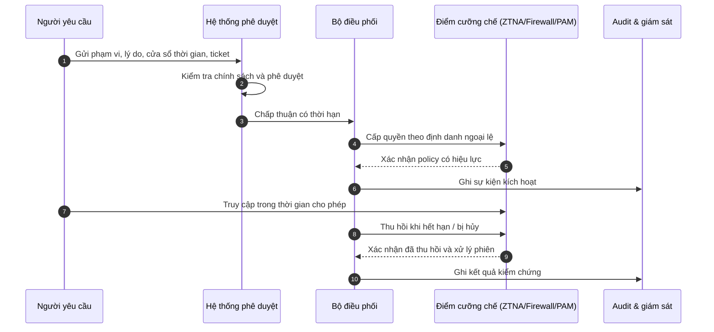

# Time-bound access cho ngoại lệ trong vận hành mạng an toàn

## 1. Vì sao ngoại lệ truy cập phải có thời hạn?

Trong vận hành mạng, chính sách mặc định thường chỉ cho phép những luồng lưu lượng đã được phê duyệt. Tuy nhiên, đội ngũ vận hành đôi khi cần **ngoại lệ**: nhà cung cấp kết nối SSH để bảo trì thiết bị, kỹ sư truy cập máy chủ trong lúc xử lý sự cố, hoặc nhóm triển khai tạm mở một đường kết nối giữa hai vùng mạng để kiểm thử.

Nếu ngoại lệ được cấu hình như một quy tắc firewall, quyền VPN hoặc vai trò quản trị tồn tại vô thời hạn, quyền tạm thời sẽ trở thành một đường truy cập thường trực. Sau khi công việc kết thúc, người được cấp quyền có thể không còn nhu cầu, nhưng tài khoản bị chiếm dụng hoặc thiết bị đã mất kiểm soát vẫn có thể lợi dụng đường truy cập đó.

**Time-bound access** (truy cập giới hạn thời gian) là cơ chế cấp quyền với thời điểm bắt đầu và kết thúc xác định, đồng thời có biện pháp **thu hồi và xác minh thực thi** khi hết hạn. Khi kết hợp với **just-in-time (JIT) access**, quyền được kích hoạt sát thời điểm thực sự cần dùng và tự hết hiệu lực sau một khoảng ngắn.

Trong module `SECURITY_NETWORK_SECURITY`, kỹ thuật này là một phần của phòng vệ nhiều lớp: kiểm soát danh tính và phiên kết nối, phân đoạn mạng, firewall/VPN/ZTNA, ghi nhật ký giám sát và xử lý sự cố. Giới hạn thời gian làm giảm khoảng thời gian phơi nhiễm, nhưng **không thay thế** nguyên tắc đặc quyền tối thiểu, xác thực mạnh, phân đoạn hoặc phát hiện xâm nhập.

Sau bài này, người học có thể:

- Mô tả một ngoại lệ bằng danh tính, tài nguyên, thao tác, điều kiện và thời hạn rõ ràng.
- Thiết kế quy trình yêu cầu, phê duyệt, kích hoạt, thu hồi và đối soát ngoại lệ.
- Phân biệt hết hạn trên hệ thống quản lý với việc thực sự chặn truy cập trên mạng.
- Chọn cơ chế cưỡng chế, giám sát và xử lý lỗi phù hợp với mức độ rủi ro.

## 2. Khái niệm và ranh giới áp dụng

Một ngoại lệ có thời hạn không đơn thuần là ghi `expires_at` vào phiếu thay đổi. Để có hiệu lực bảo mật, hệ thống phải kiểm soát được ít nhất ba lớp:

1. **Quyền được cấp**: ai có thể vào đâu, qua giao thức nào, vào thời điểm nào.
2. **Điểm cưỡng chế**: firewall, ZTNA gateway, VPN, bastion, PAM, IAM hoặc các dịch vụ kiểm soát truy cập thực sự cho phép/chặn hành động.
3. **Vòng đời phiên đang tồn tại**: khi hết hạn, kết nối mới bị chặn là chưa đủ nếu phiên SSH, VPN, phiên quản trị hoặc kết nối TCP cũ vẫn hoạt động.

Các mô hình gần nhau nhưng cần phân biệt:

| Cơ chế | Nội dung | Giới hạn cần lưu ý |
| --- | --- | --- |
| Quyền thường trực | Quyền luôn tồn tại theo chính sách chuẩn | Phù hợp với nhiệm vụ dài hạn được quản trị chặt chẽ |
| Ngoại lệ có thời hạn | Quyền chỉ có trong một cửa sổ thời gian được duyệt | Cần tự động thực thi hạn chót và kiểm tra thu hồi |
| JIT access | Quyền chỉ được kích hoạt ngay khi có nhu cầu | Thường dùng cùng thời hạn ngắn và phê duyệt theo yêu cầu |
| JEA (Just Enough Administration) | Chỉ cấp thao tác/quyền tối thiểu cần thiết | Giới hạn **phạm vi quyền**, không tự đảm bảo hết hạn |
| Break-glass access | Cơ chế khẩn cấp khi quy trình thông thường không đáp ứng | Cần giới hạn cực ngắn, giám sát cao, kiểm tra hậu kiểm |

Ví dụ, một firewall rule có ngày hết hạn nhưng không bị gỡ do tác vụ định kỳ dừng hoạt động **chưa đạt yêu cầu**. Tương tự, token mới hết hạn sau 15 phút nhưng phiên đang dùng có thể tồn tại thêm nhiều giờ nếu dịch vụ không kiểm tra lại quyền. Kết quả cần đo là **không còn khả năng truy cập vượt phạm vi được duyệt**, không chỉ là trạng thái `EXPIRED` trên giao diện.

## 3. Mô hình hóa một ngoại lệ

Mỗi ngoại lệ nên được biểu diễn thành bản ghi có thể kiểm toán:

| Thuộc tính | Câu hỏi phải trả lời | Ví dụ |
| --- | --- | --- |
| Chủ thể (`subject`) | Ai cần quyền? Dựa trên danh tính nào? | Tài khoản `vendor.ops07` đã xác thực MFA |
| Thiết bị/nguồn | Truy cập từ đâu, qua thiết bị hoặc cổng nào? | Thiết bị tuân thủ chính sách, đi qua ZTNA và bastion |
| Đích (`resource`) | Hệ thống hoặc vùng mạng nào? | Máy chủ `10.24.10.15/32` |
| Thao tác | Giao thức, cổng và quyền gì? | TCP/22 (SSH) với tài khoản bảo trì giới hạn |
| Điều kiện | Điều gì phải đúng khi thực thi? | MFA, thiết bị đạt chuẩn, ticket còn hiệu lực |
| Thời gian | Bắt đầu và kết thúc chính xác khi nào? | `07:00:00Z` đến trước `07:30:00Z` |
| Lý do/chủ sở hữu | Công việc nào và ai chịu trách nhiệm? | Bảo trì theo `CHG-2026-0042`, chủ hệ thống phê duyệt |
| Thu hồi | Thiết bị nào phải gỡ quyền, ai kiểm chứng? | Gỡ policy tại gateway, kết thúc phiên và kiểm tra truy cập |
| Bằng chứng | Cần lưu gì để hậu kiểm? | Lịch sử phê duyệt, thay đổi policy, truy cập, xác minh thu hồi |

Có thể biểu diễn điều kiện cấp phép ở thời điểm `t` như sau:

```text
allow =
    approved
    AND state == ACTIVE
    AND starts_at <= now_utc < ends_at
    AND identity_verified
    AND device_compliant
    AND source_in_scope
    AND destination_in_scope
    AND requested_action_in_scope
```

Đây là **mô hình logic**; việc một thiết bị mạng có hỗ trợ đầy đủ các điều kiện hay không phụ thuộc công nghệ triển khai. Firewall dựa trên địa chỉ IP thường không thể tự chứng minh danh tính người dùng. Nếu nhiều người cùng đi qua một địa chỉ NAT, quy tắc chỉ theo IP có thể vô tình cấp quyền cho cả nhóm. Có thể bổ sung ZTNA/PAM/bastion gắn danh tính với phiên, rồi dùng firewall để giới hạn đường đi mạng.

Các quy tắc cơ bản:

- Sử dụng địa chỉ đích cụ thể, giao thức/cổng cụ thể; tránh mở cả subnet hoặc `0.0.0.0/0` nếu công việc không bắt buộc.
- Xác định rõ **hướng lưu lượng**, tài khoản được sử dụng, quyền thực hiện và điểm vào mạng.
- Dùng mốc thời gian có múi giờ rõ ràng, ưu tiên lưu theo UTC với định dạng ISO 8601/RFC 3339.
- Thời hạn phải là `ends_at > starts_at` và nằm trong giới hạn mà chính sách tổ chức cho phép; yêu cầu gia hạn phải đi qua phê duyệt mới.
- Ràng buộc quyền vào ticket, người duyệt, người chịu trách nhiệm và định danh policy riêng; tránh gộp nhiều ngoại lệ không liên quan vào một rule dùng chung.

## 4. Kiến trúc thực thi và vòng đời

Một hệ thống time-bound access thường gồm cổng gửi yêu cầu, bộ chính sách/phê duyệt, bộ điều phối cấp quyền, điểm cưỡng chế truy cập và thành phần giám sát/đối soát. Bộ điều phối phải biết **trạng thái thực tế** của điểm cưỡng chế, thay vì chỉ tin vào cơ sở dữ liệu nội bộ.



Một vòng đời thực tế có thể dùng các trạng thái sau:

| Trạng thái | Ý nghĩa và hành động |
| --- | --- |
| `REQUESTED` | Tiếp nhận phạm vi, lý do, thời gian, danh tính và ticket |
| `APPROVED` | Người có thẩm quyền đã duyệt; chưa mặc nhiên có quyền mạng |
| `SCHEDULED` | Chờ đến thời điểm bắt đầu; chưa bật quyền |
| `ACTIVE` | Điểm cưỡng chế đã xác nhận chính sách đang có hiệu lực |
| `REVOKE_PENDING` | Đến hạn, bị hủy hoặc có cảnh báo; đang thu hồi |
| `REVOKED` | Đã xác nhận quyền bị gỡ; lưu bằng chứng hoàn tất |
| `REVOKE_FAILED` | Không thể chứng minh đã chặn truy cập; cảnh báo và xử lý ngay |
| `REJECTED` / `CANCELLED` | Yêu cầu bị từ chối hoặc hủy trước/sau khi duyệt |

Khi đến `ends_at`, hệ thống phải lập tức chuyển sang xử lý thu hồi. Không đánh dấu `REVOKED` chỉ vì một tác vụ đã được xếp hàng hoặc một API trả về `202 Accepted`: cần xác minh trạng thái thực tế. Tùy hạ tầng, trạng thái có thể là cấu hình đã gỡ, session đã chấm dứt và phép thử truy cập bị từ chối.

### Quy trình vận hành tám bước

1. **Tạo yêu cầu:** mô tả việc cần làm, chủ thể, đích, giao thức/cổng, thời lượng tối thiểu, đường vào và ảnh hưởng dự kiến.
2. **Đánh giá rủi ro:** xác minh ticket, độ nhạy cảm đích, khả năng hạn chế bằng ZTNA/bastion, lịch thay đổi và nguy cơ xung đột policy.
3. **Phê duyệt:** người có trách nhiệm hệ thống hoặc an ninh duyệt theo mức rủi ro; phân tách người yêu cầu và người duyệt với các ngoại lệ nhạy cảm.
4. **Chuẩn bị:** tạo mã ngoại lệ duy nhất; đăng ký thời điểm kết thúc và cơ chế thu hồi **trước khi** mở đường truy cập.
5. **Kích hoạt:** áp dụng đúng policy cho điểm cưỡng chế; xác nhận quyền có hiệu lực, đồng thời xác nhận những đường khác vẫn bị chặn.
6. **Giám sát:** theo dõi nhật ký xác thực, lưu lượng, truy cập quản trị, thay đổi policy và các cảnh báo trong thời gian hoạt động.
7. **Thu hồi:** xóa/cấm chính sách tạm, hủy vai trò/token và chấm dứt phiên phù hợp với cam kết thu hồi; hỗ trợ thu hồi sớm.
8. **Đối soát và hậu kiểm:** kiểm chứng không còn quyền ngoài phạm vi, liên kết bằng chứng với ticket, xem xét sự cố và xu hướng ngoại lệ lặp lại.

## 5. Ví dụ triển khai: nhà cung cấp SSH để bảo trì

Giả sử lúc **14:00–14:30 ngày 01/12/2026 theo giờ Việt Nam (UTC+07:00)**, nhà cung cấp cần bảo trì duy nhất máy chủ `10.24.10.15`. Truy cập phải đi qua ZTNA, kiểm tra MFA và tình trạng thiết bị, sau đó tới bastion có địa chỉ `172.20.20.10`; firewall chỉ cho phép từ bastion tới đích qua TCP/22.

Cửa sổ trên tương ứng **`2026-12-01T07:00:00Z` đến `2026-12-01T07:30:00Z`**. Tài liệu chính sách dưới đây là **ví dụ mô tả độc lập nhà cung cấp**, không phải cấu hình có thể nạp trực tiếp vào firewall:

```yaml
apiVersion: security.example.org/v1
kind: TimeBoundNetworkException
metadata:
  id: exc-chg-2026-0042
  changeTicket: CHG-2026-0042
  owner: network-operations
spec:
  reason: "Bao tri SSH theo cua so thay doi duoc duyet"
  subject:
    identity: vendor.ops07
    mfaRequired: true
    managedDeviceRequired: true
    entryPoint: ztna-to-bastion
  network:
    sourceCidr: 172.20.20.10/32
    destinationCidr: 10.24.10.15/32
    direction: egress-from-bastion
    protocol: tcp
    destinationPort: 22
  timeWindow:
    startsAt: "2026-12-01T07:00:00Z"
    endsAt: "2026-12-01T07:30:00Z"
  approval:
    approvedBy: system-owner
    approvalReference: APR-0042
  enforcement:
    revokeAtEnd: true
    terminateExistingSessions: true
    verifyRemoval: true
  logging:
    enabled: true
    correlationId: exc-chg-2026-0042
```

Lưu ý rằng `sourceCidr` là địa chỉ **bastion**, không chứng minh được ai đang đăng nhập. Danh tính `vendor.ops07`, MFA và thiết bị đạt chuẩn phải được ZTNA/PAM/bastion kiểm tra độc lập; bastion cần giới hạn người dùng và lệnh phù hợp. Hai lớp phối hợp mới ràng buộc đúng người với đúng đường truy cập.

### Bộ điều phối xử lý như thế nào?

```text
on_approval(request):
    validate_ticket_approvals_scope_and_utc_window(request)
    register_lease(request.id, request.ends_at)
    schedule_revoke(request.id, request.ends_at)
    state = SCHEDULED

on_start(request):
    if now_utc >= request.ends_at:
        return CANCELLED  # Quyền đã hết hạn trước khi được cấp
    if approvals_or_conditions_no_longer_valid(request):
        return CANCELLED
    apply_rule_once(rule_id=request.id, narrow_scope=request.scope)
    if verify_effective_policy(request.id):
        state = ACTIVE
    else:
        alert_and_compensate(request.id)

on_expiry_or_cancel(request):
    state = REVOKE_PENDING
    remove_only_rule_with_id(request.id)
    revoke_related_identity_grants(request.id)
    terminate_matching_sessions_if_required(request.id)
    if verify_no_effective_access(request.id):
        state = REVOKED
    else:
        state = REVOKE_FAILED
        alert_on_call_and_retry(request.id)

periodic_reconcile():
    for each request with expired_or_cancelled_lease:
        compare_desired_state_with_actual_enforcement()
        if temporary_access_still_exists:
            on_expiry_or_cancel(request)
```

Đây là **mã giả mô tả hành vi**, không phải chương trình hoàn chỉnh. Triển khai thực tế phải bảo vệ thao tác đồng thời, dùng `rule_id` duy nhất để thao tác lặp không tạo trùng, lưu trạng thái bền vững, xử lý lỗi API và kiểm tra việc thu hồi tại từng thiết bị liên quan. Việc gỡ một rule cần nhắm đúng đối tượng của ngoại lệ; không xóa nhầm quy tắc chuẩn hoặc ngoại lệ của người khác.

Các phép kiểm tra được mong đợi cho ví dụ:

| Thời điểm/tình huống | Kết quả kỳ vọng |
| --- | --- |
| 13:59 (UTC+07), chưa đến hạn | Kết nối mới tới máy chủ qua đường bảo trì bị từ chối |
| 14:05, đúng danh tính và thiết bị hợp lệ | SSH qua ZTNA → bastion → máy chủ được phép |
| 14:05, người khác dùng cùng ZTNA nhưng không được duyệt | Bị từ chối tại lớp danh tính |
| 14:05, truy cập TCP/3389 hoặc máy chủ khác | Bị từ chối vì ngoài phạm vi |
| 14:20, chủ hệ thống thu hồi sớm | Quyền bị gỡ và các phiên liên quan được xử lý |
| 14:30, hết cửa sổ | Không thể tạo kết nối mới; phiên đang có bị chấm dứt nếu đây là yêu cầu |
| Sau 14:30, tác vụ thu hồi lỗi | Báo `REVOKE_FAILED`, leo thang trực ca và tiếp tục đối soát |

## 6. Chọn điểm cưỡng chế phù hợp

Không có một cơ chế time-bound access duy nhất phù hợp mọi hạ tầng. Nên chọn điểm áp chính sách gần tài nguyên cần bảo vệ và hiểu rõ nó kiểm soát **kết nối mới**, **phiên hiện tại** hay **quyền quản trị**.

| Điểm kiểm soát | Thích hợp cho | Điểm cần xác minh khi hết hạn |
| --- | --- | --- |
| Firewall / ACL / cloud security group | Mở tạm một đường mạng giữa các phân đoạn hoặc tới một dịch vụ | Rule đã gỡ ở mọi điểm thực thi; kết nối theo dõi trạng thái có còn sống không |
| VPN gateway | Cho phép kết nối từ xa tạm thời | Quyền vào VPN, phiên đang kết nối và đường đi còn lại |
| ZTNA / proxy nhận biết danh tính | Truy cập ứng dụng/dịch vụ theo người dùng và trạng thái thiết bị | Token/quyền và phiên proxy đã bị vô hiệu hóa hoặc tái xác thực |
| Bastion / PAM | Quản trị SSH/RDP, truy cập đặc quyền của nhà thầu | Tài khoản/credential, lệnh cho phép và phiên quản trị đang chạy |
| IAM / RBAC | API, tài nguyên đám mây hoặc hệ thống điều khiển | Vai trò, token và bộ nhớ đệm quyền; chính sách IAM có thể có độ trễ cập nhật |
| SDN / microsegmentation | Đường đi động giữa workload và vùng mạng | Chính sách đã được phân phối tới từng agent/switch/gateway |

Một số nền tảng có cơ chế thời hạn gốc; những nền tảng khác chỉ hỗ trợ thêm/xóa rule bằng API. Nếu thời hạn chỉ được thực thi bởi cron job bên ngoài, mất kết nối API hoặc scheduler dừng có thể khiến ngoại lệ bị mở quá lâu. Với tài nguyên nhạy cảm, ưu tiên cơ chế hết hạn do chính điểm cưỡng chế hỗ trợ, hoặc áp dụng nhiều lớp kiểm soát độc lập để giới hạn tác động khi một lớp gặp lỗi.

Đặc biệt cần xem xét sự khác biệt giữa **hết hạn quyền** và **hết hạn phiên**:

- Một số stateful firewall có thể tiếp tục cho phép luồng đã được thiết lập dù rule mới đã gỡ; hành vi phụ thuộc nền tảng và cách xử lý bảng trạng thái.
- JWT hoặc access token có hạn dùng riêng; thu hồi vai trò có thể chưa chặn ngay token đã phát hành nếu dịch vụ không kiểm tra lại quyền.
- SSH/RDP, phiên VPN và kết nối database có thể tiếp tục hoạt động cho tới khi đóng phiên, bị ngắt hoặc bị giới hạn bởi cơ chế riêng.
- Các gateway phân tán có thể mất thời gian đồng bộ, vì vậy cần đo độ trễ thu hồi **tại nơi tiếp nhận lưu lượng**, không chỉ ở API cấu hình.

Nếu yêu cầu nghiệp vụ là “mọi truy cập kết thúc chính xác lúc 14:30”, thiết kế phải bao gồm cơ chế ngắt phiên hoặc kiểm tra lại quyền ở lớp phù hợp; chỉ xóa rule mới chưa đủ cơ sở để cam kết.

## 7. An toàn trước sự cố và lỗi vận hành

### 7.1. Hết hạn phải đáng tin cậy

Hệ thống nên coi mỗi quyền tạm là một **lease** có hạn chót lưu bền vững. Thời điểm hết hạn phải được đăng ký cùng lúc cấp quyền hoặc trước đó; nếu đăng ký tác vụ thu hồi thất bại, **không kích hoạt** ngoại lệ. Dùng một bộ đối soát độc lập để phát hiện lease quá hạn nhưng rule vẫn tồn tại.

Nguyên tắc vận hành:

- Đồng bộ thời gian bằng nguồn tin cậy và giám sát chênh lệch đồng hồ; lưu thời gian UTC, chỉ đổi sang giờ địa phương khi hiển thị.
- Giao diện hiển thị rõ ngày, múi giờ, thời lượng và thời điểm kết thúc; đặc biệt chú ý trường hợp đi qua nửa đêm và đổi giờ mùa hè ở những múi giờ có DST.
- Thiết kế thao tác cấp/thu hồi **idempotent**: chạy lại không tạo thêm rule, không làm mất quyền của người khác.
- Khi API trả lỗi hoặc mất kết nối, dùng retry có giới hạn và backoff; song song cảnh báo trực ca, lưu trạng thái lỗi và đối soát trạng thái thực tế.
- Quyền đã hết hạn phải được thu hồi dù ticket thay đổi trạng thái, service khởi động lại, worker bị hủy hoặc hệ thống hàng đợi bị gián đoạn.
- Kiểm tra rule “mồ côi” không còn liên kết với lease hợp lệ, phát hiện policy rộng bất thường, xung đột allow/deny và quyền mở quá thời hạn.

Trong trường hợp chỉ có một cron job chịu trách nhiệm thu hồi và không có cơ chế kiểm chứng bổ sung, không nên hứa hẹn thu hồi đúng hạn với ngoại lệ rủi ro cao. Có thể giảm thời hạn, hạn chế mạnh phạm vi, bố trí trực vận hành và dùng cơ chế tự hết hạn tại ZTNA/PAM, nhưng phải thừa nhận rủi ro còn lại.

### 7.2. Hủy sớm, khẩn cấp và gia hạn

**Hủy sớm** cần được hỗ trợ bất cứ khi nào công việc hoàn tất, người dùng rời tổ chức, thiết bị không tuân thủ, hoặc SOC phát hiện hoạt động bất thường. Lệnh hủy phải nhanh chóng chặn quyền mới và xử lý phiên hiện tại theo chính sách.

**Gia hạn** là yêu cầu mới: xác minh lý do, kiểm tra hoạt động trước đó, phê duyệt lại nếu cần và giới hạn tổng thời gian. Không tự cộng thêm thời gian vì “công việc chưa xong”; không sửa `ends_at` sau khi duyệt mà thiếu dấu vết kiểm toán.

**Break-glass** cho sự cố nghiêm trọng có thể giảm thời gian chờ phê duyệt, nhưng phải xác thực mạnh, giới hạn phạm vi/thời lượng, gửi cảnh báo tới trực an ninh, lưu phiên và thực hiện hậu kiểm sau sự cố. Một cơ chế khẩn cấp không được âm thầm biến thành quyền quản trị thường trực.

### 7.3. Chính sách thất bại an toàn

Với truy cập mạng nhạy cảm, khi không thể xác thực yêu cầu hoặc chứng minh hiệu lực phê duyệt, mặc định **không mở thêm quyền** (`fail closed`). Tuy nhiên, từ chối toàn bộ dịch vụ khi bộ điều phối mất kết nối cũng có thể gây gián đoạn nghiêm trọng. Cần phân biệt: lưu lượng chuẩn tiếp tục theo chính sách ổn định; chỉ **quyền ngoại lệ mới** không được kích hoạt khi thiếu điều kiện kiểm soát.

Đối với quyền ngoại lệ đã ACTIVE, cơ chế hết hạn cục bộ ở điểm cưỡng chế hoặc giới hạn phiên ngắn giúp tránh phụ thuộc hoàn toàn vào bộ điều phối. Nếu thu hồi không hoàn tất, tạo cảnh báo ưu tiên cao với định danh, phạm vi, thời điểm quá hạn và chủ sở hữu chịu trách nhiệm.

## 8. Quan sát, kiểm toán và đo chất lượng vận hành

Mỗi bản ghi sự kiện nên có định danh ngoại lệ nhất quán để kết nối phê duyệt, thay đổi chính sách, đăng nhập và lưu lượng. Ví dụ một sự kiện sau thu hồi:

```json
{
  "timestamp": "2026-12-01T07:30:08Z",
  "event_type": "network_exception.revocation_verified",
  "exception_id": "exc-chg-2026-0042",
  "ticket_id": "CHG-2026-0042",
  "actor": "access-orchestrator",
  "enforcement_point": "bastion-egress-firewall",
  "result": "deny_confirmed",
  "session_termination": "confirmed",
  "scheduled_expiry": "2026-12-01T07:30:00Z",
  "verification_time": "2026-12-01T07:30:08Z"
}
```

Tên trường trên chỉ minh họa cấu trúc audit; khi triển khai cần kiểm soát quyền xem log, chống sửa/xóa log trái phép, đồng bộ thời gian giữa hệ thống và giới hạn thu thập dữ liệu nhạy cảm không cần thiết. Log không nên chứa mật khẩu, khóa riêng hoặc token đăng nhập.

Các chỉ số gợi ý:

| Chỉ số | Ý nghĩa |
| --- | --- |
| Số ngoại lệ đang hoạt động và quá hạn | Phát hiện tồn đọng, xác định chủ sở hữu |
| Độ trễ thu hồi `verified_at - ends_at` | Đo thời gian thực tế từ hạn chót tới khi xác nhận hết quyền |
| Tỷ lệ thu hồi đúng ngưỡng | Đánh giá khả năng đáp ứng mục tiêu nội bộ, ví dụ kiểm chứng trong 60 giây |
| Số `REVOKE_FAILED` hoặc rule mồ côi | Phát hiện lỗi quy trình và điểm cưỡng chế |
| Tỷ lệ từ chối ngoài phạm vi | Xác nhận kiểm soát theo danh tính, nguồn, đích, cổng đang hoạt động |
| Tỷ lệ gia hạn và ngoại lệ lặp lại | Tìm nhu cầu cần chuẩn hóa thành chính sách chính thức |
| Ngoại lệ break-glass chưa hậu kiểm | Theo dõi trách nhiệm sau sự cố |

Ngưỡng “60 giây” ở đây là **ví dụ về SLO nội bộ**, không phải quy định phổ quát. Đội vận hành cần định nghĩa rõ tiêu chí “đã thu hồi” (không mở kết nối mới, phiên đã kết thúc, token đã vô hiệu hóa), điểm đo, độ chính xác đồng hồ và cách xử lý khi không đạt SLO.

SOC có thể liên kết sự kiện truy cập sau `ends_at` với danh sách quyền ngoại lệ đã hết hạn. Nếu phát hiện lưu lượng thành công sau hạn chót, cần xác minh liệu đó là phiên cũ, rule mồ côi, quyền khác hợp lệ hay hành vi vượt quyền, sau đó kích hoạt quy trình ứng phó sự cố nếu có dấu hiệu rủi ro.

## 9. Kiểm thử trước khi đưa vào vận hành

Một bài kiểm thử tốt phải bao gồm cả đường đi được phép lẫn đường bị từ chối:

| Tình huống | Điều cần chứng minh |
| --- | --- |
| Yêu cầu thiếu ticket, phê duyệt hoặc vượt thời lượng tối đa | Không được kích hoạt ngoại lệ |
| Chưa tới `starts_at` | Không có truy cập qua quyền ngoại lệ |
| Đúng người, đích, cổng và thời gian | Truy cập thành công; sự kiện được ghi log |
| Sai người, sai thiết bị, sai cổng, sai đích | Bị từ chối dù một số điều kiện khác hợp lệ |
| Cấp quyền trễ, đến nơi khi đã hết hạn | Không tạo quyền có thời gian hiệu lực âm hoặc kéo dài ngoài hạn |
| Thu hồi trước hạn | Không thể tiếp tục truy cập theo chính sách yêu cầu |
| Đến `ends_at` khi đang có phiên | Phiên được xử lý theo cam kết, kết nối mới bị chặn |
| Bộ điều phối khởi động lại hoặc hàng đợi bỏ sót tác vụ | Reconciler vẫn phát hiện và thu hồi ngoại lệ |
| API điểm cưỡng chế lỗi, timeout, cấu hình chưa đồng bộ | `REVOKE_FAILED` được giám sát và xử lý, không báo thành công giả |
| Hai ngoại lệ có phạm vi gần nhau hoặc trùng lặp | Thu hồi một ngoại lệ không xóa quyền hợp lệ khác |
| Đồng hồ lệch, hiển thị múi giờ khác | Thời hạn thực thi vẫn đúng theo UTC |

Kiểm thử nên diễn ra trong môi trường thử nghiệm hoặc trên phạm vi được phê duyệt, đặc biệt với thao tác firewall và cắt phiên có thể ảnh hưởng dịch vụ. Sau triển khai, kiểm tra định kỳ mẫu ngoại lệ đã hết hạn để tìm policy hoặc phiên còn tồn tại.

## 10. Những sai lầm thường gặp

**Chỉ thêm ghi chú “hết hạn lúc...” vào ticket.** Ticket giúp quản trị công việc nhưng không tự thay đổi firewall, VPN hay IAM. Cần liên kết với thiết bị cưỡng chế và bước kiểm chứng.

**Dùng IP nguồn làm danh tính.** IP có thể được dùng chung hoặc thay đổi do NAT, DHCP, proxy, mạng từ xa. Với truy cập của con người, nên xác thực tại ZTNA/PAM/bastion và coi firewall là lớp giới hạn đường mạng.

**Đặt TTL cho token nhưng bỏ qua phiên đang mở.** Hạn token không luôn đồng nghĩa cắt phiên. Phải khảo sát cơ chế kiểm tra lại quyền và ngắt phiên của từng công nghệ.

**Cho phép gia hạn vô hạn hoặc ngoại lệ quá rộng.** Quyền có thời gian nhưng bao trùm cả subnet, mọi cổng hoặc mọi tài khoản vẫn rủi ro cao. Kết hợp thời hạn ngắn với phạm vi tối thiểu và phê duyệt độc lập.

**Tin vào tác vụ thu hồi mà không đối soát.** Một API trả thành công chưa chứng minh rule đã biến mất trên tất cả gateway. Cần lấy trạng thái thực tế, kiểm tra đường truy cập và cảnh báo khi lệch.

**Không có người chịu trách nhiệm ngoài giờ hành chính.** Nếu quyền hết hạn vào ban đêm mà hệ thống không thể tự khắc phục lỗi, phải có người trực nhận cảnh báo, quyền xử lý và thủ tục leo thang.

## 11. Tình huống thực hành và câu hỏi tự kiểm tra

**Tình huống:** Một nhà thầu đề nghị mở RDP TCP/3389 từ “Internet” đến cả subnet `10.40.0.0/16` trong 48 giờ để sửa một máy chủ. Người phụ trách nói sẽ “nhớ đóng firewall sau khi xong”.

Phương án an toàn hơn là xác định chính xác một máy cần sửa, yêu cầu nhà thầu kết nối qua ZTNA/VPN có MFA và thiết bị đạt chuẩn, đi tới bastion/RD Gateway nếu phù hợp, rồi chỉ cho phép TCP/3389 tới máy đích trong khung giờ bảo trì ngắn nhất. Gắn ngoại lệ với ticket, phê duyệt và chủ sở hữu; thiết lập thu hồi tự động, xử lý phiên sau hạn và xác minh truy cập đã bị chặn. Nếu phạm vi công việc chưa rõ, yêu cầu nhà thầu làm rõ trước khi cấp quyền.

Thử tự trả lời:

1. **Quyền đã được đánh dấu `EXPIRED` nhưng phiên SSH vẫn sống. Đã an toàn chưa?** Chưa thể kết luận; cần kiểm tra chính sách đã gỡ, hành vi phiên hiện hữu và tiêu chí thu hồi đã cam kết.
2. **Scheduler bị lỗi sau khi cấp ngoại lệ. Điều gì cứu hệ thống?** Lease có thời hạn tại điểm cưỡng chế nếu được hỗ trợ, bộ đối soát độc lập, log cảnh báo và quy trình xử lý thất bại.
3. **Thay `ends_at` từ 30 phút thành 3 giờ có được xem là thay đổi nhỏ?** Không. Đây là mở rộng quyền, cần đánh giá rủi ro và phê duyệt theo quy trình gia hạn.
4. **Tại sao phải thử kết nối sai đích và sai cổng?** Để chứng minh policy thực thi nguyên tắc đặc quyền tối thiểu, không chỉ chứng minh đường đúng đã mở.
5. **Nếu firewall xóa rule thành công nhưng một phiên quản trị vẫn tiếp tục?** Cần kết hợp điểm kiểm soát phiên (ZTNA/PAM/VPN/bastion) để đạt mục tiêu kết thúc truy cập; không đồng nhất kết quả API với hiệu lực bảo mật.

## 12. Checklist triển khai

- [ ] Ngoại lệ có lý do, ticket, chủ sở hữu, người phê duyệt và phạm vi tối thiểu.
- [ ] Thời điểm bắt đầu/kết thúc được lưu bằng UTC, có thời lượng tối đa và cơ chế gia hạn.
- [ ] Danh tính, MFA, thiết bị, nguồn, đích, giao thức, cổng và thao tác được ràng buộc ở các điểm kiểm soát phù hợp.
- [ ] Hạn chót/lease và thu hồi được đăng ký trước khi kích hoạt quyền.
- [ ] Có cơ chế ngắt hoặc giới hạn phiên hiện hữu nếu nghiệp vụ yêu cầu.
- [ ] Có thể thu hồi sớm, chạy lại thao tác an toàn và đối soát rule thực tế.
- [ ] Lỗi cấp quyền/thu hồi tạo cảnh báo, có người trực và quy trình xử lý.
- [ ] Nhật ký liên kết được yêu cầu, phê duyệt, cấu hình, truy cập và kết quả xác minh.
- [ ] Có kiểm thử trước hạn, trong hạn, sau hạn, truy cập ngoài phạm vi và sự cố bộ điều phối.

**Nguyên tắc kết thúc:** Một ngoại lệ time-bound chỉ hoàn thành vòng đời khi **đúng quyền được cấp trong đúng thời gian** và **việc chấm dứt quyền đã được kiểm chứng tại nơi thực thi**. Chính sách giới hạn thời gian kết hợp với giới hạn danh tính, thiết bị, giao thức, vùng mạng và phiên kết nối mới tạo ra lớp phòng vệ vận hành đáng tin cậy.
