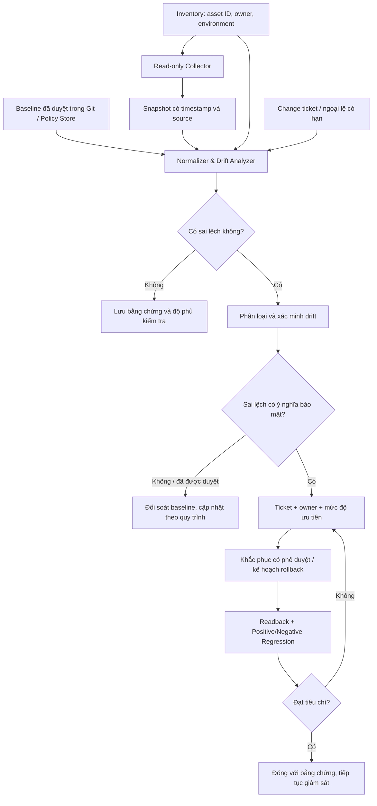

# Kiểm tra drift giữa cấu hình mong muốn và thực tế

## 1. Configuration drift là gì và vì sao nguy hiểm?

Trong quá trình **quản trị vận hành mạng an toàn**, đội kỹ thuật thường thiết lập một bộ cấu hình chuẩn cho router, switch, firewall, VPN gateway, thiết bị IDS/IPS, DNS resolver, hệ thống Wi-Fi và các tài nguyên mạng trên cloud. Nhưng sau nhiều lần bảo trì, xử lý sự cố, thay đổi chính sách, nâng cấp hoặc sửa khẩn cấp, trạng thái đang chạy có thể khác trạng thái đã được phê duyệt.

**Configuration drift** là sự sai khác giữa **cấu hình mong muốn (desired state)** và **cấu hình hoặc hành vi thực tế (actual/effective state)** tại một thời điểm. Drift không tự động đồng nghĩa có tấn công hay có lỗi: một thay đổi có thể được duyệt nhưng baseline chưa cập nhật; một thay đổi khác có thể do thao tác ngoài quy trình hoặc công cụ tự động gặp lỗi. Điều quan trọng là nhận diện và phân loại được sai khác để quyết định hành động.

Ví dụ:

- Chính sách quy định vô hiệu hóa Telnet, nhưng bản cấu hình đang chạy bật lại dịch vụ Telnet sau một đợt bảo trì.
- Firewall phải từ chối kết nối từ Guest VLAN đến mạng quản trị, nhưng xuất hiện rule tạm cho phép subnet quá rộng.
- VPN user thường chỉ được tới ứng dụng nội bộ, nhưng group mapping thực tế cấp thêm quyền tới subnet management.
- Thiết bị phải đẩy log đến collector tập trung, nhưng sau khi thay đổi địa chỉ log server, chế độ gửi log bị tắt.
- Cloud security group được quản lý bằng IaC nhưng một thay đổi trong console trực tiếp đã mở cổng quản trị ra vùng nguồn rộng hơn.
- DNS filtering chính sách yêu cầu bật, nhưng một nhánh hoặc nhóm endpoint đang dùng resolver ngoài danh sách cho phép.

Trong module `SECURITY_NETWORK_SECURITY`, kiểm tra drift là một cơ chế duy trì các lớp phòng vệ mạng — segmentation, firewall, VPN, IDS/IPS, DNS, mạng không dây và cloud — theo thiết kế, giúp phát hiện sớm những thay đổi làm suy giảm hiệu lực bảo vệ.

### Kết quả học tập

Sau bài này, người học có thể:

1. Phân biệt *desired state*, *observed state*, *effective state*, *configuration drift* và *security drift*.
2. Xây dựng baseline có nguồn gốc, phạm vi, phiên bản và chủ sở hữu rõ ràng.
3. Thu thập snapshot thực tế, chuẩn hóa dữ liệu và so sánh đúng những thuộc tính ảnh hưởng bảo mật.
4. Phân loại thay đổi được phê duyệt, sai lệch rủi ro cao, sai lệch chưa chắc chắn và ngoại lệ có thời hạn.
5. Thiết kế pipeline phát hiện, xử lý, kiểm thử hồi quy và theo dõi drift mà không gây gián đoạn dịch vụ.

## 2. Cấu hình mong muốn không chỉ là một file

Ba khái niệm cần tách biệt:

| Trạng thái | Ý nghĩa | Nguồn tham khảo |
| --- | --- | --- |
| **Desired state** | Cấu hình và yêu cầu đã được chủ sở hữu phê duyệt | Git/IaC, golden config, policy-as-code, baseline, ADR |
| **Observed state** | Những gì hệ thống thu thập được từ thiết bị hoặc API tại thời điểm đo | Running config, API response, inventory, snapshot, CLI read-only |
| **Effective state** | Hành vi thực sự có hiệu lực sau khi kết hợp nhiều lớp chính sách, rule, tuyến, NAT, định danh và trạng thái phiên | Effective policy/API, route, luồng thử nghiệm có phép, log sự kiện |

Ví dụ, file IaC mong muốn một rule firewall có action `deny`, nhưng rule cùng điều kiện ở thứ tự ưu tiên cao hơn lại `allow`. So sánh cấu hình ở mức có/không có dòng deny chưa đủ; cần xem **thứ tự rule và chính sách có hiệu lực**. Tương tự, security group của cloud và network ACL có thể cùng tác động đến lưu lượng; một lần kiểm tra chỉ một lớp chưa chứng minh hành vi cuối.

**Định nghĩa thực dụng:**

\[
\text{Drift}(t) = \operatorname{Compare}(\text{Desired}(t), \text{Actual}(t))
\]

`Compare` ở đây không nhất thiết là phép so sánh ký tự; nó là bộ quy tắc biết thuộc tính nào quan trọng, so với loại nguồn nào, và sai khác nào có ý nghĩa an ninh. Cần ghi rõ **thời điểm** vì desired và observed có thể thay đổi trong khi đang triển khai.

## 3. Các dạng drift cần theo dõi

| Dạng | Đặc điểm | Ví dụ | Tác động |
| --- | --- | --- | --- |
| **Configuration drift** | Giá trị hoặc cấu trúc cấu hình khác baseline | Bật Telnet, đổi SNMP user, đổi logging destination | Vi phạm chuẩn hardening |
| **Policy drift** | Quyền truy cập hoặc rule lệch yêu cầu | ACL mở thêm subnet, firewall any-to-any | Tăng đường truy cập trái phép |
| **Identity/access drift** | Vai trò và phạm vi quyền bị mở rộng hoặc không thu hồi | Operator vẫn có role admin, VPN group sai | Leo thang quyền, truy cập vượt nhu cầu |
| **Topology/routing drift** | Đường đi, zone, VRF hoặc NAT thay đổi | Route mới vô tình nối Guest với Management | Bypass phân đoạn |
| **Telemetry drift** | Mất event, log hoặc khả năng quan sát | IPS không xuất cảnh báo, Syslog forwarding tắt | Giảm phát hiện và điều tra |
| **Infrastructure drift** | Tài nguyên động ngoài ý muốn | Cloud SG mở rộng, workload mới chưa có policy | Phạm vi bảo vệ không đầy đủ |
| **Version/compliance drift** | Firmware hoặc cấu hình không còn đáp ứng chuẩn | Thiết bị chậm vá, bật TLS phiên bản cũ | Bất đồng bộ mức bảo vệ |
| **Runtime/effective drift** | Cấu hình trên giấy đúng nhưng kết quả thực tế khác | Route hoặc rule shadowing cho phép traffic bị cấm | Sai phạm vi bảo vệ dù file nhìn đúng |

Không phải mọi drift đều có tác động như nhau. Một interface description khác nội dung tài liệu có thể ít rủi ro hơn việc mở cổng quản trị ra Internet. Phân loại phải dựa trên **yêu cầu bảo mật bị ảnh hưởng và bằng chứng**, không chỉ số lượng dòng khác nhau.

## 4. Xác định nguồn chân lý và phạm vi kiểm tra

### 4.1. Một nguồn chân lý có chủ sở hữu

Trước khi chạy so sánh, xác định **source of truth** cho từng nhóm cấu hình:

| Nhóm kiểm soát | Nguồn mong muốn có thể phù hợp | Cần tránh |
| --- | --- | --- |
| Firewall/ACL | Repo policy-as-code, change ticket, object inventory | Dùng bản backup cũ làm baseline mà không biết đã duyệt chưa |
| Router/switch | Golden config theo vai trò thiết bị, intent về route/VRF/AAA | Áp dụng một template giống nhau cho mọi loại thiết bị |
| VPN/AAA | IdP group mapping, RBAC policy, đặc quyền đã duyệt | Chỉ so username, bỏ qua quyền thực sự được cấp |
| IDS/IPS | Detection policy, rule version và vị trí sensor đã thiết kế | Kiểm tra rule tồn tại nhưng không có traffic đi qua sensor |
| DNS | Danh sách resolver, filtering policy, vùng split DNS | Suy ra mọi IP resolver mới là vi phạm khi chưa xác minh |
| Wi-Fi/NAC | SSID role, authentication, segmentation, certificate policy | So template giữa site có yêu cầu nghiệp vụ khác nhau |
| Cloud | IaC, organization guardrails, inventory resource ID, policy binding | So theo IP tạm và bỏ qua account/region/tenant |

Baseline là dữ liệu **đã được xác nhận**, có version và lịch sử thay đổi. Một cấu hình hiện tại không trở thành chuẩn chỉ vì nó tồn tại lâu hoặc vì scanner quan sát thấy nó trong lần quét đầu.

### 4.2. Ranh giới kiểm tra và quyền thu thập

Mỗi job phải biết:

- **Asset scope:** thiết bị, nhóm thiết bị, tenant, account, project, VPC/VNet, zone hoặc cluster cụ thể.
- **Identity:** tài khoản chỉ đọc, API token tối thiểu quyền, bastion hoặc collector được phép.
- **Mục tiêu:** đọc cấu hình, đọc effective policy, kiểm tra log, hoặc probe hành vi trong phạm vi được duyệt.
- **Thời gian:** thời điểm snapshot, change window và lịch chạy kiểm tra.
- **Ràng buộc:** hệ thống nhạy cảm, rate limit, loại thông tin không được thu thập, đường OOB dự phòng.

Kiểm tra read-only thường ít rủi ro hơn thay đổi cấu hình nhưng vẫn có thể thu thập bí mật hoặc làm tăng tải trên thiết bị cũ. Chỉ lấy trường cần thiết, áp dụng kiểm soát truy cập và không lưu secret dạng rõ trong báo cáo hoặc ticket.

### 4.3. Mẫu metadata baseline

```yaml
baseline:
  id: "SEC-NET-HARDENING-2026-09"
  schema_version: 1
  revision: "git-commit-or-signed-release-id"
  approved_by: "network-security-control-owner"
  approved_at: "2026-11-28T09:00:00+07:00"
  scope:
    device_roles: ["edge-firewall", "campus-switch"]
    environments: ["staging"]
  policies:
    - "management-access"
    - "logging-and-time"
    - "segmentation"
  exceptions_reference: "approved-exceptions-register"
```

Đây là **mẫu dữ liệu minh họa**, không phải định dạng của một sản phẩm cụ thể. `revision`, `approved_by` và `scope` phải thực sự được đối chiếu với hệ thống phê duyệt; việc tự thêm chuỗi `approved` vào file không tạo quyền hay xác thực baseline.

## 5. Kiến trúc phát hiện drift



Hệ thống có thể triển khai bằng nhiều công cụ, nhưng luồng kiểm tra nên có những thành phần rõ:

1. **Collector:** kết nối từ mạng quản trị bằng quyền chỉ đọc, lấy đúng dữ liệu đã phê duyệt.
2. **Normalizer:** đưa các cấu hình từ nhiều phiên bản/nhà sản xuất về định dạng và ngữ nghĩa có thể so sánh.
3. **Comparator:** áp dụng quy tắc so sánh, phân biệt thay đổi về giá trị, thiếu trường, thêm rule và trạng thái không xác định.
4. **Exception matcher:** đối chiếu ngoại lệ đã phê duyệt có scope, owner, ngày hết hạn.
5. **Risk classifier:** ưu tiên theo tài sản, đường phơi lộ và điều kiện thực tế.
6. **Evidence store:** lưu fingerprint/snapshot phù hợp, revision, thời gian, test/log liên quan.
7. **Workflow:** thông báo đúng người, kiểm soát thay đổi và retest; không tự đánh dấu lỗi đã giải quyết.

Collector không thể kết nối hoặc không lấy đủ dữ liệu thì kết quả phải là **UNKNOWN/ERROR**, không tự kết luận hệ thống “compliant”.

## 6. Chuẩn hóa trước khi so sánh

So sánh chuỗi text nguyên văn dễ tạo nhiều cảnh báo giả do khác thứ tự, khoảng trắng hoặc trường tự sinh. Ngược lại, chuẩn hóa quá mạnh có thể che sai lệch nguy hiểm.

### 6.1. Các loại chuẩn hóa thường gặp

| Dữ liệu | Có thể chuẩn hóa | Phải giữ ý nghĩa |
| --- | --- | --- |
| IP/CIDR | Dạng địa chỉ canonical, phân biệt IPv4/IPv6 | Giữ đúng prefix; `192.0.2.0/24` khác `192.0.2.0/25` |
| Boolean/enum | Biểu diễn `true/false`, chuẩn hóa chữ hoa/thường khi được định nghĩa | `disabled` khác trạng thái missing/unknown |
| Danh sách nguồn IP | Sắp xếp nếu chính sách coi thứ tự không quan trọng | Không tự co/giãn prefix hoặc bỏ mục mới |
| Firewall ACL/rule | Chuẩn hóa trường tên/ID, nhóm dịch vụ | **Giữ nguyên thứ tự ưu tiên** khi rule có first-match |
| NTP/Syslog destinations | Chuẩn hóa cú pháp endpoint | Đích khác có thể làm mất telemetry |
| Cloud resources | Dùng resource ID, account, region, tag đã quản trị | Không trộn cùng IP nhưng khác tenant hoặc vòng đời |
| CLI config | Bỏ timestamp/banner sinh tự động khi đã xác nhận vô hại | Không bỏ interface, ACL, management hoặc AAA |
| Dữ liệu bí mật | So trạng thái cấu hình hoặc fingerprint được quản lý an toàn | Không xuất mật khẩu, private key, token ra file so sánh |

### 6.2. Quy tắc thiếu dữ liệu không có nghĩa là tắt

Ví dụ collector chỉ đọc được một phần CLI vì thiếu quyền, nhưng key `logging.remote_enabled` không xuất hiện. Không nên suy ra `false`. Cần phân biệt:

- **Key absent in complete snapshot:** có thể là một sai lệch hoặc cấu hình bị thiếu theo schema.
- **Collector failure / partial snapshot:** chưa thể kết luận, phải đánh dấu UNKNOWN.
- **Explicit false:** giá trị thực tế được xác nhận là tắt.

Mỗi snapshot nên ghi trạng thái thu thập `complete/partial/error`, schema version, asset ID, timestamp, nguồn dữ liệu và revision thiết bị nếu có. Bản dữ liệu partial không thể dùng như bằng chứng PASS.

### 6.3. So sánh cấu hình với kiểm thử hành vi

Một firewall rule có thể giống hệt baseline nhưng routing bị thay đổi khiến traffic đi qua thiết bị khác. Vì vậy, với **bất biến quan trọng** như Guest → Management phải bị từ chối, nên kết hợp:

1. So rule và cấu hình effective có thể truy vấn.
2. Kiểm tra routing/NAT, IPv4/IPv6 và trust zone liên quan.
3. Chạy kiểm thử positive/negative đã được phê duyệt tại nguồn đúng.
4. Đối chiếu firewall logs, cloud flow logs hoặc sensor evidence.

**Timeout đơn lẻ không phải bằng chứng chặn đúng chính sách**: service đích có thể down hoặc probe mất tuyến. Cần dùng bằng chứng rule/log và positive control phù hợp.

## 7. Ví dụ dữ liệu: desired và observed

Giả sử một firewall lab có định danh `fw-lab-01`. Bản mong muốn là file `desired.json` sau; địa chỉ thuộc các dải ví dụ dành cho tài liệu, không phải IP được phép kiểm tra thực tế.

```json
{
  "asset_id": "fw-lab-01",
  "schema_version": 1,
  "snapshot_complete": true,
  "policy": {
    "management": {
      "telnet_enabled": false,
      "ssh_sources": ["192.0.2.10/32"]
    },
    "logging": {
      "remote_enabled": true
    },
    "firewall": {
      "default_inbound": "deny"
    }
  }
}
```

Sau khi collector lấy snapshot thực tế và kiểm tra đầy đủ trường, file `observed.json` có nội dung:

```json
{
  "asset_id": "fw-lab-01",
  "schema_version": 1,
  "snapshot_complete": true,
  "policy": {
    "management": {
      "telnet_enabled": true,
      "ssh_sources": ["192.0.2.10/32", "192.0.2.0/24"]
    },
    "logging": {
      "remote_enabled": false
    },
    "firewall": {
      "default_inbound": "deny"
    }
  }
}
```

Có ba sai lệch đáng xem xét:

| Thuộc tính | Mong muốn | Thực tế | Rủi ro cần xác minh |
| --- | --- | --- | --- |
| `management.telnet_enabled` | `false` | `true` | Bật lại giao thức quản trị không mã hóa |
| `management.ssh_sources` | Chỉ nguồn `192.0.2.10/32` | Thêm `192.0.2.0/24` | Phạm vi nguồn SSH rộng hơn |
| `logging.remote_enabled` | `true` | `false` | Thiếu log gửi tập trung |
| `firewall.default_inbound` | `deny` | `deny` | Không drift ở trường này; vẫn cần xét rule cụ thể |

Kết luận từ dữ liệu chỉ là **mismatch đã xác nhận ở các trường trên**, chưa khẳng định có sự cố xâm nhập. Việc xác định mức độ ưu tiên và root cause cần xem owner, phạm vi, ticket, trạng thái thực thi và kiểm soát bù trừ.

## 8. Ví dụ Python so sánh snapshot ngoại tuyến

Đoạn chương trình dùng thư viện chuẩn Python để đọc hai file JSON của ví dụ trên. Chương trình **không kết nối thiết bị, không quét mạng và không tự sửa cấu hình**. Nó minh họa cách kiểm tra định danh, tính đầy đủ snapshot, rồi đối chiếu những trường đã được định nghĩa.

```python
import json
import sys
from pathlib import Path

DESIRED_FILE = Path("desired.json")
OBSERVED_FILE = Path("observed.json")

# Với trường này, thứ tự không ảnh hưởng ngữ nghĩa.
# Không áp dụng quy tắc đó cho ordered firewall rules.
ORDER_INSENSITIVE = {"management.ssh_sources"}

def load_snapshot(path):
    obj = json.loads(path.read_text(encoding="utf-8"))
    required = {"asset_id", "schema_version", "snapshot_complete", "policy"}
    if not isinstance(obj, dict) or not required.issubset(obj):
        raise ValueError(f"{path}: missing required metadata")
    if obj["snapshot_complete"] is not True:
        raise ValueError(f"{path}: snapshot is partial or incomplete")
    if not isinstance(obj["policy"], dict):
        raise ValueError(f"{path}: policy must be an object")
    return obj

def compare(expected, actual, path=""):
    issues = []
    if isinstance(expected, dict) and isinstance(actual, dict):
        for key in sorted(set(expected) | set(actual)):
            field = f"{path}.{key}" if path else key
            if key not in expected:
                issues.append(f"EXTRA {field}")
            elif key not in actual:
                issues.append(f"MISSING {field}")
            else:
                issues.extend(compare(expected[key], actual[key], field))
    elif isinstance(expected, list) and isinstance(actual, list):
        if path in ORDER_INSENSITIVE:
            if sorted(expected) != sorted(actual):
                issues.append(f"CHANGED {path}")
        elif expected != actual:
            issues.append(f"CHANGED {path} (ordered list)")
    elif type(expected) is not type(actual) or expected != actual:
        issues.append(f"CHANGED {path}")
    return issues

def main():
    desired = load_snapshot(DESIRED_FILE)
    observed = load_snapshot(OBSERVED_FILE)
    if desired["asset_id"] != observed["asset_id"]:
        raise ValueError("Asset IDs differ: comparison is unsafe")
    if desired["schema_version"] != observed["schema_version"]:
        raise ValueError("Schema versions differ: normalize before comparing")
    issues = compare(desired["policy"], observed["policy"])
    if issues:
        for issue in issues:
            print(issue)
        print(f"DRIFT: {len(issues)} differences")
        return 1
    print("PASS: no differences in modeled policy fields")
    return 0

if __name__ == "__main__":
    try:
        sys.exit(main())
    except (OSError, ValueError, json.JSONDecodeError) as exc:
        print(f"UNKNOWN/ERROR: {exc}", file=sys.stderr)
        sys.exit(2)
```

Với hai file mẫu, đầu ra dự kiến:

```text
CHANGED logging.remote_enabled
CHANGED management.ssh_sources
CHANGED management.telnet_enabled
DRIFT: 3 differences
```

Chương trình phân biệt:

- **Exit code 0:** không có sai lệch trong **những trường đã mô hình hóa**, không phải bằng chứng toàn bộ thiết bị an toàn.
- **Exit code 1:** có mismatch; cần phân loại theo mức độ bảo mật và phê duyệt.
- **Exit code 2:** dữ liệu không thể đánh giá đáng tin cậy; cần sửa collector/schema hoặc nguồn baseline.

Đây là ví dụ dạy nguyên tắc, chưa xử lý integrity/signature của snapshot, timestamp, secret redaction, exception registry, API timeout và tính đúng đắn của normalizer theo từng hãng. Trong môi trường thực tế, phải kiểm chứng dữ liệu đầu vào và không xuất giá trị bí mật vào log diff. Các danh sách như rule firewall có thứ tự cần dùng comparator hiểu semantics, tránh áp dụng `sorted` vô điều kiện.

## 9. Phân loại sai lệch trước khi khắc phục

Sau khi phát hiện drift, đừng tự động áp lại baseline cho tất cả thiết bị. Một thay đổi có thể đang phục vụ xử lý sự cố hợp lệ, một rule mới có thể cần cập nhật baseline, và một thiết bị production có thể mất kết nối nếu automation ghi đè cấu hình.

| Trường hợp | Tình huống | Hành động |
| --- | --- | --- |
| **Unauthorized drift** | Rule, quyền hoặc dịch vụ bị sửa ngoài quy trình được duyệt | Triage mức độ rủi ro, xác minh, mở ticket và xử lý theo ưu tiên |
| **Approved but unsynchronized** | Change đã được duyệt, device đã áp dụng nhưng Git baseline chưa cập nhật | Xác minh change, cập nhật baseline qua review và kiểm thử |
| **Expired exception** | Rule tạm còn tồn tại sau thời hạn | Thông báo owner, xác nhận tác động và thu hồi theo quy trình |
| **Environment-specific difference** | Site có topology/hardware đặc thù đã phê duyệt | Áp dụng baseline theo role/site, ghi điều kiện và owner |
| **Collector/normalizer error** | Snapshot bị thiếu trường, parse sai hoặc API timeout | Đánh dấu UNKNOWN, sửa hệ thống đo rồi thu thập lại |
| **Emergency change** | Cấu hình được sửa để khôi phục dịch vụ trong sự cố | Xác minh approval khẩn, xem xét lại sau sự cố, đồng bộ baseline hoặc rollback |
| **Potential compromise** | Nhiều cấu hình bảo mật cùng bị tắt, thay đổi không có owner hoặc dấu vết bất thường | Chuyển quy trình điều tra sự cố, bảo toàn bằng chứng và phối hợp SOC |

Để quyết định xử lý, cần biết **mismatch có thật không**, **thay đổi có được phép không**, **ảnh hưởng rủi ro gì**, và **cần kiểm thử kết quả bằng cách nào**.

### Ngoại lệ có hiệu lực phải cụ thể

Một exception được chấp nhận nên có:

```yaml
exception:
  id: "EXC-NET-042"
  asset_id: "fw-lab-01"
  field: "management.ssh_sources"
  allowed_deviation: "Temporary approved maintenance subnet"
  change_ticket: "CHG-LAB-042"
  owner: "network-operations"
  approved_by: "security-control-owner"
  valid_from: "2026-12-01T20:00:00+07:00"
  valid_until: "2026-12-01T21:00:00+07:00"
  compensating_controls:
    - "restricted-jump-host"
    - "session-audit"
```

Mẫu chỉ minh họa cấu trúc lưu trữ. Một exception không được tự cấp hiệu lực chỉ vì bản ghi có `approved_by`; job phải đối chiếu quyết định phê duyệt thật, thời gian, owner, phạm vi và nội dung chính xác. Một ngoại lệ rộng kiểu “bỏ qua mọi cấu hình firewall trong một tháng” có thể che mất các drift mới.

## 10. Ưu tiên xử lý drift theo rủi ro

Có thể xây thang ưu tiên dựa trên bốn nhóm yếu tố:

1. **Mức phơi lộ:** đường quản trị từ Internet/Guest, remote VPN, cloud public endpoint hay mạng lab cách ly.
2. **Tác động:** có mở quyền ghi cấu hình, làm mất phân đoạn, bỏ logging hoặc ảnh hưởng hệ thống trọng yếu không?
3. **Độ tin cậy:** drift được xác nhận bằng nhiều nguồn hay chỉ là lỗi parser?
4. **Khả năng lan rộng:** cùng template/sản phẩm/automation có thể làm thay đổi nhiều tài sản không?

Ví dụ:

| Ưu tiên | Kiểu drift | Phản ứng |
| --- | --- | --- |
| Khẩn cấp | Mở truy cập quản trị từ vùng không được phép; tắt một lớp bảo vệ quan trọng trên nhiều thiết bị | Xác minh nhanh, phối hợp owner/SOC, xử lý theo quy trình khẩn |
| Cao | Logging mất ở firewall biên; mở rộng VPN group; rule chặn dữ liệu nhạy cảm bị thay | Ticket ưu tiên, kiểm tra ảnh hưởng và retest |
| Trung bình | Sai khác cấu hình hardening có control bù trừ được xác minh | Kế hoạch sửa, hạn xử lý và theo dõi |
| Thấp | Mô tả interface hoặc trường metadata ít ảnh hưởng | Đối soát inventory, cập nhật khi phù hợp |

Không xác định mức nghiêm trọng chỉ từ số dòng diff: một dòng `permit any` có thể nguy hiểm hơn hàng trăm dòng thứ tự hiển thị khác nhau.

## 11. Quy trình xử lý drift an toàn

### Bước 1 — Xác minh thực tế

Thu thập lại khi cần, kiểm tra quyền đọc của collector, version thiết bị, chênh lệch thời gian và tính đầy đủ. Đối chiếu ticket, Git commit, nhật ký quản trị và người thực hiện. Nếu nghi ngờ can thiệp trái phép, hạn chế thao tác làm mất bằng chứng và chuyển sang quy trình ứng phó sự cố.

### Bước 2 — Xác định mục tiêu đúng

Xác minh baseline vẫn đáp ứng yêu cầu hiện tại. Nếu sai khác là thay đổi hợp lệ chưa đồng bộ, mở PR/đề xuất cập nhật baseline có review. Nếu thay đổi là ngoài quy trình hoặc sai chính sách, tạo kế hoạch đưa thực tế về trạng thái mong muốn.

### Bước 3 — Đánh giá tác động và chuẩn bị khôi phục

Xem điểm thực thi, đường đi, NAT, routing, phiên đang mở, failover và dependency. Có bản snapshot được bảo vệ, phương án rollback, cửa sổ thay đổi và liên hệ đội trực. Không tự ghi đè rule production trên diện rộng khi chưa biết tác động.

### Bước 4 — Sửa đổi có phê duyệt

Ưu tiên thay đổi qua phương thức cấu hình được quản lý, tài khoản ít quyền phù hợp, review và change ticket. Với thay đổi rủi ro cao, triển khai theo nhóm nhỏ/canary, quan sát rồi mới mở rộng.

### Bước 5 — Readback và kiểm thử hồi quy

Kiểm tra lại **cấu hình đang chạy**, quyền thực tế và luồng mạng:

- **Readback:** rule/setting đã thực sự được áp dụng và tồn tại sau commit/reload khi thích hợp?
- **Negative test:** kết nối trái chính sách bị từ chối đúng điểm thực thi?
- **Positive test:** dịch vụ hợp lệ và đường quản trị dự phòng vẫn hoạt động?
- **Telemetry test:** log, DNS filtering hoặc IDS/IPS event vẫn đến hệ thống giám sát?
- **Drift regression:** job đối chiếu nhận kết quả không còn sai lệch và lưu evidence.

### Bước 6 — Kết thúc và phòng tái diễn

Ghi root cause, cách phát hiện, thời gian xử lý, phiên bản mới, test results và owner. Nếu drift do thay đổi thủ công, bổ sung review/policy-as-code hoặc chặn quyền sửa ngoài luồng; nếu do template sai, sửa nguồn template và xác minh các thiết bị cùng nhóm. Không đóng finding khi mới sửa code nhưng chưa kiểm tra trạng thái triển khai.

## 12. Khi nào kiểm tra drift?

| Kích hoạt | Mục đích | Ghi chú |
| --- | --- | --- |
| **Sau mỗi change** | Phát hiện khác biệt phát sinh tức thời | Gắn change ID, baseline revision và thiết bị đã triển khai |
| **Theo lịch định kỳ** | Phát hiện cấu hình thủ công hoặc drift chậm | Phân kỳ theo mức quan trọng của tài sản và năng lực thu thập |
| **Sau nâng cấp/khởi động lại** | Xác minh cấu hình vẫn giữ nguyên hiệu lực | Một số nền tảng có running/startup khác nhau |
| **Sau incident/khôi phục** | Đối soát thay đổi khẩn cấp, cấu hình tạm | Lưu bằng chứng, cập nhật baseline hoặc thu hồi exception |
| **Khi onboarding tài sản** | Kiểm chứng baseline trước khi đưa vào production | Xác định đúng role, zone và nhóm quản trị |
| **Trước kỳ audit** | Có bằng chứng liên tục và exception còn hiệu lực | Audit không thay cho monitoring thường xuyên |
| **Khi phát hiện anomalous telemetry** | Xác minh vì sao hành vi mạng đổi bất thường | So log, rule, IAM, route và cloud policy |

Một lịch kiểm tra quá thưa khiến drift tồn tại lâu; lịch quá dày có thể gây tải và tiếng ồn. Cân nhắc độ nhạy của tài sản, chi phí API, thời gian thay đổi và đặc tính hệ thống. Có thể dùng event-driven checking kết hợp kiểm tra định kỳ để phát hiện cả thay đổi không sinh event hợp lệ.

### Tránh xung đột với quá trình triển khai hợp lệ

Trong một change window, desired state có thể đã thay nhưng thiết bị chưa áp dụng hết; snapshot giữa chừng tạo mismatch tạm thời. Cần:

- Gắn version cấu hình và deployment ID cho snapshot.
- Có trạng thái rollout: pending, applying, verified, failed.
- Giới hạn grace period đã định trước cho một thay đổi được phê duyệt.
- Chỉ áp ngoại lệ với đúng tài sản, trường và thời gian.
- Không tắt drift detection toàn bộ hệ thống để giảm cảnh báo trong giờ triển khai.

**Grace period không phải giấy phép bỏ qua drift rủi ro cao**. Hành vi mở quản trị ra ngoài phạm vi được duyệt vẫn phải được cảnh báo kể cả trong cửa sổ thay đổi.

## 13. Drift theo từng lớp phòng vệ mạng

### 13.1. Segmentation, route và firewall

Kiểm tra VLAN/VRF assignment, route, ACL, effective rule order, object groups, NAT, policy mặc định và quyền từ các vùng ít tin cậy. Với firewall stateful, xác định hướng khởi tạo kết nối và xử lý luồng trả về. Không chỉ kiểm tra rule có tồn tại mà cần xét rule có bị shadowing, device policy khác hoặc IPv6 rule bỏ sót không.

**Bất biến ví dụ:** Guest → Management bị từ chối; Bastion → Management theo cổng được phê duyệt vẫn được phép. Cần test cả hai phía nếu môi trường cho phép.

### 13.2. VPN, AAA và đường quản trị

So role/group mappings, split tunnel, certificate trust, phương thức xác thực, account privilege, allowed management sources, SSH/HTTPS settings và tài khoản local dự phòng. Quyền đã thu hồi ở IdP có thể vẫn tồn tại trong session/token cache, nên kết quả cấu hình cần được kết hợp kiểm tra quyền phiên thực tế theo điều kiện phù hợp.

### 13.3. IDS/IPS và giám sát

Kiểm tra policy/rule version, sensor mode (detect/block), vị trí nhận traffic, log destination, sự kiện bị bỏ qua, độ trễ ingest và correlation tại SOC. Bật rule trong cấu hình chưa chứng minh khả năng phát hiện nếu sensor không thấy traffic hoặc collector lỗi.

### 13.4. DNS và mạng không dây

Với DNS, kiểm tra resolver được chỉ định, filtering policy, danh sách ngoại lệ, logging, phương thức sử dụng resolver khác theo chính sách. Với Wi-Fi, kiểm tra mapping SSID/VLAN, WPA policy, RADIUS/NAC, guest isolation và quản lý chứng chỉ. Phải xét sự khác nhau hợp lệ theo site hoặc loại thiết bị.

### 13.5. Cloud và workload động

So IaC với security group, route table, cloud firewall, endpoint policy, network ACL, Kubernetes NetworkPolicy và resource bindings. Dùng resource ID, account/project, region và owner để tránh nhầm IP tái sử dụng. Một workload mới xuất hiện không có trong inventory nên được **đưa vào trạng thái chưa xác minh**, không tự động công nhận là compliant.

## 14. Chống drift bằng quản lý cấu hình và Policy-as-Code

Phát hiện drift là cần thiết nhưng xử lý nguyên nhân gốc sẽ bền vững hơn:

- **Git là nơi quản lý thay đổi:** PR có review, kiểm tra syntax, khác biệt policy và bằng chứng phê duyệt.
- **Golden templates theo vai trò:** khác biệt giữa router core, access switch và firewall được mô tả rõ, tránh áp chung một baseline.
- **Tự động hóa idempotent:** chạy lại cấu hình không làm phát sinh thay đổi mới ngoài ý muốn.
- **Quyền tối thiểu:** không cấp quyền chỉnh sửa trực tiếp rộng rãi khi có hệ thống thay đổi được quản lý; bảo đảm đường break-glass được kiểm toán.
- **Pre-deploy gate:** cảnh báo quyền mở rộng như `0.0.0.0/0` tới management, hoặc tắt tính năng bảo vệ quan trọng.
- **Post-deploy verification:** thu snapshot và so thực tế; không kết luận “đã triển khai” chỉ dựa vào job báo success.
- **Drift-to-PR:** khi có thay đổi được duyệt nhưng chưa đồng bộ, đề xuất patch để review thay vì âm thầm cập nhật baseline.
- **Exceptions as code:** ngoại lệ có owner, chính sách hạn dùng, khung thời gian và cách nhắc hết hạn.

Không nên để hệ thống auto-remediation vận hành vô điều kiện trên mọi tài sản. Với thay đổi nhạy cảm, chọn chế độ **detect → propose → approve → apply → verify**; chỉ tự sửa những trường hợp có rủi ro thao tác thấp, đã được cấp phép và có rollback được kiểm tra.

## 15. Phân biệt trạng thái PASS/DRIFT/UNKNOWN/ERROR

Trong báo cáo, nên tách các trạng thái kiểm tra để người vận hành không hiểu nhầm:

| Trạng thái | Khi nào dùng | Tiếp theo |
| --- | --- | --- |
| **PASS** | Snapshot đầy đủ, đúng asset/schema, các trường được kiểm soát khớp baseline hợp lệ | Lưu bằng chứng, tiếp tục kiểm tra định kỳ |
| **DRIFT** | Có khác biệt được đối chiếu đáng tin cậy | Phân loại phê duyệt/rủi ro, mở ticket và khắc phục |
| **UNKNOWN** | Thiếu dữ liệu hoặc không đủ căn cứ để xác định mức độ phù hợp | Kiểm tra collector, scope, effective policy |
| **ERROR** | Lỗi API, xác thực, parser, nguồn dữ liệu hoặc pipeline | Sửa hệ thống kiểm tra, báo ảnh hưởng độ phủ |
| **EXCEPTED** | Sai lệch được chấp nhận có điều kiện, còn hạn và đúng scope | Theo dõi, xem xét lại khi hết hạn |

**EXCEPTED không có nghĩa PASSED.** Trên dashboard, nên hiển thị số tài sản đang có ngoại lệ riêng để tránh tỷ lệ compliant bị hiểu sai.

### Ví dụ báo cáo drift

```text
RUN_ID: DRIFT-2026-11-28-09
BASELINE: SEC-NET-HARDENING-2026-09
BASELINE_REVISION: approved-git-commit
ASSET: fw-lab-01 (staging)
COLLECTOR: complete/read-only
RESULT: DRIFT
DIFFERENCES:
  - management.telnet_enabled: security-critical
  - management.ssh_sources: high-priority
  - logging.remote_enabled: high-priority
CHANGE_CORRELATION: pending owner verification
NEXT_ACTION: review approved changes, open remediation, retest
```

Những thông tin trên là ví dụ giả định. Bản ghi thực cần có metadata kiểm tra tính toàn vẹn, nguồn, thời điểm và quyền truy cập thích hợp; không ghi secret vào event chung.

## 16. Chỉ số quản trị drift

Nên theo dõi cả chất lượng kiểm tra và hiệu quả xử lý:

| Chỉ số | Ý nghĩa | Điểm cần lưu ý |
| --- | --- | --- |
| **Coverage** | Tỷ lệ tài sản trong phạm vi có snapshot hợp lệ | Không tính lỗi collector là PASS |
| **Drift rate** | Tỷ lệ tài sản có sai lệch cần xử lý | Phân nhóm theo mức rủi ro và môi trường |
| **Mean time to detect** | Thời gian từ khi drift thực sự phát sinh tới lúc phát hiện | Cần timestamp thay đổi đáng tin cậy |
| **Mean time to remediate** | Thời gian từ xác nhận đến khi nghiệm thu khắc phục | Không dùng thời điểm merge PR làm điểm kết thúc |
| **Exception debt** | Số lượng ngoại lệ đang tồn tại và đã hết hạn | Xem xét theo owner, scope và rủi ro |
| **Repeat drift** | Drift cùng nguyên nhân xuất hiện lại | Gợi ý lỗi template, quyền sửa hoặc thiếu regression |
| **False positive/UNKNOWN rate** | Mức nhiễu và chất lượng collector | Tránh tối ưu bằng cách bỏ qua drift thật |
| **Regression coverage** | Tỷ lệ control quan trọng có phép thử hành vi | So config không thể thay thế hành vi thực tế |

Ví dụ tính coverage:

\[
\operatorname{Coverage} =
\frac{\text{Số tài sản có snapshot đầy đủ, hợp lệ}}{\text{Tổng tài sản thuộc phạm vi kiểm tra}}
\times 100\%
\]

Nếu có 100 thiết bị trong phạm vi nhưng chỉ 86 thiết bị được thu thập đầy đủ, coverage là 86%. Không thể gọi 14 thiết bị còn lại là compliant chỉ vì không quan sát thấy drift.

Một dashboard giá trị nên kết hợp danh sách tài sản rủi ro cao, sai lệch theo trường, nguyên nhân và trạng thái xử lý. **Số lượng dòng diff không phản ánh trực tiếp mức độ an toàn.**

## 17. Các lỗi thường gặp khi triển khai drift detection

| Sai lầm | Hệ quả | Cách cải thiện |
| --- | --- | --- |
| Lấy running config ban đầu làm chuẩn mặc định | Hợp thức hóa sai cấu hình cũ | Dùng baseline đã được review và phê duyệt |
| Chỉ so text từng dòng | Nhiễu từ thứ tự, comment hoặc thông số tự sinh | Normalizer hiểu cấu trúc và ngữ nghĩa |
| Bỏ qua effective policy | Không phát hiện route khác hoặc rule shadowing | Kết hợp kiểm tra hành vi và log |
| Coi missing/timeout là giá trị `false` | Báo sai compliance | Phân biệt complete, partial, error |
| So danh sách ACL như tập vô thứ tự | Che sai lệch thứ tự rule quan trọng | Bảo toàn priority/order khi policy có first-match |
| Tự cập nhật desired theo observed | Tự chuẩn hóa cấu hình xấu | Review PR và xác thực change |
| Auto-revert mọi thay đổi | Có thể xóa rule khẩn, làm đứt dịch vụ | Phân loại drift, có change/rollback và owner |
| Không xem ngày hết hạn exception | Ngoại lệ tạm kéo dài vô hạn | Scope chính xác, TTL, giám sát và thu hồi |
| Chỉ kiểm tra IPv4 | Bỏ đường truy cập IPv6 | Có chính sách và kiểm tra cả hai stack |
| Collector có quyền admin rộng | Tăng rủi ro khi tài khoản bị lộ | Dùng read-only role, vault và logging truy cập |
| Log diff chứa credential | Làm lộ bí mật khi lưu ticket/SIEM | Redact, fingerprint và phân quyền bản ghi |
| Chạy quét dày gây tải lên thiết bị cũ | Ảnh hưởng độ sẵn sàng | Giới hạn tần suất, scope, thời gian và rate |
| Đóng ticket khi cấu hình đã được đẩy | Không biết effective state đã đổi | Readback và kiểm thử hồi quy rồi mới nghiệm thu |

## 18. Bài thực hành thiết kế quy trình kiểm tra drift

**Bối cảnh:** doanh nghiệp có 20 switch access, 4 firewall, 2 VPN gateways và một VPC cloud. Cấu hình được quản lý trong Git, nhưng một số thay đổi khẩn được thực hiện trực tiếp trên thiết bị. Sau một sự cố, đội bảo mật phát hiện firewall biên có thêm rule tạm cho phép một subnet mới vào management zone; log của một VPN gateway không còn được chuyển tới collector.

Hãy thực hiện các nhiệm vụ:

1. Chọn nguồn baseline có thẩm quyền cho từng nhóm: firewall rule, VPN logging, AAA access và cloud security group.
2. Xác định những trường cần thu thập vào snapshot, metadata bắt buộc và cách giới hạn quyền collector.
3. Nêu cách chuẩn hóa IP/CIDR, rule order, account/region và các giá trị tự sinh.
4. Phân loại rule tạm: chưa có ticket, có ticket còn hiệu lực, hoặc ngoại lệ đã hết hạn. Nêu kết quả xử lý tương ứng.
5. Viết acceptance test gồm một luồng quản trị bị cấm và một luồng hợp lệ, cộng với một test bảo đảm log VPN đến collector.
6. Đề xuất pipeline sau change, định kỳ, sau emergency recovery; nêu cách kết luận UNKNOWN khi collector không lấy được dữ liệu.
7. Định nghĩa hai chỉ số để đánh giá hiệu quả sau khi đưa hệ thống vào vận hành.

**Gợi ý:** bài làm tốt không chỉ tạo diff tự động; còn phân biệt sai lệch được phê duyệt, kiểm tra hiệu lực thật, giữ luồng nghiệp vụ hợp lệ và có người chịu trách nhiệm đóng vấn đề.

## 19. Câu hỏi tự kiểm tra

**Câu 1.** Một firewall có rule deny đúng như file IaC nhưng Guest vẫn kết nối được vào management subnet. Có thể coi là “không drift” không?

*Gợi ý:* Chỉ có thể nói không thấy khác biệt ở dòng rule được so. Cần xem effective policy, rule order, route/NAT, IPv4/IPv6 và kiểm tra luồng thực tế theo phạm vi đã duyệt.

**Câu 2.** Vì sao không được tự thay baseline bằng running config khi xuất hiện drift?

*Gợi ý:* Vì thay đổi chưa được phê duyệt hoặc nguy hiểm có thể bị hợp thức hóa. Cần xác minh ticket, yêu cầu bảo mật và review độc lập.

**Câu 3.** Collector trả về thiếu trường `logging.remote_enabled` do lỗi API. Phải gắn trạng thái nào?

*Gợi ý:* UNKNOWN/ERROR, tùy nguyên nhân thu thập; không suy ra đang tắt và không đánh dấu PASS.

**Câu 4.** Một rule exception còn đúng scope nhưng đã hết hạn. Đó có phải vẫn là sai lệch được chấp nhận?

*Gợi ý:* Không. Phải xác minh tình trạng và xử lý theo quy trình; không dùng ngoại lệ đã hết hạn để ẩn drift.

**Câu 5.** Tại sao sắp xếp mọi danh sách trước khi so sánh có thể gây lỗi?

*Gợi ý:* Danh sách nguồn IP có thể không phụ thuộc thứ tự, nhưng firewall ACL kiểu first-match lại phụ thuộc thứ tự. Cần comparator hiểu semantics.

**Câu 6.** Sau khi script tự động báo “applied successfully”, đội vận hành có thể đóng ticket drift không?

*Gợi ý:* Chưa. Cần readback cấu hình thực tế, kiểm tra control bằng positive/negative tests khi có phép và đối chiếu log.

## 20. Checklist trước khi đưa drift detection vào production

- [ ] Baseline có chủ sở hữu, approval, version, scope và lịch review.
- [ ] Inventory xác định đúng tài sản, môi trường, role và cloud account.
- [ ] Collector có quyền tối thiểu, giới hạn tải và bảo vệ dữ liệu nhạy cảm.
- [ ] Snapshot có asset ID, thời gian, schema version, trạng thái complete/error.
- [ ] Normalizer hiểu những trường quan trọng và giữ thứ tự rule khi cần.
- [ ] Các điều kiện exception có owner, thay đổi được duyệt và ngày hết hạn.
- [ ] Dashboard phân biệt PASS, DRIFT, UNKNOWN, ERROR và EXCEPTED.
- [ ] Drift nghiêm trọng được ưu tiên theo phơi lộ, tác động và mức chắc chắn.
- [ ] Có workflow điều tra, owner, thay đổi có phê duyệt và rollback.
- [ ] Có readback, positive/negative regression và telemetry verification.
- [ ] Có kiểm tra sau deploy, theo lịch, sau reboot/incident và khi onboarding.
- [ ] Có số đo coverage, time-to-remediate và recurring drift.

## Kết luận

**Kiểm tra drift giữa cấu hình mong muốn và thực tế** là công việc liên tục nhằm bảo đảm các lớp phòng vệ mạng vẫn tuân thủ ý định kiến trúc trong suốt vòng đời vận hành. Baseline phải có nguồn phê duyệt đáng tin cậy, snapshot phải đầy đủ và an toàn, phép so sánh phải hiểu ngữ nghĩa của chính sách, còn sai lệch phải được phân loại theo rủi ro và lịch sử thay đổi. Giá trị lớn nhất không chỉ là phát hiện cấu hình khác nhau, mà là **xác minh được hành vi bảo mật sau khắc phục, giữ luồng hợp lệ hoạt động và ngăn drift tái xuất hiện bằng quản lý thay đổi và kiểm thử hồi quy**.
