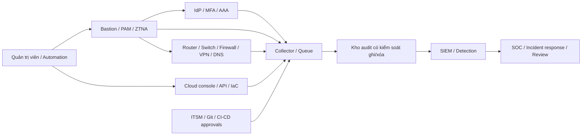
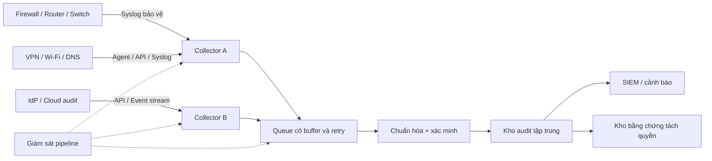

# Audit trail cho thao tác quản trị

## 1. Audit trail là gì và vì sao cần trong vận hành mạng an toàn?

Một quản trị viên đăng nhập firewall lúc 08:05, thay đổi chính sách từ chối truy cập lúc 08:08 và đăng xuất lúc 08:12. Chiều cùng ngày, ứng dụng báo có thể kết nối vào một subnet vốn bị cô lập. Nếu chỉ có bản cấu hình hiện tại, đội vận hành có thể nhận ra quy tắc thay đổi nhưng chưa trả lời chính xác được **ai thực hiện, vào lúc nào, từ đâu, dùng quyền gì, thay đổi gì, qua đường quản trị nào, có được phê duyệt không và kết quả ra sao**.

**Audit trail** là chuỗi bằng chứng có thời gian và ngữ cảnh liên kết, cho phép dựng lại những thao tác có ý nghĩa đối với hệ thống. Trong lĩnh vực bảo mật mạng, audit trail thường kết hợp nhật ký danh tính, phiên truy cập, lệnh hoặc thao tác API, thay đổi cấu hình, kết quả áp dụng chính sách, và dấu vết phê duyệt ở hệ thống quản trị thay đổi.

Bài học thuộc chương **Quản trị vận hành mạng an toàn** của module **SECURITY_NETWORK_SECURITY**. Phạm vi bao gồm các thiết bị firewall, router, switch, VPN/ZTNA, IDS/IPS, DNS, Wi-Fi, controller, hệ thống quản trị tập trung và tài nguyên mạng đám mây. Audit trail liên kết trực tiếp tới phân đoạn mạng, xác thực kết nối, phân tích lưu lượng, phát hiện xâm nhập và kiến trúc vận hành an toàn.

**Mục tiêu học tập:**

1. Phân biệt audit trail với syslog, bản sao cấu hình, flow log và cảnh báo SOC.
2. Xác định sự kiện bắt buộc đối với đăng nhập, phân quyền, thay đổi cấu hình, chính sách và thao tác khẩn cấp.
3. Thiết kế đường thu log tập trung có bảo vệ tính toàn vẹn, thời gian, tính sẵn sàng và quyền riêng tư.
4. Liên kết AAA, MFA, bastion, session, change ticket và config diff thành một chuỗi điều tra.
5. Kiểm chứng khả năng truy vết bằng bài diễn tập thay đổi có phê duyệt, thao tác bị từ chối và khôi phục.
6. Đánh giá chất lượng log, khoảng trống dữ liệu, việc chống sửa/xóa và quy trình rà soát.

## 2. Phân biệt audit trail, event log và các dạng bằng chứng

| Loại dữ liệu | Trả lời tốt câu hỏi nào? | Giới hạn quan trọng |
| --- | --- | --- |
| **Authentication log** | Tài khoản nào đăng nhập, thành công hay thất bại, từ nguồn nào? | Chưa biết người dùng đã làm gì sau đăng nhập |
| **Authorization log** | Quyền nào được cấp/từ chối, policy nào áp dụng? | Không nhất thiết chứng minh thao tác đã chạy |
| **Accounting/command log** | Lệnh/API nào được yêu cầu, trên thiết bị nào, vào thời điểm nào? | Không phải hệ thống nào cũng ghi mọi lệnh hoặc toàn bộ kết quả |
| **Configuration audit/config diff** | Thành phần cấu hình nào đã đổi từ phiên bản A sang B? | Diff không tự chứng minh ai thay đổi nếu thiếu phiên/danh tính |
| **Syslog thiết bị** | Thiết bị báo sự kiện gì trong hoạt động thường ngày? | Có thể thiếu ID người thao tác, mất gói hoặc không lưu lâu |
| **NetFlow/IPFIX/flow log** | Kết nối nào đi qua zone, giao thức, port, action? | Phản ánh lưu lượng, không trực tiếp nêu người sửa chính sách |
| **SIEM alert** | Quy tắc giám sát đã coi chuỗi sự kiện nào là đáng chú ý? | Alert là kết luận xử lý; cần giữ nguồn log gốc để kiểm tra |
| **Ticket/approval** | Ai yêu cầu và phê duyệt thay đổi nào, với phạm vi và thời hạn gì? | Ticket đã duyệt chưa chứng minh cấu hình được áp dụng đúng |
| **Session recording** | Trong phiên quản trị đã có những thao tác gì, nếu công cụ hỗ trợ? | Có thể chứa dữ liệu bí mật và có điểm mù như kênh API khác |

Một audit trail tốt không phải là “bật mọi loại log”; nó là **tập bằng chứng tối thiểu có thể liên kết**, có đủ độ tin cậy để trả lời câu hỏi điều tra. Ví dụ, ticket yêu cầu mở TCP/443 từ APP tới API đích, còn config diff cho thấy rule `ANY → DATA ANY` đã được thêm. Cần nối hai dữ liệu đó với account, thời điểm, session và thiết bị để chỉ ra độ lệch so với phê duyệt.

### 2.1 Audit trail và khả năng quy trách nhiệm

Audit trail hỗ trợ **accountability** (quy trách nhiệm theo danh tính hoặc vai trò) và điều tra, nhưng một username trong log **chưa chứng minh tuyệt đối** cá nhân sở hữu tài khoản đã thực hiện thao tác. Tài khoản chia sẻ, bị đánh cắp, token automation hoặc thiết bị giám sát thời gian sai đều có thể làm suy yếu kết luận. Cần kết hợp xác thực mạnh, danh tính cá nhân, MFA, bảo vệ phiên, log độc lập và kiểm soát khóa để tăng mức độ tin cậy.

## 3. Đặt ranh giới tin cậy cho đường quản trị

Các thành phần của một hệ thống kiểm toán thao tác quản trị thường gồm nguồn sự kiện, hệ thống xác thực và thu thập, tuyến vận chuyển bảo vệ, bộ xử lý/chuẩn hóa và nơi lưu trữ độc lập.



Điểm quyết định là **bằng chứng được đưa ra khỏi thiết bị do người quản trị đang điều khiển**. Nếu log chỉ tồn tại trong bộ nhớ hoặc ổ đĩa của firewall, một tài khoản đặc quyền có thể sửa cấu hình và xóa bằng chứng cục bộ. Gửi sự kiện đến collector độc lập giúp giảm rủi ro đó, nhưng vẫn phải bảo vệ chính collector và kho lưu trữ.

Các đường quản trị cần cân nhắc:

- **CLI qua SSH:** đăng nhập, quyền nâng cấp, lệnh cấu hình, commit/save, logout và thay đổi phiên.
- **Web GUI:** identity, session, thao tác trên object/rule, request ID, kết quả lưu và commit/publish.
- **API/automation:** service principal, API key/role, request ID, hành động, phạm vi tài nguyên, phiên bản mã và pipeline.
- **Console/OOB:** cổng console vật lý, BMC, thiết bị quản trị ngoài băng, phiên khẩn cấp.
- **Quản trị gián tiếp:** controller mạng không dây, công cụ tập trung, SD-WAN orchestrator, DNS controller, Kubernetes, cloud network API.

Nếu chỉ thu SSH login, hành động cập nhật rule qua API sẽ trở thành **điểm mù kiểm toán**.

## 4. Sự kiện tối thiểu phải ghi nhận

Không phải thiết bị nào cũng hỗ trợ cùng một trường. Cần xây dựng bảng ánh xạ **nguồn log → sự kiện → thuộc tính sẵn có → khoảng trống → kiểm soát bổ sung**.

| Nhóm sự kiện | Ví dụ cần ghi | Mục đích điều tra |
| --- | --- | --- |
| Đăng nhập | Login success/failure, SSO, MFA, session created | Ai bắt đầu truy cập và từ địa chỉ nào |
| Thay đổi quyền | Role assignment, privilege escalation, sudo/enable, API scope | Vì sao người đó có thể thao tác |
| Cấu hình | Tạo/sửa/xóa rule firewall, route, ACL, VPN profile, DNS zone | Chính xác policy nào đã thay đổi |
| Áp dụng cấu hình | Commit, publish, reload, sync HA, rollback | Thay đổi có được kích hoạt trong data plane không |
| Quản lý tài khoản | Tạo account, reset MFA, cấp khóa API, vô hiệu tài khoản | Thay đổi miền tin cậy và đường quản trị |
| Thao tác trên log | Đổi logging level, tắt syslog, xóa log, chỉnh retention | Phát hiện nỗ lực giảm khả năng quan sát |
| Chứng chỉ/khóa | Import/xoay vòng/thu hồi CA, TLS certificate, SSH key | Bảo vệ danh tính thiết bị và đường quản trị |
| Cập nhật hệ thống | Firmware/software update, restart, restore backup | Gắn sự cố vận hành với thay đổi |
| Truy cập khẩn cấp | Break-glass, console/OOB, override policy | Rà soát truy cập đặc biệt và biện pháp hậu kiểm |
| Thất bại kiểm soát | Denied command, RBAC reject, config validation failed | Phát hiện thử quyền hoặc cấu hình sai |
| Độ tin cậy log | Clock sync lost, log export failure, collector unavailable | Xác định khoảng mù có thể làm sai timeline |

**Lưu cả kết quả thành công và thất bại** khi hệ thống có hỗ trợ. Một yêu cầu API thay đổi firewall bị từ chối vẫn có giá trị vì cho thấy hành vi đã được thử; ngược lại event `request_accepted` có thể chỉ là nhận tác vụ, chưa chứng minh `policy_applied`.

### 4.1 Event schema chuẩn hóa

Một schema minh họa cho hệ thống trung tâm:

```json
{
  "event_time_utc": "2026-11-28T07:25:03.421Z",
  "received_time_utc": "2026-11-28T07:25:04.012Z",
  "event_id": "aud-net-001204",
  "event_type": "network.policy.update",
  "action": "firewall.rule.modify",
  "outcome": "success",
  "actor": {
    "id": "usr-operator-42",
    "type": "human",
    "role": "network-admin",
    "auth_method": "sso+mfa"
  },
  "session_id": "pam-session-811",
  "request_id": "api-req-7342",
  "source_ip": "192.0.2.45",
  "device_id": "fw-edge-01",
  "target": "policy-rule/FW-APP-DATA-042",
  "change_id": "CHG-2026-042",
  "config_revision_before": "rev-118",
  "config_revision_after": "rev-119",
  "source_system": "firewall-controller",
  "collector_id": "audit-col-02",
  "log_integrity_status": "validated_on_ingest"
}
```

Đây là **ví dụ giả lập**, không phải schema mặc định của bất kỳ hãng nào. `192.0.2.0/24` là dải địa chỉ IPv4 dành cho tài liệu. `log_integrity_status` chỉ được đặt là `validated_on_ingest` khi có kiểm tra thực tế; không được tự thêm nhãn “verified” vào dữ liệu chưa được xác minh.

Ý nghĩa những trường quan trọng:

- **event_time_utc:** thời điểm nguồn cho rằng sự kiện xảy ra; có thể sai khi đồng hồ lệch.
- **received_time_utc:** thời điểm collector nhận bản ghi; hỗ trợ phát hiện log đến trễ hoặc bất thường về thời gian.
- **actor.id và actor.type:** phân biệt người thật, service principal, tài khoản automation và break-glass.
- **session_id/request_id:** chìa khóa tương quan khi đi qua bastion, API gateway hoặc controller; không mặc định duy nhất trên mọi hệ thống.
- **target/change_id/revisions:** xác định tác động, phê duyệt và thay đổi cấu hình trước/sau.
- **source_system/collector_id:** nhận diện xuất xứ và đường thu log; cần giữ bản ghi nguồn để điều tra kỹ hơn.

Nếu thiết bị không có `session_id`, có thể đối chiếu actor, thời gian, IP quản trị và event sequence nhưng phải ghi mức không chắc chắn. Không tự tạo ID rồi tuyên bố đã có liên kết đáng tin giữa các event vốn độc lập.

## 5. AAA: Authentication, Authorization, Accounting

### 5.1 Chức năng của AAA

**AAA** là mô hình quản trị truy cập gồm:

1. **Authentication:** xác định tài khoản/thiết bị có danh tính hợp lệ, qua SSH, SSO, MFA, certificate hoặc một phương thức phù hợp.
2. **Authorization:** xác định tài khoản được thực hiện tác vụ nào trên thiết bị hoặc nhóm tài nguyên nào.
3. **Accounting:** ghi nhận việc sử dụng phiên/dịch vụ và, khi thiết bị/hệ thống hỗ trợ, lệnh hoặc tác vụ đã thực hiện.

Trong thiết bị mạng truyền thống, **TACACS+** thường được dùng để tách xác thực, phân quyền và accounting cho quản trị CLI; **RADIUS** thường gặp trong xác thực truy cập mạng, VPN, 802.1X và một số nhu cầu thiết bị. Tuy nhiên, khả năng **command authorization/accounting** khác nhau giữa giao thức, thiết bị, firmware và nhà cung cấp. Không nên giả định mọi dịch vụ RADIUS hoặc TACACS+ đều lưu được mọi câu lệnh.

Hạ tầng cloud thường cung cấp log **IAM/API activity** thay cho command accounting theo kiểu CLI truyền thống. Khi IaC triển khai một thay đổi, cần liên kết tài khoản chạy pipeline, lần build, commit và log API với ticket đã duyệt.

### 5.2 Mẫu nguyên tắc cấu hình AAA

```yaml
management_access_policy:
  primary_authentication:
    provider: central_identity
    mfa: required_for_human_admins
  authorization:
    roles:
      viewer: [read_config, view_status]
      operator: [read_config, apply_preapproved_change]
      security_admin: [review_security_policy, approve_privileged_access]
  accounting:
    collect:
      - login_result
      - privilege_change
      - configuration_transaction
      - command_or_api_action_when_supported
      - session_end
    destination: central_audit_collector
  emergency_access:
    separate_identity: true
    alert_on_use: true
    post_use_review: required
```

Đây là **mẫu chính sách lý tưởng**, không phải cấu hình dùng trực tiếp cho router/switch. Muốn triển khai phải đối chiếu RBAC, AAA server, dòng log thực tế, HA và khả năng vận hành khi mất kết nối máy chủ định danh.

### 5.3 Các giới hạn khi chỉ dựa vào AAA

Một giao diện thiết bị có thể xác thực bằng TACACS+ nhưng không gửi log lệnh cấu hình; thiết bị chỉ gửi session start/stop; một batch script có thể mở một phiên và thực hiện nhiều thao tác mà accounting chỉ hiển thị tên script. Vì vậy cần kiểm tra log từ **thiết bị**, **bastion/PAM**, **controller/API** và **cấu hình đã lưu** theo khả năng của từng hệ thống.

Để giảm khoảng trống:

- Tài khoản quản trị phải có danh tính riêng và quyền phù hợp; hạn chế tài khoản chia sẻ.
- Chỉ cấp kênh quản trị trực tiếp cho nơi cần thiết; ưu tiên bastion/PAM khi phù hợp.
- Tách tài khoản con người và service account, gắn owner, mục đích và vòng đời.
- Có log đăng nhập, hành động và kết quả áp dụng ở ít nhất một điểm được quản lý độc lập với người thực hiện.
- Duy trì backup cấu hình có phiên bản và diff; đặt cơ chế phát hiện thay đổi ngoài quy trình.
- Theo dõi **đường dự phòng** khi AAA tập trung lỗi, tránh local admin trở thành lối đi không được kiểm toán.

## 6. Đảm bảo thời gian sự kiện chính xác và tương quan được

Một log có timestamp nhưng sai lệch nhiều phút có thể làm timeline trở nên mâu thuẫn: SIEM ghi alert trước khi cấu hình thay đổi; VPN log ghi kết thúc phiên trước khi lệnh chạy.

Các yêu cầu chính:

- Đồng bộ NTP/NTS đáng tin cậy cho thiết bị, AAA, bastion, collector, IdP và cloud workload khi có khả năng cấu hình.
- Ghi và chuẩn hóa **UTC** với offset rõ ràng, ví dụ `2026-11-28T07:25:03.421Z`; ghi timezone gốc khi cần.
- Giữ cả **event time** và **ingest time**; giám sát độ lệch đồng hồ, hàng đợi, log đến muộn và điều chỉnh thời gian.
- Khi phân tích event từ nhiều nguồn, sử dụng session/request ID và ràng buộc thứ tự sự kiện, tránh chỉ sắp theo timestamp.
- Lưu sự kiện **mất đồng bộ** hoặc thay đổi giờ hệ thống như một phần của audit trail.

NTP/NTS giúp giảm độ lệch nhưng không đảm bảo mọi thiết bị có độ chính xác bằng nhau. Đồng hồ máy nguồn bị kiểm soát có thể vẫn ghi timestamp giả; khi điều tra cần đối chiếu với thời gian collector nhận và các nguồn độc lập.

### 6.1 Ví dụ timeline có thể kiểm chứng

| UTC | Nguồn | Sự kiện | Ý nghĩa |
| --- | --- | --- | --- |
| 07:24:56 | ITSM | Ticket `CHG-2026-042` được phê duyệt | Có yêu cầu được chấp thuận |
| 07:25:00 | IdP/PAM | `usr-operator-42` đăng nhập MFA thành công, tạo session `811` | Xác định danh tính và phiên |
| 07:25:03 | Firewall controller | Thay rule `FW-APP-DATA-042` từ revision 118 sang 119 | Xác định thao tác cấu hình |
| 07:25:05 | Firewall | Commit/publish thành công trên thiết bị | Xác định thời điểm đưa policy vào hoạt động |
| 07:25:09 | Flow log | Có kết nối từ APP tới DATA theo rule mới | Chứng minh traffic theo policy đã kích hoạt |
| 07:26:12 | CI/checker | Kiểm thử ALLOW/DENY hoàn tất | Xác minh giới hạn phân đoạn |
| 07:31:00 | PAM | Đóng session, hoàn tất record | Liên kết kết thúc truy cập |

Timeline này **hoàn toàn giả lập**; không đại diện cho sự kiện thực. Khi điều tra, so sánh chi tiết ticket được duyệt với diff thực tế. Nếu yêu cầu mở `APP → DATA TCP/5432` nhưng rule được triển khai là `ANY → DATA ANY`, kết quả phải được xem là **sai phạm vi**, ngay cả khi tất cả thao tác đều có log.

## 7. Gửi và lưu log an toàn

### 7.1 Kiến trúc thu thập



Thiết bị mạng có thể hỗ trợ nhiều hình thức gửi log. **Syslog truyền thống qua UDP/514** dễ triển khai nhưng không tự có xác thực, bảo vệ nội dung hoặc bảo đảm giao nhận. Khi nền tảng hỗ trợ, ưu tiên các cơ chế vận chuyển bảo vệ phù hợp, chẳng hạn **syslog qua TLS** theo RFC 5425, thường sử dụng **TCP/6514**, hoặc agent/API được xác thực. Dùng **RFC 5424** cho định dạng syslog có cấu trúc khi phù hợp. Cấu hình cụ thể phụ thuộc vendor.

Không suy ra rằng sử dụng TLS là đã bảo đảm toàn bộ chuỗi chứng cứ: vẫn phải kiểm tra chứng chỉ đầu cuối, khoá, hàng đợi, khả năng ghi bền vững, quyền truy cập và xóa. **Collector ACK** chỉ là xác nhận ở một lớp, không mặc nhiên chứng minh event đã được lưu bền vững trong kho dài hạn.

### 7.2 Bảo vệ dữ liệu trên đường truyền

- Định danh thiết bị gửi và máy nhận; xác minh certificate hoặc phương thức xác thực tương đương.
- Tách mạng quản trị/log khỏi mạng người dùng và hạn chế firewall egress tới collector được phê duyệt.
- Giới hạn quyền ghi vào collector theo thiết bị/tenant; ngăn nguồn không tin cậy gửi event giả.
- Tránh cấu hình gửi token, password, private key, cookie hoặc nội dung bí mật vào syslog.
- Duy trì đường thu dự phòng, buffer, retry và cảnh báo khi queue đầy hoặc thiết bị mất kết nối.
- Khi không có syslog TLS, xác định biện pháp bù trừ, giới hạn miền mạng và rủi ro còn lại; không ghi “đã mã hóa” nếu thực tế gửi plaintext.

### 7.3 Tính toàn vẹn và chống sửa/xóa

Audit trail đáng tin cậy cần phân biệt ba thuộc tính:

1. **Integrity:** phát hiện event bị sửa sau khi ghi hoặc biến đổi trên đường truyền.
2. **Availability:** còn đủ log để điều tra trong thời gian yêu cầu, kể cả khi sensor/collector gặp lỗi.
3. **Attribution:** liên kết event với danh tính, session, thiết bị và chính sách một cách có căn cứ.

Những biện pháp phổ biến:

- Ghi log tới vùng lưu **tách quyền quản trị** khỏi tài khoản điều hành thiết bị.
- Dùng mã hóa khi lưu, RBAC/least privilege, MFA và audit mọi hoạt động xem/xuất/xóa log.
- Dùng kho lưu bất biến/WORM hoặc object lock **khi cấu hình được xác minh thực sự có hiệu lực**, kèm chính sách giữ dữ liệu.
- Tạo hash/checksum theo batch, chữ ký số hoặc chuỗi hash khi cần chứng minh event không bị sửa trong kho. Khóa ký phải được bảo vệ, thời gian ký và log gốc cần có đường tin cậy.
- Duy trì sao lưu, khả năng phục hồi và cơ chế kiểm tra dữ liệu được đọc lại từ kho.
- Giám sát việc tắt agent, thay đổi logging level, mất kết nối collector, xóa hoặc hủy bucket và giảm đột ngột số event.

**Một file log có SHA-256 lưu ngay bên cạnh file đó không đủ bảo đảm chống sửa xóa**, vì người có quyền có thể thay cả log lẫn hash. Tăng tin cậy bằng ký số, anchor độc lập hoặc kho bất biến, quyền tách biệt và kiểm tra định kỳ. Các cơ chế ký syslog như RFC 5848 có thể hỗ trợ một số trường hợp, nhưng không phải mọi nền tảng đều triển khai.

### 7.4 Thiết kế khi collector hoặc AAA bị gián đoạn

Đặt ra quyết định vận hành: khi collector mất kết nối, thiết bị có cho tiếp tục thao tác quản trị không? Nếu từ chối tuyệt đối, sự cố log có thể ngăn đội vận hành sửa mạng. Nếu luôn cho phép, sẽ có khoảng thời gian thao tác không được ghi đầy đủ. Cần đánh giá theo mức độ trọng yếu, hỗ trợ **buffer cục bộ có bảo vệ**, đường thu dự phòng và **break-glass** được kiểm soát; giám sát sự kiện mất log và so khớp config diff sau khi khôi phục.

Không gộp lỗi **AAA không xác thực được** với lỗi **export log bị gián đoạn**: đây là hai tình huống có phương án dự phòng và tác động bảo mật khác nhau.

## 8. Liên kết audit trail với thay đổi cấu hình

Để trả lời “một thay đổi có hợp lệ không?”, cần đối chiếu ba lớp:

| Lớp | Bằng chứng | Kiểm tra |
| --- | --- | --- |
| **Intent/approval** | Ticket, phạm vi source/destination/port, approver, TTL, risk acceptance | Có phê duyệt hợp lệ trước lúc thực hiện? |
| **Execution** | AAA/PAM/SSH/API, actor, session, request ID, event time, outcome | Thao tác do ai/automation nào thực hiện, trong phiên nào? |
| **Effective state** | Config diff, commit/publish, state controller/HA, flow test | Cấu hình đã thay đổi và hoạt động đúng phạm vi? |

### 8.1 Phân biệt các mốc thao tác

Một hệ thống có thể trải qua: `edit_candidate` → `validate` → `commit_requested` → `commit_succeeded` → `pushed_to_devices` → `policy_effective`. Không thể đồng nhất một event “submitted” với việc mọi thiết bị đã nhận bản cấu hình. Trong hệ thống HA, controller, SD-WAN hoặc cloud, cần ghi riêng outcome của các node hoặc tài nguyên khi nền tảng có hỗ trợ.

### 8.2 Config drift và thay đổi ngoài quy trình

Nếu hệ thống quản lý cấu hình có **desired state** và **actual state**, hãy so sánh các bản cấu hình có phiên bản; tạo cảnh báo khi hiện trạng không khớp phiên bản đã duyệt. Với thiết bị không lưu revision ID, có thể lưu snapshot trước/sau và diff, gắn ticket, timestamp, nguồn thu và độ tin cậy tương ứng.

Những cảnh báo nên ưu tiên:

- Thay đổi cấu hình sau giờ làm việc mà không có change ID hợp lệ.
- Quản trị viên mở rộng rule từ `/32` sang `0.0.0.0/0` hoặc dùng `any/any`.
- Tắt IDS/IPS, WAF, AAA, MFA hoặc syslog export.
- Thay đổi route/VRF/peering có thể vượt phân đoạn mạng.
- Tạo hoặc nâng quyền tài khoản quản trị, reset MFA, cấp access key dài hạn.
- Đổi chính sách log, retention hoặc xóa dữ liệu audit.
- Áp dụng cấu hình từ local console ngoài tuyến bastion đã duyệt.

Một cảnh báo không tự chứng minh hành vi độc hại: bảo trì khẩn cấp hoặc tự động hóa có thể hợp lệ. Cần tương quan với incident/change ticket, user/identity, phạm vi và bằng chứng hiện trạng.

## 9. Audit trail theo từng loại hạ tầng

### 9.1 Firewall, router và switch

Tối thiểu ghi đăng nhập, tăng quyền, thay rule/ACL, route, VPN, NAT, zone/object, save/commit/rollback, thay log server, firmware và khởi động lại. Với firewall, lưu rule ID và policy revision để liên kết tới flow log. Với router/switch, theo dõi các thay đổi VRF, VLAN, trunk, dynamic routing và route leaking vì có thể tạo đường đi mới ngoài dự kiến.

**Lưu ý:** traffic flow log chỉ cho biết gói đi qua policy; nó không thay thế command accounting hoặc config audit.

### 9.2 VPN/ZTNA và bastion/PAM

Ghi danh tính người dùng, MFA result, posture, phương thức cấp phiên, đích được truy cập, thay đổi nhóm, assigned IP, session start/end và quyền được cấp. Khi dùng tài khoản chia sẻ qua PAM, cần giữ ánh xạ **người mượn quyền → phiên → tài khoản đích**, bảo vệ session recording và ghi thao tác thu hồi quyền.

### 9.3 DNS, DHCP, Wi-Fi và controller

DNS: tạo/sửa/xóa zone/record, forwarder, policy, quyền administrator và thay DNSSEC khi áp dụng. DHCP: sửa scope, option, cấp phát tĩnh, role. Wi-Fi: đổi SSID, VLAN mapping, 802.1X/NAC, guest isolation, controller policy và cấu hình RF quan trọng. Không cần lưu toàn bộ lịch sử duyệt DNS của từng người để chứng minh một administrator đã sửa policy DNS; tách **audit thao tác quản trị** khỏi **telemetry người dùng**.

### 9.4 Cloud, SD-WAN và Kubernetes

Trong cloud, nhiều thay đổi mạng diễn ra qua API: security group, NACL, route table, peering, transit gateway, firewall policy, private endpoint, IAM. Thu audit API và liên kết principal/role/session với resource ID, request ID, vùng cloud, pipeline, IaC commit và kết quả triển khai.

Với Kubernetes, ghi nhận thay đổi `NetworkPolicy`, `Ingress`, `Service`, namespace labels, RBAC và controller rollout nếu có; phân biệt event yêu cầu cập nhật API với trạng thái policy đã được CNI thực thi. Với SD-WAN, ghi các lần controller push policy, tác động theo site và kết quả đồng bộ trên edge.

**Nguyên tắc:** Cloud audit trail và log hệ điều hành có thể nằm ở các dịch vụ khác nhau; triển khai phải bảo vệ quyền, phạm vi vùng và đường thu cho cả hai lớp.

## 10. Ví dụ thực hành: kiểm tra log truy cập và thay đổi trên Linux

Linux có nhiều phương án audit: journal, syslog, `sudo` logs, Linux Audit subsystem và log của dịch vụ SSH. Tên service, đường dẫn và cấu hình thực tế phụ thuộc bản phân phối.

### 10.1 Kiểm tra các phiên và thao tác được ghi

Trên máy thử được phép:

```bash
# Xem dấu vết sudo đã được ghi vào journal, nếu hệ thống dùng systemd-journald
journalctl -t sudo --since '2026-11-28 07:00:00' --until '2026-11-28 08:00:00'

# Xem sự kiện theo SSH unit khi dịch vụ có tên 'sshd'
journalctl -u sshd --since '2026-11-28 07:00:00'

# Xem các bản ghi Audit subsystem đã gắn nhãn, nếu auditd được cấu hình
sudo ausearch -k network_admin_change
```

Các câu lệnh này chỉ **đọc log hiện có**. Nếu máy dùng service tên `ssh`, cần sửa tên unit phù hợp. Thời gian nhập ở `journalctl` được diễn giải theo thiết lập trên hệ thống; khi xây dựng báo cáo nên chuẩn hóa timestamp xuất ra thành UTC.

Để minh họa ý tưởng theo dõi một tệp cấu hình trên Linux trong **lab**, một quản trị viên có thể dùng công cụ audit của hệ điều hành, nhưng thao tác bật rule cần được phê duyệt và kiểm tra overhead:

```bash
# Mẫu dành cho lab được quản lý, có thể điều chỉnh theo audit framework/phiên bản
sudo auditctl -w /etc/ssh/sshd_config -p wa -k network_admin_change
```

Rule này theo dõi việc ghi hoặc đổi thuộc tính của file khi kernel audit hỗ trợ. **Nó không tự ghi nội dung diff và không chứng minh cấu hình đã được reload thành công**. Muốn chứng minh thay đổi có hiệu lực, cần kết hợp log của dịch vụ, revision/diff và phép kiểm tra sau thay đổi. Rule thêm bằng `auditctl` có thể không tồn tại sau reboot nếu không được lưu qua cơ chế cấu hình audit lâu dài.

Không chạy lệnh ghi log hoặc bật audit hàng loạt trên production chỉ để có hình minh họa; ưu tiên thực hiện trong lab và điều chỉnh theo tiêu chuẩn vận hành.

### 10.2 Với thiết bị không phải Linux

Router, switch và firewall thường cung cấp các lệnh tương đương `show logging`, `show accounting`, `show configuration changes` hoặc API xem audit. **Tên lệnh, cú pháp và mức độ ghi lệnh khác nhau theo hãng**, vì vậy cần kiểm tra tài liệu firmware thay vì sao chép một cấu hình giả cho mọi thiết bị. Có thể lập bảng kiểm chứng cùng cách:

| Điểm xác minh | Kết quả cần thấy |
| --- | --- |
| Login thử hợp lệ | Authentication success kèm danh tính và nguồn |
| Login sai có giới hạn | Authentication failure, reason nếu được cung cấp |
| Thao tác đọc chỉ cho phép | Event phù hợp policy; không phát sinh config revision |
| Thao tác cập nhật có phê duyệt | Authorization, command/API log, revision trước/sau |
| Publish/commit | Event riêng thể hiện trạng thái áp dụng |
| Rollback | Event rollback với actor, target revision và outcome |
| Collector mất kết nối có kiểm soát | Alert pipeline, buffer/recovery hoặc đánh dấu khoảng mất log |
| Logout/timeout | Session close/end, thời lượng và trạng thái |

## 11. Dò tìm bất thường trong audit trail

### 11.1 Use case phát hiện

| Use case | Dữ liệu yêu cầu | Điều kiện đáng chú ý |
| --- | --- | --- |
| Đăng nhập lạ | AAA/IdP + PAM + device login | Admin vào từ nguồn/thiết bị hoặc khung giờ ngoài baseline |
| Thay đổi không có ticket | Config event + ITSM | Có effective config change nhưng không ghép được phê duyệt phù hợp |
| Đổi quyền rồi sửa cấu hình | IAM/RBAC + config audit | Role được nâng ngay trước thay đổi nhạy cảm |
| Tắt logging | Config audit + collector metrics | Sau thao tác thay log, số lượng event biến mất |
| Sử dụng break-glass | PAM/AAA + ticket + case | Có emergency session chưa được review theo SLA |
| Thao tác từ API key cũ | Cloud audit + key inventory | Key ngoài vòng đời được dùng để sửa network policy |
| Thay đổi vượt phạm vi | Ticket tuple + config diff | Nguồn/đích/port hoặc TTL khác bản phê duyệt |
| Controller push thất bại | Controller + device state | Chỉ một số node/site nhận policy mới |
| Audit log bị xóa/xuất | Storage audit + SIEM | Có deletion, policy change hoặc export bất thường |

### 11.2 Truy vấn logic ở mức ý tưởng

```sql
-- Pseudocode SQL trên dữ liệu audit chuẩn hóa
SELECT actor_id, device_id, action, event_time_utc, change_id
FROM admin_audit_events
WHERE action IN (
  'firewall.rule.modify',
  'vpn.policy.update',
  'logging.disable',
  'rbac.role.grant'
)
  AND event_time_utc >= :start_utc
  AND event_time_utc < :end_utc
ORDER BY event_time_utc;
```

Truy vấn này **không có ý nghĩa kết luận vi phạm** nếu chưa ghép `change_id` với phê duyệt hợp lệ, ticket window và danh tính người sử dụng. Nếu log nguồn không có `actor_id` hoặc `change_id`, cần phương án đối chiếu riêng và ghi rủi ro còn lại.

### 11.3 Nguy cơ khi tạo cảnh báo sai

- Tác vụ dự phòng có thể chạy ngoài giờ làm việc nhưng đã được lên lịch.
- CI/CD có thể sử dụng cùng service principal cho nhiều thay đổi; phân biệt theo run ID và commit.
- Controller phát nhiều event cho **một** thao tác, cần deduplicate nhưng không xóa chuỗi sự kiện gốc.
- Khi đồng hồ bị lệch hoặc log đến trễ, thay đổi có thể xuất hiện trước phê duyệt mặc dù thực tế không phải vậy.
- Khóa API hoặc NAT khiến nhiều người dùng có cùng source IP; không gán danh tính dựa trên IP duy nhất.

Trong vận hành, hãy tạo cả **phát hiện** và **quy trình triage**: ai kiểm tra, thời gian phản hồi, dữ liệu đối chứng, điều kiện tăng cấp và cách xử lý những trường hợp hợp lệ.

## 12. Privacy, retention và quyền truy cập audit trail

Audit trail có thể chứa username, địa chỉ IP, thời gian truy cập, đường dẫn thiết bị, nội dung lệnh, bản ghi phiên và sự kiện về quyền. Đó là dữ liệu nhạy cảm đối với tổ chức và có thể liên quan đến cá nhân.

Các nguyên tắc cần áp dụng:

1. **Data minimization:** ghi dữ liệu cần cho security/audit; tránh ghi mật khẩu, bearer token, private key, secret trong CLI/API hoặc request body.
2. **Phân quyền truy cập:** SOC tuyến đầu chỉ xem dữ liệu cần triage; người điều tra được phân quyền mới xem session recording, lệnh nhạy cảm hoặc đối chiếu danh tính.
3. **Purpose limitation:** audit quản trị dùng cho bảo vệ hệ thống, kiểm soát thay đổi và điều tra theo quy định, không tự động sử dụng làm công cụ giám sát đời tư.
4. **Retention phân tầng:** event tóm tắt, log chi tiết, bản diff cấu hình và session recording có thể có thời hạn giữ khác nhau; chọn theo yêu cầu thực tế và quy định.
5. **Mã hóa và kiểm toán:** bảo vệ khi chuyển/lưu; log việc xem, truy vấn, xuất, xóa hoặc thay retention.
6. **Chia sẻ bằng chứng:** dùng mã sự kiện, ẩn/redact thông tin không cần thiết; tránh dán toàn bộ session có secret vào ticket.
7. **Xóa có kiểm soát:** xóa/giảm chi tiết các bản ghi hết hạn trong các kho liên quan theo chính sách, trừ khi có giữ chứng cứ hợp lệ.

Không có **một thời hạn lưu log chuẩn duy nhất** cho mọi loại tổ chức hoặc hệ thống. Tài liệu vận hành phải xác định hạn cụ thể cho từng lớp dữ liệu, chủ sở hữu, cơ sở yêu cầu và cách kiểm chứng việc xóa.

### 12.1 Cảnh báo về session recording

Ghi hình/ghi lại phiên quản trị có thể thu cả thông tin bí mật hiện ra trong terminal hoặc web console. Cần cơ chế che thông tin, hạn chế ghi dữ liệu không cần thiết, cảnh báo khi có khả năng lộ secret, quyền truy cập riêng và thời hạn phù hợp. Không xem session recording là giải pháp thay thế cho RBAC, MFA hay config diff.

## 13. Bài thực hành tổng hợp: truy vết thay đổi firewall ngoài phạm vi

### 13.1 Bối cảnh

Tổ chức có chính sách phân đoạn:

- Chỉ APP `10.20.10.21/32` và `10.20.10.22/32` được kết nối DATA `10.20.30.15/32` qua TCP/5432.
- USER `10.20.40.0/24` bị cấm truy cập DATA qua port đó.
- Mọi thay đổi firewall cần có ticket, phê duyệt của owner/security, người triển khai và kiểm thử lại.

Lúc 07:25 UTC, hệ thống quan sát một config revision mới. Đến 07:30 UTC, nhóm giám sát phát hiện kết nối USER → DATA đang được phép. Ticket lại chỉ phê duyệt hai IP nguồn APP. Các event giả lập:

| Thời gian UTC | Log nguồn | Bằng chứng |
| --- | --- | --- |
| 07:20:00 | ITSM | `CHG-2026-042` phê duyệt APP IPs → DATA TCP/5432 |
| 07:24:50 | IdP/PAM | `usr-operator-42`, MFA success, session `811` |
| 07:25:03 | Firewall controller | `policy.rule.update`, actor tương ứng, revision 118 → 119 |
| 07:25:05 | Firewall | Publish successful |
| 07:29:54 | Config backup | Diff ghi nguồn `0.0.0.0/0` thay cho hai địa chỉ `/32` |
| 07:30:01 | Flow log | USER `10.20.40.12` → DATA TCP/5432, action=ALLOW |
| 07:32:10 | SOC | Alert “policy mở rộng ngoài phê duyệt” |

Dữ liệu đều là **giả lập trong lab**.

### 13.2 Yêu cầu phân tích

1. Chỉ ra **ba loại bằng chứng khác nhau** cần kết hợp để chứng minh thay đổi trái phạm vi ticket.
2. Giải thích vì sao chỉ nhìn config diff không đủ quy trách nhiệm cho một cá nhân.
3. Trình bày trình tự kiểm tra actor, session ID, API/CLI action, revision, publish và flow log.
4. Đề xuất cách khắc phục **trong lab** và phép thử để bảo đảm APP vẫn kết nối được, còn USER vẫn bị chặn.
5. Nêu hai cách cải thiện chống xóa log và hai cách phát hiện khoảng thời gian không thu được log.
6. Nếu event controller ghi thời gian khác collector 90 giây, timeline nên ghi nhận ra sao?

### 13.3 Gợi ý lời giải

- **Phê duyệt:** ticket chỉ cho phép APP IP cụ thể; **thực thi:** event controller/PAM chỉ ra phiên và revision đã đổi; **hiệu lực:** config diff và flow log cho thấy mở rộng từ APP sang mọi nguồn.
- Không thể kết luận cá nhân chỉ từ một username nếu tài khoản dùng chung, token bị lộ hoặc session bị chiếm. Cần kiểm tra MFA, PAM, truy cập từ nguồn, API request ID, tài khoản automation và khả năng nguồn log giả.
- Diff `0.0.0.0/0` là dấu hiệu policy rộng hơn yêu cầu; đối chiếu rule order/NAT/IPv6 và nơi enforcement thực tế trước khi xác định tác động.
- Trong môi trường được duyệt, có thể rollback tới revision 118 hoặc sửa lại nguồn `/32` và commit có giám sát; thử **ALLOW APP → DATA** và **DENY USER → DATA**, lưu log tại control.
- Đưa log qua kênh xác thực tới collector độc lập, giữ trên kho tách quyền, bật bất biến khi có khả năng; giám sát event rate, exporter health, queue backlog và clock drift.
- Ghi cả event time và ingest time, đánh dấu độ lệch ±90 giây nếu đo được, sắp timeline dựa trên ID/revision và nguồn độc lập; **không âm thầm chỉnh timestamp gốc**.

## 14. Thiết kế bài kiểm thử chất lượng audit trail

Một hệ thống log có vẻ đầy đủ trên sơ đồ nhưng có thể mất event khi nguồn reboot, collector down, vòng quay log hoặc lệnh đi qua API khác.

| Test ID | Kịch bản trong lab | Kỳ vọng | Nguồn bằng chứng |
| --- | --- | --- | --- |
| AT-01 | Admin hợp lệ đăng nhập qua MFA/PAM | Login và session ID xuất hiện, kết nối tới device được ghi | IdP, PAM, device |
| AT-02 | Tài khoản viewer thử sửa policy đã được chuẩn bị trước | Authorization denied có actor, target và thời gian | AAA/controller, audit store |
| AT-03 | Admin có quyền thực hiện change ticket nhỏ | Có event trước/sau, revision, commit và test app | ITSM, config diff, device |
| AT-04 | Automation cập nhật một network object lab | Gắn được service principal, pipeline run và commit | CI/CD, cloud/controller audit |
| AT-05 | Collector tạm mất kết nối ở lab | Có alert, trạng thái buffer và báo rõ log có thể mất | Collector metrics, device audit |
| AT-06 | Thao tác break-glass trong bài diễn tập | Có alert lập tức, thời hạn và review sau | PAM, SOC, ITSM |
| AT-07 | Thu hồi quyền quản trị | User/token không còn thao tác được, có event revoke | IdP/AAA, device |
| AT-08 | Kiểm tra xóa hết hạn trong kho thử | Dữ liệu đúng chính sách được xóa, chứng cứ được giữ hợp lệ | Storage lifecycle, audit log |
| AT-09 | Thay config từ tuyến API thay vì SSH | Event vẫn có actor/request ID và config revision | API audit, controller, diff |

**Đánh giá kết quả:**

- **PASS:** Có đầy đủ những sự kiện đã yêu cầu, liên kết được actor/session/change/target/outcome và lưu độc lập theo thiết kế.
- **FAIL:** Một thao tác trọng yếu không ghi nhận được, log có thể bị sửa/xóa ngoài quyền hoặc một nguồn bypass không được giám sát.
- **INCONCLUSIVE:** Thiếu đối chứng, log đến muộn hoặc nguồn đồng hồ sai khiến chưa thể xác minh chuỗi.
- **NOT TESTED:** Chưa được phép thử hoặc thiếu môi trường đáp ứng điều kiện kiểm chứng.

Không đánh dấu “PASS” chỉ vì dashboard có vài event. Cần xác minh **tính đầy đủ** bằng cách so sánh số lượng thao tác lab cố ý phát sinh với các event thực nhận và liên kết thành công.

### 14.1 Các chỉ số vận hành audit trail

- **Coverage thiết bị:** số thiết bị/zone/controller quan trọng gửi được các nhóm event bắt buộc.
- **Event completeness:** tỷ lệ thao tác chuẩn trong bài thử có đủ các event dự kiến.
- **Time-to-ingest:** khoảng cách giữa event time và ingest time, kèm phân vị và độ lệch đồng hồ.
- **Log pipeline health:** tỷ lệ lỗi vận chuyển, dropped events, backlog, disk capacity và collector availability.
- **Change correlation:** tỷ lệ config change được ghép đúng ticket, identity và revision.
- **Privileged activity review:** tỷ lệ break-glass session/đổi quyền được rà soát trong hạn.
- **Retention compliance:** tỷ lệ dữ liệu có policy hết hạn và số lần kiểm tra xóa/giữ chứng cứ.
- **Unattributed changes:** số thay đổi mà không thể xác định account, session hoặc nguồn thực hiện.
- **Restore/verification:** tỷ lệ mẫu log đọc lại/ký xác minh thành công sau lưu trữ.

Không dùng tỷ lệ log lớn làm thước đo duy nhất; một pipeline tạo nhiều event trùng lặp nhưng thiếu thay đổi API vẫn có chất lượng kiểm toán thấp.

## 15. Quy trình xử lý khi nghi ngờ audit trail bị can thiệp

Nếu phát hiện người vận hành vô hiệu hóa log, mất sự kiện trong thời điểm cấu hình đổi hoặc checksum không khớp:

1. **Đánh dấu phạm vi và mốc thời gian:** thiết bị, phiên, collector, loại log và khoảng mù; không vội khẳng định ai có lỗi.
2. **Bảo toàn bằng chứng độc lập:** bản ghi IdP/PAM, config backup, API audit, flow log và sự kiện từ kho lưu trữ; áp chính sách giữ chứng cứ có thẩm quyền.
3. **Kiểm tra đường thu:** chứng chỉ, kết nối TLS, queue, disk, nguồn đồng bộ thời gian, parsing và filter có bị thay đổi.
4. **So sánh trạng thái:** revision cấu hình hiện tại với bản đã duyệt và snapshot trước đó; xác định có thay đổi ngoài quy trình không.
5. **Hạn chế rủi ro:** bảo vệ tài khoản/khóa, thu hồi session bất thường, khôi phục logging, sửa policy mạng nếu thấy mở rộng nguy hiểm; tuân thủ quy trình incident/change.
6. **Khôi phục và nghiệm thu:** kiểm chứng luồng sự kiện mới từ nguồn đến kho, thử thao tác vô hại có kiểm soát, kiểm tra alert mất log và retention.
7. **Hậu kiểm:** nguyên nhân, dữ liệu không thể phục hồi, tác động điều tra, kiểm soát phòng ngừa và người chịu trách nhiệm.

**Mất log không tự động chứng minh có người cố ý xóa log.** Thiết bị hết dung lượng, lỗi mạng, thay đổi schema, queue đầy hoặc clock skew có thể gây biểu hiện tương tự. Ngược lại, không được coi các sự cố đó là vô hại nếu xảy ra cùng thời điểm một policy nhạy cảm bị thay đổi.

## 16. Checklist nghiệm thu audit trail quản trị

- [ ] Đã liệt kê các đường quản trị: SSH, GUI, API, IaC, cloud console, bastion/PAM và console/OOB.
- [ ] Các tài khoản con người có danh tính riêng; MFA/RBAC/AAA phù hợp; automation và break-glass có owner.
- [ ] Có log thành công/thất bại cho xác thực, phân quyền, thay đổi cấu hình, commit/rollback, quyền quản trị và thao tác log.
- [ ] Có đủ target, actor, source, session/request ID, UTC, outcome, rule/revision và change ID khi nền tảng hỗ trợ.
- [ ] Có tuyến vận chuyển log được xác thực/bảo vệ, buffer/retry, collector dự phòng và giám sát sự cố pipeline.
- [ ] Kho audit phân tách quyền với người quản trị thiết bị; có kiểm soát toàn vẹn, quyền xem/xuất/xóa và bảo vệ backup.
- [ ] Đồng hồ hệ thống được giám sát; lưu event time, ingest time và các trường hợp drift.
- [ ] Có cơ chế config diff hoặc revision history và so khớp với ticket đã duyệt.
- [ ] Sự kiện tắt logging, xóa log, thay role, thay policy nhạy cảm hoặc dùng break-glass có alert và quy trình review.
- [ ] Có chính sách retention/privacy cho event, session recording, cấu hình và bằng chứng sự cố.
- [ ] Bài test đã kiểm tra cả CLI, GUI/API/automation, đường dự phòng và mất kết nối collector nếu thuộc phạm vi.
- [ ] Biên bản nghiệm thu lưu rõ PASS/FAIL/INCONCLUSIVE, bằng chứng, giới hạn và hành động theo dõi.

## 17. Câu hỏi tự đánh giá

1. Vì sao chỉ lưu bản cấu hình firewall cuối cùng không đủ tạo audit trail cho thao tác thay đổi?
2. Ba thành phần Authentication, Authorization và Accounting khác nhau thế nào khi theo dõi một phiên CLI?
3. Khi một tài khoản service principal sửa security group cloud, cần liên kết thêm những thông tin nào để xác định pipeline chịu trách nhiệm?
4. Tại sao log được đẩy qua TLS vẫn có thể bị mất hoặc bị sửa ở nơi lưu?
5. Vì sao hash file log được đặt cạnh file log chưa đủ chống sửa bằng chứng?
6. Khi timestamp của firewall và collector chênh 90 giây, xử lý timeline điều tra như thế nào?
7. Đâu là khác biệt giữa `config_update_requested`, `commit_success` và `policy_effective`?
8. Nếu admin đăng nhập qua bastion nhưng chạy lệnh qua API trực tiếp sau đó, khoảng trống audit nào có thể xuất hiện?
9. Những tín hiệu nào nên phát cảnh báo khi nguồn log bị tắt trong lúc mạng hoạt động bình thường?
10. Nêu hai cách giảm việc lộ dữ liệu riêng tư trong session recording nhưng vẫn giữ khả năng điều tra.
11. Làm thế nào để xác minh một rule mở port có cả phê duyệt đúng và cấu hình thực tế đúng?
12. Khi AAA không liên lạc được và hệ thống phải dùng break-glass, audit trail cần được bổ sung bằng bằng chứng nào?

**Tài liệu tham khảo định hướng:** RFC 5424 (*The Syslog Protocol*), RFC 5425 (*Transport Layer Security (TLS) Transport Mapping for Syslog*), RFC 5848 (*Signed Syslog Messages*), NIST SP 800-53 (các nhóm kiểm soát Audit and Accountability, Access Control, Configuration Management, Identification and Authentication), NIST SP 800-92 (*Guide to Computer Security Log Management*), và tài liệu AAA, PAM, firewall, SIEM, cloud audit, Linux Audit của nền tảng thực tế. Phân loại dữ liệu, quyền truy cập và thời hạn lưu phải theo yêu cầu hiện hành của tổ chức và quy định áp dụng.

