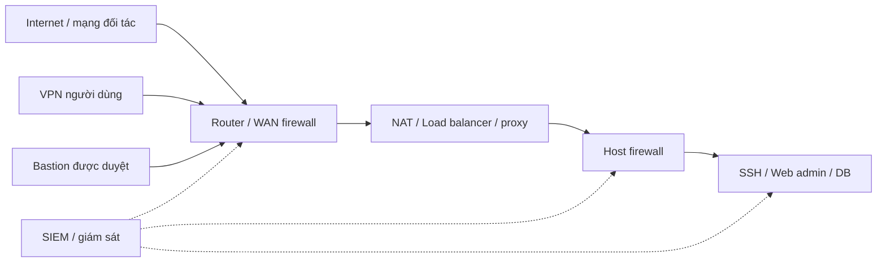
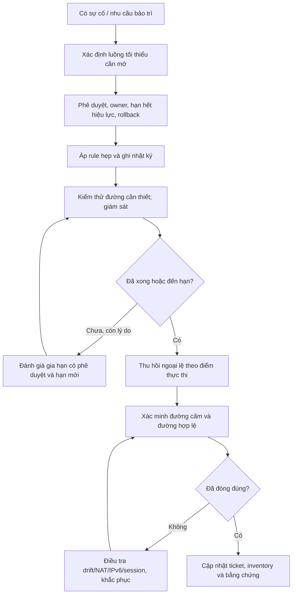

# Mở port để xử lý sự cố rồi quên đóng

Trong vận hành bảo mật mạng, một sự cố kết nối đôi khi được xử lý bằng cách mở tạm cổng trên firewall, security group, router hoặc host firewall. Nếu thay đổi này không có **thời hạn và cơ chế thu hồi**, quyền tạm thời có thể tồn tại nhiều tuần hoặc nhiều tháng sau khi sự cố đã kết thúc. Đó là một lỗi cấu hình phổ biến, đặc biệt nguy hiểm với cổng quản trị, cơ sở dữ liệu và các dịch vụ vốn chỉ dành cho mạng nội bộ.

Bài học thuộc chương **Sai lầm thường gặp** của module **SECURITY_NETWORK_SECURITY**. Kiến thức về phân đoạn mạng, firewall, VPN, IDS/IPS, quản lý DNS, Wi-Fi và hạ tầng đám mây đều liên quan: một ngoại lệ tưởng chừng nhỏ có thể tạo đường vượt qua nhiều lớp phòng vệ đã thiết kế.

**Tình huống mở đầu:** Lúc 22:00, một kỹ sư không thể SSH đến máy chủ ứng dụng để khắc phục lỗi. Để xử lý nhanh, nhóm vận hành bổ sung rule cho phép TCP 22 từ `0.0.0.0/0` tới máy chủ. Đến 23:00, dịch vụ đã phục hồi; ticket được đánh dấu xong nhưng rule vẫn còn. Ngày hôm sau, cổng SSH vẫn có thể được tiếp cận từ Internet dù chỉ cần thiết trong một phiên bảo trì ngắn.

Vấn đề không nằm ở việc thiết lập quyền tạm để hỗ trợ vận hành khi thật sự cần. Vấn đề là quyền đó **không được giới hạn đủ hẹp, không gắn vòng đời và không được xác minh đã thu hồi**.

## 1. Mục tiêu học tập

Sau bài học, người học có thể:

1. Nhận diện sự khác nhau giữa **dịch vụ đang lắng nghe**, **port được policy cho qua** và **dịch vụ có thể tiếp cận từ một nguồn cụ thể**.
2. Giải thích những con đường khiến một rule mở tạm trở thành bề mặt tấn công lâu dài.
3. Thiết kế ngoại lệ mạng có **owner, ticket, phạm vi, thời hạn, điều kiện dừng, giám sát và rollback**.
4. Chọn phương án khắc phục sự cố ít mở rộng quyền nhất, như VPN quản trị, bastion, console hoặc session manager.
5. Đọc và kiểm chứng chính sách firewall, NAT, security group, host firewall, IPv4/IPv6 và các đường truy cập phụ.
6. Thực hiện quy trình đóng cổng và **kiểm tra lại từ cả nguồn được phép lẫn không được phép**.
7. Phát hiện ngoại lệ quá hạn bằng inventory, policy review, cảnh báo thay đổi và đối chiếu cấu hình.
8. Lập báo cáo sự cố và bằng chứng đủ để cải thiện quy trình quản lý thay đổi.

## 2. Hiểu đúng: “mở port” nghĩa là gì?

Trong ngôn ngữ vận hành, “mở port” thường được dùng cho nhiều hành động kỹ thuật khác nhau. Phân biệt đúng giúp đánh giá chính xác rủi ro và chứng minh việc đã đóng.

| Hành động | Ví dụ | Hệ quả thực tế |
|---|---|---|
| **Bật dịch vụ lắng nghe** | SSH daemon bind TCP 22; database bind TCP 5432 | Tiến trình có thể nhận kết nối trên địa chỉ/interface tương ứng |
| **Thêm allow rule trên firewall** | Cho TCP 22 từ một subnet tới máy chủ | Lưu lượng phù hợp có thể đi qua điểm kiểm soát này |
| **Mở security group/NSG** | Inbound TCP 3389 từ Internet tới NIC VM | Đường mạng ở lớp cloud cho phép theo scope rule |
| **Cấu hình NAT/port forwarding** | Public TCP 8443 chuyển tới IP nội bộ TCP 443 | Tạo đường ánh xạ đến dịch vụ nội bộ |
| **Xuất bản route/Ingress/load balancer** | Đưa backend nội bộ ra hostname công khai | Một endpoint có thể tiếp cận qua proxy/LB dù không có IP public trên máy |
| **Cho phép cổng trên chính thiết bị** | Bật HTTPS management trên interface WAN của firewall | Tăng bề mặt **management plane**, khác với luồng chuyển tiếp |
| **Tạo quyền truy cập VPN/ZTNA** | Nhóm hỗ trợ có quyền vào subnet/cổng đích | Mở thêm đường truy cập sau bước xác thực ban đầu |

Một cổng “open” trong kết quả dò từ một nguồn cụ thể nghĩa là người thử nghiệm **quan sát được phản hồi** phù hợp với dịch vụ đang lắng nghe, theo điều kiện đo. Nó không chứng minh có thể truy cập cổng đó từ mọi nguồn. Tương tự, trạng thái “filtered” có thể do firewall, route hoặc mạng không hoạt động; chưa thể khẳng định đã đóng đúng bởi chính sách mong muốn.

**Ba lớp cần khớp khi kết luận:**

1. **Listener:** dịch vụ lắng nghe trên IP/interface nào?
2. **Reachability:** đường mạng, NAT, VPN, LB và các luật truy cập có cho phép nguồn cụ thể kết nối tới listener?
3. **Authentication/authorization:** nếu kết nối tới được, ai có quyền sử dụng chức năng bên trong?

Bảo vệ mạnh cần kết hợp cả ba. Đổi cổng SSH từ 22 sang một cổng cao hơn không làm dịch vụ tự trở nên an toàn, cũng không thay thế giới hạn nguồn hoặc xác thực.

## 3. Vì sao rule tạm bị bỏ quên?

### 3.1. Áp lực xử lý sự cố

Khi dịch vụ đang lỗi, nhóm trực có xu hướng tối ưu cho **thời gian khôi phục**. Nếu chưa xác định nguyên nhân, họ có thể mở rộng nguồn, cổng hoặc đích để “loại trừ firewall”. Sau khi dịch vụ hoạt động lại, khâu khôi phục chính sách bị bỏ qua vì không nằm trong checklist đóng ticket.

Ví dụ thường thấy:

- Mở SSH/RDP để nhà cung cấp truy cập trực tiếp, nhưng không thu hồi sau bảo trì.
- Tạm cho toàn bộ mạng VPN nhân viên tới cổng quản trị, sau đó quên hạn chế lại.
- Mở TCP 443 tới giao diện quản trị firewall trên WAN vì VPN quản trị đang lỗi.
- Mở rộng rule database từ một application subnet thành `any` để kiểm thử kết nối.
- Tắt tạm inspection/WAF hoặc thay đổi IPS sang chế độ bypass, nhưng chỉ đóng ticket ứng dụng và bỏ quên thay đổi bảo mật.

### 3.2. Sai lệch giữa các hệ thống quản lý

Một rule được tạo bằng giao diện web khẩn cấp trong khi hạ tầng chính dùng IaC có thể không xuất hiện trong yêu cầu thay đổi ban đầu. Một security group đã sửa trực tiếp trong console có thể khác cấu hình Terraform. Một firewall có HA pair, nhiều policy package hoặc rule ở nhiều zone khiến đội vận hành chỉ đóng **một bản sao** của quyền mở.

Các nguồn gây trôi cấu hình (*configuration drift*) có thể là:

- Thao tác thủ công không được ghi nhận trong Git/IaC.
- Quyền cấp qua nhóm IAM/SG hoặc object group mà người xử lý không nhận ra.
- Rule NAT, local-in policy, ACL hoặc host firewall tồn tại độc lập.
- Một đường IPv6, VPN site-to-site hoặc private endpoint chưa nằm trong kiểm kê.
- Rule đã disable ở một node nhưng node còn lại vẫn có hiệu lực.

### 3.3. Không có chủ sở hữu và thời gian hết hạn

Một ticket ghi “mở tạm port 22” là quá thiếu dữ liệu. Không biết **cho ai**, **đến đâu**, **trong bao lâu**, **ai thu hồi** và **cách kiểm tra** thì người đến ca sau khó kết thúc công việc an toàn.

**Nguyên nhân gốc rễ:** ngoại lệ được quản lý như một thao tác cấu hình đơn lẻ thay vì một **quyền có vòng đời** gồm tạo → sử dụng → hết hạn → thu hồi → kiểm chứng.

## 4. Tác động an ninh và phạm vi rủi ro

### 4.1. Tăng bề mặt tấn công

Một cổng được phép truy cập từ nguồn ngoài dự kiến có thể tạo cơ hội cho:

- Dò tìm dịch vụ và phiên bản phần mềm đang lắng nghe.
- Thử thông tin xác thực bị lộ hoặc đoán mật khẩu.
- Khai thác lỗ hổng chưa vá trong SSH, RDP, VPN, web admin, API hoặc database.
- Truy cập trái phép bằng tài khoản nhà thầu còn hiệu lực.
- Di chuyển ngang từ mạng người dùng hoặc mạng đối tác vào vùng quản trị và dữ liệu.
- Gửi lưu lượng quá mức vào dịch vụ thiếu rate limit hoặc nguồn lực kiểm soát.

Không phải **mọi port mở đều đã bị khai thác**, và không phải một số port nhất định tự động là lỗ hổng. Rủi ro phụ thuộc loại dịch vụ, phiên bản, khả năng khai thác, xác thực, nguồn được phép, khả năng phát hiện và giá trị tài sản.

### 4.2. Ví dụ các cổng nhạy cảm

| Dịch vụ | Cổng thường gặp | Vì sao cần thận trọng khi mở tạm |
|---|---|---|
| SSH | TCP 22 | Bề mặt truy cập shell/quản trị; cần giới hạn nguồn và danh tính |
| RDP | TCP/UDP 3389 tùy triển khai | Truy cập phiên desktop và tài nguyên hệ thống |
| Web quản trị | TCP 443, 8443 hoặc cổng riêng | Có thể cho phép thay đổi cấu hình thiết bị |
| PostgreSQL | TCP 5432 | Giao diện cơ sở dữ liệu thường chỉ cần từ ứng dụng |
| MySQL | TCP 3306 | Dữ liệu và quyền thực thi truy vấn |
| Redis | TCP 6379 theo cấu hình thường gặp | Dịch vụ cache có thể lưu thông tin nhạy cảm, cần auth/TLS/policy |
| SNMP | UDP 161 | Thu thập trạng thái; dùng SNMPv3, allowlist collector |
| DNS | UDP/TCP 53 | Có thể là dịch vụ **phải phục vụ nhiều nguồn**; cần tách resolver/authoritative và quản trị |
| VPN | Cổng tùy sản phẩm, ví dụ UDP 500/4500 cho IPsec NAT-T | Dịch vụ truy cập từ xa và bảo mật đường hầm; không thay đổi tùy tiện |
| Debug/metrics | Cổng do app cấu hình | Endpoint nội bộ có thể lộ dữ liệu cấu hình/trace/health |

**Chú ý:** các số cổng chỉ là ví dụ phổ biến, không đủ để kết luận chức năng thực tế. Ứng dụng có thể đổi cổng, dùng proxy hoặc gom nhiều route ở TCP 443. Đánh giá phải dựa trên **dịch vụ thực**, không chỉ danh sách số port.

### 4.3. Rủi ro theo đường đi



Nếu firewall WAN đã chặn nguồn ngoài nhưng host firewall vẫn mở TCP 22, điều đó có thể phù hợp với yêu cầu quản trị **chỉ qua bastion**. Tuy nhiên, nếu NAT hay VPN tạo đường khác, policy ở firewall WAN không phải là lớp bảo vệ duy nhất.

Cần phân biệt **đường đến thiết bị firewall** (*local-in*, management plane) với **đường đi qua firewall** (*forward/transit*). Chặn transit từ WAN vào server không nhất thiết đóng web admin của chính firewall trên IP WAN.

## 5. Phạm vi mở quyền nên được mô tả như thế nào?

Một ngoại lệ phải có tối thiểu **nguồn, đích, dịch vụ, hành động, thời hạn, mục đích, owner và cách kiểm chứng**.

### 5.1. Ví dụ xấu và tốt hơn

Giả sử cần khắc phục một máy chủ nội bộ `10.20.30.12`:

| Thành phần | Rule mở rộng quá mức | Rule giới hạn có thể kiểm soát |
|---|---|---|
| Nguồn | `0.0.0.0/0` | Bastion `10.20.10.10/32` |
| Đích | Toàn subnet `10.20.30.0/24` | Một host `10.20.30.12/32` |
| Dịch vụ | `any` | TCP 22 |
| Hành động | Allow vô thời hạn | Allow có thời hạn và ticket |
| Danh tính | Tài khoản chia sẻ lâu dài | Tài khoản cá nhân/được cấp tạm, MFA tại VPN/bastion khi hỗ trợ |
| Quan sát | Không bật log | Log truy cập, rule hit, cảnh báo khi có nguồn lạ |
| Thu hồi | Không có người chịu trách nhiệm | Owner cụ thể; hết hạn và bước xác minh đóng |

Địa chỉ trong bảng là ví dụ nội bộ giả lập. Với địa chỉ nguồn đi qua VPN/NAT, phải dùng **địa chỉ nguồn mà thiết bị chặn thực sự nhìn thấy**; không mặc định IP laptop bên ngoài sẽ đi nguyên vẹn tới host.

### 5.2. Mở đúng thời gian

Ngoại lệ “đến khi xử lý xong” không phải thời hạn vận hành rõ ràng. Nên ghi thời điểm UTC, ví dụ `expires_at_utc: 2026-12-01T02:00:00Z`, người giám sát và hành động khi hết hạn.

Tốt nhất **quy trình cấp quyền gắn luôn lịch thu hồi**. Nếu nền tảng không hỗ trợ TTL native, dùng job/IaC automation có owner, quyền hạn và cơ chế cảnh báo; không giả định firewall, security group hay ACL mặc nhiên tự xóa rule ở thời điểm hết hạn chỉ vì mô tả rule có trường “expires”.

### 5.3. Mở đúng đường quản trị

Khi phải truy cập SSH/RDP, ưu tiên các đường đã thiết kế:

1. Console hoặc out-of-band (OOB) khi cần thao tác cứu hộ.
2. VPN quản trị hoặc ZTNA với MFA, chính sách danh tính và thiết bị.
3. Bastion/jump host có IP cố định, quyền tối thiểu, audit.
4. Cloud session-management service không cần mở inbound SSH/RDP khi được triển khai phù hợp.
5. Ngoại lệ trực tiếp từ IP nguồn cụ thể chỉ khi không có phương án hợp lệ khác và đã được duyệt.

Không cho phép mọi nhân viên trên VPN vào mạng quản trị chỉ vì một kỹ sư cần xử lý một server. Cũng không coi một IP trong allowlist là bằng chứng về danh tính người thực hiện.

## 6. Thiết kế ngoại lệ theo vòng đời

### 6.1. Trạng thái đề xuất



Các trạng thái hữu ích: `REQUESTED` → `APPROVED` → `ACTIVE` → `EXPIRING` → `REVOKED` → `VERIFIED_CLOSED`. Nếu chưa rõ ảnh hưởng hoặc không thu được log, dùng trạng thái `INVESTIGATE` thay vì vội xác nhận đã đóng.

### 6.2. Biểu mẫu yêu cầu ngoại lệ tối thiểu

| Trường | Mục đích | Ví dụ |
|---|---|---|
| `change_id` | Liên kết ticket | `INC-2026-042` |
| `asset_id` / `zone` | Xác định tài sản/vùng | `app-node-12 / application` |
| `source` | Nguồn **tại điểm áp rule** | `10.20.10.10/32` |
| `destination` | IP/service đích | `10.20.30.12/32` |
| `protocol` / `port` | Giới hạn cổng thực sự cần | `tcp / 22` |
| `purpose` | Sự cố và lệnh xử lý dự kiến | “Kiểm tra lỗi dịch vụ sau deploy” |
| `owner` / `approver` | Trách nhiệm thực hiện/phê duyệt | `network-ops / security-oncall` |
| `valid_from_utc` | Thời điểm bắt đầu | `2026-12-01T00:00:00Z` |
| `expires_at_utc` | Thời điểm hết hạn | `2026-12-01T02:00:00Z` |
| `enforcement_points` | Các lớp cần thay và kiểm lại | Firewall policy, host ACL |
| `monitoring_ref` | Dashboard/log cần theo dõi | Rule hit + AAA audit |
| `rollback_ref` | Thao tác phục hồi cấu hình | `RBK-2026-042` |
| `verification_ref` | Bằng chứng đã thu hồi | `TEST-2026-042` |

**Không** đưa mật khẩu, private key, API token hoặc dữ liệu cấu hình bí mật vào ticket. Chỉ dùng tham chiếu tới nơi lưu trữ có kiểm soát.

### 6.3. Cơ chế kiểm soát bắt buộc trong quy trình

- **Người yêu cầu** giải thích sự cố và nhu cầu thật.
- **Người phê duyệt** đánh giá phạm vi và chấp nhận ngoại lệ trong cửa sổ ngắn.
- **Người triển khai** ghi đầy đủ rule ID, cấu hình trước/sau và nơi áp dụng.
- **Hệ thống giám sát** kiểm tra hạn hết hiệu lực, sự kiện quản trị và hành vi kết nối.
- **Người đóng ticket** xác minh rule đã được thu hồi; không chỉ xác minh ứng dụng hết lỗi.

Ở nhóm nhỏ, một người có thể kiêm nhiều vai trò nếu quy trình cho phép, nhưng thay đổi nhạy cảm nên có cơ chế kiểm tra độc lập, nhất là với cổng quản trị hoặc dữ liệu quan trọng.

## 7. Ví dụ cấu hình dạng khai báo để quản lý quyền tạm

Một bản ghi chính sách **minh họa**, không phải cú pháp áp trực tiếp cho thiết bị:

```yaml
exception_id: "TEMP-NET-2026-042"
change_ticket: "INC-2026-042"
service_owner: "Application Operations"
security_approver: "Security On-call"
environment: "staging"
purpose: "Kiểm tra SSH trong đợt khôi phục cấu hình"
enforcement:
  device: "segmentation-firewall"
  direction: "ingress-to-application-zone"
  source_cidr: "10.20.10.10/32"
  destination_cidr: "10.20.30.12/32"
  protocol: "tcp"
  destination_port: 22
  action: "allow"
lifecycle:
  valid_from_utc: "2026-12-01T00:00:00Z"
  expires_at_utc: "2026-12-01T02:00:00Z"
  revoke_method: "approved-change-workflow"
  owner_ack_required: true
evidence:
  prechange_policy_ref: "POLICY-SNAPSHOT-041"
  firewall_log_ref: "SIEM-QUERY-042"
  rollback_ref: "RBK-2026-042"
  closure_test_ref: "TEST-2026-042"
state: "APPROVED"
```

Ví dụ YAML là **metadata** để quản lý vòng đời. Nó không tự thực thi deny hay tự xóa rule khi hết hạn. Việc thực thi cần hệ thống change/IaC/firewall orchestration tương ứng, quyền phân tách hợp lý và xác nhận kết quả đã áp dụng trên thiết bị thực.

### 7.1. Idempotency và xử lý lỗi của tự động thu hồi

Nếu tự động hóa đóng rule ở `expires_at_utc`, quy trình nên:

1. Xác minh đúng **rule ID, policy version và ticket**, tránh xóa nhầm rule giống tên.
2. Thực hiện revoke/idempotent update; nếu đã thu hồi thì ghi nhận đã đạt trạng thái mong muốn.
3. Xác nhận cấu hình đã được commit và phân phối đến các node/thiết bị liên quan.
4. Kiểm tra trạng thái đường truy cập sau thay đổi; nếu còn truy cập do một rule khác, không xác nhận đã đóng.
5. Báo lỗi và nâng cấp cảnh báo cho người trực nếu API, device hoặc hệ thống thay đổi thất bại.
6. Không gia hạn tự động vô hạn chỉ vì ứng dụng chưa “đóng sự cố”.

Khi rule gắn với nhóm object được chia sẻ, không xóa object đang được rule nghiệp vụ khác sử dụng. Cần phân biệt **xóa ngoại lệ tạm** với xóa tài nguyên dùng chung.

## 8. Các đường dễ bị bỏ sót khi đóng cổng

### 8.1. IPv4 và IPv6

Rule IPv4 cho `0.0.0.0/0` và rule IPv6 cho `::/0` là hai phạm vi khác nhau. Đóng rule IPv4 không tự đóng dịch vụ đang lắng nghe trên IPv6. Một tiến trình bind `::` có thể chấp nhận IPv6, và cách hỗ trợ IPv4-mapped address còn phụ thuộc OS/cấu hình.

Cần rà soát:

- Interface và IP lắng nghe của dịch vụ.
- Các allow/deny rule cho từng address family.
- Public IPv6, ULA, link-local và route có thể tới dịch vụ.
- Chính sách trên edge, cloud SG và host firewall, bao gồm IPv6.
- Đường public/private/hybrid đưa tới cùng endpoint.

### 8.2. NAT, load balancer, reverse proxy và CDN

Một port public 8443 có thể NAT vào port nội bộ 443. Đóng rule TCP 443 trên IP public có thể **không liên quan** tới đường vào TCP 8443 đã publish. Ngược lại, service có thể được mở qua HTTPS ingress/reverse proxy dù host chỉ có IP private.

Để kiểm chứng, theo dõi **đích ở từng lớp**:

```text
Client:203.0.113.25:xxxxx
       |
       v
PublicIP:8443 (NAT / LB / proxy)
       |
       v
PrivateIP:443 (web management)
```

Địa chỉ `203.0.113.0/24` thuộc dải dùng cho tài liệu; các IP ví dụ không nhằm chỉ một hệ thống ngoài thực tế.

Khi proxy đặt trước ứng dụng, policy dựa theo IP nguồn phải xác định rõ thiết bị nào quan sát IP thật, IP proxy hoặc IP sau SNAT. Các header như `X-Forwarded-For` chỉ đáng tin nếu do proxy đã xác thực và cấu hình trust boundary đúng; không được dùng header do client ngoài Internet tự khai để cấp quyền quản trị.

### 8.3. Firewall transit và local-in

Hai câu hỏi khác nhau:

- “Nguồn Internet có đi **qua** firewall để đến máy chủ phía trong không?”
- “Nguồn Internet có kết nối vào cổng HTTPS/SSH trên **chính firewall** không?”

Policy bảo vệ lưu lượng đi qua có thể không ảnh hưởng đến dịch vụ quản trị trên chính thiết bị. Khi mở tạm web admin firewall, cần kiểm tra local-in policy, trusted hosts của tài khoản và listener/interface; lúc đóng phải thu hồi đúng cơ chế.

### 8.4. HA, nhiều vùng và cấu hình IaC

Một môi trường có hai firewall HA, nhiều vùng cloud hoặc các máy dùng cùng security group có thể có **nhiều điểm thực thi**. Khi đóng:

- Kiểm tra cấu hình đã đồng bộ, commit và áp đúng trên node active/standby khi cần.
- Xác minh rule trong Git/IaC không bị một lần deploy tiếp theo tạo lại.
- Đọc effective policy thay vì chỉ dựa trên một diff của file khai báo.
- Kiểm tra gắn security group/NSG vào tài nguyên khác trong cùng nhóm.
- Kiểm tra đường origin/bypass bên cạnh WAF/CDN hoặc VPN.

**Trạng thái “đã xóa trong giao diện” chưa đủ** nếu một controller có thể phân phối lại rule cũ hoặc đường song song còn mở.

## 9. Cách kiểm kê ngoại lệ đang tồn tại

### 9.1. Thu thập bằng chứng từ nhiều nguồn

| Nguồn dữ liệu | Điều có thể tìm | Giới hạn của nguồn |
|---|---|---|
| Firewall policy export | Rule allow/deny, zone, source, destination, service, schedule | Không tự chứng minh rule còn khớp trên đường đi thực |
| Firewall session/hit logs | Nguồn thực tế, phiên, số lần khớp | Counter có thể reset; một số bản ghi có sampling |
| NAT/LB/Ingress | Port publish, backend, listener và route | Có thể tạo đường ngoài danh sách firewall truyền thống |
| Security group/NSG | Rule của từng NIC/resource | Policy hiệu dụng còn phụ thuộc NACL, route, network firewall |
| Host firewall/OS | Listener và rule áp ngay trên host | Không nhìn thấy toàn bộ edge path |
| VPN/ZTNA/bastion | Ai được cấp đường truy cập; phiên nào đã dùng | Chưa thể kết luận service đích đóng nếu vẫn còn đường khác |
| IdP/AAA/PAM | User, nhóm, đăng nhập, token/phiên | Không bao phủ local account hoặc credential ngoài IdP |
| CMDB/change tickets/IaC | Owner, mục đích, deadline, kế hoạch thu hồi | Dữ liệu có thể lỗi thời hoặc không đồng bộ với runtime |
| SIEM/IDS/IPS | Dấu hiệu scan, kết nối và thay đổi policy | Alert im lặng không chứng minh không có rủi ro |

### 9.2. Bộ lọc ưu tiên kiểm tra

Có thể lập danh sách các ngoại lệ:

- Cho phép `0.0.0.0/0` hoặc `::/0` đến cổng quản trị, database hoặc debug.
- Được tạo dưới dạng *temporary*, *troubleshooting*, *hotfix* nhưng **không có hạn**.
- Đã qua `expires_at_utc` mà chưa có bằng chứng thu hồi.
- Không có owner/ticket hoặc không rõ ứng dụng cần quyền.
- Có rule trùng lặp, rule rộng phía trước hoặc policy chồng lấn.
- Bị đánh dấu `DISABLED` trong ticket nhưng vẫn `ENABLED` tại thiết bị.
- Có cấu hình mới lạ so với baseline Git/IaC.
- Đang xuất hiện lưu lượng từ nguồn không nằm trong kế hoạch hỗ trợ.

**Không tự xóa mọi rule có hit = 0.** Một rule dự phòng có thể chỉ được dùng trong diễn tập DR; một rule mới được reset counter sau reboot; một deny rule không hit vẫn có thể cần giữ. Trọng tâm bài này là **ngoại lệ mở tạm** và quyền không còn lý do hợp lệ, được xác minh bằng owner và lịch sử thay đổi.

## 10. Quy trình kiểm tra và đóng cổng sau sự cố

### 10.1. Bước 1: xác nhận mục tiêu

Trước khi thu hồi, xác minh chức năng cần kiểm tra đã hoàn tất, người xử lý đã kết thúc phiên, ứng dụng hoạt động đúng và mọi công việc định kỳ/automation phụ thuộc vào rule đã được rà soát.

Nếu vẫn cần truy cập, ưu tiên chuyển sang đường quản trị chuẩn hoặc gia hạn **có phê duyệt và thời hạn mới rõ ràng**. Không để trạng thái “chưa xong nên giữ nguyên vô thời hạn”.

### 10.2. Bước 2: lưu cấu hình trước thay đổi

Ghi lại:

- Tên thiết bị, version/config revision, rule ID, vị trí trong policy.
- Nguồn–đích–giao thức–cổng, IPv4/IPv6 và NAT mapping liên quan.
- Firewall/SG/host policy trước thay đổi, owner và ticket.
- Các phiên đang hoạt động, log deny/allow và nguồn truy cập gần đây.
- Bằng chứng chức năng vẫn bình thường ở đường truy cập hợp lệ.

Giữ bản sao cấu hình để rollback nếu cần và tránh ghi lộ bí mật trong ticket.

### 10.3. Bước 3: thu hồi chính xác ngoại lệ

Tùy nền tảng, thao tác có thể là:

- Xóa/disable rule allow tạm ở policy chính xác; commit và deploy.
- Thu hồi security group/NSG ingress rule gắn với nguồn/đích/cổng tạm.
- Xóa ánh xạ DNAT/port forward hoặc listener công khai chỉ dùng để hỗ trợ.
- Tắt dịch vụ debug hoặc bind lại vào management IP được bảo vệ.
- Xóa quyền tạm của nhóm VPN/ZTNA/PAM và thu hồi session/credential nếu được cấp riêng.
- Đồng bộ lại IaC để cấu hình sau deploy vẫn ở trạng thái đã đóng.

Với firewall stateful, xóa allow rule có thể chỉ ảnh hưởng **kết nối mới**; những phiên TCP đã được thiết lập có thể tiếp tục theo bảng session, tùy implementation. Nếu mục tiêu là chấm dứt quyền ngay, kiểm tra chính sách xóa phiên và thu hồi credential/session **một cách có kiểm soát**.

### 10.4. Bước 4: kiểm chứng có kết nối hợp lệ và bị chặn

Thực hiện kiểm thử từ đúng các vantage point đã được cấp quyền:

1. Từ **bastion/nguồn quản trị hợp lệ**, xác nhận đường chuẩn vẫn vào được.
2. Từ **nguồn đã từng được cấp tạm nhưng không còn hợp lệ**, xác nhận không tạo được kết nối mới.
3. Nếu có exposure Internet, dùng probe từ **mạng ngoài thuộc phạm vi kiểm thử**.
4. Kiểm tra riêng **IPv4 và IPv6**, hostname/route phụ, port forward và load balancer.
5. Đọc firewall deny log, rule hit/counter, config trạng thái thực và listener tại đích.
6. Xác nhận phiên còn mở đã hết hiệu lực nếu yêu cầu thu hồi ngay.

Không lấy `Connection timed out` làm bằng chứng duy nhất. Timeout có thể do host ngừng chạy, DNS không phân giải, đứt mạng hoặc ACL. Cần chứng minh chính sách chặn tại **đúng điểm thực thi**.

### 10.5. Bước 5: cập nhật hồ sơ

Chỉ đánh dấu `VERIFIED_CLOSED` khi có:

- Dấu vết cấu hình rule đã thu hồi ở mọi điểm liên quan.
- Test kết nối mới bị chặn từ nguồn không hợp lệ.
- Test kết nối hợp lệ vẫn thành công.
- Log/counter hoặc bằng chứng policy đúng trạng thái.
- Thời điểm UTC, người kiểm thử, kết quả và các ngoại lệ còn tồn tại.
- Ticket/CMDB/IaC đồng bộ với trạng thái runtime.

Nếu test không thành công, ghi `INVESTIGATE` hoặc `FAILED_CLOSURE`, nêu rõ phát hiện và xử lý tiếp. Không che giấu vì ticket ứng dụng đã hoàn thành.

## 11. Công cụ thực hành kiểm chứng an toàn

Các lệnh dưới đây dành cho **lab hoặc tài sản được quản lý/cấp phép kiểm thử**. Các kiểm tra chỉ tạo lượng kết nối rất nhỏ; không dùng quét diện rộng hay thử mật khẩu để chứng minh một port còn mở.

### 11.1. Kiểm tra listener và firewall trên Linux

```bash
# Dịch vụ đang lắng nghe (cần quyền phù hợp để xem tiến trình).
sudo ss -lntup

# Xem chính sách nftables đang có hiệu lực, có rule handle.
sudo nft -a list ruleset

# Nếu hệ thống dùng iptables:
sudo iptables -S

# Đối chiếu IPv6 nếu host dùng ip6tables:
sudo ip6tables -S

# Kiểm tra route tới một địa chỉ nội bộ.
ip route get 10.20.30.12
```

**Giải thích:** `ss` cho biết listener cục bộ, không chứng minh dịch vụ truy cập được từ Internet. `nft` hoặc `iptables` cho biết policy trên host, nhưng vẫn cần kiểm tra firewall upstream và NAT. Trên nhiều bản Linux, `iptables` có thể là frontend tương thích với nftables; khi vận hành cần hiểu tập luật thực tế đang có hiệu lực, không suy đoán chỉ từ tên lệnh.

### 11.2. Kiểm tra kết nối từ một client được cấp quyền

```bash
# Thử TCP 22 tới một máy lab trong scope.
nc -vz -w 3 10.20.30.12 22

# Nếu có web admin test, xem HTTP headers và TLS theo đường hợp lệ.
curl -I --connect-timeout 3 --max-time 5 \
  https://admin.example.internal/

# Một cổng TCP được phép kiểm tra trên một host lab duy nhất:
nmap -sT -Pn -p 22 10.20.30.12
```

- Kết quả `open` từ nmap chỉ mô tả **tầm nhìn từ vị trí probe đó**.
- Kết quả `closed` thường nghĩa là kết nối tới đích được nhưng không có listener đáp ứng ở cổng đó trong điều kiện thử.
- Kết quả `filtered` có thể liên quan policy mạng hoặc không nhận được phản hồi; cần log/rule kiểm chứng.
- Với HTTP 401/403, client **đã đến được** ứng dụng hoặc proxy, nên chưa thể coi là port đã đóng ở lớp mạng nếu mục tiêu là không cho tới dịch vụ.

Các tên và địa chỉ ví dụ phải được thay bằng endpoint lab/thực được cấp quyền; không mặc định chúng tồn tại trong hệ thống.

### 11.3. Kiểm tra security group cloud ở chế độ đọc

Ví dụ truy vấn AWS CLI với một security group **đã xác định trong tài khoản và vùng được phép**:

```bash
aws ec2 describe-security-group-rules \
  --filters Name=group-id,Values=sg-EXAMPLE \
  --region ap-southeast-1 \
  --query 'SecurityGroupRules[*].[SecurityGroupRuleId,IsEgress,IpProtocol,FromPort,ToPort,CidrIpv4,CidrIpv6,Description]' \
  --output table
```

`sg-EXAMPLE` là placeholder, cần thay bằng ID thực tế. Lệnh này **chỉ đọc**, không tự xóa quyền. Đừng chỉ kiểm tra rule ở một security group nếu NIC/load balancer còn gắn những security group khác; cần đánh giá hiệu lực hợp nhất, routes, network ACL và network firewall tương ứng. Việc thêm mô tả “tạm” trong SG **không khiến rule tự hết hạn**.

### 11.4. Ghi lại kết quả theo từng đường

```text
TEST-01 | Bastion -> SSH host     | ALLOW expected | PASS
TEST-02 | User VLAN -> SSH host   | DENY expected  | PASS
TEST-03 | External test -> SSH    | DENY expected  | PASS
TEST-04 | IPv6 external -> SSH    | DENY expected  | PASS
TEST-05 | Web admin via WAN LB    | DENY expected  | PASS
TEST-06 | App HTTPS normal       | ALLOW expected | PASS
```

**PASS** chỉ khi có log/counter hoặc bằng chứng khác tại điểm thực thi chứng minh kết quả. Trong nhiều môi trường, nguồn test IPv6 hoặc external vantage point không sẵn có; khi đó phải ghi `NOT_TESTED` và giới hạn của xác nhận, không điền PASS theo suy đoán.

## 12. Tình huống thực hành: rule SSH bị bỏ quên ba tuần

### 12.1. Diễn biến giả lập

Một doanh nghiệp vận hành firewall phân đoạn, VPN nhân viên, bastion quản trị, SIEM và ứng dụng nội bộ. Dưới đây là câu chuyện giả lập minh họa lỗi quản lý thay đổi:

| Thời điểm | Sự kiện |
|---|---|
| 2026-11-01, 22:00 UTC | Nhóm vận hành gặp lỗi SSH từ bastion đến máy chủ ứng dụng |
| 2026-11-01, 22:10 UTC | Thêm rule tạm cho TCP 22 từ `0.0.0.0/0` đến IP quản trị qua một đường public |
| 2026-11-01, 23:20 UTC | Ứng dụng phục hồi, ticket đóng; rule không có hạn và không được thu hồi |
| 2026-11-20, 09:00 UTC | Security review phát hiện một rule mới không có owner/expiry |
| 2026-11-21, 01:00 UTC | Nhóm xác minh đường quản trị chuẩn và chuẩn bị thu hồi |
| 2026-11-21, 02:00 UTC | Xóa rule, kiểm tra external/IPv4/IPv6 và cập nhật ticket |

Khoảng từ 2026-11-01 đến 2026-11-21 là **20 ngày**, không tự xác nhận rằng đã có xâm nhập. Mức độ phơi nhiễm thực tế phải dựa trên reachability, listener, log kết nối, bản vá và xác thực. Nếu trong thời gian mở có đăng nhập thành công bất thường, đó là dấu hiệu cần chuyển quy trình điều tra sự cố; không được chỉ đóng rule rồi bỏ qua.

### 12.2. Phân tích nguyên nhân gốc

**Lỗi trực tiếp:** rule cho phép quá rộng, không có hạn và bị quên khi đóng sự cố.

**Lỗi quy trình:**

- Ticket khắc phục ứng dụng thiếu checklist **revert security exception**.
- Không có owner theo dõi rule sau ca trực.
- Không có cảnh báo rule quản trị mở `0.0.0.0/0` và không có đối chiếu IaC.
- Phương án quản trị dự phòng không được chuẩn bị, nên kỹ sư chọn đường public.
- Đội vận hành không thực hiện test từ nguồn ngoài sau khi xóa thay đổi.

**Không nên kết luận** chỉ cần nhắc nhân viên “cẩn thận hơn” là đủ; cần thay đổi quy trình và công cụ để quyền tạm có cơ chế hết hạn độc lập với trí nhớ cá nhân.

### 12.3. Khắc phục ngay

1. Xác minh đường bastion/VPN đã hoạt động và tài khoản quản trị hợp lệ.
2. Chụp policy, log firewall, lịch sử thay đổi và log đăng nhập SSH trong thời gian phơi nhiễm có thể truy xuất.
3. Thu hồi rule public, đóng NAT/port forwarding tạm nếu có, kiểm tra cả IPv4/IPv6.
4. Xác minh đường quản trị chuẩn vẫn thành công, đường public bị chặn đối với **kết nối mới**.
5. Kiểm tra session đang mở, tài khoản, khóa SSH và bất thường trong khoảng phơi nhiễm nếu có lý do nghi ngờ.
6. Cập nhật ticket và policy baseline; thêm theo dõi các rule tạm còn mở ở cùng môi trường.

Nếu host đã bị tấn công, việc thu hồi rule là bước **cô lập bề mặt truy cập**, không thay thế ứng cứu sự cố như điều tra, loại bỏ điểm bám, thay credential và khôi phục từ trạng thái tin cậy.

### 12.4. Phòng ngừa tái diễn

- Áp dụng mẫu ngoại lệ đầy đủ trường và hạn, bắt buộc phê duyệt.
- Không cho tạo rule public quản trị rộng bằng console thông thường; áp guardrail/IaC policy theo khả năng.
- Có automation thu hồi hoặc ít nhất cảnh báo và giao người chịu trách nhiệm trước hạn.
- Ticket không thể đóng hoàn toàn khi ngoại lệ vẫn `ACTIVE`, trừ khi có phê duyệt gia hạn.
- Có báo cáo định kỳ các rule hết hạn, rule không owner và rule chứa nguồn quá rộng.
- Diễn tập truy cập OOB/bastion để giảm nhu cầu mở port khẩn cấp.

## 13. Đánh đổi vận hành: đóng cổng không làm hỏng dịch vụ hợp lệ

Chặn một cổng có thể gây gián đoạn nếu nó vẫn cần cho dịch vụ, backup, failover hoặc quản trị. Vì vậy cần phân biệt:

| Loại cổng/luồng | Quyết định phù hợp |
|---|---|
| Dịch vụ công khai đã được phê duyệt, ví dụ HTTPS của ứng dụng | Giữ theo policy nghiệp vụ, tiếp tục áp TLS/WAF/rate limit/giám sát phù hợp |
| Cổng quản trị cần cho bastion | Giữ rule nguồn hẹp; thu hồi rule mở rộng tạm |
| Cổng mở để debug trong một khung giờ | Đóng sau khung giờ và kiểm chứng |
| Cổng dùng cho backup quý/DR | Xác nhận owner, lịch hoạt động và chính sách có điều kiện |
| Cổng chỉ dùng để xử lý sự cố đã hết | Thu hồi sau khi xác minh, ghi bằng chứng |
| Cổng có owner không xác định | Đánh dấu INVESTIGATE, thu thập phụ thuộc và đánh giá rủi ro |
| Cổng bị nghi dùng để xâm nhập | Phối hợp ứng cứu sự cố, bảo toàn log và cô lập theo quy trình |

**Nguyên tắc quản lý rủi ro:** giữ kết nối cần thiết cho nghiệp vụ nhưng thu hẹp quyền theo chức năng và danh tính. “Đóng hết mọi cổng” không phải phương pháp quản trị mạng thực tế; ngược lại, “mở mọi cổng cho nhanh” cũng không có cơ sở bảo mật.

### 13.1. Khi nào nên dùng maintenance window?

Với thiết bị lõi, firewall HA, VPN gateway, máy chủ DNS hoặc hệ thống OT, thu hồi một rule có thể ảnh hưởng traffic đang hoạt động. Cần dùng cửa sổ thay đổi phù hợp, kiểm thử phụ thuộc và chuẩn bị rollback. Tuy nhiên, nếu một rule quản trị đang phơi nhiễm rộng, quy trình ứng cứu rủi ro có thể yêu cầu giảm phạm vi sớm hơn; quyết định phải dựa trên mức độ phơi nhiễm và thẩm quyền vận hành.

### 13.2. Theo dõi rủi ro của quyền cấp tạm

Rủi ro tăng theo **quyền của dịch vụ**, **phạm vi nguồn**, **độ dài phơi nhiễm**, **số tài sản bị ảnh hưởng** và **khả năng khai thác**. Không nên suy ra một xác suất tấn công chính xác chỉ từ số ngày rule tồn tại. Có thể dùng mức độ ưu tiên sơ bộ:

- **Rất cao:** port quản trị/database đến tài sản quan trọng cho `0.0.0.0/0` hoặc `::/0`, không có MFA/allowlist, tồn tại quá hạn.
- **Cao:** quyền truy cập chéo vùng có thể dẫn tới dữ liệu nhạy cảm, không có owner.
- **Trung bình:** rule nguồn tương đối hẹp nhưng chưa có expiry hoặc chứng cứ kiểm tra.
- **Thấp hơn:** rule đã có hạn, owner, mục đích, ghi log và đường quản trị được kiểm soát.

Thang trên chỉ để ưu tiên điều tra; mọi trường hợp cần đánh giá dựa trên kiến trúc thật.

## 14. Quản lý vòng đời bằng IaC và giám sát

### 14.1. Kiểm soát từ lúc tạo rule

Một hệ thống có thể quy định:

- Rule tạm chỉ được tạo bởi pipeline hoặc giao diện đã tích hợp ticket.
- Trường `expires_at_utc` và owner bắt buộc; hạn tối đa do tổ chức quy định.
- Chặn/kiểm tra đặc biệt khi nguồn là `0.0.0.0/0` hoặc `::/0` với cổng nhạy cảm.
- Phê duyệt độc lập cho đường quản trị trực tiếp.
- Mọi thay đổi đều có config diff, commit ID và log hành động.

Đối với trạng thái khẩn cấp không sử dụng được pipeline, phải có **break-glass procedure** với ghi nhận tự động hoặc bù đắp sau sự cố trong thời hạn quy định.

### 14.2. Kiểm soát khi ngoại lệ đang hoạt động

Giám sát thời gian hết hạn, số lần kết nối từ nguồn ngoài kế hoạch và các thay đổi từ ticket. Rule có hit không có nghĩa là còn chính đáng: có thể là truy cập hợp lệ hoặc dấu hiệu bất thường. Một rule 0 hit cũng có thể chưa được kích hoạt do cửa sổ bảo trì chưa tới.

Những alert nên xem xét:

| Điều kiện | Hành động |
|---|---|
| Sắp đến `expires_at_utc` | Thông báo owner, kiểm tra sẵn đường chuẩn |
| Đến hạn mà vẫn ACTIVE | Tự thu hồi nếu policy cho phép; nếu thất bại, cảnh báo ưu tiên cao |
| Rule mở rộng nguồn từ /32 thành /0 | Tạo cảnh báo thay đổi bảo mật, yêu cầu xác minh ngay |
| Có kết nối từ nguồn không trong ticket | Điều tra, thu hẹp hoặc cô lập theo rủi ro |
| Thay đổi rule bằng tài khoản break-glass | Ghi audit đặc biệt và hậu kiểm |
| Runtime khác trạng thái Git/IaC | Tạo issue config drift và xác nhận nguồn thay đổi |
| Auto-revoke lỗi | Chuyển cho on-call, không tự ghi “đã đóng” |

### 14.3. Chỉ số để đo chất lượng vận hành

Các KPI hữu ích:

1. **Số ngoại lệ đang ACTIVE**, chia theo mức rủi ro, zone, cổng và owner.
2. **Tỷ lệ ngoại lệ quá hạn**: số ngoại lệ đã qua hạn nhưng chưa `VERIFIED_CLOSED` chia tổng ngoại lệ đến hạn.
3. **Thời gian trung vị/p95 từ lúc hết nhu cầu đến lúc xác minh đóng**.
4. **Tỷ lệ có owner, ticket, expiry và rollback** trong tổng ngoại lệ.
5. **Số rule quản trị công khai quá rộng** và số ngày tồn tại.
6. **Tỷ lệ tự động thu hồi thành công**, có kiểm chứng thực tế.
7. **Số rollback/lỗi dịch vụ do đóng nhầm** để đo chất lượng kiểm tra tác động.

Ví dụ: 45/50 ngoại lệ đến hạn đã có bằng chứng xác minh đóng đúng thời hạn, tỷ lệ hoàn tất là **90%**. Nếu 5 ngoại lệ còn lại chứa rule WAN → management với nguồn `any`, mức rủi ro chưa thể coi là thấp. Cần xem **bản chất** ngoại lệ cùng số lượng thống kê.

## 15. Mẫu checklist đóng ticket sửa lỗi mạng

Checklist nên là phần bắt buộc trong ticket khi thay đổi đã động tới một cổng/ACL/firewall rule:

- [ ] Xác định **dịch vụ, nguồn, đích, protocol/port** của mọi ngoại lệ đã tạo.
- [ ] Đối chiếu rule ID, ticket, thời hạn, owner và policy đang có hiệu lực.
- [ ] Xác minh chức năng cần hỗ trợ đã kết thúc hoặc chuyển sang đường chuẩn.
- [ ] Thu hồi rule/NAT/listener/quyền VPN tạm ở **mọi** điểm có liên quan.
- [ ] Kiểm tra cả IPv4, IPv6, interface, SG/NSG, HA và đường proxy/LB nếu có.
- [ ] Xác minh nguồn không hợp lệ không tạo được **kết nối mới**.
- [ ] Xác minh nguồn hợp lệ/ứng dụng vẫn vận hành bình thường.
- [ ] Kiểm tra/thu hồi session hoặc credential tạm khi yêu cầu.
- [ ] Ghi log, config diff, timestamp UTC, người thực hiện và người xác nhận.
- [ ] Đồng bộ IaC/CMDB và gắn `VERIFIED_CLOSED` hoặc lý do chưa hoàn tất.

Checklist chỉ hiệu quả khi mỗi dấu tick tương ứng **bằng chứng kiểm tra**, không phải được đánh tự động lúc đóng ticket.

## 16. Sai lầm khi cố khắc phục chính sai lầm này

| Phản ứng vội | Vì sao chưa đủ hoặc nguy hiểm | Cách xử lý phù hợp |
|---|---|---|
| “Đổi port 22 sang 2222 là an toàn” | Dịch vụ vẫn có thể bị tìm thấy và khai thác | Giới hạn đường vào, nguồn, danh tính và quyền |
| “Đã tắt SSH trên server nên xong” | Firewall/NAT/SG vẫn có thể giữ quyền thừa; dịch vụ khác có thể dùng cùng đường | Thu hồi policy dư, giữ listener theo nhu cầu |
| “Rule disable trong UI là đóng hẳn” | Có HA, IaC tái tạo hoặc rule khác vẫn allow | Kiểm chứng hiệu lực thực và drift |
| “Chỉ dùng firewall public IPv4” | IPv6/VPN/private endpoint có thể bypass | Rà soát mọi address family và đường |
| “Bị timeout tức là đã chặn” | Có thể là lỗi route, DNS hoặc host down | Đối chiếu rule logs/counters và kiểm thử đối chứng |
| “Không có hit nghĩa là vô hại” | Counter reset, log chưa bật, luồng sử dụng hiếm | Xác minh cửa sổ log, owner và ứng dụng |
| “Xóa mọi cổng mở để khỏi rủi ro” | Có thể làm gián đoạn DNS, VPN, ứng dụng, DR | Phân loại quyền cần thiết, quản lý thu hẹp có kiểm chứng |
| “Đặt expiry trong mô tả là đủ” | Nhiều nền tảng không tự thu hồi theo mô tả | Tích hợp automation/ticket, kiểm tra sau hạn |
| “Đã xóa rule nên mọi phiên bị cắt” | Phiên stateful cũ có thể còn | Kiểm tra session và yêu cầu thu hồi ngay |
| “Chỉ cần nhắc người trực nhớ đóng” | Con người dễ quên trong ca sự cố | Quy trình đóng ticket + owner + automation/alert |

## 17. Bài tập vận dụng

### Bài tập 1 — Đọc cấu hình

Một rule được thêm lúc 13:00:

```text
action      = allow
source      = 0.0.0.0/0
destination = 10.20.30.12
service     = tcp/22
reason      = temporary support
expires     = (empty)
```

Hãy chỉ ra các thông tin còn thiếu, nguy cơ phơi nhiễm và cách tạo rule thay thế cho kỹ sư làm việc qua bastion `10.20.10.10`.

*Gợi ý:* Rule nguồn `/0` quá rộng, thiếu ticket, owner, hạn UTC và kiểm tra thu hồi. Ưu tiên `10.20.10.10/32 → 10.20.30.12/32 TCP 22` trong cửa sổ được duyệt, có audit và xác minh đường WAN không còn truy cập trực tiếp.

### Bài tập 2 — Phân biệt listener và reachability

Một máy Linux có `ss -lntup` cho thấy SSH lắng nghe ở `0.0.0.0:22`. Firewall biên deny TCP 22 từ Internet, nhưng cho phép bastion nội bộ.

1. Có thể kết luận port SSH “mở Internet” không?
2. Vì sao vẫn nên kiểm tra IPv6 và host firewall?
3. Nếu một người dùng VPN thông thường truy cập được SSH, cần kiểm tra các lớp nào?

*Gợi ý:* Listener lắng nghe mọi IPv4 interface chưa chứng minh Internet reachability. Cần kiểm tra đường NAT/VPN, firewall transit, host policy, IPv6 và cơ chế quyền. IP bastion có thể cần truy cập, VPN thường không.

### Bài tập 3 — Auto-expiry thất bại

Hệ thống có job tự đóng rule lúc 02:00 UTC, nhưng API firewall không phản hồi và không có retry hoặc cảnh báo. Ticket hiển thị `EXPIRED`.

- Rule có thể vẫn hoạt động không?
- Vì sao trạng thái `EXPIRED` không tương đương `VERIFIED_CLOSED`?
- Hãy thiết kế các trạng thái và cảnh báo để xử lý sự cố này.

*Gợi ý:* Phân biệt hạn đã qua với thay đổi thực sự thành công. Cần retry an toàn/idempotent, nhận kết quả commit, readback effective policy, kiểm tra từ nguồn ngoài và cảnh báo on-call nếu chưa thu hồi.

### Bài tập 4 — NAT và cloud

Security group của VM chỉ cho TCP 443 từ IP proxy, nhưng load balancer public vẫn có listener 8443 chuyển đến web admin nội bộ. Kỹ sư đã xóa rule SG cho TCP 8443 và cho rằng đã đóng.

- Vì sao kiểm tra còn thiếu?
- Tại sao cổng frontend và backend có thể khác nhau?
- Những điểm nào phải kiểm tra để chứng minh không còn truy cập trái chính sách?

*Gợi ý:* Kiểm tra LB listener 8443, target group, proxy routing, backend port 443, SG/NSG, NAT, IPv6, route và policy tại ứng dụng. Rule SG frontend 8443 có thể không liên quan tới backend khi traffic thực tới TCP 443.

### Bài tập 5 — Điều tra quyền mở quá hạn

Một rule inbound TCP 3389 từ `0.0.0.0/0` tồn tại 14 ngày sau đợt bảo trì. Có một số lần đăng nhập thất bại trong log nhưng không thấy đăng nhập thành công.

1. Có thể khẳng định “không bị xâm nhập” không?
2. Cần thu bằng chứng nào và phân tích ở những lớp nào?
3. Nếu chưa đủ log, báo cáo kết luận nên viết thế nào?

*Gợi ý:* Không thể kết luận chắc chắn chỉ từ việc không thấy đăng nhập thành công; log có thể thiếu, truy cập ngoài dịch vụ đăng nhập có thể không được ghi. Cần giữ log firewall, host, RDP/AAA, EDR, sự kiện cấu hình và thời gian phơi nhiễm; trình bày giới hạn bằng chứng, thu hồi rule và chuyển điều tra khi cần.

### Bài tập 6 — Thiết kế quy trình

Hãy viết một runbook xử lý yêu cầu “mở SSH 2 giờ để nhà thầu bảo trì switch” gồm:

1. Phương án truy cập qua VPN/bastion hoặc OOB.
2. Ma trận nguồn–đích–dịch vụ–thời hạn.
3. Chủ sở hữu, ticket, người duyệt và log cần thu.
4. Các bước mở, kiểm tra khi đang dùng, thu hồi và xác nhận.
5. Điều kiện gia hạn, auto-expiry, xử lý auto-revoke thất bại.
6. Bằng chứng và trạng thái cuối khi đóng ticket.

## 18. Câu hỏi tự kiểm tra

1. “Port có listener”, “rule allow” và “dịch vụ reachable” khác nhau thế nào?
2. Vì sao ngoại lệ từ `0.0.0.0/0` tới SSH thường có rủi ro cao hơn rule chỉ cho phép từ bastion?
3. Khi nào phải kiểm tra cổng trên chính firewall khác với cổng trên máy chủ nằm sau firewall?
4. Vì sao đóng rule IPv4 chưa chắc đóng mọi đường truy cập vào dịch vụ?
5. NAT và reverse proxy khiến việc kiểm tra cổng public/backend phức tạp ra sao?
6. Vì sao một rule có `expires_at_utc` vẫn có thể còn hiệu lực sau hạn?
7. “Ticket hết hạn” và “đã xác minh thu hồi” khác nhau thế nào?
8. Vì sao xóa rule mới chưa chắc chấm dứt ngay phiên TCP đang tồn tại?
9. Những dữ liệu gì cần thu trước khi thay đổi để có thể rollback và điều tra?
10. Khi nào một cổng lắng nghe là nhu cầu nghiệp vụ hợp lệ, không phải lỗi cấu hình?
11. Tại sao zero hit không đủ chứng minh rule không còn cần?
12. Nếu một thử nghiệm `nc` timeout, bạn cần chứng cứ gì để khẳng định firewall deny?
13. Quy trình khẩn cấp nên cho phép ngoại lệ có kiểm soát ra sao mà không tạo lỗ hổng lâu dài?
14. Những KPI nào phản ánh chất lượng kiểm soát ngoại lệ tốt hơn “số cổng đã đóng”?

**Điểm cần ghi nhớ:** mở tạm một cổng trong lúc xử lý sự cố là một thay đổi quyền truy cập có rủi ro, cần được quản lý từ lúc cấp đến lúc thu hồi. Quyền nên được giới hạn theo nguồn, đích, giao thức, mục đích và thời gian; có owner và giám sát; được đóng bằng thay đổi cấu hình thực; và chỉ được coi là kết thúc khi đã **đọc lại chính sách và kiểm thử đường truy cập**. Một quy trình như vậy giúp giảm bề mặt tấn công mà vẫn duy trì khả năng khắc phục sự cố và vận hành hạ tầng.
