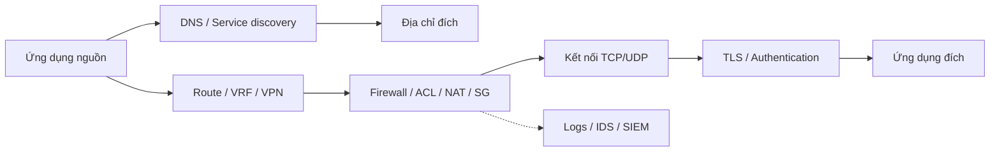

# Dùng allow all để che lỗi cấu hình: sai lầm thường gặp khi bảo mật mạng

Trong vận hành mạng, khi một ứng dụng không kết nối được, kỹ sư đôi khi thêm một quy tắc **`allow all`** để “xem có phải do firewall không”. Dịch vụ có thể hoạt động ngay sau đó, nhưng nguyên nhân thật chưa được xác định; quy tắc rộng còn có thể mở thêm những đường truy cập mà chủ hệ thống chưa từng phê duyệt. Nếu quy tắc tạm này được giữ lại, sự cố khả dụng đã biến thành một lỗ hổng kiểm soát truy cập.

**`Allow all`** là cách gọi chung cho các chính sách cho phép quá rộng, chẳng hạn “mọi nguồn → mọi đích → mọi giao thức/cổng”. Nó có thể xuất hiện trong firewall/ACL, network security group, cloud firewall, proxy, Kubernetes NetworkPolicy hoặc rule phân đoạn nội bộ. Bài học thuộc chương **Sai lầm thường gặp** của module `SECURITY_NETWORK_SECURITY`, liên kết bảo mật phân đoạn, firewall, VPN, IDS/IPS, DNS, mạng không dây và cloud với quy trình điều tra, kiểm thử và vận hành an toàn.

Ví dụ, một máy ứng dụng trong VLAN `APP` cần gọi API kế toán qua TCP/443. Sau thay đổi mạng, kết nối thất bại. Nếu nhóm vận hành thêm `permit ip any any`, ứng dụng có thể chạy lại, nhưng cùng lúc máy có thể tiếp cận management subnet, dịch vụ nội bộ nhạy cảm hoặc Internet ngoài danh sách cho phép. Câu hỏi quan trọng phải là: **luồng nào cần được phép, vì sao luồng đó bị chặn, và quy tắc tối thiểu nào đáp ứng đúng nhu cầu?**

Sau bài này, người học có thể phân biệt lỗi mạng với lỗi chính sách; giải thích tác hại của `allow all`; lập giả thuyết dựa trên log, routing và ứng dụng; triển khai ngoại lệ giới hạn trong tình huống khẩn cấp; và xác minh đồng thời **luồng hợp lệ hoạt động** với **luồng ngoài phạm vi vẫn bị từ chối**.

## 1. `Allow all` là gì, xuất hiện ở đâu?

Để đánh giá mức độ rộng của một rule, hãy xét **nguồn, đích, cổng/giao thức, chiều luồng, danh tính, vùng mạng và thời hạn**. Một rule có thể không ghi chữ “all” nhưng vẫn mở một tập kết nối quá lớn so với nhu cầu.

| Môi trường | Biểu hiện thường gặp | Tác động có thể xảy ra |
| --- | --- | --- |
| Firewall/ACL truyền thống | `permit ip any any`, rule hai zone cho phép mọi dịch vụ | Bỏ qua phân đoạn, để lộ dịch vụ quản trị và đường đi east–west. |
| Ingress cloud security group | Mọi giao thức/cổng từ `0.0.0.0/0` hoặc `::/0` | Mở tài nguyên trước nhiều nguồn không tin cậy; phải xem cả địa chỉ public/private, route và lớp bảo vệ khác. |
| Egress cloud security group | Cho phép mọi đích và mọi dịch vụ ra ngoài | Workload có thể kết nối tới đích không được phê duyệt; rủi ro exfiltration và command-and-control nếu thiết bị bị xâm nhập. |
| Kubernetes / CNI network policy | Không có policy cô lập hoặc policy egress/ingress cho phép toàn bộ | Pod có thể nói chuyện vượt ranh giới dự kiến, tùy cơ chế thực thi và các lớp policy khác. |
| VPN / remote access | Nhóm VPN được route và ACL tới toàn bộ subnet nội bộ | Tài khoản/thiết bị VPN có phạm vi tiếp cận quá rộng. |
| Wireless / NAC | SSID khách được truy cập tương đương mạng nhân viên | Mất tách biệt mạng guest với hệ thống nội bộ. |
| Proxy / egress gateway | Cho phép `CONNECT` tới mọi hostname/port hoặc bỏ qua kiểm tra đích | Lưu lượng có thể đi qua proxy hợp lệ nhưng tới dịch vụ không được chấp thuận. |
| DNS security | Tắt toàn bộ lọc/chính sách DNS để “hết lỗi phân giải” | Làm giảm lớp kiểm soát tên miền, nhưng **không chứng minh** nguyên nhân DNS hay kết nối được giải quyết ở tầng nào. |

**Không phải mọi quy tắc có `0.0.0.0/0` đều sai.** Một web server công khai có thể chủ đích mở ingress TCP/443 từ Internet; một NAT gateway có thể có route ra Internet; một dịch vụ cần công khai có thể dùng kiểm soát khác. Sai lầm xuất hiện khi **phạm vi được phép vượt nhu cầu và không được chấp nhận có chủ đích**, đặc biệt khi mở rộng để che một lỗi chưa hiểu rõ.

Cũng cần phân biệt **`default deny`** (lưu lượng không khớp quy tắc cho phép sẽ bị từ chối) với “deny tất cả” (không cho cả những luồng hợp lệ). Thiết kế đúng thường là cho phép theo yêu cầu đã xác minh rồi từ chối phần còn lại, với ngoại lệ rõ ràng.

## 2. Vì sao `allow all` làm sự cố có vẻ biến mất?

Một luồng ứng dụng chỉ thành công khi nhiều điều kiện cùng đúng. Khi mở rộng firewall rule, ta có thể làm một điều kiện chuyển từ false sang true, nhưng chưa biết **đó có phải điều kiện đúng cần sửa hay không**.



Ví dụ có thể gặp:

- Ứng dụng đổi từ IP cũ sang IP mới do DNS/CDN, nhưng firewall object chưa được cập nhật. Cho phép mọi đích sẽ che đi việc **object đích sai**.
- Kết nối xuất phát qua VPN pool hoặc NAT mới, trong khi rule chỉ cho phép subnet nguồn cũ. Cho phép mọi nguồn che **source zone/NAT mapping sai**.
- App cần TCP/443 nhưng rule chỉ mở TCP/8443, hoặc thiếu kết nối bắt buộc tới DNS/IdP/OCSP. Cho phép mọi port che **sai cổng/phụ thuộc**.
- Route thay đổi khiến traffic đi qua firewall khác hoặc chiều trả lời bất đối xứng. Một rule mở rộng có thể làm lưu lượng đi tiếp trên một đường nhưng không khắc phục **routing/stateful path**.
- Log cho thấy firewall **deny** nhưng thực tế ứng dụng lỗi do TLS hostname, chứng chỉ, quyền tài khoản hoặc backend. Trong trường hợp này mở rule có thể không giúp gì, thậm chí tạo thêm rủi ro.

**Tính tương quan không đồng nghĩa quan hệ nhân quả.** “Mở all thì kết nối được” chỉ hỗ trợ giả thuyết rằng một kiểm soát hoặc điều kiện kết nối có liên quan. Cần xác minh rule nào khớp, luồng nào đi qua và vì sao luồng ban đầu bị từ chối.

## 3. Hậu quả bảo mật của việc giữ quy tắc quá rộng

### 3.1. Mất khả năng phân đoạn và quyền tối thiểu

Phân đoạn VLAN/VRF hoặc microsegmentation chỉ hữu ích nếu kết nối giữa các vùng được giới hạn theo nhu cầu. Một `any-to-any allow` đặt trên đường liên vùng có thể phá vỡ ý nghĩa của sơ đồ phân đoạn dù các subnet vẫn tách biệt về mặt địa chỉ.

Ví dụ, policy dự kiến:

| Nguồn | Đích | Cổng | Kết quả |
| --- | --- | --- | --- |
| `APP-ZONE` | `DB-PROD` | TCP/5432 | Cho phép theo ứng dụng được duyệt. |
| `APP-ZONE` | `DNS-INTERNAL` | UDP/TCP 53 | Cho phép phân giải. |
| `GUEST-ZONE` | `MGMT-ZONE` | Mọi cổng | Chặn. |
| `APP-ZONE` | `MGMT-ZONE` | SSH/HTTPS quản trị | Chặn, trừ jump host đã phê duyệt. |
| Nguồn/đích/giao thức khác | Không có trong allowlist | Bất kỳ | Chặn theo chính sách. |

Nếu `APP-ZONE` được mở `any any`, workload bị xâm nhập trong vùng đó có thể tiếp cận nhiều đích hơn dự kiến. Firewall chỉ là một lớp phòng vệ; mục tiêu hardening là **giới hạn phạm vi di chuyển và hậu quả** khi một thành phần bị lạm dụng.

### 3.2. Rủi ro dữ liệu và điểm quản trị

Một luồng ngoài nhu cầu có thể dẫn tới:

- Truy cập nhầm hoặc trái phép tới API nội bộ, database, storage, dịch vụ quản trị hoặc metadata endpoint.
- Egress tới endpoint Internet tùy ý, làm giảm hiệu quả kiểm soát đích kết nối của workload.
- Bỏ qua jump host, proxy, kiểm soát DNS hoặc ranh giới giám sát nếu mạng có nhiều đường đi.
- Tăng bề mặt tấn công nếu rule mở cả từ Internet vào dịch vụ vốn chỉ dùng nội bộ.

**Cho phép kết nối không đồng nghĩa đã bị khai thác.** Báo cáo nên nói rõ điều đã chứng minh là *đường kết nối được mở* hay *hành động ở tầng ứng dụng đã xảy ra*, tránh phóng đại từ một log `ALLOW`.

### 3.3. Nợ cấu hình và rủi ro vận hành

Quy tắc rộng còn gây khó quản trị:

- **Shadowing:** rule nằm phía trên khiến rule hẹp phía dưới không bao giờ được dùng; trong firewall theo thứ tự ưu tiên, thứ tự match có thể quyết định kết quả.
- **Rule drift:** rule tạm khác với bản thiết kế/Git/CMDB; lần kiểm toán sau không biết lý do.
- **Thiếu ownership:** không ai biết ai đã mở, khi nào đóng hay ứng dụng nào phụ thuộc.
- **Log noise hoặc blind spot:** lượng session tăng, log có thể bị giảm mức chi tiết hoặc ghi không đủ; một số hệ thống không ghi mọi packet.
- **Thay đổi không chủ đích:** khi cần khắc phục, mọi người sợ thu hẹp vì không biết ai đang sử dụng rule.

Một rule chưa có hit trong thời gian ngắn cũng **không chắc là thừa**: luồng dự phòng/DR chỉ xuất hiện khi failover. Cần kết hợp owner, dependency và quan sát phù hợp trước khi xóa.

## 4. Nhận diện rule có vẻ hẹp nhưng thực chất quá rộng

| Dấu hiệu | Vì sao đáng xem xét | Cách xác minh |
| --- | --- | --- |
| Source `any`, destination `any`, service `any` | Cho phép gần như không giới hạn trong phạm vi zone đó | Kiểm tra ingress/egress zone, route thực, thứ tự rule và các lớp lọc khác. |
| Cổng 443 tới `0.0.0.0/0` | Giới hạn cổng nhưng không giới hạn dịch vụ hay chủ đích | Kiểm tra nhu cầu egress, proxy/FQDN/identity policy và endpoint dùng chung. |
| Source là cả subnet trong khi chỉ một workload cần | Mở quyền cho máy khác trong subnet | Xác nhận asset/identity thực, NAT và khả năng dùng object hẹp. |
| Một object group gồm dải mạng lớn | Rule nhìn gọn nhưng destination thực quá rộng | Mở rộng nested object, xem địa chỉ thực và thay đổi gần đây. |
| `allow` không có owner/hạn review | Không có cơ chế xác minh còn cần | Đối chiếu ticket, chủ dịch vụ và thời hạn ngoại lệ. |
| Rule ưu tiên cao vừa được thêm lúc sự cố | Có khả năng override deny/segmentation phía dưới | Đối chiếu change log và hit/deny trước-sau. |
| IPv4 bị giới hạn nhưng IPv6 cho phép toàn bộ | Cùng ứng dụng có thể chọn IPv6 | Xem `::/0`, IPv6 route/policy và dual stack của workload. |
| Firewall chặn nhưng proxy/VPN path lại cho phép | Có nhiều điểm cưỡng chế không nhất quán | Định tuyến từ điểm nguồn thực, proxy setting, VPN split tunneling. |
| Quy tắc tạm bị sao chép qua môi trường | Rule troubleshooting ở staging được đưa vào production | Rà pipeline IaC, policy inheritance và approval. |

Rule hẹp theo một thuộc tính có thể vẫn rộng theo thuộc tính khác. Chẳng hạn `TCP/443` chỉ nói tới cổng đích, không tự khẳng định kết nối HTTPS đúng tên miền hoặc đúng ứng dụng. Các hệ thống proxy/ngữ cảnh TLS có thể bổ sung kiểm soát, nhưng cần kiểm tra thực tế khả năng nhận diện dịch vụ, SNI/ECH và sự phụ thuộc vào mã hóa.

## 5. Quy trình chẩn đoán đúng trước khi sửa firewall

Đừng chọn thay đổi rule làm bước đầu tiên. Quy trình nên tìm **điểm lỗi cụ thể** và xác minh điều kiện vận hành của từng lớp, ưu tiên quan sát thụ động trước.

### Bước 1 — Xác định luồng cần có và kết quả thực tế

Ghi rõ:

| Thuộc tính | Ví dụ lab |
| --- | --- |
| Dịch vụ/nghiệp vụ | `billing-api` cần gọi `payment-partner.test` |
| Nguồn | Workload `APP-01` tại `10.10.20.25`, zone `APP` |
| Đích được phê duyệt | `10.60.50.10` trong test zone do tổ chức quản lý |
| Giao thức/cổng | TCP/443, HTTPS/TLS |
| Đường đi kỳ vọng | `APP-VRF → FW-EGRESS-01 → TEST-SERVICE` |
| Thời điểm sự cố | UTC, ghi phút/giây và sai số đồng hồ |
| Hiện tượng | DNS trả đích nhưng TCP connect timeout; chưa biết lỗi ở đâu |
| Chính sách dự kiến | Chỉ `APP-01` tới `10.60.50.10:443`, còn đích khác bị deny |

Với IP động hoặc dịch vụ dùng CDN, cần xác nhận mô hình owner cho đích động; không tự gán một địa chỉ IP mới là hợp lệ chỉ vì DNS trả về.

### Bước 2 — Đối chiếu DNS và kết nối ứng dụng

Xác định hostname phân giải thành gì từ **đúng resolver của workload**, có split DNS, cache hoặc DNS64 không. Nếu phân giải đúng, vẫn cần kiểm tra routing, firewall, TLS và trạng thái endpoint.

Trong lab được cho phép, có thể thực hiện kiểm tra nhẹ:

```bash
# Dùng resolver nội bộ đã được chỉ định trong lab.
nslookup payment-partner.test 10.10.0.53

# Một request HTTPS ngắn đến endpoint kiểm thử do tổ chức quản lý.
curl --head --connect-timeout 3 --max-time 6 \
  https://payment-partner.test/
```

Lệnh `curl` chỉ có ý nghĩa khi endpoint/test certificate và proxy của môi trường đã được cấu hình hợp lệ. `curl` timeout không xác định riêng lỗi ở firewall; HTTP error có thể xuất hiện **sau khi** TCP/TLS đã thành công. Không tắt kiểm tra TLS để đánh dấu HTTPS là đạt.

### Bước 3 — Kiểm tra routing, VRF, NAT và đường đi

Đối chiếu route ở **đúng nguồn/namespace/VRF**, next-hop, policy routing và chiều trả lời. Trong mạng cloud/hybrid, lưu ý cloud route table, private endpoint, peering, VPN gateway, NAT gateway và các thiết bị firewall nối tiếp.

- Có route tới IP đích đúng không và đi qua điểm cưỡng chế nào?
- IP nguồn được firewall quan sát có phải IP của workload hay địa chỉ đã NAT?
- Đích có thấy nguồn NAT khác, hay có reverse proxy/load balancer?
- Có đường IPv6 hoặc proxy/VPN thay thế khiến traffic đi qua rule khác không?
- Nếu firewall stateful, kết nối có bị bất đối xứng khiến thiết bị không quan sát đủ phiên không?

Không cho rằng một bảng route có tuyến nghĩa là ứng dụng đã đi được; cần kiểm tra forwarding thực và return path.

### Bước 4 — Ghép log theo phiên, không dựa vào suy đoán

Một bản ghi có ích nên thể hiện `timestamp_utc`, `device_id`, `src_ip/src_port`, `dst_ip/dst_port`, `protocol`, `zone/interface`, `rule_id`, `action`, `session_id`, NAT mapping và thời gian hiệu lực nếu có.

Ví dụ giả lập:

```json
{
  "timestamp_utc": "2026-11-28T03:20:15.124Z",
  "device_id": "FW-EGRESS-01",
  "src_zone": "APP",
  "src_ip": "10.10.20.25",
  "src_port": 53320,
  "dst_zone": "TEST",
  "dst_ip": "10.60.50.10",
  "dst_port": 443,
  "protocol": "TCP",
  "rule_id": "APP-TEST-DENY-DEFAULT",
  "action": "deny",
  "session_id": "lab-sess-012",
  "reason": "no-specific-allow-rule"
}
```

Log minh họa cho thấy **một phiên TCP cụ thể** bị từ chối bởi rule được ghi. Nó không khẳng định mọi lần thử đều bị chặn hay đã chứng minh ứng dụng đích khỏe. Để kiểm tra đầy đủ, đối chiếu log phía client/server, tình trạng endpoint, đồng hồ, NAT và đường đi.

### Bước 5 — Xác nhận nguyên nhân bằng một giả thuyết có thể bác bỏ

Ví dụ: “`APP-01` bị deny vì policy cho đúng `APP-ZONE` và TCP/443 tới endpoint cũ nhưng thiếu `10.60.50.10` trong destination object.”

Đây là giả thuyết **có thể kiểm chứng** bằng rule, object, change history và luồng test. Trước khi sửa, hỏi xem đích mới có thực sự được chủ ứng dụng cho phép, có thuộc bên thứ ba cần đồng ý và có phát sinh dependency khác không. Nếu các nguồn dữ liệu mâu thuẫn, ghi `INCONCLUSIVE`, tiếp tục điều tra có kiểm soát.

## 6. So sánh ba cách “khắc phục” một luồng bị chặn

Tình huống giả lập: `APP-01 (10.10.20.25)` cần HTTPS tới `TEST-SERVICE (10.60.50.10)`, nhưng firewall ghi deny do thiếu chính sách cho phép.

| Cách xử lý | Mô tả logic | Đánh giá |
| --- | --- | --- |
| **A. Mở toàn bộ** | `ALLOW any → any → any` | Có thể làm luồng chạy, nhưng mở phạm vi rất lớn, khó chứng minh không ảnh hưởng luồng khác. |
| **B. Mở theo cổng nhưng mọi đích** | `ALLOW APP-ZONE → any → TCP/443` | Hẹp hơn A về nguồn/cổng nhưng vẫn cho mọi đích HTTPS qua đường này, có thể vượt nhu cầu. |
| **C. Cho đúng luồng** | `ALLOW APP-01 → 10.60.50.10 → TCP/443`, phần khác theo default deny | Đúng nguyên tắc tối thiểu cho giả định endpoint ổn định; cần policy về danh tính/đích động nếu kiến trúc yêu cầu. |

Đây là mô tả logic, không phải cú pháp CLI cụ thể. Phải kiểm tra firewall thực thi theo rule order, zone, stateful semantics, object expansion và vị trí NAT; không sao chép ví dụ vào production mà chưa review.

### 6.1. Mô hình chính sách trước và sau

```yaml
# Pseudocode: mô tả ý định chính sách, KHÔNG phải cấu hình vendor.
before_bad:
  - id: "temporary-any-any"
    source: "any"
    destination: "any"
    protocol: "any"
    destination_port: "any"
    action: "allow"
    justification: "service troubleshooting"
    expiry: null

after_review:
  - id: "billing-to-approved-partner"
    source: "APP-01"
    destination: "TEST-SERVICE"
    protocol: "tcp"
    destination_port: 443
    action: "allow"
    owner: "billing-service-owner"
    approval: "CHG-EXAMPLE-104"
    review_due: "set-by-change-policy"
  - id: "default-deny-app-egress"
    source: "APP-ZONE"
    destination: "not-explicitly-allowed"
    action: "deny"
    logging: "security-relevant-events"
```

Trong firewall cụ thể, “default deny” có thể là chính sách ngầm và không cần một rule thêm vào; logging của implicit deny có thể tắt hoặc giới hạn. Định nghĩa `not-explicitly-allowed` ở đây là mục đích chính sách, **không phải object thực**. Nếu dịch vụ đối tác đổi IP theo DNS, cần phương thức quản lý đích phù hợp (FQDN-aware firewall, proxy hoặc cơ chế được vendor hỗ trợ) và vẫn phải xác minh giới hạn.

### 6.2. Ma trận kiểm thử sau thay đổi

| ID | Nguồn → đích | Kết quả mong đợi | Cần có bằng chứng gì? |
| --- | --- | --- | --- |
| `T01` | `APP-01 → TEST-SERVICE:443/TCP` | **ALLOW**, ứng dụng test nhận phản hồi hợp lệ | Client/server log, firewall policy ID đúng, route/NAT. |
| `T02` | `APP-01 → DENY-TEST-SERVICE:443/TCP` | **DENY** | Đích thử đang khỏe, firewall deny, không có request thành công. |
| `T03` | `APP-01 → TEST-SERVICE:22/TCP` | **DENY** | Log đúng cổng, không bị rule khác cho phép. |
| `T04` | `GUEST-CLIENT → TEST-SERVICE:443/TCP` | **DENY** nếu guest không được cấp quyền | Kiểm tra theo đúng VLAN/VRF, log matched rule. |
| `T05` | `APP-01 → dịch vụ DNS nội bộ` | **ALLOW** theo policy DNS đã duyệt | DNS query/response và log đúng resolver. |
| `T06` | `APP-01 qua IPv6/proxy/VPN phụ nếu có` | Theo chính sách tương đương, không bypass | Route, policy, log theo đường thực. |

**Positive control** (`T01`) bảo đảm dịch vụ vẫn chạy. **Negative control** (`T02–T04`) bảo đảm quyền không mở rộng. Nếu chỉ kiểm tra T01, nhóm mới chứng minh khả dụng mà chưa chứng minh chính sách bảo mật đúng. Nếu T02 timeout nhưng không có log hoặc không biết đích test khỏe, kết quả phải là **chưa đủ kết luận**.

## 7. Trường hợp khẩn cấp: ngoại lệ tạm phải có ranh giới

Có những sự cố mức nghiêm trọng cao mà tổ chức cho phép **emergency change** để khôi phục dịch vụ. Điều đó không biến `allow all` thành mặc định hợp lệ. Một ngoại lệ phải có căn cứ, giới hạn và kế hoạch thu hồi cụ thể.

| Yếu tố kiểm soát | Yêu cầu |
| --- | --- |
| **Authority** | Người có thẩm quyền emergency change phê duyệt, có ticket/incident ID. |
| **Scope** | Chỉ nguồn/đích, zone, protocol/port tối thiểu đã xác định. |
| **Time limit** | Thời điểm bắt đầu, thời hạn hoặc mốc review/thu hồi; không để “tạm thời vô hạn”. |
| **Monitoring** | Bật log phù hợp và có người theo dõi lượng phiên/deny/allow bất thường trong cửa sổ. |
| **Compensating controls** | Hạn chế ở lớp khác khi khả thi: mTLS, proxy, danh tính, host policy, bastion, ACL nguồn. |
| **Rollback** | Trạng thái trước, cách hoàn nguyên và người quyết định rollback; đã kiểm tra khả năng khôi phục. |
| **Review** | Post-implementation review, xác minh lưu lượng thật cần thiết rồi thay bằng rule hẹp. |
| **Evidence** | Change ID, rule ID, audit thao tác, thời gian UTC, kết quả test và rủi ro được chấp nhận. |

Nếu chưa thể xác định đích chính xác, một phương án ít rủi ro hơn có thể là **giới hạn theo đúng workload nguồn, cổng, thời gian và đích trung gian do tổ chức kiểm soát**, đồng thời thu log để xác định dependency. Quyết định cụ thể phải dựa trên nguy cơ và quyền phê duyệt thực tế; không coi đây là lý do mở toàn bộ kết nối ra Internet.

### 7.1. Vì sao “bật all vài phút rồi tắt” vẫn có rủi ro?

- Dù chỉ trong vài phút, rule có thể cho phép những phiên không liên quan khởi tạo.
- Với firewall **stateful**, phiên được tạo khi rule mở có thể còn tồn tại trong state table sau khi rule bị thu hẹp, tùy cơ chế nền tảng và chính sách xử lý session.
- Hệ thống tự động hóa hoặc IaC có thể ghi nhận rule rộng như trạng thái chuẩn rồi đưa lại vào triển khai kế tiếp.
- Nếu test không ghi log, nhóm khó xác định traffic nào đã đi trong khoảng mở.

Do đó cần cả kiểm tra **phiên mới**, cân nhắc **phiên đã tồn tại** theo runbook và xác nhận trạng thái rule ở tất cả node/zone sau rollback. Không tự xóa hàng loạt session production nếu chưa được cho phép.

## 8. Các bẫy kỹ thuật làm người vận hành muốn mở `allow all`

### 8.1. Firewall stateful và cổng phản hồi

Một kết nối TCP hợp lệ có cổng nguồn tạm thời (*ephemeral port*). Firewall **stateful** thường cho phép lưu lượng phản hồi của phiên đã thiết lập theo state table; không nên suy ra phải mở mọi cổng inbound để nhận response.

Ngược lại, **stateless ACL/NACL** có thể yêu cầu quy tắc cho chiều phản hồi tương ứng, bao gồm port range cần thiết. Cấu hình phải dựa trên ngữ nghĩa của sản phẩm và flow cụ thể; không sao chép rule từ stateful firewall sang stateless NACL.

### 8.2. Thứ tự rule, nhóm đối tượng và policy inheritance

Trong nhiều firewall có thứ tự xử lý first-match, một rule phía trên có thể che rule cụ thể bên dưới. Trong một số nền tảng cloud, nhiều rule được tổng hợp bằng logic khác và **không theo first-match**. Vì vậy, phải đọc **ngữ nghĩa thực thi của nền tảng**.

Điểm cần kiểm tra: rule priority, source/destination zone, security profile, address object, inheritance, implicit deny và hit count. Một rule “hẹp” đặt sau `allow any` sẽ không bảo vệ được nếu rule trước đã quyết định cho phép.

### 8.3. DNS và IPv4/IPv6

Ứng dụng có thể phân giải cả `A` và `AAAA`. Nếu IPv4 đã deny đúng nhưng IPv6 còn open `::/0`, hệ thống dual-stack có thể vẫn có đường ra ngoài. Tương tự, DNS thành công không khẳng định firewall permit, DNS timeout không khẳng định mạng ứng dụng bị firewall chặn. Kiểm tra DNS view, resolver, IP được trả, route và policy cho từng giao thức liên quan.

### 8.4. NAT, proxy và điểm quan sát

Firewall có thể ghi địa chỉ trước NAT hoặc sau NAT tùy thiết bị/điểm log. Server đích có thể chỉ thấy IP của NAT/proxy. Nếu rule được cấu hình theo IP nguồn cũ nhưng NAT thay đổi, mở mọi nguồn sẽ che lỗi mapping. Hãy ghép **5-tuple, NAT mapping và timestamp** để tìm đúng phiên.

### 8.5. VPN và routing

VPN split tunnel, route leaking giữa VRF, cloud peering, SD-WAN hoặc secondary interface có thể tạo đường truyền khác dự kiến. Đưa một allow rule rộng vào thiết bị đang được xem xét không chứng minh nó là điểm lọc thực; traffic có thể đi qua gateway khác. Trước khi mở rule, phải xác định **path thực tế** và người sở hữu thay đổi route.

### 8.6. IDS/IPS và các lớp bảo vệ khác

Một ứng dụng có thể lỗi vì IPS chặn một hành vi cụ thể, WAF từ chối request, TLS không tương thích hoặc IAM không cấp quyền. **Tắt toàn bộ IPS/WAF hoặc mở toàn bộ firewall** chỉ làm mất các tín hiệu bảo vệ. Tìm event ID/rule và thử kịch bản có kiểm soát để phân biệt lỗi phát hiện giả với lỗi ứng dụng.

## 9. Đặc thù cloud, Kubernetes và tự động hóa

### 9.1. Cloud security group, NACL và route

Trong cloud, một máy ảo có thể chịu nhiều lớp: host firewall, security group, subnet NACL, cloud firewall, route table, NAT/Internet gateway, peering và VPN. Các lớp này không có ngữ nghĩa giống nhau.

Ví dụ một security group cho mọi egress có thể là mặc định của một nền tảng/tài nguyên, nhưng **không chứng minh** từng workload đã được kiểm soát ở tầng egress gateway hoặc proxy. Khi xử lý lỗi, phải phân biệt **SG stateful**, **NACL stateless**, route và điểm NAT để tránh mở ingress/egress toàn phần.

| Tình huống | Chẩn đoán nên làm | Tránh |
| --- | --- | --- |
| EC2/VM không truy cập được API đối tác | Kiểm tra DNS, SG egress, NACL, route, NAT gateway, proxy, log | Cho phép mọi protocol/port từ `0.0.0.0/0` trên ingress. |
| Cloud app sau khi chuyển subnet bị timeout | So sánh route/NACL/SG ở subnet cũ và mới; kiểm tra IPv6 | Sao chép một SG `allow all` “để giống môi trường cũ”. |
| Private endpoint không hoạt động | Kiểm tra endpoint policy, private DNS, route và identity | Mở Internet gateway vô điều kiện. |

Các hệ thống cloud có thay đổi về tính năng; khi triển khai phải xác minh tài liệu của **dịch vụ, tài khoản và phiên bản chính sách** đang dùng.

### 9.2. Kubernetes NetworkPolicy

Một Kubernetes workload không có policy cô lập cho một chiều có thể được phép giao tiếp mặc định trong phạm vi cơ chế NetworkPolicy, nếu không có lớp kiểm soát khác. Một NetworkPolicy kiểu “allow toàn bộ” có thể vô hiệu hóa mục tiêu cô lập ở chiều ingress hoặc egress đã định. Tuy nhiên, hiệu lực cụ thể phụ thuộc **CNI**, sự chọn lọc Pod/namespace, loại traffic và các chính sách bổ sung.

Mô tả **pseudocode** dưới đây nêu ý định, không phải tài nguyên Kubernetes hợp lệ:

```yaml
# Model only — not a Kubernetes NetworkPolicy manifest.
namespace: payments
workload: billing-api
intent:
  ingress:
    default: deny
    allow:
      - from: approved-api-gateway
        port: "tcp/8443"
  egress:
    default: deny
    allow:
      - to: internal-dns
        ports: ["udp/53", "tcp/53"]
      - to: approved-payment-service
        ports: ["tcp/443"]
```

Ở môi trường thật cần thiết kế theo `podSelector`, `namespaceSelector`, `ipBlock` hoặc cơ chế CNI hỗ trợ và kiểm tra tác động DNS, node/hostNetwork, service mesh, network namespace và traffic path. Không mặc định NetworkPolicy chuẩn có điều kiện FQDN hoặc chặn mọi đường qua host.

### 9.3. IaC và policy-as-code

Nếu firewall/cloud policy được quản lý bằng Terraform, GitOps hoặc pipeline, sửa tay một rule “cho kịp” tạo drift và có thể bị pipeline **ghi đè** hoặc **hợp thức hóa** về sau. Cần định nghĩa owner của desired state, quy trình emergency change và đường đưa thay đổi có phê duyệt trở lại mã khai báo.

Những kiểm tra hữu ích trước triển khai:

- Cảnh báo rule cho mọi nguồn/đích/protocol không có exception ID hợp lệ.
- Chặn rule tạm thiếu `owner`, `justification`, `expiry/review_due` và `change_id`.
- Kiểm tra rule rộng làm shadow các deny hoặc allow hẹp quan trọng.
- Phân biệt nhu cầu mở dịch vụ công khai theo thiết kế với hành động bypass trong xử lý lỗi.
- Có test policy/đường đi theo nguồn và đích được duyệt, kiểm tra IPv4/IPv6 khi áp dụng.

Không nên tự động từ chối mọi `0.0.0.0/0:443` nếu kiến trúc yêu cầu web public; hãy định nghĩa **policy exceptions có giải trình**, ranh giới khác và khả năng quan sát.

## 10. Một tình huống điều tra đầy đủ

**Bối cảnh phòng lab giả lập:** service `billing-api` trong `APP-ZONE` cần kết nối HTTPS tới `payment-partner.test`. Trước thay đổi, domain chỉ tới `10.60.40.10`; sau chuyển hệ thống, trả `10.60.50.10`. Firewall chỉ cho phép IP cũ.

**Quan sát ban đầu:**

1. Client phân giải `payment-partner.test` ra `10.60.50.10`.
2. TCP connect từ `10.10.20.25` tới `10.60.50.10:443` thất bại.
3. Firewall log ghi `DENY` theo rule default, với 5-tuple khớp.
4. Chủ ứng dụng xác nhận IP mới thuộc endpoint được phê duyệt.
5. Đích `10.60.50.10:443` hoạt động từ một test source đối chứng được phép.

**Quyết định sai:** thêm `allow APP-ZONE → any → any`. Đích mới kết nối được, nhưng máy cùng zone cũng có thể thử kết nối tới các đích quản trị hoặc endpoint ngoài allowlist; nguyên nhân thực về object IP bị bỏ qua.

**Quyết định đúng:** sửa destination object hoặc rule dành riêng cho `billing-api`, duy trì nguồn/cổng tối thiểu, xác minh địa chỉ động theo policy quản lý dịch vụ, cập nhật dependency và log. Triển khai bằng change có người duyệt; có thời hạn nếu chỉ là ngoại lệ.

### 10.1. Bằng chứng trước và sau (giả lập)

| Kiểm tra | Trước khi sửa | Sau khi sửa đúng |
| --- | --- | --- |
| `billing-api → partner:443` | DENY do object chưa có IP mới | ALLOW; response HTTPS test hợp lệ. |
| `billing-api → deny-test:443` | DENY | Vẫn DENY; log khớp nguồn/đích. |
| `billing-api → management:22` | DENY | Vẫn DENY. |
| DNS cho `payment-partner.test` | Trả IP mới | Vẫn trả IP mới; không cần “mở tất cả DNS”. |
| Firewall policy | Rule đích cũ | Rule giới hạn đúng endpoint/identity đã được duyệt. |
| Monitoring | Ghi default deny | Ghi allow đúng rule và deny cho các luồng không được phép. |

**Kết luận:** việc thêm đúng địa chỉ/đối tượng và giữ negative controls đã chứng minh thay đổi đạt cả mục tiêu khả dụng lẫn kiểm soát truy cập **trong phạm vi thử**. Chưa chứng minh mọi luồng trên toàn mạng an toàn tuyệt đối.

### 10.2. Nguyên nhân gốc và phòng ngừa tái diễn

RCA nên ghi rõ:

- **Nguyên nhân trực tiếp:** destination object firewall không được cập nhật theo endpoint mới.
- **Yếu tố góp phần:** change DNS và firewall không có dependency mapping; chủ ứng dụng chưa báo thay đổi IP.
- **Biện pháp ngắn hạn:** cập nhật allowlist có phê duyệt và retest.
- **Biện pháp dài hạn:** quản lý luồng dịch vụ, review dependency, cảnh báo object stale, hỗ trợ FQDN/proxy policy nếu phù hợp, thêm kiểm tra liên nhóm trước cutover.
- **Giới hạn kiểm chứng:** chỉ kiểm những đường/host được ghi; quy tắc cloud, IPv6 hoặc VPN khác cần bài kiểm thử riêng nếu trong scope.

## 11. Cách viết báo cáo và đo mức cải thiện

Một báo cáo lỗi `allow all` nên trả lời được sáu câu hỏi:

1. **Rule nào** đã bị mở quá rộng (ID, device/policy version, điểm thực thi)?
2. **Vì sao** rule được tạo (ticket, sự cố, người phê duyệt, giả thuyết ban đầu)?
3. **Tập luồng nào** phát sinh thêm quyền ngoài nhu cầu (nguồn/đích/port/zone; có bằng chứng quan sát)?
4. **Nguyên nhân thực** của lỗi ban đầu là gì; bằng chứng đối chiếu ở DNS, route, firewall và ứng dụng?
5. **Chính sách thay thế** là gì, vì sao nó tối thiểu và có owner/expiry/review?
6. **Kết quả kiểm chứng** của positive/negative controls, log, rollback và rủi ro còn lại?

Ví dụ diễn đạt:

> Trong cửa sổ xử lý sự cố, rule `FW-R-TEMP-12` được cấu hình cho phép toàn bộ traffic từ `APP-ZONE` tới `TEST-ZONE`. Đối chiếu log xác nhận dịch vụ `billing-api` thất bại vì destination object chưa chứa IP endpoint mới. Rule tạm đã được thay bằng rule giới hạn `billing-api → approved-payment-service:443/TCP` theo change `CHG-EXAMPLE-104`. Các phép thử đã duyệt xác nhận HTTPS hợp lệ hoạt động và hai luồng ngoài danh sách vẫn bị deny. Kết luận chỉ áp dụng cho các luồng, đường mạng và cửa sổ thử nghiệm được nêu.

### 11.1. Chỉ số theo dõi

| Chỉ số | Diễn giải | Lưu ý |
| --- | --- | --- |
| Rule quá rộng không có owner | Đếm rule có phạm vi lớn mà thiếu người chịu trách nhiệm | Không đồng nhất rule công khai có giải trình với rule sai. |
| Exception quá hạn | Rule tạm quá `expiry/review_due` mà chưa đánh giá lại | Phải có xử lý theo mức rủi ro, tránh xóa mù quáng. |
| Số sự cố có RCA | Ticket connectivity có nguyên nhân rõ và test xác minh | Một rule “đã mở nên hết lỗi” chưa đủ RCA. |
| Tỷ lệ change có negative control | Số thay đổi có test deny hợp lệ / tổng thay đổi cần test | Test deny phải gắn đúng đường/nguồn và log. |
| Drift policy | Rule thực tế khác desired state có phê duyệt | Có thể bỏ sót nếu công cụ chỉ kiểm tên rule, không mở rộng object. |
| Thời gian thu hồi emergency rule | Từ thời điểm áp dụng tới lúc được thay bằng rule chuẩn hoặc gỡ | Chỉ số đo kỷ luật thay đổi, không đại diện độc lập mức an toàn. |

## 12. Những câu hỏi tự kiểm tra

**Tình huống A:** Một VM không gọi được API qua HTTPS. Firewall đã cho TCP/443 đến một đích cụ thể; team đề xuất mở `0.0.0.0/0`. Điều gì cần kiểm tra trước?

**Hướng xử lý:** DNS/FQDN và IP hiện tại, route/NAT/proxy, đúng source/zone/SG, log rule ID, tình trạng TLS và endpoint. Nếu đích đổi IP, cập nhật object/policy phù hợp; chỉ mở nguồn/đích được phê duyệt.

**Tình huống B:** Sau khi mở `any any` trong 10 phút, kết nối chạy; rule đã bị gỡ. Có thể tuyên bố đã an toàn chưa?

**Hướng xử lý:** Chưa. Cần đánh giá những phiên đã mở, thay đổi state table tùy nền tảng, log trong cửa sổ ngoại lệ, drift IaC, đường đi khác và kết quả negative controls sau rollback. Kết luận dựa trên bằng chứng cụ thể.

**Tình huống C:** Kubernetes Pod gửi được HTTP ra ngoài dù NetworkPolicy được cho là default deny egress. Có thể sửa bằng cách thêm allow all không?

**Hướng xử lý:** Không. Kiểm tra selector, namespace, policy type, CNI enforcement, lưu lượng từ host/network namespace, đường egress và thứ tự áp dụng các lớp policy. Tạo phép thử từ đúng Pod, xác định lỗi rồi bổ sung quyền tối thiểu.

**Tình huống D:** Firewall log `DENY` nhưng ứng dụng vẫn hoạt động. Điều đó chứng minh firewall không chặn?

**Hướng xử lý:** Không. Log deny có thể thuộc một phiên khác, đường đi khác hoặc lần kết nối cũ; ứng dụng có thể chuyển sang địa chỉ khác, IPv6/proxy, cache hoặc retry. Ghép source/destination/port/protocol/timestamp/NAT/session ID và kiểm tra log endpoint.

## 13. Checklist trước khi phê duyệt hoặc gỡ một rule tạm

- [ ] Nhu cầu nghiệp vụ và 5-tuple (hoặc chính sách ứng dụng/identity tương đương) đã được mô tả.
- [ ] Log, routing, DNS, NAT, proxy, VPN, IPv4/IPv6 và ứng dụng đã được đối chiếu đủ để xác định giả thuyết.
- [ ] Rule đề xuất giới hạn theo nguồn, đích, port, protocol, zone và thời gian cần thiết.
- [ ] Rule không shadow/bypass các kiểm soát phân đoạn, quản trị, IDS/IPS hoặc egress đã duyệt.
- [ ] Có approval và owner theo thẩm quyền; exception được ghi ticket, hạn review/thu hồi và rủi ro.
- [ ] Có baseline/diff trước thay đổi, kế hoạch rollback, điểm liên lạc NOC/SOC và tiêu chí dừng.
- [ ] Có positive control xác minh luồng hợp lệ chạy đúng đường và đúng rule.
- [ ] Có negative controls để chứng minh các đích/cổng/nguồn khác vẫn bị deny.
- [ ] Log mới có ID rule, action, nguồn/đích/cổng, UTC và mapping NAT khi cần.
- [ ] Đã xem xét phiên stateful tồn tại sau thu hồi và các policy tương đương trong cloud/IPv6/proxy.
- [ ] Đã xác minh cấu hình thực, desired state (IaC/CMDB), và rule đã đồng bộ trên HA peers.
- [ ] Chủ ứng dụng và chủ security policy đã xác nhận hành vi sau thay đổi; tài liệu, runbook và dependency được cập nhật.
- [ ] Nếu kết quả vẫn chưa đủ kết luận, báo `INCONCLUSIVE` thay vì mở rộng rule để ép phép thử “thành công”.

**Nguyên tắc cốt lõi:** Dùng `allow all` để che một lỗi kết nối đánh đổi khả năng kiểm soát mạng lấy sự thuận tiện tạm thời. Vận hành bảo mật đúng là **điều tra luồng bị lỗi, sửa nguyên nhân cụ thể, cấp quyền tối thiểu, kiểm tra cả allow và deny, rồi quản lý vòng đời của mọi ngoại lệ**.

## Tài liệu tham khảo

- [NIST SP 800-41 Rev. 1 — Guidelines on Firewalls and Firewall Policy](https://csrc.nist.gov/pubs/sp/800/41/r1/final): thiết kế và quản trị chính sách firewall, nguyên tắc kiểm soát luồng.
- [NIST SP 800-53 Rev. 5 — Security and Privacy Controls](https://csrc.nist.gov/pubs/sp/800/53/r5/upd1/final): các nhóm AC (access control), CM (configuration management), SC (system and communications protection) và AU (audit).
- [NIST SP 800-115 — Technical Guide to Information Security Testing and Assessment](https://csrc.nist.gov/pubs/sp/800/115/final): lập kế hoạch kiểm thử và phương pháp thu chứng cứ.
- [RFC 1918 — Address Allocation for Private Internets](https://datatracker.ietf.org/doc/html/rfc1918): địa chỉ IPv4 riêng sử dụng trong ví dụ.
- [RFC 5737 — IPv4 Address Blocks Reserved for Documentation](https://datatracker.ietf.org/doc/html/rfc5737): địa chỉ IP dành cho ví dụ tài liệu khi cần minh họa đích public.
