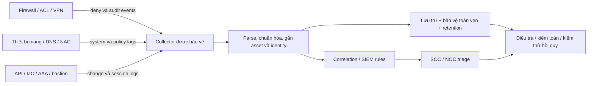

# Không ghi log deny và thay đổi cấu hình

## 1. Sai lầm này nguy hiểm ở đâu?

Trong hệ thống **SECURITY_NETWORK_SECURITY**, doanh nghiệp sử dụng nhiều lớp phòng vệ: phân đoạn mạng, firewall, VPN, IDS/IPS, bảo vệ DNS, Wi-Fi và các lớp kiểm soát mạng trên cloud. Các lớp này có thể từ chối truy cập trái chính sách hoặc thay đổi cách lưu lượng được định tuyến. Nhưng khi **không ghi nhận những lần truy cập bị từ chối (deny)** và **không ghi nhận thay đổi cấu hình**, nhóm vận hành sẽ thiếu bằng chứng để biết liệu biện pháp kiểm soát đã hoạt động như thiết kế, đã bị chỉnh sửa hoặc đang bị lạm dụng hay chưa.

Ví dụ, một kỹ sư nhận báo cáo rằng ứng dụng vừa mất kết nối với cơ sở dữ liệu. Firewall có thể đang chặn đúng theo yêu cầu, một rule mới có thể vô tình chặn luồng hợp lệ, hoặc routing/DNS có thể có lỗi. Nếu không có deny log và lịch sử thay đổi rule, cả ba tình huống đều có thể biểu hiện thành timeout. Nhóm vận hành buộc phải suy đoán, kéo dài thời gian khắc phục và có nguy cơ mở quyền quá rộng để “chữa cháy”.

Ngược lại, kẻ tấn công thử truy cập dịch vụ quản trị từ vùng ít tin cậy có thể liên tục bị từ chối. Việc chặn thành công là tốt, nhưng nếu không tạo ra tín hiệu phù hợp, SOC sẽ không biết có hoạt động dò tìm bất thường, không thể tương quan với VPN/IDS logs hoặc điều chỉnh kiểm soát phòng ngừa.

**Vấn đề cốt lõi:** cấu hình chặn và khả năng quan sát phải đi cùng nhau. Mục tiêu không phải lưu mọi packet bằng mọi giá; mục tiêu là **ghi đủ bằng chứng có ích, đúng chỗ và có thể xác minh**, trong giới hạn hiệu năng, quyền riêng tư và chi phí.

### Mục tiêu học tập

Sau bài này, người học có thể:

1. Phân biệt log lưu lượng bị từ chối với log xác thực, phân quyền và log thay đổi cấu hình.
2. Mô tả các hậu quả vận hành, điều tra và kiểm thử khi hai nhóm log quan trọng bị thiếu.
3. Xác định dữ liệu tối thiểu để ghi nhận một lần deny hoặc thay đổi chính sách.
4. Thiết kế chuỗi ghi nhận, vận chuyển, lưu trữ, cảnh báo và đối soát sự kiện.
5. Kiểm tra end-to-end logging bằng các phép thử trong phạm vi được phê duyệt.
6. Cân bằng độ phủ với log storm, chi phí SIEM, bảo vệ bí mật và thời hạn lưu giữ.

## 2. Hiểu đúng ba lớp nhật ký thường bị nhầm

| Loại | Câu hỏi trả lời | Ví dụ | Giới hạn |
| --- | --- | --- | --- |
| **Traffic / policy decision log** | Lưu lượng nào được cho phép hay bị từ chối? | Firewall deny TCP từ Guest tới Management | Không tự nói ai đã sửa rule |
| **Authentication / authorization / accounting** | Danh tính nào đã đăng nhập, yêu cầu quyền gì và thao tác ra sao? | Operator SSH, lệnh CLI bị từ chối, phiên TACACS+ | Có thể không lưu được toàn bộ bản diff cấu hình |
| **Configuration change / audit log** | Ai, khi nào và thông qua kênh nào đã thay đổi cấu hình gì? | Firewall rule mới, đổi VPN group, tắt syslog | Không tự chứng minh rule chạy đúng trên data path |

Một sự kiện deny có thể đến từ nhiều nguồn:

- **Firewall/ACL/NGFW:** từ chối một kết nối hoặc gói tin theo policy.
- **VPN/ZTNA:** từ chối một yêu cầu truy cập hoặc gán tài nguyên ngoài role.
- **AAA/RBAC:** từ chối đăng nhập, cấp quyền lệnh hoặc thao tác quản trị.
- **DNS filtering:** chặn truy vấn một tên miền theo chính sách.
- **Cloud:** một số nền tảng có flow logs hoặc audit logs phản ánh hành động bị từ chối, tùy loại dịch vụ và cấu hình.
- **NAC/Wi-Fi:** từ chối kết nối hoặc cấp quyền vào VLAN/SSID.

**Không có một chuẩn log deny duy nhất cho mọi sản phẩm.** Một số firewall ghi theo kết nối, một số chỉ ghi khi rule bật logging, một số có bộ lọc/rate limit, và một số cơ chế *implicit deny* không sinh log mặc định. Vì vậy phải kiểm tra đặc tính của đúng thiết bị, phiên bản và đường đi lưu lượng.

Thay đổi cấu hình cũng có nhiều lớp:

1. **Thao tác quản trị:** ai đăng nhập, từ đâu, bằng phương thức nào.
2. **Ý định thay đổi:** ticket, pull request, lệnh hoặc API call được yêu cầu.
3. **Thay đổi cấu hình:** phần nào đã bị thêm, xóa hoặc sửa; phiên bản trước/sau.
4. **Áp dụng thực tế:** commit, push, reload, HA sync hoặc deployment có thành công không.
5. **Hiệu lực vận hành:** policy đã thay đổi hành vi theo thiết kế hay chưa.

Một bản ghi “user chạy lệnh configure” **không tương đương** bằng chứng thay đổi đã được lưu/commit; cũng không cho biết tác động cuối cùng của rule.

## 3. Hậu quả khi không ghi log deny

### 3.1. Không phân biệt chặn đúng với hệ thống đang hỏng

Khi một kết nối TCP bị timeout, các nguyên nhân có thể gồm:

- Packet bị firewall drop theo policy.
- Không có route hoặc route đi qua điểm khác.
- Đích down, dịch vụ không listen, thiết bị quá tải.
- Gói phản hồi bị chặn, NAT lỗi hoặc phiên stateful bị hết hạn.
- DNS phân giải sai đích, phiên VPN hoặc đường truyền gián đoạn.

**Timeout không đủ chứng minh deny.** Nếu thiếu log quyết định chính sách, kỹ sư khó phân biệt việc firewall chặn hợp lệ với sự cố hạ tầng. Điều này dẫn đến sửa sai nguyên nhân, mở rule quá rộng hoặc làm mất luồng nghiệp vụ khác.

### 3.2. Mất tín hiệu điều tra và phát hiện

Một số deny event có giá trị lớn đối với SOC:

- Nhiều lần truy cập management plane từ vùng Guest hoặc mạng Internet không được phép.
- Danh tính VPN thông thường liên tục cố tới subnet không thuộc quyền.
- Một workload cloud thử kết nối đến nhiều vùng nhạy cảm khác nhau.
- Thiết bị sử dụng resolver DNS ngoài chính sách hoặc domain bị bộ lọc chặn nhiều lần.
- Có mẫu deny bất thường ngay sau một thay đổi firewall hoặc group membership.

Thiếu các sự kiện này khiến việc tương quan dấu hiệu hoạt động ngang mạng, kiểm tra giả thuyết threat modeling và xác minh IDS/IPS khó hơn. Tuy nhiên **deny đơn lẻ không đủ kết luận có tấn công**: có thể là ứng dụng cấu hình sai, quét được cấp phép hoặc hệ thống tự động thử kết nối lại.

### 3.3. Không chứng minh được hiệu lực bảo vệ

Trong network security testing, test kiểu “Guest phải bị chặn khi truy cập Management” cần bằng chứng đến từ nguồn thích hợp. Nếu người kiểm thử chỉ nhìn thấy timeout nhưng firewall không có log hoặc không biết rule nào match, kết quả phải là **không xác định** cho tới khi có chứng cứ bổ sung. Việc ghi lại quyết định policy giúp phát hiện regression và giảm phụ thuộc vào phán đoán chủ quan.

## 4. Hậu quả khi không ghi thay đổi cấu hình

Thiết bị có thể hoạt động đúng hôm nay nhưng lệch khỏi baseline sau một lần chỉnh sửa:

- Firewall rule tạm được mở để bảo trì nhưng không ai nhớ thu hồi.
- Quyền quản trị thiết bị hoặc VPN role được cấp thêm mà thiếu người phê duyệt.
- Tính năng IPS chuyển từ `block` sang `monitor` để xử lý sự cố rồi không chuyển lại.
- Đích syslog/SIEM bị xóa hoặc thay sang collector không còn hoạt động.
- Security group ở cloud console được sửa trực tiếp ngoài Git/IaC.
- DNS policy hoặc mạng Wi-Fi đổi cấu hình sau nâng cấp mà không có biên bản thay đổi.

Khi thiếu audit trail:

| Câu hỏi điều tra | Khó khăn nếu không ghi log |
| --- | --- |
| Ai đã sửa rule cho phép? | Chỉ thấy cấu hình hiện tại, khó truy nguồn chủ thể |
| Rule được sửa lúc nào? | Không thể đối chiếu chính xác với thời điểm sự cố |
| Thay đổi có được phê duyệt? | Không liên kết được với ticket/change window |
| Trạng thái trước đó là gì? | Khó rollback an toàn hoặc so diff |
| Cấu hình đã được triển khai đầy đủ chưa? | Không biết phần nào apply/commit thất bại |
| Thay đổi có tác động trên lưu lượng thật không? | Thiếu xác minh effective policy và test hồi quy |

Điểm cần chú ý: **lưu backup cấu hình định kỳ không thay thế audit log**. Backup giúp phục hồi và so sánh snapshot tại các mốc, nhưng thường không cho biết danh tính thao tác và trình tự chi tiết giữa hai bản.

## 5. Những thành phần cần có trong một deny event

Không phải mọi thiết bị đều xuất được cùng tập trường. Hãy xác định **trường tối thiểu cần thiết cho mục tiêu điều tra**, với schema chuẩn hóa ở collector:

| Trường | Mục đích |
| --- | --- |
| `timestamp`, timezone, độ chính xác | Đối chiếu các nguồn log trên timeline |
| `device_id`, hostname, site/zone | Biết điểm thực thi nào ra quyết định |
| `action=deny/drop/reject` | Phân biệt kết quả thực sự và lý do nếu có |
| `rule_id` / policy ID | Truy nguyên rule, thay đổi và owner |
| `src_ip`, `src_port`, `dst_ip`, `dst_port`, `protocol` | Ghép luồng với probe, IDS/IPS và app |
| `src_zone` / `dst_zone`, interface hoặc VRF | Phân tích đường đi và phân đoạn |
| `nat_original` / `nat_translated` khi hỗ trợ | Tránh nhầm địa chỉ trước và sau NAT |
| `user` hoặc device/workload identity nếu có | Liên kết với VPN, IAM hoặc AAA |
| `event_id` / `session_id`, action reason | Correlation và tránh đếm trùng |
| `policy_revision` / firmware version | Hiểu hành vi tại thời điểm sự kiện |

Không phải gói bị drop nào cũng có user identity; đối với lưu lượng mạng thuần túy có thể chỉ có IP/port. Không tự suy diễn IP là một người cụ thể, nhất là sau NAT, proxy hoặc DHCP. Khi các trường không tồn tại, hệ thống báo cáo nên thể hiện rõ **unavailable/unknown**, không gán giá trị giả.

### Ví dụ deny event chuẩn hóa

Đây là **JSON minh họa** cho log đã được chuẩn hóa; không phải output nguyên bản của một hãng:

```json
{
  "event_id": "deny-lab-000182",
  "event_type": "network.policy.deny",
  "timestamp": "2026-11-28T09:12:11+07:00",
  "device_id": "fw-lab-edge-01",
  "policy_revision": "rev-018",
  "rule_id": "deny-guest-to-mgmt",
  "action": "deny",
  "src_zone": "guest",
  "dst_zone": "management",
  "src_ip": "192.0.2.25",
  "src_port": 49152,
  "dst_ip": "198.51.100.10",
  "dst_port": 22,
  "protocol": "tcp",
  "transport": "syslog-tls",
  "correlation_id": "authorized-test-044"
}
```

Các IP thuộc dải dành cho tài liệu (RFC 5737). Phép thử thực tế phải có nguồn, đích và phương thức được phép. `transport` trong ví dụ mô tả đường vận chuyển về collector; nó không phải trường bắt buộc của thiết bị hay bằng chứng đường truyền đã được bảo vệ nếu không có giám sát và xác minh tương ứng.

## 6. Những thành phần cần có trong configuration change event

Một sự kiện thay đổi cấu hình đủ để phục vụ điều tra nên có:

| Trường | Ý nghĩa |
| --- | --- |
| Danh tính operator/service account | Ai hoặc hệ thống nào yêu cầu thay đổi |
| Auth/session/bastion ID | Liên kết phiên và nguồn quản trị |
| Thiết bị, nhóm tài sản, môi trường | Thay đổi tác động đến đâu |
| Timestamp chính xác | Liên hệ sự cố và các log liên quan |
| Kênh thay đổi | CLI, API, GUI, IaC, controller hay automation |
| Change ticket / PR / approval | Cơ sở cho phép nếu quy trình yêu cầu |
| Kiểu thao tác | Thêm/xóa/sửa, commit, rollback, apply |
| Đối tượng bị thay | Rule ID, object group, interface, AAA/DNS/VPN setting |
| Baseline revision và before/after hash | Phát hiện sai khác, hỗ trợ điều tra/rollback |
| Kết quả thực thi | Requested, succeeded, failed, partial, not verified |

Nên **tách nhật ký yêu cầu thay đổi và nhật ký áp dụng thay đổi**. Một API trả HTTP 200 hoặc job CI kết thúc thành công chưa đảm bảo mọi thiết bị HA đều đồng bộ policy. Có thể cần readback, revision/commit ID và regression test để chứng minh trạng thái thực tế.

Ví dụ sự kiện:

```json
{
  "event_id": "change-lab-0031",
  "event_type": "network.config.commit",
  "timestamp": "2026-11-28T09:14:00+07:00",
  "device_id": "fw-lab-edge-01",
  "actor": "network-operator-042",
  "source": "managed-bastion",
  "session_id": "bastion-session-778",
  "channel": "api",
  "change_ticket": "CHG-LAB-031",
  "object_type": "firewall_rule",
  "object_id": "deny-guest-to-mgmt",
  "before_revision": "rev-018",
  "after_revision": "rev-019",
  "operation": "update",
  "apply_result": "succeeded",
  "verification": "pending"
}
```

`verification: pending` nhắc rằng thay đổi đã được thiết bị chấp nhận nhưng **chưa được xác minh hành vi**. Với bản diff đầy đủ, phải cân nhắc chứa địa chỉ nội bộ, thông tin người dùng, khóa hoặc mật khẩu. Chỉ cấp quyền xem cho những người cần thiết, che bí mật và có thể giữ diff nhạy cảm trong kho được bảo vệ thay vì gửi thẳng vào SIEM.

## 7. Kiến trúc đường đi log từ thiết bị đến người xử lý



Đường đi có thể có nhiều collector, hàng đợi và hệ thống lưu trữ tùy quy mô. Nhưng nên xác định rõ:

1. **Nguồn:** event được tạo ở đúng điểm ra quyết định hay chỉ ở tầng ứng dụng?
2. **Vận chuyển:** collector có nhận được trong thời gian yêu cầu, có mã hóa và xác thực khi cần?
3. **Chuẩn hóa:** parser còn bảo toàn action, rule ID, identity và timestamp hay làm mất trường?
4. **Lưu trữ:** log có thể tìm lại theo tài sản, thời gian và correlation ID không?
5. **Phát hiện:** những sự kiện quan trọng có sinh cảnh báo và đến đúng queue không?
6. **Sẵn sàng:** nếu collector mất kết nối, liệu thiết bị có buffer hoặc khả năng quan sát lỗi mất log không?
7. **Bảo vệ:** người có quyền sửa policy có thể tự ý xóa toàn bộ bằng chứng không?

### Chọn phương thức vận chuyển

- **Syslog UDP:** cấu hình đơn giản nhưng có thể thất lạc bản ghi khi mạng quá tải; không có bảo đảm chuyển phát.
- **Syslog TCP:** giảm một số mất mát khi vận chuyển nhưng không tự bảo đảm mã hóa hay lưu bền vững phía nhận.
- **Syslog qua TLS** (ví dụ triển khai phù hợp tiêu chuẩn của sản phẩm): bảo vệ kênh truyền; vẫn cần xác thực đích, quản lý chứng chỉ và kiểm tra pipeline nhận log.
- **Agent/API/cloud-native log export:** có cơ chế và độ trễ riêng; cần kiểm tra quota, batch, retry và quyền truy cập.

Không có transport nào biến mọi log thành “chắc chắn đã nhận”. Cần dùng heartbeat, bộ đếm drop, queue lag, cảnh báo ingest và thỉnh thoảng kiểm tra truy xuất event end-to-end.

## 8. Ghi log deny theo mức độ rủi ro, không ghi bừa mọi gói

Khi bật log ở rule phổ biến trên hệ thống có lưu lượng lớn, số sự kiện có thể tăng mạnh. **Log storm** có thể gây tải firewall, collector hoặc SIEM, dẫn đến mất chính những sự kiện quan trọng.

| Loại deny | Mức ưu tiên gợi ý | Hướng cấu hình |
| --- | --- | --- |
| Truy cập management plane trái chính sách | Cao | Log có đủ rule/source/zone; cảnh báo theo ngữ cảnh |
| Truy cập giữa các vùng đặc quyền khác nhau | Cao | Log trên các trust boundary cần giám sát |
| VPN/AAA authorization deny bất thường | Cao | Liên kết identity, role, tài nguyên và session |
| DNS security deny thuộc kịch bản phát hiện | Theo rủi ro | Lưu domain, policy, identity trong phạm vi quyền riêng tư |
| Drop nền rất lớn do Internet noise | Theo chính sách | Tối ưu rate limit, sampling, aggregation khi được phép |
| Lưu lượng sức khỏe thường xuyên bị chặn có chủ đích | Thấp hơn nếu đã xác minh | Điều chỉnh rule/log volume nhưng giữ khả năng kiểm tra định kỳ |

**Không tắt log của rule nhạy cảm chỉ vì nhiều alert.** Hãy phân biệt:

- **Event generation:** có ghi nhận deny hay không.
- **Event collection:** có lưu bản ghi hay bị loại do quota/rate limit.
- **Detection:** có tạo alert cần triage hay không.

Một rule có thể **ghi đầy đủ vào kho** nhưng chỉ **cảnh báo khi vượt ngưỡng**, khi xuất phát từ vùng nhạy cảm hoặc khi có chuỗi dấu hiệu. Cách này bảo toàn dữ liệu điều tra trong giới hạn ngân sách tốt hơn việc biến mọi deny thành một alert.

### Đơn vị đo chi phí log

Giả sử trung bình 100 event/giây, mỗi event 600 byte:

\[
100 \times 600 \times 86\,400 = 5\,184\,000\,000\ \text{byte/ngày}
\]

Đó là khoảng **5,184 GB dữ liệu thô/ngày** theo đơn vị thập phân, chưa tính metadata, index, replication và retention. Trong 30 ngày, khoảng 155,52 GB thô. Đây chỉ là ví dụ minh họa dung lượng, không phải tốc độ một thiết bị cụ thể.

Với lưu lượng lớn hơn, đo trực tiếp event per second, byte per event, lượng drop và latency trước khi quyết định bật log chi tiết trên diện rộng. Nên thử nghiệm theo giai đoạn và theo dõi hiệu năng thiết bị.

## 9. Những vị trí logging thường bị bỏ quên

### 9.1. Implicit deny và default policy

Nhiều hệ thống có quy tắc mặc định từ chối lưu lượng không khớp rule allow. **Không mặc định implicit deny tự tạo log**. Nếu muốn quan sát luồng bị chặn ở ranh giới quan trọng, kiểm tra tính năng logging default deny hoặc xây explicit deny có log theo đặc tính nền tảng. Việc thêm rule phải bảo đảm không thay đổi thứ tự/ý nghĩa policy ngoài mong muốn.

### 9.2. IPv6 và các đường đi song song

Thiết bị có thể áp dụng policy IPv4 đúng nhưng IPv6 lại không được cấu hình logging hoặc segmentation tương ứng. Kiểm tra cả hai stack ở những môi trường sử dụng chúng. Tương tự, SD-WAN, đường VPN phụ, network VRF hoặc cloud private endpoint có thể đi qua điểm thực thi khác với đường chính.

### 9.3. Cloud và container

Cloud security group, network ACL, route, firewall service và Kubernetes NetworkPolicy có khả năng log khác nhau. Một flow log cấp VPC chưa chắc chứa rule ID gây deny; audit API có thể chứng minh **ai sửa policy**, trong khi flow logs giúp chứng minh **lưu lượng đi đâu và được xử lý thế nào**. Cần liên kết account, region, resource ID và thời gian để tránh ghép nhầm workload động.

### 9.4. GUI/API thay đổi cấu hình

Nếu chỉ bật logging lệnh CLI, thay đổi thực hiện qua GUI, controller hoặc API có thể không xuất hiện. Cần thu cả audit events của giao diện quản lý, controller, hệ thống IaC, CI/CD và cloud control plane, đồng thời đối soát kết quả deploy. Không dựa hoàn toàn vào log đăng nhập để suy ra thay đổi.

### 9.5. Thay đổi chính cơ chế logging

Các thao tác như **tắt syslog**, **đổi collector**, **giảm severity**, **vô hiệu hóa audit**, **sửa rule SIEM** hoặc **thay retention** có thể làm mất bằng chứng sau đó. Những thay đổi này cần được theo dõi bằng lớp giám sát độc lập khi khả thi: log từ controller, log hệ điều hành, change management, drift detection và cảnh báo “không còn heartbeat”.

## 10. Kiểm tra end-to-end deny logging

Không đủ để nhìn thấy ô “Enable logging” trên giao diện. Kiểm tra cần có hành vi và bằng chứng:

1. **Phê duyệt:** có RoE hoặc ticket nêu nguồn/đích, phương pháp kiểm thử, thời hạn, cường độ và người chịu trách nhiệm.
2. **Chọn control:** xác định policy/rule cụ thể và luồng phải bị chặn; dùng tài sản trong lab/staging hoặc đích đã được duyệt.
3. **Chạy probe an toàn:** gửi một số lượng nhỏ yêu cầu hợp lệ trong phạm vi; ghi test ID, timestamp, source identity và tuple kết nối.
4. **Quan sát nguồn:** kiểm tra event được tạo ở firewall/điểm chặn dự kiến, đúng action và rule ID.
5. **Quan sát đích:** xác minh collector/SIEM nhận được cùng event trong cửa sổ yêu cầu, còn trường cần thiết và timestamp phù hợp.
6. **Đối chiếu hành vi:** phân biệt bị chặn theo policy với DNS/routing/đích lỗi; dùng positive control khi có phép.
7. **Lưu evidence:** giữ event ID, policy revision, test ID, log query và kết quả để hồi quy.

### Ma trận kiểm thử gợi ý

| ID | Tình huống | Hành vi mong đợi | Bằng chứng cần có |
| --- | --- | --- | --- |
| D-01 | Guest → thiết bị quản trị TCP/22 | DENIED | Rule ID đúng, sự kiện tại firewall và collector |
| D-02 | Bastion → thiết bị quản trị TCP/22 | ALLOWED | Kết nối hợp lệ vẫn hoạt động |
| D-03 | VPN user thường → subnet quản trị | DENIED | Policy VPN/AAA hoặc firewall tương ứng, identity phù hợp |
| D-04 | DNS client tới resolver bị cấm | DENIED theo chính sách | Resolver/firewall event và thông tin nguồn |
| D-05 | IPv6 Guest → Management | DENIED | Control IPv6 và log thực sự được thu |
| D-06 | Bản ghi deny mẫu phát sinh khi collector vừa phục hồi | Được tiếp nhận hoặc có cảnh báo mất log | Buffer/retry/health evidence phù hợp năng lực hệ thống |

Không kết luận D-01 PASS chỉ vì probe timeout. Nếu nguồn log không xuất hiện hoặc thiếu căn cứ xác nhận chặn theo rule đúng, trạng thái cần là **UNKNOWN/ERROR** tùy nguyên nhân, trong khi bài kiểm tra logging **FAIL** nếu đáng lẽ phải sinh bản ghi mà không sinh.

## 11. Kiểm tra end-to-end configuration change logging

Thiết kế thử nghiệm thay đổi **vô hại, được phê duyệt trong môi trường phù hợp**; chẳng hạn sửa mô tả một object lab hoặc tạo một object không được gắn vào policy production. Một bài kiểm tra đơn thuần không nên sửa rule bảo vệ critical trên hệ thống thật nếu không có quy trình change phù hợp.

1. Ghi nhận baseline: asset ID, revision, actor, source, ticket và trạng thái hiện tại.
2. Thực hiện thay đổi được duyệt qua một kênh: CLI/GUI/API/IaC.
3. Kiểm tra ở thiết bị/controller đã sinh audit event đúng actor, đối tượng, hành động và thời gian.
4. Xác minh log đã đến collector và có thể truy vấn theo ticket hoặc correlation ID.
5. Đọc lại cấu hình để xác định trạng thái apply/commit; không nhầm “requested” với “effective”.
6. Khi thay đổi đã hoàn tất và được nghiệm thu, đưa snapshot, diff đã bảo vệ và kết quả test vào hồ sơ.
7. Lặp lại bài kiểm tra tương ứng cho các kênh có quyền thay đổi; không suy từ CLI logging sang API logging.

### Ví dụ checklist cấu hình log

- [ ] Có log cho đăng nhập, logout, thất bại xác thực và nâng quyền quản trị.
- [ ] Có log cho thay đổi ACL, firewall policy, NAT, VPN role, AAA và service hardening.
- [ ] Có liên kết actor/service identity với phiên, thiết bị, ticket và thời điểm.
- [ ] Có thông tin revision/commit trước và sau khi khả dụng.
- [ ] Có log riêng khi thao tác tắt, đổi hoặc giảm mức ghi log.
- [ ] Có readback chứng minh thay đổi đã áp dụng hay thất bại.
- [ ] Có kiểm thử lại các luồng mạng và sự kiện phát hiện bị ảnh hưởng.

## 12. Kiểm tra chất lượng log bằng dữ liệu ngoại tuyến

Ví dụ dưới đây chỉ đọc sự kiện thử nghiệm đã được thu thập, **không kết nối mạng, không đổi cấu hình**. File `events.json` mô tả cả deny và thay đổi cấu hình với các trường tối thiểu.

```json
[
  {
    "event_id": "deny-001",
    "event_type": "network.policy.deny",
    "timestamp": "2026-11-28T09:12:11+07:00",
    "device_id": "fw-lab-edge-01",
    "action": "deny",
    "rule_id": "deny-guest-to-mgmt",
    "src_ip": "192.0.2.25",
    "dst_ip": "198.51.100.10",
    "protocol": "tcp",
    "dst_port": 22,
    "correlation_id": "authorized-test-044"
  },
  {
    "event_id": "change-001",
    "event_type": "network.config.commit",
    "timestamp": "2026-11-28T09:14:00+07:00",
    "device_id": "fw-lab-edge-01",
    "actor": "network-operator-042",
    "object_id": "deny-guest-to-mgmt",
    "before_revision": "rev-018",
    "after_revision": "rev-019",
    "change_ticket": "CHG-LAB-031",
    "apply_result": "succeeded"
  }
]
```

Một validator tối giản kiểm tra schema từng loại log:

```python
import json
import sys
from datetime import datetime
from pathlib import Path

REQUIRED = {
    "network.policy.deny": {
        "event_id", "event_type", "timestamp", "device_id",
        "action", "rule_id", "src_ip", "dst_ip",
        "protocol", "dst_port", "correlation_id",
    },
    "network.config.commit": {
        "event_id", "event_type", "timestamp", "device_id",
        "actor", "object_id", "before_revision",
        "after_revision", "change_ticket", "apply_result",
    },
}

def valid_timestamp(value):
    if not isinstance(value, str):
        return False
    try:
        parsed = datetime.fromisoformat(value)
        return parsed.utcoffset() is not None
    except ValueError:
        return False

events = json.loads(Path("events.json").read_text(encoding="utf-8"))
issues = []
seen_ids = set()
seen_types = set()

if not isinstance(events, list):
    raise ValueError("Expected a list of events")

for index, event in enumerate(events):
    if not isinstance(event, dict):
        issues.append(f"Item {index}: invalid event object")
        continue
    event_type = event.get("event_type")
    if event_type not in REQUIRED:
        issues.append(f"Item {index}: unexpected event type")
        continue
    seen_types.add(event_type)
    missing = [k for k in REQUIRED[event_type] if event.get(k) in (None, "")]
    if missing:
        issues.append(f"Item {index}: missing {sorted(missing)}")
    if not valid_timestamp(event.get("timestamp")):
        issues.append(f"Item {index}: invalid timestamp")
    if event.get("event_id") in seen_ids:
        issues.append(f"Item {index}: duplicate event ID")
    seen_ids.add(event.get("event_id"))
    if event_type == "network.policy.deny" and event.get("action") != "deny":
        issues.append(f"Item {index}: unexpected deny action")

for required_type in REQUIRED:
    if required_type not in seen_types:
        issues.append(f"Missing event type: {required_type}")

if issues:
    print("\n".join(issues), file=sys.stderr)
    sys.exit(1)

print("PASS: sample deny and change events contain required fields")
```

Chạy trên dữ liệu mẫu sẽ cho kết quả PASS đối với **độ đầy đủ trường trong hai event**. Điều đó **không chứng minh** thiết bị đã tạo mọi sự kiện đáng lẽ phải có, hay collector không làm mất log. Muốn kiểm chứng end-to-end cần so số lượng và danh tính test run đã phát sinh với những bản ghi truy xuất được, đối chiếu sequence/correlation ID, kiểm tra giờ, queue lag, duplicates và sự kiện thiếu.

Trong thực tế, các loại sản phẩm khác nhau cần adapter/schema riêng; không nên bắt mọi thiết bị có chính xác các trường mà nó không hỗ trợ. Thiếu trường trọng yếu cần được công khai thành hạn chế coverage, không tự điền dữ liệu suy đoán.

## 13. Tương quan deny với thay đổi cấu hình để điều tra

Một deny event sau một lần sửa rule không đủ chứng minh thay đổi đó là nguyên nhân: có thể trùng thời điểm hoặc bị một lớp khác tác động. Cần ghép theo:

- **Thiết bị hoặc policy enforcement point** và rule/policy ID.
- **Thời điểm thay đổi và hiệu lực:** requested, committed, applied, synchronized và readback.
- **Source/destination, zone, giao thức và cổng** của luồng bị ảnh hưởng.
- **Revision cấu hình:** log sự kiện được tạo dưới policy version nào?
- **Change ticket, user/service identity và điều kiện phê duyệt.**
- **Control khác:** route, NAT, DNS, VPN, cloud policy và trạng thái ứng dụng.

Ví dụ chuỗi điều tra:

```text
09:10  Change ticket yêu cầu cập nhật policy App -> DB
09:14  Audit: operator cập nhật firewall rule, commit thành công
09:15  Readback: policy revision tăng từ rev-018 lên rev-019
09:16  Firewall deny: App -> DB, rule_id = deny-app-to-db
09:17  App health check: database connection failed
09:18  SOC/NOC tương quan deny với thay đổi vừa áp dụng
09:25  Khôi phục cấu hình theo runbook được duyệt
09:27  Positive test: App -> DB hoạt động trở lại
09:29  Negative test: Guest -> DB vẫn bị từ chối
```

Đây là timeline giả định nhằm minh họa cách sử dụng bằng chứng để xác định nguyên nhân và kiểm tra sau khắc phục. Việc rollback thực tế phải theo phê duyệt, có snapshot và kiểm tra ảnh hưởng; không tự động đảo cấu hình chỉ vì có deny event xuất hiện gần thời điểm thay đổi.

## 14. Cảnh báo có thể hành động, thay vì cảnh báo cho mọi sự kiện

Ví dụ use case khả thi cho SIEM/SOC:

| Use case | Tín hiệu | Hành động |
| --- | --- | --- |
| Truy cập management trái chính sách | Nhiều deny từ Guest/Internet tới cổng quản trị | Xác minh nguồn, rule, scope, hoạt động được cấp phép |
| Thay đổi firewall rule nhạy cảm | Cấu hình cho phép nguồn rộng tới Management | Kiểm tra ticket, review diff, rủi ro và hiệu lực |
| Tắt hoặc giảm logging | Config audit cho biết log policy thay đổi; hoặc mất heartbeat | Xác minh owner và đường log; nâng mức ưu tiên nếu mất quan sát |
| Lỗi gửi syslog/flow logs | Collector gap, queue error, ingest giảm đột ngột | Điều tra nguồn, TLS/quota, pipeline và buffer |
| Deny tăng sau triển khai | Số deny trên rule hoặc app flow đột biến cùng change ID | Kiểm tra luồng hợp lệ, rollback khi cần |
| Quyền VPN bị từ chối nhiều lần | Authorization denies của một identity hoặc tài nguyên | Phân biệt lỗi cấp quyền, ứng dụng và hành vi đáng ngờ |

Ngưỡng cảnh báo phải dựa trên baseline lưu lượng, mức quan trọng tài sản và thử nghiệm thực tế. Không chọn một con số chung cho toàn bộ mạng mà không đo nhiễu. Cần đánh dấu sự kiện test có phép qua correlation ID để SOC phân biệt với hoạt động không dự kiến.

**Nếu không có event**, không thể chỉ dựa vào rule SIEM để khẳng định “không xảy ra tấn công”. Một khoảng trống log là **sự thiếu bằng chứng**, cần biểu diễn và cảnh báo riêng.

## 15. Bảo vệ tính toàn vẹn và khả năng truy vết

Nhật ký có thể chứa thông tin nhạy cảm và cũng là mục tiêu bị xóa hoặc sửa để che hành vi. Một thiết kế ghi log an toàn cần:

1. **Phân quyền:** tách quyền thay đổi firewall rule khỏi quyền quản lý/xóa log khi khả thi.
2. **Vận chuyển bảo vệ:** xác thực collector, mã hóa khi cần, giới hạn đường mạng và chứng chỉ.
3. **Đồng bộ thời gian:** NTP an toàn theo kiến trúc, theo dõi clock drift và ghi timezone nhất quán.
4. **Bảo toàn nguyên bản:** giữ raw event hoặc dữ liệu gốc ở nơi có quyền truy cập phù hợp, đồng thời có bản đã chuẩn hóa để tìm kiếm.
5. **Chống sửa/xóa:** áp dụng cơ chế lưu trữ chống sửa khi cần, audit truy cập log, integrity checks và retention policy.
6. **Dự phòng:** buffer/queue, cảnh báo mất heartbeat, đánh giá hành vi khi storage hoặc collector gián đoạn.
7. **Quyền riêng tư:** giảm thiểu dữ liệu, che bí mật, quy định ai được đọc và thời gian lưu giữ theo yêu cầu tổ chức.
8. **Khôi phục:** thử định kỳ khả năng truy xuất log lịch sử để phục vụ điều tra và kiểm toán.

Không coi việc gửi log vào một SIEM chung là bảo đảm log không thể bị xóa. Cần xem ai quản trị SIEM, có quyền xóa index, thay parser, disable detection hay rút ngắn retention, rồi thiết kế kiểm soát phù hợp.

## 16. Vòng đời logging sau thay đổi và trong vận hành

### 16.1. Trước thay đổi

Khi chuẩn bị sửa firewall, ACL, VPN, DNS, Wi-Fi hoặc cloud policy:

- Xác định các luồng và tài sản chịu tác động.
- Quy định loại deny event và audit event cần có sau thay đổi.
- Kiểm tra cấu hình log, retention, hạn chế tải và đường truyền tới collector.
- Chuẩn bị positive/negative regression tests, người vận hành và rollback plan.
- Đối chiếu quyền thực hiện thay đổi với ticket và vai trò quản trị.

### 16.2. Trong thay đổi

Ghi operator, session, yêu cầu, cấu hình trước/sau, commit status và thời điểm. Quan sát các deny event bất thường của luồng nghiệp vụ, sự kiện logging bị tắt và ảnh hưởng ứng dụng. Nếu nguồn log mất, nêu rõ độ mù tạm thời và điều kiện dừng đã duyệt.

### 16.3. Sau thay đổi

- Readback cấu hình và xác minh rule/version trên thiết bị thực tế.
- Kiểm tra luồng **được phép** vẫn hoạt động.
- Kiểm tra luồng **bị cấm** vẫn bị chặn.
- Kiểm tra hai loại event đã đến collector/SIEM và có thể tìm lại.
- Lưu bằng chứng, policy revision, kết quả kiểm thử và đánh giá exception.

### 16.4. Theo lịch

Giám sát nguồn log còn sống, tỷ lệ mất sự kiện, ingest lag, các rule quan trọng có logging và audit trail cho mọi kênh cấu hình. Chạy kiểm thử theo tần suất phù hợp, nhất là sau nâng cấp firmware, thay SIEM/parser, đổi route log hoặc thay đổi cloud audit policy.

## 17. Phân biệt thiếu log do thiết kế với sự cố pipeline

| Hiện tượng | Khả năng nguyên nhân | Kiểm tra |
| --- | --- | --- |
| Thiết bị có log deny nhưng SIEM không thấy | Collector/TLS/network, parser hoặc filter ingest | So raw log trên thiết bị và collector, kiểm tra queue |
| Không có log deny ở thiết bị | Rule chưa bật logging, implicit deny không ghi, lưu lượng đi đường khác | Xem rule match, traffic path và policy thực thi |
| Audit có login nhưng thiếu diff thay đổi | Chỉ bật authentication accounting; GUI/API không audit đầy đủ | Bật nguồn cấu hình audit phù hợp, kết hợp before/after revision |
| Event bị trễ hàng phút | Batch export, retry, SIEM ingest lag | Đo thời điểm source và ingest, đặt SLO thực tế |
| Log đến nhưng mất trường quan trọng | Parser normalization, source format hoặc schema mapping | So raw event và bản chuẩn hóa, sửa parser |
| Event không có giờ chuẩn | NTP sai, timezone khác, thiết bị lỗi | Kiểm tra nguồn thời gian và metadata |
| Nhiều event giống nhau | Collector forward trùng, reconnect/retry, HA | Dùng event ID, nguồn và correlation để giảm đếm trùng |
| Mất event khi tải tăng | Rate limit, queue overflow, SIEM quota | Theo dõi drop counters, sizing, buffer và chính sách ưu tiên |
| Có log config change nhưng không có tên người | Tài khoản dùng chung, controller service identity | Gắn phiên bastion/IdP/PR với service account; giảm dùng chung |

**Không nên giải quyết thiếu log bằng cách bật tất cả log ở mọi nơi ngay lập tức.** Hãy định vị điểm mất, cân đối tải, thử trên nhóm thiết bị nhỏ và kiểm tra tín hiệu đầu cuối.

## 18. Thực hành tình huống: rule mở rộng và log bị tắt

**Bối cảnh:** một doanh nghiệp phân vùng mạng thành Guest, Application, Database và Management. Firewall đang chặn Guest → Management; VPN cấp quyền theo nhóm. Trong một ca bảo trì, một người vận hành thêm rule tạm cho phép một subnet quản trị rộng hơn và chuyển mức log của rule deny sang `none` để giảm lượng event. Sau đó SIEM không còn thấy deny ở vùng nhạy cảm, còn người trực nhận thông báo một ứng dụng mất kết nối tới DB.

**Nhiệm vụ:**

1. Chỉ ra vì sao thiếu deny log và thiếu audit change log tạo ra hai khoảng trống khác nhau.
2. Xác định tối thiểu dữ liệu nào cần thu hồi từ firewall, hệ thống AAA, controller/IaC, ticket và SIEM để dựng timeline.
3. Phân biệt ba giả thuyết: policy chặn App → DB, route/NAT lỗi, hoặc chính dịch vụ DB không hoạt động.
4. Viết hai acceptance tests: Guest → Management phải DENIED và App → DB phải ALLOWED, kèm bằng chứng nguồn/đích và log.
5. Nêu cách kiểm tra việc bật lại logging không gây quá tải và sự kiện đến đúng SOC.
6. Đề xuất quy trình cho rule tạm có ticket, owner, hạn hiệu lực, readback, audit và regression.
7. Giải thích vì sao không được đánh dấu kiểm thử PASS khi chỉ thấy timeout và không tìm được log.

**Gợi ý đánh giá:** hướng giải quyết tốt có bằng chứng thực tế, xác minh owner và phê duyệt, khôi phục logging ở điểm có ích, không phá luồng hợp lệ và theo dõi nguồn event từ thiết bị đến hệ thống giám sát.

## 19. Câu hỏi tự kiểm tra

**Câu 1.** Firewall có implicit deny nhưng SIEM không thấy bản ghi từ chối. Có thể kết luận firewall đã cho phép lưu lượng đó không?

*Gợi ý:* Không. Một số thiết bị không log implicit deny mặc định, log có thể thất lạc hoặc lưu lượng đi đường khác. Cần đối chiếu cấu hình, đường đi, hit counter và bằng chứng kiểm thử.

**Câu 2.** Một phiên SSH của operator được ghi trong AAA accounting nhưng không có trước/sau cấu hình. Đã đủ audit thay đổi chưa?

*Gợi ý:* Chưa. Cần nguồn audit thay đổi thực tế, revision/commit ID và đối chiếu với ticket; log phiên không tự chứa diff đầy đủ.

**Câu 3.** Vì sao không nên tạo alert cho mọi deny event?

*Gợi ý:* Deny có thể xuất hiện rất nhiều trong hoạt động bình thường; báo động tất cả gây alert fatigue. Nên lưu bằng chứng theo mức quan trọng, tương quan và cảnh báo có ngữ cảnh.

**Câu 4.** Một test bị timeout nhưng không thấy event deny. Nên ghi kết quả thế nào?

*Gợi ý:* UNKNOWN/ERROR cho kết luận chặn theo policy; ghi rõ việc thiếu evidence, kiểm tra service, route và đường log. Nếu tiêu chí logging yêu cầu có event, bài kiểm tra logging chưa đạt.

**Câu 5.** Một nhân viên sửa firewall qua GUI; log CLI không có gì. Làm sao kiểm toán thay đổi?

*Gợi ý:* Thu audit GUI/API/controller và log change management, gắn identity/session, ticket, before/after revision; không giới hạn kiểm toán vào CLI.

**Câu 6.** Log deny tại thiết bị có đầy đủ nhưng SIEM thiếu tất cả sự kiện trong 20 phút. Control nào có thể đã lỗi?

*Gợi ý:* Vận chuyển, collector, parser, queue, ingest quota hoặc lưu trữ. Cần so raw log nguồn với đích, xác định gap và kích hoạt giám sát sức khỏe pipeline.

## 20. Checklist vận hành

- [ ] Có danh mục rule, traffic boundary và nguồn audit cần logging theo mức rủi ro.
- [ ] Biết chính xác thiết bị nào log explicit/implicit deny và khi nào không log.
- [ ] Ghi đủ hành động, thời gian, nguồn/đích, rule/policy ID và asset identity khi hỗ trợ.
- [ ] Ghi thay đổi qua CLI, GUI, API, IaC và controller với người thực hiện và ticket.
- [ ] Có readback hoặc snapshot để chứng minh change đã có hiệu lực.
- [ ] Event đi qua pipeline bảo vệ và có thể truy xuất tại SIEM/collector.
- [ ] Có giám sát heartbeat, drop counters, ingestion delay và nguồn log bị ngắt.
- [ ] Có kiểm soát tải, retention, bảo vệ bí mật và phân quyền xem/xóa log.
- [ ] Có cảnh báo cho hành vi quản trị bất thường, thay đổi policy nhạy cảm và tắt logging.
- [ ] Negative test chứng minh luồng bị cấm bị chặn bằng bằng chứng đáng tin cậy.
- [ ] Positive test xác minh luồng hợp lệ không bị ảnh hưởng.
- [ ] Có regression test cho logging và audit sau thay đổi cấu hình hoặc nâng cấp.
- [ ] Có owner, runbook và quy trình điều tra khi không có bằng chứng log kỳ vọng.

## Kết luận

**Không ghi log deny và thay đổi cấu hình** là sai lầm khiến các lớp bảo vệ mạng khó kiểm chứng, khó vận hành và khó điều tra khi xảy ra sự cố. Đội vận hành cần biết **điểm kiểm soát đã quyết định gì** và **ai đã thay đổi hành vi kiểm soát đó, khi nào, theo phê duyệt nào**. Nhật ký phải được tạo ở đúng nguồn, chuyển đến hệ thống giám sát đáng tin cậy, chứa dữ liệu đủ để đối chiếu, được bảo vệ và kiểm tra thường xuyên. Khi kết hợp deny logging với audit thay đổi, positive/negative tests và quản lý drift, tổ chức có thể phát hiện sai lệch sớm, giảm thời gian xử lý và duy trì hiệu lực bảo mật qua những lần thay đổi mạng.
