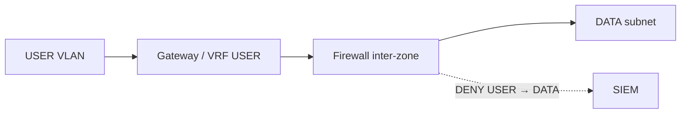
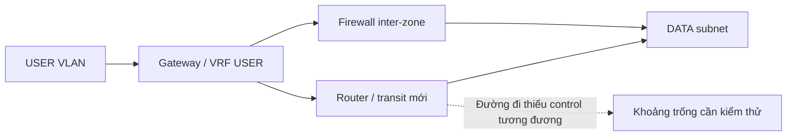
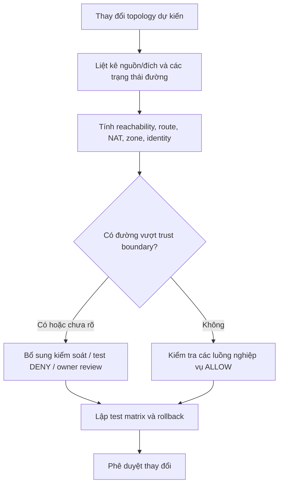
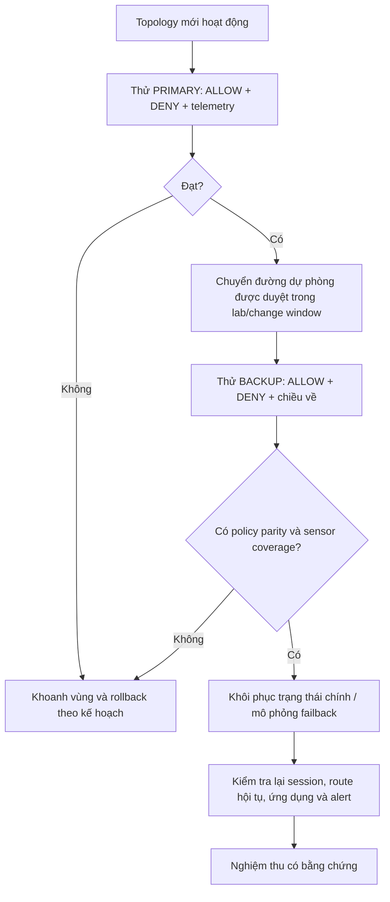
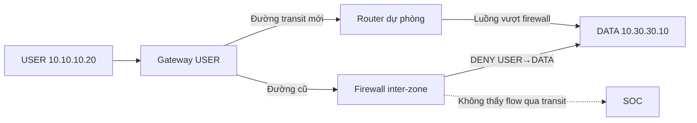

# Không kiểm thử khi topology thay đổi

## 1. Sai lầm: sơ đồ mạng đổi nhưng giả định bảo mật vẫn giữ nguyên

Một nhóm vận hành bổ sung đường kết nối giữa hai trung tâm dữ liệu để tăng tính sẵn sàng. Sau khi cấu hình định tuyến và xác nhận hệ thống ứng dụng hoạt động, nhóm đóng change ticket. Vài ngày sau, SOC phát hiện máy ở mạng người dùng có thể kết nối tới dịch vụ quản trị trước đây chỉ mở trong management VLAN. Firewall chưa hề bị sửa quy tắc, nhưng **đường đi thực tế của lưu lượng đã thay đổi**: một tuyến mới chuyển gói qua điểm không có chính sách phân đoạn tương đương.

Đây là sai lầm điển hình trong **bảo mật mạng**: cho rằng một thay đổi topology chỉ ảnh hưởng tính sẵn sàng hoặc hiệu năng, nên kiểm tra ping hay ứng dụng chạy được là đủ. Trong thực tế, đổi VLAN, VRF, route, tunnel, kết nối VPN, SD-WAN, NAT, cloud peering, Wi-Fi, load balancer hoặc đường dự phòng có thể đổi **ai tới được ai, gói đi qua control nào, chiều về theo lối nào và sensor nào còn nhìn thấy lưu lượng**.

Bài học thuộc chương **Sai lầm thường gặp**, module **SECURITY_NETWORK_SECURITY**. Các kỹ năng phân đoạn mạng, firewall, VPN, IDS/IPS, DNS, giám sát lưu lượng, threat modeling và kiến trúc cloud đều cần được áp dụng khi topology thay đổi. Mục tiêu là học cách xác minh **hành vi thực tế sau thay đổi**, không chỉ xác nhận cấu hình mới được áp dụng.

Sau bài học, người học có thể:

1. Giải thích vì sao thay topology có thể làm mất hiệu lực kiểm soát bảo mật dù cấu hình firewall không đổi.
2. Xác định các đường luồng phải được thử khi thêm route, VLAN/VRF, tunnel, cloud peering hoặc thay đổi đường HA.
3. Lập ma trận kiểm thử **ALLOW và DENY**, theo cả chiều đi, chiều về và vùng tin cậy.
4. Phân biệt việc một dịch vụ không kết nối được với bằng chứng nó đã bị **đúng control** chặn.
5. Thiết kế quy trình trước, trong, sau change, bao gồm kiểm thử failover và rollback.
6. Thu thập bằng chứng từ nguồn, gateway, firewall, host, IDS/IPS và SIEM để nghiệm thu đáng tin cậy.

> Các câu lệnh trong bài chỉ dành cho môi trường lab hoặc tài sản/phép thử được cho phép. Thử từ đúng endpoint đã đăng ký trong kế hoạch change, giới hạn lưu lượng và tránh quét diện rộng lên mạng sản xuất.

## 2. Hiểu topology, control plane và data plane

**Network topology** là cấu trúc kết nối vật lý và logic giữa thiết bị, giao diện, vùng mạng, mạng ảo, tunnel và dịch vụ. Một mô hình topology đầy đủ cần tính đến ít nhất các lớp sau:

| Lớp | Thành phần | Một thay đổi có thể gây ra |
| --- | --- | --- |
| Vật lý / L2 | Cáp, switch, trunk, VLAN, STP, MLAG, AP, SSID | Máy xuất hiện ở broadcast domain hoặc VLAN khác; có đường bridge ngoài dự kiến |
| L3 | Subnet, gateway, static/dynamic route, VRF, policy routing | Đường đi mới giữa các vùng, route leak, lưu lượng vòng hoặc đi qua gateway khác |
| Overlay / WAN | IPsec, GRE, VXLAN, SD-WAN, MPLS, transit network | Tunnel/next hop khác, gói được phân loại theo inner hoặc outer header |
| Security | Firewall, ACL, SG/NACL, IDS/IPS, host firewall, NetworkPolicy | Control bị bypass, policy áp ở ngữ cảnh khác, khả năng quan sát suy giảm |
| Định danh / truy cập | VPN, ZTNA, NAC/802.1X, role, nhóm thiết bị | Cùng người dùng nhận vùng nguồn/quyền mạng khác |
| Dịch vụ | DNS, NAT, proxy, VIP, load balancer, service discovery | Đích hoặc địa chỉ nguồn thực tế thay đổi sau phân giải/dịch địa chỉ |
| Cloud/container | VPC/VNet, peering, route table, private endpoint, CNI, service mesh | Đường east-west và đường sang hybrid khác topology trên sơ đồ truyền thống |

Có ba góc nhìn cần tách biệt:

- **Intent:** chính sách nói GUEST không được truy cập DATA; APP được truy cập API qua TCP/443.
- **Control plane:** bảng route, VLAN mapping, firewall rule, security group, route advertisement và các object cho biết thiết bị dự định xử lý lưu lượng thế nào.
- **Data plane:** gói thật từ một nguồn cụ thể đi qua giao diện, zone, NAT, đường dự phòng và host firewall nào; kết quả thực sự là allow, deny hay lỗi.

Một ảnh chụp cấu hình trước/sau chỉ cho thấy một phần **control plane**. Để xác minh segmentation, phải **phát yêu cầu từ điểm nguồn đại diện** và đối chiếu telemetry trên đường đi. Đặc biệt, một route hợp lệ về mặt kỹ thuật không đồng nghĩa đường mới đáp ứng chính sách tin cậy.

### 2.1 Ví dụ hai đường có mức kiểm soát khác nhau

Trước thay đổi:



Sau thay đổi, một kết nối dự phòng cho phép định tuyến từ VRF USER qua một router trung gian:



Sơ đồ là **giả định bài học**; bản thân thêm route chưa tự động tạo bypass. Bypass chỉ tồn tại nếu router/gateway có đường chuyển tiếp, policy và quyền nguồn đủ để vận chuyển lưu lượng tới DATA. Bài kiểm thử phải xác nhận điều kiện đó bằng gói thực, route/ACL/flow logs và quan sát phía đích.

## 3. Những thay đổi topology thường tạo lỗ hổng khó thấy

| Thay đổi | Sai lầm phổ biến | Rủi ro bảo mật | Kiểm tra cần bổ sung |
| --- | --- | --- | --- |
| Thêm VLAN / thay trunk | Chỉ thử thiết bị nhận IP mới | VLAN nhạy cảm bị truyền tới switch/port không dự kiến | VLAN membership, trunk allowlist, đường L2, NAC và luồng DENY |
| Chuyển default gateway / thiết bị L3 | Chỉ kiểm tra reachability | Gói không còn qua firewall/ACL cũ | Route/FIB, interface thực tế, counter rule và điểm quan sát |
| Thêm VRF route leaking | Kiểm tra route hợp lệ rồi đóng change | Các vùng trước đây cô lập có thể giao tiếp | Test chéo từng cặp VRF; kiểm tra prefix/next hop và deny |
| Bật đường dự phòng HA / ECMP | Chỉ thử đường chính | Khi failover, lưu lượng bỏ qua sensor hoặc firewall khác | Kiểm thử từng trạng thái đường, policy parity, symmetric return |
| Thay SD-WAN/IPsec VPN | Chỉ thử tunnel up | Traffic đi vào zone/route khác, sai split tunnel | Bên trong tunnel, IP nguồn sau NAT, route đến vùng nhạy cảm |
| Đổi NAT / proxy / load balancer | Chỉ xác nhận URL phản hồi | Định danh nguồn/đích của policy đổi hoặc origin bị truy cập trực tiếp | Pre-NAT/post-NAT tuples, VIP/backend, ACL origin |
| Cloud peering/transit | Chỉ thử hai VPC kết nối | Mở đường không dự kiến qua route/SG/NACL/host policy | Phép thử từ đúng subnet/role, route table, log accept/reject |
| Thêm Wi-Fi SSID / thay NAC | Chỉ thử truy cập Internet | Khách/thiết bị BYOD có đường vào mạng nội bộ | SSID→VLAN→VRF mapping, GUEST→INTERNAL DENY |
| Thêm IPv6 | Chỉ thử IPv4 | Hostname có AAAA, firewall IPv6 cho qua ngoài policy | Test dual-stack và chính sách IPv6 riêng |
| Chuyển workload/pod | Chỉ kiểm tra health endpoint | NetworkPolicy/CNI/mesh áp nhãn hoặc zone khác | Pod-to-pod, ingress/egress, label, namespace, egress gateway |
| Đổi DNS hoặc private endpoint | Chỉ thử tên miền từ DNS nội bộ | Client tới IP public thay vì private, đi ngoài điểm kiểm soát | A/AAAA, resolver path, route đích và logging |
| Thay vị trí IDS/IPS/NDR sensor | Chỉ kiểm tra dữ liệu vẫn vào SIEM | Sensor mất visibility với tuyến mới hoặc nhận bản sao trùng | Test phát hiện từ từng tuyến, span/tap/flow coverage |

**Dấu hiệu chung:** Thay đổi không nhất thiết động tới một dòng `deny` trên firewall nhưng vẫn thay đường dẫn từ source tới destination. Cần kiểm thử các **bất biến bảo mật** sau mọi thay đổi kiến trúc.

## 4. Phân tích nguyên nhân của những kết luận sai

### 4.1 “Ping được là ổn”

ICMP echo thành công chứng minh có phản hồi ICMP cho cặp nguồn–đích tại thời điểm thử. Nó **không** chứng minh TCP/443 hoạt động, phiên TLS hợp lệ, ứng dụng được cấp quyền hay chính sách chặn TCP/5432 vẫn hiệu lực. ICMP có thể bị lọc riêng, còn các giao thức khác được xử lý khác.

**Cách sửa:** kiểm thử chính xác giao thức/port và hành vi ứng dụng được yêu cầu, đồng thời chạy ca **DENY** đối với luồng không được phép.

### 4.2 “Firewall rule không đổi nên segmentation không đổi”

Một rule có thể đúng nhưng không còn nằm trên đường của gói. Ngược lại, route mới có thể khiến gói đi qua rule khác do zone/interface, địa chỉ sau NAT hoặc nhãn workload đã đổi. Rule order và object group có thể che hoặc mở rộng phạm vi rule trước đó.

**Cách sửa:** đối chiếu route, zone, NAT, session và rule hit; dùng capture/log tại điểm thực thi dự kiến để chứng minh gói đã đi qua.

### 4.3 “Traceroute dừng ở firewall là gói bị chặn”

Traceroute dựa trên TTL/hop limit và phản hồi ICMP hoặc probe giao thức. Một số thiết bị không phản hồi, tunnel che hop và ECMP có thể chọn đường khác dựa trên 5-tuple. Vị trí hop cuối nhìn thấy **không đồng nghĩa** nơi packet bị chặn.

**Cách sửa:** kết hợp route, flow logs, firewall counters và quan sát của client/đích; xác minh bằng chính giao thức và port ứng dụng.

### 4.4 “Timeout chứng tỏ quy tắc DENY hoạt động”

Timeout có thể do đích tắt, listener không chạy, DNS sai, route lỗi, lỗi đường phản hồi hoặc một control khác chặn. Một phép thử DENY đạt phải xác định được **quy tắc hoặc ranh giới dự kiến đã thực thi**, cùng với một phép thử đối chứng cho thấy đích đang hoạt động từ nguồn hợp lệ.

**Cách sửa:** kết quả thiếu bằng chứng phải là **INCONCLUSIVE**, không được tự đánh dấu PASS.

### 4.5 “Đã kiểm thử đường chính thì đường dự phòng cũng giống vậy”

Khi HA failover hoặc ECMP chọn next hop khác, lưu lượng có thể đi qua firewall node, ACL hoặc tunnel với policy không tương đương. Đường về bất đối xứng còn có thể làm firewall stateful không nhìn thấy phiên và drop gói trả lời.

**Cách sửa:** thử qua cả đường chính và các trạng thái dự phòng quan trọng, kiểm tra policy parity, đường phản hồi và sensor visibility.

### 4.6 “Một máy thử đại diện cho mọi người dùng”

Máy quản trị có thể ở management VLAN, nhận policy rộng hơn máy người dùng. Một VPN user có role khác guest user, workload trong cloud và pod trong Kubernetes cũng chịu các điều kiện mạng khác nhau. Thử từ sai nguồn có thể tạo cảm giác an toàn giả.

**Cách sửa:** chọn probe theo từng vùng, VRF/VPC/SSID, identity và loại thiết bị cần kiểm chứng.

## 5. Chuyển topology thành ma trận bất biến bảo mật

Ví dụ môi trường lab có bốn vùng:

| Vùng | Host ví dụ | Quyền truy cập |
| --- | --- | --- |
| **USER** | `10.10.10.20` | Chỉ kết nối ứng dụng APP qua HTTPS |
| **APP** | `10.20.20.10` | Cho phép ứng dụng kết nối DATA qua TCP/5432 |
| **DATA** | `10.30.30.10` | Nhận kết nối DB từ APP đã duyệt |
| **MGMT** | `10.40.40.10` | Chỉ bastion/admin được duyệt mới truy cập cổng quản trị |
| **GUEST** | `10.50.50.20` | Chỉ tới Internet/DNS theo chính sách khách |

Đường dự kiến: USER → firewall → APP; APP → firewall → DATA; GUEST không được đi vào mạng nội bộ; MGMT dùng tuyến quản trị riêng. Đây là mô hình minh họa trong lab, không phải dải địa chỉ khuyến nghị cho mạng thật.

### 5.1 Ma trận ALLOW/DENY trước và sau

| Test ID | Nguồn thực tế | Đích | Luồng | Kỳ vọng | Tại sao quan trọng |
| --- | --- | --- | --- | --- | --- |
| T01 | USER | APP | TCP/443 | **ALLOW** | Bảo đảm chức năng nghiệp vụ |
| T02 | USER | DATA | TCP/5432 | **DENY** | Chống vượt phân đoạn USER → DATA |
| T03 | APP | DATA | TCP/5432 | **ALLOW** | Ứng dụng vẫn kết nối DB |
| T04 | GUEST | MGMT | TCP/22 | **DENY** | Wi-Fi khách không vào quản trị |
| T05 | USER | MGMT | TCP/22 | **DENY** | Người dùng không đi tắt vào thiết bị quản trị |
| T06 | MGMT/bastion đã duyệt | Thiết bị quản trị | SSH/HTTPS quản trị | **ALLOW** theo RBAC | Đội vận hành còn kênh quản trị hợp lệ |
| T07 | DATA | USER | Phiên TCP mới đến cổng được chỉ định trong test | **DENY** | Kiểm tra chiều khởi tạo ngược |
| T08 | Probe IPv6 tương ứng | Đích IPv6 tương ứng | Luồng nghiệp vụ và luồng bị cấm | Theo chính sách IPv6 | Tránh đường đi ngoài IPv4 |
| T09 | USER/VPN identity riêng | APP/DATA | Luồng phù hợp role | Theo role | Bảo đảm thay đổi đường remote không làm mở rộng quyền |
| T10 | Probe từ site dự phòng | APP/DATA | Luồng được phép và bị cấm | Theo chính sách từng site | Kiểm chứng failover và đường WAN mới |

Với thiết bị **stateful**, trả lời thuộc phiên T01/T03 đã được cho phép khác với **kết nối mới** theo hướng T07. Với ACL/NACL **stateless**, phải xét rule cho cả chiều đi và chiều về, bao gồm ephemeral ports. Kỳ vọng phải nêu đúng trạng thái phiên, không viết mơ hồ “chặn chiều ngược”.

### 5.2 Mẫu test case có thể lưu cùng change

```yaml
test_id: T02
change_id: CHG-NET-2026-117
purpose: "USER không được kết nối trực tiếp tới DATA"
source:
  zone: USER
  host: 10.10.10.20
  identity: lab-standard-user
destination:
  zone: DATA
  host: 10.30.30.10
transport: tcp
destination_port: 5432
session: new
expected: deny
expected_enforcement: inter_zone_firewall
required_evidence:
  - probe_result_and_utc_time
  - firewall_rule_hit_or_equivalent_telemetry
  - destination_observation_if_available
positive_control: "APP -> DATA TCP/5432 must remain ALLOW"
topology_states:
  - primary_path
  - failover_path
```

Mẫu chỉ mô tả dữ liệu kiểm thử, không phải tệp cấu hình firewall. Nếu tài nguyên dùng FQDN hoặc NAT/VIP, cần lưu cả kết quả DNS, địa chỉ trước/sau NAT và backend tại thời điểm thử.

## 6. Quy trình chuẩn trước khi thay topology

### Bước 1 — Xác định phạm vi thay đổi và blast radius

Lập danh sách thiết bị, interface, VLAN, subnet, VRF, VPC/VNet, tunnel, chính sách route, NAT, DNS, firewall và sensor dự kiến bị ảnh hưởng. Xem thay đổi có tạo ra tuyến **transitive reachability** qua một trung gian hay không.

Câu hỏi quan trọng:

- Nguồn nào có thể tới được đích trước change, và nguồn nào **không được phép** tới?
- Tuyến dự kiến chạy qua những điểm kiểm soát bảo mật nào? Có đường khác qua VPN/peering/management không?
- Cần đổi nhóm IP, security group, route advertisement hoặc object nào?
- Một đường mới có thể biến hai vùng trước đây cô lập thành vùng có liên thông L3 hoặc L2 không?
- IDS/IPS, NDR, WAF, DNS filtering, SIEM nhận dữ liệu từ đâu? Khi đổi đường, sensor còn nhìn thấy không?
- Có dịch vụ nhạy cảm như authentication, NTP, DNS, database hoặc management plane nào nằm trong phạm vi lan truyền không?

Nên ghi rõ **ngoại lệ cần xét lại**, như tunnel khẩn cấp đã tồn tại, rule ANY cũ hoặc route leak từng được phê duyệt tạm.

### Bước 2 — Chụp baseline có thể so sánh

Lưu trạng thái **trước thay đổi**, gồm sơ đồ dự kiến, bảng route và policy liên quan, các test case ALLOW/DENY, trạng thái ứng dụng, log rule hit và thời gian đo.

Đối với L3 và firewall, có thể lưu:

- Prefix và next hop theo VRF, interface, priority/metric và route source.
- ACL/firewall rule ID, zone mapping, NAT translations, session state.
- DNS A/AAAA cho dịch vụ đi qua VIP/endpoint động.
- Trạng thái tunnel, đường primary/backup và health-check.
- Sensor coverage và nguồn log đã bật.
- Kết quả kiểm thử cả **được phép** lẫn **bị cấm** từ đúng vùng.

**Baseline cần mô tả hành vi thực tế, không chỉ cấu hình.** Nếu T02 đã FAIL trước change, phải ghi rõ tồn đọng; không gán toàn bộ phát hiện cho topology mới.

### Bước 3 — Mô hình hóa đường đi mới và rủi ro



Đánh giá kiến trúc bằng câu hỏi **“với cùng điểm nguồn, gói sẽ đi qua control nào trong từng trạng thái topology?”**. Điều này giúp tìm lỗ hổng kiểu bypass mà chỉ review diff firewall sẽ bỏ sót.

### Bước 4 — Chuẩn bị rollback và điểm dừng

Một kế hoạch change có trách nhiệm cần chuẩn bị:

1. Snapshot/diff cấu hình liên quan, rollback steps và cách bảo toàn đường quản trị.
2. Cửa sổ change, danh tính người triển khai, owner và on-call/SOC.
3. Thứ tự thay đổi, điều kiện để chuyển sang bước tiếp, cổng kiểm tra sau từng giai đoạn.
4. Những ca test tối thiểu không được bỏ: luồng nghiệp vụ trọng yếu, nguồn không được phép tới DATA/MGMT, kiểm tra đường dự phòng.
5. Giới hạn lỗi hiệu năng/mất gói, sự cố ứng dụng hoặc phát hiện bypass khiến phải dừng.
6. Cách nhận biết **rollback đã có hiệu lực** trên control plane và data plane, kể cả khi route hội tụ trễ.

Một thay đổi không có môi trường staging tương đương vẫn cần kế hoạch test sản xuất **được phê duyệt** với probes nhẹ và quan sát phù hợp; ghi rõ giới hạn so với lab.

## 7. Quy trình kiểm thử trong và sau khi thay đổi

### 7.1 Triển khai theo giai đoạn

Với thay đổi có thể chia nhỏ, ưu tiên kích hoạt từng kết nối/site/tunnel, kiểm tra trước khi mở rộng. Sau mỗi bước, quan sát route, policy và hệ thống giám sát; ghi lại timestamp UTC, thiết bị thực thi và revision. Chú ý **thời gian hội tụ** của dynamic routing/SD-WAN/cloud và thời gian làm mới DNS/NAT/session: kết quả ngay sau khi áp dụng có thể khác kết quả sau khi hệ thống ổn định.

### 7.2 Chạy test từ đúng nguồn

Trên **Linux probe trong lab**:

```bash
# Đường ra mà kernel nguồn chọn đến DATA
ip route get 10.30.30.10

# Test T03: chạy từ host APP đã được phê duyệt
nc -vz -w 3 10.30.30.10 5432

# Test T02: chạy từ host USER, cùng đích và cổng nhưng kỳ vọng DENY
nc -vz -w 3 10.30.30.10 5432

# Test T01: chạy từ host USER đến APP
curl -v --connect-timeout 3 --max-time 8 https://app.example.test/health
```

Các dòng `nc` chỉ có ý nghĩa đúng khi **chạy từ hai host khác nhau như mô tả**; sao chép toàn bộ từ cùng máy có thể cho kết luận sai. `app.example.test` là hostname ví dụ, cần thay bằng dịch vụ test thật đã được duyệt và xác minh TLS. Lệnh `nc` xác nhận khả năng bắt tay TCP, chưa chứng minh thao tác nghiệp vụ hoặc authorization ở tầng ứng dụng.

Trên **Windows probe** trong đúng zone:

```powershell
# Đo khả năng kết nối TCP của endpoint lab
Test-NetConnection 10.30.30.10 -Port 5432

# Quan sát tuyến từ host đó tới DATA (tín hiệu tham khảo)
tracert 10.30.30.10
```

Các lệnh trace, ping và route cung cấp bằng chứng **bổ trợ**. Chúng không thể một mình chứng minh toàn bộ forwarding path hay điểm drop.

### 7.3 Đối chiếu ở firewall và phía đích

Một ca DENY nên có tối thiểu:

1. Bằng chứng probe thật phát từ **nguồn đúng zone, route và identity**, ở cùng cửa sổ UTC.
2. Log/counter ở **control dự kiến** thể hiện đúng source, destination, protocol, port và action, hoặc bằng chứng dataplane tương đương.
3. Xác minh dịch vụ đích **đang hoạt động** từ nguồn được phép, tránh nhầm lỗi dịch vụ với firewall deny.
4. Quan sát phía đích nếu có thể, để xem gói có tới được trước khi host firewall từ chối hay không.
5. Đối chiếu NAT/route/session nếu tuple đổi giữa các điểm đo.

Có thể thu gói **giới hạn trong lab**, nếu đã được phép:

```bash
# Trên interface lab đúng điểm đo; tự dừng sau 20 gói
sudo tcpdump -nni eth0 -c 20 'host 10.30.30.10 and tcp port 5432'
```

Lưu ý: thấy SYN rời client không đủ kết luận nó đã tới firewall; không thấy SYN trên một interface không tự chứng minh nó chưa tới host khác qua đường thay thế. Cần chọn interface đúng, đồng bộ thời gian và ghép log với rule/session/NAT.

### 7.4 Xác minh sensor và khả năng phát hiện

Thay topology có thể làm firewall vẫn chặn đúng nhưng **IDS/IPS/NDR không còn nhìn thấy** một phần lưu lượng. Nên chạy các tín hiệu thử an toàn đã đăng ký (ví dụ một kết nối canary trong lab, không gây khai thác) để xác minh:

- Collector tiếp tục nhận log từ firewall/routers/host đi qua đường mới.
- Sự kiện thử có source, destination, zone và timestamp đúng.
- Sensor đặt tại SPAN/TAP/flow exporter không bỏ sót khi tuyến chuyển sang dự phòng.
- Cảnh báo theo use case bảo mật vẫn hoạt động khi traffic chọn tunnel/VPC/VRF mới.
- Không phát sinh duplicate events làm sai đếm hoặc gây nhầm timeline.

**Không sinh traffic tấn công thật chỉ để thử độ phủ** nếu mục tiêu có thể xác minh bằng canary, phép thử segmentation hoặc log fixture trong môi trường được duyệt. Khi sử dụng fixture tổng hợp, ghi rõ đó là kiểm tra **pipeline/detection logic**, không chứng minh sensor đã thấy traffic mạng thật.

## 8. Kiểm thử trạng thái đường dự phòng và thất bại từng phần

Phần bị bỏ quên nhiều nhất là **failover**, vì hệ thống có thể hoạt động bình thường trong lúc đường chính khỏe.



### 8.1 Các vấn đề dễ xuất hiện khi failover

- **Policy parity:** firewall B không có rule deny trên firewall A, hoặc security object chưa đồng bộ.
- **Asymmetric routing:** gói đi qua firewall A nhưng trả qua B; thiết bị stateful không có session tương ứng.
- **ECMP:** hai probe có source port khác nhau có thể chọn next hop khác; một lần thử không đại diện cho mọi hash path.
- **Tunnel fallback:** đường backup dùng tunnel/VRF ít hạn chế hơn hoặc chuyển sang Internet public.
- **NAT/session continuity:** sau failover địa chỉ source public thay đổi, phiên bị reset hoặc authentication policy không phù hợp.
- **Route convergence:** lúc đổi đường có khoảng trống phân đoạn hoặc traffic tạm thời đi qua điểm kiểm soát khác.
- **Telemetry parity:** exporter trên đường backup bị bỏ cấu hình, SOC chỉ thấy trạng thái link chứ không thấy flow.

Có hệ thống không cho phép cố tình cắt đường production để thử; khi đó kiểm tra bằng staging, mô phỏng control plane hoặc cửa sổ bảo trì đã duyệt, và ghi rõ trạng thái failover production là **NOT TESTED** cho tới khi có bằng chứng thích hợp.

## 9. Những bối cảnh đặc thù cần mở rộng bộ kiểm thử

### 9.1 VLAN, trunk và mạng không dây

Khi đổi port trunk hoặc VLAN mapping, cần xác nhận interface thực tế mang VLAN nào, access port thuộc đúng zone và guest isolation/NAC vẫn hiệu lực. Một SSID khách gán nhầm vào VLAN nội bộ có thể bypass nhiều firewall rule vốn được áp ở tầng L3 khác.

Thử từ **thiết bị thực nối đúng SSID/port**, xác nhận DHCP, DNS, gateway, role NAC và các luồng DENY tới DATA/MGMT. Không chỉ thử từ laptop quản trị vì thiết bị đó có thể vào VLAN quản trị.

### 9.2 VRF route leaking và MPLS/SD-WAN

Route leaking có thể chủ ý cung cấp dịch vụ chung giữa VRF, nhưng cần hạn chế prefix, next hop và phân đoạn traffic. Khi thêm kết nối SD-WAN/MPLS, kiểm tra traffic qua từng site/underlay/overlay, nhãn zone và điểm áp policy. Một VRF tách route không đồng nghĩa mọi traffic sẽ bị chặn khi có cầu nối L3 ở nơi khác.

### 9.3 Cloud VPC/VNet peering và hybrid

Peering hoặc transit gateway mở **reachability tiềm năng** nhưng traffic còn phụ thuộc route table, security groups, NACL, cloud firewall, host firewall và IAM/endpoint policy. Kiểm thử từ đúng subnet, instance identity hoặc workload; lưu route selection và cloud flow logs.

`ACCEPT` trong một cloud flow log thường chỉ phản ánh quyết định ở lớp có log, không tự chứng minh ứng dụng đã nhận request. Tương tự, một rule DENY trong security group không chứng minh không còn đường gián tiếp qua proxy hoặc instance trung gian. Đối với hybrid on-prem ↔ cloud, so sánh cả kiểm soát ở hai đầu.

### 9.4 Kubernetes và container networking

Pod chuyển node hoặc cập nhật CNI có thể làm thay đổi dataplane, NAT và khả năng thực thi `NetworkPolicy`. Tạo test cho **pod→pod, pod→service, pod→external, ingress→service** theo namespace, labels và service account. Nếu dùng service mesh, cần kiểm tra authorization/mTLS ở tầng service song song với phép thử L3/L4; việc TCP connect được tới sidecar không mặc nhiên cho phép request ứng dụng.

### 9.5 DNS, VIP và IPv6

Topology logic còn thay đổi khi DNS trỏ sang vùng khác hoặc load balancer dịch sang backend mới. Lưu A/AAAA, TTL, VIP, DNS resolver, backend selection và đường NAT/return. Với dual-stack, mỗi chính sách quan trọng cần có test IPv4 và IPv6; **IPv4 DENY PASS không đủ để suy ra IPv6 DENY PASS**.

## 10. Chấm kết quả: không biến thiếu dữ liệu thành PASS

| Kết luận | Điều kiện tối thiểu | Ví dụ |
| --- | --- | --- |
| **PASS — ALLOW** | Probe đúng nguồn kết nối được dịch vụ theo yêu cầu; có bằng chứng route/control và kết quả ứng dụng dự kiến | APP → DATA TCP/5432 có handshake và health-check hợp lệ |
| **PASS — DENY** | Probe đúng nguồn bị chặn ở ranh giới mong đợi; dịch vụ đối chứng hoạt động; có log/counter/quan sát phù hợp | USER → DATA TCP/5432 bị firewall inter-zone deny |
| **FAIL — mở rộng quyền** | Luồng ngoài chính sách vẫn tới được dịch vụ hoặc vượt ranh giới tin cậy | GUEST → MGMT SSH bắt tay thành công ngoài dự kiến |
| **FAIL — giảm sẵn sàng** | Luồng hợp lệ bị lỗi do topology mới hoặc đường phản hồi | APP → DATA bị drop khi route chuyển qua firewall không có session |
| **FAIL — visibility** | Lưu lượng thực đã xuất hiện nhưng telemetry/sensor bắt buộc bị mất | Sensor không thấy canary flow qua backup tunnel |
| **INCONCLUSIVE** | Thiếu bằng chứng, sai điểm probe, đích tắt hoặc chỉ có timeout | Không tìm được deny rule/log trong lúc service không lắng nghe |
| **NOT TESTED** | Chưa thử đường, giao thức hoặc trạng thái topology theo kế hoạch | Chưa có quyền thử failover production |

Nên duy trì kết quả riêng theo từng **topology state** (primary, backup, failback), **địa chỉ IPv4/IPv6**, **network role** và **port/protocol**. Một lần PASS từ máy APP không thể thay thế các bài thử từ GUEST, VPN user hay cloud workload.

### 10.1 Mẫu bản ghi evidence sau change

```yaml
change_id: CHG-NET-2026-117
test_id: T02
topology_state: backup_path
executed_at_utc: "2026-11-28T08:10:00Z"
probe:
  source_zone: USER
  source_ip: 10.10.10.20
  destination: 10.30.30.10
  protocol: tcp
  port: 5432
expected: deny
observed:
  client: "TCP connection timed out"
  firewall: "rule FW-USER-DATA-DENY matched, action=drop"
  destination: "no matching SYN in approved capture window"
positive_control:
  source_zone: APP
  destination: 10.30.30.10
  result: "connection successful"
verdict: PASS
evidence_refs:
  - "flowlog-20261128-0810"
  - "probe-t02-backup"
notes: "Mẫu minh họa; kết luận thật phải dựa trên chứng cứ thu được"
```

**Bằng chứng phải có ngữ cảnh**. Log từ firewall khác, trạng thái topology khác hoặc thời gian không trùng nhau không đủ chứng minh điểm chặn. Đặc biệt NAT có thể thay source IP, còn proxy có thể sinh phiên mới với tuple khác; phải tương quan request/session ID khi có.

## 11. Tình huống: route leak sau nâng cấp mạng dự phòng

### 11.1 Bối cảnh

Một doanh nghiệp có mạng USER, APP, DATA và MGMT. Chính sách đặt ra: USER chỉ truy cập APP qua HTTPS, APP được kết nối DATA qua TCP/5432, còn USER không được kết nối trực tiếp đến DATA. Đội mạng triển khai **router transit dự phòng** để cải thiện thời gian khôi phục khi firewall chính gặp sự cố. Nhóm kiểm tra thấy các server trao đổi bình thường và ứng dụng không báo lỗi, nên đóng ticket.

Sau đó một thử nghiệm từ host USER cho thấy TCP/5432 tới DATA kết nối thành công. Trong bài tập mô phỏng, route transit mới đã quảng bá prefix DATA vào bảng định tuyến mà USER sử dụng và có đường forward không qua firewall inter-zone. Không phải bất kỳ route advertisement nào cũng tự tạo bypass: ở đây còn có forwarding và ACL/host policy đủ mở để cho phiên đi qua.



### 11.2 Dữ liệu thu thập trong lab

| Nguồn | Quan sát | Diễn giải |
| --- | --- | --- |
| Client USER | `nc -vz -w 3 10.30.30.10 5432` thành công | USER tới được TCP/5432 ngoài chính sách |
| APP | Kết nối DB vẫn thành công | Luồng nghiệp vụ được phép còn hoạt động |
| Gateway USER | Next hop tới prefix DATA đổi sang router transit | Có đường khác với baseline |
| Firewall inter-zone | Không có hit từ USER tới DATA trong cửa sổ thử | Chưa đủ để tự kết luận bypass, nhưng là dấu hiệu kiểm tra tuyến |
| Router transit | Forwarded flow khớp source/destination | Gói thực đi qua đường mới |
| DATA | Host/DB log cho thấy kết nối từ nguồn không được phép | Xác nhận luồng đến đích |
| SIEM | Không có cảnh báo deny vì sensor ở đường cũ không thấy traffic | Visibility bị giảm khi đổi topology |

### 11.3 Cách xử lý

1. Dừng việc mở rộng topology mới, giữ bằng chứng theo ticket và cảnh báo đội security/owner.
2. Kiểm tra route leak, next hop, forwarding, zone policy, NAT, ACL và đường phản hồi; xác định control nào được kỳ vọng chặn.
3. Trong lab/change window đã duyệt, khôi phục route hoặc đặt policy kiểm soát tương đương tại đường transit. Không tạo rule quá rộng chỉ để ứng dụng hoạt động.
4. Thử lại **USER → DATA DENY**, **APP → DATA ALLOW**, **USER → APP HTTPS ALLOW** trên cả đường chính và backup.
5. Thử **failback** và xác minh firewall/NDR/SIEM thấy các sự kiện kiểm tra đúng tuyến.
6. Cập nhật sơ đồ topology, kiểm soát thay đổi route, test matrix và cảnh báo thay đổi reachability.

### 11.4 Nguyên nhân gốc

Nguyên nhân không đơn giản là “quên deny rule”. Quy trình change chỉ kiểm tra **khả năng kết nối của những luồng được phép**, không đánh giá **tập nguồn có thể tới vùng DATA sau khi thêm tuyến**. Sơ đồ sau thay đổi thiếu điểm kiểm soát và test cases phủ định, khiến bypass tồn tại ngay cả khi dịch vụ vẫn chạy tốt.

## 12. Tự động hóa kiểm thử hồi quy khi topology thay đổi

Với môi trường có nhiều site, VPC, VLAN và policy, kiểm thử thủ công dễ bỏ sót. Có thể tự động hóa **kiểm tra cấu hình lẫn hành vi** trong vòng đời change.

### 12.1 Hai lớp kiểm thử bổ sung nhau

| Lớp | Công cụ/phương pháp | Giá trị và giới hạn |
| --- | --- | --- |
| **Static/control-plane** | Kiểm tra route/ACL/security group theo IaC, policy-as-code, network reachability analysis | Phát hiện sai scope, route leak, policy broadening trước triển khai; không chứng minh mọi gói thật đi đúng đường |
| **Dynamic/data-plane** | Probe từ mỗi zone, kết nối ứng dụng, flow logs, canary, kiểm thử failover | Xác minh hành vi thực tế; độ phủ phụ thuộc vị trí probe, lịch thử và trạng thái topology |

Nên có tập bài kiểm thử tối thiểu bắt buộc cho mỗi thay đổi:

- **Positive tests:** những luồng doanh nghiệp phải hoạt động.
- **Negative tests:** những ranh giới bảo mật cấm vượt qua.
- **Failover/failback:** những trạng thái topology có khả năng xảy ra.
- **Observability tests:** sensor, log collector và alert thực sự nhận dữ liệu.
- **Regression tests:** các luồng ngoài phạm vi thay đổi nhưng có chung gateway, VRF, firewall hoặc tunnel.

### 12.2 Mẫu pseudo-workflow

```text
INPUT: change_record, approved_flow_matrix, topology_states

validate_change_metadata(change_record)
snapshot_prechange_routes_policies_and_baseline()

FOR each approved_state in topology_states:
    activate_state_only_in_authorized_lab_or_change_window()
    verify_routing_nat_zone_and_sensor_coverage()

    FOR each flow_case in approved_flow_matrix:
        observe_probe_from_actual_source_zone(flow_case)
        correlate_client_control_and_destination_evidence()
        verdict = PASS | FAIL | INCONCLUSIVE | NOT_TESTED
        attach_results_to_change_record()

    IF critical_negative_test_is_FAIL:
        stop_rollout_and_trigger_approved_rollback()

compare_before_after_reachability_and_detection()
record_unverified_states_and_residual_risk()
```

Mã giả này chỉ minh họa tổ chức quy trình, không phải chương trình điều khiển router hoặc tự động cắt đường production. Việc test thật phải có quyền, cửa sổ thay đổi, giới hạn tải, phương án khôi phục và người chịu trách nhiệm.

### 12.3 Kích hoạt kiểm thử khi có sự kiện thay đổi

Nên xem xét chạy hồi quy khi xảy ra một trong các sự kiện: thay VRF route import/export, cập nhật BGP/OSPF policies, thêm route peering, đổi security group/network ACL, thay kết nối VPN/SD-WAN, migrate workload, đổi CNI/NetworkPolicy, thay HA role, cập nhật NAT/VIP, đổi DNS/private endpoint hoặc thay VLAN/NAC/SSID. Các sự kiện này có thể đến từ pipeline IaC, ITSM hoặc công cụ giám sát drift.

Không nên chỉ kích hoạt kiểm thử theo **commit firewall**: route, cloud API và topology vật lý có thể thay đổi độc lập với firewall.

## 13. Chỉ số đo chất lượng và quản trị tồn đọng

| Chỉ số | Cách diễn giải |
| --- | --- |
| **Coverage của các vùng tin cậy** | Phần trăm cặp nguồn–đích–giao thức quan trọng có cả yêu cầu ALLOW/DENY và probe đại diện |
| **State coverage** | Đã thử bao nhiêu đường primary, backup, failback và điều kiện hội tụ theo kế hoạch |
| **Negative test pass rate** | Tỷ lệ luồng bị cấm có bằng chứng chặn ở control dự kiến |
| **Unauthorized reachability** | Số kết nối ngoài chính sách được xác minh sau thay đổi |
| **Visibility coverage** | Tỷ lệ tuyến có thể ghép log/probe với sensor/SIEM |
| **Change escape rate** | Số lỗi phân đoạn hoặc điểm mù được phát hiện sau nghiệm thu thay vì trước |
| **Evidence completeness** | Tỷ lệ test có timestamp, nguồn, đích, topology state và log từ control phù hợp |
| **Rollback readiness** | Tỷ lệ change có kịch bản rollback đã kiểm tra và tiêu chí dừng rõ ràng |
| **Drift detection latency** | Thời gian từ route/policy thực tế lệch baseline tới khi được phát hiện |

Một tỷ lệ test PASS cao có thể gây hiểu lầm nếu toàn bộ test chỉ nằm trên đường chính và bỏ qua các luồng DENY. Nên báo cáo **coverage trước**, rồi mới nói tới tỷ lệ PASS.

## 14. Checklist trước khi đóng change topology

### Chuẩn bị

- [ ] Đã có sơ đồ/bản đồ topology cũ và mới, bao gồm các đường dự phòng và ranh giới tin cậy.
- [ ] Đã xác định những nguồn, đích, zone, VRF, VPC, SSID, VPN role và workload có thể bị ảnh hưởng.
- [ ] Đã đánh giá route leak, NAT, asymmetric path, firewall/ACL/SG/NACL, host policy, IDS/IPS và monitoring.
- [ ] Đã lập ma trận **ALLOW và DENY** theo protocol/port, source identity, chiều phiên và IP family.
- [ ] Đã chụp baseline route/policy/log và kết quả thử trước thay đổi.
- [ ] Đã có kế hoạch áp dụng theo giai đoạn, rollback, điểm dừng, chủ sở hữu và cửa sổ được duyệt.

### Sau thay đổi

- [ ] Đã xác nhận control plane hội tụ và các interface/next hop/zone thực tế khớp thiết kế.
- [ ] Đã kiểm thử ALLOW từ đúng nguồn và kiểm tra kết quả ứng dụng, không chỉ ping.
- [ ] Đã kiểm thử DENY từ vùng không được phép, có log/counter/quan sát ở control dự kiến.
- [ ] Đã kiểm tra đường phản hồi, NAT/VIP, IPv6, VPN/cloud/overlay và các đường phụ nằm trong phạm vi.
- [ ] Đã kiểm thử các trạng thái failover/failback theo mức được cho phép; trạng thái chưa thử được ghi **NOT TESTED**.
- [ ] Đã xác nhận IDS/IPS/NDR, flow logs, SIEM vẫn quan sát được traffic trên tuyến mới.
- [ ] Đã đối chiếu thời gian UTC, cấu hình trước/sau, rule ID và evidence cho từng test case.
- [ ] Đã ghi rõ PASS, FAIL, INCONCLUSIVE; xử lý/rollback những lỗi nghiêm trọng trước nghiệm thu.
- [ ] Đã cập nhật topology inventory, threat model, test matrix và lịch kiểm thử hồi quy.
- [ ] Có chủ sở hữu theo dõi sau triển khai, cảnh báo drift và quy trình tái kiểm tra khi route/policy tiếp tục đổi.

## 15. Câu hỏi tự đánh giá

1. Vì sao giữ nguyên firewall rule không chứng minh segmentation vẫn hiệu quả sau khi thêm đường transit?
2. Khác nhau thế nào giữa kiểm tra route table và xác minh data plane?
3. Một lần ping thành công chứng minh điều gì và chưa chứng minh điều gì về quyền truy cập ứng dụng?
4. Tại sao test DENY bị timeout chưa đủ để chấm PASS? Nêu ít nhất ba nguyên nhân có thể khác.
5. Khi chuyển lưu lượng qua đường backup, phải kiểm tra policy parity, đường về và sensor visibility ra sao?
6. Thay đổi VLAN mapping của SSID khách có thể gây hậu quả bảo mật nào dù Internet vẫn hoạt động?
7. Trong cloud, tại sao thay peering/route table có thể yêu cầu kiểm thử lại cả security group, NACL và host policy?
8. Vì sao cần kiểm tra IPv4 và IPv6 riêng khi có hostname dual-stack?
9. Trường hợp nào cần đánh dấu INCONCLUSIVE hoặc NOT TESTED thay vì PASS?
10. Trong ví dụ route leak, bộ test nào có thể phát hiện lỗi ngay sau change và phép thử nào bảo đảm ứng dụng không bị gián đoạn?
11. Khi ECMP đổi hash path theo source port, một lần thử kết nối có đủ chứng minh mọi đường đều an toàn không?
12. Các sự kiện ngoài commit firewall nào cần kích hoạt kiểm thử hồi quy về phân đoạn?

**Tài liệu tham khảo định hướng:** NIST SP 800-115 (*Technical Guide to Information Security Testing and Assessment*); NIST SP 800-41 Rev. 1 (*Guidelines on Firewalls and Firewall Policy*); RFC 5737 (địa chỉ IPv4 minh họa), RFC 3849 (địa chỉ IPv6 minh họa) và tài liệu cấu hình định tuyến, firewall, SD-WAN, cloud networking, CNI/NetworkPolicy của nền tảng sử dụng. Cần đối chiếu khả năng ghi log, định tuyến, failover và chính sách thay đổi với thiết bị và môi trường thực tế.

