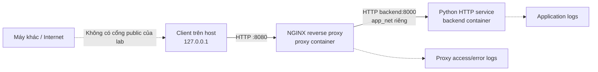

# Đặt reverse proxy trước service mẫu

Trong dự án thực hành của module **SECURITY_NETWORK_SECURITY**, chúng ta sẽ xây dựng một dịch vụ HTTP nhỏ và đặt **NGINX reverse proxy** ở phía trước. Người dùng chỉ kết nối tới proxy; backend không xuất bản cổng trực tiếp ra máy chủ chạy lab. Từ kiến trúc này, người học thực hành định tuyến request, chuyển tiếp header, kiểm soát nguồn truy cập, rate limit, ghi log, xử lý lỗi upstream và chuẩn bị nền tảng cho TLS/WAF.

Bài học thuộc chương **Dự án thực hành bảo mật mạng**. Đây là một lab nhỏ nhưng thể hiện nhiều nguyên tắc của bảo mật mạng: **phân đoạn và thu hẹp bề mặt truy cập**, bảo vệ lưu lượng tại ranh giới, xác định đúng nguồn client sau proxy, quan sát và kiểm chứng cấu hình thay vì chỉ “thấy website chạy”.

> **Phạm vi an toàn:** chỉ tạo tải thử trên `127.0.0.1` trong lab hoặc hệ thống mà bạn được cấp quyền. Không đưa cấu hình minh họa HTTP không mã hóa ra Internet. Mọi số cổng, IP và tên service dưới đây chỉ dành cho môi trường mô phỏng.

## 1. Mục tiêu và kết quả cần đạt

Sau khi hoàn thành, người học có thể:

1. Phân biệt **reverse proxy**, forward proxy, API gateway, load balancer và backend service.
2. Vẽ đường đi client → proxy → backend và giải thích vì sao backend không nên phơi ra mạng công cộng.
3. Dựng hai container bằng Docker Compose, cho phép chỉ NGINX có cổng công bố trên **loopback** của host.
4. Viết cấu hình `proxy_pass`, chuyển tiếp `Host`, `X-Forwarded-For`, `X-Forwarded-Proto` và request ID.
5. Kiểm chứng proxy không tin header IP do client bên ngoài tự khai.
6. Áp giới hạn request, kích thước body và timeout ở vị trí thích hợp.
7. Quan sát access/error log, lỗi backend, HTTP 429/502 và sự thay đổi khi sửa cấu hình.
8. Phân biệt tính sẵn sàng của proxy với tính sẵn sàng của backend, biết rollback an toàn.
9. Mô tả cách nâng cấp lab sang HTTPS/TLS, bảo vệ origin và triển khai thực tế.
10. Viết báo cáo PASS/FAIL có bằng chứng thay vì chỉ kết luận “đã chạy được”.

### Đầu ra dự kiến

Khi hoàn thành lab:

- `http://127.0.0.1:8080/health` phản hồi từ backend **qua NGINX**.
- `http://127.0.0.1:8080/api/info` phản hồi JSON để quan sát thông tin forwarded.
- Host **không** công bố TCP 8000 của backend; chỉ proxy có published port `127.0.0.1:8080`.
- Một đợt request ngắn vượt ngưỡng có thể bị giới hạn bằng **HTTP 429**.
- Khi backend dừng, proxy trả lỗi upstream (thường **502**) thay vì âm thầm “vẫn thành công”.
- Các kết quả có thể đối chiếu bằng `docker compose ps`, `docker compose logs` và HTTP response.

## 2. Kiến thức nền: reverse proxy đứng ở đâu?

### 2.1. Phân biệt những thành phần thường bị nhầm

| Thành phần | Đại diện cho ai? | Nhiệm vụ điển hình |
|---|---|---|
| **Reverse proxy** | Đại diện cho các service phía server | Nhận request từ client, chọn backend, chuyển tiếp, TLS termination, giới hạn và ghi log |
| **Forward proxy** | Đại diện cho client khi client truy cập ra ngoài | Chính sách egress, lọc website, cache, kiểm soát truy cập Internet |
| **Load balancer** | Phân phối lưu lượng đến một hay nhiều backend | Chia tải, health checking, chuyển vùng; có thể đồng thời làm reverse proxy |
| **API gateway** | Cửa ngõ của API | Định tuyến API, xác thực, rate limit, quota, quan sát; thường có chức năng reverse proxy |
| **WAF** | Lớp bảo vệ HTTP/HTTPS | Kiểm tra mẫu lưu lượng ứng dụng, ngăn request có dấu hiệu khai thác theo policy |
| **Backend service** | Thực thi nghiệp vụ | Xử lý request, kiểm tra quyền đối với dữ liệu và tạo response |

Một sản phẩm có thể làm nhiều vai trò. NGINX có thể reverse proxy và cân bằng tải; một API gateway có thể tích hợp WAF và xác thực. **Reverse proxy thuần túy không mặc nhiên là WAF**, cũng không thể thay thế kiểm tra quyền truy cập ở backend.

### 2.2. Kiến trúc lab



**Đường đi thực tế trong lab:**

```text
curl trên máy host
     |
     | TCP 127.0.0.1:8080
     v
NGINX container (proxy)
     |
     | Docker DNS: backend -> IP container
     | TCP 8000 trên mạng app_net
     v
Python HTTP service (backend)
     |
     | JSON/HTTP response
     v
NGINX -> client
```

Có **hai mạng Docker**:

- `edge_net`: proxy tham gia mạng ở phía nhận request; cổng host chỉ bind `127.0.0.1`.
- `app_net`: proxy và backend cùng tham gia; khai báo `internal: true` để mạng này không có đường egress ngoài thông thường.

Backend chỉ nối với `app_net` và **không có mục `ports`**. Điều này giảm bề mặt truy cập trực tiếp qua cổng công bố trên host. Nó **không** có nghĩa Docker bridge là hàng rào an ninh tuyệt đối trước người có quyền quản trị Docker/host hoặc container khác được cấp quyền nối vào cùng mạng. Trong production cần thêm policy mạng, bảo vệ host, quản lý quyền Docker và kiểm soát danh tính dịch vụ.

### 2.3. Vì sao dùng HTTP ở bước đầu?

Mục tiêu đầu tiên là nhìn rõ cách định tuyến và kiểm soát nguồn. Lab dùng HTTP **chỉ trên loopback và mạng container nội bộ** để không trộn lỗi chứng chỉ với lỗi proxy. Ở cuối bài có phần mở rộng HTTPS/TLS. Khi đưa qua mạng không tin cậy, phải dùng TLS phù hợp và bảo vệ kết nối proxy ↔ backend nếu đường đó vượt qua ranh giới tin cậy.

## 3. Chuẩn bị môi trường và phạm vi kiểm thử

Yêu cầu tối thiểu:

- Docker Engine hoặc Docker Desktop đang hoạt động; có hỗ trợ lệnh `docker compose`.
- Terminal và công cụ `curl`. Trên Windows PowerShell, dùng `curl.exe` nếu `curl` là alias của `Invoke-WebRequest`.
- Có thể tạo một thư mục thực hành riêng trên máy cá nhân.
- Port `127.0.0.1:8080` đang trống.
- Quyền chạy container trên máy lab. Không thực hiện trên máy chủ sản xuất nếu chưa có phê duyệt.

Ví dụ cấu trúc thư mục **mà người học tự tạo**:

```text
reverse-proxy-lab/
├── compose.yaml
├── app/
│   └── app.py
└── nginx/
    └── default.conf
```

Hướng dẫn này mô tả nội dung ba file của **lab minh họa**, không yêu cầu chỉnh sửa các file mã nguồn khác của hệ thống học tập. Các lệnh chạy trong thư mục `reverse-proxy-lab` do người học chuẩn bị.

### 3.1. Điều kiện dừng

Dừng thử nếu có bất kỳ tình huống nào:

- Port lab bị một dịch vụ quan trọng khác sử dụng.
- Container ảnh hưởng tài nguyên máy chủ hoặc không còn kiểm soát được nguồn traffic.
- Không chắc endpoint thử nghiệm thuộc phạm vi được cho phép.
- Cần mở bind `0.0.0.0`/port forwarding ra WAN chỉ để “cho dễ thử” mà chưa có phương án TLS và kiểm soát truy cập.

**Không cần tạo flood hay quét mạng bên ngoài để thực hành bài này.** Tất cả phép thử dưới đây là request HTTP nhỏ hoặc thay đổi container riêng của lab.

## 4. Viết backend service mẫu

Tạo `app/app.py` với Python standard library; không cần cài framework hoặc database.

```python
import json
from http.server import BaseHTTPRequestHandler, ThreadingHTTPServer


class Handler(BaseHTTPRequestHandler):
    def do_GET(self):
        if self.path not in ("/", "/health", "/api/info"):
            self.send_error(404, "Route not found")
            return

        result = {
            "status": "ok",
            "path": self.path,
            # Địa chỉ peer TCP của backend thường là proxy container.
            "peer_ip_at_backend": self.client_address[0],
            # Các trường này CHỈ ĐỂ QUAN SÁT, không dùng để cấp quyền.
            "forwarded_for": self.headers.get("X-Forwarded-For"),
            "forwarded_proto": self.headers.get("X-Forwarded-Proto"),
            "request_id": self.headers.get("X-Request-ID"),
        }
        body = json.dumps(result, ensure_ascii=False).encode("utf-8")

        self.send_response(200)
        self.send_header("Content-Type", "application/json; charset=utf-8")
        self.send_header("Content-Length", str(len(body)))
        self.send_header("Cache-Control", "no-store")
        self.end_headers()
        self.wfile.write(body)


if __name__ == "__main__":
    server = ThreadingHTTPServer(("0.0.0.0", 8000), Handler)
    print("Demo backend listening on :8000", flush=True)
    server.serve_forever()
```

**Giải thích thiết kế:**

- `ThreadingHTTPServer` xử lý các kết nối nhỏ phục vụ quan sát. Đây là **server demo**, không phải nền tảng Python production-ready.
- Backend bind `0.0.0.0:8000` **bên trong container** để proxy container có thể kết nối. Việc bind này không đồng nghĩa host đã công bố port.
- `/health` giúp kiểm tra dịch vụ còn đáp ứng; `/api/info` chỉ trả metadata đơn giản.
- `peer_ip_at_backend` là địa chỉ peer TCP mà backend thấy; thường là IP nội bộ của proxy.
- `forwarded_for` là header proxy chuyển tiếp, không phải địa chỉ do kernel của backend xác nhận.
- Không chấp nhận POST hay thay đổi dữ liệu; thử nghiệm không cần tài khoản hoặc bí mật.
- Không ghi mật khẩu, authorization header, cookie hoặc token vào phản hồi hay log.

**Ranh giới tin cậy:** ứng dụng không được dùng `X-Forwarded-For` làm căn cứ cấp quyền quản trị. Trong production, cần xác minh đường truyền chỉ qua proxy tin cậy, cấu hình xử lý client IP đúng chuỗi proxy và áp authorization độc lập.

## 5. Viết NGINX reverse proxy

Tạo `nginx/default.conf`:

```nginx
# File này được image NGINX nạp trong ngữ cảnh http {}.
# Giới hạn tốc độ thử nghiệm: mỗi IP 5 request/s, có burst 10.
limit_req_zone $binary_remote_addr zone=lab_per_ip:10m rate=5r/s;

server {
    listen 8080;
    server_name localhost;

    # Chỉ giảm thông tin phiên bản, không thay cho cập nhật bản vá.
    server_tokens off;

    # Giới hạn kích thước request body, tránh request quá lớn.
    client_max_body_size 16k;

    # Access log của image container có thể chuyển ra stdout.
    access_log /var/log/nginx/access.log;
    error_log /var/log/nginx/error.log warn;

    location / {
        # Bảo vệ tài nguyên với burst ngắn ở lab.
        limit_req zone=lab_per_ip burst=10 nodelay;
        limit_req_status 429;

        # Chuyển request đến service trên mạng app_net.
        proxy_pass http://backend:8000;
        proxy_http_version 1.1;
        proxy_set_header Connection "";

        # Giữ Host của request và thêm thông tin proxy có kiểm soát.
        proxy_set_header Host $host;
        proxy_set_header X-Real-IP $remote_addr;

        # Vì đây là edge proxy trực tiếp, ghi đè XFF không tin cậy.
        proxy_set_header X-Forwarded-For $remote_addr;
        proxy_set_header X-Forwarded-Proto $scheme;
        proxy_set_header X-Request-ID $request_id;

        # Tránh chiếm worker / treo kết nối quá lâu trong lab.
        proxy_connect_timeout 2s;
        proxy_send_timeout 5s;
        proxy_read_timeout 5s;

        add_header X-Content-Type-Options "nosniff" always;
        add_header Referrer-Policy "no-referrer" always;
    }
}
```

### 5.1. Các directive chính

| Directive | Chức năng | Lỗi thường gặp |
|---|---|---|
| `listen 8080` | NGINX nhận HTTP trên cổng nội bộ của container | Nhầm với bind host, nghĩ đã bật HTTPS |
| `proxy_pass http://backend:8000` | Chuyển request tới DNS service `backend` trên Docker network | Backend không cùng network, tên DNS sai |
| `proxy_set_header Host $host` | Truyền Host tới backend | Cho phép Host header không mong muốn nếu ứng dụng dùng Host xây URL tin cậy |
| `X-Forwarded-For $remote_addr` | Ghi nguồn client theo proxy trực tiếp ở lab | Nối mù quáng header XFF do Internet tự gửi |
| `X-Forwarded-Proto $scheme` | Báo scheme nhìn từ client tại proxy | Nếu TLS termination ở proxy khác phía trước thì cần trust chain đúng |
| `X-Request-ID $request_id` | Sinh ID để đối chiếu sự kiện | Không truyền/ghi ID nhất quán qua các dịch vụ |
| `proxy_*_timeout` | Giới hạn thời gian giao tiếp upstream | Timeout quá ngắn làm hỏng tác vụ hợp lệ |
| `client_max_body_size 16k` | Từ chối request body vượt kích thước | Chặn nhầm upload nếu áp máy móc vào production |
| `limit_req` | Throttle request theo địa chỉ nguồn | Nhiều người dùng NAT chung IP bị giới hạn cùng nhau |

**Quan trọng:** `limit_req_zone` phải nằm trong ngữ cảnh `http` của NGINX. File `default.conf` được include dưới `http` trong image NGINX thông thường; vì thế khai báo ở đầu file này hợp lệ. Không đặt nguyên khối cấu hình trên vào bên trong một `server` khác.

### 5.2. Header nguồn client và vấn đề spoofing

Client có thể gửi:

```http
GET /api/info HTTP/1.1
Host: localhost
X-Forwarded-For: 203.0.113.88
```

Nếu proxy chỉ nối tiếp hoặc tin header này mà không xác minh nguồn gửi, backend có thể ghi nhầm IP hoặc ra quyết định dựa trên dữ liệu giả mạo. Trong lab, `proxy_set_header X-Forwarded-For $remote_addr;` **ghi đè** giá trị XFF do client cung cấp.

Trong mô hình production có CDN hoặc load balancer **đã được tin cậy ở phía trước**, `$remote_addr` có thể là IP của CDN/LB chứ không phải client cuối. Khi đó phải cấu hình mô hình **trusted proxies**, `real_ip_header` / `set_real_ip_from` ở phạm vi hẹp và rule chặn truy cập trực tiếp, không sao chép nguyên cấu hình lab. Header IP không bao giờ thay thế việc xác thực danh tính.

### 5.3. Một giới hạn quan trọng của lab

Vì phía client dùng HTTP, giá trị `X-Forwarded-Proto` sẽ là `http`. Proxy không tạo TLS chỉ bằng việc thêm header hoặc đặt tên file `default.conf`. HTTPS/TLS phải được cấu hình và kiểm tra riêng.

## 6. Viết Docker Compose với mạng backend riêng

Tạo `compose.yaml`:

```yaml
services:
  backend:
    image: python:3.12-alpine
    command: ["python", "-u", "/app/app.py"]
    working_dir: /app
    volumes:
      - ./app/app.py:/app/app.py:ro
    expose:
      - "8000"
    networks:
      - app_net
    # Hạn chế quyền của service demo.
    user: "65534:65534"
    read_only: true
    environment:
      PYTHONDONTWRITEBYTECODE: "1"
    security_opt:
      - no-new-privileges:true
    cap_drop:
      - ALL
    # KHÔNG dùng 'ports' cho backend.

  proxy:
    image: nginx:stable-alpine
    depends_on:
      - backend
    ports:
      # Chỉ công bố trên loopback của host lab.
      - "127.0.0.1:8080:8080"
    volumes:
      - ./nginx/default.conf:/etc/nginx/conf.d/default.conf:ro
    networks:
      - edge_net
      - app_net

networks:
  edge_net: {}
  app_net:
    internal: true
```

### 6.1. Vì sao backend không dùng `ports`?

Trong Docker Compose:

- `ports: ["127.0.0.1:8080:8080"]` của proxy tạo một cổng **published** trên host.
- `expose: ["8000"]` ở backend là metadata mô tả cổng nội bộ; **không** tạo host port forwarding. Các container có đường mạng và quyền phù hợp vẫn có thể kết nối đến cổng được service lắng nghe, kể cả khi không có `expose`.
- Chỉ proxy tham gia `edge_net`; backend chỉ tham gia `app_net`.
- `internal: true` giúp giới hạn định tuyến từ mạng `app_net` ra ngoài, nhưng không thay thế kiểm soát quyền đối với Docker daemon và host.
- `depends_on` theo cấu hình trên bảo đảm **thứ tự khởi động**, không bảo đảm backend sẵn sàng nhận request; khi dịch vụ chưa ready, proxy có thể tạm trả 502.

**Một anti-pattern cần tránh:**

```yaml
backend:
  ports:
    - "0.0.0.0:8000:8000"
```

Cấu hình trên xuất bản backend tới mọi interface IPv4 của host, có thể làm client bỏ qua NGINX. Đây là ví dụ **không được đưa vào Compose chính**. Nếu thay ngược từ `ports` thành `expose` nhưng để một đường publish khác ở host/kubernetes/ingress, backend vẫn có thể bị truy cập trực tiếp qua đường đó.

### 6.2. Ghi chú về image và hệ điều hành

Image `python:3.12-alpine` và `nginx:stable-alpine` là tag tham khảo cho lab, có thể thay đổi bản vá theo thời gian. Trong pipeline production, nên kiểm soát version/digest, quét lỗ hổng, cập nhật có thử nghiệm và tuân thủ chính sách supply chain. Cấu hình `user`, `read_only`, `cap_drop` giúp giảm quyền backend demo, nhưng không bảo đảm mọi ứng dụng khác có thể chạy như vậy mà không cần điều chỉnh.

## 7. Khởi chạy và xác minh cấu hình

Thực hiện các lệnh trong thư mục `reverse-proxy-lab`:

```bash
# Kiểm tra cú pháp và nội dung Compose đã được hợp nhất.
docker compose config

# Tạo và chạy hai service.
docker compose up -d

# Kiểm tra container và port publish.
docker compose ps

# Kiểm tra cấu hình NGINX trong container.
docker compose exec proxy nginx -t

# Xem log khởi động gần đây.
docker compose logs --tail=30 proxy backend
```

Kết quả mong đợi:

- Có service `proxy` và `backend` đang chạy.
- `docker compose ps` chỉ hiển thị host published port cho proxy (`127.0.0.1:8080`), **không** có publish TCP 8000 của backend.
- `nginx -t` báo cú pháp hợp lệ.
- Log của backend có thông điệp đang lắng nghe `:8000`.

### 7.1. Gửi request từ host qua proxy

```bash
curl -i http://127.0.0.1:8080/health
```

Ví dụ phản hồi JSON, các IP/ID thực tế sẽ khác:

```http
HTTP/1.1 200 OK
Content-Type: application/json; charset=utf-8
X-Content-Type-Options: nosniff

{"status":"ok","path":"/health",
 "peer_ip_at_backend":"<ip_proxy_noi_bo>",
 "forwarded_for":"<ip_client_proxy_thay>",
 "forwarded_proto":"http",
 "request_id":"<ma_yeu_cau>"}
```

**Dấu hiệu proxy hoạt động:** request tới host port 8080 được chuyển sang backend, nhận JSON từ Python; log phía proxy có request và backend có log truy cập. `peer_ip_at_backend` thường là IP của proxy trên mạng Docker, không phải `127.0.0.1` của máy host.

### 7.2. Gửi request đến route không tồn tại

```bash
curl -i http://127.0.0.1:8080/khong-ton-tai
```

Backend dự kiến phản hồi HTTP **404**; NGINX chuyển tiếp trạng thái đó. Thử nghiệm giúp phân biệt lỗi định tuyến ứng dụng với lỗi proxy. Không phải mọi 404 đều do NGINX tự sinh.

### 7.3. Kiểm tra backend không được công bố ra host

```bash
# Trên host, dự kiến KHÔNG có service lab ở port này.
curl --connect-timeout 2 -i http://127.0.0.1:8000/health

# Đọc port publish từ Compose (backend không có published port).
docker compose ps

# Bên trong backend container vẫn có thể truy cập localhost:8000.
docker compose exec backend python -c \
  "import urllib.request; print(urllib.request.urlopen('http://127.0.0.1:8000/health').status)"
```

Kỳ vọng: host không thể tới backend qua `127.0.0.1:8000` **nếu không có dịch vụ khác đang dùng cổng đó**; bên trong container, request localhost:8000 phản hồi 200. Kết luận chính xác hơn dựa trên **không có host port publish** cùng sơ đồ network, không chỉ một lỗi kết nối đơn lẻ.

**Đừng thử mở port backend ra Internet để “kiểm chứng cho dễ”**: điều đó phá chính mục tiêu bảo vệ origin của lab.

## 8. Thử giả mạo header client IP

Đây là phép thử an toàn dùng một request đến proxy loopback:

```bash
curl -sS \
  -H "X-Forwarded-For: 203.0.113.88" \
  http://127.0.0.1:8080/api/info
```

Trong JSON trả về, trường `forwarded_for` **không nên là** `203.0.113.88` chỉ vì client tự khai giá trị đó. NGINX đã ghi đè bằng `$remote_addr` quan sát tại proxy.

Giải thích:

1. Client kết nối đến NGINX bằng địa chỉ nguồn mà Docker/host networking cung cấp.
2. NGINX nhận một header `X-Forwarded-For` do client gửi nhưng **không chuyển nguyên giá trị này**.
3. NGINX tạo header mới với nguồn quan sát ở biên.
4. Backend chỉ nhận header do NGINX cấp; nó vẫn phải dùng cơ chế authn/authz của riêng mình nếu có dữ liệu thật.

**Chú ý:** kết quả chỉ chứng minh chính sách header của một proxy lab. Trong mô hình có CDN/LB phía trước, cần xác minh **toàn chuỗi proxy tin cậy**, không giữ cấu hình này máy móc vì có thể mất IP client thật.

## 9. Kiểm thử rate limit và giới hạn kích thước request

### 9.1. Rate limit theo IP

NGINX được cấu hình:

```nginx
limit_req_zone $binary_remote_addr zone=lab_per_ip:10m rate=5r/s;
limit_req zone=lab_per_ip burst=10 nodelay;
limit_req_status 429;
```

Một client có thể gửi request thành từng cụm trong phạm vi burst, sau đó bị giới hạn khi vượt khả năng nạp token. Để thử an toàn trên lab, gửi tối đa 20 request nhỏ:

```bash
# Linux/macOS hoặc terminal có bash; chỉ chạy với loopback lab.
for i in $(seq 1 20); do
  curl -sS -o /dev/null -w "%{http_code}\n" \
    http://127.0.0.1:8080/api/info
done
```

Kết quả có thể gồm **200** và **429**. Nếu máy thử chạy chậm, nhiều request có thể được chấp nhận do token được nạp lại trong lúc chạy. Không thấy 429 trong một đợt **không** đủ để kết luận limiter sai; cần đối chiếu cấu hình, tốc độ phát request thực tế và log.

**Không biến phép thử thành flood vô hạn.** Mục tiêu là xác minh 429 ở mức tải nhỏ trong môi trường của mình, không kiểm tra sức chịu tải DDoS.

### 9.2. Giới hạn request body

NGINX đặt:

```nginx
client_max_body_size 16k;
```

Một request có body lớn hơn giới hạn có thể nhận **413 Request Entity Too Large** trước khi đến backend. Backend lab không hỗ trợ POST và trả 501 cho phương thức không được định nghĩa; do đó cần phân biệt **413 do gateway giới hạn body** với **501 do backend không hỗ trợ POST**. Khi kiểm thử, có thể dùng một file dữ liệu giả lớn hơn 16 KiB trên chính lab rồi gửi tới loopback, không cần dữ liệu thật.

**Hạn chế:** một giá trị 16 KiB hợp lý cho API GET demo nhưng có thể làm hỏng upload hợp lệ ở production. Quyết định size limit phải theo endpoint, mục tiêu bảo vệ và yêu cầu nghiệp vụ.

### 9.3. Khi nào không nên dùng limit theo IP?

Nhiều người dùng có thể chia cùng một IP public sau NAT/VPN. Nếu 30 người truy cập qua cùng một gateway, limiter `5r/s` theo `$binary_remote_addr` có thể chặn nhầm nhau. Một API production thường cần thêm limit theo tenant, user, API key hoặc route, với xác thực và giới hạn tổng có kiểm soát.

## 10. Quan sát log và tìm lỗi proxy

Các lệnh đọc log:

```bash
docker compose logs --tail=100 proxy
docker compose logs --tail=100 backend

# Theo dõi log khi đang thử trên một terminal riêng.
docker compose logs -f proxy backend
```

Ở terminal khác, gửi vài request:

```bash
curl -i http://127.0.0.1:8080/api/info
curl -i http://127.0.0.1:8080/khong-ton-tai
```

Quan sát:

- Proxy access log có method, URL, HTTP status và nguồn client proxy nhìn thấy.
- Backend log cho biết đã thực sự nhận những request được proxy chuyển tiếp.
- Request trả 429 tại proxy có thể **không** có bản ghi xử lý tương ứng tại backend, nếu bị từ chối trước `proxy_pass`.
- Header `X-Request-ID` trong lab được forward tới backend và có trong response JSON; tuy nhiên access log mặc định của NGINX **chưa chắc ghi request ID**. Muốn liên kết bằng ID trong log, phải cấu hình định dạng log riêng.

### 10.1. Bổ sung correlation ID vào access log

Có thể thêm đoạn này ở **đầu file `nginx/default.conf`, trước `server`**, rồi sửa dòng `access_log` trong `server`:

```nginx
log_format lab_json escape=json
  '{"time":"$time_iso8601",'
  '"remote_addr":"$remote_addr",'
  '"request_id":"$request_id",'
  '"method":"$request_method",'
  '"uri":"$request_uri",'
  '"status":$status,'
  '"request_time":$request_time,'
  '"upstream_status":"$upstream_status",'
  '"upstream_response_time":"$upstream_response_time"}';

# Bên trong server {}, thay dòng access_log cũ bằng:
access_log /var/log/nginx/access.log lab_json;
```

**Cẩn thận về ngữ cảnh:** `log_format` chỉ hợp lệ ở `http`, còn `access_log` có thể đặt trong `server` hoặc `location`. Đừng dán `access_log` thứ hai mà không hiểu log đang được ghi hai lần.

Từ đây, proxy log có thể chứa `request_id` và `upstream_status` để xác định 200/404 đến từ upstream hay 429 do proxy xử lý. Mọi log có URL/query string cần được xem xét để tránh vô tình lưu thông tin nhạy cảm; production nên có quy tắc che/redact và lưu trữ có kiểm soát.

### 10.2. Phân biệt lỗi theo vị trí

| Triệu chứng | Nguyên nhân có thể | Cách kiểm tra |
|---|---|---|
| Không kết nối được `127.0.0.1:8080` | Proxy chưa chạy, port bind lỗi, Docker chưa sẵn sàng | `docker compose ps`, logs, port host |
| HTTP 404 | Route backend không tồn tại hoặc NGINX config khác | So sánh proxy access và backend log |
| HTTP 429 | Limit theo khóa/nguồn đang áp dụng | NGINX config, `limit_req` logs, tần suất thực |
| HTTP 413 | Request body quá lớn | `client_max_body_size`, endpoint và payload |
| HTTP 502 | Không kết nối/không nhận response hợp lệ từ upstream | Backend logs, name resolution, network, proxy error log |
| HTTP 504 | Upstream timeout theo cơ chế proxy | Timeout, backend response time, kết nối |
| Request qua proxy OK, truy cập backend trực tiếp không được | Theo mục tiêu hạn chế origin của lab | `docker compose ps` và network topology |
| Backend thấy nguồn là proxy | Hành vi TCP bình thường sau reverse proxy | Header forwarded do proxy thiết lập, không dùng cấp quyền |

Một số lỗi có thể thay đổi mã HTTP theo phiên bản NGINX, cấu hình timeout và trạng thái upstream. Luôn đọc **error log** và đối chiếu thời điểm, không đoán nguyên nhân chỉ từ mã phản hồi.

## 11. Thử tình huống backend ngừng phục vụ

Để quan sát hành vi khi upstream lỗi, chỉ dừng backend **trong lab này**:

```bash
docker compose stop backend

# Proxy còn chạy nhưng backend tạm không có.
curl -i --max-time 5 http://127.0.0.1:8080/health

docker compose logs --tail=30 proxy

# Khởi động lại backend.
docker compose start backend

# Kiểm tra phục hồi.
curl -i --max-time 5 http://127.0.0.1:8080/health
```

**Kỳ vọng:** khi backend không còn kết nối được, NGINX thường trả **502 Bad Gateway**; sau khi backend hoạt động lại và đường upstream ổn định, request có thể thành công. Nếu nhận 429 do đã dùng hết bucket thử nghiệm, chờ một chút rồi thử request đơn lẻ để không nhầm limiter với lỗi upstream.

**Điểm vận hành quan trọng:** NGINX dạng cấu hình tĩnh `proxy_pass http://backend:8000` có thể chỉ phân giải địa chỉ DNS của backend khi nạp cấu hình. Nếu bạn **recreate** backend và địa chỉ container đổi, proxy có thể tiếp tục dùng địa chỉ cũ cho đến lúc reload/restart cấu hình, tùy cách khai báo upstream. Với lab có thể kiểm tra:

```bash
docker compose exec proxy nginx -t
docker compose exec proxy nginx -s reload
```

Ở production, cần chiến lược service discovery/resolve và health checking phù hợp, không dựa vào giả định tên DNS luôn được tái phân giải ở từng request.

### 11.1. Nếu backend không sẵn sàng ngay khi Compose start

`depends_on` không mặc nhiên đợi HTTP health của Python backend. Nếu request đầu tiên nhận 502 nhưng sau đó thành công, đó có thể là race khi khởi động. Có thể bổ sung healthcheck và phụ thuộc vào trạng thái healthy bằng cú pháp Compose hỗ trợ, hoặc thiết kế retry an toàn tại client. Không sửa NGINX thành “always 200” để che lỗi backend.

## 12. Thay đổi cấu hình và rollback

Khi muốn cập nhật `nginx/default.conf`:

1. Giữ bản sao/version của cấu hình đang chạy.
2. Sửa đúng directive và ghi mục đích.
3. Kiểm tra cú pháp trước khi reload.
4. Reload và gửi lại bộ test.
5. Nếu lỗi, khôi phục cấu hình trước đó, `nginx -t` rồi reload.
6. Ghi log và kết quả kiểm chứng sau rollback.

```bash
# Kiểm tra cấu hình sau khi sửa file bind-mount.
docker compose exec proxy nginx -t

# Chỉ reload nếu cấu hình hợp lệ.
docker compose exec proxy nginx -s reload

# Test đường chính.
curl -i http://127.0.0.1:8080/health
```

Nếu cấu hình sai khiến container proxy không khởi động được, sửa file trên host rồi dùng `docker compose up -d` để tạo lại service phù hợp. Trong lab, có thể dùng source control hoặc bản sao file để rollback; đừng xóa toàn bộ cấu hình thiết bị production.

**Khi dọn lab:**

```bash
docker compose down
```

Lệnh này dừng và gỡ các container/network do Compose tạo cho project, nhưng **không tự xóa** ba file người học đã viết trên host. Không cần dùng `down -v` vì lab không khai báo named volume dữ liệu; cần hiểu phạm vi trước khi dùng tùy chọn xóa volume ở dự án khác.

## 13. Mở rộng tùy chọn: thêm HTTPS/TLS tại reverse proxy

Bản gốc chỉ dành cho HTTP loopback. Trong vận hành thật, TLS bảo vệ dữ liệu giữa client và reverse proxy; backend hop cũng cần bảo vệ nếu vượt ranh giới tin cậy hoặc có yêu cầu tuân thủ.

### 13.1. Tạo chứng chỉ **tự ký dành riêng cho localhost**

Trên máy có OpenSSL, trong thư mục `reverse-proxy-lab`, tạo file chứng chỉ lab (không dùng cho Internet):

```bash
openssl req -x509 -newkey rsa:2048 -nodes -days 2 \
  -keyout nginx/localhost.key \
  -out nginx/localhost.crt \
  -subj "/CN=localhost" \
  -addext "subjectAltName=DNS:localhost"
```

Bản OpenSSL hoặc shell có thể khác cú pháp; nếu thiếu `-addext`, hãy dùng cấu hình chứng chỉ có SAN tương đương. File `localhost.key` là **private key**, không đưa vào Git, không chia sẻ và cần bảo vệ quyền đọc.

### 13.2. Bổ sung mapping cho proxy

Trong `compose.yaml`, thêm dưới service `proxy`:

```yaml
ports:
  - "127.0.0.1:8080:8080"
  - "127.0.0.1:8443:8443"
volumes:
  - ./nginx/default.conf:/etc/nginx/conf.d/default.conf:ro
  - ./nginx/localhost.crt:/etc/nginx/certs/localhost.crt:ro
  - ./nginx/localhost.key:/etc/nginx/certs/localhost.key:ro
```

Đây là **đoạn thay thế** cho hai mục `ports` và `volumes` hiện có của `proxy`, không dán lặp các khóa YAML cùng cấp.

### 13.3. Thêm server HTTPS vào file NGINX

Giữ `limit_req_zone` ở đầu file, thêm **một `server` thứ hai**:

```nginx
server {
    listen 8443 ssl;
    server_name localhost;
    server_tokens off;

    ssl_certificate /etc/nginx/certs/localhost.crt;
    ssl_certificate_key /etc/nginx/certs/localhost.key;
    ssl_protocols TLSv1.2 TLSv1.3;

    client_max_body_size 16k;

    location / {
        limit_req zone=lab_per_ip burst=10 nodelay;
        limit_req_status 429;

        proxy_pass http://backend:8000;
        proxy_http_version 1.1;
        proxy_set_header Connection "";
        proxy_set_header Host $host;
        proxy_set_header X-Real-IP $remote_addr;
        proxy_set_header X-Forwarded-For $remote_addr;
        proxy_set_header X-Forwarded-Proto $scheme;
        proxy_set_header X-Request-ID $request_id;
        proxy_connect_timeout 2s;
        proxy_read_timeout 5s;

        add_header X-Content-Type-Options "nosniff" always;
    }
}
```

Áp cấu hình và kiểm tra:

```bash
docker compose up -d
docker compose exec proxy nginx -t

# -k CHỈ để kiểm thử chứng chỉ tự ký trong lab.
curl -k -i https://localhost:8443/health
```

Khi truy cập HTTPS, `forwarded_proto` dự kiến là `https`. Flag `-k` bỏ xác minh chứng chỉ, **không dùng trong production**. Trong production, dùng chứng chỉ được tin cậy, tên miền thật, kiểm tra chuỗi chứng chỉ và cấu hình TLS theo chính sách; chỉ bật HSTS sau khi đã xác nhận HTTPS hoạt động bền vững cho các hostname liên quan.

**Lưu ý:** HTTPS ở client → NGINX **không** khiến chặng NGINX → backend tự được mã hóa; cấu hình ở lab vẫn dùng `http://backend:8000`. Nếu các container thuộc ranh giới tin cậy khác nhau hoặc chính sách yêu cầu mã hóa nội bộ, dùng TLS/mTLS và xác thực phía backend theo kiến trúc thực.

### 13.4. Không chuyển trực tiếp chứng chỉ tự ký vào production

Chứng chỉ tự ký chỉ phục vụ học cơ chế. Khi triển khai thật còn cần:

- Quản lý khóa riêng bằng secret store phù hợp, phân quyền, thay/xoay vòng.
- Chứng chỉ có SAN đúng domain, thời hạn, chain và quy trình renew.
- Giới hạn phiên bản/cipher TLS, kiểm tra trước khi bật HSTS.
- Phân loại nơi cần terminate TLS, khi nào mã hóa lại tới upstream.
- Kiểm tra client IP thực qua proxy tin cậy sau CDN/load balancer.
- Bảo vệ origin, xác thực/ủy quyền, rate limit theo danh tính và audit.

## 14. Hardening để tiến gần hệ thống thực tế

Reverse proxy giúp tập trung một số biện pháp, nhưng cần hiểu **giới hạn của chính lớp bảo vệ**.

| Hạng mục | Những gì lab đã có | Yêu cầu cần bổ sung cho production |
|---|---|---|
| **Bề mặt truy cập** | Proxy published trên loopback, backend không published | Firewall/SG, private networking, không để origin bypass qua IP/ingress khác |
| **TLS** | HTTP loopback; HTTPS tự ký tùy chọn | Chứng chỉ đáng tin, TLS policy, key rotation, mTLS khi cần |
| **Xác thực/ủy quyền** | Không có tài khoản vì là API demo | OIDC/OAuth2/mTLS/PAM theo nhu cầu; backend vẫn thực thi authorization |
| **Client IP** | Ghi đè XFF ở edge một hop | Trusted proxy chain, Real-IP config và ngăn client spoof |
| **Rate limit** | Theo IP để học cơ chế | Theo IP + user/tenant/route, giới hạn global, fairness cho NAT |
| **WAF/DDoS** | Không có WAF thực sự; NGINX limit_req cơ bản | WAF, bot protection, upstream DDoS protection theo threat model |
| **Observability** | Access/error logs và request ID | Structured logging, metrics, distributed tracing, SIEM, alert |
| **High availability** | Một NGINX và một backend | Multi-replica, load balancing, health checks, failover và capacity |
| **DNS/service discovery** | Docker DNS đơn giản | Dynamic discovery, resolver phù hợp, retry và circuit-breaker có giới hạn |
| **Image/container** | Tag Docker, backend giảm privilege | Version/digest pinning, quét image, patch, secret management, runtime isolation |
| **Headers và bảo vệ ứng dụng** | No-sniff và referrer policy | CSP/HSTS/X-Frame-Options khi áp dụng, kiểm tra Host và hạn chế request methods |
| **Chính sách vận hành** | Có lệnh test, reload và cleanup | IaC, code review, canary, change approval, rollback và runbook |

### 14.1. Origin bypass là lỗi kiến trúc nghiêm trọng

Nếu backend còn cổng publish công khai trên `:8000`, client có thể gọi trực tiếp, **bỏ qua** rate limit, log và chính sách xác thực đặt ở NGINX. Do đó, khi kiểm thử phải nhìn cả đường đi **qua proxy** và đường **tới origin**.

Mạng backend riêng của lab là minh họa cách giảm exposure. Ở cloud hoặc Kubernetes, cần thêm security group/NSG/NetworkPolicy/ingress routing và kiểm tra public IP, private endpoint, peering, IPv6. Không chỉ tin rằng “backend không có tên miền public” thì nó không thể tiếp cận trực tiếp.

### 14.2. Khả năng sẵn sàng và lỗi điểm đơn

Một proxy đơn có thể thành điểm lỗi chung. Nếu backend hoạt động nhưng proxy dừng, người dùng vẫn mất kết nối. Nếu proxy hoạt động nhưng backend dừng, thường nhận 502. Khi thiết kế HA cần:

- Nhiều proxy hoặc dịch vụ edge có failover.
- Backend readiness/health checks.
- Timeout và retry phù hợp **chỉ cho thao tác an toàn/idempotent khi thực sự được thiết kế**.
- Theo dõi CPU, memory, connections, queue, p95/p99, 429/502/504 và lượng request hợp lệ.
- Đánh giá các thành phần hạ tầng như DNS, chứng chỉ, service discovery và upstream network.

### 14.3. Log và dữ liệu nhạy cảm

Không để NGINX ghi raw token, cookie, thông tin cá nhân hoặc query string nhạy cảm tràn lan. Khi dùng structured log, định nghĩa trường cần thiết, lọc/redact, quyền xem, thời hạn lưu và đồng bộ UTC. Request ID cần được truyền đúng qua service, không thay thế xác thực.

## 15. Ma trận kiểm thử và tiêu chí chấp nhận

| ID | Kịch bản | Cách quan sát | Kỳ vọng |
|---|---|---|---|
| T01 | Proxy và backend start | `docker compose ps` / logs | Cả hai service chạy, không có lỗi config |
| T02 | GET `/health` qua proxy | `curl -i 127.0.0.1:8080/health` | HTTP 200, JSON backend |
| T03 | Route không tồn tại | `curl /khong-ton-tai` | HTTP 404 từ backend |
| T04 | Backend không published | Compose port inspection và host probe | Không có host mapping TCP 8000 của backend |
| T05 | Header XFF giả mạo | Gửi `X-Forwarded-For: 203.0.113.88` | Backend không nhận nguyên giá trị client tự khai |
| T06 | Rate limit nhỏ có kiểm soát | Tối đa 20 request lab | Thấy hành vi giới hạn phù hợp; có thể có 429 |
| T07 | Request body quá giới hạn | Gửi payload giả >16 KiB | NGINX trả 413 trước backend |
| T08 | Backend dừng | `docker compose stop backend` | Proxy không trả 200 giả; báo lỗi upstream |
| T09 | Backend phục hồi | `docker compose start backend` | Request hợp lệ quay về 200 khi đường upstream ổn định |
| T10 | Cấu hình NGINX hợp lệ | `nginx -t` | Cú pháp OK, reload không phá hoạt động |
| T11 | Quan sát request | Logs proxy/backend, request ID | Tìm được bản ghi tương ứng |
| T12 | HTTPS mở rộng (nếu làm) | `curl -k https://localhost:8443/health` | Có TLS, `forwarded_proto=https` |
| T13 | Chặn truy cập trực tiếp origin | Không dùng `ports` cho backend | Không có đường publish bypass NGINX |
| T14 | Rollback và cleanup | `docker compose down`, quan sát runtime | Container và network của project đã dừng/gỡ |

**Lưu ý PASS/FAIL:** mỗi trường hợp cần bằng chứng tương ứng; không được tự đánh dấu PASS chỉ từ một response duy nhất. Ví dụ T04 cần nhìn Compose publish port; một timeout trên host có thể đến từ nguyên nhân khác. T06 cần lưu tốc độ phát request thực tế nếu muốn chứng minh limit.

## 16. Kịch bản sự cố để luyện xử lý

### Sự cố A — Proxy trả 502 ngay sau start

**Quan sát:** `docker compose ps` cho thấy NGINX chạy; request tới `/health` trả 502.

**Các giả thuyết cần kiểm tra:**

1. Backend chưa ready vì `depends_on` chỉ điều khiển thứ tự start.
2. `proxy_pass` trỏ sai `backend:8000` hoặc backend không tham gia `app_net`.
3. Ứng dụng không lắng nghe trên `0.0.0.0:8000` của container.
4. NGINX giữ địa chỉ container cũ sau khi backend recreate.
5. Host/container network bị thay đổi hoặc backend gặp lỗi runtime.

**Quy trình:** xem `docker compose ps`, logs proxy/backend; thử truy cập localhost từ bên trong backend; kiểm tra `nginx -t` và network của Compose. Nếu chỉ lỗi thời điểm start, xác nhận sau khi backend ready. Không “sửa” bằng cách publish backend ra Internet.

### Sự cố B — Tất cả người dùng bị 429

**Quan sát:** sau khi đặt NGINX sau một load balancer, nhiều người dùng cùng bị giới hạn 5 RPS.

**Giải thích có thể:** `$remote_addr` tại NGINX là **IP load balancer**, khiến mọi client chia một bucket `lab_per_ip`. Cấu hình lab chỉ phù hợp khi NGINX là edge trực tiếp. Cần thiết kế trusted proxy chain và limit theo identity/tenant khi phù hợp, không tin `X-Forwarded-For` tùy ý từ Internet.

### Sự cố C — Proxy đã bật HTTPS nhưng backend vẫn nhận `http`

**Quan sát:** `forwarded_proto` từ request HTTPS vẫn báo `http`.

**Các khả năng:** request đi qua server HTTP thay vì TLS server, cấu hình `proxy_set_header` không đúng `location`, có proxy thứ hai trước NGINX và `$scheme` phản ánh kết nối **tới NGINX**, hoặc ứng dụng đang đọc header do một tầng khác ghi đè. Kiểm tra đường đi thực, Host/port, access log và policy từng hop.

### Sự cố D — Đổi backend image rồi proxy vẫn tới IP cũ

**Quan sát:** backend được recreate, NGINX vẫn 502 dù Docker DNS đã có tên service.

**Hướng xử lý:** so sánh DNS/network và thời điểm NGINX phân giải tên; reload NGINX như thao tác lab. Với hệ thống động, dùng service discovery và cấu hình upstream/resolver đúng theo khả năng phiên bản NGINX hoặc ingress controller, tránh phụ thuộc restart thủ công.

### Sự cố E — Đã có reverse proxy nhưng scanner vẫn thấy port backend

**Quan sát:** một kiểm tra được ủy quyền phát hiện cổng backend công khai.

**Nguyên nhân có thể:** còn `ports` trong Compose, load balancer/Ingress khác publish trực tiếp, firewall/cloud SG mở rộng, hoặc IPv6 route ngoài dự kiến. Phải **loại bỏ đường origin bypass** và kiểm thử lại từ đúng vantage point, không chỉ thay banner HTTP.

## 17. Mẫu báo cáo thực hành

Điền các trường sau sau khi chạy lab. Những giá trị đánh dấu `<...>` là chỗ cần bổ sung, **không phải kết quả đo có sẵn**.

```yaml
lab_id: "NETWORK-SECURITY-LAB-005"
topic: "Đặt reverse proxy trước service mẫu"
environment:
  platform: "<Docker Engine/Desktop + phiên bản>"
  compose_project: "<tên thư mục/project>"
  ingress: "http://127.0.0.1:8080"
  backend: "backend:8000"
architecture:
  exposed_services:
    - "proxy TCP 8080 trên host loopback"
  backend_published_port: false
  app_network_internal: true
test_results:
  t01_compose_start: "<PASS/FAIL/NOT_TESTED>"
  t02_health_through_proxy: "<PASS/FAIL/NOT_TESTED>"
  t03_backend_404: "<PASS/FAIL/NOT_TESTED>"
  t04_backend_not_published: "<PASS/FAIL/NOT_TESTED>"
  t05_xff_spoof_protection: "<PASS/FAIL/NOT_TESTED>"
  t06_rate_limit: "<PASS/FAIL/NOT_TESTED>"
  t07_body_limit: "<PASS/FAIL/NOT_TESTED>"
  t08_upstream_failure: "<PASS/FAIL/NOT_TESTED>"
  t09_recovery: "<PASS/FAIL/NOT_TESTED>"
  t12_optional_tls: "<PASS/FAIL/NOT_TESTED>"
evidence:
  compose_ps: "<đầu ra/ảnh hoặc ref>"
  nginx_config_test: "<đầu ra nginx -t>"
  http_responses: "<mã/response/correlation-id>"
  proxy_logs: "<ref log>"
  backend_logs: "<ref log>"
limitations:
  - "HTTP chỉ được dùng trên loopback và mạng container nội bộ"
  - "Chưa kiểm thử tải cao, DDoS hoặc HA production"
  - "Backend demo không có authorization hay database"
security_findings: []
rollback:
  plan: "Hoàn nguyên config, nginx -t, reload; docker compose down khi dọn lab"
decision: "<PASS/FAIL/INCONCLUSIVE>"
```

**INCONCLUSIVE** phù hợp khi không đủ bằng chứng: ví dụ không thể test IPv6, thiếu log cho 429, không xác minh được đường origin hoặc lỗi Docker khiến proxy chưa chạy ổn định. Ghi rõ giới hạn thay vì khẳng định đã bảo mật hoàn chỉnh.

## 18. Bài tập mở rộng

### Bài tập 1 — Chứng minh reverse proxy không phải WAF

Giải thích vì sao NGINX nhận request và chuyển tiếp thành công không đủ để kết luận backend được bảo vệ khỏi mọi lỗi ứng dụng. Hãy phân biệt nhiệm vụ của WAF, rate limit, input validation và authorization.

*Gợi ý:* Reverse proxy quản lý đường đi và có thể áp một số chính sách; WAF có tập rule phân tích request; backend phải tự kiểm tra quyền theo tài nguyên/người dùng. Không lớp nào thay thế hoàn toàn lớp kia.

### Bài tập 2 — Hai backend sau proxy

Mở rộng lab bằng backend thứ hai (chỉ trong mạng riêng), cấu hình NGINX `upstream` với hai server và ghi ID của từng backend vào JSON. Kiểm chứng routing, health/failover, log; không xuất bản port backend ra host.

*Yêu cầu:* mô tả sự khác nhau giữa round-robin đơn giản và active health check; đừng tự khẳng định NGINX OSS có mọi tính năng commercial. Đo p95 khi mỗi backend có độ trễ khác nhau.

### Bài tập 3 — Bảo vệ origin trên cloud

Giả sử proxy nằm trên VM public, backend nằm trên VM private. Đề xuất security group inbound cho proxy và backend, route, DNS, identity/service authorization, TLS và log. Trình bày cách xác minh backend không có public reachability qua IP phụ, load balancer khác hoặc IPv6.

### Bài tập 4 — Trusted proxy chain

Thêm CDN/load balancer mô phỏng phía trước NGINX. Hãy mô tả:

1. NGINX thấy `$remote_addr` nào?
2. Ai được phép tạo header `X-Forwarded-For` đáng tin?
3. Vì sao cấu hình `set_real_ip_from` quá rộng là rủi ro?
4. Khi giới hạn theo IP, người dùng cùng NAT bị ảnh hưởng ra sao?
5. Ngoài IP, nên có khóa giới hạn nào?

### Bài tập 5 — Xử lý lỗi 502 mà không mở backend

Backend tạm bị lỗi ngay sau triển khai. Hãy viết runbook gồm đọc logs, kiểm tra kết nối private, DNS nội bộ, NGINX config, rollback, kế hoạch thông báo và điều kiện thử lại. Giải thích vì sao publish backend port ra WAN không phải biện pháp khắc phục phù hợp.

### Bài tập 6 — Bổ sung policy cho quản trị

Nếu service demo được đổi thành API thay đổi cấu hình router, cần thêm những lớp kiểm soát nào? Hãy lập ma trận nguồn–đích–cổng, MFA/VPN/bastion, mTLS/OIDC, authorization chi tiết, log audit, bảo vệ secret, rate limit và phương án thu hồi quyền.

## 19. Câu hỏi tự kiểm tra

1. Reverse proxy khác forward proxy như thế nào?
2. `expose` có ngăn mọi container khác kết nối tới backend không? Vì sao?
3. Vì sao backend không nên có `ports: 0.0.0.0:8000:8000` trong kiến trúc này?
4. NGINX phân giải `backend` thành địa chỉ ở đâu?
5. Vì sao `X-Forwarded-For` do client tự khai không đáng tin?
6. Khi nào `$remote_addr` là IP của proxy trước đó thay vì IP người dùng?
7. HTTP 404, 413, 429 và 502 khác nhau ở tầng nào trong lab?
8. Vì sao `depends_on` không bảo đảm backend đã sẵn sàng xử lý request?
9. Tại sao bảo vệ bằng reverse proxy không thay thế authorization ở backend?
10. Những hạn chế nào của rate limit theo địa chỉ IP khi có VPN/NAT?
11. HTTPS tại proxy có bảo đảm chặng proxy–backend cũng được mã hóa không?
12. Khi backend dừng, vì sao proxy không nên tiếp tục trả phản hồi 200 giả cho mọi request?
13. Vì sao cần kiểm tra đường truy cập trực tiếp tới origin sau khi triển khai proxy?
14. Một test kết nối timeout có đủ chứng minh đã chặn bởi firewall không?
15. Cần lưu những trường log nào để nối request qua proxy và backend?
16. Cần thay đổi gì để biến lab một proxy/một backend thành kiến trúc có HA và khả năng quan sát?

**Tổng kết:** đưa reverse proxy trước service mẫu không chỉ là cấu hình `proxy_pass`. Bài thực hành đúng cần chứng minh **client buộc đi qua proxy**, backend không bị công bố trực tiếp, forwarded header được tạo từ ranh giới tin cậy, giới hạn và timeout có tác dụng, log đủ phục vụ điều tra, TLS được dùng ở những chặng cần bảo vệ và có phương án khôi phục khi upstream gặp lỗi. Những nguyên tắc này là nền tảng để triển khai WAF, API gateway, Zero Trust access và các lớp phòng vệ mạng thực tế.
