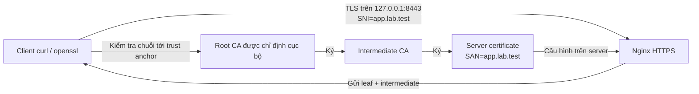
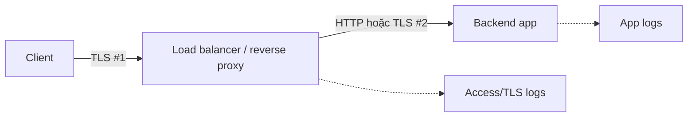
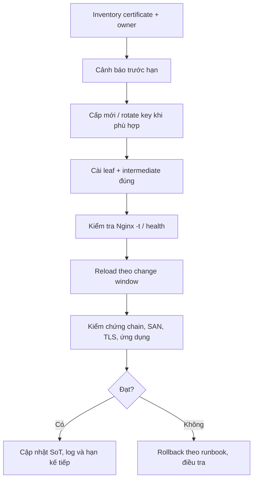

# Lab: Bật TLS và kiểm tra certificate chain

**TLS (Transport Layer Security)** bảo vệ dữ liệu khi truyền giữa hai đầu kết nối bằng các cơ chế thương lượng khóa, mã hóa, kiểm tra tính toàn vẹn và xác thực danh tính theo chứng chỉ. Trong HTTPS, TLS thường xác thực **máy chủ** trước khi client gửi dữ liệu ứng dụng. Tuy nhiên, cấu hình “đã bật HTTPS” không có nghĩa client **tin đúng máy chủ**, **nhận đủ chuỗi chứng chỉ** hoặc **đường truyền đã được bảo vệ ở tất cả các chặng**.

Bài thực hành thuộc chương **Dự án thực hành bảo mật mạng** của module `SECURITY_NETWORK_SECURITY`, nơi kiến thức về firewall, phân đoạn, DNS, VPN, giám sát mạng và quản trị hạ tầng được áp dụng để triển khai một dịch vụ TLS và kiểm chứng bằng chứng kỹ thuật. Trọng tâm là **bật TLS cho một endpoint lab, tạo và kiểm tra chuỗi chứng chỉ gồm Root CA → Intermediate CA → Server certificate**, thử các tình huống cấu hình sai và đưa ra tiêu chí nghiệm thu rõ ràng.

> **Giới hạn an toàn:** Toàn bộ ví dụ thực hiện trên máy/lab mà bạn có quyền quản trị. Chứng chỉ và CA tự tạo chỉ dành cho môi trường học tập, không dùng làm chứng chỉ public production. Không tắt xác thực chứng chỉ bằng `curl -k`, `--insecure` hoặc “trust all” để đánh dấu bài lab thành công.

## 1. Mục tiêu, đầu ra và điều kiện tiên quyết

Kết thúc bài, người học cần làm được:

1. Giải thích sự khác nhau giữa **TLS handshake**, **certificate chain**, **trust anchor** và **kiểm tra hostname**.
2. Tạo CA gốc và CA trung gian trong phòng lab, sau đó cấp chứng chỉ server có `subjectAltName` (SAN), `serverAuth` và khóa riêng phù hợp.
3. Cấu hình một máy chủ HTTPS chỉ cho phép TLS 1.2/1.3 trong lab, gửi đúng `leaf + intermediate`.
4. Kiểm tra chuỗi bằng `openssl verify`, kiểm tra kết nối thực bằng `openssl s_client` và `curl` với SNI/hostname và trust store đúng.
5. Nhận biết lỗi CA không được tin cậy, thiếu intermediate, hostname không khớp, chứng chỉ hết hạn và khóa riêng không tương ứng.
6. Ghi lại bằng chứng, kết quả kiểm thử và kế hoạch gia hạn/rollback phù hợp vận hành an ninh mạng.

### 1.1. Môi trường đề xuất

| Thành phần | Giá trị lab | Ghi chú |
| --- | --- | --- |
| Máy chủ TLS | Nginx trên Linux | Có thể thay bằng Apache, HAProxy, Envoy hoặc ingress controller; cú pháp sẽ khác. |
| Client thử nghiệm | Cùng máy lab | Kết nối qua `127.0.0.1:8443` để không tạo lưu lượng ngoài phạm vi. |
| Tên dịch vụ | `app.lab.test` | Miền `.test` được dành cho thử nghiệm; không cần đăng ký DNS public. |
| Cổng HTTPS lab | TCP/8443 | Tránh cần chiếm cổng 443 của dịch vụ đang chạy. |
| Bộ công cụ | OpenSSL, curl, Nginx | Các lệnh giả định OpenSSL phiên bản hỗ trợ `-addext`, `-verify_hostname` (ví dụ OpenSSL 1.1.1/3.x). |
| PKI thử nghiệm | `root.crt`, `intermediate.crt`, `app.crt` và khóa riêng | Root chỉ được tin cậy cục bộ bằng `-CAfile` hoặc `--cacert` trong bài lab. |
| Điểm bảo vệ mạng | Local loopback | Khi chuyển sang VM khác cần thêm quyền truy cập, firewall rule, DNS và log tương ứng. |

**Điều kiện trước khi bắt đầu:** đã có quyền thao tác với máy Nginx, sẵn sàng khôi phục cấu hình nếu lỗi, không dùng tài khoản hoặc tên miền production, và không để khóa CA/khóa server trong Git. Đối với môi trường dùng container, có thể chạy Nginx trong container lab rồi ánh xạ TCP/8443 ra loopback thay cho cài trực tiếp.

### 1.2. Sơ đồ lab



**Phân biệt hai hướng trong sơ đồ:** dấu mũi tên `Root → Intermediate → Leaf` biểu diễn **quan hệ ký chứng chỉ**, còn server gửi **Leaf → Intermediate** cho client. Root CA thường đã có trong kho tin cậy của client và **không cần gửi trong TLS handshake**. Trong bài lab, client được cung cấp Root CA qua tham số kiểm chứng tường minh.

## 2. Kiến thức nền: TLS và chuỗi chứng chỉ

### 2.1. TLS mang lại những bảo đảm nào?

- **Bảo mật dữ liệu trên đường truyền:** dữ liệu ứng dụng sau khi thiết lập phiên TLS được mã hóa; một kẻ chỉ nhìn lưu lượng thường không thể đọc nội dung.
- **Tính toàn vẹn:** dữ liệu bị sửa đổi trái phép trong quá trình truyền sẽ không vượt qua kiểm tra xác thực của phiên.
- **Xác thực máy chủ:** khi dùng PKI đúng, client kiểm tra chữ ký và các điều kiện chứng chỉ, đồng thời xác minh chứng chỉ hợp lệ cho tên dịch vụ mà nó kết nối.
- **Forward secrecy:** TLS hiện đại sử dụng cơ chế trao đổi khóa tạm thời thích hợp, giảm nguy cơ lộ lại nội dung phiên trước đó khi khóa lâu dài bị lộ.

TLS **không** tự quyết định ai được truy cập API, không thay thế firewall/VPN/IDS/IPS và không bảo vệ nội dung **sau khi đã giải mã** ở máy chủ hoặc reverse proxy. TLS xác thực client chỉ khi thiết kế có **mTLS** hoặc một cơ chế xác thực bổ sung.

### 2.2. Leaf, Intermediate và Root

| Thành phần | Chức năng | Thực tế triển khai |
| --- | --- | --- |
| **Root CA / Trust anchor** | Điểm tin cậy ban đầu; thường tự ký, được phân phối độc lập qua hệ thống tin cậy | Private key phải được bảo vệ nghiêm ngặt; root public certificate nằm trong trust store. |
| **Intermediate CA** | Được root (hoặc CA cấp trên) ký, dùng để ký chứng chỉ server | Server thường cần gửi chứng chỉ intermediate để client xây dựng chuỗi. |
| **Leaf / End-entity / Server certificate** | Gắn public key server với danh tính như `app.lab.test` | Server gửi leaf trong TLS handshake và giữ kín private key tương ứng. |

Chuỗi mẫu:

```text
Trust store của client:
  Lab Root CA                 [self-signed; CA:TRUE]
       |
       | ký Intermediate CA
       v
  Lab Intermediate CA         [CA:TRUE; pathLen:0]
       |
       | ký chứng chỉ server
       v
  app.lab.test                [CA:FALSE; SAN=DNS:app.lab.test; EKU=serverAuth]
       ^
       |
  Nginx gửi: app.crt + intermediate.crt
  Nginx giữ: app.key (PRIVATE; không gửi cho client)
```

Một đường kiểm tra thường gồm:

1. **Chữ ký và xây dựng đường chứng thực:** leaf được intermediate ký; intermediate được một CA được client tin cậy ký.
2. **Thời hạn:** `notBefore ≤ thời gian hiện tại ≤ notAfter` trên các chứng chỉ cần thiết.
3. **CA constraints và key usages:** intermediate phải được phép ký chứng chỉ; leaf không được đóng vai CA, phải phù hợp mục đích TLS server.
4. **Danh tính đích:** SAN phải bao gồm đúng hostname; `CN` không nên được dùng thay SAN để xác minh tên.
5. **Thuật toán/chính sách:** khóa, chữ ký, chính sách và độ mạnh mật mã đáp ứng client và yêu cầu tổ chức.
6. **Trạng thái thu hồi:** nếu cần, phải có cơ chế OCSP/CRL hoặc kiểm soát vòng đời phù hợp; lệnh verify cơ bản **không tự bảo đảm đã kiểm tra thu hồi**.

**Quan trọng:** `verify return code: 0 (ok)` không đủ để kết luận kết nối “an toàn toàn diện” nếu lệnh đã bỏ qua hostname, dùng CA không phù hợp, hoặc chưa xét revocation/môi trường thực. Cần kiểm tra đúng danh tính dịch vụ và phạm vi bảo vệ.

### 2.3. SNI và SAN không phải một thứ

- **SNI (Server Name Indication):** client khai báo hostname cần truy cập khi bắt đầu handshake (trong ngữ cảnh TLS thông thường), giúp server chọn đúng certificate/virtual host.
- **SAN (Subject Alternative Name):** danh sách danh tính được CA xác nhận trong chứng chỉ; client kiểm tra hostname yêu cầu có khớp SAN hay không.

SNI giúp **chọn** chứng chỉ, SAN giúp **xác minh** chứng chỉ. Một server có thể trả đúng certificate theo SNI nhưng certificate vẫn hết hạn, thiếu intermediate hoặc không được client tin cậy.

## 3. Chuẩn bị khóa và chứng chỉ trong phạm vi lab

Tất cả lệnh trong phần này chạy ở một **thư mục thử nghiệm riêng**, trên Linux có OpenSSL và quyền tạo file. Ví dụ dùng RSA để thuận tiện với nhiều môi trường; triển khai thật nên chọn thuật toán, kích thước khóa và thời hạn theo chính sách hiện hành.

**Không đưa `root.key`, `intermediate.key`, `app.key`, file `*.srl` hoặc file CSR có nội dung nhạy cảm vào repository công khai.** Có thể lưu chứng chỉ public phục vụ kiểm thử, nhưng khóa riêng vẫn phải được bảo vệ.

### Bước 1 — Tạo thư mục với quyền file chặt

```bash
umask 077
mkdir -p "$HOME/tls-lab"
cd "$HOME/tls-lab"
```

`umask 077` giúp các file mới mặc định không cho người dùng khác đọc. CA root ở môi trường production nên có quản lý khóa chuyên dụng (HSM/offline root, quy trình cấp phát được kiểm soát); ở đây chỉ mô phỏng trong lab.

### Bước 2 — Tạo Root CA của lab

```bash
openssl genpkey -algorithm RSA -pkeyopt rsa_keygen_bits:3072 \
  -out root.key

openssl req -new -x509 -sha256 -days 365 \
  -key root.key -out root.crt \
  -subj "/CN=TLS Lab Root CA" \
  -addext "basicConstraints=critical,CA:TRUE,pathlen:1" \
  -addext "keyUsage=critical,keyCertSign,cRLSign"
```

Giải thích:

- `root.key` là private key của CA gốc; **không cài khóa này lên web server**.
- `root.crt` là chứng chỉ public tự ký, đóng vai trust anchor chỉ khi client **được cấu hình tin cậy**.
- `CA:TRUE` và `keyCertSign` cho phép CA ký chứng chỉ.
- `pathlen:1` của root cho phép tối đa một lớp CA trung gian không tự phát hành bên dưới theo ràng buộc này; intermediate tiếp theo sẽ dùng `pathlen:0`.

Một CA tự ký không tự động được trình duyệt/curl tin cậy. **Không** nhập Root CA thử nghiệm vào trust store toàn hệ thống chỉ để lệnh curl thành công; truyền nó bằng tham số kiểm chứng trong bài lab sẽ ít ảnh hưởng hệ thống hơn.

### Bước 3 — Tạo Intermediate CA và xin Root ký

```bash
openssl genpkey -algorithm RSA -pkeyopt rsa_keygen_bits:3072 \
  -out intermediate.key

openssl req -new -sha256 \
  -key intermediate.key -out intermediate.csr \
  -subj "/CN=TLS Lab Intermediate CA"

cat > intermediate.ext <<'EOF'
basicConstraints=critical,CA:TRUE,pathlen:0
keyUsage=critical,keyCertSign,cRLSign
subjectKeyIdentifier=hash
authorityKeyIdentifier=keyid,issuer
EOF

openssl x509 -req -sha256 -days 120 \
  -in intermediate.csr \
  -CA root.crt -CAkey root.key -CAcreateserial \
  -out intermediate.crt -extfile intermediate.ext
```

`intermediate.crt` là CA certificate được ký bởi root. `pathlen:0` giới hạn intermediate **không được cấp tiếp một subordinate CA**, nhưng vẫn có thể ký leaf. Các file serial do OpenSSL tạo phải được quản lý nếu thực hiện cấp nhiều chứng chỉ; trong phòng lab nhỏ này chỉ tạo một certificate của mỗi cấp.

### Bước 4 — Tạo khóa và CSR cho máy chủ HTTPS

```bash
openssl genpkey -algorithm RSA -pkeyopt rsa_keygen_bits:2048 \
  -out app.key

openssl req -new -sha256 \
  -key app.key -out app.csr \
  -subj "/CN=app.lab.test"

cat > app.ext <<'EOF'
basicConstraints=critical,CA:FALSE
keyUsage=critical,digitalSignature,keyEncipherment
extendedKeyUsage=serverAuth
subjectAltName=DNS:app.lab.test
subjectKeyIdentifier=hash
authorityKeyIdentifier=keyid,issuer
EOF

openssl x509 -req -sha256 -days 30 \
  -in app.csr \
  -CA intermediate.crt -CAkey intermediate.key -CAcreateserial \
  -out app.crt -extfile app.ext
```

`CN=app.lab.test` trong CSR giúp tên dễ đọc, nhưng **hostname verification dựa trên SAN** `DNS:app.lab.test`. Nếu dùng thêm alias `api.lab.test`, phải đưa alias vào SAN và cấp lại chứng chỉ đúng quy trình, không chỉ thêm `server_name` ở Nginx.

`extendedKeyUsage=serverAuth` xác định mục đích chứng chỉ. `CA:FALSE` ngăn leaf được dùng như CA cấp dưới. `keyEncipherment` trong ví dụ RSA phục vụ tương thích với một số cấu hình TLS cũ; với TLS hiện đại, `digitalSignature` là phần quan trọng cho xác thực bằng chữ ký. Các ràng buộc chính xác phụ thuộc thuật toán khóa/cơ chế xác thực.

### Bước 5 — Ghép fullchain đúng thứ tự

```bash
cat app.crt intermediate.crt > fullchain.pem
```

Trong ví dụ này:

- `app.crt`: leaf.
- `intermediate.crt`: intermediate.
- `fullchain.pem`: **leaf trước, intermediate sau**.
- `root.crt`: **không cần** ghép vào chain server gửi; client được cấp trust anchor riêng.
- `app.key`: private key **không bao giờ** được ghép vào file chain phát cho client.

Một lỗi phổ biến là cấu hình Nginx chỉ dùng `app.crt`, khiến server **không gửi intermediate**. Client sạch cache có thể không tìm được đường tin cậy, dù kiểm tra local với intermediate file riêng vẫn thành công.

## 4. Kiểm tra chứng chỉ trước khi bật Nginx

Việc kiểm tra ở trạng thái “offline” giúp loại bỏ lỗi sai SAN, EKU, CA constraint hoặc private key trước khi thay đổi dịch vụ.

### 4.1. Kiểm tra trường thông tin trên leaf và CA

```bash
openssl x509 -in app.crt -noout -subject -issuer -dates
openssl x509 -in app.crt -noout -text
openssl x509 -in intermediate.crt -noout -text
openssl x509 -in root.crt -noout -text
```

Trong output, tìm các thành phần:

| Thành phần | Ở leaf | Ở intermediate/root |
| --- | --- | --- |
| `Issuer` và `Subject` | Issuer là `TLS Lab Intermediate CA` | Intermediate có issuer là Root; root là self-signed. |
| `Basic Constraints` | `CA:FALSE` | `CA:TRUE`, path length như cấu hình. |
| `Subject Alternative Name` | `DNS:app.lab.test` | Không bắt buộc theo mục đích lab. |
| `Extended Key Usage` | `TLS Web Server Authentication` hoặc `serverAuth` | Không được giả định tương tự leaf. |
| `Key Usage` | `Digital Signature`, có thể thêm `Key Encipherment` | `Certificate Sign`, `CRL Sign`. |
| `Not Before/Not After` | Khoảng thời gian đang có hiệu lực | CA phải đang còn hiệu lực phù hợp. |

### 4.2. Xác minh đường chứng thực bằng OpenSSL

```bash
openssl verify \
  -purpose sslserver \
  -CAfile root.crt \
  -untrusted intermediate.crt \
  app.crt
```

Kết quả mong đợi:

```text
app.crt: OK
```

Lệnh này chứng minh OpenSSL có thể xây dựng và xác minh đường từ `app.crt` tới `root.crt` khi **intermediate đã được cung cấp riêng**. Nó **chưa chứng minh Nginx sẽ gửi intermediate trong handshake**, cũng chưa xác minh một kết nối mạng hoặc tên đích tại thời điểm gọi lệnh. Những yêu cầu đó được kiểm tra ở phần sau.

### 4.3. Kiểm tra private key tương ứng với leaf

Có thể so sánh hash của public key trích từ private key và public key trong certificate. Cách này dùng được cho cả RSA và các loại khóa khác nếu công cụ hỗ trợ:

```bash
openssl pkey -in app.key -pubout -outform DER \
  | openssl dgst -sha256

openssl x509 -in app.crt -pubkey -noout \
  | openssl pkey -pubin -pubout -outform DER \
  | openssl dgst -sha256
```

Hai hash phải **giống nhau**. Nếu khác, `app.key` không tương ứng với `app.crt` và Nginx có thể không tải được cấu hình. Không dán private key thật lên trang web hoặc ticket để nhờ kiểm tra; so sánh tại máy được phép sử dụng key.

### 4.4. Kiểm tra chứng chỉ sắp hết hạn

```bash
# Exit code = 0 nếu app.crt còn hiệu lực hơn 7 ngày tính từ lúc chạy.
openssl x509 -in app.crt -noout -checkend 604800

# Xem thời hạn cụ thể để lập kế hoạch thay thế.
openssl x509 -in app.crt -noout -startdate -enddate
```

`-checkend` dựa trên thời điểm môi trường chạy lệnh; cần đồng bộ đồng hồ (NTP hoặc nguồn thời gian tin cậy). Bài lab tạo leaf 30 ngày và CA có thời hạn dài hơn; vận hành thật phải có **thời gian cảnh báo trước hạn** theo chính sách, tránh đợi đúng ngày hết hạn mới gia hạn.

## 5. Bật TLS cho Nginx trong lab

Các bước dưới đây giả định Nginx được cài sẵn và cấu hình `/etc/nginx/conf.d/*.conf` nằm trong khối `http`. Với môi trường khác, đặt `server` block ở vị trí tương ứng. **Không ghi đè cấu hình production**; sử dụng lab hoặc một virtual host mới.

### Bước 1 — Đặt certificate và key vào đường dẫn Nginx đọc được

```bash
sudo mkdir -p /etc/nginx/tls-lab

# Chuỗi public: client có thể nhận khi bắt tay TLS.
sudo install -m 0644 fullchain.pem /etc/nginx/tls-lab/fullchain.pem

# Khóa riêng: chỉ cho tài khoản/quy trình được phép đọc.
sudo install -m 0600 app.key /etc/nginx/tls-lab/app.key
```

Không sao chép `root.key` hoặc `intermediate.key` vào thư mục Nginx. Trên production cần chú ý ownership và chính sách chạy Nginx, secret manager, sao lưu mã hóa và rotation.

### Bước 2 — Cấu hình virtual host HTTPS

Thêm vào một file được Nginx include trong `http` (ví dụ `/etc/nginx/conf.d/tls-lab.conf`):

```nginx
server {
    listen 127.0.0.1:8443 ssl;
    server_name app.lab.test;

    ssl_certificate     /etc/nginx/tls-lab/fullchain.pem;
    ssl_certificate_key /etc/nginx/tls-lab/app.key;

    # Chỉ bật các phiên bản TLS hiện đại được môi trường hỗ trợ.
    ssl_protocols TLSv1.2 TLSv1.3;

    # Giới hạn riêng trong lab; cấu hình cipher/groups thực tế
    # cần xem chính sách và bản OpenSSL/Nginx đang chạy.
    ssl_session_tickets off;

    location / {
        default_type text/plain;
        return 200 "TLS lab OK\n";
    }
}
```

Trong Nginx, `ssl_certificate` phải trỏ tới fullchain đã ghép theo thứ tự đúng. `ssl_certificate_key` trỏ tới private key leaf. `ssl_protocols` không thể bảo đảm cipher suite hoặc nhóm trao đổi khóa nào được chấp nhận trên mọi phiên bản phần mềm; cần kiểm chứng thực tế.

**Lưu ý về port:** `listen 127.0.0.1:8443` chỉ nhận kết nối loopback. Nếu dùng hai VM trong mạng lab, cần chọn IP/port mà chủ hệ thống đã phê duyệt, cấu hình firewall/ACL cụ thể và dùng chứng chỉ có SAN khớp hostname được kiểm tra. Không mở `0.0.0.0:8443` trên máy production chỉ để làm lab.

### Bước 3 — Kiểm tra cú pháp và nạp cấu hình

```bash
sudo nginx -t
sudo nginx -s reload
```

Nếu `nginx -t` báo lỗi, **không reload**; kiểm tra đường dẫn file, quyền đọc private key, sự phù hợp giữa cert/key và xung đột port. Lệnh `reload` chỉ nên dùng khi dịch vụ đang chạy và cấu hình đã hợp lệ. Với distro dùng systemd, phương pháp quản lý dịch vụ có thể khác; tuân thủ quy trình vận hành tương ứng.

## 6. Kiểm tra TLS handshake, SNI và certificate chain trên đường truyền

Đây là bước quan trọng nhất: xác minh **máy chủ đã gửi gì**, **client có thật sự xây dựng được chain** và **hostname có đúng hay không**.

### 6.1. OpenSSL s_client: kiểm tra từ góc nhìn client

```bash
openssl s_client \
  -connect 127.0.0.1:8443 \
  -servername app.lab.test \
  -verify_hostname app.lab.test \
  -CAfile root.crt \
  -verify_return_error \
  -showcerts < /dev/null
```

Phân tích tham số:

| Tham số | Ý nghĩa |
| --- | --- |
| `-connect 127.0.0.1:8443` | Điểm mạng thực; dùng loopback trong lab. |
| `-servername app.lab.test` | Gửi SNI để server chọn virtual host/certificate đúng. |
| `-verify_hostname app.lab.test` | Buộc xác minh tên máy chủ trong certificate theo yêu cầu. |
| `-CAfile root.crt` | Dùng trust anchor của lab, không can thiệp trust store hệ thống. |
| `-verify_return_error` | Không im lặng tiếp tục khi xảy ra lỗi xác thực certificate. |
| `-showcerts` | Hiển thị các chứng chỉ **server thật sự gửi** trong handshake. |

Những dòng quan trọng cần tìm:

- `Certificate chain` có **leaf** và **intermediate** phù hợp (thường là chỉ số `0` và `1`).
- Leaf có `subject`, `issuer`, SAN và thời hạn khớp `app.lab.test`.
- Kết quả xác minh là `Verify return code: 0 (ok)`, trong điều kiện đã bật `-verify_hostname` và dùng trust anchor đúng.
- `Protocol` hoặc dòng tương tự cho biết phiên bản TLS đã thương lượng; `Cipher` là bộ mật mã của phiên thực.

**Chú ý:** `-showcerts` cho biết những gì server gửi, khác với các certificate mà OpenSSL có thể tự lấy từ trust store. Nếu chỉ thấy leaf, không kết luận intermediate đã được gửi chỉ vì `openssl verify` offline thành công.

### 6.2. curl: xác minh HTTPS và nội dung trả về

```bash
curl --noproxy '*' \
  --resolve app.lab.test:8443:127.0.0.1 \
  --cacert ./root.crt \
  --verbose \
  https://app.lab.test:8443/
```

Kỳ vọng:

- Client xác minh chứng chỉ, không có lỗi CA/hostname.
- Kết nối TLS thương lượng phiên bản được phép.
- HTTP trả mã 200 và nội dung `TLS lab OK`.
- URL giữ đúng hostname để kiểm tra SAN, trong khi `--resolve` ánh xạ tên đó tới loopback **chỉ trong lệnh curl này**.

`--resolve` không chứng minh DNS toàn mạng hoạt động. Khi chuyển sang một dịch vụ thật, cần kiểm tra DNS resolver/view, load balancer, NAT, firewall, VPN và cách client nhìn hostname/IP đích. `--noproxy '*'` giúp ví dụ tránh proxy môi trường làm thay đổi đường đi.

### 6.3. Kiểm tra TLS 1.2 và 1.3 riêng

```bash
# Kiểm tra một phiên TLS 1.2 (nếu bản OpenSSL/Nginx hỗ trợ).
openssl s_client -connect 127.0.0.1:8443 \
  -servername app.lab.test -tls1_2 \
  -CAfile root.crt -verify_hostname app.lab.test \
  -verify_return_error < /dev/null

# Kiểm tra một phiên TLS 1.3.
openssl s_client -connect 127.0.0.1:8443 \
  -servername app.lab.test -tls1_3 \
  -CAfile root.crt -verify_hostname app.lab.test \
  -verify_return_error < /dev/null
```

Nếu phần mềm hỗ trợ hai phiên bản đó, kỳ vọng cả hai thành công. Đối với TLS 1.0/1.1, chính sách ở lab là **không cho phép**; nếu có công cụ thử được giao thức cũ, kỳ vọng handshake thất bại. Một số bản OpenSSL mới không cho phép thử giao thức cũ ngay từ client nên cần phân biệt **client không hỗ trợ** với **server từ chối**.

## 7. Những bài kiểm thử lỗi cần thực hiện

Không chỉ test luồng đúng. Chất lượng cấu hình TLS còn thể hiện ở việc client **từ chối đúng những certificate không hợp lệ**.

| Test ID | Cách thiết lập trong lab | Kỳ vọng | Điều chứng minh |
| --- | --- | --- | --- |
| `TLS-01` | Đúng hostname, CA tin cậy, fullchain và TLS 1.2/1.3 | **PASS**, có HTTP 200 | Đường tin cậy và hostname đúng với kết nối đã thử. |
| `TLS-02` | Bỏ `--cacert`, giả định Root CA lab không nằm trong trust store mặc định | Lỗi **unknown/untrusted CA** | Client không chấp nhận CA tùy ý. |
| `TLS-03` | Gọi `other.lab.test` trong khi leaf chỉ có SAN `app.lab.test` | **Hostname mismatch** | SAN được xác minh; SNI không thay thế SAN. |
| `TLS-04` | Server chỉ gửi leaf, không gửi intermediate | Thất bại khi client không có intermediate trong cache/trust | Server cần cung cấp chain đầy đủ cho client tương ứng. |
| `TLS-05` | Chứng chỉ hết hạn hoặc chưa có hiệu lực | Client từ chối nếu kiểm chứng thời hạn đúng | Thời gian và validity là phần của xác thực chain. |
| `TLS-06` | Private key server không tương ứng leaf | `nginx -t` hoặc nạp cấu hình thất bại | Cert/key phải tương ứng và được quản lý đúng. |
| `TLS-07` | Thử phiên bản TLS không được cấu hình cho phép | Handshake bị từ chối, với điều kiện client có thể khởi tạo thử | Không hỗ trợ giao thức yếu ngoài chính sách. |
| `TLS-08` | Cùng hostname nhưng endpoint sau reverse proxy/LB | Ghi nhận chain/cert ở đúng điểm kết thúc TLS | Không nhầm bảo vệ chặng ngoài với chặng nội bộ. |

### 7.1. Cố ý thử sai hostname

```bash
curl --noproxy '*' \
  --resolve other.lab.test:8443:127.0.0.1 \
  --cacert ./root.crt \
  https://other.lab.test:8443/
```

Trong lab hiện tại, chứng chỉ chỉ có SAN `app.lab.test`. `other.lab.test` không nằm trong SAN, nên curl phải **từ chối vì hostname mismatch**. Không nên “sửa” kết quả bằng `--insecure`. Nếu server chọn một chứng chỉ khác có SAN `other.lab.test` do cấu hình SNI, cần kiểm tra lại virtual host thực và điều chỉnh test để vẫn đo đúng giả thuyết.

### 7.2. Cố ý thử thiếu intermediate

Trong môi trường lab **không có traffic production**, sao lưu cấu hình Nginx, tạm thời đổi `ssl_certificate` từ `fullchain.pem` sang `app.crt`, kiểm tra `nginx -t` rồi reload. Chạy lại lệnh `s_client` với `-CAfile root.crt` và `-verify_return_error`.

Kỳ vọng một client sạch không có intermediate sẵn sẽ báo lỗi xây dựng chain, thường tương tự `unable to get local issuer certificate`. Sau đó **hoàn nguyên ngay** `fullchain.pem`, kiểm tra `nginx -t` và chạy lại `TLS-01`.

**Không làm bài kiểm thử này trên dịch vụ production.** Một số client có thể tải intermediate qua AIA hoặc đã cache intermediate nên vẫn thành công; cần ghi rõ loại client và trust store. `openssl s_client` trong bài test là điểm đối chiếu vì lệnh không mặc định lấy intermediate qua mạng như một số ứng dụng.

### 7.3. Kiểm tra certificate validity và lỗi đồng hồ

Thay vì tạo certificate cố ý quá hạn trong cùng lab, trước hết xem:

```bash
openssl x509 -in app.crt -noout -dates
openssl x509 -in app.crt -noout -checkend 604800
```

Nếu lab chuyên kiểm thử lỗi hết hạn, có thể cung cấp một certificate **hết hạn được tạo sẵn** từ bộ test có quyền sử dụng. Kỳ vọng client kiểm tra thời hạn từ chối. Không đổi đồng hồ của máy production hoặc vô hiệu hóa xác thực certificate để mô phỏng lỗi thời gian; thao tác đó có thể gây ảnh hưởng tới xác thực, log và nhiều dịch vụ khác.

### 7.4. Nhận diện certificate không thuộc chuỗi tin cậy

Nếu thay `-CAfile root.crt` bằng CA certificate không phải issuer/trust anchor của chain, kết nối xác minh sẽ thất bại, trừ khi có **đường tin cậy hợp lệ khác** được cung cấp. Việc một CA tự ký tồn tại trên đĩa **không khiến nó đáng tin cậy** với client; tin cậy phải được thiết lập qua trust store và chính sách.

## 8. Đọc kết quả sai và tìm nguyên nhân gốc

| Hiện tượng | Nguyên nhân cần kiểm tra | Cách phân biệt |
| --- | --- | --- |
| `unable to get local issuer certificate` | Thiếu intermediate, CA chain không đúng, hoặc trust anchor chưa có | So sánh `-showcerts` với `app.crt`/`intermediate.crt`; xác minh lại `-CAfile`. |
| `self-signed certificate in certificate chain` | Client không có trust anchor phù hợp hoặc gặp certificate không được tin | Kiểm tra root thực, CAfile/trust store và chain server gửi. |
| `certificate verify failed: hostname mismatch` | SAN thiếu tên đích, client dùng IP thay hostname, SNI sai virtual host | Dùng `-verify_hostname`, kiểm tra SAN và tên URL thực. |
| `certificate has expired` / `not yet valid` | Thời hạn leaf/CA hoặc đồng hồ không đúng | Xem `-dates` trên toàn chain; kiểm tra đồng bộ thời gian. |
| Nginx báo key mismatch | `app.key` không thuộc public key trong `app.crt` | So hash public key; kiểm tra file đang được load. |
| TLS handshake failure | Giao thức/cipher/group không giao nhau, lỗi SNI hoặc chính sách TLS | Đối chiếu phiên bản TLS, server log và certificate; không tự hạ chuẩn mật mã. |
| curl thành công với `-k` nhưng thất bại bình thường | Kiểm chứng TLS không đạt; `-k` đã bỏ qua lỗi | Bỏ `-k`, xác minh CA/SAN/chain/time, không đánh dấu nghiệm thu. |
| HTTPS ở load balancer đúng nhưng backend đi HTTP | TLS kết thúc ở LB, chặng sau chưa được mã hóa | Kiểm tra sơ đồ TLS termination và chính sách bảo vệ backend. |
| Có certificate hợp lệ nhưng request lỗi 403/500 | TLS có thể đã thành công nhưng HTTP/authz/backend lỗi | Phân biệt log TLS, HTTP status, IAM và ứng dụng. |
| `s_client` báo verify OK nhưng curl lỗi | Có thể khác SNI/hostname, proxy, CA store hoặc đường mạng | Đối chiếu chính xác lệnh, trust store và endpoint của hai client. |

**Không nhầm các lớp:** DNS phân giải sai có thể dẫn tới sai hostname/endpoint; firewall chặn TCP khiến TLS handshake **chưa bắt đầu**; TLS xác thực thất bại có thể xảy ra dù TCP đã thiết lập; HTTP 401/403 có thể xuất hiện sau một phiên TLS hợp lệ. Một lệnh `curl` thất bại không đủ để quy trách nhiệm cho certificate chain.

## 9. TLS termination, mTLS và phạm vi bảo vệ

### 9.1. HTTPS có thể kết thúc trước ứng dụng



Nếu TLS kết thúc ở load balancer:

- Chứng chỉ client nhìn thấy là chứng chỉ mà **load balancer** trình bày, không nhất thiết là chứng chỉ của backend.
- Nếu proxy → backend dùng HTTP, dữ liệu **không được TLS bảo vệ trên chặng này**; cần mạng bảo vệ khác hoặc áp dụng TLS tới backend theo yêu cầu.
- Nếu proxy → backend cũng dùng TLS, phải kiểm tra **CA, SAN, hostname, thời hạn và bảo mật** riêng cho chặng thứ hai.
- Một số proxy có thể không xác thực certificate backend theo mặc định hoặc do cấu hình; cần kiểm chứng thực tế, không chỉ bật tùy chọn “https upstream”.

Đối với dịch vụ qua VPN/cloud, sơ đồ phải thể hiện rõ điểm bắt đầu/kết thúc TLS, route/zone, firewall/ACL và nơi thu log để tránh tuyên bố “mã hóa end-to-end” khi chỉ một đoạn có TLS.

### 9.2. TLS một chiều so với mTLS

- **TLS server authentication:** client xác minh chứng chỉ của server. Web browser truy cập HTTPS thông thường dùng mô hình này.
- **Mutual TLS (mTLS):** server cũng yêu cầu và xác minh chứng chỉ client, phù hợp service-to-service hoặc API theo chính sách. mTLS **không mặc định** được kích hoạt chỉ vì bật `ssl_certificate` trên Nginx.
- **Authorization ứng dụng:** sau khi xác thực chứng chỉ, hệ thống vẫn cần quyết định danh tính đó được quyền gọi API/tài nguyên nào, theo role hoặc chính sách riêng.

Nếu dùng mTLS, cần thêm CA tin cậy của client, kiểm soát vòng đời client certificate, mapping danh tính, quyền và revocation riêng. Đừng tự cấp cho certificate server quyền `clientAuth` chỉ để bỏ qua thiết kế định danh.

## 10. Lưu ý vận hành an toàn khi dùng chứng chỉ thật

### 10.1. Quản lý khóa và quyền cấp phát

- Private key leaf chỉ được truy cập bởi tiến trình/nhóm được phân quyền; tránh đưa vào CI logs, ticket hoặc backup không mã hóa.
- Root private key cần kiểm soát nghiêm ngặt hơn intermediate; một số PKI sử dụng offline root/HSM và audit ký cấp phát.
- Không dùng CA thử nghiệm của lab như CA tin cậy chung trong hệ thống doanh nghiệp.
- Với production, chứng chỉ có thể được cấp bởi CA công khai, CA nội bộ hoặc ACME tùy dịch vụ; phải xác nhận yêu cầu sở hữu domain và trust store của client.
- Sao lưu và khôi phục cần đi kèm quyền truy cập, mã hóa và quy trình xóa/thu hồi khi khóa bị lộ.

### 10.2. Tự động gia hạn và không làm gián đoạn

Chu kỳ nên theo dõi:



Những trường nên lưu trong **certificate inventory**: FQDN/SAN, asset ID/owner, điểm kết thúc TLS, CA/issuer, serial/fingerprint, `notAfter`, đường dẫn secret (không phải nội dung khóa), phương pháp cấp phát, hệ thống gia hạn, mốc cảnh báo, phụ thuộc và người xử lý sự cố.

Gia hạn không chỉ là thay file: cần kiểm tra **certificate mới đã thực sự được tiến trình dùng** sau reload, không chỉ file trên đĩa. Giữ cấu hình cũ để rollback trong phạm vi cho phép và tránh thu hồi certificate cũ quá sớm nếu còn node chưa chuyển xong.

### 10.3. Những vấn đề kiểm thử chain không bao phủ

| Mục tiêu | Kiểm tra thêm |
| --- | --- |
| **Thu hồi certificate** | OCSP/CRL và cách client xử lý lỗi/trạng thái; kiểm thử chain cơ bản không đủ kết luận revocation. |
| **Mật mã và protocol** | Cấu hình cipher/group/signature algorithms phù hợp sản phẩm; kiểm tra TLS1.2/1.3 thật. |
| **Certificate Transparency** | Phù hợp chứng chỉ công khai theo yêu cầu hệ sinh thái/browser, không đánh đồng với CA nội bộ. |
| **HTTP security headers** | HSTS/cookie flags/CSP theo nhu cầu ứng dụng; HSTS chỉ triển khai sau khi HTTPS vận hành đúng. |
| **Mã hóa chặng nội bộ** | TLS giữa proxy và backend hoặc cơ chế bảo vệ khác, đúng threat model. |
| **Giám sát** | Alert về hạn, lỗi handshake tăng, request failures, unexpected issuer/certificate changes. |
| **Bảo mật mạng** | Firewall, segmentation, IDS/IPS, DNS, quản lý quyền và logging; TLS không thay thế các lớp này. |

### 10.4. Không dùng chứng chỉ tự ký để che lỗi PKI production

Trong lab, Root CA tự ký là điều kiện có chủ đích và được client cấp phát tin cậy qua `--cacert`. Trong hệ thống thật, nếu certificate được trình bày bởi endpoint public, việc yêu cầu người dùng bấm “Continue anyway” hoặc tắt xác thực là dấu hiệu cần sửa. Phải kiểm tra CA/chain, SAN, tên dịch vụ, DNS và time, sau đó triển khai chứng chỉ đúng loại; không dạy người dùng chấp nhận mọi certificate.

## 11. Mẫu ghi nhận kết quả bài lab

Một bộ chứng cứ gọn nên có **cấu hình không chứa secret**, output kiểm tra từ client, thời gian UTC, phiên bản OpenSSL/Nginx, và ghi chú điều kiện thử. Không cần chép private key hoặc toàn bộ certificate body vào báo cáo; có thể lưu fingerprint và đường dẫn file certificate public.

| Test ID | Kỳ vọng | Kết quả quan sát (ví dụ) | Trạng thái |
| --- | --- | --- | --- |
| `TLS-01` | Đúng CA, SAN, fullchain; HTTPS 200 | `Verify return code: 0 (ok)`, `TLS lab OK` | `PASS` |
| `TLS-02` | Không được tin khi thiếu root lab | curl báo CA trust failure | `PASS` |
| `TLS-03` | Sai hostname bị từ chối | curl hostname mismatch | `PASS` |
| `TLS-04` | Thiếu intermediate gây lỗi với client sạch | s_client không xây dựng chain tới root | `PASS` |
| `TLS-05` | Certificate cần còn hiệu lực và cảnh báo gần hạn | `-checkend 604800` exit 0 | `PASS` tại thời điểm thử |
| `TLS-06` | Cert/key tương ứng | Hash public key trùng nhau | `PASS` |
| `TLS-07` | TLS 1.2 và 1.3 theo chính sách; giao thức cũ bị từ chối | Handshake 1.2/1.3 OK | `PASS` nếu phần test giao thức cũ đủ dữ liệu; nếu không ghi `INCONCLUSIVE` |
| `TLS-08` | Xác định đúng điểm TLS termination | Network diagram và log của đúng điểm | `PASS` nếu đã kiểm chứng |

**Quy tắc trạng thái:** `PASS` chỉ khi có bằng chứng đối chiếu đủ; `FAIL` khi khác kỳ vọng; `INCONCLUSIVE` khi thiếu điều kiện hoặc log; `NOT RUN` khi chưa thực hiện; `N/A` khi tình huống không áp dụng và có lý do. Không biến việc bỏ qua xác thực thành `PASS`.

### 11.1. Mẫu evidence record (dữ liệu giả lập)

```yaml
lab_id: "NET-TLS-CHAIN-006"
environment: "isolated-local-lab"
service: "app.lab.test:8443"
tls_termination: "nginx-on-127.0.0.1"
trust_anchor: "root.crt (lab-only, supplied via --cacert/-CAfile)"
certificate:
  san: ["DNS:app.lab.test"]
  chain_sent: ["app.crt", "intermediate.crt"]
  root_sent_by_server: false
  private_key_location: "restricted; not attached"
tested_at_utc: "2026-11-28T04:00:00Z"
tests:
  - id: "TLS-01"
    expected: "valid chain and hostname; HTTPS 200"
    result: "pass"
    evidence: ["s_client_output_redacted", "curl_output_redacted"]
  - id: "TLS-03"
    expected: "wrong hostname rejected"
    result: "pass"
    evidence: ["curl_hostname_failure_redacted"]
limitations:
  - "Loopback only; no real DNS, VPN, firewall or reverse-proxy path tested"
  - "Revocation status and external CA trust are not established"
```

Mẫu minh họa không phải log của một lần chạy thật. Khi nộp bài, điền kết quả **đã quan sát** và gắn file/bằng chứng tương ứng; che private data và lưu đường dẫn vào kho hạn chế truy cập.

## 12. Câu hỏi phân tích tình huống

**Tình huống A — Client báo “unknown CA” dù Nginx đã bật TLS.**

Điều cần kiểm tra: root trust anchor trên client, certificate server thực gửi, intermediate chain, fingerprint/issuer và đường dẫn CAfile. Không tự bật `--insecure`; nếu là lab, chỉ định `root.crt` chính xác bằng `--cacert`/`-CAfile`.

**Tình huống B — `openssl verify` offline OK nhưng Chrome hoặc curl báo lỗi.**

Có thể server không gửi intermediate, SAN không khớp tên truy cập, client chọn sai virtual host qua SNI, root không có trong trust store của ứng dụng hoặc certificate hết hạn. Chạy `s_client -showcerts -verify_hostname` tới đúng endpoint để xem chain thực.

**Tình huống C — Có chứng chỉ hợp lệ ở edge proxy, nhưng đội kiểm toán hỏi liệu API backend được mã hóa.**

Trả lời: chưa đủ dữ liệu. Cần kiểm tra proxy → backend dùng HTTP hay TLS, nếu TLS có xác minh hostname/chain không, ai quản lý private key và logs ở điểm termination.

**Tình huống D — Sau khi gia hạn, một số node vẫn trả chứng chỉ cũ.**

Kiểm tra load balancer upstream, deployment/reload trên từng node, SNI, cache/rollout, inventory và fingerprint/chứng chỉ từ từng node. Hoàn tất rollout trước khi đánh dấu nghiệp vụ thành công; theo dõi cảnh báo hết hạn cho node chưa thay.

**Tình huống E — Truy cập bằng IP khiến certificate bị từ chối dù hostname bình thường.**

Certificate hiện có SAN DNS `app.lab.test`, không có SAN IP `127.0.0.1`. Khi client truy cập `https://127.0.0.1:8443`, nó xác minh danh tính IP thay vì DNS. Trong lab, dùng hostname URL và `--resolve`; trong triển khai thật, bổ sung SAN IP chỉ khi đó là danh tính thực cần phục vụ, theo quy trình cấp phát.

## 13. Checklist nghiệm thu cuối

- [ ] Có quyền quản trị lab và không chạm các endpoint ngoài phạm vi được phê duyệt.
- [ ] TLS server dùng private key bảo vệ; Root/Intermediate CA private key không nằm trên web server.
- [ ] Leaf có `CA:FALSE`, SAN đúng hostname, `serverAuth`, thời hạn và thuật toán phù hợp.
- [ ] Intermediate có `CA:TRUE`, quyền ký chứng chỉ và đường ký hợp lệ tới Root CA tin cậy.
- [ ] `fullchain.pem` có thứ tự leaf → intermediate; không phát khóa riêng và không phụ thuộc root gửi từ server.
- [ ] `openssl verify -purpose sslserver` hợp lệ với CA/intermediate được cấp.
- [ ] Hash public key trong leaf và private key của server trùng nhau.
- [ ] `nginx -t` thành công và Nginx thực dùng certificate/key đã cấu hình.
- [ ] `s_client` có SNI, `-verify_hostname`, `-CAfile`, `-verify_return_error` và `-showcerts`; ghi lại chain server gửi.
- [ ] `curl` xác minh HTTPS mà không có `-k` hoặc `--insecure`; URL đúng hostname, ứng dụng trả response mong đợi.
- [ ] Đã xác minh TLS 1.2/1.3 theo cấu hình, không mặc định cho phép phiên bản cũ.
- [ ] Các phép thử sai CA, sai hostname và thiếu intermediate được thực hiện trong lab hoặc giải thích rõ lý do chưa chạy.
- [ ] Có nhận định rõ về validity, hostname, trust anchor, revocation và giới hạn kiểm chứng.
- [ ] Nếu có reverse proxy/LB, sơ đồ TLS termination và chặng backend đã được xác minh.
- [ ] Có kế hoạch expiry alert, renewal, inventory, rollback và owner của certificate.
- [ ] Báo cáo lưu log/trạng thái test, không phát tán khóa riêng hoặc đưa CA lab vào trust store toàn cục.

**Nguyên tắc cốt lõi:** Bật TLS là bước cấu hình; **kiểm tra certificate chain là bước xác minh danh tính và niềm tin**. Một bài lab đạt yêu cầu khi client xác nhận đúng hostname và đường chứng thực, máy chủ cung cấp leaf/intermediate phù hợp, luồng HTTPS hoạt động, và các chứng chỉ không hợp lệ bị từ chối mà không phải bỏ qua kiểm tra an toàn.

## Tài liệu tham khảo

- [RFC 8446 — The Transport Layer Security (TLS) Protocol Version 1.3](https://datatracker.ietf.org/doc/html/rfc8446): TLS 1.3 và các mục tiêu bảo mật.
- [RFC 9325 — Recommendations for Secure Use of TLS and DTLS](https://datatracker.ietf.org/doc/html/rfc9325): hướng dẫn lựa chọn phiên bản, cấu hình và sử dụng TLS an toàn.
- [RFC 5280 — Internet X.509 Public Key Infrastructure Certificate and CRL Profile](https://datatracker.ietf.org/doc/html/rfc5280): đường xác thực chứng chỉ, CA constraints, key usage và CRL.
- [RFC 9525 — Service Identity in TLS](https://datatracker.ietf.org/doc/html/rfc9525): xác thực danh tính dịch vụ/hostname trong TLS.
- [RFC 6066 — Transport Layer Security (TLS) Extensions](https://datatracker.ietf.org/doc/html/rfc6066): tiện ích mở rộng TLS bao gồm SNI.
- [RFC 8555 — Automatic Certificate Management Environment (ACME)](https://datatracker.ietf.org/doc/html/rfc8555): quy trình tự động cấp và gia hạn chứng chỉ trong môi trường phù hợp.
- [OpenSSL — s_client manual](https://docs.openssl.org/3.0/man1/openssl-s_client/): kiểm tra handshake, SNI, certificate chain và trust.
- [OpenSSL — verify manual](https://docs.openssl.org/3.0/man1/openssl-verify/): kiểm tra certificate path và các tùy chọn xác thực.
- [Nginx — Configuring HTTPS servers](https://nginx.org/en/docs/http/configuring_https_servers.html): cấu hình `ssl_certificate`, `ssl_certificate_key` và HTTPS virtual host.
