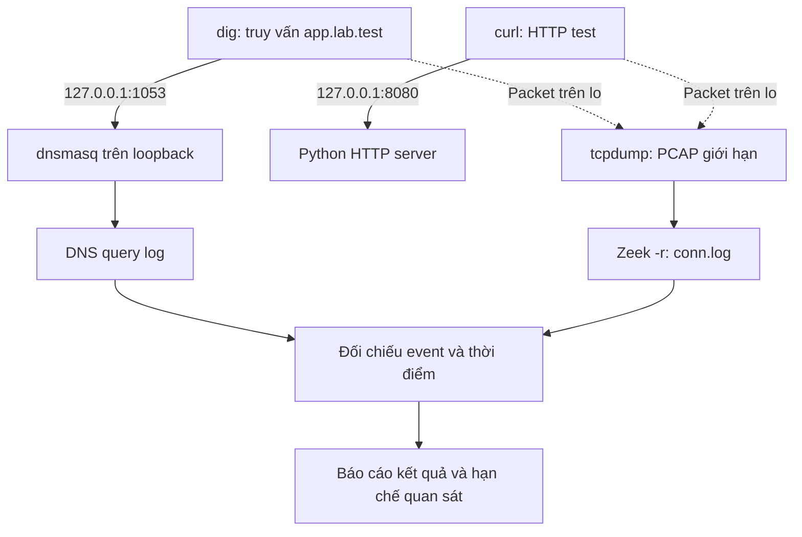

# Thiết lập DNS logging và flow logging

## 1. Bối cảnh của dự án thực hành

Trong vận hành bảo mật mạng, **DNS logging** giúp trả lời máy khách đã hỏi tên miền nào, nhận phản hồi ra sao và thông qua resolver nào. **Flow logging** giúp mô tả những luồng kết nối giữa các địa chỉ, cổng, giao thức, thời điểm và lượng dữ liệu quan sát được. Khi kết hợp hai nguồn này với thông tin tài sản, firewall, VPN hoặc IDS/IPS, nhóm bảo mật có thêm căn cứ để điều tra truy cập bất thường, phát hiện đường liên lạc ngoài chính sách và xác minh hiệu lực các lớp phòng vệ.

Tuy nhiên, hai nhóm log **không thay thế cho nhau**: một truy vấn DNS không bảo đảm sau đó có kết nối; một flow TCP không chứng minh ứng dụng đã dùng DNS; và một dòng `conn_state` trong công cụ phân tích không luôn là quyết định allow/deny của firewall.

Bài thuộc chương **Dự án thực hành bảo mật mạng** trong module `SECURITY_NETWORK_SECURITY`. Các lớp phòng vệ liên quan gồm DNS security, phân đoạn mạng, firewall, VPN, IDS/IPS, mạng không dây và cloud. Bài thực hành tạo dữ liệu mẫu trong môi trường **cô lập trên chính máy lab** để học cách thu thập, kiểm chứng, đối chiếu và bảo vệ log; không thực hiện khám phá hay quét các mạng không được cấp phép.

### Kết quả cần đạt

Sau khi thực hành, người học có thể:

1. Giải thích được dữ liệu mà DNS query log và flow log cung cấp, cũng như các giới hạn của chúng.
2. Dựng resolver DNS dành riêng cho lab và bật ghi nhận truy vấn.
3. Thu packet capture giới hạn trên loopback, chuyển thành connection/flow metadata để phân tích.
4. Tạo test traffic có mã nhận diện, đối chiếu timestamp, máy nguồn, IP đích, cổng và giao thức.
5. Phân biệt tình huống thiếu event, mất gói, parser lỗi, DNS cache, NAT, DoH/DoT và kết quả không xác định.
6. Xây checklist nghiệm thu, chính sách lưu giữ, cảnh báo và quy trình vận hành cho logging thực tế.

## 2. Phân biệt DNS log, flow log và packet capture

| Nguồn | Dữ liệu điển hình | Câu hỏi giải đáp | Điều **không** thể khẳng định chỉ bằng nguồn đó |
| --- | --- | --- | --- |
| **DNS query log** | Client/resolver IP, query name, loại bản ghi, thời gian, answer, rcode nếu có | Có truy vấn `app.lab.test` không? Resolver trả lời gì? | Không chứng minh kết nối ứng dụng đã xảy ra |
| **Flow/connection log** | Source/destination IP và port, protocol, start time, duration, bytes, state | Host nào có trao đổi hoặc thử kết nối với endpoint nào? | Không tự cho biết domain được người dùng nhập hoặc HTTP URL |
| **Firewall decision log** | Rule ID, action allow/deny, source/destination, zone, timestamp | Rule nào cho phép hoặc chặn lưu lượng? | Không thay thế được log phân giải DNS |
| **Packet capture (PCAP)** | Header và, khi không mã hóa, có thể cả payload | Có thể tái phân tích lưu lượng quan sát tại điểm thu | Không bao phủ lưu lượng đi qua tuyến khác; có nguy cơ lưu dữ liệu nhạy cảm |
| **IDS/IPS log** | Signature/anomaly, alert, action, sensor ID | Có tín hiệu bất thường hoặc sự kiện bảo mật không? | Không bảo đảm quan sát mọi kết nối hoặc chính xác nguyên nhân gốc |

**Flow** thường được mô hình hóa bởi tập thuộc tính `(src_ip, src_port, dst_ip, dst_port, protocol)`, kèm thời gian và dữ liệu thống kê. Tuy nhiên cách exporter gom các packet thành bản ghi flow, thời gian timeout, sampling và hướng lưu lượng khác nhau theo NetFlow/IPFIX, sFlow, Zeek, VPC Flow Logs và sản phẩm cloud. Không coi các định dạng là đồng nhất.

**DNS** là giao thức phân giải tên; một truy vấn có thể là A, AAAA, CNAME, TXT hoặc loại khác, có thể trả lời từ cache, trả lời lỗi, hoặc được chuyển tiếp. DNS log trên resolver chỉ nhìn thấy những truy vấn **thực sự tới resolver đó**. DoH/DoT sử dụng kênh mã hóa và client dùng resolver bên ngoài có thể không xuất hiện trong log DNS truyền thống tại resolver nội bộ.

## 3. Phạm vi, kiến trúc lab và điều kiện an toàn

### 3.1. Kiến trúc đề xuất

Lab sử dụng **một máy Linux/VM riêng**, với ba tiến trình chạy trên loopback `127.0.0.1`:

- DNS resolver thử nghiệm: `dnsmasq` nghe cổng UDP/TCP `1053`.
- HTTP server thử nghiệm: Python standard library nghe TCP `8080`.
- Bộ thu dữ liệu: `tcpdump` trên interface `lo`, chỉ lấy lưu lượng cổng `1053` và `8080`; sau đó dùng **Zeek offline** để tạo `conn.log`.



**Lưu ý kiến trúc:** `curl --resolve` trong lab sẽ **chỉ định IP đích trực tiếp**, không gửi DNS query qua dnsmasq. Truy vấn `dig` là bước độc lập để tạo DNS evidence. Vì vậy mối liên hệ giữa hai log là **quan hệ được thiết kế trong kịch bản thử nghiệm**, không phải chứng cứ chắc chắn HTTP request đã dùng kết quả DNS.

### 3.2. Tài nguyên và phần mềm

| Thành phần | Mục đích | Yêu cầu |
| --- | --- | --- |
| Linux VM hoặc máy thử nghiệm | Cách ly dữ liệu, chạy các tiến trình lab | Có loopback, shell và quyền cài gói theo chính sách |
| `dnsmasq` | Resolver tối giản có query logging | Cấu hình bind địa chỉ/cổng riêng |
| `dig` (gói `dnsutils` hoặc `bind-utils` tùy distro) | Sinh truy vấn DNS có thể kiểm soát | Có hỗ trợ chỉ định server và port |
| Python 3 | HTTP server và phân tích JSON ngoại tuyến | Không cần thư viện Python bên thứ ba cho server |
| `curl` | Tạo HTTP request tới dịch vụ lab | Hỗ trợ `--resolve` |
| `tcpdump` | Thu gói trên loopback, ghi PCAP | Quyền capture theo cấu hình hệ điều hành |
| **Zeek** | Phân tích PCAP thành connection metadata | Được cài theo repository phù hợp với hệ điều hành |
| Trình xem log/JSON | Quan sát và đối soát kết quả | `less`, `grep`, `jq` (tùy chọn) |

Không bắt buộc chạy Zeek trực tiếp trên hệ thống production. Có thể phân tích PCAP trên máy phân tích riêng được cho phép. Tên gói và cách cài Zeek khác nhau theo bản phân phối; kiểm tra hướng dẫn của nền tảng trước khi cài, không suy ra một câu lệnh cài đặt duy nhất phù hợp với mọi máy.

### 3.3. Ràng buộc cần kiểm tra trước khi bắt đầu

1. Có quyền hợp lệ trên **máy lab của mình**; chỉ dùng `127.0.0.1` và tên miền dành cho kiểm thử `lab.test`.
2. Không ghi vào hoặc sửa DNS resolver mặc định của hệ thống, `/etc/resolv.conf` hay chính sách DNS doanh nghiệp.
3. Không capture interface vật lý hoặc môi trường bên ngoài phạm vi đã duyệt.
4. Không thu payload/secret hoặc log người dùng thật; chỉ tạo request mẫu và file dữ liệu thử nghiệm.
5. Dừng tiến trình khi xong, giới hạn thời gian/dung lượng PCAP và bảo vệ quyền đọc log.
6. Nếu cổng đã có dịch vụ hoặc thiếu quyền, dừng để chỉnh lab chứ không tắt dịch vụ quan trọng đang chạy.

## 4. Bước 1 — Chuẩn bị workspace lab

Trong máy Linux/VM đã được phê duyệt, tạo thư mục riêng:

```bash
mkdir -p "$HOME/netsec-lab-007/www"
printf 'Hello from isolated network-security lab\n' \
  > "$HOME/netsec-lab-007/www/index.html"
```

Chọn một khoảng thời gian thử ngắn, ghi timezone và ghi lại thời điểm bắt đầu. Lab chỉ cần sử dụng cổng cao `1053` và `8080` để tránh thay đổi dịch vụ DNS port 53 của máy.

Kiểm tra trước xem các cổng có đang được sử dụng không:

```bash
ss -lntup | grep -E ':(1053|8080)\b' || true
```

Nếu có tiến trình đang dùng cổng, không cố chiếm quyền; đổi sang cổng khác trong toàn bộ ví dụ hoặc dùng VM riêng.

## 5. Bước 2 — Bật DNS query logging với dnsmasq

### 5.1. Cấu hình DNS dành riêng cho loopback

Tạo file `$HOME/netsec-lab-007/dnsmasq.conf`:

```ini
# Chỉ dành cho lab: không nhận truy vấn từ mạng bên ngoài.
port=1053
listen-address=127.0.0.1
bind-interfaces

# Không truy vấn upstream DNS và không đọc /etc/hosts.
no-resolv
no-hosts

# Vùng DNS giả lập; không forward những tên .lab.test.
local=/lab.test/
address=/app.lab.test/127.0.0.1

# Ghi các truy vấn vào stderr để terminal có thể lưu lại.
log-queries=extra
log-facility=-
```

Để tạo file bằng terminal, có thể dùng heredoc trên Linux:

```bash
cat > "$HOME/netsec-lab-007/dnsmasq.conf" <<'CONF'
port=1053
listen-address=127.0.0.1
bind-interfaces
no-resolv
no-hosts
local=/lab.test/
address=/app.lab.test/127.0.0.1
log-queries=extra
log-facility=-
CONF
```

**Giải thích:** tên `app.lab.test` trả về A record trỏ `127.0.0.1`. Tên `missing.lab.test` không có trong vùng local và dự kiến không có bản ghi; vì `no-resolv` và `local` nên không chuyển truy vấn ra Internet. Tùy phiên bản và cấu hình, định dạng log và các trường có thể khác. Không biến ví dụ này thành resolver dùng chung trên mạng.

### 5.2. Chạy resolver và giữ nhật ký

Tại **terminal A**:

```bash
dnsmasq --no-daemon \
  --conf-file="$HOME/netsec-lab-007/dnsmasq.conf" \
  2>&1 | tee "$HOME/netsec-lab-007/dns.log"
```

Tham số `--no-daemon` giữ dnsmasq ở foreground; `tee` lưu dòng log và hiển thị để quan sát. Tùy nền tảng, tiến trình có thể cần tài khoản/quyền chạy phù hợp; dùng máy lab có phân quyền hợp lệ, không tự cấp đặc quyền không cần thiết.

Nếu khởi động thất bại do cổng đang được sử dụng, quyền ghi hoặc cấu hình sai, xem thông báo trên terminal và điều chỉnh trước khi tiếp tục. Không chạy thêm một DNS daemon với quyền rộng chỉ để vượt lỗi.

### 5.3. Sinh các truy vấn DNS kiểm soát

Tại **terminal D**, sau khi dnsmasq chạy:

```bash
dig @127.0.0.1 -p 1053 app.lab.test A \
  +tries=1 +time=2 +noall +answer

dig @127.0.0.1 -p 1053 missing.lab.test A \
  +tries=1 +time=2 +noall +comments +answer

dig @127.0.0.1 -p 1053 app.lab.test AAAA \
  +tries=1 +time=2 +noall +comments +answer
```

Quan sát `dns.log` tại terminal A hoặc đọc lại sau bài. Các sự kiện cần phân biệt:

- Truy vấn `A` tới `app.lab.test`: dự kiến được trả `127.0.0.1`.
- Truy vấn `A` tới `missing.lab.test`: dự kiến không tìm thấy bản ghi trong vùng lab.
- Truy vấn `AAAA` tới tên chỉ có A record: không có địa chỉ IPv6 tương ứng; phải phân biệt **NODATA** với **NXDOMAIN** theo phản hồi thực tế.

**Không kết luận trạng thái chỉ từ một chuỗi log:** hãy đối chiếu `dig` và query log, vì hệ thống DNS có các dạng trả lời như NOERROR có answer, NOERROR không có answer, NXDOMAIN, SERVFAIL hoặc timeout. Nếu cần đo rcode chính xác, dùng output `dig +noall +comments` hoặc công cụ kiểm tra DNS tương đương.

## 6. Bước 3 — Tạo dịch vụ và luồng HTTP thử nghiệm

Tại **terminal B**, chạy một HTTP server chỉ nghe trên loopback:

```bash
python3 -m http.server 8080 \
  --bind 127.0.0.1 \
  --directory "$HOME/netsec-lab-007/www"
```

Tại terminal D, kiểm tra thử:

```bash
curl --noproxy '*' --max-time 3 -I \
  http://127.0.0.1:8080/
```

Sau đó dùng hostname giả lập nhưng chỉ định IP đã biết:

```bash
curl --noproxy '*' --max-time 3 \
  --resolve app.lab.test:8080:127.0.0.1 \
  http://app.lab.test:8080/
```

`--resolve` giúp tạo request có Host header phù hợp nhưng **bỏ qua bước phân giải DNS của curl**. Mục đích ở đây là phát sinh flow TCP tới endpoint đã chỉ định, còn bằng chứng DNS đến từ lệnh `dig` độc lập.

Trong lab đơn máy, cả source và destination IP có thể là `127.0.0.1`. Đây là đặc điểm của loopback, không phải mẫu kiến trúc thực tế của mạng nhiều host. Khi mở rộng sang hai VM đã được phê duyệt, mới có địa chỉ nguồn và đích khác nhau; không tự mở rộng capture ra mạng thật.

## 7. Bước 4 — Thu packet trong phạm vi tối thiểu

### 7.1. Bắt đầu capture trước các lệnh tạo traffic

Tại **terminal C** trên máy lab:

```bash
sudo tcpdump -i lo -n -s 0 -U \
  -w "$HOME/netsec-lab-007/lab.pcap" \
  '(port 1053 or port 8080)'
```

Chỉ thực hiện khi tài khoản được cấp quyền capture trên máy lab. Quyền `sudo` trong ví dụ phụ thuộc chính sách OS; nếu không được cấp, dùng tài khoản/capability được quản trị hợp lệ hoặc chuyển sang PCAP mẫu được duyệt.

Các lựa chọn có ý nghĩa:

- `-i lo`: chỉ nghe trên interface loopback.
- `-n`: tránh phân giải IP/port khi hiển thị, không tạo traffic DNS phụ.
- `-s 0`: capture packet không giới hạn snaplen trong ví dụ; **chỉ phù hợp lab dữ liệu giả**. Trong production cần đánh giá metadata-only và giới hạn payload.
- `-U`: ghi PCAP theo gói, tiện giám sát trong lab.
- `-w`: ghi file để phân tích ngoại tuyến.
- Filter: giới hạn đúng hai cổng `1053` và `8080`.

**Trình tự quan trọng:** nếu đã thử `dig` và `curl` trước khi bật capture, hãy lặp lại lệnh ở bước 5 và 6 **sau khi tcpdump bắt đầu**; nếu không, `lab.pcap` có thể không chứa các flow đó.

Sau vài truy vấn và HTTP request, dừng `tcpdump` bằng **Ctrl+C**. Không thu vô thời hạn; PCAP có thể chứa payload của HTTP và DNS test dù dữ liệu giả. Chỉ lưu trong thư mục bảo vệ của lab. File PCAP có thể thuộc root hoặc tài khoản capture tùy hệ thống; quản trị quyền đọc file theo chính sách, không tùy tiện làm nó public.

### 7.2. Kiểm tra PCAP trước khi phân tích

Nếu được cấp quyền đọc:

```bash
tcpdump -nn -r "$HOME/netsec-lab-007/lab.pcap" -c 20
```

Kết quả cần có packet tới `1053` và `8080`. Nếu không có, kiểm tra filter, thời điểm capture, interface loopback, quyền truy cập, việc server có chạy và traffic có thực sự phát sinh. `tcpdump` không tự tạo flow log; nó chỉ lưu packet.

## 8. Bước 5 — Dùng Zeek tạo flow/connection logs từ PCAP

Zeek là một network security monitor có thể đọc PCAP offline và sinh log theo kết nối. Ở đây sử dụng nó như **bộ chuyển packet thành metadata kết nối**. Một số phiên bản hoặc cấu hình có thể sinh thêm `dns.log` và `http.log`, nhưng **không dựa vào điều đó trong bài**, vì DNS lab chạy trên cổng không chuẩn `1053` và phân tích protocol có thể cần cấu hình thêm. Nguồn DNS query log chuẩn trong bài là `dnsmasq`.

Tạo thư mục phân tích và chạy:

```bash
mkdir -p "$HOME/netsec-lab-007/zeek"
cd "$HOME/netsec-lab-007/zeek"
zeek -r "$HOME/netsec-lab-007/lab.pcap"
```

Sau khi Zeek hoàn tất, kiểm tra:

```bash
ls -l conn.log
head -n 15 conn.log
```

Thông thường `conn.log` mặc định là **Zeek ASCII TSV** có các dòng `#fields` và `#types`, không phải JSON. Có thể dùng `zeek-cut` để đọc những trường quan trọng:

```bash
zeek-cut ts uid id.orig_h id.orig_p id.resp_h id.resp_p \
  proto service duration orig_bytes resp_bytes conn_state \
  < conn.log
```

Tên và sự hiện diện trường phụ thuộc phiên bản, định dạng và script Zeek. Khi thiếu `zeek-cut`, có thể xem header `#fields` để xác định vị trí cột hoặc dùng công cụ phân tích phù hợp. Nếu Zeek không được cài sẵn, sử dụng hướng dẫn cài từ nguồn phù hợp với OS lab trước, hoặc phân tích PCAP bằng công cụ khác được phê duyệt. **Không khẳng định flow log được tạo nếu chưa có file thực tế.**

### 8.1. Các trường cơ bản trong Zeek conn.log

| Trường | Ý nghĩa | Cần lưu ý |
| --- | --- | --- |
| `ts` | Thời điểm bắt đầu kết nối theo timestamp của Zeek | Thường là Unix timestamp có phần thập phân |
| `uid` | Định danh kết nối trong ngữ cảnh log Zeek | Hữu ích khi liên kết với các log Zeek khác |
| `id.orig_h / id.orig_p` | Địa chỉ và cổng của phía khởi tạo | “Originator” không đồng nghĩa người dùng thật khi có NAT |
| `id.resp_h / id.resp_p` | Địa chỉ và cổng đầu bên kia | Không tự chứng minh ứng dụng đang lắng nghe hoặc thành công |
| `proto` | TCP, UDP hoặc protocol khác | Không cho biết loại ứng dụng một cách chắc chắn |
| `service` | Protocol analyzer nhận diện được, nếu có | Trường trống không có nghĩa traffic vô hại |
| `duration` | Thời lượng kết nối quan sát được | Có thể thiếu hoặc bị giới hạn do PCAP không đầy đủ |
| `orig_bytes / resp_bytes` | Số byte payload theo chiều luồng nếu tính được | Không mặc định bằng tổng byte trên dây |
| `conn_state` | Trạng thái được suy ra từ packet đã thấy | Không thay cho firewall action deny/allow |

Ví dụ một kết nối TCP HTTP hoàn tất sẽ tạo bản ghi có phía phản hồi ở cổng `8080`. Một truy vấn UDP tới `1053` có thể tạo bản ghi UDP ở `conn.log`, dù `dns.log` không được sinh do cổng không chuẩn. Kết quả thực tế khác nhau nếu capture thiếu gói, packet bị dropped hoặc service phân tích khác.

### 8.2. Flow log khác với chứng cứ chặn của firewall

Trong Zeek, một kết nối có `conn_state=S0` thường thể hiện đã thấy SYN nhưng **không thấy SYN-ACK trả lời** trong dữ liệu quan sát. Điều này **không đủ** để kết luận firewall đã chặn: có thể mất gói, timeout, máy đích không nhận hoặc capture không nằm ở điểm đúng. Muốn xác minh deny, cần log quyết định chính sách hoặc bằng chứng độc lập khác.

Flow log cũng có thể bị **sampling, aggregation hoặc cắt phiên theo timeout** ở sản phẩm khác. Chỉ số byte và số lượng flow từ hai nguồn khác nhau không nên so tuyệt đối khi chưa chuẩn hóa ngữ nghĩa.

## 9. Bước 6 — Chuẩn hóa log để đối chiếu

DNS log từ dnsmasq là chuỗi văn bản theo định dạng riêng, còn Zeek `conn.log` thường là TSV. Một pipeline thực tế cần parser/normalizer biến chúng thành schema có thể tìm kiếm mà vẫn giữ raw event để kiểm chứng.

### 9.1. Mẫu normalized DNS event

Đây là **JSON minh họa sau khi parser xử lý**, không phải output trực tiếp từ dnsmasq:

```json
{
  "event_type": "dns.query",
  "event_id": "dns-test-001",
  "timestamp": "2026-11-28T09:00:02+07:00",
  "resolver_id": "dnsmasq-lab-01",
  "client_ip": "127.0.0.1",
  "query_name": "app.lab.test",
  "query_type": "A",
  "rcode": "NOERROR",
  "answers": ["127.0.0.1"],
  "test_run_id": "NETSEC-LAB-007"
}
```

### 9.2. Mẫu normalized flow event

```json
{
  "event_type": "network.flow",
  "event_id": "flow-test-001",
  "timestamp": "2026-11-28T09:00:04+07:00",
  "observer_id": "zeek-offline-lab-01",
  "source_ip": "127.0.0.1",
  "source_port": 51324,
  "destination_ip": "127.0.0.1",
  "destination_port": 8080,
  "protocol": "tcp",
  "connection_state": "SF",
  "test_run_id": "NETSEC-LAB-007"
}
```

`connection_state=SF` chỉ là ví dụ một connection state Zeek có thể thấy khi phiên TCP được quan sát đóng bình thường. Không đảm bảo mọi lần thử đều ra `SF`. `test_run_id` là metadata minh họa được thêm trong pipeline lab; Zeek không tự tạo trường này.

### 9.3. Các quy tắc chuẩn hóa

- Chuyển timestamp về một chuẩn (ví dụ UTC) nhưng giữ timezone hoặc offset nguồn; ghi độ chính xác và thời gian ingest riêng.
- Ghi rõ observer/resolver ID và nguồn raw log; không giả định mọi event tới từ cùng điểm quan sát.
- Chuẩn hóa FQDN có kiểm soát (ví dụ chữ hoa/thường, dấu chấm cuối khi phù hợp) và loại DNS query.
- Bảo toàn IPv4/IPv6, port và protocol; không biến IPv6 thành IPv4 hoặc tự suy IP chỉ từ hostname.
- Lưu status như NOERROR/NXDOMAIN/SERVFAIL nếu có, không thay mọi trường rỗng bằng “NXDOMAIN”.
- Đánh dấu `missing/unknown` khi dữ liệu không hiện diện; không tự tạo danh tính người dùng từ IP loopback/NAT.
- Với cloud flow logs, giữ account, region, VPC/VNet, interface/resource ID và action nếu nguồn hỗ trợ.

## 10. Bước 7 — Đối chiếu DNS và flow: suy luận đúng mức

Một truy vấn DNS và một flow có thể liên quan nếu:

1. Truy vấn trả về địa chỉ IP xuất hiện trong flow đích.
2. Truy vấn và flow thuộc client hoặc workload đã được xác định (xem xét NAT và proxy).
3. Thời gian flow phù hợp với khoảng sau DNS response, TTL và cache.
4. Có nguồn khác hỗ trợ liên kết: process log, HTTP host/SNI khi có phép, session ID hoặc trace ID.

**Đây chỉ là mối liên hệ khả dĩ**, không mặc nhiên chứng minh rằng DNS query là nguyên nhân tạo flow. Với DNS response nhiều IP, CDN, shared hosting, proxy, DNS cache, DoH/DoT, NAT và hệ thống cân bằng tải, liên kết có thể là một-nhiều hoặc không có.

### 10.1. Ví dụ Python đối chiếu hai nhóm dữ liệu mẫu

Để minh họa an toàn, lưu hai mảng JSON vào `dns_events.json` và `flow_events.json` trong thư mục lab. Dữ liệu mẫu:

```json
{
  "dns_events": [
    {
      "timestamp": "2026-11-28T09:00:02+07:00",
      "client_ip": "127.0.0.1",
      "query_name": "app.lab.test",
      "query_type": "A",
      "answers": ["127.0.0.1"]
    }
  ],
  "flow_events": [
    {
      "timestamp": "2026-11-28T09:00:04+07:00",
      "source_ip": "127.0.0.1",
      "destination_ip": "127.0.0.1",
      "destination_port": 8080,
      "protocol": "tcp"
    }
  ]
}
```

Để tránh phụ thuộc parser vendor, có thể lưu toàn bộ JSON trên vào `normalized.json`, rồi chạy script sau. Chương trình **chỉ đọc file cục bộ, không tạo traffic mạng**:

```python
import json
from datetime import datetime, timedelta
from pathlib import Path

data = json.loads(
    Path("normalized.json").read_text(encoding="utf-8")
)
dns_events = data["dns_events"]
flow_events = data["flow_events"]
WINDOW = timedelta(seconds=60)

def moment(value):
    result = datetime.fromisoformat(value)
    if result.utcoffset() is None:
        raise ValueError("Timestamp must include UTC offset")
    return result

for flow in flow_events:
    flow_time = moment(flow["timestamp"])
    matches = []
    for query in dns_events:
        dns_time = moment(query["timestamp"])
        elapsed = flow_time - dns_time
        same_client = query["client_ip"] == flow["source_ip"]
        answer_matches = flow["destination_ip"] in query.get("answers", [])
        if same_client and answer_matches and timedelta(0) <= elapsed <= WINDOW:
            matches.append(query["query_name"])

    if matches:
        print("POSSIBLE_CANDIDATE:", sorted(set(matches)))
    else:
        print("NO_MATCH: insufficient correlation evidence")
```

Với dữ liệu mẫu, chương trình in một ứng viên `app.lab.test`. Kết quả chỉ biểu diễn điều kiện ghép theo IP và cửa sổ 60 giây; **không phải chứng minh quan hệ nhân quả** hoặc công cụ điều tra production. Ngoài thực tế cần xử lý DNS TTL, quan hệ CNAME, nhiều A/AAAA, forward proxy, NAT, IPv6, sai lệch đồng hồ, cache và quyền riêng tư.

Trong lab này `dig` và `curl --resolve` được chạy riêng, vì vậy dù dữ liệu ghép được theo thời gian và địa chỉ, không được kết luận `curl` đã dùng kết quả `dig`.

## 11. Các phép thử nghiệm thu cần có

| ID | Phép thử | Kết quả kỳ vọng | Bằng chứng |
| --- | --- | --- | --- |
| DNS-01 | `dig` truy vấn A record của `app.lab.test` | Resolver trả `127.0.0.1` | Output `dig` + query log với name/type |
| DNS-02 | `dig` truy vấn tên không tồn tại trong vùng lab | Không có answer hợp lệ; xem rcode thực | `dig` response + query log |
| DNS-03 | `dig` truy vấn AAAA của tên chỉ có IPv4 | Không có AAAA answer | Output và log, phân biệt NODATA/NXDOMAIN |
| DNS-04 | Dừng resolver trong lab | Client không nhận dịch vụ, có dấu hiệu mất heartbeat | Lỗi kết nối có kiểm soát và health check |
| FLOW-01 | HTTP `curl` tới `127.0.0.1:8080` | Có flow TCP trong `conn.log` | PCAP, `conn.log` và timestamp |
| FLOW-02 | Capture kết thúc và phân tích offline | Có thể đọc `conn.log`, không sinh luồng ngoài scope | Header `#fields` và source/destination |
| FLOW-03 | Thử khi `tcpdump` không chạy | Không có dữ liệu mới trong PCAP cũ | Nhận diện đúng gap, **không báo PASS** |
| CORR-01 | Truy vấn DNS và flow cùng kịch bản mẫu | Có ứng viên tương quan, ghi rõ giới hạn | Normalized events + logic matching |
| SEC-01 | Kiểm tra quyền đọc thư mục log | Không công khai dữ liệu ngoài người được phép | File permissions, owner, retention |
| OPS-01 | Khởi động lại quy trình lab | Có thể tái lập DNS và flow evidence | Runbook và phiên bản công cụ |

**Tiêu chí hoàn thành tối thiểu:** DNS-01, DNS-02, DNS-03, FLOW-01, FLOW-02, CORR-01 và SEC-01 phải có chứng cứ phù hợp. DNS-04 và FLOW-03 là bài tập kiểm tra khả năng phát hiện mất dữ liệu, không phải mục tiêu tăng tải hay tấn công dịch vụ.

Nếu một công cụ không hỗ trợ ở hệ điều hành đang dùng, ghi **BLOCKED/NOT RUN** và thay thế bằng bằng chứng được giảng viên/người phụ trách phê duyệt; không tự tạo log mẫu rồi ghi là log thật do máy tạo.

## 12. Kiểm tra chất lượng và độ đầy đủ của log

Có file log chưa đồng nghĩa pipeline hoạt động đầy đủ. Mỗi lần kiểm thử cần đối chiếu số sự kiện có thể quan sát, thời điểm và khả năng truy xuất:

- **Source health:** dnsmasq/Zeek/tcpdump có chạy và sinh dữ liệu trong cửa sổ thử nghiệm?
- **Collection gap:** có khoảng thời gian không tạo event dù test có chạy?
- **Capture loss:** `tcpdump` báo bao nhiêu packet received/captured/dropped khi kết thúc (tùy OS và công cụ)?
- **Parser errors:** event nào parse thất bại, trường nào bị thiếu, dữ liệu có bị cắt?
- **Ingest latency:** thời điểm phát sinh so với thời điểm log đến hệ thống phân tích.
- **Clock synchronization:** timestamp giữa resolver, sensor và collector có cùng nguồn thời gian đáng tin không?
- **Deduplication:** cùng gói/sự kiện có bị đếm hai lần do collector hoặc capture topology không?
- **Evidence provenance:** có thể truy từ normalized event về raw log/PCAP và test run không?

Trong ví dụ lab một máy, thời gian lấy từ cùng hệ điều hành giúp giảm độ lệch, nhưng vẫn cần kiểm tra timezone của log vì dnsmasq và Zeek có thể trình bày timestamp khác nhau. Một event `missing` không thể được suy ra là `allow` hay `deny`.

### Trạng thái kết quả nên dùng

| Trạng thái | Định nghĩa | Xử lý |
| --- | --- | --- |
| **PASS** | Có bằng chứng truy vấn/flow phù hợp với phép thử và đủ trường cần thiết | Lưu lại test ID, timestamp và file nguồn |
| **FAIL** | Có bằng chứng rõ ràng trái tiêu chí: ví dụ truy vấn được gửi nhưng không log như chính sách yêu cầu | Triage nguồn, cấu hình logging và pipeline |
| **UNKNOWN** | Không đủ thông tin kết luận; như capture trễ, thiếu test marker, log partial | Thu lại dữ liệu hoặc điều chỉnh phép thử |
| **ERROR** | Tiến trình, quyền, parser, file hoặc hạ tầng bị lỗi | Sửa môi trường và chạy lại |
| **NOT RUN** | Test chưa được thực hiện, có lý do và owner | Ghi rõ chỗ thiếu và kế hoạch thực hiện |

Khi báo cáo, **đừng tự đổi UNKNOWN thành PASS** chỉ vì một dịch vụ trông vẫn hoạt động.

## 13. Sử dụng DNS log và flow log trong threat detection

Các nguồn log có thể hỗ trợ phát hiện một số hành vi đáng chú ý; phải đánh giá trong bối cảnh và không kết luận “độc hại” chỉ từ một chỉ số:

| Tín hiệu | Dữ liệu cần tương quan | Cách diễn giải thận trọng |
| --- | --- | --- |
| Nhiều truy vấn tới tên chưa từng thấy | DNS query history, client/device, owner, allowlist | Ứng dụng mới, lỗi cấu hình hoặc hoạt động đáng ngờ đều có thể xảy ra |
| Tần suất NXDOMAIN tăng | Rcode, domain pattern, subnet, thời gian | Có thể do search suffix, retry, DGA hoặc lỗi DNS |
| DNS tới resolver ngoài chính sách | DNS/flow log, firewall, client config | Cần xác nhận policy và khả năng DoH/DoT |
| DNS trả lời IP mới rồi có flow đến IP đó | Answer, timestamp, destination, session metadata | Tương quan khả dĩ, chưa chứng minh ứng dụng dùng DNS |
| Kết nối tới nhiều endpoint trong thời gian ngắn | Flow volume, source identity, service inventory | Có thể là monitoring được duyệt, cập nhật hoặc hành vi cần điều tra |
| Flow giữa vùng bị cấm | Flow record, routing, firewall rule ID, zone | Flow log không tự chứng minh firewall đã cho phép thành công |
| Flow đến IP khác so với DNS answer | NAT, proxy, CDN, cache, CNAME, IPv6 | Không tự coi là bypass DNS; cần kiểm tra kiến trúc |
| Không còn DNS/flow events | Heartbeat, expected test traffic, ingest counters | Có thể pipeline lỗi hoặc không có traffic; cần kiểm chứng |

### Một kịch bản SOC giả lập

Một thiết bị lab hỏi `app.lab.test`, sau đó sinh TCP flow tới `127.0.0.1:8080`. Nhóm phân tích:

1. Xác nhận query DNS xuất phát từ resolver lab và có timestamp.
2. Đọc `conn.log` để xác định flow, thời điểm, protocol, cổng và trạng thái.
3. Ghép theo kịch bản đã chuẩn bị; ghi rõ là **correlation candidate**.
4. Nếu có yêu cầu chặn luồng, đối chiếu firewall decision log thay vì suy đoán từ `conn_state`.
5. Lưu event ID, test run ID và phiên bản dữ liệu để sau này kiểm thử regression.

Bài học chính là cách **đặt giới hạn cho kết luận**, không phải cố tạo một cảnh báo bảo mật từ mọi tên miền được phân giải.

## 14. Mở rộng sang môi trường nhiều máy và cloud

Mô hình loopback là bước đầu để hiểu cơ chế. Khi chuyển sang hệ thống thật, cần thay đổi thiết kế và quyền:

### 14.1. Mạng nhiều phân đoạn

- Resolver có thể phục vụ nhiều VLAN/VRF; cần xác định client IP trước/sau NAT và tài sản tương ứng.
- Sensor flow phải nằm ở nơi nhìn thấy luồng mục tiêu; SPAN/TAP, firewall exporter, router hay host agent cho phạm vi quan sát khác nhau.
- DNS lưu ở resolver trung tâm có thể không nhìn thấy các thiết bị dùng DNS cache hoặc resolver bên ngoài.
- Cần kết hợp firewall/IDS/IPS logs khi mục tiêu là xác minh chặn truy cập giữa các trust zone.

### 14.2. Cloud/hybrid

- Bật logging ở phạm vi account/project, VPC/VNet, subnet/interface hoặc dịch vụ tương ứng với yêu cầu, theo cơ chế của nhà cung cấp.
- Flow log cloud có thể chứa `ACCEPT/REJECT` hoặc trường khác tùy dịch vụ; **đọc đúng ngữ nghĩa nhà cung cấp** trước khi đối chiếu với firewall rule.
- DNS query logs ở cloud thường chỉ bao phủ resolver hoặc zone được cấu hình; cần xác minh scope, region và các nguồn truy vấn được ghi.
- Resource ID, workload tags, account và region quan trọng hơn IP đơn lẻ khi VM/pod hoặc serverless thay đổi nhanh.
- Có thể phát sinh chi phí ingestion, storage và dữ liệu truyền qua vùng; thử nghiệm quy mô nhỏ trước khi mở rộng.

Không sao chép trực tiếp cấu hình demo `dnsmasq` vào production. Hệ thống vận hành cần kiến trúc HA, bảo vệ DNS, kiểm soát truy cập, SLA, backup, quản lý thay đổi và lưu giữ theo chính sách.

## 15. Các vấn đề thường gặp và cách xử lý

| Triệu chứng | Nguyên nhân có thể | Kiểm tra ưu tiên |
| --- | --- | --- |
| `dig` trả timeout | dnsmasq chưa chạy, sai cổng, không bind loopback | Kiểm tra terminal A, `ss`, IP và port `1053` |
| Query hoạt động nhưng `dns.log` trống | Chưa bật `log-queries`, sai log-facility hoặc tee chưa ghi | Xem cấu hình đang nạp, stderr, quyền ghi file |
| Query tới `missing.lab.test` không giống kỳ vọng | Cấu hình local zone/upstream khác, cache | Xác minh `local=/lab.test/` và phản hồi rcode |
| HTTP `curl` lỗi | Server chưa chạy, port `8080` bị chiếm, proxy can thiệp | Kiểm tra terminal B và `--noproxy '*'` |
| `lab.pcap` trống | Capture mở quá muộn, sai interface/filter, thiếu quyền | Khởi động capture trước, tạo lại traffic và kiểm tra counter |
| Có PCAP nhưng `conn.log` không tạo | Zeek lỗi đọc file, thiếu quyền hoặc đầu vào rỗng | Xem stderr, đường dẫn PCAP, kết quả `tcpdump -r` |
| `conn.log` có flow nhưng không có `dns.log` của Zeek | DNS dùng port `1053` không được analyzer tự nhận | Dùng log dnsmasq làm DNS evidence như thiết kế |
| Không thấy HTTP payload trong flow log | Flow log không lưu payload đầy đủ | Dùng app log/PCAP có phép nếu thật sự cần |
| Nhiều flow trông giống nhau | Kết nối TCP mới mỗi request, loopback, exporter timeout | Phân biệt 5-tuple, `uid`, timestamp và capture topology |
| DNS trả IP nhưng không có flow | Không kết nối, cache, network path khác hoặc thiếu capture | Không tự báo lỗi DNS; kiểm tra test đã tạo traffic |
| Flow có nhưng thiếu DNS query | `--resolve`, cache, DoH, resolver khác hoặc không dùng DNS | Xác nhận kiến trúc và cách sinh traffic |
| Timestamp ghép không khớp | Sai timezone, clock skew, timestamp source/ingest | Chuẩn hóa UTC và giữ nguồn thời gian |
| Log có thông tin nhạy cảm | Thu quá rộng hoặc giữ payload không cần thiết | Giới hạn scope, che bí mật, giảm retention và phân quyền |

## 16. Bảo vệ log và kiểm soát chi phí vận hành

DNS queries có thể tiết lộ dịch vụ nội bộ hoặc hoạt động cá nhân; flow logs có thể lộ quan hệ giữa ứng dụng và tài sản. Vì vậy dữ liệu cần có phân loại, chủ sở hữu và chính sách truy cập.

### Các biện pháp bắt buộc cần cân nhắc

- **Data minimization:** chỉ log trường cần để phát hiện/điều tra; không thu payload khi flow metadata đã đủ.
- **Scope control:** chỉ nhận log từ tài sản và nguồn được phép; tránh vô tình lưu dữ liệu của bên thứ ba.
- **Access control:** phân quyền xem, xuất, xóa và cấu hình nguồn log; ghi lại hoạt động truy cập log.
- **Transport security:** dùng kênh truyền có xác thực và bảo vệ phù hợp, nhất là khi chuyển log khỏi host.
- **Integrity:** lưu raw log/PCAP khi cần dưới quyền kiểm soát phù hợp, đối chiếu hash/checksum và audit thay đổi.
- **Retention:** đặt thời hạn lưu theo nhu cầu điều tra, pháp lý và riêng tư; tự động xử lý khi hết hạn.
- **Health monitoring:** theo dõi source heartbeat, collector queue, dropped packets, ingest delay và parser errors.
- **Cost awareness:** dự báo events/second, bytes/event, tỷ lệ tăng trưởng, replication/index và network egress.

Ví dụ, nếu hệ thống nhận trung bình 20.000 flow records/phút, mỗi record đã chuẩn hóa khoảng 250 byte, dung lượng raw ước tính:

\[
20\,000 \times 250 \times 60 \times 24
= 7\,200\,000\,000\ \text{byte/ngày}
\]

Tương đương khoảng **7,2 GB/ngày** theo đơn vị thập phân, chưa gồm index, metadata, replica, nén, retention và chi phí truy vấn. Đây là ví dụ định lượng, không phải benchmark của Zeek hoặc sản phẩm cloud.

### Retention gợi ý theo nhu cầu, không phải mặc định bắt buộc

| Dữ liệu | Hướng quản lý |
| --- | --- |
| PCAP lab | Giữ ngắn trong khu vực lab; xóa khi hoàn tất nhiệm vụ nếu không cần bằng chứng |
| DNS và flow log đã chuẩn hóa | Giữ theo yêu cầu bảo mật, riêng tư, điều tra và hợp đồng |
| Raw logs phục vụ điều tra | Phân quyền chặt, cân nhắc bảo vệ chống sửa/xóa và dấu thời gian |
| Báo cáo thực hành | Giữ dữ liệu đã giảm nhạy cảm: thời gian, kết quả, version, log IDs |

Không có một con số ngày lưu áp dụng cho mọi tổ chức. Người phụ trách cần cân bằng yêu cầu điều tra, quy định, chi phí và quyền riêng tư; không kéo dài retention vô hạn chỉ vì lưu trữ rẻ.

## 17. Thiết kế triển khai thật: ghi log đúng nơi, đúng mục đích

Khi chuyển từ lab sang hệ thống vận hành, làm theo thứ tự sau:

1. **Xác định use case:** cần điều tra DNS abuse, phát hiện egress lạ hay kiểm tra phân đoạn mạng?
2. **Chọn nguồn quan sát:** resolver log, firewall/NetFlow/IPFIX, Zeek sensor hoặc cloud-native flow log; ghi coverage và blind spots.
3. **Thiết kế schema:** chuẩn hóa asset ID, resolver/sensor ID, timestamp, tuple, DNS answers, action và event ID khi có.
4. **Xác định đường truyền:** collector, batch/queue, mã hóa, authentication, retry, buffering.
5. **Đặt SLO telemetry:** ingest latency, mức mất sự kiện chấp nhận được, khả năng khôi phục khi collector lỗi.
6. **Chạy pilot:** tạo traffic được cấp phép, đối chiếu log nguồn–đích và kiểm soát khối lượng.
7. **Phân tích detection:** giảm alert vô ích, tạo rule theo ngữ cảnh; không coi mọi NXDOMAIN là tấn công.
8. **Tích hợp SOC/NOC:** owner, dashboard, runbook, cách phân loại sự cố và cơ chế escalation.
9. **Tạo regression test:** sau thay đổi DNS, firewall, network route, IDS/IPS hoặc log pipeline phải kiểm tra lại khả năng quan sát.
10. **Rà soát định kỳ:** chi phí, coverage, parser, dữ liệu thiếu, nguồn không còn hoạt động và quyền truy cập.

Một thay đổi logging được xem là thành công khi **có bằng chứng nguồn tạo event, pipeline lưu được event, người được cấp quyền truy vấn được và hệ thống xử lý hiểu đúng ngữ nghĩa**.

## 18. Mẫu báo cáo kết quả lab

Sau bài thực hành, điền báo cáo theo bằng chứng thực tế; không sao chép “PASS” từ ví dụ trước khi quan sát được:

```text
LAB_ID: NETSEC-LAB-007
ENVIRONMENT: isolated Linux VM / loopback
APPROVED_SCOPE: 127.0.0.1, UDP/TCP 1053, TCP 8080
TIME_WINDOW: <ghi ISO-8601 có timezone>

DNS_SOURCE: dnsmasq
DNS_TEST_A: <PASS / FAIL / UNKNOWN / ERROR>
DNS_TEST_NXDOMAIN: <PASS / FAIL / UNKNOWN / ERROR>
DNS_LOG_FILE: <path, size, owner>

FLOW_SOURCE: Zeek offline from bounded tcpdump PCAP
FLOW_TEST_HTTP: <PASS / FAIL / UNKNOWN / ERROR>
PCAP_FILE: <path, size, capture window>
FLOW_LOG_FILE: <path, record count>

CORRELATION: <POSSIBLE_CANDIDATE / NO_MATCH>
LIMITATIONS: curl --resolve bypasses resolver DNS; loopback only
PRIVACY: synthetic domains and payload only
ISSUES: <lỗi, nguyên nhân, bằng chứng>
CONCLUSION: <kết quả và phạm vi có thể kết luận>
```

### Bằng chứng nên bàn giao

| Hiện vật | Mục đích |
| --- | --- |
| `dnsmasq.conf` | Chứng minh cấu hình nghe loopback và logging |
| `dns.log` | Truy vấn DNS thực tế và thời điểm |
| Output `dig` | Chứng minh câu trả lời/rcode của từng test |
| `lab.pcap` | Bằng chứng packet trong giới hạn capture (khi được phép lưu) |
| `zeek/conn.log` | Metadata flow sinh từ PCAP |
| Bảng kết quả test | Phân biệt PASS/FAIL/UNKNOWN và phạm vi quan sát |
| Báo cáo hạn chế và rủi ro | Nêu rõ không chứng minh allow/deny firewall hay causal DNS → HTTP |

Không đưa PCAP chứa dữ liệu thật vào repo hoặc kênh chia sẻ không được phép. Có thể bàn giao chỉ phần metadata đã làm sạch và hash của bằng chứng gốc theo yêu cầu.

## 19. Bài tập mở rộng

### Bài tập A — Khác biệt giữa DNS A và AAAA

Sinh truy vấn A và AAAA cho tên mẫu, ghi rcode, answer và số bản ghi DNS; giải thích vì sao không có AAAA answer chưa chắc là lỗi DNS. Nếu triển khai trên môi trường dual-stack được duyệt, thiết kế cách quan sát flow IPv6 mà không mở phạm vi ngoài lab.

### Bài tập B — Phân biệt DNS log và flow log trong sự cố

Giả sử DNS trả IP đúng nhưng client không kết nối HTTP được. Hãy đề xuất các bằng chứng cần thêm từ server health, route, firewall deny log và capture. Giải thích vì sao DNS log một mình không xác minh kết nối được hay bị chặn.

### Bài tập C — Mất telemetry

Giả lập ngừng tiến trình dnsmasq hoặc không bật capture trong một cửa sổ thử ngắn. Viết logic monitoring để xác định không có log là do **không có traffic** hay do **nguồn thu thập ngừng hoạt động**, dựa trên test marker và heartbeat. Không chạy stress test hoặc làm gián đoạn dịch vụ ngoài lab.

### Bài tập D — Correlation trong mạng NAT

Cho dữ liệu giả lập hai client dùng chung một public IP sau NAT. Đề xuất các trường cần thêm (thiết bị NAT, thời gian, cổng nguồn chuyển đổi, workload ID) trước khi ghép DNS với flow. Nêu khi nào phải kết luận `UNKNOWN` vì không đủ bằng chứng.

### Bài tập E — Quyết định về retention

Với use case điều tra bảo mật mạng, xây bảng giữ DNS log, flow log và PCAP theo các lớp nóng/lạnh, ước lượng dung lượng và giải thích cách bảo vệ dữ liệu nhạy cảm. Không chọn retention chỉ từ chi phí lưu trữ.

## 20. Câu hỏi tự kiểm tra

**Câu 1.** Nếu DNS query log có `app.lab.test → 127.0.0.1`, có thể khẳng định người dùng đã mở ứng dụng không?

*Gợi ý:* Không. Có thể là truy vấn tự động, prefetch hoặc truy vấn thủ công; cần flow và application evidence để xác nhận hành vi ở tầng ứng dụng.

**Câu 2.** Vì sao Zeek `conn.log` không tự thay thế firewall deny log?

*Gợi ý:* `conn.log` phản ánh packet sensor quan sát và trạng thái suy ra; nó không nhất thiết chứa quyết định policy/rule ID hoặc bao phủ lưu lượng qua đường khác.

**Câu 3.** Trong lab, vì sao `curl --resolve` không chứng minh DNS và HTTP kết nối theo cùng một đường phân giải?

*Gợi ý:* Vì tham số này chỉ định sẵn hostname–IP, bỏ qua DNS lookup của curl. Truy vấn `dig` chỉ cung cấp DNS evidence độc lập.

**Câu 4.** Có `dns.log` nhưng không có bản ghi `conn.log` sau HTTP test. Nguyên nhân có thể là gì?

*Gợi ý:* Capture sai thời điểm/interface/filter, thiếu packet, Zeek đọc sai PCAP hoặc HTTP request chưa thực hiện; cần kiểm tra từng giai đoạn.

**Câu 5.** Một sensor chỉ thấy traffic trước NAT, còn DNS resolver chỉ có client IP sau NAT. Có thể nối sự kiện chỉ theo IP và thời gian không?

*Gợi ý:* Không đủ. Cần bảng ánh xạ NAT, cổng, thời gian và định danh thiết bị/workload; nếu thiếu thì kết luận không xác định.

**Câu 6.** Vì sao không nên lưu toàn bộ PCAP không giới hạn trên mạng production?

*Gợi ý:* Có thể chứa payload/secret, làm tăng dung lượng và rủi ro quyền riêng tư; nên xác định rõ scope, thời hạn, data minimization và quyền truy cập.

## 21. Checklist nghiệm thu và dọn dẹp

- [ ] Máy lab và người vận hành được phép tạo/thu lưu lượng trong phạm vi.
- [ ] Resolver chỉ bind `127.0.0.1:1053`, không chuyển DNS ngoài vùng giả lập.
- [ ] Có truy vấn DNS A, AAAA và tên không tồn tại; kết quả được ghi theo rcode thực.
- [ ] `dns.log` có event và timestamp đủ để tìm lại từng test.
- [ ] HTTP server chỉ bind `127.0.0.1:8080`.
- [ ] `tcpdump` chỉ capture `lo` và các cổng lab, trong khoảng thời gian giới hạn.
- [ ] `lab.pcap` có packet của bài test sau khi capture bắt đầu.
- [ ] Zeek đọc được PCAP và tạo `conn.log`, các trường được giải thích đúng.
- [ ] Kết luận tương quan nêu rõ `curl --resolve` không sử dụng DNS query vừa tạo.
- [ ] PASS/FAIL/UNKNOWN/ERROR được ghi từ bằng chứng, không suy diễn.
- [ ] Log/PCAP có quyền đọc phù hợp và không chứa dữ liệu thật ngoài scope.
- [ ] Báo cáo nêu rõ lỗ hổng quan sát do DNS cache, DoH/DoT, NAT, IPv6 và routing.
- [ ] Các terminal DNS, HTTP và capture đã được dừng sau khi lấy đủ dữ liệu.
- [ ] File lab được xóa hoặc lưu đúng retention; không thay đổi DNS mặc định hệ thống.

## Kết luận

Thiết lập **DNS logging và flow logging** là nền tảng cho khả năng quan sát bảo mật mạng. DNS log cho biết truy vấn và phản hồi phân giải tên trong phạm vi resolver nhìn thấy; flow log cung cấp metadata kết nối được ghi nhận tại điểm quan sát. Khi cấu hình nguồn log có chủ đích, kiểm tra end-to-end và đối chiếu thận trọng, đội vận hành có thể phát hiện khoảng trống giám sát, hỗ trợ điều tra và xác minh hiệu quả bảo vệ DNS, phân đoạn, firewall, VPN, IDS/IPS và cloud. Giá trị của lab không chỉ nằm ở việc tạo ra `dns.log` và `conn.log`, mà ở việc **biết chính xác những gì từng nguồn log chứng minh được, những gì còn chưa biết và cách duy trì bằng chứng đáng tin cậy**.
