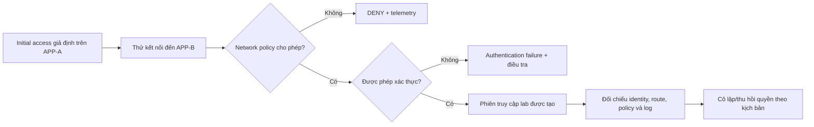
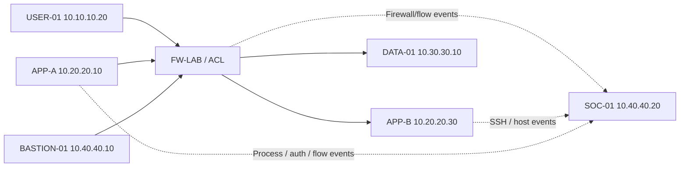
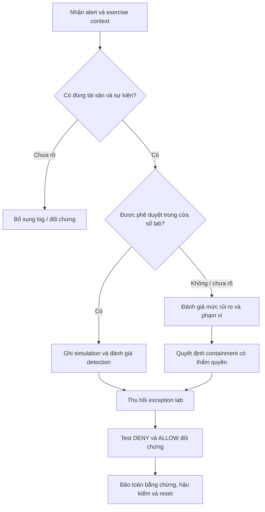

# Mô phỏng một sự cố lateral movement

## 1. Mục tiêu của dự án thực hành

**Lateral movement** (di chuyển ngang) là giai đoạn một đối tượng đã có vị trí truy cập trong môi trường tìm cách mở rộng phạm vi tiếp cận sang những hệ thống, tài khoản hoặc vùng mạng khác. Theo MITRE ATT&CK Enterprise, đây là chiến thuật **TA0008 – Lateral Movement**. Các kỹ thuật liên quan có thể gồm sử dụng dịch vụ truy cập từ xa (**T1021 – Remote Services**) và tài khoản hợp lệ (**T1078 – Valid Accounts**). Di chuyển ngang không nhất thiết đồng nghĩa leo thang đặc quyền: một tài khoản quyền thấp vẫn có thể đi sang hệ thống khác nếu mạng và quyền truy cập cho phép.

Bài thực hành này nằm trong chương **Dự án thực hành bảo mật mạng** của module **SECURITY_NETWORK_SECURITY**. Người học kết hợp phân đoạn mạng, firewall, VPN, xác thực kết nối, IDS/IPS, bảo vệ DNS, phân tích lưu lượng, giám sát xâm nhập và kiến trúc mạng an toàn để điều tra một **tình huống lateral movement được dựng sẵn**.

**Mục tiêu:** mô phỏng có kiểm soát một máy nguồn đã được gắn nhãn “nghi bị xâm nhập”, thử đường kết nối tới máy ngang hàng, quan sát log định tuyến/firewall/xác thực/endpoint, phát hiện hành vi trái baseline, thực hành phản ứng và chứng minh việc kiểm soát vẫn bảo vệ được các vùng khác.

Đến cuối bài, người học có thể:

1. Phân biệt **khả năng kết nối mạng**, **đăng nhập được bằng tài khoản thử**, **truy cập trái chính sách** và **lateral movement đã được xác minh**.
2. Vẽ luồng nguồn–đích, ranh giới tin cậy, điều kiện định danh và điểm thu bằng chứng.
3. Tạo và thực hiện ma trận kiểm thử ALLOW/DENY trong một lab tách biệt.
4. Liên kết flow log, đăng nhập SSH/Windows, dấu vết endpoint và nhật ký SIEM thành timeline.
5. Xây dựng tiêu chí phát hiện, điều tra, cô lập và phục hồi có kiểm chứng.
6. Báo cáo kết quả PASS/FAIL/INCONCLUSIVE, phạm vi đã thử và khoảng trống còn lại.

> **Quy tắc an toàn:** Chỉ thao tác trên môi trường lab được cấp phép. Không thu thập thông tin xác thực thật, không quét mạng ngoài danh sách được duyệt, không khai thác lỗ hổng, không lấy dữ liệu của bên thứ ba và không cài mã độc hay cơ chế bám trụ. Những dấu hiệu “máy bị xâm nhập” trong bài đều do người hướng dẫn **giả định hoặc tạo dữ liệu giả lập**; bài không cần chiếm quyền một máy thật.

## 2. Hiểu đúng sự cố đang mô phỏng

Một sơ đồ tấn công có thể viết ngắn gọn:



Đây là **chuỗi điều kiện**, không phải bằng chứng rằng đã có một cuộc tấn công thật. Cần phân biệt:

| Mức quan sát | Ví dụ | Kết luận có căn cứ | Không được suy ra |
| --- | --- | --- | --- |
| **Reachability** | TCP handshake tới APP-B:22 thành công | Có đường tới dịch vụ SSH ở thời điểm đó | Đã đăng nhập hoặc thực thi được lệnh |
| **Authentication event** | Log ghi thử đăng nhập tài khoản lab | Có một lần xác thực được thử | Tài khoản đã bị đánh cắp |
| **Authorized test login** | Tài khoản lab định trước đăng nhập thành công | Phiên truy cập đã được cấp theo thiết kế lab | Có khai thác hoặc compromise thật |
| **Policy violation** | Nguồn APP-A kết nối qua ranh giới vốn yêu cầu DENY | Có sai lệch enforcement cần điều tra | Toàn bộ vùng DATA đã bị chiếm |
| **Simulated foothold** | Dán nhãn APP-A “compromised-simulated” hoặc phát fixture | Dùng để thử khả năng phát hiện và phản ứng | Malware đã chạy hoặc thiết bị đã thực sự nhiễm |
| **Confirmed lateral movement incident** | Có bằng chứng thực về truy cập trái phép sang hệ thống khác | Đã có sự kiện vượt quyền trong phạm vi chứng cứ | Mọi tài nguyên khác cũng đã bị truy cập |

Một bài lab có thể tái hiện **dấu vết di chuyển ngang** bằng hoạt động được cho phép. Báo cáo phải ghi rõ cái gì **được thực hiện thật trong lab**, cái gì **giả lập bằng event**, và cái gì **chưa kiểm thử**. Nếu chỉ tạo sự kiện SIEM giả, đó là kiểm thử pipeline/detection, chưa chứng minh sensor mạng có thể thấy một luồng thật.

## 3. Phạm vi lab, tài sản và topology

### 3.1 Danh sách tài sản

Sử dụng máy ảo hoặc namespace/container trong một mạng lab **không nối với hạ tầng production**. Địa chỉ IP riêng sau đây chỉ là ví dụ để người học thay bằng thông số lab thực tế.

| Tài sản | Địa chỉ ví dụ | Vùng | Vai trò |
| --- | --- | --- | --- |
| **USER-01** | `10.10.10.20` | USER | Máy người dùng, chỉ truy cập web APP qua HTTPS |
| **APP-A** | `10.20.20.10` | APP | Điểm xuất phát mô phỏng, gắn nhãn “nghi bị xâm nhập” |
| **APP-B** | `10.20.20.30` | APP | Máy đích mô phỏng, có SSH phục vụ tài khoản test giới hạn |
| **DATA-01** | `10.30.30.10` | DATA | Dịch vụ dữ liệu giả lập, không chứa dữ liệu thật |
| **BASTION-01** | `10.40.40.10` | MGMT | Đường quản trị hợp lệ cho APP-B |
| **SOC-01** | `10.40.40.20` | MGMT | Log collector/SIEM hoặc nơi tập hợp bản ghi lab |
| **FW-LAB** | Gateway cho các zone | SECURITY | Firewall/ACL hoặc policy engine tách vùng |

Có thể triển khai APP-A và APP-B cùng subnet để kiểm tra east–west, hoặc ở hai subnet APP khác nhau để kiểm tra inter-zone firewall. **Hai cách không tương đương**: nếu hai máy cùng L2 segment, traffic có thể không qua firewall L3. Tài liệu và phép thử phải nêu rõ điểm nào thực sự thực thi policy.

### 3.2 Sơ đồ logic



Nếu trong triển khai thực tế APP-A và APP-B chung subnet, cần bổ sung **host firewall, vSwitch/distributed firewall hoặc microsegmentation**. Sơ đồ trên thể hiện điểm kiểm soát logic, không cam kết mọi gói cùng subnet đều đi qua FW-LAB.

### 3.3 Những thành phần tối thiểu

- Một mạng lab đã cô lập, máy/VM có thể làm APP-A và APP-B, một host log hoặc nơi tập hợp dữ liệu quan sát.
- Policy firewall/ACL/host firewall có thể quan sát log **allow/deny** theo IP, protocol và port.
- SSH server test trên APP-B **được bật có kiểm soát** và tài khoản `lab-run` chỉ có quyền tối thiểu. Có thể thay SSH bằng dịch vụ canary có xác thực nếu môi trường không cho phép SSH.
- Một kênh quản trị riêng để **thu hồi policy và phục hồi** kể cả khi đường thử bị chặn.
- Đồng bộ thời gian NTP/NTS hoặc ít nhất có ghi nhận độ lệch UTC, event time và collector receive time.
- Bản ghi phê duyệt bài lab, người vận hành và cách dừng/reset.

**Không** cần Domain Controller thật, công cụ trích xuất mật khẩu, máy chủ C2 hay phần mềm remote execution. Nếu muốn luyện triage Windows, có thể dùng **dữ liệu sự kiện Windows tổng hợp** thay cho triển khai một domain sản xuất.

## 4. Threat model và giả thuyết kiểm chứng

Giả sử có cảnh báo nghi vấn đối với APP-A. Người bảo vệ cần trả lời các câu hỏi:

- APP-A có đường TCP/22 tới APP-B không? Trước và sau khi tạo exception, policy thay đổi ra sao?
- Nếu một phiên test được tạo trên APP-B, ai xác thực, từ IP nào, theo chính sách nào?
- APP-A có thể thử kết nối tới DATA-01 dù không được cấp quyền không?
- Một phiên thử này có được SOC nhìn thấy trong firewall, endpoint và hệ thống identity không?
- Khi responder chặn APP-A, các luồng nghiệp vụ hợp lệ khác có tiếp tục hoạt động không?

Bảng giả thuyết:

| ID | Giả thuyết | Bằng chứng tối thiểu |
| --- | --- | --- |
| H1 | APP-A → APP-B:22 bị **DENY** theo baseline | Client probe; firewall/host policy DENY; dịch vụ APP-B đang hoạt động |
| H2 | Một exception có thời hạn chỉ cho phép một phiên kiểm thử có duyệt | Thay đổi có ticket; source/destination/port chính xác; log ALLOW; thời hạn |
| H3 | Khi đăng nhập từ APP-A bằng tài khoản thử, APP-B ghi nhận nguồn, tài khoản và phiên | SSH/auth log hoặc bản ghi tương đương, timestamp và outcome |
| H4 | Dấu hiệu thay đổi so với baseline được phát hiện và triage | SIEM/IDS/EDR alert hoặc rule correlation đã chuẩn bị |
| H5 | APP-A → DATA-01:5432 luôn **DENY**, kể cả trong kịch bản thử | Rule hit/flow log, đối chứng dịch vụ DATA từ nguồn hợp lệ |
| H6 | Thu hồi exception/cô lập APP-A chặn luồng thử nhưng không làm hỏng đường quản trị hợp lệ | Test sau ứng phó, log deny, health check bastion/APP-B |

**Giới hạn mô phỏng:** H2 và H3 dùng một tài khoản/exception hợp lệ có kiểm soát. Chúng tái tạo **hành vi quan sát giống di chuyển ngang**, không chứng minh rằng kẻ tấn công đã đánh cắp tài khoản. Mức độ nguy hiểm trong một sự cố thật cần được đánh giá theo điều kiện truy cập trái phép và tác động thực tế.

## 5. Ma trận chính sách và phép thử

### 5.1 Chính sách nền

| Test ID | Nguồn | Đích | Dịch vụ | Kỳ vọng | Lý do |
| --- | --- | --- | --- | --- | --- |
| LM-01 | USER-01 | Ứng dụng web APP | TCP/443 | **ALLOW** | Luồng nghiệp vụ được duyệt |
| LM-02 | APP-A | APP-B | TCP/22 | **DENY** | Không cho máy ứng dụng SSH ngang hàng theo baseline |
| LM-03 | APP-A | DATA-01 | TCP/5432 | **DENY** | Chặn nguồn không phải client DB được duyệt |
| LM-04 | BASTION-01 | APP-B | TCP/22 | **ALLOW** | Đường quản trị hợp lệ |
| LM-05 | USER-01 | DATA-01 | TCP/5432 | **DENY** | Bảo vệ vùng dữ liệu |
| LM-06 | APP-A | APP-B | TCP/22 trong **cửa sổ mô phỏng có phê duyệt** | **ALLOW tạm thời** | Tái hiện dấu vết kết nối/đăng nhập; sau đó thu hồi |
| LM-07 | APP-A | APP-B | TCP/22 **sau thu hồi** | **DENY** | Chứng minh containment/rollback |
| LM-08 | BASTION-01 | APP-B | TCP/22 sau thu hồi LM-06 | **ALLOW** | Đảm bảo thay đổi không làm mất quyền quản trị hợp lệ |

LM-02, LM-06 và LM-07 phải chạy ở **ba thời điểm/trạng thái policy khác nhau**, không phải ba quy tắc đồng thời. LM-06 không được tự động mở toàn subnet hoặc kéo dài vô thời hạn. Nếu không thể triển khai exception ở firewall do APP-A và APP-B cùng L2, dùng cơ chế host firewall/microsegmentation được phê duyệt và ghi rõ nơi thực thi.

**Stateful vs stateless:** Phản hồi thuộc một phiên TCP ALLOW được xử lý khác với một kết nối mới khởi tạo theo chiều ngược. Đừng tạo rule `APP-B → APP-A any` chỉ để có phản hồi; với ACL/NACL stateless, đánh giá riêng chiều về và ephemeral port.

### 5.2 Mẫu mô tả test

```yaml
exercise_id: LM-LAB-010
test_id: LM-06
scenario: "Lateral movement mô phỏng qua remote service"
source:
  asset: APP-A
  zone: APP
  ip: 10.20.20.10
destination:
  asset: APP-B
  zone: APP
  ip: 10.20.20.30
transport: TCP
destination_port: 22
account: lab-run
auth_method: preprovisioned_lab_credential
expected: "Một phiên SSH test hợp lệ; có log và alert tương quan"
permission: "Temporary exception được duyệt trước"
safety:
  max_sessions: 1
  no_privilege_escalation: true
  no_data_collection: true
  no_persistence: true
  expiry_required: true
evidence:
  - firewall_or_host_policy
  - ssh_auth_event
  - endpoint_or_process_event_if_available
  - siem_case
```

Mẫu YAML này **không** phải rule có thể áp trực tiếp trên firewall. Các tên và IP chỉ dành cho lab.

## 6. Rules of Engagement trước khi chạy

Trước khi phát traffic, ghi nhận **quyền hạn** và **phạm vi**:

1. **Người phụ trách:** chủ lab, operator, blue-team observer, người có quyền sửa firewall và người quyết định dừng.
2. **Tài sản:** đúng danh sách APP-A, APP-B, DATA-01, bastion và SOC, kèm IP và zone tại thời điểm thực hiện.
3. **Hành động được phép:** kết nối kiểm tra có giới hạn; tối đa một phiên SSH hợp lệ với tài khoản `lab-run`; đọc hostname hoặc một chuỗi canary cố định; không truy cập tệp người dùng.
4. **Hành động không được phép:** đoán mật khẩu/brute force, khai thác dịch vụ, thu token, dump credential, chạy payload, tạo persistence, tự động quét rộng, thử di chuyển tới thiết bị khác.
5. **Thời gian:** cửa sổ kiểm thử UTC, hạn tự thu hồi exception và lịch xóa dữ liệu lab.
6. **Tín hiệu nhận diện:** `exercise_id=LM-LAB-010` trong ticket, tên tài khoản lab, tên host và báo cáo để tránh nhầm với sự cố thật.
7. **Điều kiện dừng:** xuất hiện dữ liệu production, phát hiện bất thường tài nguyên, ảnh hưởng dịch vụ ngoài dự kiến hoặc không còn đường khôi phục.
8. **Bằng chứng:** lưu log cần thiết, kiểm soát quyền truy cập, không chia sẻ bí mật đăng nhập trong ticket.

Cần có **đối chứng**: APP-B phải nhận được kết nối từ bastion hợp lệ, để khi APP-A bị timeout có thể phân biệt **network policy DENY** với việc SSH server đang dừng.

## 7. Preflight: xác nhận topology, dịch vụ và giám sát

### Bước 1 — Chụp baseline

Ghi phiên bản firewall/host policy, route, DNS/hostname mapping, trạng thái mạng, thời gian UTC và log đang bật. Tạo snapshot VM hoặc bản sao cấu hình theo quy trình lab nếu có. Kiểm tra APP-A và APP-B thuộc đúng môi trường cách ly, không có NIC hoặc route ngoài phạm vi.

Ví dụ trên Linux lab:

```bash
# Chạy riêng trên từng máy để ghi địa chỉ và route thực
ip -brief addr
ip route

# Chạy trên APP-A: xem route local sẽ chọn đến APP-B
ip route get 10.20.20.30

# Kiểm tra thời gian trên hệ thống
date -u +'%Y-%m-%dT%H:%M:%SZ'
```

`ip route get` chỉ mô tả quyết định định tuyến của nguồn theo điều kiện hiện tại, **không chứng minh** toàn bộ đường đi sau gateway. Nếu có VRF, network namespace, cloud overlay hoặc NAT, cần kiểm tra trong đúng ngữ cảnh của probe.

### Bước 2 — Kiểm tra dịch vụ đối chứng

Trên APP-B, người phụ trách xác nhận SSH lắng nghe và tài khoản thử đã được tạo với quyền tối thiểu, hạn dùng, theo quy trình quản trị lab:

```bash
# Chạy trên APP-B (chỉ đọc): kiểm tra cổng SSH lắng nghe
ss -lnt '( sport = :22 )'
```

Từ **BASTION-01**, thử kết nối trong phạm vi:

```bash
# Chỉ chạy trên BASTION-01 theo LM-04
nc -vz -w 3 10.20.20.30 22
```

Nếu đối chứng không thành công, **không chấm LM-02 là PASS** chỉ vì APP-A cũng timeout. Phải khắc phục dịch vụ, route hoặc vấn đề lab trước.

### Bước 3 — Kiểm tra pipeline telemetry

Xác nhận có ít nhất hai nguồn quan sát độc lập, lý tưởng là ba:

- **Network:** firewall/host firewall rule hit, NetFlow/IPFIX, Zeek `conn.log`, NDR hoặc cloud flow log.
- **Identity/host:** Linux SSH/journal, Windows Security log, EDR/Sysmon nếu đã triển khai hợp lệ.
- **Central analysis:** collector/SIEM, đồng bộ sự kiện, rule cảnh báo và nơi lưu evidence.
- **Change control:** ticket temporary exception, time window, owner và người phê duyệt.

Nếu thiếu một nguồn, ghi giới hạn trước khi chạy; không tự cho rằng detector nhìn thấy dữ liệu chỉ vì nó đang chạy.

## 8. Pha A — kiểm chứng baseline ngăn chuyển ngang

Từ **APP-A**, thử đúng một kết nối tới APP-B với timeout ngắn:

```bash
# Test LM-02, chạy trên APP-A; không phải quét nhiều host
nc -vz -w 3 10.20.20.30 22
```

Đồng thời xác minh APP-A không thể đi trực tiếp vào DATA:

```bash
# Test LM-03, chỉ chạy trên APP-A của lab
nc -vz -w 3 10.30.30.10 5432
```

**Cách diễn giải:**

| Quan sát client | Có thể nghĩa là | Kết luận tạm thời |
| --- | --- | --- |
| Kết nối TCP thành công | Đường tới port đang mở; policy cho phép hoặc có lối đi ngoài mong đợi | LM-02/LM-03 là **FAIL** nếu đã xác minh đúng nguồn và policy yêu cầu DENY |
| Timeout | Bị drop, mất route, đích không sẵn sàng, đường trả lời lỗi | **INCONCLUSIVE** nếu thiếu log policy và đối chứng |
| TCP RST / `Connection refused` | Host hoặc middlebox từ chối, cổng không mở hoặc có reject rule | Cần xác định control từ chối; chưa phải chứng cứ chặn đúng |
| Kết nối bị gián đoạn giữa phiên | Timeout/expiry, session state hoặc kiểm soát ứng dụng | Điều tra riêng, không gán mặc nhiên cho lateral movement |

Đối với **PASS — DENY**, yêu cầu APP-B còn truy cập được từ bastion, có log/counter ở điểm chặn đúng thời gian, và nếu có thể xác minh APP-B không nhận SYN hoặc không thiết lập phiên từ APP-A. Dùng timestamp UTC và 5-tuple để ghép sự kiện.

### 8.1 Một lỗi thường gặp trong lab

Nếu APP-A và APP-B cùng subnet, flow có thể đi thẳng qua switch/bridge. Firewall inter-zone sẽ **không có rule hit**, dù cấu hình DENY đúng cho luồng liên zone. Cần đặt host firewall/microsegmentation hoặc tách APP-A/APP-B thành subnet khác để phép thử thực sự đi qua điểm thực thi mong muốn.

## 9. Pha B — tái hiện dấu vết lateral movement trong cửa sổ thử

Pha này mô phỏng trường hợp một máy vốn không cần SSH sang host khác bỗng mở phiên. Đội mạng thực hiện **ngoại lệ một luồng, có phê duyệt**, hoặc mở đường thông qua công cụ lab đã được chuẩn bị; người học không tự thay cấu hình production.

### Bước 1 — cho phép một flow thật hẹp

Điều kiện mong muốn trong thời gian mô phỏng:

```yaml
temporary_policy:
  id: LM-LAB-010-TEMP
  from: 10.20.20.10/32
  to: 10.20.20.30/32
  protocol: tcp
  destination_port: 22
  action: allow
  logging: required
  reason: "Kiểm thử dấu vết lateral movement trong lab"
  owner: lab-instructor
  expires_at_utc: "2026-11-28T08:00:00Z"
```

Đây là **mẫu ý định chính sách**, không phải cú pháp để áp vào firewall. Thời hạn ví dụ phải được thay bằng cửa sổ thực tế đã duyệt. Nếu firewall không hỗ trợ expiry tự động, tạo lịch thu hồi và người chịu trách nhiệm trong ticket.

Điểm kiểm chứng: rule chỉ áp cho đúng source/destination/port và **không** làm APP-A truy cập được DATA-01. Có thể chạy LM-03 ngay sau thay đổi để phát hiện rule quá rộng.

### Bước 2 — tạo đúng một phiên test hợp lệ

Trên APP-A, với tài khoản `lab-run` **đã được chủ lab cấp sẵn** và phương thức xác thực được duyệt, thực hiện một câu lệnh không đổi dữ liệu:

```bash
# Chỉ chạy từ APP-A tới APP-B trong cửa sổ mô phỏng
# Tài khoản lab-run đã được chuẩn bị trước, không dùng credential thật
ssh -o ConnectTimeout=3 -o BatchMode=yes lab-run@10.20.20.30   'printf "LM-LAB-010: authorized simulation\n"'
```

Nếu lab dùng xác thực tương tác, người hướng dẫn thực hiện theo quy trình đăng nhập thông thường và ghi log phiên; không khuyến khích ghi password vào command line hay script. `BatchMode=yes` chỉ giúp lệnh không hỏi mật khẩu trong quá trình thử tự động, nên **có thể thất bại nếu lab chưa có cơ chế xác thực phù hợp**. Không thêm `StrictHostKeyChecking=no` để bỏ kiểm tra danh tính máy; xác minh host key theo kênh đáng tin.

Lệnh trên **không khai thác lỗ hổng** và không chứng minh quyền truy cập trái phép. Đây là phiên SSH được chuẩn bị có chủ đích để tạo **dữ liệu quan sát** tương tự một người dùng từ APP-A sang APP-B.

**Tín hiệu cần có:**

1. APP-A phát phiên TCP từ địa chỉ nguồn được ghi nhận tới APP-B:22.
2. Network control ghi action=ALLOW cho `LM-LAB-010-TEMP` trong cửa sổ phê duyệt.
3. APP-B ghi authentication success cho `lab-run` và source IP APP-A.
4. Nếu có EDR/process audit, APP-B ghi tiến trình shell/SSH và lệnh test đã chạy ở mức được phép quan sát.
5. SIEM nhận event, liên kết theo thời gian và sinh alert/case theo quy tắc bài tập nếu đã cấu hình.
6. APP-A vẫn không truy cập được DATA-01 ngoài chính sách.

### Bước 3 — thu hồi ngoại lệ

Ngay sau khi có bằng chứng, người có quyền gỡ rule thử và vô hiệu hóa/thu hồi phương thức xác thực test theo kế hoạch. Chạy lại **LM-07 (APP-A→APP-B DENY)** và **LM-08 (BASTION→APP-B ALLOW)** để xác minh:

- Đường ngang từ APP-A đã bị đóng.
- Đường quản trị hợp lệ không bị ảnh hưởng.
- Các bản ghi từ trước và sau thu hồi có timestamp, rule ID và kết quả khác nhau tương ứng.
- Không còn user/credential/exception tạm bị quên trong lab.

Nếu sau gỡ rule vẫn kết nối được, phải điều tra session state cũ, rule khác, đường qua proxy/NAT hoặc kết nối cùng L2. Với firewall stateful, một **phiên đã thiết lập trước khi gỡ rule** có thể tồn tại tới khi kết thúc hoặc khi policy/session table áp dụng cách xử lý riêng; để nghiệm thu DENY, tạo **phiên mới** sau khi thu hồi.

## 10. Pha C — thu thập bằng chứng và dựng timeline

### 10.1 Dấu vết trên Linux

Trên APP-B, kiểm tra log SSH tương ứng (tên service tùy bản phân phối):

```bash
# Trên APP-B: đọc log SSH theo khoảng thời gian bài diễn tập
journalctl -u sshd --since '2026-11-28 07:00:00'   --until '2026-11-28 08:10:00'

# Một số hệ thống dùng unit 'ssh' thay vì 'sshd'
journalctl -u ssh --since '2026-11-28 07:00:00'   --until '2026-11-28 08:10:00'
```

Thời gian nhập cho `journalctl` thường được diễn giải theo timezone hiện tại của máy; khi xuất bằng chứng cần chuẩn hóa sang UTC và ghi timezone. Không kỳ vọng mọi bản phân phối đều ghi cùng chuỗi “Accepted publickey” hoặc trường `session_id`.

Nếu có audit/EDR sẵn trong lab, đối chiếu event tiến trình/phiên. Tránh thay đổi chế độ logging trên máy production chỉ để thu được log cho bài tập. Nếu chỉ có SSH login log nhưng không có command/process log, ghi rõ không đủ bằng chứng về lệnh bên trong phiên.

### 10.2 Dấu vết Windows (biến thể tùy chọn)

Khi mô phỏng một dịch vụ truy cập từ xa trên Windows lab, các bản ghi thường hữu ích gồm:

| Event ID / nguồn | Ý nghĩa điển hình | Ghi chú |
| --- | --- | --- |
| Security **4624** | Đăng nhập thành công | `LogonType=3` thường là network logon; `LogonType=10` thường liên quan remote interactive/RDP |
| Security **4625** | Đăng nhập thất bại | Xác định nguồn và lý do theo trường có sẵn; một lần sai không chứng minh brute force |
| Security **4648** | Thử đăng nhập với thông tin xác thực tường minh | Chỉ xuất hiện theo hành vi và auditing được bật |
| Security **4672** | Quyền đặc biệt được gán cho phiên đăng nhập | Không tự chứng minh hành vi xâm nhập |
| Sysmon **1** | Tạo tiến trình | Chỉ có nếu Sysmon được cài và cấu hình |
| Sysmon **3** | Kết nối mạng do tiến trình tạo | Phụ thuộc cấu hình thu thập Sysmon |
| Sysmon **22** | DNS query | Phụ thuộc phiên bản và cấu hình Sysmon |
| Firewall/EDR | Đường kết nối, process, user, action | Schema và mức logging tùy nền tảng |

Người học có thể phân tích **fixture log Windows đã tạo trước** thay vì khởi tạo phiên remote thực. Khi sử dụng dữ liệu tổng hợp, phải đánh dấu `simulation=true` để không nhầm với sự kiện thật.

Ví dụ chỉ đọc Security log trên **máy Windows lab đã được cấp quyền**:

```powershell
# Cần quyền đọc Windows Security log phù hợp
$start = [datetime]'2026-11-28T07:00:00Z'
$end   = [datetime]'2026-11-28T08:10:00Z'
Get-WinEvent -FilterHashtable @{
  LogName = 'Security'
  Id = 4624, 4625, 4648, 4672
  StartTime = $start
  EndTime = $end
} | Select-Object TimeCreated, Id, ProviderName, Message
```

Các event ID và LogonType chỉ là **dữ liệu để đối chiếu**, không nên tạo kết luận chỉ từ ID. Ví dụ RDP, SMB, WinRM và SSH có chuỗi sự kiện và chính sách khác nhau; cần đặt trong bối cảnh tài khoản, máy nguồn, phiên và hoạt động thực tế.

### 10.3 Network evidence

Nếu được phép thu gói trên một host/sensor lab, giới hạn theo đích và số gói:

```bash
# Sensor lab có quyền quan sát; dừng sau tối đa 20 gói phù hợp
sudo tcpdump -nni eth0 -c 20   'host 10.20.20.30 and tcp port 22'
```

Capture tại APP-A có thể cho thấy SYN và phản hồi, nhưng không xác định chắc chắn firewall nào cho phép nếu chưa có log tại control. SSH mã hóa nội dung ứng dụng; packet capture không mặc nhiên nhìn được lệnh bên trong phiên. Chỉ thu header/flow metadata nếu mục tiêu không cần payload, và không lưu file PCAP chứa dữ liệu riêng tư ngoài phạm vi.

### 10.4 Ví dụ timeline

| UTC (giả lập) | Nguồn | Sự kiện | Ý nghĩa |
| --- | --- | --- | --- |
| 07:30:00 | ITSM | Temporary exception LM-LAB-010 được phê duyệt | Có phạm vi được cho phép |
| 07:31:00 | Firewall | Rule hẹp APP-A→APP-B:22 được áp | State change có kiểm chứng |
| 07:31:20 | APP-A / FW | TCP/22 được phép tới APP-B | Network reachability thay đổi |
| 07:31:21 | APP-B auth | `lab-run` đăng nhập thành công từ APP-A | Có phiên thử được cấp phép |
| 07:31:22 | APP-B process | Câu lệnh canary chạy | Hoạt động mô phỏng được ghi nhận |
| 07:31:24 | SIEM | Alert “unusual east-west remote login” | Detection pipeline hoạt động |
| 07:33:00 | Operator | Thu hồi exception | Containment theo kịch bản |
| 07:33:25 | APP-A / FW | Kết nối mới APP-A→APP-B bị DENY | Đã đóng đường thử |
| 07:34:00 | BASTION / APP-B | Bastion vẫn truy cập APP-B được | Không làm gián đoạn kênh quản trị |

Mốc thời gian chỉ để minh họa. Trong lab thật, lưu cả **event time** và **received/ingested time**; log có thể trễ, nguồn bị lệch đồng hồ hoặc thay đổi NAT tuple. Không được tự sửa timestamp gốc để tạo một timeline “đẹp”.

## 11. Thiết kế logic phát hiện và tương quan

Một detector tốt không chỉ kiểm tra “có SSH giữa hai máy hay không”. Nó cần đánh giá **mức khác thường so với vai trò ứng dụng và thay đổi đã phê duyệt**.

### 11.1 Use case phát hiện

| Use case | Nguồn dữ liệu | Điều kiện có thể đáng ngờ |
| --- | --- | --- |
| East–west remote access bất thường | Firewall/flow + asset inventory | Một workload vốn không dùng SSH/RDP/WinRM bắt đầu kết nối tới host ngang hàng |
| Đăng nhập từ nguồn không phù hợp vai trò | SSH/Windows auth + zone map | Tài khoản quản trị xuất hiện từ host ứng dụng thay vì bastion |
| Kết nối sau khi policy DENY | Rule log + session | Phiên mới vẫn đạt đến service qua route hoặc control khác |
| Truy cập sang nhiều host | Flow/endpoint | Một source liên hệ nhiều service ngang hàng trong cửa sổ thời gian; cần ngưỡng phù hợp |
| Truy cập DATA sau khi có dấu hiệu remote access | Identity + flow + segmentation | Nguồn/hệ thống đích mới thử giao tiếp tới DATA không có quyền |
| Thay policy trùng thời điểm kết nối lạ | Change audit + network | Exception xuất hiện ngoài change window hoặc mở rộng phạm vi đã duyệt |
| Mất visibility trên đường nội vùng | Sensor health + flow test | Canary connection thật có nhưng collector không nhận event dự kiến |

Mục tiêu detection không phải xem mọi SSH là xâm nhập. Một pipeline backup, công cụ cấu hình tự động hoặc nhân viên qua bastion có thể tạo sự kiện gần giống. Asset inventory, lịch bảo trì, tài khoản, role và danh sách thay đổi được duyệt giúp giảm false positive.

### 11.2 Quy tắc tương quan ở mức mã giả

```text
FOR each east_west_remote_access_event:
    identify source_asset, target_asset, protocol, port, timestamp
    identify initiating_identity_or_process_if_available

    baseline = lookup_approved_source_target_service_flow()
    change = lookup_change_window_and_exception()
    auth = correlate_target_auth_events_by_time_and_source()
    endpoint = correlate_target_process_or_session_events_if_available()

    IF flow_not_in_baseline AND no_matching_approved_change:
        raise investigation_candidate()

    IF auth_success AND target_has_unusual_remote_session:
        increase_priority()

    IF missing_firewall_or_host_telemetry:
        mark_evidence_gap()

    attach_raw_event_references_and_uncertainty()
```

Mã giả không phải detector có thể chạy trực tiếp. Cần điều chỉnh theo khả năng lấy log, NAT, thời gian trễ, định danh workload, mức độ chấp nhận false positive và policy riêng của tổ chức. Khi diễn tập có thông báo, alert có thể mang nhãn `exercise_id` để SOC không kích hoạt quy trình xử lý thật ngoài dự kiến.

### 11.3 Đánh giá hiệu quả phát hiện

- **Visibility coverage:** sensor thấy được bao nhiêu flow thật trong các trạng thái ALLOW, DENY và sau containment?
- **Correlation quality:** có ghép đúng firewall event, tài khoản, host, session và event endpoint không?
- **Detection latency:** thời gian từ lúc dấu hiệu xuất hiện đến khi alert được tạo; tách trễ thu log khỏi trễ xử lý.
- **Triage latency:** thời gian từ alert tới lúc analyst xác định được scope và quyết định hành động.
- **False positives:** cảnh báo đối với hoạt động quản trị hợp lệ có được phân loại đúng không?
- **Enforcement correctness:** các ca DENY thật sự được chặn tại control dự kiến và không bị bypass qua đường khác?
- **Containment efficacy:** sau thu hồi/cô lập, luồng thử mới bị chặn mà không làm mất dịch vụ quản trị hợp lệ?

Không thể đánh giá detector bằng **số lượng alert** đơn thuần. Một detector có ít cảnh báo đúng, đầy đủ bằng chứng và phù hợp phản ứng có thể tốt hơn một detector gây nhiễu toàn bộ SOC.

## 12. Pha D — điều tra, phân loại và ứng phó

Giả sử SOC nhận được cảnh báo “APP-A tạo phiên SSH sang APP-B” trong khi sơ đồ mạng không cho phép ứng dụng kết nối ngang hàng. Bài thực hành cần có **runbook** rõ ràng:

### Bước 1 — Xác minh alert

Đối chiếu source IP/source asset, target IP, port, event time, policy action, auth event và change ticket. Kiểm tra APP-A và APP-B có đúng là workload cần theo dõi không; tránh nhầm IP sau NAT hoặc địa chỉ vừa cấp lại. Trong lab, một phiên đã được phê duyệt vẫn có thể bị rule phát hiện; analyst cần ghi **simulated, authorized** thay vì báo compromise production.

### Bước 2 — Xác định phạm vi

Xem các kết nối khác từ APP-A trong cùng khoảng UTC: tới DATA, MGMT hoặc host ngoài danh sách? Phân biệt flow **bị thử**, flow **được phép** và session **đã đăng nhập**. Kiểm tra host log để biết lệnh canary và tài khoản test, không mở rộng thu dữ liệu ngoài phạm vi.

### Bước 3 — Ra quyết định containment

Trong lab, phương án ứng phó có thể là:

- Gỡ exception `APP-A→APP-B TCP/22` và xác minh phiên mới bị chặn.
- Thu hồi hoặc vô hiệu hóa tài khoản thử `lab-run` theo kế hoạch, nếu tài khoản được tạo riêng cho bài.
- Giới hạn egress từ APP-A tới các vùng không cần thiết bằng firewall/SG/host policy đã được duyệt.
- Chuyển APP-A vào vùng cô lập của lab nếu topology hỗ trợ, nhưng **giữ kênh quản trị/forensic** đã thiết kế sẵn.
- Phát cảnh báo hoặc tạo case SOC, liên kết tới `exercise_id` và người điều phối.

**Không tự động khóa mọi tài khoản hoặc cắt toàn bộ mạng ứng dụng production** chỉ vì thấy một đăng nhập xa. Phản ứng phải dựa trên mức độ tin cậy của bằng chứng, tác động nghiệp vụ và quyền phê duyệt.

### Bước 4 — Kiểm tra containment

Sau khi thu hồi rule thử, chạy lại một **phiên TCP mới** từ APP-A tới APP-B. Đồng thời xác minh APP-A→DATA vẫn DENY và BASTION→APP-B vẫn ALLOW. Đối chiếu log; nếu một phiên cũ còn tồn tại, phân biệt nó với kết nối mới để tránh đánh giá sai.

### Bước 5 — Khôi phục và hậu kiểm

Khôi phục snapshot/rule baseline theo phương thức được duyệt, xóa quyền test tạm, xác nhận lại ALLOW/DENY, trạng thái sensor và ứng dụng. Báo cáo những chỗ thiếu log, policy quá rộng hoặc triage sai ngữ cảnh. Nếu bài diễn tập chạm tới sự kiện đáng ngờ không thuộc kịch bản, **dừng diễn tập và chuyển sang quy trình ứng phó sự cố thật**.



## 13. Bằng chứng và cách chấm điểm

### 13.1 Mẫu evidence record

```yaml
exercise_id: LM-LAB-010
scenario: "APP-A to APP-B remote session"
executed_at_utc: "2026-11-28T07:31:21Z"
simulation: true
source:
  asset: APP-A
  ip: 10.20.20.10
destination:
  asset: APP-B
  ip: 10.20.20.30
service: tcp/22
identity: lab-run
expected:
  baseline: deny
  temporary_window: allow_test_session
  post_containment: deny
observed:
  baseline: "deny with firewall/host policy log"
  temporary_window: "TCP connect + one authorized SSH canary session"
  post_containment: "new TCP session denied"
  data_zone: "APP-A -> DATA denied"
  bastion: "BASTION -> APP-B remained allowed"
evidence:
  - "ticket-reference"
  - "firewall-rule-event-reference"
  - "ssh-auth-event-reference"
  - "siem-case-reference"
limitations:
  - "Không chạy exploit hay dùng credential thật"
  - "Không chứng minh compromise bên ngoài lab"
verdict: PASS
```

Bản ghi này chỉ minh họa cấu trúc mong muốn. Không sử dụng `PASS` khi bằng chứng thật không đầy đủ; cần bảo vệ log và xóa dữ liệu thử theo chính sách.

### 13.2 Tiêu chí PASS/FAIL/INCONCLUSIVE

| Kết quả | Tiêu chí kiểm chứng |
| --- | --- |
| **PASS — Baseline** | APP-A→APP-B và APP-A→DATA bị DENY đúng control; bastion/đích có đối chứng hoạt động |
| **PASS — Simulation** | Phiên canary đúng source, đích, account, thời gian và phạm vi tạm; log mạng + xác thực/host tương quan được |
| **PASS — Detection** | Rule/analyst nhận diện được event phù hợp kịch bản và phân loại đúng giả lập |
| **PASS — Containment** | Sau thu hồi, **phiên mới** từ APP-A bị DENY, còn đường hợp lệ từ bastion không bị phá |
| **FAIL — Excessive reachability** | APP-A vẫn tới DATA hoặc tới host khác ngoài policy, hay exception mở rộng source/port không được duyệt |
| **FAIL — Observability** | Kết nối/đăng nhập lab xảy ra nhưng nguồn dữ liệu bắt buộc không ghi hoặc SIEM không xử lý như kỳ vọng |
| **FAIL — Recovery** | Exception/tài khoản thử còn tồn tại sau rollback hoặc đường nghiệp vụ hợp lệ bị mất |
| **INCONCLUSIVE** | Chỉ có timeout, thiếu đối chứng, không biết điểm thực thi hoặc log thời gian không khớp |
| **NOT TESTED** | Một trạng thái, giao thức, hướng, zone hay endpoint ngoài phạm vi hoặc chưa được phép thử |

Kết quả **một bài lab** không đủ tuyên bố hệ thống production chống được mọi lateral movement. Cần xem thêm các tuyến Windows SMB/RDP/WinRM, cloud identity, container API, VPN, đường quản trị và các control thực tế trong tổ chức.

## 14. Các biến thể và điểm mù thường gặp

### 14.1 Kết nối east–west cùng VLAN

Hai máy cùng L2 segment có thể trao đổi trực tiếp qua switch, nên firewall inter-zone không nhìn thấy traffic. Khi đó cần host firewall, hypervisor distributed firewall, CNI/network policy hoặc giải pháp microsegmentation; chỉ đặt sensor tại firewall perimeter sẽ tạo điểm mù.

### 14.2 Định danh so với IP

Một tài khoản có quyền vào APP-B qua bastion nhưng không nên đăng nhập từ APP-A. Chỉ cho phép theo địa chỉ nguồn IP chưa thể hiện đầy đủ chủ thể. Kết hợp IdP/PAM, tài khoản quản trị riêng, MFA, role và policy đường truy cập. Không dùng địa chỉ IP đơn lẻ để kết luận danh tính người thực hiện.

### 14.3 Windows remote services

Trong mạng Windows, dấu hiệu di chuyển ngang có thể liên quan **SMB, RDP, WinRM hoặc dịch vụ quản trị khác**, không chỉ SSH. Mỗi giao thức có log, quy tắc firewall, cơ chế xác thực và trường hợp sử dụng quản trị khác nhau. Thực hành phòng thủ nên dùng **sự kiện tổng hợp có schema hợp lệ** khi môi trường không cấp quyền tạo session thật; không cần chạy công cụ thực thi từ xa hoặc trích xuất tài khoản.

### 14.4 Cloud, VPN, VPC và container

Đường qua peering, transit gateway, site-to-site VPN hoặc cloud private endpoint có thể làm flow không đi qua firewall on-prem. Security group, network ACL, route table, host firewall và IAM áp các điều kiện khác nhau. Với Kubernetes, policy pod-to-pod phụ thuộc CNI, namespace, labels và đôi khi service mesh; phải thử từ **đúng workload identity**. Một flow log `ACCEPT` không tự chứng minh ứng dụng đích đã cho phép thao tác.

### 14.5 NAT, proxy và đường phản hồi

Một proxy hoặc NAT có thể khiến APP-B thấy IP nguồn khác với APP-A. Cần đối chiếu session/NAT table, proxy request ID hoặc endpoint logs để xác nhận nguồn thật. Route bất đối xứng cũng có thể làm firewall stateful drop phản hồi và tạo timeout không liên quan đến rule DENY kỳ vọng.

### 14.6 Giám sát mạng mã hóa

SSH, TLS và VPN bảo vệ nội dung ứng dụng nên NDR có thể chỉ nhìn metadata, handshake và nhịp traffic. Phát hiện có thể kết hợp network flow với endpoint process, auth events, asset roles và policy change. Không cần giải mã đại trà chỉ để chứng minh một phiên remote access đã diễn ra.

### 14.7 False positives từ automation

Backup, patching, CI/CD và công cụ cấu hình có thể đăng nhập nhiều host. Cần so sánh tài khoản, host nguồn, change window, loại hành động và lịch chạy. Một alert tốt nên giải thích **vì sao flow lệch baseline** và còn những giả thuyết hợp lệ nào.

## 15. Checklist trước và sau bài lab

### Trước khi chạy

- [ ] Có phê duyệt rõ ràng, owner, người chịu trách nhiệm dừng và môi trường cô lập.
- [ ] Danh sách APP-A, APP-B, DATA-01, BASTION-01, SOC-01 có IP, zone và vai trò chính xác.
- [ ] Đã xác nhận không có đường tới production, Internet ngoài phạm vi hoặc tài sản của bên thứ ba.
- [ ] Có ma trận ALLOW/DENY cho baseline, temporary window và containment.
- [ ] Tài khoản `lab-run` được cấp quyền tối thiểu, có thời hạn, không dùng credential thật.
- [ ] Có phương án áp dụng và thu hồi exception, snapshot/rollback và kênh quản trị dự phòng.
- [ ] APP-B hoạt động từ bastion hợp lệ; có log firewall/host/identity và collector nhận sự kiện.
- [ ] Đồng hồ được đồng bộ, người vận hành ghi thời gian UTC và `exercise_id`.
- [ ] Đã xác định giới hạn số kết nối, điều kiện dừng và cách bảo vệ dữ liệu log.

### Sau khi chạy

- [ ] LM-02/LM-03 DENY có evidence ở control dự kiến và đối chứng dịch vụ hoạt động.
- [ ] LM-06 được phép chính xác trong cửa sổ duyệt; một phiên test canary đã được ghi lại, không có hành động ngoài phạm vi.
- [ ] Có thể liên kết source/destination/port, account, phiên, thời gian và kết quả ứng dụng qua các nguồn log.
- [ ] SIEM/SOC phân loại đúng hoạt động mô phỏng, có thông tin hỗ trợ triage.
- [ ] Exception và quyền tạm được thu hồi; LM-07 DENY và LM-08 ALLOW đạt như baseline.
- [ ] Không còn đường APP-A→DATA ngoài chính sách và không còn cấu hình/tài khoản tạm.
- [ ] Có đánh giá sensor coverage, log delay, clock skew và các trường hợp chưa đủ bằng chứng.
- [ ] Evidence có giới hạn truy cập/retention; tài khoản test, khóa và snapshot được dọn theo kế hoạch.
- [ ] Báo cáo nêu rõ PASS, FAIL, INCONCLUSIVE, NOT TESTED, rủi ro còn lại và đề xuất khắc phục.

## 16. Câu hỏi tự đánh giá và bài tập mở rộng

1. Vì sao `nc` báo TCP/22 mở chưa đủ để kết luận lateral movement đã thành công?
2. Khi APP-A và APP-B cùng subnet, điều gì khiến firewall inter-zone có thể không thấy luồng thử?
3. Cần những sự kiện nào để ghép một phiên SSH từ APP-A tới APP-B với account `lab-run`?
4. Điều gì chứng minh một luồng bị chặn bởi **đúng policy** chứ không phải vì SSH server ngừng chạy?
5. Vì sao LM-06 phải có thời hạn và LM-07 phải kiểm thử bằng **phiên TCP mới**?
6. Nếu Windows Security log có event 4624 LogonType 3 từ APP-A, cần đối chiếu thêm gì trước khi báo một sự cố?
7. Nếu firewall ghi ALLOW nhưng APP-B ghi authentication failure, lớp bảo mật nào đã cho qua và lớp nào từ chối?
8. Làm thế nào phân biệt một phiên từ công cụ backup hợp lệ với dấu hiệu truy cập bất thường giữa các máy?
9. Những điểm đo nào cần bổ sung khi traffic đi qua cloud peering hoặc VPN thay vì firewall liên vùng?
10. Vì sao tạo fixture `simulation=true` trong SIEM không chứng minh sensor đã nhìn thấy traffic thật?
11. Nếu APP-A bị cô lập nhưng bastion cũng không kết nối được APP-B, kết luận containment nên là gì?
12. Khi hoàn tất, bằng chứng nào chứng minh lab đã thu hồi toàn bộ quyền, exception và tài khoản tạm?

**Bài tập mở rộng:** Giữ cùng topology và bổ sung một đường backup/VRF hoặc một workload trong cloud lab. Tạo hai tập test cho đường chính và dự phòng, so sánh **policy enforcement**, **network visibility** và **auth events**. Chỉ sử dụng canary/phiên test có kiểm soát, không tăng phạm vi sang mạng ngoài lab.

## 17. Tài liệu tham khảo định hướng

- **MITRE ATT&CK Enterprise:** TA0008 – Lateral Movement; T1021 – Remote Services; T1078 – Valid Accounts. Dùng để mô tả chiến thuật/kỹ thuật, không thay thế bằng chứng điều tra.
- **NIST SP 800-61:** Hướng dẫn xử lý sự cố bảo mật máy tính; tham khảo các nguyên tắc chuẩn bị, phát hiện, phân tích, ngăn chặn, phục hồi và hậu kiểm.
- **NIST SP 800-115:** Technical Guide to Information Security Testing and Assessment; tham khảo lập kế hoạch, giới hạn phạm vi và ghi nhận kiểm thử.
- **NIST SP 800-207:** Zero Trust Architecture; tham khảo kiểm soát truy cập theo danh tính và ngữ cảnh thay cho việc tin tưởng subnet.
- **RFC 1918:** Address Allocation for Private Internets; các địa chỉ `10.0.0.0/8` trong bài là ví dụ riêng cho lab.
- Tài liệu chính thức của firewall/host firewall, SSH, Windows Event Logging, Sysmon, Zeek/Suricata, SIEM, cloud networking và Kubernetes CNI mà môi trường học đang sử dụng.

Khi triển khai thực tế, người vận hành phải đối chiếu khả năng ghi log, phiên bản hệ điều hành, công cụ, đường mạng, thời gian lưu và quyền thực hiện với chính sách của tổ chức. Bài học minh họa **một quy trình mô phỏng – phát hiện – ứng phó có kiểm soát**, không thay thế kiểm thử xâm nhập chuyên sâu được phê duyệt.

