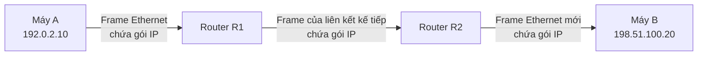

# Tầng Network (Layer 3) trong mô hình OSI: Địa chỉ IP, định tuyến và an toàn mạng

## 1. Tầng Network giải quyết vấn đề gì?

Trong một mạng LAN, tầng liên kết dữ liệu (Data Link, Layer 2) có thể chuyển **frame** giữa các thiết bị cùng một liên kết. Nhưng khi máy tính cần truy cập máy chủ nằm ở **mạng khác**, địa chỉ MAC và cơ chế chuyển mạch cục bộ là chưa đủ. Cần một cơ chế xác định mạng đích, chọn đường đi qua các router và chuyển tiếp dữ liệu qua nhiều liên kết. Đó là vai trò trung tâm của **tầng Network (Layer 3, L3)**.

Trong phạm vi học phần **SECURITY_NETWORK_SECURITY**, hiểu tầng Network giúp phân tích lưu lượng và vị trí áp dụng các biện pháp như phân đoạn mạng, định tuyến an toàn, firewall, chống giả mạo IP, IDS/IPS, giám sát và bảo vệ kết nối giữa mạng nội bộ với Internet hoặc hạ tầng đám mây.

Sau bài học, bạn có thể:

- Phân biệt địa chỉ IP với MAC, gói tin IP với frame và vai trò của L3 so với L2/L4.
- Giải thích cách subnet, bảng định tuyến, next hop và TTL/Hop Limit quyết định đường đi của gói tin.
- Nhận biết vai trò của IPv4, IPv6, ICMP/ICMPv6 và các cơ chế hỗ trợ chuyển tiếp gói tin.
- Đọc một số lệnh chẩn đoán tuyến đường; liên hệ kết quả với các sự cố hoặc rủi ro bảo mật thường gặp.

## 2. Vị trí của tầng Network trong mô hình OSI

| Lớp | Đơn vị dữ liệu thường gọi | Nhiệm vụ liên quan |
| --- | --- | --- |
| L4 — Transport | Segment (TCP), datagram (UDP) | Cổng dịch vụ, kết nối, truyền nhận đầu cuối |
| **L3 — Network** | **Packet / gói tin IP** | Địa chỉ logic, chọn tuyến, chuyển tiếp qua các mạng |
| L2 — Data Link | Frame | Truyền qua một liên kết, địa chỉ MAC, VLAN |
| L1 — Physical | Bit | Truyền tín hiệu trên cáp, sóng vô tuyến, quang học |

Khi máy A gửi dữ liệu đến máy B, dữ liệu ứng dụng đi xuống ngăn xếp giao thức. TCP/UDP tạo đơn vị dữ liệu L4; IP đóng gói vào packet; L2 đóng packet vào frame thích hợp với liên kết đang sử dụng. Mỗi router trên đường đi tháo phần bao L2 nhận được, xử lý header IP để chọn next hop, rồi đóng packet vào **frame L2 mới** cho chặng kế tiếp.



Điểm cần nhớ:

- **Địa chỉ MAC** xác định giao diện trên liên kết L2; MAC nguồn/đích thường thay đổi sau mỗi lần chuyển tiếp qua router.
- **Địa chỉ IP nguồn/đích** xác định các đầu mút L3; trong định tuyến thông thường chúng được giữ xuyên suốt đường đi. NAT là trường hợp có chủ đích làm thay đổi một phần header IP (và có thể cả thông tin L4).
- **Router** quyết định chuyển gói sang đâu tiếp theo; **switch L2** chủ yếu quyết định chuyển frame trong miền L2 nào.
- IP cung cấp dịch vụ chuyển gói theo nguyên tắc *best effort*: không tự bảo đảm gói đến nơi, đúng thứ tự, hay được truyền lại khi mất. Độ tin cậy đầu cuối, nếu cần, do lớp khác như TCP cung cấp.

> Các địa chỉ `192.0.2.0/24`, `198.51.100.0/24`, `203.0.113.0/24` và `2001:db8::/32` trong bài là dải địa chỉ dành cho tài liệu minh họa. Không dùng chúng làm địa chỉ Internet công cộng thực tế.

## 3. Các chức năng cốt lõi của Layer 3

### 3.1. Địa chỉ hóa logic và chia mạng

IP xác định **địa chỉ nguồn**, **địa chỉ đích** và **tiền tố mạng (network prefix)**. Một địa chỉ IP không thay thế cho MAC; nó được dùng để xác định đích nằm trong mạng cục bộ hay cần gửi đến router.

Với IPv4, địa chỉ có **32 bit**; ví dụ `192.0.2.10/24` có 24 bit đầu mô tả tiền tố mạng `192.0.2.0/24`. Một thiết bị khác ở `198.51.100.20/24` nằm ngoài tiền tố đó, nên máy A cần dùng tuyến thích hợp, thường qua default gateway.

Với IPv6, địa chỉ có **128 bit**; ví dụ `2001:db8:10:1::10/64` thuộc tiền tố `2001:db8:10:1::/64`. IPv6 dùng cấu trúc header và cơ chế khám phá hàng xóm khác IPv4; việc một thiết bị có địa chỉ IPv6 **không** đồng nghĩa với mọi mạng IPv6 đều có thể đến được thiết bị đó.

| Khái niệm | Ý nghĩa | Ví dụ |
| --- | --- | --- |
| IP host | Danh tính logic của một giao diện trên một mạng | `192.0.2.10` |
| Prefix/CIDR | Các bit xác định tập địa chỉ của một mạng | `192.0.2.0/24` |
| Default gateway | Router chuyển gói đến mạng ngoài khi cần | `192.0.2.1` |
| Next hop | Địa chỉ router kế tiếp trên đường đi đã chọn | `192.0.2.1` |
| Route mặc định | Tuyến khớp khi không có tuyến cụ thể hơn | `0.0.0.0/0`, `::/0` |

### 3.2. Định tuyến (routing) và chuyển tiếp (forwarding)

Hai khái niệm có liên quan nhưng khác nhau:

- **Routing:** tìm và duy trì thông tin về các tuyến đường, bằng cấu hình tĩnh hoặc giao thức định tuyến; thông tin được tổ chức thành bảng định tuyến.
- **Forwarding:** xử lý từng gói khi đi qua router, tra cứu tuyến phù hợp và gửi gói qua giao diện/next hop tương ứng.

Router thường chọn tuyến theo quy tắc **longest prefix match**: trong các tuyến phù hợp với IP đích, tuyến có tiền tố dài nhất (cụ thể nhất) được ưu tiên. Sau khi xác định tiền tố phù hợp, lựa chọn giữa nhiều ứng viên cùng tiền tố phụ thuộc cách học tuyến, metric, chính sách và thiết bị triển khai.

Ví dụ một bảng tuyến minh họa:

| Prefix đích | Hướng chuyển tiếp | Ý nghĩa |
| --- | --- | --- |
| `192.0.2.0/24` | Trực tiếp qua `eth0` | Mạng gắn trực tiếp |
| `198.51.100.0/24` | Qua `192.0.2.254` | Tuyến đến mạng máy chủ |
| `0.0.0.0/0` | Qua `192.0.2.1` | Tuyến mặc định |

Nếu router nhận gói đến `198.51.100.20`, nó chọn `198.51.100.0/24` thay vì tuyến mặc định. Với gói đến `203.0.113.50`, nếu không có tuyến cụ thể hơn, router dùng `0.0.0.0/0`.

**Không có tuyến hợp lệ** thường khiến gói bị loại bỏ; thiết bị có thể trả về ICMP Destination Unreachable tùy cấu hình và chính sách lọc. Có tuyến cũng chưa bảo đảm dịch vụ hoạt động: đường quay về, ACL, firewall hoặc máy đích vẫn có thể ngăn kết nối.

### 3.3. Ngăn gói tin lặp vô hạn

Trường **TTL (Time To Live)** trong IPv4 hoặc **Hop Limit** trong IPv6 được giảm khi router chuyển tiếp gói. Khi giá trị không còn đủ để tiếp tục, router loại bỏ gói và thông thường có thể gửi ICMP Time Exceeded về nguồn. Đây là cơ sở cho cách công cụ `traceroute` khám phá các chặng trung gian.

TTL/Hop Limit đếm số chặng chuyển tiếp trong thực hành, không phải đồng hồ đo số giây dữ liệu được phép tồn tại. Nó giúp chặn vòng lặp định tuyến, nhưng **không** tự xác thực nguồn gói hay bảo vệ nội dung gói.

### 3.4. Xử lý kích thước gói và MTU

**MTU (Maximum Transmission Unit)** là kích thước gói tối đa mà một liên kết có thể truyền ở lớp tương ứng; với Ethernet thường gặp IP MTU **1500 byte**. Nếu gói IP lớn hơn MTU trên tuyến:

- **IPv4:** router có thể phân mảnh gói khi được phép; nếu bật cờ *Don't Fragment* (DF) và gói quá lớn, router loại bỏ gói và có thể gửi thông báo ICMP cần phân mảnh kèm MTU phù hợp.
- **IPv6:** router **không** phân mảnh gói đang chuyển tiếp. Router thông báo lỗi **ICMPv6 Packet Too Big** để phía gửi điều chỉnh kích thước; nếu cần phân mảnh, phía gửi thực hiện bằng Fragment extension header.

**Path MTU Discovery (PMTUD)** tìm giới hạn kích thước có thể truyền trên toàn tuyến. Chặn mọi ICMP/ICMPv6 một cách máy móc có thể khiến các phiên kết nối bị treo hoặc không truyền được dữ liệu lớn. Chính sách an toàn mạng phải giữ những loại thông báo lỗi thiết yếu, đồng thời giới hạn và giám sát lưu lượng bất thường.

## 4. Các giao thức và cơ chế liên quan

| Thành phần | Chức năng | Ranh giới cần hiểu |
| --- | --- | --- |
| **IPv4 / IPv6** | Địa chỉ hóa và chuyên chở gói liên mạng | Cốt lõi của L3 |
| **ICMP / ICMPv6** | Thông báo lỗi, hỗ trợ chẩn đoán và các chức năng điều khiển | Không đồng nghĩa với chỉ `ping` |
| **IGMP** | Quản lý thành viên nhóm multicast IPv4 trên mạng cục bộ | Liên quan đến chuyển phát multicast |
| **Neighbor Discovery (ND)** | Khám phá router, hàng xóm và giải địa chỉ L2 trong IPv6 | Dựa trên ICMPv6; có tác động trực tiếp đến an toàn L2/L3 |
| **ARP** | Tìm MAC tương ứng với địa chỉ IPv4 trên cùng liên kết | Giao thức hỗ trợ tại ranh giới L2/L3, không phải gói IPv4 |
| **OSPF / IS-IS / BGP** | Trao đổi thông tin tuyến giữa router/hệ thống mạng | Là giao thức điều khiển định tuyến; không nên mặc định mọi bản tin của chúng là dữ liệu IP L3 thuần túy. BGP chạy trên TCP. |
| **IPsec** | Bảo vệ lưu lượng IP ở mức mạng bằng các cơ chế mật mã | Thường dùng cho VPN site-to-site hoặc host-to-host |

### 4.1. Một số trường header IPv4 và IPv6 cần quan sát

| Thuộc tính | IPv4 | IPv6 |
| --- | --- | --- |
| Độ dài địa chỉ | 32 bit | 128 bit |
| Kích thước header cơ sở | Tối thiểu 20 byte; có thể có options | Cố định 40 byte; có thể có extension headers |
| Địa chỉ | Source / Destination Address | Source / Destination Address |
| Giới hạn chặng | TTL | Hop Limit |
| Xác định giao thức kế tiếp | Protocol | Next Header |
| Phân mảnh | Có các trường Identification, Flags, Fragment Offset | Dùng Fragment extension header ở phía gửi khi cần |
| Checksum header | Có, áp dụng cho header IPv4 | Không có checksum trong header IPv6 cơ sở |
| QoS / phân loại | DSCP, ECN | Traffic Class; thêm Flow Label |

IPv6 giải quyết nhiều hạn chế của không gian địa chỉ IPv4, nhưng **không tự động mã hóa** hay **tự động bảo vệ** mọi lưu lượng. Cả IPv4 và IPv6 đều cần các biện pháp kiểm soát truy cập, giám sát và cấu hình phù hợp.

### 4.2. ICMP là tín hiệu vận hành quan trọng

Một số thông điệp cần nhận diện:

- **Echo Request / Echo Reply:** thường dùng bởi `ping` để thử tính đến được của đích.
- **Destination Unreachable:** báo không thể chuyển phát vì lý do như không có đường đi hoặc bị chặn (tùy trường hợp).
- **Time Exceeded:** xuất hiện khi TTL/Hop Limit hết, hữu ích cho `traceroute`.
- **Packet Too Big (ICMPv6)** và thông điệp cần phân mảnh của IPv4: hỗ trợ tìm Path MTU.
- **Router Solicitation / Advertisement, Neighbor Solicitation / Advertisement (ICMPv6):** phục vụ Neighbor Discovery và tự cấu hình địa chỉ của IPv6.

Không nhận được phản hồi `ping` **không đủ kết luận** máy chủ đã chết: thiết bị hoặc firewall có thể lọc Echo Reply trong khi TCP/UDP vẫn phục vụ bình thường. Ngược lại, `ping` thông suốt không chứng minh cổng dịch vụ ứng dụng được cho phép.

## 5. Ví dụ xuyên suốt: Một gói IP rời mạng LAN

Giả sử máy A được cấp địa chỉ `192.0.2.10/24`, gateway `192.0.2.1`, và cần truy cập máy B tại `198.51.100.20` qua TCP cổng 443.

```text
Máy A                     Router/Gateway                  Máy B
192.0.2.10/24              192.0.2.1                  198.51.100.20
     |                          |                            |
     |-- Gói IP nguồn A, đích B -->                           |
     |   Frame đích MAC gateway |                            |
     |                          |-- Chọn tuyến tới B -------->|
     |                          |   Frame L2 mới ở chặng sau  |
     |                          |   TTL bị giảm               |
     |<----------------- Đường phản hồi cần có tuyến hợp lệ ---|
```

Trình tự chi tiết:

1. **Xác định mạng đích.** A so sánh `198.51.100.20` với tiền tố cục bộ `192.0.2.0/24` và biết B ở ngoài mạng trực tiếp.
2. **Chọn next hop.** A tra bảng định tuyến, thường chọn gateway `192.0.2.1` qua tuyến mặc định.
3. **Tìm địa chỉ L2.** Với Ethernet/IPv4, A dùng ARP để biết MAC của gateway nếu chưa có trong cache. Với IPv6, công việc tương tự sử dụng Neighbor Discovery.
4. **Đóng gói và gửi.** Header IP có nguồn `192.0.2.10` và đích `198.51.100.20`; header TCP có cổng đích `443`. Frame Ethernet có MAC đích của **gateway**, không phải MAC của B.
5. **Router chuyển tiếp.** Router nhận frame, kiểm tra gói IP, giảm TTL, tra bảng chuyển tiếp, xác định next hop và đóng gói L2 lại cho giao diện ra. ACL, firewall hay thiết bị khác trên tuyến có thể chặn hoặc ghi log.
6. **Máy B nhận dữ liệu.** Nếu gói tới được và dịch vụ chấp nhận kết nối, B xử lý tại L4/L7. Phản hồi chỉ thành công khi **đường về** cũng hợp lệ và các chính sách hai chiều cho phép.

Nếu có **NAT/PAT** tại biên mạng, địa chỉ nguồn riêng hoặc cổng nguồn có thể được dịch thành địa chỉ/cổng khác. Vì vậy cần xác định vị trí NAT khi so khớp log ở máy gửi, router biên, firewall và máy nhận.

**Ba sự cố dễ nhầm:**

| Triệu chứng | Khả năng ở L3 hoặc vùng giáp L3 | Bước kiểm tra |
| --- | --- | --- |
| Đến được máy cùng subnet nhưng không ra Internet | Thiếu default gateway, lỗi tuyến, NAT hoặc chính sách chặn | Xem IP/prefix, bảng route, gateway, log firewall |
| Đến được một số IP nhưng không đến mạng cụ thể | Tuyến cụ thể sai/thiếu, ACL, route quay về không đối xứng | Kiểm tra longest-prefix match và bảng tuyến hai chiều |
| Gói nhỏ chạy, gói lớn hay bị treo | MTU/PMTUD bị lỗi, lọc ICMP cần thiết hoặc tunnel tăng overhead | Kiểm tra Path MTU, thông điệp ICMP liên quan |

## 6. Định tuyến trong mạng doanh nghiệp và đám mây

Đối với hệ thống nhiều subnet, chỉ đặt default gateway là chưa đủ để vận hành tin cậy. Thường gặp các cơ chế sau:

**Static route:** người quản trị khai báo tuyến cụ thể. Dễ hiểu, phù hợp đường ổn định nhưng cần cập nhật thủ công khi topology thay đổi.

**Dynamic routing:** router trao đổi thông tin topology và khả năng đến mạng với nhau. OSPF hoặc IS-IS thường được dùng trong miền quản trị; BGP được dùng phổ biến giữa các hệ thống tự trị và trong nhiều kiến trúc mạng lớn. Điều kiện học/quảng bá tuyến phải được giới hạn để tránh định tuyến sai hoặc rò rỉ route.

**Segmentation và VRF:** tách phạm vi định tuyến giữa các nhóm mạng, làm giảm khả năng di chuyển ngang nếu được kết hợp với chính sách firewall/ACL. VLAN là cơ chế chia miền ở L2; **VLAN không tự động tạo quy tắc chặn lưu lượng giữa các subnet** nếu có router hoặc L3 switch cho phép định tuyến.

**Cloud networking:** subnet, route table, virtual gateway, security group, network ACL và VPN/peering/tunnel cùng tham gia vào đường đi. Tên gọi và điểm áp dụng khác nhau theo nhà cung cấp, nhưng cần kiểm tra nhất quán **tuyến đi, tuyến về, luật cho phép, NAT và địa chỉ sau dịch**.

## 7. Bảo vệ Layer 3 trong Network Security

Phân tích bảo mật tầng Network cần trả lời: *Ai được phép gửi gói từ tiền tố nào, qua tuyến nào, đến tiền tố nào, bằng loại giao thức nào, và hệ thống quan sát/chặn ở đâu?*

| Mối đe dọa hoặc cấu hình sai | Tác động | Biện pháp phòng vệ liên quan |
| --- | --- | --- |
| **IP spoofing** (giả mạo IP nguồn) | Che giấu nguồn, hỗ trợ tấn công phản xạ hoặc vượt kiểm soát đơn giản | Lọc nguồn đầu vào/đầu ra, ingress filtering (BCP 38), uRPF khi phù hợp topology |
| **Route hijack / route leak** | Chuyển gói sang đường sai, gián đoạn hoặc chuyển hướng lưu lượng | Prefix filter, giới hạn quảng bá, xác thực phiên/giao thức phù hợp; RPKI/ROV cho kiểm tra nguồn gốc prefix BGP |
| **Phân đoạn thiếu chặt chẽ** | Mở rộng phạm vi truy cập và di chuyển ngang | Tách subnet/VRF, đặt ACL/firewall giữa các vùng tin cậy, áp dụng nguyên tắc quyền tối thiểu |
| **ICMP/ICMPv6 bị lọc quá mức** | Khó chẩn đoán, hỏng PMTUD hoặc chức năng Neighbor Discovery IPv6 | Cho phép các loại thông điệp cần thiết theo phạm vi, giám sát và rate-limit hợp lý |
| **Rogue IPv6 Router Advertisement** | Host nhận gateway/prefix sai, có thể bị chuyển hướng lưu lượng | Kiểm soát thiết bị cắm vào mạng, RA Guard ở switch truy cập khi phù hợp, giám sát ND |
| **Flooding gói L3 / DDoS** | Cạn băng thông, quá tải router hoặc control plane | Chống DDoS nhiều lớp, lọc tại biên, rate limit, control-plane policing và telemetry |
| **Gói phân mảnh bất thường / đường MTU lỗi** | Khó phân tích, giảm hiệu năng hoặc tạo điểm mù ở một số thiết bị | Chính sách xử lý fragment nhất quán, theo dõi ICMP/MTU, cấu hình thiết bị an ninh phù hợp |

### 7.1. Phân biệt các lớp kiểm soát

- **Router/route table** quyết định đường đi, bản thân một tuyến được khai báo không đồng nghĩa với quyền truy cập.
- **ACL L3/L4** thường xét IP nguồn/đích, giao thức, đôi khi cả cổng TCP/UDP, rồi cho phép hoặc chặn theo quy tắc.
- **Firewall stateful** theo dõi trạng thái kết nối/luồng để quyết định cho phép lưu lượng mới và phản hồi; vị trí đặt firewall phải nằm trên đường gói thực sự đi qua.
- **IDS/IPS** phân tích lưu lượng hay sự kiện để phát hiện/chặn hành vi đáng ngờ theo khả năng triển khai. Nếu đường đi đổi hoặc lưu lượng được mã hóa, khả năng quan sát có thể thay đổi.
- **IPsec VPN** có thể bảo vệ tính bí mật và toàn vẹn của lưu lượng IP trong tunnel; việc tạo tunnel **không thay thế** phân quyền truy cập giữa các mạng được nối.

### 7.2. Checklist đánh giá một luồng liên mạng

Khi xem xét kết nối `client -> service` qua nhiều vùng mạng, lần lượt xác định:

1. IP/prefix và giao diện mạng thực tế của hai đầu, gồm cả IPv4 và IPv6 nếu hệ thống chạy dual-stack.
2. Default gateway và route cụ thể tại từng điểm định tuyến; xác nhận next hop thực tế.
3. Tuyến quay về; chú ý nhiều đường đi, định tuyến bất đối xứng và điểm chuyển qua firewall stateful.
4. Vị trí có NAT, tunnel hoặc VPN; ghi rõ địa chỉ và cổng trước/sau khi dịch.
5. ACL, security group, network ACL và chính sách firewall ở từng vùng; xác nhận cả chiều yêu cầu lẫn chiều phản hồi.
6. ICMP cần thiết cho chẩn đoán và PMTUD, MTU của mạng vật lý/ảo/tunnel.
7. Log/flow telemetry tại các hop trọng yếu; đối chiếu IP nguồn/đích, giao thức, thời điểm và quyết định allow/deny.

## 8. Thực hành quan sát Layer 3 trên Linux

Các lệnh sau phục vụ **quan sát và chẩn đoán**. Tên giao diện phụ thuộc máy; kết quả là dữ liệu thực của hệ thống, không nhất thiết giống ví dụ trong bài.

```bash
# Địa chỉ IPv4/IPv6 trên các giao diện
ip -br address

# Các tuyến đang sử dụng
ip route
ip -6 route

# Tuyến mà kernel dự kiến dùng đến một IP cụ thể
ip route get 198.51.100.20

# Bảng ánh xạ láng giềng L2: ARP (IPv4) / ND (IPv6)
ip neigh show
ip -6 neigh show

# Kiểm tra khả năng nhận phản hồi ICMP
ping -c 3 192.0.2.1

# Quan sát các hop trung gian (cần cài traceroute)
traceroute -n 198.51.100.20

# Quan sát dấu hiệu MTU trên tuyến (nếu có tracepath)
tracepath -n 198.51.100.20
```

Ví dụ minh họa đầu ra `ip route`:

```text
default via 192.0.2.1 dev eth0
192.0.2.0/24 dev eth0 proto kernel scope link src 192.0.2.10
```

Diễn giải: kernel biết mạng `192.0.2.0/24` ở trực tiếp trên `eth0`; các đích IPv4 khác sẽ được gửi đến gateway `192.0.2.1` khi không có tuyến cụ thể hơn. Lệnh `ip route get` giúp xác minh quyết định chọn tuyến của chính host đối với một địa chỉ đích.

Nếu môi trường phòng lab cho phép và bạn có quyền phù hợp, có thể quan sát ICMP/ICMPv6 bằng công cụ bắt gói:

```bash
sudo tcpdump -ni eth0 'icmp or icmp6'
```

Khi phân tích bản ghi, hãy chú ý IP nguồn/đích, TTL/Hop Limit, giao thức và loại ICMP. `tcpdump` chỉ thấy lưu lượng đi qua giao diện được chọn; không nhìn thấy toàn bộ mạng chỉ vì thiết bị thuộc cùng subnet.

### Bài thực hành suy luận

Một host có IP `192.0.2.10/24`, default gateway `192.0.2.1`. Bảng route có thêm `198.51.100.0/24 via 192.0.2.254`.

1. Host gửi tới `192.0.2.40` qua router nào?
2. Host gửi tới `198.51.100.20` qua next hop nào? Vì sao?
3. Host gửi tới `203.0.113.8` qua next hop nào?
4. Tại sao sửa tuyến đi ở host vẫn chưa đủ nếu gói phản hồi không quay về được?

**Đối chiếu:** (1) Đích thuộc mạng trực tiếp nên host gửi trên liên kết cục bộ, không qua router. (2) Qua `192.0.2.254` vì `/24` cụ thể hơn `/0`. (3) Qua default gateway `192.0.2.1`. (4) Vì trao đổi hai chiều còn phụ thuộc tuyến về, các bộ lọc, NAT và trạng thái kết nối trên đường phản hồi.

## 9. Những hiểu lầm cần tránh

- **“Cùng VLAN là cùng subnet.”** VLAN và subnet thường được ghép tương ứng trong thiết kế, nhưng là khái niệm ở hai lớp khác nhau; cấu hình quyết định quan hệ thực tế.
- **“Router có route nghĩa là firewall cho phép.”** Có đường đi mới là điều kiện định tuyến; luật bảo mật có thể từ chối gói ở bất kỳ điểm kiểm soát thích hợp nào.
- **“IPv6 an toàn sẵn vì không cần NAT.”** NAT không phải tường lửa; IPv6 vẫn cần phân đoạn, chính sách truy cập và bảo vệ Neighbor Discovery.
- **“Chặn toàn bộ ICMP là an toàn.”** Làm vậy có thể phá PMTUD, gây gián đoạn chức năng vận hành IPv6 và làm mất tín hiệu chẩn đoán.
- **“Ping không được tức là IP không tới.”** Có thể chỉ thông điệp Echo bị lọc, hoặc một hop không trả lời traceroute dù vẫn chuyển tiếp dữ liệu.
- **“TTL càng lớn thì kết nối càng bảo mật.”** TTL chỉ giới hạn số chặng và hỗ trợ tránh vòng lặp; không cung cấp tính xác thực hay mã hóa.

## 10. Tổng kết và câu hỏi tự kiểm tra

Tầng Network là lớp giúp dữ liệu **đi từ mạng này sang mạng khác**. Các khái niệm IP/prefix, next hop, định tuyến, TTL/Hop Limit, MTU và ICMP phải được hiểu cùng nhau để chẩn đoán đúng luồng gói tin. Trong công việc bảo mật, cần nối kiến thức đó với phân đoạn, tuyến hai chiều, firewall/ACL, VPN, chống giả mạo địa chỉ và quan sát lưu lượng thực tế.

Tự kiểm tra trước khi học tiếp:

1. Khi gói IP đi qua một router Ethernet, thành phần nào thay đổi ở L2 và thành phần nào thường giữ nguyên ở L3?
2. Nếu có cả tuyến `10.0.0.0/8` và `10.10.0.0/16`, gói đến `10.10.5.7` khớp tuyến nào trước?
3. Vì sao ICMPv6 Packet Too Big đặc biệt quan trọng đối với IPv6?
4. Một kết nối TCP thất bại dù `ping` qua gateway vẫn được: bạn sẽ kiểm tra thêm những vị trí nào trên đường đi và đường về?

**Gợi ý đáp án:** (1) MAC và frame L2 đổi theo chặng; IP nguồn/đích thường giữ nguyên nếu không có NAT. (2) Tuyến `/16`. (3) Router IPv6 không phân mảnh, phía gửi cần biết Path MTU để giảm kích thước gói. (4) Route đến đích và quay về, ACL/firewall, NAT, cổng và trạng thái dịch vụ, MTU/PMTUD, log tại các điểm kiểm soát.

### Tài liệu chuẩn để tra cứu thêm

- **RFC 791:** Internet Protocol (IPv4).
- **RFC 8200:** Internet Protocol, Version 6 (IPv6) Specification.
- **RFC 792 / RFC 4443:** ICMP cho IPv4 / ICMPv6.
- **RFC 4861:** Neighbor Discovery for IP version 6.
- **RFC 8201:** Path MTU Discovery for IP version 6.
- **BCP 38 (RFC 2827):** Network Ingress Filtering để hạn chế gói giả mạo địa chỉ nguồn.
