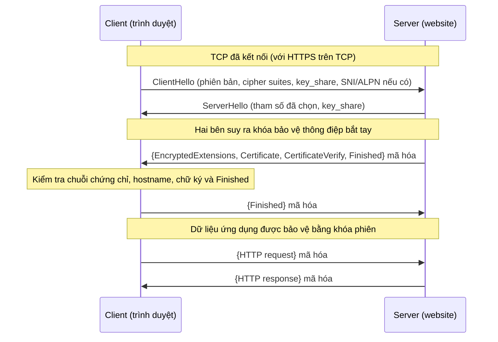

# TLS nằm giữa application và transport như thế nào?

## 1. Vì sao cần một lớp bảo vệ giữa ứng dụng và đường truyền?

Khi trình duyệt gửi yêu cầu đăng nhập đến một website, HTTP định nghĩa **nội dung** cần trao đổi (phương thức, đường dẫn, header, body), còn TCP chịu trách nhiệm vận chuyển một luồng byte có thứ tự, phát hiện mất mát và truyền lại khi cần. Bản thân TCP **không mã hóa** dữ liệu hay chứng minh rằng đầu bên kia thực sự là máy chủ mong muốn. Nếu dùng HTTP thuần trên một mạng không đáng tin cậy, bên có khả năng quan sát đường truyền có thể đọc nội dung, và kẻ tấn công ở vị trí phù hợp còn có thể sửa thông điệp.

**Transport Layer Security (TLS)** giải quyết khoảng trống này. Với ứng dụng chạy trên TCP, TLS tạo một **kênh bảo mật ở phía trên TCP và phía dưới giao thức ứng dụng**. Ứng dụng đưa dữ liệu rõ cho thư viện TLS; TLS xác thực đối tác, mã hóa và kiểm tra tính toàn vẹn; TCP chuyển những byte đã được TLS bảo vệ qua mạng. Khi nhận, thứ tự xử lý đảo ngược.

Ví dụ với HTTPS dùng HTTP/1.1 hoặc HTTP/2:

```text
Máy khách                                              Máy chủ
┌─────────────────────┐                        ┌─────────────────────┐
│ HTTP: GET /account  │                        │ HTTP: xử lý GET     │
├─────────────────────┤                        ├─────────────────────┤
│ TLS: xác thực,      │   TLS records          │ TLS: giải mã,       │
│ mã hóa, kiểm tra    │ <====================> │ kiểm tra toàn vẹn   │
├─────────────────────┤                        ├─────────────────────┤
│ TCP: luồng byte     │ <--------------------> │ TCP: luồng byte     │
├─────────────────────┤                        ├─────────────────────┤
│ IP + liên kết mạng  │ <--------------------> │ IP + liên kết mạng  │
└─────────────────────┘                        └─────────────────────┘
```

Sơ đồ thể hiện **thứ tự xử lý logic**, không ngụ ý TLS là một tầng vật lý độc lập, cũng không có nghĩa một TLS record luôn tương ứng với một TCP segment hoặc một gói IP.

## 2. TLS đứng ở đâu trong mô hình OSI và TCP/IP?

Mô hình OSI bảy tầng là khung tham chiếu để phân tích chức năng mạng. Các giao thức Internet thực tế được triển khai theo bộ TCP/IP, không nhất thiết khớp một-một với từng tầng OSI. Do TLS có nhiệm vụ biểu diễn dữ liệu được mã hóa và quản lý phiên bảo mật, tài liệu nhập môn đôi khi gắn TLS với **tầng 6 (Presentation)** và/hoặc **tầng 5 (Session)**. Đây là **cách liên hệ về chức năng**, không phải định nghĩa chuẩn rằng TLS chính là “tầng OSI số 6”.

| Góc nhìn | Vị trí/chức năng | Ví dụ |
|---|---|---|
| OSI tầng 7 — Application | Quy tắc nghiệp vụ và định dạng thông điệp ứng dụng | HTTP, SMTP, IMAP |
| OSI tầng 5–6 — Session/Presentation | Những chức năng thường được dùng để *liên hệ* với TLS: thương lượng phiên, mã hóa, bảo vệ dữ liệu | TLS, xét về chức năng |
| OSI tầng 4 — Transport | Truyền dữ liệu đầu cuối, theo luồng hoặc datagram | TCP, UDP |
| TCP/IP trong triển khai HTTPS truyền thống | Ứng dụng → TLS → TCP → IP → liên kết | HTTP/2 → TLS 1.3 → TCP → IP |

Vì vậy, khi hỏi “TLS nằm giữa application và transport như thế nào?”, câu trả lời đúng ở mức triển khai thông thường là: **TLS là một giao thức bảo mật đặt giữa giao thức ứng dụng và dịch vụ luồng byte tin cậy của TCP**. Trong mô hình TCP/IP bốn tầng, người ta thường xem TLS là thành phần nằm trong hoặc sát tầng ứng dụng, thay vì bổ sung hẳn một tầng mới vào mô hình.

TLS cũng **không thay thế TCP**: nó không chọn đường đi, không đảm bảo phát lại gói bị mất, không điều khiển tắc nghẽn và không đảm bảo kết nối luôn sẵn sàng. Các việc đó thuộc TCP, IP và hạ tầng mạng. Trái lại, TCP không chịu trách nhiệm xác thực chứng chỉ máy chủ hay bảo mật nội dung HTTP; đó là việc của TLS và ứng dụng sử dụng TLS.

## 3. Dữ liệu đi qua HTTP, TLS và TCP như thế nào?

Xét một phiên truy cập `https://example.com/account` bằng HTTP/1.1 trên TCP:

1. **Thiết lập đường vận chuyển:** máy khách phân giải tên miền bằng cơ chế DNS thích hợp, sau đó thiết lập kết nối TCP tới máy chủ hoặc điểm kết thúc TLS đại diện cho máy chủ, thường ở cổng 443. DNS là một quá trình riêng; DNS thuần không tự được bảo vệ chỉ vì kết nối web sau đó dùng HTTPS.
2. **Bắt tay TLS:** hai đầu thỏa thuận tham số mã hóa, tạo khóa phiên và máy khách xác minh danh tính máy chủ. TLS 1.3 thường cho phép hoàn thành bắt tay đầy đủ với một vòng trao đổi mạng (*1-RTT*), sau khi đã có kết nối vận chuyển.
3. **Gửi HTTP:** HTTP tạo yêu cầu như `GET /account HTTP/1.1` cùng các header. TLS chia dữ liệu cần thiết thành các **record**, mã hóa và gắn thông tin bảo vệ tính toàn vẹn. TCP nhìn thấy các byte của TLS record, không cần hiểu nội dung HTTP.
4. **Nhận và xử lý:** TCP ghép lại luồng byte đúng thứ tự; TLS kiểm tra tính hợp lệ và giải mã record; HTTP nhận nội dung rõ để xử lý. Phản hồi đi theo chiều ngược lại.

```text
Ứng dụng:  GET /account HTTP/1.1\r\nHost: example.com\r\n...
              │
              ▼
TLS:      [record header | dữ liệu ứng dụng đã mã hóa + thẻ xác thực]
              │
              ▼
TCP:      [TCP header | một phần của luồng byte TLS]
              │
              ▼
IP:       [IP header | TCP segment]
```

TLS record là đơn vị bảo vệ dữ liệu của TLS; **TCP là một luồng byte**. Một record có thể trải qua nhiều TCP segment hoặc nhiều record cùng được chứa trong một segment. Chia tách gói mạng không tạo ra ranh giới thông điệp HTTP tương ứng.

Ở phía lập trình, có thể hình dung ứng dụng ghi vào một kết nối TLS được dựng trên socket TCP:

```text
http_request = serialize_http_request(...)
tls_connection = tls_handshake(tcp_socket, expected_hostname="example.com")
tls_connection.write(http_request)  // thư viện TLS bảo vệ dữ liệu trước khi gửi
http_response = tls_connection.read() // thư viện TLS xác minh rồi giải mã
```

Đây là **mã giả để hiểu luồng xử lý**, không phải API có thể thực thi nguyên văn. Trong ứng dụng thực tế, dùng thư viện HTTP/TLS chuẩn để xử lý kiểm tra tên máy chủ, chứng chỉ, lỗi kết nối và đóng phiên.

## 4. TLS 1.3 bắt tay để xây dựng kênh bảo mật

Trong TLS 1.3, bắt tay làm ba việc có liên hệ với nhau: **thỏa thuận thuật toán**, **thiết lập bí mật chung để sinh khóa đối xứng** và **xác thực danh tính đối tác**. Với HTTPS thông thường, máy chủ chứng minh danh tính bằng chứng chỉ; việc xác thực chứng chỉ máy khách là tùy chọn (mTLS).



Các bước cần hiểu:

- **ClientHello** khai báo khả năng của máy khách: các bộ mật mã được hỗ trợ, thông tin trao đổi khóa, và thường có SNI (*Server Name Indication*, tên host mong muốn) cùng ALPN (*Application-Layer Protocol Negotiation*, chẳng hạn `h2` hoặc `http/1.1`). Thông tin ClientHello ban đầu thường có thể được quan sát trên đường truyền; ECH (*Encrypted ClientHello*) có thể che một phần nội dung, tùy mức hỗ trợ và cấu hình.
- **ServerHello** chọn các tham số phù hợp; với trao đổi khóa tạm thời như ECDHE, hai phía tính ra bí mật chung mà không phải gửi bí mật đó trực tiếp qua mạng. Khóa bảo vệ bắt tay và khóa bảo vệ dữ liệu ứng dụng được dẫn xuất từ các bí mật tương ứng.
- **Certificate** cung cấp thông tin chứng chỉ máy chủ; **CertificateVerify** chứng minh máy chủ nắm giữ khóa riêng tương ứng và ràng buộc chữ ký với phiên bắt tay. Máy khách cần kiểm tra chuỗi tin cậy, thời hạn, tên host và các quy tắc xác minh áp dụng. Nếu xác thực thất bại, **không nên tiếp tục gửi dữ liệu nhạy cảm**.
- **Finished** xác nhận tính nhất quán và toàn vẹn của bản ghi bắt tay. Sau khi hai phía hoàn tất các bước cần thiết, dữ liệu ứng dụng được bảo vệ bằng thuật toán mã hóa đối xứng có xác thực (*AEAD*), ví dụ AES-GCM hoặc ChaCha20-Poly1305.

Khóa công khai trong chứng chỉ chủ yếu phục vụ **xác thực danh tính**; khóa phiên đối xứng phục vụ **mã hóa lưu lượng**. Đây là hai vai trò khác nhau. TLS 1.3 không còn sử dụng cơ chế trao đổi khóa RSA tĩnh của các cấu hình TLS cũ. Việc dùng khóa trao đổi tạm thời hỗ trợ **forward secrecy**: lộ khóa riêng chứng chỉ sau này không tự động cho phép giải mã các phiên cũ đã ghi lại, với giả định bí mật phiên tạm thời được bảo vệ.

TLS 1.3 có cơ chế **session resumption** để giảm chi phí kết nối lại. Tùy cấu hình, dữ liệu sớm **0-RTT** có thể được gửi trước khi bắt tay mới hoàn tất, nhưng dữ liệu 0-RTT có nguy cơ **bị phát lại (replay)** và không mang đầy đủ tính chất forward secrecy như dữ liệu sau bắt tay. Chỉ dùng 0-RTT cho thao tác mà ứng dụng xử lý phát lại an toàn; không mặc định cho hành động như chuyển tiền hoặc thay đổi mật khẩu.

## 5. TLS bảo vệ những gì, và điều gì vẫn lộ ra?

Khi chứng chỉ được xác minh đúng và thuật toán/cấu hình đủ an toàn, TLS mang lại ba thuộc tính chính:

| Thuộc tính | TLS thực hiện | Giới hạn cần nhớ |
|---|---|---|
| Bí mật (*confidentiality*) | Mã hóa nội dung ứng dụng đi qua phiên | Không che mặc định địa chỉ IP, cổng, kích thước, thời điểm gói tin |
| Toàn vẹn (*integrity*) | Phát hiện dữ liệu TLS bị sửa hoặc giả mạo trong phiên | Không ngăn kẻ tấn công từ chối dịch vụ hay chặn kết nối |
| Xác thực (*authentication*) | Máy khách xác minh danh tính máy chủ; mTLS có thể xác minh máy khách | Phụ thuộc vào việc kiểm tra chứng chỉ/tên host; không xác nhận ứng dụng không có lỗ hổng |

Đối với HTTPS dùng TLS trên TCP, người quan sát mạng thông thường vẫn có thể thấy **IP nguồn/đích, TCP/UDP port tùy giao thức, độ dài và thời điểm trao đổi**. Bắt tay TCP và một số thông tin TLS ban đầu cũng quan sát được. Trong nhiều cấu hình, SNI trong ClientHello lộ tên host cần kết nối; **ECH** có thể giảm lộ thông tin này nếu hai phía hỗ trợ. DNS truyền thống ở ngoài TLS của HTTPS cũng có thể tiết lộ tên miền. Do đó, **HTTPS không đồng nghĩa ẩn danh**.

Ngược lại, khi HTTP đi trong TLS đúng cách, các thành phần như **đường dẫn URL (`/account`), query string, cookie, Authorization header, HTTP request/response body** được mã hóa trên đường truyền. Ví dụ người bắt gói có thể suy ra rằng máy khách kết nối một địa chỉ IP tại cổng 443, nhưng không đọc được nội dung `Authorization: Bearer ...` chỉ bằng việc quan sát các gói tin.

TLS cũng không tự sửa lỗi **SQL injection, XSS, lộ dữ liệu ở endpoint, chứng chỉ bị cấu hình sai, máy chủ nhiễm mã độc** hoặc việc người dùng gửi mật khẩu vào trang giả mạo có chứng chỉ hợp lệ cho chính tên miền giả đó. Nó bảo vệ một *kênh truyền đã được xác thực*, còn an toàn ứng dụng và người dùng cần những lớp phòng vệ khác.

## 6. TLS có luôn nằm trên TCP không? QUIC, DTLS và STARTTLS

Sơ đồ “application → TLS → TCP” là cách tổ chức phổ biến nhưng **không bao quát mọi trường hợp**:

| Trường hợp | Ngăn xếp/đặc điểm | Điểm cần nhớ |
|---|---|---|
| HTTPS với HTTP/1.1, HTTP/2 | HTTP → TLS → TCP → IP | Cách minh họa điển hình cho TLS giữa ứng dụng và transport |
| HTTP/3 | HTTP/3 → QUIC (tích hợp bắt tay TLS 1.3) → UDP → IP | QUIC sử dụng TLS 1.3 để thiết lập khóa/xác thực, nhưng bảo vệ gói bằng QUIC; không có lớp TLS record chạy trên TCP |
| DTLS | Ứng dụng → DTLS → UDP → IP | DTLS là biến thể TLS dành cho truyền thông datagram, xử lý đặc tính mất/đảo thứ tự gói |
| SMTP/IMAP có STARTTLS | Kết nối ứng dụng ban đầu chưa mã hóa → lệnh STARTTLS → bắt tay TLS trên cùng kết nối | Chỉ an toàn khi chính sách yêu cầu TLS và chống hạ cấp phù hợp; STARTTLS tùy chọn có thể bị tấn công hạ cấp |
| Ứng dụng dùng TLS trực tiếp | Ví dụ ứng dụng cơ sở dữ liệu hoặc giao thức riêng trên TCP | TLS bảo vệ byte ứng dụng, không chỉ HTTP |

**HTTP/3** là ngoại lệ quan trọng: QUIC chạy trên UDP và tích hợp **bắt tay TLS 1.3** vào quá trình tạo kết nối. Những bí mật được TLS dẫn xuất dùng để bảo vệ gói QUIC, trong khi QUIC đảm nhiệm truyền dữ liệu tin cậy, đa luồng và kiểm soát tắc nghẽn. Vì vậy, nói “HTTP/3 = HTTP → TLS → TCP” là sai; nói “TLS chỉ hoạt động qua TCP” cũng không chính xác nếu xét họ giao thức và sự tích hợp TLS vào QUIC.

**DTLS** có thiết kế riêng cho ứng dụng kiểu datagram, chẳng hạn một số hệ thống thoại/video thời gian thực. Không nên coi việc gửi các TLS record thông thường qua UDP là đủ để tạo DTLS.

**STARTTLS** minh họa rằng TLS có thể được bật *sau khi* kết nối ứng dụng đã bắt đầu. Khi thiết kế chính sách email, cần phân biệt việc hỗ trợ STARTTLS với **bắt buộc sử dụng TLS**; nếu máy khách chấp nhận quay về kết nối không mã hóa một cách âm thầm, kẻ tấn công có thể lợi dụng.

## 7. Các lớp phòng vệ mạng liên hệ với TLS thế nào?

Trong kiến trúc bảo mật mạng, TLS là một lớp trong **phòng vệ nhiều lớp**, kết hợp cùng phân đoạn mạng, firewall, DNS, IDS/IPS, VPN, xác thực và giám sát:

| Biện pháp | Quan hệ với TLS | Ví dụ triển khai |
|---|---|---|
| Firewall / phân đoạn mạng | Quyết định ai được kết nối đến đâu, cổng nào; TLS bảo vệ nội dung sau khi kết nối được cho phép | Chỉ cho máy chủ ứng dụng truy cập DB ở cổng được phê duyệt; kết nối ứng dụng–DB dùng TLS |
| IDS/IPS / giám sát | Có thể phân tích metadata, mẫu lưu lượng và một phần bắt tay; mặc định không thấy nội dung ứng dụng đã mã hóa | Phát hiện kết nối đáng ngờ theo IP/tần suất; kiểm tra nội dung chỉ tại điểm có quyền giải mã hợp lệ |
| DNS security | Bảo vệ việc phân giải/tên miền; TLS bảo vệ phiên ứng dụng sau đó | Chặn tên miền độc hại ở bộ phân giải; cân nhắc DoT/DoH theo kiến trúc |
| VPN/IPsec | Bảo vệ kênh ở phạm vi kết nối/tuyến mạng khác với TLS ứng dụng | Nhân viên dùng VPN để tới mạng nội bộ, đồng thời website nội bộ vẫn dùng HTTPS |
| mTLS | Xác minh hai đầu TLS bằng chứng chỉ, hữu ích giữa các dịch vụ | Gateway chỉ chấp nhận client có chứng chỉ dịch vụ hợp lệ |

Một điểm thực tế là **TLS thường kết thúc tại reverse proxy, load balancer hoặc API gateway**. Ví dụ:

```text
Browser == TLS phiên A ==> Reverse proxy --HTTP hoặc TLS phiên B--> Application
```

Proxy có thể đọc dữ liệu sau khi giải mã phiên A để định tuyến, kiểm tra hoặc ghi nhật ký, rồi mở phiên B đến backend. **TLS từ trình duyệt đến proxy không tự đảm bảo đoạn proxy → backend được mã hóa**. Kiến trúc cần quyết định rõ nơi kết thúc TLS, yêu cầu mã hóa nội bộ và nơi dữ liệu rõ có thể xuất hiện. Tương tự, một hệ thống kiểm tra lưu lượng TLS bằng cách giải mã có quyền truy cập vào dữ liệu nhạy cảm; phải quản lý chặt chứng chỉ, khóa, log và quyền truy cập.

## 8. Ví dụ phân tích lưu lượng và xác minh cấu hình

Giả sử người dùng truy cập `https://example.com/login` qua Wi-Fi công cộng. Trình phân tích gói tin có thể ghi nhận kết nối tới IP đích và cổng, bắt tay TCP, các TLS record, độ dài và nhịp trao đổi. Với TLS 1.3, nội dung đăng nhập trong HTTP được mã hóa; phần lớn thông điệp bắt tay sau ServerHello cũng được mã hóa. Nếu trình phân tích không có khóa phiên hoặc quyền giải mã tại endpoint, nó **không thể đọc mật khẩu hoặc body HTTP từ gói tin TLS**.

Có thể quan sát một phiên HTTPS bằng công cụ dòng lệnh:

```bash
# Kiểm tra bắt tay TLS 1.3, yêu cầu xác minh chứng chỉ và tên host
openssl s_client -connect example.com:443 \
  -servername example.com \
  -verify_hostname example.com \
  -verify_return_error \
  -tls1_3 -alpn h2

# Xem thông tin kết nối TLS và phản hồi HTTP ở mức ứng dụng
curl --verbose --http1.1 https://example.com/
```

Các lệnh trên là **ví dụ thực hành**, phụ thuộc công cụ, phiên bản OpenSSL/cURL và khả năng TLS của máy chủ; chúng không phải kết quả đo đã chạy. Trong kết quả, cần phân biệt **phiên bản TLS/bộ mã hóa và tình trạng xác minh chứng chỉ** với **giao thức HTTP được chọn qua ALPN**. Việc thêm `-alpn h2` chỉ yêu cầu đàm phán HTTP/2; để gửi HTTP/2 thực sự cần chương trình hỗ trợ và máy chủ chấp nhận ALPN tương ứng. `curl --http1.1` cho ví dụ riêng về HTTP/1.1, không phải cùng phiên với lệnh OpenSSL.

Nếu dùng Wireshark, bộ lọc `tcp.port == 443` giúp nhìn lưu lượng HTTPS trên TCP, còn `tls` giúp nhận diện các gói TLS mà Wireshark phân tích được. HTTP/3 thường chạy trên UDP/443 nên cần kiểm tra lưu lượng **QUIC/UDP** thay vì chỉ lọc TCP. Việc thấy “Application Data” trong Wireshark không chứng minh nội dung đã bị lộ; đó thường là tên loại bản ghi được nhận diện trong lưu lượng mã hóa.

### Tình huống kiểm tra hiểu bài

Một nhóm vận hành nhận được yêu cầu “đã bật HTTPS ở load balancer rồi nên kết nối tới backend chắc chắn an toàn”. Hãy đánh giá bằng cách lần theo hai chặng: **client → load balancer** và **load balancer → backend**. Chặng đầu có TLS; chặng sau chỉ được bảo vệ nếu backend sử dụng TLS (hoặc một cơ chế bảo mật khác đủ đáp ứng yêu cầu) và được cấu hình/xác minh thích hợp. Firewall và phân đoạn mạng giảm phạm vi truy cập nhưng không tự mã hóa nội dung ở chặng thứ hai.

Một nhận định khác: “Chặn cổng TCP 443 sẽ chặn toàn bộ HTTPS”. Điều này không chắc đúng vì HTTPS có thể dùng cổng khác, còn HTTP/3 thông dụng chạy QUIC trên UDP/443. Quy tắc mạng phải dựa vào kiến trúc và giao thức thực tế; chỉ dựa vào số cổng không đủ để xác định chắc chắn giao thức ứng dụng.

## 9. Những nhầm lẫn thường gặp

1. **“TLS là tầng 6 OSI.”** Chính xác hơn: TLS thực hiện các chức năng gợi liên hệ tầng 5–6 trong OSI; giao thức thực tế hoạt động sát tầng ứng dụng trên dịch vụ truyền tải, không bị gắn cố định vào một số tầng OSI.
2. **“TCP đã tin cậy thì dữ liệu đã an toàn.”** *Tin cậy* của TCP chủ yếu là giao byte có thứ tự và truyền lại khi mất; không đồng nghĩa bí mật hay xác thực đối tác.
3. **“Mã hóa HTTPS che được mọi thông tin kết nối.”** Địa chỉ IP, kích thước, thời gian, nhiều metadata và đôi khi tên host vẫn có thể quan sát được.
4. **“Có chứng chỉ nghĩa là website chắc chắn đáng tin.”** Chứng chỉ xác nhận quan hệ giữa khóa và tên miền theo quy tắc kiểm tra, không bảo đảm nội dung hoặc chủ sở hữu website không lừa đảo.
5. **“TLS 1.3 là bắt tay qua TCP cho mọi ứng dụng.”** TLS trên TCP là cách triển khai điển hình; QUIC dùng TLS 1.3 tích hợp trên UDP, còn DTLS phục vụ datagram.
6. **“Mã hóa tại cổng vào có nghĩa là mã hóa đầu cuối.”** Nếu proxy giải mã rồi chuyển tiếp HTTP thuần, đoạn sau proxy không còn được TLS bảo vệ.

## 10. Kết luận và câu hỏi tự kiểm tra

Khi đọc một kiến trúc mạng, hãy vẽ rõ **ứng dụng → vị trí kết thúc TLS → giao thức vận chuyển → IP**, rồi hỏi: TLS xác thực tên nào, mã hóa ở đoạn nào, kết thúc ở đâu và còn metadata gì lộ ra? Cách nhìn này giúp tránh nhầm TLS với TCP, hiểu vì sao HTTPS bảo vệ nội dung HTTP, và thiết kế chính xác các lớp kiểm soát như firewall, IDS/IPS, DNS security, VPN hay mTLS.

Thử tự trả lời:

- Tại sao `GET /account` được bảo vệ bởi HTTPS nhưng địa chỉ IP máy chủ vẫn có thể xuất hiện trong gói tin?
- Trong TLS 1.3, chứng chỉ máy chủ và khóa phiên đối xứng giữ hai vai trò khác nhau thế nào?
- Vì sao không thể biểu diễn HTTP/3 đơn giản bằng ngăn xếp `HTTP → TLS → TCP`?
- Sau khi reverse proxy kết thúc TLS, cần thêm điều kiện nào để backend vẫn nhận dữ liệu qua một chặng mã hóa?
- Vì sao STARTTLS “có hỗ trợ” chưa đủ để kết luận kết nối email bắt buộc an toàn?

**Tài liệu gốc để đọc sâu:** RFC 8446 (*The Transport Layer Security (TLS) Protocol Version 1.3*), RFC 9001 (*Using TLS to Secure QUIC*), RFC 9147 (*The Datagram Transport Layer Security (DTLS) Protocol Version 1.3*), RFC 9114 (*HTTP/3*).
