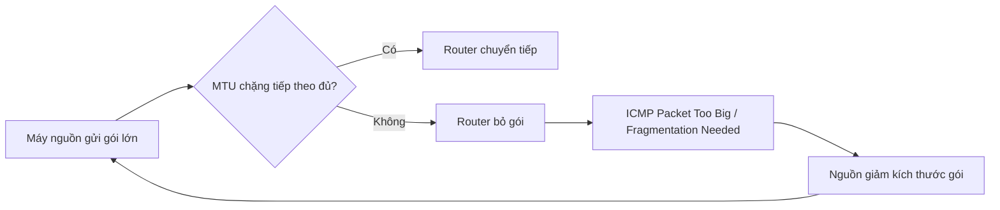
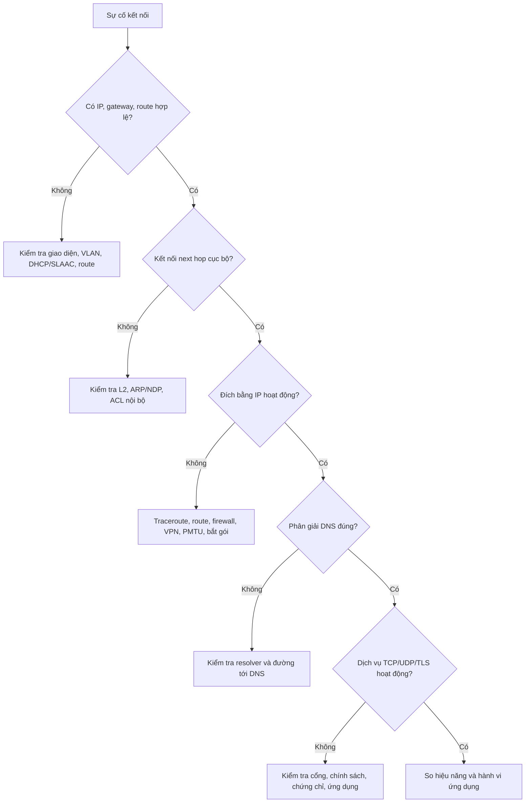

# ICMP và chẩn đoán mạng

> **Chương:** OSI và giao thức  
> **Mô-đun:** `SECURITY_NETWORK_SECURITY` — Bảo mật mạng  
> **Trọng tâm:** Hiểu ICMP, sử dụng thông điệp điều khiển để tìm sự cố, phân tích lưu lượng và thiết kế chính sách firewall/IDS/IPS phù hợp cho IPv4, IPv6, VPN và hạ tầng đám mây.

## 1. ICMP là gì và nằm ở đâu trong mô hình mạng?

**Internet Control Message Protocol (ICMP)** là giao thức mang thông báo điều khiển và báo lỗi liên quan đến việc chuyển tiếp gói IP. Nó giúp thiết bị đầu cuối và bộ định tuyến nhận biết các tình huống như đích không thể đến được, gói hết giới hạn số chặng, hoặc kích thước gói vượt quá MTU trên đường truyền. Các công cụ `ping`, `traceroute`/`tracert` và một phần cơ chế khám phá MTU dựa vào ICMP.

Trong mô hình OSI, ICMP được xem là một phần chức năng **lớp 3 (Network)**, gắn với IP. ICMP được đóng gói trực tiếp trong gói IP: **IPv4 dùng trường Protocol = 1**, còn **IPv6 dùng Next Header = 58** cho ICMPv6. ICMP **không chạy trên TCP hay UDP** và **không có khái niệm cổng TCP/UDP**; vì vậy quy tắc firewall đối với ICMP cần dựa vào giao thức, *type*, *code*, nguồn, đích và ngữ cảnh luồng.

```text
Khung Ethernet / Wi-Fi / liên kết khác
└── Gói IPv4 hoặc IPv6
    ├── Header IP: địa chỉ nguồn/đích, TTL hoặc Hop Limit, ...
    └── Thông điệp ICMP: Type | Code | Checksum | Dữ liệu theo loại
```

ICMP cung cấp **tín hiệu chẩn đoán**, chứ không bảo đảm giao nhận ứng dụng. Một máy chủ có thể chặn Echo Request nhưng vẫn phục vụ HTTPS bình thường; ngược lại, ping thành công cũng không chứng minh DNS, TLS, xác thực hoặc ứng dụng hoạt động tốt.

Trong bảo mật mạng, ICMP có hai mặt: thông điệp hợp lệ giúp định tuyến, phát hiện lỗi và giám sát; một số loại lưu lượng cũng có thể bị lạm dụng để do thám, gây quá tải hoặc che giấu dữ liệu. Vì vậy cần **phân loại và kiểm soát** ICMP, không mặc định chặn toàn bộ.

### Mục tiêu học tập

Sau bài này, người học có thể:

1. Phân biệt ICMPv4 và ICMPv6, thông điệp báo lỗi và thông điệp truy vấn/thông tin.
2. Đọc `type`, `code`, TTL/Hop Limit, RTT và dấu hiệu trong gói bắt được.
3. Dùng `ping`, `traceroute`, công cụ DNS và packet capture để khoanh vùng lỗi kết nối.
4. Giải thích vì sao Path MTU Discovery và Neighbor Discovery cần ICMP.
5. Đề xuất chính sách firewall, giám sát và giảm thiểu các hình thức lạm dụng ICMP.

## 2. Cấu trúc và quy tắc hoạt động

Mỗi thông điệp ICMP thông thường bắt đầu bằng các trường:

| Trường | Ý nghĩa |
|---|---|
| `Type` | Nhóm thông điệp: Echo Request, Destination Unreachable, Time Exceeded, Packet Too Big, ... |
| `Code` | Chi tiết nguyên nhân trong từng loại thông điệp. Cần đọc **cặp type/code**, không chỉ type. |
| `Checksum` | Kiểm tra lỗi dữ liệu khi truyền; **không phải** cơ chế xác thực hay bảo đảm thông điệp đáng tin. |
| Dữ liệu theo loại | Chẳng hạn Identifier/Sequence và payload của Echo; hoặc phần gói IP ban đầu khiến lỗi xảy ra. |

Khi một router không chuyển tiếp được gói IP, nó có thể tạo ICMP báo lỗi gửi về **địa chỉ nguồn của gói gây lỗi**. Bản tin lỗi thường trích lại phần header và dữ liệu đầu của gói ban đầu, để máy nguồn hoặc thiết bị giám sát nhận ra kết nối liên quan. Với ICMPv4 cổ điển, phần trích dẫn tối thiểu gồm header IPv4 ban đầu và 8 byte dữ liệu tiếp theo; các định dạng mở rộng có thể mang nhiều hơn. ICMPv6 cũng trả lại phần gói kích hoạt lỗi trong giới hạn kích thước theo chuẩn.

Không phải mọi lỗi đều sinh ICMP. Để tránh phản hồi vô hạn và khuếch đại, tiêu chuẩn giới hạn việc gửi lỗi, ví dụ không tạo ICMP error để đáp lại một ICMP error khác và có quy tắc riêng đối với địa chỉ multicast/broadcast hay mảnh gói. Firewall, NAT, chính sách thiết bị và giới hạn tốc độ còn có thể khiến thông điệp ICMP không đến được bên gửi.

**Điểm khác nhau về checksum:** ICMPv4 tính checksum trên thông điệp ICMP; ICMPv6 còn đưa các trường từ *IPv6 pseudo-header* vào phép tính. Dù checksum hợp lệ, gói vẫn có thể do bên không đáng tin tạo ra hoặc giả mạo.

## 3. Những loại ICMP thường gặp

### 3.1. ICMPv4

| Type | Code tiêu biểu | Tên / tình huống | Ý nghĩa chẩn đoán |
|---|---|---|---|
| `8` | `0` | Echo Request | Máy nguồn gửi yêu cầu kiểm tra khả năng phản hồi bằng `ping`. |
| `0` | `0` | Echo Reply | Máy đích trả lời Echo Request; có thể đo RTT và mất gói. |
| `3` | `0`, `1` | Destination Unreachable — Network/Host Unreachable | Không tìm được đường hoặc không đến được mạng/máy đích theo thông tin thiết bị phát lỗi. |
| `3` | `3` | Destination Unreachable — Port Unreachable | Thường gặp khi gói UDP đến cổng không có dịch vụ lắng nghe; cũng là dấu kết thúc của một kiểu `traceroute` UDP. |
| `3` | `4` | Destination Unreachable — Fragmentation Needed | Gói có cờ DF và lớn hơn MTU chặng tiếp theo; quan trọng với Path MTU Discovery IPv4. |
| `3` | `13` | Destination Unreachable — Communication Administratively Prohibited | Có thể do thiết bị lọc hoặc chính sách mạng không cho phép. |
| `11` | `0` | Time Exceeded — TTL Expired in Transit | Router giảm TTL về 0; cơ sở của `traceroute`. |
| `11` | `1` | Time Exceeded — Fragment Reassembly Time Exceeded | Không ghép đủ mảnh trong thời hạn. |
| `12` | Tùy tình huống | Parameter Problem | Header IP có vấn đề khiến thiết bị không xử lý được. |
| `5` | Tùy tình huống | Redirect | Thông báo có tuyến tốt hơn; cần kiểm soát chặt vì có rủi ro chuyển hướng lưu lượng. |

Các thông điệp cũ như **Source Quench (type 4)** đã bị loại bỏ khỏi cách kiểm soát tắc nghẽn hiện đại; không dựa vào chúng để thiết kế mạng mới.

### 3.2. ICMPv6

ICMPv6 không chỉ là phiên bản đổi số type của ICMPv4: nó đảm nhận thêm nhiều chức năng hạ tầng thiết yếu của IPv6, đặc biệt là Neighbor Discovery.

| Type | Tên | Vai trò |
|---|---|---|
| `128` | Echo Request | Ping trên IPv6. |
| `129` | Echo Reply | Phản hồi ping trên IPv6. |
| `1` | Destination Unreachable | Báo không đến được đích hoặc cổng; type/code chi tiết tùy nguyên nhân. |
| `2` | Packet Too Big | Báo MTU chặng tiếp theo; thiết yếu cho Path MTU Discovery IPv6. |
| `3` | Time Exceeded | Hop Limit bị dùng hết hoặc hết thời gian ghép mảnh. |
| `4` | Parameter Problem | Lỗi trong xử lý header IPv6 hoặc tùy chọn. |
| `133` | Router Solicitation (RS) | Host yêu cầu router quảng bá thông tin mạng. |
| `134` | Router Advertisement (RA) | Router quảng bá prefix, default router và các tham số. |
| `135` | Neighbor Solicitation (NS) | Tìm địa chỉ liên kết, kiểm tra láng giềng hoặc phát hiện địa chỉ trùng. |
| `136` | Neighbor Advertisement (NA) | Phản hồi/xuất bản thông tin về láng giềng. |
| `137` | Redirect | Router thông báo lựa chọn next hop tốt hơn trong cùng phạm vi liên kết. |

ICMPv6 phân nhóm **error message** có type từ `0` đến `127` và **informational message** có type từ `128` trở lên. `type 1/code 4` là **Port Unreachable** trong ICMPv6; đừng nhầm với `type 3/code 3` của ICMPv4. Các bản tin Multicast Listener Discovery (MLD) cũng sử dụng ICMPv6, ảnh hưởng đến vận hành multicast IPv6.

## 4. `ping`: kiểm tra khả năng phản hồi và đo độ trễ

`ping` thường gửi các **ICMP Echo Request** có Identifier, Sequence Number và một phần dữ liệu, rồi ghép chúng với Echo Reply. Công cụ hiển thị thời gian khứ hồi (*round-trip time*, RTT), tỷ lệ mất phản hồi và đôi khi TTL của gói nhận.

**Linux/macOS (ví dụ IPv4):**

```bash
ping -c 4 1.1.1.1
ping -c 4 example.com
ping -6 -c 4 example.com
```

**Windows:**

```powershell
ping -n 4 1.1.1.1
ping -n 4 example.com
ping -6 example.com
```

Trong kết quả `ping`, chú ý:

- **Reply/timeout:** Có nhận Echo Reply trong thời gian chờ không? Timeout đơn lẻ chưa xác định lỗi nằm ở đường đi hay chính sách lọc.
- **RTT:** Thời gian khứ hồi, gồm cả đường đi và xử lý gói. RTT ICMP không nhất thiết tương đồng với thời gian phản hồi HTTP hay truy vấn cơ sở dữ liệu.
- **Packet loss:** Tỷ lệ Echo Request không có Echo Reply; có thể do lỗi đường truyền, nghẽn, giới hạn tốc độ hoặc firewall. Nên so nhiều mẫu và đối chiếu giao thức ứng dụng.
- **TTL/Hop Limit ở phản hồi:** Giá trị còn lại của gói nhận, **không tự nó cho biết chính xác số router** đã đi qua nếu không biết giá trị khởi tạo.
- **Thông báo `Destination Unreachable`:** Xem **thiết bị nào phát ra** và type/code cụ thể trước khi kết luận.

Ví dụ, nếu `ping 1.1.1.1` có phản hồi nhưng `ping example.com` báo không phân giải được tên, hãy kiểm tra DNS. Nếu `ping` đến máy chủ timeout nhưng truy cập HTTPS vẫn thành công, khả năng cao Echo bị lọc hoặc hạn chế; không được kết luận máy chủ ngừng hoạt động chỉ từ ping.

## 5. `traceroute`/`tracert`: khám phá các chặng trên đường đi

Mỗi gói IP có **TTL (IPv4)** hoặc **Hop Limit (IPv6)**. Router chuyển tiếp làm giảm trường này; khi về 0, router thường loại bỏ gói và có thể trả về **Time Exceeded**. `traceroute` khai thác cơ chế đó bằng cách gửi các probe lần lượt với giới hạn 1, 2, 3, ... chặng.

```text
Máy A ── R1 ── R2 ── R3 ── Máy B

Probe TTL = 1: R1 làm TTL về 0 → ICMP Time Exceeded từ R1
Probe TTL = 2: qua R1, hết TTL ở R2 → ICMP từ R2
Probe TTL = 3: qua R1, R2, hết TTL ở R3 → ICMP từ R3
Probe TTL = 4: gói tới B → phản hồi tùy kiểu probe và dịch vụ ở B
```

**Linux:**

```bash
traceroute -n 1.1.1.1         # Mặc định trên nhiều hệ thống: UDP probe
traceroute -I -n 1.1.1.1      # Dùng ICMP Echo probe
traceroute -T -p 443 1.1.1.1 # TCP probe tới cổng 443; có thể cần quyền cao
tracepath 1.1.1.1             # Thường giúp quan sát MTU trên tuyến
```

**Windows:**

```powershell
tracert -d 1.1.1.1
pathping -n 1.1.1.1
```

**Phân biệt kiểu probe:** `tracert` của Windows thường dùng ICMP Echo với TTL tăng dần; `traceroute` Unix/Linux truyền thống thường gửi UDP đến cổng cao nên đích có thể báo ICMP Port Unreachable; tùy chọn `-I` dùng ICMP Echo và `-T` dùng TCP. Vì vậy không nên coi mọi gói `traceroute` đều là ICMP Echo, dù các router trung gian thường trả lời bằng ICMP Time Exceeded.

Khi đọc tuyến:

- Dấu `* * *` tại một hop nghĩa là **không nhận được phản hồi probe trong thời gian chờ**. Router có thể hạn chế ICMP, ưu tiên thấp gói gửi đến control plane hoặc tuyến đi/về không đối xứng; hop đó chưa chắc bị lỗi.
- RTT tăng bất thường **ở một hop nhưng trở lại bình thường ở các hop sau** thường liên quan cách router xử lý phản hồi chẩn đoán. Muốn nghi ngờ nghẽn thực sự, hãy tìm sự tăng RTT hoặc mất gói **tiếp diễn ở các hop về sau và tại đích**.
- ECMP, cân bằng tải theo luồng, NAT, tunnel, MPLS và định tuyến bất đối xứng có thể khiến tuyến quan sát được khác đường đi thật của một kết nối ứng dụng.
- Hãy so sánh cả tuyến theo địa chỉ IP, truy vấn DNS, và thử TCP probe đến đúng cổng dịch vụ trước khi quy lỗi cho firewall hay ISP.

## 6. ICMP và Path MTU Discovery

**MTU** là kích thước gói lớn nhất có thể truyền qua một liên kết ở lớp IP theo ngữ cảnh đang xét. **Path MTU (PMTU)** là MTU nhỏ nhất trên đường truyền từ nguồn đến đích. Một kết nối có thể gửi gói nhỏ thành công nhưng truyền gói lớn thất bại, nhất là qua VPN, tunnel, PPPoE hoặc các chặng có encapsulation bổ sung.

### IPv4: Fragmentation Needed

Với IPv4, khi gói có cờ **Don't Fragment (DF)** và lớn hơn MTU của next hop, router không thể phân mảnh gói: nó bỏ gói và có thể gửi **ICMPv4 type 3/code 4 — Fragmentation Needed** về nguồn, kèm thông tin MTU thích hợp. Nguồn nhờ đó giảm kích thước gói cho các lần gửi tiếp theo.

Trong một đường IPv4 thông thường MTU 1500, không có IP options:

```text
MTU lớp IP      = 1500 byte
Header IPv4     =   20 byte
Header ICMP Echo=    8 byte
Payload Echo tối đa để vừa 1500 byte = 1472 byte
```

Trên **Linux**, phép thử dưới đây yêu cầu không phân mảnh (`do`) khi gửi Echo 1472 byte dữ liệu. Chỉ dùng đối với đích cho phép chẩn đoán và hiểu rằng kết quả còn phụ thuộc chính sách Echo ở đích:

```bash
ping -c 3 -M do -s 1472 1.1.1.1
ping -c 3 -M do -s 1400 1.1.1.1
```

Nếu gói nhỏ thành công còn gói lớn thất bại, cần xem MTU giao diện/tunnel, ICMP Fragmentation Needed có quay về được không, trạng thái MSS clamping, NAT và firewall. **Không thể kết luận PMTU bị lỗi chỉ từ một lần ping timeout**; thiết bị có thể lọc Echo hoặc áp dụng rate limit.

### IPv6: Packet Too Big

**Router IPv6 không phân mảnh gói trong quá trình chuyển tiếp.** Khi gói vượt MTU chặng kế tiếp, router loại bỏ gói và gửi **ICMPv6 type 2 — Packet Too Big** để nguồn điều chỉnh kích thước hoặc thực hiện phân mảnh tại nguồn nếu thích hợp. IPv6 yêu cầu mỗi liên kết có khả năng mang gói IPv6 tối thiểu 1280 byte theo cách quy định của giao thức; PMTU thực tế vẫn có thể lớn hơn.

Vì vậy **chặn toàn bộ ICMPv6, đặc biệt Packet Too Big, có thể làm hỏng các kết nối IPv6**: ping nhỏ vẫn trả lời nhưng tải trang, truyền file hoặc phiên TLS lại treo khi dữ liệu lớn. Đây là một dạng *PMTUD black hole*. Cơ chế dò PLPMTUD ở lớp vận chuyển có thể giảm phụ thuộc vào ICMP trong một số giao thức, nhưng không thay thế lý do phải xử lý ICMP phù hợp.



## 7. ICMPv6 và Neighbor Discovery: thành phần không thể bỏ qua

Trong IPv4, ánh xạ địa chỉ IPv4 sang địa chỉ MAC trên LAN thường dùng **ARP**. IPv6 sử dụng **Neighbor Discovery Protocol (NDP)** dựa trên ICMPv6, kết hợp chức năng khám phá router, phát hiện láng giềng và kiểm tra địa chỉ.

| Thông điệp | Cách dùng trong mạng IPv6 |
|---|---|
| Router Solicitation (`133`) | Host mới kết nối có thể yêu cầu router gửi thông tin cấu hình. |
| Router Advertisement (`134`) | Router cho biết prefix, default router, một số tùy chọn và tham số hỗ trợ SLAAC. |
| Neighbor Solicitation (`135`) | Tìm ánh xạ IPv6 → địa chỉ liên kết, kiểm tra láng giềng; tham gia Duplicate Address Detection. |
| Neighbor Advertisement (`136`) | Thông báo hoặc cập nhật thông tin láng giềng. |
| Redirect (`137`) | Thông báo next hop tốt hơn trên cùng liên kết theo điều kiện của NDP. |

Các thông điệp NDP hợp lệ phải tuân thủ các kiểm tra của giao thức, chẳng hạn **IPv6 Hop Limit = 255** cho các thông điệp NDP liên quan để ngăn gói được chuyển tiếp từ bên ngoài liên kết giả danh thông điệp on-link. Kiểm tra này **không ngăn được kẻ tấn công đang ở cùng mạng lớp 2** phát rogue RA hay giả mạo neighbor; vì vậy cần bảo vệ ngay tại access switch/vùng Wi-Fi và phân đoạn mạng.

Một firewall ở host, switch hoặc security group được thiết kế sai có thể vô tình chặn NS/NA và làm host IPv6 mất khả năng tìm next hop, dù địa chỉ, route và DNS đều đúng. Kiểm tra các loại ICMPv6 cần cho chức năng thực tế của từng giao diện, **không mở vô điều kiện NDP qua ranh giới định tuyến**: NDP chủ yếu hoạt động trong phạm vi liên kết.

## 8. Quy trình chẩn đoán có hệ thống

Nguyên tắc chính: kiểm tra từ **cấu hình cục bộ → next hop → định tuyến → đích theo IP → DNS → cổng dịch vụ/ứng dụng** và quan sát phản hồi ICMP ở đúng nơi. Mỗi bước trả lời một câu hỏi khác nhau.



### Bước 1 — Xác nhận cấu hình và tuyến cơ bản

**Linux:**

```bash
ip -br address
ip route
ip -6 route
ip route get 1.1.1.1
ip neigh
```

**Windows PowerShell:**

```powershell
Get-NetIPConfiguration
Get-NetRoute
Get-NetNeighbor
```

Kiểm tra địa chỉ IP và prefix, trạng thái giao diện, default gateway, bảng định tuyến, neighbor/ARP, VLAN hoặc tunnel đang sử dụng. Nếu máy không có route hợp lệ thì kết quả ping tới internet không đủ để xác định lỗi nằm ở nhà cung cấp mạng.

### Bước 2 — Kiểm tra khả năng đi tới các mức đích

Ví dụ dưới đây giả sử gateway nội bộ là `192.168.1.1`; hãy thay bằng **gateway thực tế của hệ thống**:

```bash
ping -c 4 192.168.1.1  # Gần máy nguồn: gateway hoặc next hop
ping -c 4 1.1.1.1      # Một IP ngoài mạng, có thể bị chặn Echo
ping -c 4 example.com  # Thêm bước phân giải DNS
```

Đối với kết nối cụ thể, thử **đúng địa chỉ IP đích** và **đúng dịch vụ**. Ví dụ `curl -I https://example.com` giúp kiểm tra đường HTTPS ở mức ứng dụng, khác với Echo của ICMP. `nslookup example.com` hoặc `dig example.com` kiểm tra phân giải tên; một kết quả DNS đúng không bảo đảm đường đến IP vừa phân giải hoạt động.

### Bước 3 — Đọc lỗi, khám phá tuyến và kiểm tra MTU

Khi nhận `Destination Unreachable`, xác định nguồn phát ICMP và cặp type/code. Nếu chỉ có timeout, dùng `traceroute`/`tracert`, thử phương thức probe khác hoặc so sánh từ một máy ở phân đoạn mạng khác. Nếu ứng dụng gặp lỗi với dữ liệu lớn, xem PMTU và thông điệp Fragmentation Needed/Packet Too Big; kiểm tra route hai chiều và overhead của VPN/tunnel.

### Bước 4 — Bắt gói trên cả hai phía của ranh giới nghi ngờ

Ví dụ trên máy Linux có giao diện tên `eth0` (đổi theo hệ thống):

```bash
sudo tcpdump -ni eth0 -vv 'icmp or icmp6'
```

Trong Wireshark, có thể dùng các *display filter*:

```text
icmp || icmpv6
icmp.type == 3 && icmp.code == 4
icmpv6.type == 2
icmpv6.type == 134
```

Khi có thể, đối chiếu gói ở **máy gửi, trước/sau firewall hoặc đầu tunnel, và máy nhận**. Câu hỏi hữu ích là: request có rời nguồn không, có qua firewall không, router có tạo error không, và error có quay lại nguồn không? So sánh timestamp và địa chỉ nguồn/đích, chú ý NAT có thể làm thay đổi địa chỉ hoặc khiến việc ghép luồng khó hơn. Chỉ bắt gói ở một điểm không đủ để khẳng định một thiết bị cụ thể đã chặn lưu lượng.

### Bảng đọc nhanh triệu chứng

| Quan sát | Giả thuyết cần kiểm chứng | Bước kế tiếp |
|---|---|---|
| Ping gateway không phản hồi | Sai IP/subnet, VLAN, vấn đề lớp 2, NDP/ARP, hoặc gateway lọc Echo | Kiểm tra route, neighbor, switch, thử lưu lượng cần thiết khác. |
| Ping IP ngoài mạng thành công, tên miền không phân giải | DNS/resolver hoặc đường đến máy DNS | `nslookup`/`dig`, cấu hình resolver và ACL DNS. |
| Echo tới máy chủ timeout nhưng HTTPS hoạt động | Echo bị lọc hoặc giới hạn tốc độ | Xác minh quy tắc ICMP; không coi máy chủ down. |
| Nhiều hop của traceroute hiện `*` nhưng đích vẫn tới | Router không phản hồi probe hoặc đường về khác | So traceroute TCP và đo trực tiếp tới đích. |
| Gói nhỏ truyền được, phiên gửi dữ liệu lớn bị treo | PMTU quá nhỏ, mất ICMP báo MTU, tunnel/MSS không phù hợp | Kiểm tra DF/MTU và packet capture hai phía. |
| IPv6 có địa chỉ nhưng không đi được tới router | NS/NA/RA bị chặn hoặc cấu hình NDP/SLAAC sai | Kiểm tra neighbor, RA và chính sách L2/ICMPv6. |

## 9. Góc nhìn an ninh: ICMP có thể bị lạm dụng như thế nào?

Hãy đặt ICMP trong mô hình đe dọa theo **tài sản cần bảo vệ**, **ranh giới tin cậy**, **lưu lượng được phép** và **khả năng quan sát**. Hệ thống phân đoạn mạng, firewall, VPN, IDS/IPS, Wi-Fi và cloud đều ảnh hưởng tới đường đi của ICMP. Chẳng hạn, một firewall biên có thể chặn Echo vào máy chủ công cộng nhưng vẫn cần cho gói báo MTU quay về; ở LAN IPv6, switch access lại cần bảo vệ RA/ND tại lớp 2.

| Nguy cơ | Cách xảy ra | Tác động | Phòng vệ thích hợp |
|---|---|---|---|
| Do thám bằng ping sweep | Quét nhiều địa chỉ để tìm host có phản hồi Echo | Lộ bề mặt mạng đang hoạt động | Giới hạn Echo từ vùng không tin cậy; giám sát số lượng địa chỉ đích và tần suất. |
| ICMP flood | Gửi khối lượng lớn Echo hoặc error | Tắc nghẽn băng thông, CPU/control plane | Rate limit phù hợp, chống DDoS, CoPP, giám sát bất thường. |
| Smurf/amplification cổ điển | Gói Echo giả mạo nguồn gửi tới directed broadcast | Khuếch đại phản hồi về nạn nhân | Không chuyển tiếp directed broadcast, chống giả mạo IP ở biên. |
| ICMP tunneling | Mã hóa/đóng gói dữ liệu bất thường vào payload ICMP | Vượt kiểm soát lưu lượng, khả năng rò rỉ dữ liệu | Phân tích payload/hành vi, giới hạn type/chiều và truy cập ngoại mạng. |
| Giả mạo ICMP error/Redirect | Kẻ tấn công tạo thông điệp sai hoặc điều hướng đường đi | Gián đoạn kết nối, thay đổi tuyến nếu host chấp nhận | Kiểm tra ngữ cảnh gói gốc, chính sách Redirect, chống spoofing. |
| Rogue Router Advertisement/ND spoofing | Thiết bị cùng LAN IPv6 giả router hoặc neighbor | Đổi default gateway, MITM hoặc mất kết nối | RA Guard/ND inspection khi thiết bị hỗ trợ, 802.1X/kiểm soát access, phân đoạn và giám sát. |

**Phân biệt hai chiều quan trọng:** kẻ tấn công có thể gửi ICMP từ bên ngoài vào (*inbound*), nhưng ICMP hợp lệ cũng có thể được tạo từ router ở giữa đường để báo lỗi cho kết nối *outbound* của máy bên trong. Nếu chỉ xét yêu cầu ứng dụng một chiều, firewall dễ làm rơi thông điệp cần thiết cho kết nối đang diễn ra.

## 10. Thiết kế chính sách firewall và IDS/IPS

Không nên có quy tắc kiểu “deny mọi ICMP” làm mặc định duy nhất. Xây chính sách dựa trên **IPv4 hay IPv6, type/code, nguồn/đích, zone, giao diện, chiều lưu lượng và trạng thái liên quan**. Ví dụ một chính sách mang tính nguyên tắc:

```text
ICMPv4:
  - Cho phép lỗi cần thiết cho luồng hợp lệ, nhất là type 3/code 4
    (Fragmentation Needed) và type 11 (Time Exceeded) theo phạm vi.
  - Cho phép Echo Request/Reply ở các vùng cần giám sát; đặt giới hạn
    tốc độ hợp lý đối với truy cập không tin cậy.
  - Hạn chế Redirect (type 5) và xác minh chính sách định tuyến của host.

ICMPv6:
  - Cho phép các lỗi vận hành thiết yếu theo chính sách, đặc biệt
    type 2 (Packet Too Big), cùng type 1/3/4 khi phù hợp.
  - Trên liên kết IPv6, bảo đảm xử lý đúng RS/RA/NS/NA (133-136)
    và các thông điệp cần cho NDP/SLAAC/MLD theo vai trò thiết bị.
  - Áp dụng kiểm soát RA/Redirect ngay tại vùng lớp 2 đáng tin cậy,
    thay vì chuyển các bản tin on-link xuyên qua mọi zone.
  - Kiểm soát Echo và lưu lượng bất thường theo mục đích quản trị.
```

Đây là **nguyên tắc thiết kế**, không phải đoạn cấu hình để sao chép trực tiếp: syntax, xử lý `related` state, phân loại ICMPv6, giới hạn tốc độ và thứ tự rule khác nhau giữa firewall. Trước khi triển khai, kiểm tra thêm các thông điệp ICMPv6 multicast cần thiết, lưu lượng control plane, dịch vụ VPN, NAT và security group trong cloud.

Các lớp phòng vệ nên phối hợp:

1. **Phân đoạn mạng và ACL:** Chỉ cho nguồn/đích cần thiết đi qua ranh giới; theo dõi cả đường đi lẫn đường về.
2. **Firewall trạng thái:** Cho phép phản hồi lỗi liên quan phiên đang tồn tại, đồng thời xác thực điều kiện type/code và gói được trích dẫn nếu thiết bị hỗ trợ.
3. **IDS/IPS:** Phát hiện tỷ lệ Echo bất thường, thay đổi phân bố type/code, payload ICMP lạ, nghi vấn tunneling và rogue RA.
4. **Bảo vệ control plane:** Giới hạn tài nguyên router dành cho ICMP và giao thức điều khiển, nhưng tránh rate limit quá thấp làm mất tín hiệu PMTU hoặc gây chẩn đoán sai.
5. **Bảo vệ nguồn tại biên:** Chống IP spoofing bằng lọc nguồn (ví dụ nguyên tắc BCP 38/uRPF khi phù hợp với định tuyến), kiểm soát mạng không dây và thiết bị tham gia LAN.
6. **Cloud và VPN:** Kiểm tra đồng thời security group, network ACL, route table, tunnel MTU, encapsulation và chính sách firewall ở host/biên.

### Ghi log và đo lường

Theo dõi ít nhất: số ICMP theo type/code và theo zone; tỷ lệ Echo Request/Reply; Packet Too Big/Fragmentation Needed; Time Exceeded; số địa chỉ quét; lỗi NDP/RA bất thường; số lần firewall drop các ICMP error liên quan. Đặt baseline theo thời gian và môi trường, tránh coi mọi ICMP từ scanner giám sát hợp pháp là tấn công.

Một ví dụ quy tắc cảnh báo có ý nghĩa: **trong thời gian ngắn, cùng một nguồn gửi Echo Request đến rất nhiều IP khác nhau trên một phân đoạn**. Cần kết hợp lịch kiểm thử của đội vận hành, whitelist có kiểm soát và nhật ký firewall trước khi kết luận đó là hành vi độc hại.

## 11. Ba tình huống phân tích thực tế

### Tình huống A — Ping không trả lời nhưng website vẫn mở

Một máy khách truy cập `https://example.com` thành công, trong khi `ping example.com` luôn timeout.

**Cách suy luận:** kiểm tra DNS đã trả IP nào, so sánh với địa chỉ web thực sự kết nối; sau đó xem lưu lượng ICMP có rời máy nguồn không và firewall/đích có chính sách chặn Echo không. TCP 443 hoạt động chứng minh ít nhất có đường đi phục vụ HTTPS; **ping timeout không chứng minh lỗi kết nối chung**. Nếu mục tiêu là giám sát tính sẵn sàng ứng dụng, dùng cả probe TCP/HTTP thay vì chỉ ping.

### Tình huống B — VPN kết nối nhưng tải dữ liệu lớn bị treo

Người dùng đăng nhập VPN, truy vấn DNS được và truyền bản tin nhỏ bình thường; tải file lớn lại treo hoặc timeout.

**Giả thuyết:** overhead do tunnel làm PMTU hữu dụng thấp hơn; gói lớn có DF bị bỏ, trong khi thông báo Fragmentation Needed/Packet Too Big không quay về nguồn. Kiểm tra MTU tunnel, TCP MSS, capture hai phía thiết bị VPN và rule firewall. Chỉ điều chỉnh MTU/MSS sau khi xác định thực tế, đồng thời bảo đảm đường quay về cho thông điệp báo MTU.

### Tình huống C — IPv6 ở Wi-Fi có địa chỉ nhưng kết nối chập chờn

Máy khách nhận IPv6 nhưng đôi khi không xác định được default router hoặc liên tục đổi tuyến.

**Giả thuyết:** RA không ổn định, NS/NA bị lọc, hoặc có thiết bị gửi rogue RA trên cùng Wi-Fi/LAN. Kiểm tra packet capture theo `icmpv6.type == 134`, nguồn phát RA, thông tin prefix/default-router, neighbor cache và cấu hình switch/access point. Xử lý ở đúng lớp: bảo vệ NDP/RA trong vùng lớp 2, đồng thời giữ các thông điệp ICMPv6 hợp lệ cần cho IPv6 hoạt động.

## 12. Những kết luận dễ nhầm và cách tránh

| Kết luận vội | Cách hiểu đúng |
|---|---|
| “Ping thất bại nghĩa là host đã chết.” | Host có thể từ chối Echo, rate limit, hoặc đường về ICMP bị chặn; kiểm tra giao thức ứng dụng. |
| “Ping thành công nghĩa là ứng dụng khỏe.” | Ping không kiểm tra TCP port, TLS, DNS trả kết quả phù hợp, xác thực hay logic ứng dụng. |
| “Một hop có `*` là mạng đứt ở đó.” | Hop có thể không trả lời probe nhưng vẫn chuyển tiếp gói bình thường. |
| “ICMP chỉ để ping, chặn hết là an toàn.” | Chặn error về MTU và NDP/RA hợp lệ có thể làm hỏng IPv4/IPv6. |
| “Checksum ICMP hợp lệ nghĩa là gói đáng tin.” | Checksum phát hiện lỗi truyền tải, không xác thực người gửi. |
| “ICMPv4 và ICMPv6 chỉ khác địa chỉ.” | Type/code và vai trò khác nhau; ICMPv6 còn hỗ trợ NDP, MLD, PMTUD thiết yếu. |

## 13. Checklist vận hành khi gặp sự cố liên quan ICMP

- [ ] Xác định đây là IPv4 hay IPv6, IP nguồn/đích và phân đoạn mạng liên quan.
- [ ] Kiểm tra IP, gateway, route, DNS và khả năng kết nối đến đúng cổng dịch vụ.
- [ ] Xem ICMP theo **type/code**, nguồn gửi lỗi, gói gốc được trích dẫn và thời điểm.
- [ ] So sánh `ping`, `traceroute`/`tracert`, probe TCP và số liệu ứng dụng.
- [ ] Xác minh PMTU, overhead tunnel/VPN, thông điệp Fragmentation Needed hoặc Packet Too Big.
- [ ] Với IPv6, kiểm tra thêm RS/RA/NS/NA, MLD, neighbor cache và bảo vệ lớp 2.
- [ ] Đối chiếu log firewall/IDS/IPS và bản bắt gói ở các phía của điểm nghi ngờ.
- [ ] Kiểm tra rủi ro spoofing, flood, quét IP, ICMP tunneling và rogue RA mà không gây ảnh hưởng đến lưu lượng điều khiển hợp lệ.

## 14. Tài liệu chuẩn để tra cứu sâu hơn

- [RFC 792 — Internet Control Message Protocol](https://www.rfc-editor.org/rfc/rfc792): định nghĩa nền tảng ICMPv4.
- [RFC 4443 — Internet Control Message Protocol (ICMPv6) for IPv6](https://www.rfc-editor.org/rfc/rfc4443): thông điệp lỗi, thông tin và quy tắc ICMPv6.
- [RFC 1191 — Path MTU Discovery](https://www.rfc-editor.org/rfc/rfc1191): khám phá PMTU trên IPv4.
- [RFC 8201 — Path MTU Discovery for IPv6](https://www.rfc-editor.org/rfc/rfc8201): khám phá PMTU trên IPv6.
- [RFC 4861 — Neighbor Discovery for IP version 6](https://www.rfc-editor.org/rfc/rfc4861): RA, RS, NS, NA, Redirect và quy tắc NDP.
- [RFC 4890 — Recommendations for Filtering ICMPv6 Messages in Firewalls](https://www.rfc-editor.org/rfc/rfc4890): nguyên tắc lọc ICMPv6 theo mục đích và môi trường.

**Ghi nhớ:** ICMP là kênh phản hồi của tầng IP. Khi phân tích sự cố và kiến trúc phòng vệ, giá trị lớn nhất đến từ việc ghép **loại thông điệp + vị trí phát sinh + hành vi của kết nối thật**. Chính sách tốt duy trì các tín hiệu điều khiển cần thiết, đồng thời giảm bề mặt tấn công và cung cấp đủ dữ liệu giám sát để xử lý sự cố.
