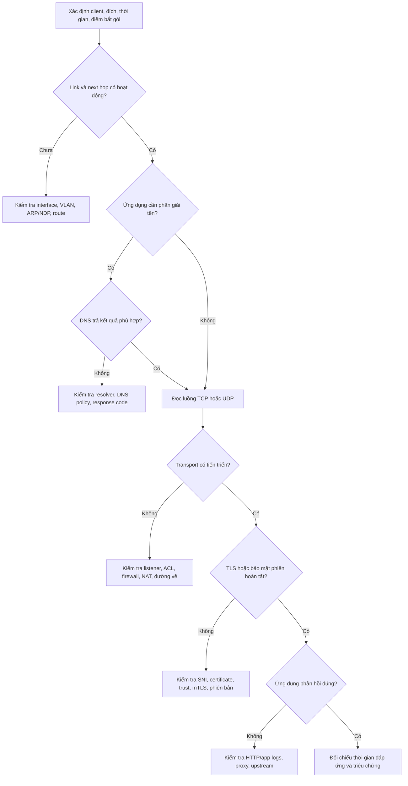

# Đọc packet theo lớp để tìm nguyên nhân lỗi

Khi một ứng dụng báo “không kết nối được”, nguyên nhân có thể nằm ở liên kết vật lý, VLAN, tuyến IP, DNS, firewall, bắt tay TCP, đàm phán TLS hoặc chính ứng dụng. Nếu thấy một dòng `connection timed out` rồi lập tức kết luận “máy chủ hỏng”, người vận hành rất dễ xử lý sai tầng.

**Đọc packet theo lớp** là phương pháp quan sát lưu lượng mạng để trả lời: dữ liệu đã đi qua những bước nào, bên nào có phản hồi, lỗi xuất hiện từ lớp nào, và bằng chứng nào còn thiếu. Mô hình OSI cung cấp khung phân tích, nhưng khi làm việc với packet thật cần đối chiếu với các giao thức TCP/IP và kiến trúc triển khai.

Trong module **SECURITY_NETWORK_SECURITY**, kỹ năng này phục vụ cả chẩn đoán lẫn bảo mật: xác minh phân đoạn mạng và firewall/VPN, phân tích lưu lượng, đối chiếu cảnh báo IDS/IPS, phát hiện dịch vụ bị lộ, kiểm tra bảo vệ DNS và điều tra kết nối trong hạ tầng cloud.

Sau bài học, bạn có thể:

- Phân biệt điều **quan sát trực tiếp** từ packet với **giả thuyết** về căn nguyên.
- Đọc Ethernet, ARP/NDP, IP, ICMP, TCP, UDP, DNS, TLS và HTTP để khoanh vùng lỗi.
- Nhận diện tình huống mất đường truyền, sai route, DNS thất bại, TCP bị từ chối/timeout, lỗi TLS và lỗi ứng dụng.
- Sử dụng `tcpdump` và bộ lọc Wireshark để liên hệ dữ liệu ở các lớp, bao gồm khi có NAT, proxy, VPN hoặc QUIC.
- Viết báo cáo xử lý sự cố gắn với bằng chứng và bước xác minh cụ thể.

## 1. Nhìn packet theo nguyên tắc đóng gói

Một ứng dụng gửi dữ liệu qua IP thường dựa vào header vận chuyển (TCP/UDP), header IP và header của công nghệ đường truyền (Ethernet, Wi-Fi...). Phía nhận tháo từng lớp để đưa dữ liệu vào ứng dụng.

```text
Ví dụ HTTPS qua TCP và Ethernet

Ethernet frame
└── IP packet (IPv4/IPv6)
    └── TCP segment
        └── TLS record
            └── HTTP data (đã mã hóa trên đường truyền)
```

Hình trên chỉ mô tả cấu trúc khái niệm: một TCP segment có thể chứa một phần hoặc nhiều phần của TLS record; một HTTP request có thể trải trên nhiều packet. **Một packet không bằng một request.** Công cụ như Wireshark thường phải ghép lại luồng TCP và giải mã giao thức (khi đủ điều kiện) mới nhận diện được thông điệp cấp cao.

### 1.1. Bảng tra cứu nhanh các lớp OSI

| Lớp | Dấu hiệu cần đọc | Dữ liệu/công cụ | Giới hạn |
|---|---|---|---|
| **1. Physical** | Link up/down, cáp/sóng, tốc độ, lỗi vật lý | NIC/switch/AP counters, log thiết bị | Pcap thông thường không chứng minh chất lượng cáp; NIC có thể bỏ frame hỏng trước khi bắt. |
| **2. Data Link** | MAC, VLAN, ARP, next hop, switching | Ethernet header, 802.1Q, ARP, NDP | Bắt trên host có thể không thấy VLAN tag do offload; MAC thay đổi ở từng chặng routed. |
| **3. Network** | IP nguồn/đích, route, TTL/Hop Limit, ICMP, MTU | IPv4/IPv6, ICMP/ICMPv6, traceroute | Một điểm bắt gói thường không xác định được chính xác hop làm rơi gói. |
| **4. Transport** | Port, TCP handshake, retransmission, RST, flow control; UDP datagram | TCP/UDP header, sequence/ACK/window | TCP thành công không chứng minh TLS/ứng dụng thành công. |
| **5–6. Session/Presentation** | Thiết lập phiên, biểu diễn và bảo vệ dữ liệu | TLS handshake, alert, certificate/log | TLS 1.3 mã hóa phần lớn handshake sau ServerHello; không ánh xạ hoàn hảo một lớp OSI. |
| **7. Application** | Tên miền, request/response, status, logic nghiệp vụ | DNS, HTTP, log ứng dụng | Payload mã hóa thường không quan sát được trong pcap thụ động. |

Trong triển khai TCP/IP, các giao thức thường được nhóm theo **link → internet → transport → application**; OSI là mô hình khái niệm, không phải khuôn ép mọi giao thức vào đúng một lớp. Khi điều tra, hãy đọc **header thực sự xuất hiện** và xác minh giao thức đã dùng.

### 1.2. Bốn câu hỏi trước khi phân tích

1. **Ai giao tiếp với ai?** Ghi rõ client, DNS resolver, default gateway, VPN, proxy/load balancer và server; xác định IPv4 hay IPv6.
2. **Bắt packet ở đâu?** Trên client, server, firewall, điểm mirror, trước hay sau NAT? Một điểm đo không phản ánh toàn bộ mạng.
3. **Khi nào?** Ghi khoảng thời gian và múi giờ; đồng bộ đồng hồ nếu so sánh capture ở hai đầu.
4. **Luồng thành công mong đợi ra sao?** Ví dụ DNS → TCP `443` → TLS → HTTP, hoặc DNS → QUIC/UDP `443` → HTTP/3.

Không có bối cảnh này, một gói `RST`, mã DNS `NXDOMAIN`, hay khoảng trống trong file pcap có thể bị diễn giải sai.

## 2. Quy trình khoanh vùng lỗi theo lớp

Xuất phát từ **triệu chứng tái hiện được**, quan sát bước đầu tiên khác với dự kiến rồi thu thêm bằng chứng ở lớp và vị trí phù hợp.



Đây là sơ đồ điều tra, không phải một chuỗi giao thức bắt buộc. DNS có thể chạy trên HTTPS/TLS; QUIC không dùng TCP handshake; proxy có thể tách kết nối client–proxy và proxy–server. Cần điều chỉnh theo kiến trúc thực tế.

Một kết luận chất lượng cao thường có bốn phần:

> **Quan sát:** Client gửi SYN ba lần, không thấy SYN-ACK/RST trong capture ở client.
>
> **Suy luận được hỗ trợ:** Client chưa quan sát được phản hồi bắt tay TCP.
>
> **Giả thuyết:** Gói có thể bị lọc, sai đường đi/đường về, hoặc đích không phản hồi.
>
> **Kiểm chứng:** Bắt gói cùng thời điểm ở phía server và đối chiếu route, firewall/flow log.

Không nên nhảy thẳng từ “không thấy SYN-ACK” đến “firewall chắc chắn chặn”.

## 3. Lớp 1–2: Ethernet, VLAN, ARP và NDP

### 3.1. Khi không thấy packet

Link vật lý không hoạt động có thể khiến **không có frame nào** trong capture. Ngược lại, capture trống còn có thể do bắt sai interface, capture filter quá hẹp hoặc SPAN bị thiếu gói. Trước tiên kiểm tra trạng thái NIC, cổng switch, log AP Wi-Fi, CRC/error counters, gói bị drop và tình trạng liên kết.

Ethernet frame thông thường có MAC đích, MAC nguồn và EtherType:

```text
Destination MAC      Source MAC             EtherType
00:11:22:33:44:55    aa:bb:cc:dd:ee:ff      0x0800 (IPv4)
                                             0x86DD (IPv6)
                                             0x0806 (ARP)
```

Trong mạng 802.1Q, tag VLAN mang VLAN ID. Sai VLAN hoặc port mode có thể làm ARP không đến đúng broadcast domain. Tuy nhiên **không thấy VLAN tag trên pcap của host không chứng minh mạng không có VLAN**: NIC hoặc driver có thể xử lý tag trước điểm bắt gói.

### 3.2. ARP trong IPv4

Giả sử `192.0.2.10/24` cần liên hệ `192.0.2.20` cùng subnet:

```text
ARP Request: Who has 192.0.2.20? Tell 192.0.2.10
ARP Reply:   192.0.2.20 is at aa:bb:cc:dd:ee:ff
```

Nếu chỉ thấy request lặp lại mà không có reply, điều đó gợi ý vấn đề phân giải MAC, host đích, VLAN/chuyển mạch, chính sách lớp 2, hoặc capture không thấy chiều về. **Không thể kết luận hỏng cáp chỉ từ một ARP request thiếu reply.**

Với IP đích **khác subnet**, host thường ARP tìm **MAC của default gateway/next hop**, không phải MAC của server xa. Vì vậy, một ARP tới gateway là hoàn toàn bình thường khi người dùng truy cập website ngoài subnet.

### 3.3. Neighbor Discovery của IPv6

IPv6 không dùng ARP. NDP sử dụng ICMPv6, gồm Neighbor Solicitation (NS) và Neighbor Advertisement (NA), để tìm neighbor/next hop. Nếu NS lặp lại và không có NA, kiểm tra VLAN, địa chỉ IPv6, neighbor cache và firewall/ACL lớp 2/3. Chặn ICMPv6 bừa bãi có thể phá NDP và Path MTU Discovery.

| Dấu hiệu | Giả thuyết khả thi | Bước tiếp theo |
|---|---|---|
Interface link down | Lỗi vật lý, Wi-Fi association, driver | Kiểm tra NIC, switch/AP log, cáp/sóng. |
ARP request liên tục không thấy reply | Host/vlan/next hop hoặc điểm capture có vấn đề | Đối chiếu IP/mask, ARP/MAC table, VLAN, hai đầu. |
ARP reply có MAC lạ | Thiết bị đổi MAC, dự phòng gateway, giả mạo ARP hoặc cấu hình sai | Kiểm tra bảng MAC hợp lệ và sự kiện cấu hình; chưa mặc định có tấn công. |
IPv6 NS lặp lại, không thấy NA | Neighbor chưa được phân giải | Kiểm tra ICMPv6/NDP, neighbor cache và mạng lớp 2. |

## 4. Lớp 3: IP, routing, ICMP và MTU

Trong IPv4, header có source/destination IP, TTL, Protocol, trường phân mảnh; trong IPv6 là source/destination, Hop Limit, Next Header và có thể có extension headers. Các trường quan trọng:

- **IP nguồn/đích:** Có đúng host, địa chỉ sau DNS và phiên bản IP mong đợi không? Có NAT/SNAT/DNAT không?
- **Protocol/Next Header:** IPv4 `6` thường biểu thị TCP, `17` UDP, `1` ICMP; với IPv6, cần đi qua extension headers khi có.
- **TTL/Hop Limit:** Giảm qua router; khi hết có thể sinh ICMP Time Exceeded. TTL đơn lẻ không nói được chính xác số hop còn lại vì giá trị khởi tạo không cố định.
- **ICMP/ICMPv6:** Destination Unreachable, Time Exceeded và các thông báo cần cho chẩn đoán.
- **MTU và fragmentation:** Các packet lớn có thể bị loại khi không thể chuyển theo kích thước đường đi.

**Routing bất đối xứng** khiến request và response có đường đi khác nhau. Một thiết bị chỉ thấy chiều đi chưa chứng minh phía kia không gửi chiều về; stateful firewall cũng có thể chặn response nếu phiên không được nhận diện ở đúng đường.

### 4.1. Hiện tượng Path MTU black hole

Giả sử TCP handshake thành công, request nhỏ hoạt động nhưng các trao đổi lớn treo. Một giả thuyết là packet quá MTU của tunnel/VPN hoặc đường truyền. Với IPv4 có cờ DF, router có thể báo ICMP “Fragmentation needed”; IPv6 router có thể gửi ICMPv6 “Packet Too Big”. Nếu thông báo cần thiết bị chặn, máy gửi không điều chỉnh được kích thước theo đường đi.

Cần đối chiếu kích thước packet, ICMP/ICMPv6, MTU của interface/tunnel, TCP MSS và hành vi ứng dụng khi gửi kích thước khác nhau. **Thấy TCP retransmission không đủ để kết luận lỗi MTU**.

## 5. Lớp 4: đọc TCP đúng trình tự

### 5.1. Nhận dạng luồng bằng 5-tuple

Một luồng TCP thường được nhận diện bằng:

```text
(protocol, source IP, source port, destination IP, destination port)
(TCP, 192.0.2.10, 53124, 198.51.100.20, 443)
```

Ở chiều phản hồi, source và destination đảo vai. Khi đi qua NAT, tuple có thể bị thay đổi; hãy đối chiếu thời gian, bảng NAT/conntrack, TCP sequence và những thông tin liên quan thay vì chỉ so IP/port nguyên dạng ở hai chặng.

### 5.2. Bắt tay TCP ba bước

```text
T0  client:53124 → server:443   SYN       seq=x
T1  server:443  → client:53124  SYN,ACK   seq=y ack=x+1
T2  client:53124 → server:443   ACK       ack=y+1
T3  client:53124 → server:443   TLS / dữ liệu ứng dụng
```

Wireshark thường hiển thị **relative sequence number**, có thể bắt đầu từ `0` trong giao diện; đó không phải sequence number tuyệt đối trên dây. Ba bước TCP thành công chứng minh transport đã thiết lập theo góc nhìn quan sát, **chưa chứng minh TLS hay ứng dụng hoạt động**.

| Mẫu trong pcap | Diễn giải hợp lý | Điều cần kiểm tra |
|---|---|---|
Nhiều SYN, không có SYN-ACK/RST | Chưa thấy phản hồi TCP tại điểm bắt | Sai IP/route, lọc gói, host không phản hồi, đường về; so hai đầu. |
SYN → RST hoặc RST,ACK | Kết nối bị từ chối/reset | Có listener? Bind IP nào? Host firewall reject? Middlebox tạo RST? |
Server gửi SYN-ACK nhưng client không thấy | Có thể mất trên đường về | Route chiều về, NAT, stateful firewall, VPN. |
Handshake xong rồi chờ mãi | Lỗi có thể thuộc giao thức cấp cao hoặc nghẽn dữ liệu | TLS, framing, server processing, window/timeout. |
TCP Retransmission / Duplicate ACK | Có dấu hiệu truyền lại/nhận gói bất thường | RTT, sequence/ACK, reordering, packet loss/capture loss. |
TCP Zero Window | Bên nhận thông báo cửa sổ bằng 0 | Buffer đầy hoặc ứng dụng đọc chậm. |
FIN/ACK | Một bên đóng TCP có trật tự | Xem lý do ứng dụng đóng. |
RST | Kết nối bị reset | Xác định bên gửi và gói ngay trước reset; có thể do thiết bị trung gian. |

Khi server nhận SYN và trả SYN-ACK nhưng client không nhận, vấn đề **có thể nằm ở đường về**. Khi client thấy RST, đó là dấu hiệu từ chối ở tầng TCP, song RST có thể do host đích hoặc thiết bị trung gian, không thể quy mọi RST cho ứng dụng.

### 5.3. UDP không có bắt tay TCP

DNS truyền thống, NTP và QUIC thường dùng UDP. UDP giữ ranh giới datagram, không có SYN/SYN-ACK và không tự bảo đảm truyền lại, đúng thứ tự hay nhận đủ. Phân tích UDP cần đọc IP/port, thời gian, chiều gửi/nhận, độ dài datagram và mã giao thức ứng dụng. Một socket UDP có thể dùng `connect` để đặt đối tác mặc định, nhưng thao tác đó không tạo TCP handshake.

Nếu gửi UDP không có phản hồi, có thể do firewall, host không có dịch vụ, ứng dụng bỏ qua request không hợp lệ hoặc capture thiếu chiều về. ICMP Port Unreachable có thể gợi ý không có endpoint hay một chính sách từ chối; không nhận ICMP **không chứng minh UDP port đang mở**.

HTTP/3 chạy trên **QUIC/UDP**, thường port `443`. Nếu chỉ lọc `tcp.port == 443`, bạn sẽ bỏ sót HTTP/3. Hãy kiểm tra thêm `udp.port == 443` và các trường QUIC nếu Wireshark nhận diện được.

## 6. Lớp ứng dụng: DNS, TLS, HTTP

### 6.1. DNS: phân biệt tên sai và đường mạng sai

Với DNS không mã hóa, cần đọc:

- **QNAME và QTYPE:** ứng dụng đang hỏi đúng tên chưa; `A` hay `AAAA`?
- **Transaction ID, endpoint, thời gian:** ghép truy vấn/phản hồi phù hợp.
- **RCODE:** `NOERROR`, `NXDOMAIN`, `SERVFAIL`...
- **Answer:** Địa chỉ nào được trả về; `TTL` của bản ghi là bao nhiêu?
- **Resolver:** Client hỏi DNS server nội bộ hay ngoài Internet?

`NXDOMAIN` báo tên không tồn tại theo phản hồi DNS; `SERVFAIL` báo không xử lý thành công; `NOERROR` nhưng không có câu trả lời phù hợp **không đồng nghĩa NXDOMAIN**. Hãy kiểm tra search domain, cache, split-horizon DNS và khác biệt giữa A/AAAA. Một ứng dụng dùng IPv6 trước có thể gặp lỗi riêng dù IPv4 vẫn hoạt động.

DNS có thể dùng UDP/TCP `53`, **DNS-over-TLS** hoặc **DNS-over-HTTPS**. Với DNS mã hóa, tên truy vấn thường không hiện trong capture thụ động; cần log từ resolver hoặc endpoint được cấp quyền quan sát.

### 6.2. TLS: TCP thành công nhưng kênh bảo mật vẫn thất bại

Sau TCP handshake, client có thể gửi TLS ClientHello với phiên bản/cipher suites/extensions; SNI thường giúp định tuyến virtual host. Server đàm phán và gửi các thông điệp bắt tay; nếu điều kiện không phù hợp, phiên có thể bị hủy.

| Triệu chứng | Hướng kiểm tra |
|---|---|
TLS alert hoặc đóng sớm | TLS versions, cipher suites, server policy, gateway, log lỗi. |
Certificate không được tin cậy | CA, chain, hostname, thời hạn và đồng hồ hệ thống. |
Virtual host sai | Hostname client, SNI, cấu hình reverse proxy/LB. |
Mutual TLS thất bại | Client certificate, CA của server, chính sách mTLS, hạn dùng. |
TCP và TLS được xác nhận tốt nhưng ứng dụng treo | HTTP framing, upstream, app logs, timeout. |

**Giới hạn quan sát:** TLS 1.3 mã hóa phần lớn thông điệp handshake sau ServerHello, gồm certificate; SNI có thể được bảo vệ bằng ECH. Capture thụ động thường không đủ để xác nhận chi tiết certificate, lỗi xác thực hoặc HTTP status. Dùng thêm lỗi từ client, log endpoint/proxy và dữ liệu được giải mã hợp lệ khi có quyền.

### 6.3. HTTP status là dấu hiệu tầng ứng dụng

| Status | Diễn giải thường gặp | Gợi ý điều tra |
|---|---|---|
| `301`/`302` | Chuyển hướng | `Location`, hostname, vòng lặp redirect. |
| `401` | Thiếu hoặc sai thông tin xác thực | Token, challenge, identity provider. |
| `403` | Từ chối theo chính sách | Phân quyền, WAF, API policy. |
| `404` | Không tìm thấy tài nguyên | URL, routing, virtual host. |
| `429` | Giới hạn tốc độ | Rate limit, quota. |
| `502` | Proxy/gateway gặp vấn đề khi làm việc với upstream | Proxy log, backend health và đường proxy–backend. |
| `503` | Dịch vụ tạm thời không sẵn sàng | Capacity, backend health, bảo trì. |
| `504` | Gateway chờ upstream quá lâu | Timeout, hiệu năng/backend network. |

Một phản hồi `502/504` chỉ xác nhận **thành phần trả HTTP** đã có phản hồi đến client; không chứng minh server cuối cùng đã nhận request. Với HTTPS, HTTP/2 hoặc HTTP/3, status có thể bị mã hóa và không hiển thị trong pcap nếu chưa giải mã.

## 7. Bắt và lọc traffic bằng tcpdump, Wireshark

Chỉ bắt gói trên máy/mạng **được phép kiểm tra**. Pcap có thể chứa IP nội bộ, token, cookie và thông tin cá nhân; hãy giới hạn thời gian, phạm vi, quyền truy cập file.

### 7.1. Ví dụ tcpdump trên Linux

Thay `eth0` bằng interface thực tế; `198.51.100.20` là địa chỉ IPv4 dành cho tài liệu:

```bash
# Xem các interface có thể capture
sudo tcpdump -D

# Xem TCP và UDP 443 của một máy, bỏ phân giải tên/port
sudo tcpdump -i eth0 -nn \
  'host 198.51.100.20 and (tcp port 443 or udp port 443)'

# Ghi pcap để phân tích bằng Wireshark
sudo tcpdump -i eth0 -nn -s 0 -w network-issue.pcap \
  'host 198.51.100.20 and (tcp port 443 or udp port 443)'

# DNS truyền thống
sudo tcpdump -i eth0 -nn -s 0 'port 53'

# ARP lớp 2
sudo tcpdump -i eth0 -nn -e arp
```

`-nn` ngăn phân giải tên khi hiển thị; `-s 0` yêu cầu bắt đủ độ dài frame mà interface capture cung cấp; `-w` ghi file. Đây là **capture filter** theo cú pháp libpcap/BPF, chỉ giữ packet thỏa điều kiện trong lúc bắt. Bộ lọc quá hẹp dễ bỏ sót ARP, DNS, ICMP, IPv6, QUIC hoặc các kết nối upstream; nếu chưa rõ nguyên nhân, chọn phạm vi đủ rộng có kiểm soát rồi phân tích sâu sau.

### 7.2. Wireshark display filters

Mở file pcap trong Wireshark và dùng **display filter** để xem packet đã bắt. Display filter không khôi phục packet bị loại bởi capture filter.

| Mục tiêu | Display filter |
|---|---|
| IP IPv4 xuất hiện ở bất kỳ chiều nào | `ip.addr == 198.51.100.20` |
| IPv6 cụ thể | `ipv6.addr == 2001:db8::20` |
| TCP port 443 | `tcp.port == 443` |
| UDP port 443/QUIC | `udp.port == 443` |
| DNS được dissector nhận diện | `dns` |
| SYN chưa có ACK | `tcp.flags.syn == 1 && tcp.flags.ack == 0` |
| TCP reset | `tcp.flags.reset == 1` |
| TCP retransmission được Wireshark gợi ý | `tcp.analysis.retransmission` |
| TLS ClientHello được nhận diện | `tls.handshake.type == 1` |
| ICMPv4 | `icmp` |
| ICMPv6 | `icmpv6` |
| HTTP rõ nội dung, nếu có | `http` |

Tên trường và khả năng nhận diện phụ thuộc phiên bản Wireshark/dissector. Không thấy `http` trong capture HTTPS là bình thường khi payload mã hóa.

Hướng đọc một packet:

1. Chọn frame theo thời gian, IP và luồng liên quan.
2. Trong **Packet Details**, mở từ **Frame → Ethernet → IP → TCP/UDP → giao thức ứng dụng**.
3. Kiểm tra source/destination, độ dài, flags, ports, sequence/ack, các trường trả lời của DNS/TLS/HTTP nếu quan sát được.
4. Sử dụng **Follow TCP Stream** hoặc tính năng follow stream tương ứng để đọc theo ngữ cảnh. Dữ liệu có thể vẫn là ciphertext.
5. Xem **Conversations**, **Endpoints**, **Expert Information** và biểu đồ thời gian. Cảnh báo của công cụ là điểm khởi đầu điều tra, không tự nó chứng minh căn nguyên.

### 7.3. Chọn đúng vị trí capture

```text
Client ── Switch/Wi-Fi ── Firewall/VPN ── NAT ── Load balancer ── App server
   A                             B                        C           D
```

- **A (client):** xác nhận client gửi gì, nhận gì; tốt cho DNS, SYN, ClientHello.
- **B (firewall/VPN):** so sánh trước/sau policy, NAT/tunnel, hướng đi và hướng về.
- **C (load balancer):** phân biệt kết nối từ client với kết nối tới upstream; proxy có thể thay đổi địa chỉ và chấm dứt TLS.
- **D (server):** chứng minh packet đã đến host/network namespace và server có trả lời hay không.

Capture trên interface `any`, trong container hay tại SPAN/mirror có thể có thông tin link-layer khác capture trực tiếp trên interface Ethernet. Cần xác định rõ **interface, network namespace và điểm trước/sau NAT**.

## 8. Phân tích một phiên HTTPS thành công

Giả sử client `192.0.2.10` truy cập `https://app.example.test/health`; resolver trả A record `198.51.100.20`. Tất cả địa chỉ và tên miền dưới đây dùng cho minh họa.

| Bước | Quan sát | Tầng | Có thể kết luận |
|---|---|---|---|
| 1 | DNS query `A app.example.test` | Application trên UDP/TCP hoặc cơ chế DNS tương ứng | Client hỏi tên miền. |
| 2 | DNS response `NOERROR, A 198.51.100.20` | Application | Resolver trả IP; chưa chứng minh IP đúng với kiến trúc dự kiến. |
| 3 | `192.0.2.10:53124 → 198.51.100.20:443 SYN` | IP/TCP | Client bắt đầu kết nối TCP. |
| 4 | `198.51.100.20:443 → 192.0.2.10:53124 SYN,ACK` | IP/TCP | Có phản hồi bắt tay từ endpoint hoặc thành phần trung gian mang địa chỉ đó. |
| 5 | Client gửi `ACK` | TCP | Handshake ba bước hoàn tất theo capture. |
| 6 | ClientHello, ServerHello, những bản tin TLS tiếp theo | TLS | Hai bên đàm phán bảo mật; cần xác nhận handshake hoàn tất và ứng dụng trao đổi được. |
| 7 | HTTP request và `200 OK` từ log hoặc phiên đã giải mã | HTTP | Request tương ứng được phục vụ thành công. |

Từ packet TLS mã hóa ở bước 6, **không được tự viết “HTTP 200”** khi chưa có log hay dữ liệu giải mã làm bằng chứng.

Nếu reverse proxy trả `200`, cần lưu ý đó có thể là **kết quả của proxy** chứ không phải chứng cứ backend cụ thể đã nhận request. HTTP keep-alive và HTTP/2 multiplexing còn cho phép nhiều request đi trên một TCP connection; không thể luôn ánh xạ mỗi kết nối với đúng một request.

## 9. Các ca chẩn đoán thực tế

### Ca 1: `Connection refused` ngay khi mở TCP

**Ngữ cảnh:** Client `10.0.1.9` thử đến dịch vụ nội bộ `10.0.2.15:8443`.

```text
10:00:00.000  10.0.1.9:54010  → 10.0.2.15:8443  SYN
10:00:00.002  10.0.2.15:8443 → 10.0.1.9:54010   RST,ACK
```

**Quan sát:** Có phản hồi reset ngay sau SYN. **Suy luận:** TCP bị từ chối/reset trước khi đến TLS/HTTP. **Chưa chắc** service tắt: firewall có thể chủ động reject hoặc middlebox có thể gửi RST.

Kiểm chứng trên server: chương trình có `LISTEN` tại port `8443` không, đã `bind` IP nào (`127.0.0.1` hay IP mạng), firewall có policy reject không, server có nhận SYN ở capture riêng không? Nếu không có listener, sửa cấu hình/start dịch vụ trong phạm vi được phép; nếu policy đúng đang chặn, giữ nguyên chính sách và xác minh nhu cầu truy cập trước khi sửa.

### Ca 2: SYN gửi đi nhưng kết nối timeout

**Ngữ cảnh:** Sau khi đổi rule phân đoạn/cloud security group, ứng dụng không nối được database `10.20.30.40:5432`.

```text
11:01:00.000  client:55002 → db:5432  SYN
11:01:01.030  client:55002 → db:5432  SYN retransmission
11:01:03.080  client:55002 → db:5432  SYN retransmission
# Không thấy SYN-ACK hoặc RST trong capture tại client
```

**Quan sát:** Client thử mở TCP nhiều lần mà không nhận phản hồi tại điểm đo. **Giả thuyết:** Lọc gói, sai route/đường về, đích không phản hồi hoặc điểm capture thiếu gói.

Kiểm tra có thứ tự: (1) DNS và route/VPN client; (2) server có thấy SYN ở cùng thời điểm? (3) nếu không, đối chiếu firewall flow log, security group, network ACL, NAT; (4) nếu server thấy SYN và gửi SYN-ACK, điều tra đường về/stateful filtering; (5) nếu server nhận SYN nhưng không trả lời, kiểm tra host firewall và TCP stack. **Không mở public port `5432` chỉ để thử kết nối**: cần giữ phân đoạn mạng và giới hạn nguồn được phép.

### Ca 3: Client có TLS nhưng nhận HTTP `502`

**Ngữ cảnh:** Reverse proxy trên HTTPS trả `502`; backend dự kiến là `10.0.3.15:8080`.

| Điểm đo | Bằng chứng | Hướng kết luận |
|---|---|---|
| Client → proxy | TCP/TLS hoạt động; log client/proxy xác nhận HTTP `502` | Client đã liên hệ được proxy. |
| Proxy → backend | Proxy log báo lỗi kết nối tới `10.0.3.15:8080` | Cần kiểm tra đoạn proxy–backend. |
| Backend | Không có listener `8080` hoặc policy từ chối | Giải thích vì sao proxy không dùng được upstream. |

Chỉ pcap phía client thường **không đủ** để kết luận backend dừng hay firewall chặn; cần log proxy và bằng chứng phía upstream. Một `502` là phản hồi tầng HTTP, **không phải** lỗi TCP handshake trên kết nối client–proxy.

### Ca 4: Sau khi bật VPN, gói nhỏ được, request lớn treo

**Ngữ cảnh:** TCP handshake hoàn tất, request nhỏ chạy bình thường nhưng response lớn timeout. Có TCP retransmission cho các packet lớn; một điểm đo thấy ICMP “Fragmentation needed” hoặc ICMPv6 “Packet Too Big”.

**Giả thuyết:** MTU của tunnel thấp hơn kỳ vọng, encapsulation overhead, hoặc cơ chế PMTU discovery không nhận được thông báo cần thiết. Đối chiếu kích thước packet trước/sau VPN, MTU/MSS, ICMP, log tunnel và thử payload nhiều kích thước có kiểm soát trên hệ thống được phép. **Không nên chỉ tắt ICMP hoặc giảm MTU tùy tiện** trước khi tìm được giới hạn thực tế.

### Ca 5: Website đôi lúc truy cập được, đôi lúc lỗi do IPv6

**Ngữ cảnh:** DNS trả cả A và AAAA. Client chọn IPv6 và nhận timeout; thử IPv4 thì thành công.

Kiểm tra tên và hai bản ghi DNS, route IPv6, Neighbor Discovery, ICMPv6, firewall IPv6, listener IPv6 và hành vi chọn địa chỉ của client. Không nên kết luận “DNS hỏng” chỉ vì A record tốt còn kết nối thực tế dùng AAAA. Đây là ví dụ quan trọng cho thấy **lớp 7 (DNS) có thể đưa client sang một đường đi lớp 3 hoàn toàn khác**.

## 10. Những bẫy đọc pcap gây chẩn đoán sai

### 10.1. “Không thấy” khác “không có”

Thiếu packet trong pcap có thể do capture sai interface, capture filter loại mất, thiết bị mirror bỏ gói, lưu lượng đi trên IPv6/QUIC, đường về bất đối xứng, hoặc máy capture không theo kịp. Hãy ghi rõ **“không quan sát thấy tại điểm A trong khoảng B”** và kiểm chứng ở điểm khác.

### 10.2. Checksum sai do offload

NIC offload như checksum offload, TSO, GSO, GRO hoặc LRO có thể làm packet hiển thị trên host khác frame trên wire. Trong capture trước khi NIC tính checksum, Wireshark có thể báo “bad checksum” dù kết nối hoạt động bình thường; kích thước segment hiển thị cũng có thể không phải kích thước thật ngoài mạng. Muốn kết luận lỗi checksum, đối chiếu capture ngoài host, chỉ số NIC và cấu hình offload.

### 10.3. Retransmission là dấu hiệu, chưa phải căn nguyên

TCP retransmission có thể đến từ mất gói, reordering, RTT biến động, congestion hoặc lỗi quan sát. Cần xét sequence/ack, SACK, window, thời gian và packet ở hai đầu trước khi tuyên bố nguyên nhân là packet loss ở một switch.

### 10.4. NAT, proxy và tunnel thay đổi góc nhìn

NAT đổi địa chỉ và có thể đổi port. Reverse proxy tạo hai kết nối độc lập. VPN có packet bên trong (inner) và packet được encapsulate bên ngoài (outer). Cloud load balancer/service mesh có thể chấm dứt TLS rồi tạo TLS session khác. Hãy đối chiếu thời gian, request ID, NAT/conntrack log và từng chặng, thay vì kỳ vọng 5-tuple không đổi khắp hệ thống.

### 10.5. Mã hóa che dữ liệu tầng ứng dụng

TLS, QUIC và DNS-over-HTTPS bảo vệ nội dung. Có thể quan sát thời gian, IP/port và một phần handshake; không được mặc định thấy URL, HTTP status, token, nội dung DNS hay certificate khi đang mã hóa. Dùng client error, access log hoặc công cụ ở endpoint và chỉ giải mã khi có quyền.

## 11. Kết hợp packet với phòng vệ mạng nhiều lớp

- **Firewall và phân đoạn:** Đối chiếu luồng trước/sau rule; phân biệt silent drop, reject và dịch vụ thật sự không lắng nghe. Chỉ mở những kết nối cần thiết theo nguồn, đích, protocol và port.
- **IDS/IPS:** Phân tích TCP flags, reset, chuỗi request hoặc lưu lượng bất thường; so cảnh báo với pcap, tài sản liên quan và log để tránh false positive. IDS thụ động khác IPS có thể chặn lưu lượng.
- **VPN:** Bắt ở cả phía trong/ngoài tunnel khi khả thi, kiểm tra route, MTU, NAT và firewall của tunnel.
- **DNS security:** So bản ghi trả lời, chính sách resolver và dấu hiệu domain bất thường; với DNS mã hóa cần thêm log endpoint/resolver hợp lệ.
- **Wi-Fi:** Lỗi trong TCP capture có thể bắt nguồn từ sóng/association/roaming; cần thêm log AP hoặc capture 802.11 ở điểm phù hợp.
- **Cloud/container:** Security group, ACL, route table, network policy, ingress/egress, service mesh, node/pod namespace và SNAT đều có thể thay đổi con đường packet tới ứng dụng.

Cảnh báo của IDS/IPS **không đồng nghĩa** xâm nhập thành công; ngược lại, không có alert không chứng minh mạng an toàn. Packet phải được đánh giá cùng chính sách, danh tính tài sản, trạng thái ứng dụng và bối cảnh mối đe dọa.

### 11.1. Lưu bằng chứng có trách nhiệm

- Ghi người đo, hệ thống, interface, vị trí, thời gian và phạm vi được phép.
- Giới hạn capture theo thời gian và mục tiêu; tránh thu dữ liệu nhạy cảm không cần thiết.
- Bảo vệ file pcap/log theo quyền truy cập và chính sách lưu trữ; có thể chứa token, cookie và dữ liệu khách hàng.
- Khi chia sẻ mẫu, ẩn dữ liệu nhạy cảm phù hợp; nếu là điều tra sự cố bảo mật, giữ bản chứng cứ gốc theo quy trình.

## 12. Mẫu báo cáo điều tra bằng packet

| Mục | Ví dụ |
|---|---|
| Triệu chứng | Client không truy cập được `https://service.example.test`; timeout sau 5 giây. |
| Thời gian | 14:00–14:02 ngày điều tra, UTC+7; đồng hồ đã đồng bộ. |
| Các endpoint | Client `10.0.1.20`, server `10.0.2.30`, TCP `443`. |
| Điểm bắt | Client `eth0`, server `eth0`, firewall flow log. |
| Lớp 2/3 | ARP tới gateway thành công; route tới đích tồn tại. |
| Lớp 4 | Client gửi 3 SYN, không có SYN-ACK/RST tại client; server không thấy SYN trong cùng cửa sổ thời gian. |
| Kết luận được hỗ trợ | Chưa xác nhận packet tới server; cần định vị chặng gây mất gói. |
| Hành động tiếp | Đối chiếu firewall/ACL/VPN và capture ở điểm trung gian. |
| Đánh giá sau xử lý | Ghi thay đổi, thử TCP handshake, TLS và response ứng dụng; xác nhận policy vẫn đúng. |

Viết “gói bị chặn ở firewall X” chỉ khi có bằng chứng phù hợp từ firewall/capture; nếu không, hãy ghi **“nghi vấn chặn hoặc mất gói giữa các điểm đo”**.

## 13. Bài tập tự kiểm tra

**Tình huống A.** DNS trả `NOERROR` và A record. TCP SYN tới địa chỉ này nhận RST ngay. Có chắc lỗi nằm ở DNS không?

**Đáp án gợi ý:** Chưa. Cần xác minh IP trả về đúng mục tiêu, nhưng RST cho thấy kết nối bị từ chối/reset ở tầng TCP hoặc thiết bị trung gian. Kiểm tra listener, bind address, host firewall và capture server.

**Tình huống B.** Pcap HTTPS có đủ 3 bước TCP, rồi TLS records và FIN. Có thể kết luận ứng dụng trả HTTP `500` không?

**Đáp án gợi ý:** Không. Dữ liệu HTTP có thể được mã hóa và chưa có status trong bằng chứng. Dùng log endpoint/proxy hoặc phiên giải mã hợp lệ.

**Tình huống C.** Sau bật HTTP/3, filter `tcp.port == 443` không thấy request dù website truy cập được. Vì sao?

**Đáp án gợi ý:** HTTP/3 đi qua QUIC/UDP. Kiểm tra thêm `udp.port == 443`, khả năng nhận diện QUIC và vị trí capture.

**Tình huống D.** IPv6 Neighbor Solicitation lặp lại mà không thấy Neighbor Advertisement. Nên tìm ARP Reply hay thay certificate TLS?

**Đáp án gợi ý:** Không. Cần kiểm tra NDP/ICMPv6, VLAN, neighbor và IPv6 network path trước khi xét TLS.

## 14. Checklist ghi nhớ

1. Xác định **client, server, giao thức, thời điểm và điểm bắt** trước khi diễn giải gói tin.
2. Bắt đầu từ lỗi quan sát rồi khoanh vùng: link/ARP/NDP → IP/route/ICMP → TCP/UDP → DNS/TLS/HTTP theo giao thức thực tế.
3. Dùng ít nhất hai nguồn khi kết luận về một chặng mạng: capture hai phía, flow log, log ứng dụng, NIC counters hoặc cấu hình thiết bị.
4. Phân biệt **triệu chứng** với **căn nguyên**: RST không chắc do ứng dụng; timeout không chắc do firewall; retransmission không chắc do hỏng đường truyền.
5. Tính tới NAT, proxy, offload, bất đối xứng, IPv6 và mã hóa trước khi so sánh dữ liệu.
6. Chỉ đề xuất thay đổi sau khi có giả thuyết kiểm chứng được; xác nhận lại cả **đường mạng, TLS/xác thực và kết quả ứng dụng**.

Đọc packet theo lớp là cách biến sự cố mơ hồ thành **chuỗi bằng chứng có thể kiểm tra**. Đây là nền tảng để điều tra xâm nhập, xác nhận hiệu lực firewall/VPN, xử lý DNS và xây dựng kiến trúc mạng an toàn.
