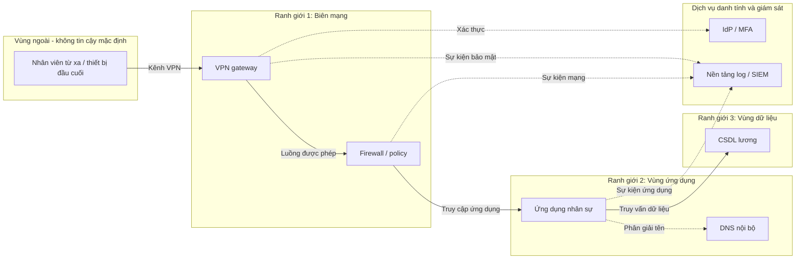
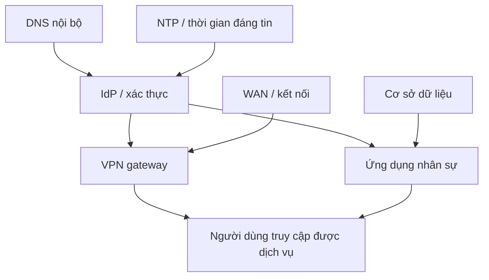

# Tài sản cần bảo vệ trong network

## 1. Vì sao threat modeling mạng phải bắt đầu từ tài sản?

Khi thiết kế mạng an toàn, câu hỏi đầu tiên không phải là “cần đặt thêm firewall ở đâu?” mà là **“điều gì cần được bảo vệ, vì sao quan trọng và điều gì sẽ xảy ra nếu bị xâm phạm?”**. Những thứ cần được bảo vệ được gọi là **tài sản (assets)**. Tài sản có thể là thông tin khách hàng, khóa mã hóa, quyền quản trị, một dịch vụ DNS thiết yếu, một tuyến kết nối hoặc khả năng duy trì hoạt động của cả hệ thống. Một thiết bị mạng đắt tiền chưa chắc là tài sản quan trọng nhất; ngược lại, một tệp cấu hình nhỏ có chứa thông tin nhạy cảm có thể ảnh hưởng đến nhiều hệ thống.

**Network threat modeling (mô hình hóa mối đe dọa mạng)** xác định tài sản, luồng dữ liệu, ranh giới tin cậy, tác nhân có thể tác động, các tình huống xâm phạm và biện pháp giảm thiểu. Kết quả giúp quyết định nơi cần phân đoạn mạng, áp dụng firewall, VPN, xác thực kết nối, IDS/IPS, bảo vệ DNS, mạng không dây và hạ tầng đám mây. Quá trình này cần phối hợp góc nhìn nghiệp vụ với góc nhìn kỹ thuật: điều quan trọng đối với doanh nghiệp có thể không hiển thị rõ trong danh sách địa chỉ IP.

Sau bài học, bạn có thể:

- Nhận diện **tài sản nghiệp vụ, dữ liệu, danh tính, kết nối, dịch vụ nền và mặt phẳng quản trị** của một hệ thống mạng.
- Phân biệt tài sản với mối đe dọa, điểm yếu, biện pháp bảo vệ và ranh giới tin cậy.
- Xây dựng danh mục tài sản, mô tả các luồng dữ liệu và nhận diện các phụ thuộc quan trọng.
- Ưu tiên tài sản theo ảnh hưởng đến tính bảo mật, toàn vẹn và sẵn sàng thay vì chỉ theo giá trị phần cứng.
- Liên kết tài sản với kịch bản đe dọa, lớp phòng vệ và cách xác minh hiệu quả bảo vệ.

## 2. Khái niệm cơ bản: tài sản, mối đe dọa và rủi ro

### 2.1. Tài sản không chỉ là máy chủ và thiết bị

**Tài sản** là bất kỳ thành phần hữu hình hoặc vô hình nào có giá trị đối với tổ chức và cần bảo vệ trước sự kiện không mong muốn. Trong mô hình mạng, tài sản có thể thuộc nhiều lớp:

- **Nghiệp vụ:** khả năng vận hành ứng dụng thanh toán, xử lý đơn hàng, quản lý nhân sự hoặc duy trì một kênh liên lạc khẩn cấp.
- **Thông tin:** hồ sơ khách hàng, dữ liệu lương, bí mật kinh doanh, cấu hình, bản sao lưu và dữ liệu được truyền qua mạng.
- **Danh tính và quyền:** tài khoản quản trị, tài khoản dịch vụ, token phiên, chứng chỉ số, khóa riêng, thông tin xác thực Wi-Fi/VPN và các chính sách phân quyền.
- **Dịch vụ và hệ thống:** máy chủ ứng dụng, DNS, DHCP, NTP, hệ thống quản lý danh tính (IdP), RADIUS, proxy, VPN gateway và dịch vụ giám sát.
- **Hạ tầng truyền dẫn và điều khiển:** router, switch, firewall, access point, liên kết WAN, bảng định tuyến, VLAN, ACL, security group, VPC/VNet và hệ thống quản trị thiết bị.

Một tài sản có thể tồn tại ở nhiều vị trí hoặc trạng thái. Ví dụ, dữ liệu khách hàng có thể nằm trong cơ sở dữ liệu (*data at rest*), xuất hiện trong truy vấn giữa dịch vụ và database (*data in transit*) hoặc được lưu trong bản sao lưu. Mỗi trạng thái có bề mặt tấn công và biện pháp bảo vệ riêng.

### 2.2. Những khái niệm dễ nhầm

| Khái niệm | Câu hỏi cần trả lời | Ví dụ |
|---|---|---|
| **Asset — tài sản** | Cần bảo vệ điều gì? | Cơ sở dữ liệu thông tin khách hàng |
| **Security objective — mục tiêu bảo vệ** | Cần giữ thuộc tính nào? | Không lộ dữ liệu; dữ liệu không bị sửa sai; ứng dụng vẫn phục vụ được |
| **Threat — mối đe dọa** | Sự kiện hoặc hành vi nào có thể gây hại? | Đánh cắp danh tính quản trị, tấn công từ chối dịch vụ |
| **Vulnerability — điểm yếu** | Điều kiện nào khiến mối đe dọa dễ thành hiện thực? | Mở cổng quản trị ra Internet, thiếu MFA, ACL quá rộng |
| **Attack surface — bề mặt tấn công** | Đường nào có thể bị tiếp cận hoặc lạm dụng? | VPN portal, API công khai, Wi-Fi khách, cổng quản lý thiết bị |
| **Trust boundary — ranh giới tin cậy** | Ở đâu mức tin cậy hoặc thẩm quyền thay đổi? | Internet → VPN → mạng ứng dụng → mạng cơ sở dữ liệu |
| **Control — biện pháp bảo vệ** | Kiểm soát nào giảm nguy cơ? | MFA, firewall deny-by-default, phân đoạn mạng, giám sát |
| **Risk — rủi ro** | Tác động đáng lo là gì và khả năng xảy ra đến mức nào? | Rò rỉ dữ liệu khi kẻ xấu sử dụng tài khoản bị chiếm đoạt |

Ví dụ: **DNS nội bộ** là một tài sản. **Bản ghi DNS bị thay đổi trái phép** là một kịch bản đe dọa đến tính toàn vẹn. **Quyền sửa zone quá rộng** là điểm yếu. **Phân quyền thay đổi cấu hình, ghi nhật ký và kiểm tra thay đổi** là các biện pháp giảm thiểu. Không nên coi tên một thiết bị hoặc tên một lỗ hổng là toàn bộ mô hình đe dọa.

### 2.3. Giá trị tài sản theo CIA và các yêu cầu bổ sung

Ba thuộc tính phổ biến để đánh giá tổn thất là **CIA**:

| Thuộc tính | Khi bị vi phạm, điều gì xảy ra? | Tài sản ví dụ |
|---|---|---|
| **Confidentiality — Bảo mật** | Thông tin bị xem hoặc lấy bởi người không được phép | Dữ liệu lương, token phiên, gói tin chứa thông tin nhạy cảm |
| **Integrity — Toàn vẹn** | Dữ liệu/chính sách/bản ghi bị sửa trái phép hoặc sai lệch | Bản ghi DNS, cấu hình firewall, tuyến định tuyến, thông tin giao dịch |
| **Availability — Sẵn sàng** | Dịch vụ hoặc kết nối không thể sử dụng đúng nhu cầu | VPN gateway, DNS resolver, WAN, kết nối ứng dụng và cơ sở dữ liệu |

Với mạng, cần xét thêm **tính xác thực** (có đúng thiết bị/người dùng/dịch vụ mong muốn không?), **khả năng truy vết** (có log đáng tin để điều tra không?), **khả năng phục hồi** (khôi phục trong bao lâu?) và **an toàn vận hành** (đặc biệt với hạ tầng công nghiệp hoặc y tế). Các thuộc tính bổ sung hỗ trợ đánh giá, nhưng không thay thế CIA.

## 3. Nhóm tài sản cần bảo vệ trong hệ thống mạng

### 3.1. Bản đồ tài sản theo lớp

| Nhóm tài sản | Ví dụ cụ thể | Điều có thể mất | Câu hỏi kiểm kê |
|---|---|---|---|
| **Dữ liệu và dịch vụ nghiệp vụ** | Dữ liệu khách hàng, cơ sở dữ liệu, API thanh toán, hệ thống nhân sự | Lộ thông tin, sai giao dịch, gián đoạn nghiệp vụ | Dữ liệu nằm ở đâu, ai được dùng, luồng truyền nào đi qua mạng? |
| **Danh tính, phiên và bí mật** | IdP, Active Directory, tài khoản dịch vụ, SSH key, API key, chứng chỉ, khóa VPN | Mất quyền kiểm soát, giả mạo, di chuyển giữa các vùng | Ai cấp quyền, bí mật được lưu/luân chuyển/thu hồi ra sao? |
| **Máy chủ và thiết bị đầu cuối** | Máy trạm nhân viên, server, VM, container node, IoT/OT | Lộ dữ liệu, bị điều khiển từ xa, thành điểm xâm nhập | Thiết bị nào không được quản lý hoặc chậm cập nhật? |
| **Thiết bị mạng và cấu hình** | Router, switch, firewall, ACL, bảng định tuyến, VLAN | Lệch luồng truy cập, chặn lưu lượng, chuyển hướng kết nối | Ai có quyền sửa và kiểm tra thay đổi như thế nào? |
| **Dịch vụ nền của mạng** | DNS, DHCP, NTP, PKI/CA, RADIUS/802.1X | Kết nối sai đích, cấp cấu hình sai, không xác thực được | Mất dịch vụ có làm nhiều hệ thống khác cùng hỏng không? |
| **Điểm truy cập và kết nối** | Internet uplink, WAN, VPN gateway, private link, Wi-Fi AP | Mất kết nối, bị nghe lén hoặc truy cập trái phép | Đường nào đi qua ranh giới tin cậy; có đường dự phòng không? |
| **Hạ tầng đám mây và overlay** | VPC/VNet, subnet, route table, security group, cloud load balancer, private endpoint | Lộ tài nguyên nội bộ hoặc mất cô lập giữa các môi trường | Chính sách cloud có tương thích với quy tắc mạng nội bộ? |
| **Mặt phẳng quản trị** | Bastion/jump host, console thiết bị, API quản lý, công cụ IaC, OOB network | Một thay đổi trái phép ảnh hưởng diện rộng | Truy cập quản trị có được tách khỏi luồng dữ liệu người dùng? |
| **Giám sát và phản ứng** | Syslog, NetFlow/IPFIX, DNS logs, IDS/IPS, SIEM, cấu hình cảnh báo | Mất khả năng phát hiện, điều tra, chứng minh sự kiện | Log có đủ nguồn, đồng bộ thời gian và chống sửa/xóa không? |
| **Khôi phục và phụ thuộc bên ngoài** | Bản sao lưu cấu hình, backup dữ liệu, ISP, nhà cung cấp DNS/IdP/cloud | Khó khôi phục; gián đoạn dây chuyền | Tài sản nằm ngoài quyền quản trị trực tiếp của ai, có phương án dự phòng? |

Danh sách này là khung tham khảo, không phải mặc định tất cả tài sản đều tồn tại trong một tổ chức. Cần xác minh theo kiến trúc thực tế và phạm vi đã thống nhất.

### 3.2. Đừng bỏ sót những tài sản “vô hình”

Một số tài sản quan trọng thường bị bỏ qua khi chỉ lấy danh sách thiết bị từ công cụ quét mạng:

1. **Quyền truy cập**: quyền sửa firewall rule, route table hoặc cấu hình DNS; tài khoản quản trị cloud có thể tác động đến toàn bộ phân đoạn mạng.
2. **Cấu hình và trạng thái điều khiển**: chính sách route, firewall, NAT, network policy, cấu hình chứng chỉ, quy tắc trust giữa các miền.
3. **Khả năng phục hồi**: bản sao lưu cấu hình switch/router và khả năng dựng lại mạng sau sự cố; không có backup thì thiết bị thay thế vẫn chưa đủ.
4. **Khả năng quan sát**: luồng log, thời gian hệ thống, bộ quy tắc IDS/IPS, nơi lưu bản ghi giám sát; thiếu chúng thì sự cố có thể diễn ra mà không được phát hiện.
5. **Luồng dữ liệu và quan hệ tin cậy**: kết nối giữa ứng dụng với database, giữa VPN với IdP, giữa hệ thống DNS với máy trạm; đây là nơi cần kiểm soát, dù không phải một thiết bị độc lập.
6. **Khả năng sẵn sàng của nhà cung cấp**: đường truyền ISP, DNS ngoài, cloud region hoặc dịch vụ định danh bên thứ ba là phụ thuộc trực tiếp đến dịch vụ của mình.

Ví dụ, một firewall có nhiều rule chính xác nhưng **tài khoản quản trị firewall** bị lộ thì hầu hết quy tắc có thể bị sửa. Trong trường hợp này, tài khoản và luồng quản trị xứng đáng được xem là tài sản trọng yếu ngang với chính thiết bị firewall.

## 4. Nhận diện tài sản bằng luồng dữ liệu và ranh giới tin cậy

Danh mục địa chỉ IP cho biết *thiết bị nào tồn tại*; sơ đồ luồng dữ liệu giúp trả lời *tài sản nào thực sự trao đổi dữ liệu, ở đâu có thay đổi mức tin cậy và ai được phép thực hiện hành động gì*. Hai góc nhìn cần được sử dụng cùng nhau.

### 4.1. Ví dụ: hệ thống nhân sự truy cập từ xa

Giả định một doanh nghiệp có nhân viên làm việc từ xa, truy cập ứng dụng nhân sự qua VPN. Ứng dụng lấy thông tin từ cơ sở dữ liệu lương; việc xác thực dựa vào IdP và MFA. Hệ thống ghi log bảo mật vào nền tảng giám sát. Đây chỉ là mô hình minh họa; quy trình, giao thức và vị trí dịch vụ sẽ khác theo triển khai.



Từ sơ đồ, không chỉ nhận diện được **CSDL lương** là tài sản trọng yếu. Cần đưa vào mô hình cả **thiết bị người dùng**, **phiên VPN**, **IdP và MFA**, **chính sách firewall**, **DNS**, **quyền của ứng dụng đối với database**, **đường truyền**, **khóa/chứng chỉ** và **nhật ký phát hiện**. Ranh giới giữa VPN và mạng ứng dụng, hoặc giữa ứng dụng và vùng dữ liệu, vẫn phải được kiểm soát. Việc một thiết bị đã vào VPN không đồng nghĩa với quyền truy cập tất cả hệ thống nội bộ.

### 4.2. Xem xét mỗi đường đi theo sáu câu hỏi

Với một luồng như `Ứng dụng nhân sự → CSDL lương`, cần mô tả:

1. **Nguồn và đích:** tiến trình/dịch vụ nào thực sự mở kết nối? Hai đầu nằm trong subnet hoặc vùng bảo mật nào?
2. **Dữ liệu:** là truy vấn lương, bản ghi định danh, token hay dữ liệu không nhạy cảm?
3. **Quyền:** ứng dụng được chỉ đọc, được ghi hay có quyền thay đổi cấu trúc dữ liệu?
4. **Kết nối và xác thực:** giao thức/cổng, TLS/mTLS, danh tính dịch vụ và cách xác minh chứng chỉ có phù hợp không?
5. **Ranh giới:** luồng có băng qua vùng người dùng, vùng ứng dụng, vùng dữ liệu, VPN, tenant hoặc cloud account nào không?
6. **Quan sát và khôi phục:** điều gì được ghi log, cảnh báo như thế nào, mất kết nối thì ứng dụng phục hồi ra sao?

**Trust boundary không tự mang lại an toàn.** Nó đánh dấu điểm cần xem xét kỹ vì người dùng, chính sách, mức tin cậy, quyền sở hữu hoặc môi trường thực thi thay đổi. Cơ chế thực thi bảo vệ có thể là firewall, policy cloud, xác thực ứng dụng, IAM, mã hóa, giới hạn truy cập hoặc nhiều lớp kết hợp.

### 4.3. Sơ đồ phụ thuộc cho thấy “điểm yếu dây chuyền”

Ví dụ, ứng dụng nhân sự có thể không xử lý được đăng nhập mới nếu IdP ngừng hoạt động; IdP có thể phụ thuộc DNS và NTP; VPN gateway cũng có thể phụ thuộc IdP. Khi đó, **DNS/NTP/IdP** có ảnh hưởng lớn đến tính sẵn sàng dù bản thân chúng không lưu dữ liệu lương.



Mũi tên trong sơ đồ thể hiện **thành phần ở đầu mũi tên phụ thuộc vào thành phần phía trước**. Phụ thuộc có thể là vận hành thường xuyên hoặc chỉ trong lúc khởi tạo, xác thực hay phục hồi. Khi đánh giá mức độ quan trọng, phải xác nhận loại phụ thuộc thực tế; nếu không, có thể đánh giá sai tác động khi một thành phần ngừng hoạt động.

## 5. Quy trình lập danh mục tài sản phục vụ threat modeling

### Bước 1: Xác định phạm vi và mục tiêu nghiệp vụ

Đặt ranh giới cho mô hình: một ứng dụng, một vùng mạng, một kết nối site-to-site, một hệ thống Wi-Fi doanh nghiệp hay toàn bộ môi trường hybrid cloud. Ghi rõ môi trường (production, staging), đơn vị sở hữu, dịch vụ quan trọng và những thành phần bên ngoài vẫn ảnh hưởng tới hệ thống.

Ví dụ: “Bảo vệ dữ liệu lương và duy trì truy cập ứng dụng nhân sự cho nhân viên từ xa trong môi trường production; bao gồm VPN, IdP, DNS, firewall, ứng dụng, database và hạ tầng log phụ thuộc.”

### Bước 2: Thu thập bằng chứng từ nhiều nguồn

Có thể đối chiếu dữ liệu từ **CMDB/asset inventory**, IPAM, sơ đồ mạng được phê duyệt, hệ thống quản lý endpoint, cloud inventory, kho Infrastructure as Code, cấu hình firewall/switch/router, danh mục DNS, thông tin chứng chỉ, hệ thống IAM và log lưu lượng. Chủ sở hữu hệ thống cần xác nhận phần nào là nghiệp vụ trọng yếu. Các nguồn khác nhau có thể lệch nhau do tài sản tồn tại ngắn hạn, cấu hình thay đổi hoặc tài sản chưa được quản lý.

Không nên mặc định “không thấy trong CMDB” nghĩa là “không tồn tại”. Cũng không nên mặc định một thiết bị được phát hiện qua IP đồng nghĩa với việc ta đã xác định đúng chủ sở hữu, giá trị và quan hệ phụ thuộc. Nếu cần dò quét, thực hiện theo phạm vi và quyền kiểm thử đã được phê duyệt.

### Bước 3: Ghi lại đặc trưng quan trọng của từng tài sản

Một bản ghi kiểm kê dùng cho threat modeling nên có ít nhất:

| Trường | Ý nghĩa | Ví dụ |
|---|---|---|
| `asset_id`, `name`, `type` | Định danh duy nhất, tên và loại | `NET-APP-01`, Ứng dụng nhân sự, application |
| `business_owner`, `technical_owner` | Người chịu trách nhiệm nghiệp vụ và vận hành | Chủ quy trình nhân sự, đội vận hành ứng dụng |
| `environment`, `zone`, `location` | Môi trường, vùng mạng, nơi triển khai | production, vùng ứng dụng, cloud region |
| `data_classification` | Độ nhạy của dữ liệu xử lý/lưu trữ | Nội bộ, mật, dữ liệu cá nhân nhạy cảm theo chính sách tổ chức |
| `exposure`, `entry_points` | Ai có thể tiếp cận qua đường nào | Chỉ từ VPN và nhóm người dùng được cấp quyền |
| `dependencies`, `data_flows` | Phụ thuộc và các kết nối được phép | IdP, DNS, CSDL lương; app → DB |
| `security_objectives` | Tác động tới bảo mật, toàn vẹn, sẵn sàng | C: cao; I: cao; A: trung bình |
| `controls`, `logging`, `recovery` | Biện pháp hiện có và cách kiểm chứng | RBAC, TLS, phân đoạn; log; backup và RTO/RPO |
| `last_verified`, `evidence` | Thời điểm xác thực và bằng chứng | Ngày đối chiếu IaC và xác nhận của chủ sở hữu |

Mẫu bản ghi minh họa (các giá trị dưới đây chỉ dùng để học, không phải cấu hình sẵn của hệ thống thực):

```yaml
asset_id: NET-DATA-001
name: Co so du lieu luong
type: data_store
environment: production
zone: sensitive-data
business_owner: HR
technical_owner: Platform-DB
data_classification: confidential
security_objectives:
  confidentiality: high
  integrity: high
  availability: high
exposure: private-network-only
allowed_data_flows:
  - source: NET-APP-001
    purpose: read-write-through-application
dependencies:
  - NET-ID-001
  - NET-BACKUP-001
existing_controls:
  - restricted-network-policy
  - service-identity
  - tls-in-transit
  - database-audit-logging
evidence_to_verify:
  - policy-as-code-review
  - permission-review
  - restore-test
```

Các trường như `type`, `security_objectives` và `data_classification` cần dùng hệ phân loại thống nhất của tổ chức. Mẫu trên ghi tài sản, phụ thuộc và bằng chứng; không thay thế CMDB hoặc chính sách phân quyền đang áp dụng.

### Bước 4: Nối tài sản với luồng dữ liệu và phụ thuộc

Với mỗi tài sản trọng yếu, ghi lại **ai gọi đến nó**, **nó gọi ai**, **cần dịch vụ nền nào**, **đường nào đi qua vùng tin cậy khác** và **quyền cần thiết tối thiểu**. Đặc biệt xem xét đường quản trị ngoài đường nghiệp vụ: ứng dụng có thể chỉ đọc database, nhưng đội vận hành có thể có quyền sửa toàn bộ cấu hình qua jump host. Thiếu một trong hai đường sẽ bỏ sót kịch bản đe dọa.

### Bước 5: Gắn trách nhiệm và vòng đời

Mỗi tài sản cần người chịu trách nhiệm ra quyết định về rủi ro và người triển khai biện pháp kỹ thuật. Tài sản mới, di chuyển vùng, thay đổi chủ sở hữu hoặc ngừng sử dụng phải cập nhật cả inventory, sơ đồ luồng và chính sách kết nối. Với tài sản cloud hoặc container có vòng đời ngắn, nên kết hợp kiểm kê tự động với thông tin sở hữu và mục đích triển khai.

## 6. Phân loại mức độ quan trọng và chọn tài sản ưu tiên

### 6.1. Đánh giá theo tác động nghiệp vụ

Không đánh giá độ quan trọng chỉ bằng giá tiền mua thiết bị. Một DNS resolver giá trị phần cứng thấp có thể ảnh hưởng hàng nghìn người dùng; một bản sao dữ liệu có giá trị lưu trữ nhỏ có thể chứa thông tin cần bảo mật nghiêm ngặt.

Có thể chia sơ bộ thành bốn mức theo chính sách riêng của tổ chức:

| Mức ưu tiên | Diễn giải | Ví dụ có điều kiện |
|---|---|---|
| **Rất cao — crown jewels** | Mất kiểm soát có thể gây hậu quả nghiêm trọng hoặc lan rộng | Dữ liệu nhạy cảm, hệ thống cấp phát danh tính đặc quyền, khóa gốc quan trọng |
| **Cao** | Gián đoạn hoặc xâm phạm tác động đáng kể tới hoạt động | Firewall ranh giới chính, VPN gateway, DNS/IdP trọng yếu |
| **Trung bình** | Ảnh hưởng trong phạm vi có thể khoanh vùng; có cách khôi phục khả thi | Một dịch vụ nội bộ với đường thay thế và ít dữ liệu nhạy cảm |
| **Thấp** | Ảnh hưởng nhỏ, giới hạn và có thể khôi phục đơn giản | Môi trường thử nghiệm cô lập không chứa thông tin thực |

Các ví dụ không phải mức xếp hạng mặc định: cùng một DNS server có thể là **rất cao** nếu phục vụ mọi dịch vụ quan trọng, hoặc thấp hơn khi có dự phòng độc lập. Xác định mức ưu tiên dựa trên dữ liệu, phụ thuộc, phạm vi ảnh hưởng và yêu cầu của nghiệp vụ.

### 6.2. Thêm độ nhạy, mức phơi lộ và khả năng phục hồi

Đối với tài sản có cùng mức ảnh hưởng nghiệp vụ, thứ tự xem xét có thể khác nhau do:

- **Phơi lộ:** tài sản có giao diện công khai, nằm trong Wi-Fi khách hoặc truy cập từ bên thứ ba cần được xem xét khác với tài sản chỉ có luồng hạn chế.
- **Đặc quyền:** tài khoản quản trị, hệ thống IAM hay kênh quản lý cloud có khả năng thay đổi rất nhiều tài sản khác.
- **Phụ thuộc tập trung:** DNS/IdP/đường WAN độc đạo có thể trở thành điểm lỗi chung (*single point of failure*).
- **Khả năng phát hiện:** thiếu log, thiếu nhận diện thiết bị hoặc không có baseline làm tăng khó khăn khi điều tra.
- **Khả năng phục hồi:** thời gian phục hồi mục tiêu (**RTO**), điểm khôi phục mục tiêu (**RPO**), phương án dự phòng và bằng chứng restore test.

**Lưu ý:** mức độ quan trọng của *tài sản* khác với điểm *rủi ro của một kịch bản*. Một tài sản rất quan trọng có thể đang được bảo vệ tốt; một tài sản kém quan trọng hơn vẫn có kịch bản rủi ro cao nếu đường truy cập của nó dẫn đến tài sản trọng yếu.

### 6.3. Mẫu đánh giá định tính dễ áp dụng

Khi phải so sánh nhiều kịch bản, đội dự án có thể dùng thang nội bộ cho **mức tác động** và **khả năng xảy ra**, chẳng hạn 1–5. Điểm `impact × likelihood` chỉ hỗ trợ sắp thứ tự xem xét, **không phải xác suất thống kê chính xác**. Cần nêu lý do chấm điểm và điều kiện của từng mức.

Ví dụ minh họa:

| Kịch bản | Tài sản liên quan | Tác động (1–5) | Khả năng (1–5) | Điểm minh họa | Hành động ưu tiên |
|---|---|---:|---:|---:|---|
| Cấu hình cloud mở nhầm database ra Internet | Dữ liệu nhạy cảm, security group | 5 | 3 | 15 | Thu hẹp quyền mạng; rà soát thay đổi và cảnh báo cấu hình |
| Một DNS nội bộ ngừng hoạt động | DNS, ứng dụng và đăng nhập | 4 | 3 | 12 | Kiểm tra HA/failover, giám sát và phục hồi |
| Máy thử nghiệm cô lập bị gián đoạn | Môi trường thử nghiệm | 1 | 2 | 2 | Duy trì cấu hình cơ bản và sao lưu khi cần |

Các con số do người phân tích **giả định** trong ví dụ; với hệ thống thực phải có dữ liệu cấu hình, mức phơi lộ, lịch sử vận hành, đánh giá nghiệp vụ và biện pháp đang áp dụng. Sau khi bổ sung kiểm soát, đánh giá lại **rủi ro còn lại (residual risk)** thay vì coi có một firewall là rủi ro bằng 0.

## 7. Liên kết tài sản với kịch bản đe dọa

Sau khi tìm đúng tài sản mới xem xét các hành động hoặc sự kiện có thể gây mất thuộc tính bảo vệ. **STRIDE** là một khung gợi ý câu hỏi khi phân tích từng thành phần và luồng dữ liệu:

| Nhóm STRIDE | Câu hỏi đối với tài sản mạng | Ví dụ tài sản và hướng phòng vệ |
|---|---|---|
| **Spoofing — Giả mạo** | Ai có thể giả danh người dùng, thiết bị hoặc dịch vụ? | VPN/IdP: MFA chống phishing khi phù hợp, chứng chỉ thiết bị, danh tính dịch vụ |
| **Tampering — Sửa đổi trái phép** | Ai có thể thay nội dung hoặc chính sách đường truyền? | DNS/route/firewall: kiểm soát thay đổi, phân quyền cấu hình, kiểm tra toàn vẹn |
| **Repudiation — Chối bỏ hành động** | Có đủ bằng chứng ai đã thay cấu hình hoặc truy cập dữ liệu? | Tài khoản quản trị/log: nhật ký được đồng bộ thời gian, bảo vệ và lưu giữ theo yêu cầu |
| **Information Disclosure — Lộ thông tin** | Dữ liệu hoặc khóa có thể bị đọc ở đâu? | Database/API/gói tin: phân quyền, mã hóa khi truyền, bảo vệ secrets |
| **Denial of Service — Từ chối dịch vụ** | Nếu dịch vụ nền hoặc liên kết ngừng hoạt động thì sao? | DNS/WAN/VPN: năng lực chịu tải, giới hạn lưu lượng, dự phòng và kế hoạch phục hồi |
| **Elevation of Privilege — Leo thang đặc quyền** | Quyền hẹp có thể bị biến thành quyền quản trị rộng không? | Jump host/IAM/cloud: đặc quyền tối thiểu, phân tách nhiệm vụ, giám sát thao tác quản trị |

STRIDE giúp hệ thống hóa câu hỏi nhưng không tự phát hiện hết mối đe dọa. Cần xét cả lỗi thao tác, sai cấu hình, hỏng thiết bị, thiên tai, sự cố bên thứ ba và tác động từ những phụ thuộc chưa được quan sát.

### 7.1. Ví dụ bảng liên kết tài sản → sự kiện → lớp phòng vệ

| Tài sản trọng yếu | Kịch bản cần phân tích | Phòng vệ và cách xác minh |
|---|---|---|
| Tài khoản quản trị thiết bị | Tài khoản bị chiếm quyền rồi thay ACL hoặc route | MFA/kiểm soát truy cập quản trị, bastion, phân quyền; đối chiếu danh sách quản trị và nhật ký thay đổi |
| DNS nội bộ | Bản ghi bị thay sai hoặc resolver ngừng hoạt động | Hạn chế quyền thay zone, giám sát bất thường, dự phòng; thử failover và rà soát audit log |
| Cổng VPN | Người không được phép truy cập từ xa hoặc VPN quá tải | Xác thực mạnh, thiết bị tin cậy theo chính sách, cập nhật bản vá, giám sát phiên; kiểm tra thử quyền theo vai trò |
| Wi-Fi doanh nghiệp | Thiết bị chưa được phê duyệt truy cập cùng vùng nội bộ | 802.1X/EAP-TLS khi phù hợp, tách Wi-Fi khách, kiểm soát thiết bị; rà soát policy và kết nối mẫu |
| Phân đoạn dữ liệu | Máy trong vùng người dùng kết nối trực tiếp database | Deny-by-default giữa các vùng, chỉ cho phép luồng cụ thể; xác minh ma trận kết nối từ các vị trí được phép |
| Cloud VPC/VNet | Rule hoặc route tạo đường truy cập ngoài dự kiến | IaC review, policy guardrail, giám sát cấu hình và drift; rà soát effective routes/security rules |
| IDS/IPS và log | Mất nguồn sự kiện hoặc quy tắc bị vô hiệu hóa | Theo dõi tính liên tục của log, quyền sửa cấu hình, cảnh báo mất telemetry; thực hiện kiểm tra thu nhận sự kiện |
| Khóa, chứng chỉ và secrets | Bí mật bị dùng ngoài mục đích hoặc hết hạn khiến dịch vụ gián đoạn | Quản lý vòng đời khóa/chứng chỉ, giới hạn phạm vi sử dụng, thu hồi và xoay vòng; đối chiếu tuổi và quyền truy cập |

Các biện pháp trên phải phù hợp với nguy cơ thật của từng môi trường. Ví dụ, DNSSEC có thể giúp xác thực nguồn gốc và tính toàn vẹn của dữ liệu DNS trong chuỗi xác thực thích hợp, nhưng **không thay thế** việc bảo vệ tài khoản quản trị zone hay phân quyền truy cập DNS nội bộ.

## 8. Ví dụ thực hành: xác định crown jewels trong mạng hybrid

Giả định công ty có nhân viên dùng laptop truy cập hệ thống nhân sự qua VPN. Ứng dụng nội bộ chạy trên VM trong cloud, database chứa dữ liệu lương nằm ở vùng riêng, IdP và DNS do đội hạ tầng quản lý. Có firewall hoặc security group kiểm soát luồng giữa các vùng, đồng thời log tập trung phục vụ phát hiện xâm nhập.

### 8.1. Liệt kê tài sản theo mức tác động

| Tài sản | Vì sao cần bảo vệ | Ưu tiên giả định |
|---|---|---|
| **Dữ liệu lương và quyền truy cập database** | Rò rỉ hoặc sai dữ liệu ảnh hưởng trực tiếp nhân viên, nghĩa vụ pháp lý và nghiệp vụ | Rất cao |
| **IdP, tài khoản đặc quyền và khóa xác thực** | Chi phối khả năng xác thực, cấp quyền và có thể ảnh hưởng nhiều dịch vụ | Rất cao |
| **Ứng dụng nhân sự và danh tính dịch vụ** | Là đường hợp lệ để đọc/ghi dữ liệu lương; sai quyền gây lộ hoặc sửa dữ liệu | Cao |
| **VPN gateway, laptop được cấp quyền** | Là điểm đầu vào truy cập từ xa; trạng thái thiết bị ảnh hưởng mức tin cậy phiên | Cao |
| **Firewall/security group và bảng route** | Quyết định kết nối nào qua được các ranh giới và khả năng cô lập vùng dữ liệu | Cao |
| **DNS, chứng chỉ và thời gian hệ thống** | Phục vụ phân giải tên và xác thực; sự cố có thể ảnh hưởng dây chuyền | Cao, phụ thuộc kiến trúc |
| **Log/SIEM và bản sao lưu** | Hỗ trợ phát hiện, điều tra, khôi phục sau sai sót hoặc sự cố | Cao |

Mức trên chỉ là **giả định phục vụ bài học**. Chủ sở hữu nghiệp vụ phải xác nhận yêu cầu về bảo mật và liên tục dịch vụ.

### 8.2. Viết các giả thuyết đe dọa theo tài sản

**Kịch bản A — tài khoản truy cập từ xa bị lạm dụng.** Tài sản mục tiêu là dữ liệu lương; đường tiếp cận qua danh tính người dùng, VPN và ứng dụng. Câu hỏi cần kiểm tra: VPN xác thực những yếu tố gì, ứng dụng có phân quyền đúng từng vai trò không, laptop có đáp ứng chính sách thiết bị không, và log có giúp phát hiện phiên đăng nhập bất thường không? Một phiên VPN thành công không được mặc định cho phép kết nối database trực tiếp.

**Kịch bản B — security group cloud bị cấu hình quá rộng.** Tài sản mục tiêu là vùng dữ liệu và chính sách kết nối. Câu hỏi cần kiểm tra: database có giao diện công khai không, route có tạo đường đi ngoài dự kiến không, thay đổi policy được phê duyệt và theo dõi thế nào? Cách xác minh gồm xem effective policies, rà soát IaC và kiểm tra quyền kết nối từ các nguồn có thẩm quyền.

**Kịch bản C — DNS hoặc IdP ngừng hoạt động.** Tài sản chịu ảnh hưởng trực tiếp là dịch vụ định danh, nhưng **ứng dụng nhân sự và quyền truy cập của nhân viên** có thể cùng mất tính sẵn sàng. Cần xác minh cơ chế dự phòng, thời gian khôi phục, khả năng dùng thông tin xác thực còn hiệu lực và kết quả thử phục hồi theo kế hoạch.

**Kịch bản D — mất khả năng quan sát.** Nếu VPN hoạt động nhưng gateway không còn gửi log, tổ chức có thể không phát hiện hành vi bất thường kịp thời. Tài sản cần bảo vệ lúc này là luồng telemetry, cấu hình giám sát và khả năng điều tra. Kiểm tra cảnh báo “không nhận được log”, tính toàn vẹn và thời gian lưu giữ bản ghi.

### 8.3. Từ mô hình thành quyết định kiến trúc

- **Vùng dữ liệu:** chỉ ứng dụng và đường quản trị đã kiểm soát được phép kết nối; áp dụng danh tính dịch vụ và quyền tối thiểu ở tầng dữ liệu.
- **Vùng người dùng/VPN:** phân quyền theo vai trò và điều kiện truy cập, không coi kết nối VPN là quyền truy cập toàn bộ mạng.
- **Mặt phẳng quản trị:** tách quyền và luồng quản trị khỏi traffic người dùng; bảo vệ tài khoản, thao tác sửa chính sách, khóa và cấu hình dự phòng.
- **Dịch vụ nền:** xem xét rủi ro phụ thuộc vào DNS, IdP, chứng chỉ và đường truyền; định nghĩa cách phát hiện và phục hồi khi chúng gián đoạn.
- **Phát hiện và phản ứng:** thu thập log từ những điểm có thể kiểm tra chính sách và ranh giới, bao gồm VPN, firewall, IdP, ứng dụng và cloud control plane.

Sản phẩm đầu ra nên là **sơ đồ luồng đã xác thực, danh sách tài sản có người sở hữu, ma trận kết nối được phép, các kịch bản rủi ro có mức ưu tiên và việc cần làm có thể kiểm chứng**. Chỉ có sơ đồ mạng và danh sách IP là chưa đủ.

## 9. Bảo vệ tài sản theo nhiều lớp

Các lớp phòng vệ cần gắn với tài sản và ranh giới cần bảo vệ:

| Lớp phòng vệ | Tài sản được bảo vệ chủ yếu | Kiểm chứng thực tế |
|---|---|---|
| **Phân đoạn mạng và firewall/ACL** | Phân vùng dữ liệu, ứng dụng, quản trị và người dùng | Ma trận luồng được phép, kiểm tra đường đi và rule không còn sử dụng |
| **VPN, xác thực kết nối, Zero Trust** | Danh tính và truy cập từ thiết bị/vùng ít tin cậy | Chứng minh danh tính, trạng thái thiết bị và phân quyền theo từng tài nguyên |
| **TLS/mTLS, quản lý chứng chỉ, secrets** | Thông tin khi truyền, danh tính dịch vụ và khóa | Kiểm tra xác thực peer, vòng đời chứng chỉ và quyền dùng secret |
| **IDS/IPS, giám sát mạng và nhật ký** | Khả năng phát hiện, phân tích và phản ứng | Kiểm tra độ đầy đủ log, chất lượng cảnh báo, tính liên tục của telemetry |
| **Bảo vệ DNS/DHCP/NTP và dịch vụ nền** | Toàn vẹn của phân giải tên, cấu hình máy trạm và thời gian | Kiểm soát thay đổi, dự phòng, cảnh báo bất thường và thử failover |
| **Mạng không dây** | Xác thực thiết bị và cô lập Wi-Fi khách/IoT | Chính sách 802.1X nếu phù hợp, tách vùng và rà soát roaming/guest access |
| **Cloud network/IAM/IaC** | VPC/VNet, route, security group, control plane và workload | Rà soát drift, kiểm tra quyền hiệu dụng, quy trình thay đổi có thể truy vết |
| **Sao lưu, HA và kế hoạch ứng cứu** | Khả năng khôi phục dữ liệu, cấu hình và dịch vụ | Thử restore/failover, đối chiếu kết quả với RTO/RPO đã cam kết |

**Phòng vệ nhiều lớp (defense in depth)** không có nghĩa phải dùng tất cả công cụ cho tất cả tài sản. Ví dụ, bảo vệ cơ sở dữ liệu cần phối hợp giới hạn kết nối mạng, kiểm soát quyền ứng dụng, xác thực dịch vụ, mã hóa, ghi log và phương án khôi phục. Nếu chính sách tầng mạng sai, quyền truy cập của database vẫn tạo lớp bảo vệ tiếp theo; nếu tài khoản ứng dụng có quyền quá rộng, firewall không tự hạn chế được mọi thao tác bên trong một kết nối đã được phép.

## 10. Kiểm tra mô hình và duy trì theo thay đổi

Đối với mỗi tài sản trọng yếu, có thể thực hiện cuộc rà soát ngắn theo câu hỏi:

1. **Định danh:** có biết chủ sở hữu, chức năng, nơi triển khai và các phiên bản/bản sao của tài sản không?
2. **Giá trị:** đã xác định hậu quả mất bảo mật, toàn vẹn và sẵn sàng cùng yêu cầu phục hồi chưa?
3. **Đường vào:** ai/thiết bị nào có thể tiếp cận, bằng giao thức nào, qua ranh giới nào?
4. **Quyền:** quyền quản trị và quyền nghiệp vụ có được phân tách và giới hạn theo nhu cầu không?
5. **Phụ thuộc:** sự cố DNS, IdP, cloud, ISP hoặc máy chủ khác có làm tài sản không hoạt động không?
6. **Bằng chứng:** có cấu hình, log, kết quả review policy và thử phục hồi để chứng minh biện pháp hoạt động không?
7. **Vòng đời:** thay đổi gần đây về mạng, ứng dụng, danh tính hoặc hạ tầng cloud đã được phản ánh vào mô hình chưa?

Mô hình cần được cập nhật khi xuất hiện **dịch vụ mới**, **thay đổi đường kết nối**, **mở cổng**, **đổi nhà cung cấp**, **mở VPN/Wi-Fi cho nhóm mới**, **di chuyển lên cloud**, **đổi cách xác thực** hoặc **phát hiện sự cố**. Rà soát định kỳ cũng quan trọng, nhưng chỉ rà soát theo lịch có thể bỏ lỡ rủi ro phát sinh ngay sau thay đổi.

### Các sai lầm thường gặp

| Sai lầm | Vì sao gây thiếu sót | Cách sửa |
|---|---|---|
| Chỉ liệt kê router, switch, server | Bỏ qua dữ liệu, bí mật, quyền quản trị và ranh giới nghiệp vụ | Bắt đầu từ mục tiêu nghiệp vụ và luồng dữ liệu |
| Mặc định mạng nội bộ là tin cậy | Bỏ qua nguy cơ từ tài khoản bị chiếm, endpoint hoặc luồng giữa các vùng | Phân quyền theo tài nguyên, xác thực và kiểm soát qua từng ranh giới |
| Chỉ xem tài sản đang có IP | Bỏ sót cloud control plane, tài khoản IAM, policy, backup, SaaS | Kết hợp nhiều nguồn kiểm kê và xác nhận chủ sở hữu |
| Không xét phụ thuộc | Đánh giá thấp sự cố dây chuyền từ DNS, IdP, WAN hoặc PKI | Vẽ phụ thuộc và xác minh khả năng phục hồi |
| Coi biện pháp được cấu hình là đã có hiệu quả | Có thể có rule sai, log thiếu, dự phòng chưa từng thử | Gắn mỗi kiểm soát với bằng chứng xác minh |
| Đánh đồng mức quan trọng với điểm rủi ro | Không thấy khác biệt giữa giá trị tài sản và kịch bản xâm phạm | Định giá tài sản trước, đánh giá từng tình huống rủi ro sau |

## 11. Bài tập áp dụng

**Bài tập 1 — Phân loại tài sản.** Một doanh nghiệp có: (A) dữ liệu khách hàng; (B) cổng VPN; (C) API key triển khai cloud; (D) hệ thống DNS nội bộ; (E) rule firewall; (F) log truy cập quản trị. Hãy xếp chúng vào nhóm tài sản phù hợp và xác định thuộc tính CIA ưu tiên của từng loại.

*Gợi ý:* A là thông tin, ưu tiên bảo mật và toàn vẹn; B là điểm kết nối, ưu tiên sẵn sàng và xác thực truy cập; C là bí mật/danh tính, ưu tiên bảo mật và quản lý quyền; D là dịch vụ nền, ưu tiên toàn vẹn và sẵn sàng; E là chính sách điều khiển, ưu tiên toàn vẹn; F là bằng chứng giám sát, ưu tiên toàn vẹn, truy vết và khả dụng khi điều tra. Cả ba thuộc tính CIA vẫn có thể cần bảo vệ, tùy yêu cầu nghiệp vụ.

**Bài tập 2 — Vẽ luồng.** Đối với ứng dụng quản lý đơn hàng trên cloud, nhân viên truy cập qua Wi-Fi doanh nghiệp; ứng dụng dùng IdP ngoài và database trong private subnet. Hãy vẽ các điểm vào và ranh giới tin cậy, chỉ ra ít nhất năm tài sản ngoài database. Lời giải có thể bao gồm Wi-Fi AP và cơ chế xác thực thiết bị, IdP, tài khoản/phiên, ứng dụng, security group, DNS, chứng chỉ, log/SIEM và kết nối WAN. Cần ghi rõ mỗi phụ thuộc làm thay đổi điều gì khi bị xâm phạm.

**Bài tập 3 — Ưu tiên rủi ro.** Cloud security group bị sửa khiến một dịch vụ dữ liệu có thể được tiếp cận từ nguồn không dự kiến. Hãy nêu tài sản mục tiêu, thay đổi trong bề mặt tấn công, hai biện pháp giảm thiểu và ít nhất hai bằng chứng xác minh. Một đáp án phù hợp: dữ liệu và policy mạng là tài sản; quyền truy cập mạng bị mở rộng; giới hạn inbound theo nguồn/nhu cầu và bắt buộc rà soát IaC; kiểm chứng qua effective rules, lịch sử thay đổi, thử kết nối được phê duyệt và log cảnh báo drift.

**Bài tập 4 — Xác định điểm lỗi chung.** Giả sử VPN và ứng dụng cùng sử dụng một IdP, IdP phụ thuộc một nhóm DNS resolver. Nếu resolver ngừng hoạt động, hãy xác định ảnh hưởng trực tiếp và gián tiếp, đặt câu hỏi về failover, RTO và cách kiểm thử. Không thể kết luận tất cả phiên đều ngừng ngay, vì hành vi cache và phiên hiện hữu tùy triển khai: phải kiểm chứng theo từng loại kết nối.

## 12. Tổng kết kiến thức

Một mô hình đe dọa mạng có ích phải liên kết được **tài sản cần bảo vệ → giá trị và mục tiêu bảo vệ → đường truy cập/phụ thuộc → kịch bản đe dọa → kiểm soát → bằng chứng xác minh**. Tài sản mạng bao gồm nhiều hơn thiết bị: dữ liệu, danh tính, khóa, DNS, quyền quản trị, kết nối, chính sách cloud, hệ thống phát hiện và khả năng phục hồi đều có thể là điểm quyết định mức an toàn của dịch vụ. Khi xác định đúng “crown jewels” và các phụ thuộc của chúng, đội kỹ thuật mới ưu tiên được phân đoạn, firewall, VPN, IDS/IPS, giám sát và khôi phục theo tác động nghiệp vụ thực tế.

### Tài liệu tham khảo để đọc sâu

- [NIST SP 800-30 Rev. 1 — Guide for Conducting Risk Assessments](https://csrc.nist.gov/pubs/sp/800/30/r1/final): khung đánh giá rủi ro dựa trên tài sản, tác động và điều kiện đe dọa.
- [NIST SP 800-154 — Guide to Data-Centric System Threat Modeling](https://csrc.nist.gov/pubs/sp/800/154/ipd): hướng tiếp cận threat modeling lấy dữ liệu làm trọng tâm; đây là **bản dự thảo** tham khảo, không phải tiêu chuẩn hoàn chỉnh.
- [NIST SP 800-207 — Zero Trust Architecture](https://csrc.nist.gov/pubs/sp/800/207/final): nguyên tắc kiểm soát truy cập theo tài nguyên và ranh giới tin cậy.
- [NIST SP 800-53 Rev. 5 — Security and Privacy Controls](https://csrc.nist.gov/pubs/sp/800/53/r5/upd1/final): danh mục biện pháp kiểm soát an toàn và quyền riêng tư.
- [OWASP — Threat Modeling Cheat Sheet](https://cheatsheetseries.owasp.org/cheatsheets/Threat_Modeling_Cheat_Sheet.html): câu hỏi và thực hành lập mô hình đe dọa theo tài sản và luồng dữ liệu.
