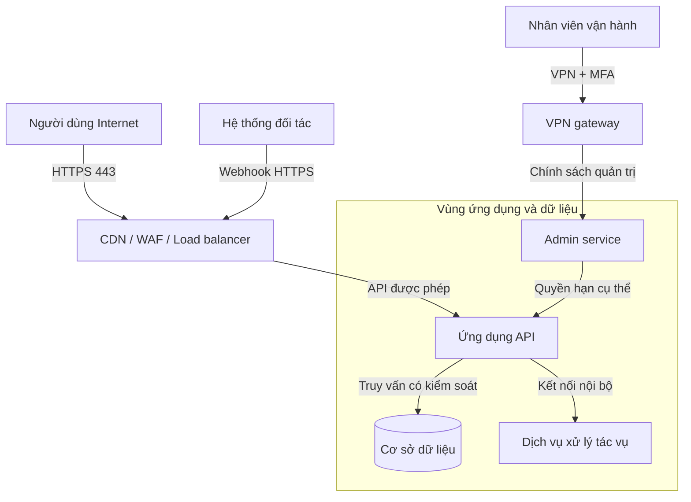
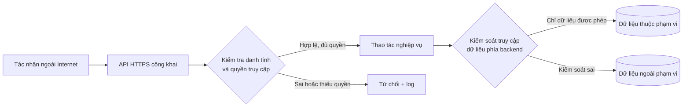

# Entry point và exposed service trong threat modeling mạng

## 1. Vì sao phải bắt đầu từ những điểm có thể truy cập?

Một hệ thống có thể được phân đoạn bằng subnet, VLAN, firewall, VPN, IDS/IPS và nhiều quy tắc truy cập. Tuy nhiên, để đánh giá rủi ro thực tế, trước hết cần xác định **ai có thể đưa dữ liệu hoặc yêu cầu vào hệ thống, đi qua đường nào, và dịch vụ nào đang tiếp nhận**. Trong threat modeling mạng, các vị trí đó được gọi là **entry point** (điểm xâm nhập hoặc điểm vào) và **exposed service** (dịch vụ được làm cho có thể truy cập từ một phạm vi mạng nhất định).

Đây là một kỹ năng nền tảng của học phần **SECURITY_NETWORK_SECURITY**: hiểu các lớp phòng vệ mạng từ phân đoạn, firewall, VPN, IDS/IPS và xác thực kết nối đến DNS, Wi-Fi và hạ tầng đám mây; biết phân tích lưu lượng, mô hình hóa mối đe dọa, theo dõi xâm nhập và thiết kế kiến trúc an toàn.

Sau bài này, bạn có thể:

- Phân biệt *entry point*, *exposed service*, *attack surface*, *trust boundary* và *attack path*.
- Nhận diện điểm vào từ Internet, mạng nội bộ, VPN, Wi-Fi, hạ tầng đám mây và đối tác tích hợp.
- Lập danh mục dịch vụ có thể truy cập, gắn mỗi dịch vụ với chủ sở hữu, luồng dữ liệu, danh tính và cơ chế bảo vệ.
- Dùng sơ đồ luồng dữ liệu và một phương pháp threat modeling để tìm đường tấn công khả dĩ, xếp ưu tiên và đề xuất kiểm soát.
- Kiểm chứng kết luận bằng dữ liệu cấu hình và quan sát mạng trong phạm vi được cấp phép.

## 2. Phân biệt các khái niệm cốt lõi

| Khái niệm | Câu hỏi cần trả lời | Ví dụ |
| --- | --- | --- |
| **Entry point** | Tác nhân hoặc dữ liệu có thể đi vào hệ thống tại đâu? | Trang đăng nhập, API nhận yêu cầu, cổng VPN, webhook nhận sự kiện |
| **Exposed service** | Dịch vụ nào đang được phép tiếp cận từ một vùng mạng? | HTTPS trên `443` từ Internet; PostgreSQL trên `5432` từ subnet ứng dụng |
| **Attack surface** | Những điểm tiếp xúc nào có thể bị tương tác hoặc lạm dụng? | Các endpoint API, giao thức, tài khoản, parser, giao diện quản trị, tích hợp |
| **Trust boundary** | Ở đâu dữ liệu hoặc chủ thể chuyển từ mức tin cậy này sang mức khác? | Internet → reverse proxy; mạng ứng dụng → mạng dữ liệu |
| **Attack path** | Một chuỗi bước có thể dẫn từ điểm vào đến tài sản mục tiêu là gì? | Truy cập tài khoản đối tác → gọi API quá quyền → đọc dữ liệu khách hàng |
| **Exposure** | Một đối tượng cụ thể có khả năng truy cập dịch vụ trong điều kiện nào? | Người dùng Internet có thể gọi API; chỉ máy vận hành thuộc VPN được SSH |

**Entry point rộng hơn một cổng TCP mở.** Một URL API, một tham số do người dùng kiểm soát, một tệp được tải lên, một DNS resolver chấp nhận truy vấn từ vùng không tin cậy, hoặc một hệ thống nhận webhook đều có thể là điểm vào. Ngược lại, một tiến trình đang lắng nghe trên cổng mạng chưa chắc đã được Internet truy cập được.

**Exposed không có nghĩa là có lỗ hổng.** Một dịch vụ HTTPS công khai, được thiết kế để khách hàng sử dụng, vẫn là dịch vụ *exposed* dù đã có xác thực, giới hạn tốc độ và giám sát. Việc nó có điểm yếu khai thác được hay không là câu hỏi cần phân tích tiếp.

**Không phải mọi exposure đều công khai.** Cơ sở dữ liệu chỉ cho phép mạng ứng dụng truy cập vẫn đang *exposed với mạng ứng dụng*. Nếu máy ứng dụng bị chiếm quyền, dịch vụ dữ liệu là điểm đến trên đường tấn công tiếp theo.

### 2.1. Các chiều mô tả một điểm vào

Một entry point hữu ích trong mô hình đe dọa cần được mô tả ít nhất theo những chiều sau:

1. **Nguồn:** Internet, đối tác, máy nhân viên, subnet nội bộ, workload đám mây, thiết bị Wi-Fi hay tài khoản dịch vụ.
2. **Đích:** địa chỉ IP/FQDN, VIP/load balancer, máy chủ, container, API hoặc dịch vụ logic.
3. **Đường kết nối:** DNS, route, NAT, VPN/tunnel, proxy, firewall, security group, cổng và giao thức.
4. **Danh tính:** vô danh, tài khoản người dùng, API key, OAuth token, chứng chỉ mTLS hoặc danh tính workload.
5. **Quyền sau xác thực:** tài nguyên được phép đọc/ghi, vai trò quản trị, quyền truy cập nội bộ được ủy quyền.
6. **Dữ liệu đưa vào:** tham số, body, tệp, header, thông điệp hàng đợi, lệnh điều khiển, bản tin giao thức.
7. **Điểm kiểm soát và quan sát:** firewall/ACL, WAF, gateway, kiểm tra quyền ứng dụng, log, metric, IDS/IPS.

Một dịch vụ có thể có **nhiều entry point**: cùng một backend phục vụ API công khai, dashboard quản trị sau VPN và webhook của đối tác. Không nên gộp chúng thành một quyền truy cập duy nhất.

## 3. Điểm vào nằm ở đâu trong kiến trúc mạng?

### 3.1. Luồng north–south và east–west

**North–south traffic** là luồng đi qua ranh giới hệ thống/mạng doanh nghiệp với bên ngoài: khách hàng truy cập web, nhân viên kết nối VPN, đối tác gọi API. **East–west traffic** là giao tiếp giữa các subnet, dịch vụ, container và máy chủ bên trong hệ thống; luồng này đặc biệt quan trọng đối với nguy cơ di chuyển ngang (*lateral movement*).



Sơ đồ trên có ít nhất ba vùng tin cậy: **Internet/đối tác**, **mạng truy cập quản trị**, và **mạng ứng dụng/dữ liệu**. HTTPS công khai, webhook và VPN là các điểm vào khác nhau. API → cơ sở dữ liệu cũng là một ranh giới cần kiểm soát, dù nằm trong cùng trung tâm dữ liệu hoặc cùng VPC/VNet.

### 3.2. Danh mục các nhóm entry point thường gặp

| Vùng / kênh | Điểm vào hoặc dịch vụ điển hình | Điều cần xem xét |
| --- | --- | --- |
| Internet | Web `443`, API, DNS, mail gateway | Endpoint công khai, xác thực, rate limit, tuyến đến backend, log |
| Truy cập từ xa | VPN, ZTNA, cổng quản trị, SSH/RDP qua jump host | MFA, kiểm tra thiết bị, giới hạn quyền, thời hạn phiên |
| LAN / chi nhánh | SMB, LDAP, DNS nội bộ, ứng dụng nghiệp vụ | ACL theo subnet, quản trị danh tính, chia vùng tin cậy |
| Wi-Fi | Cổng captive portal, hệ thống xác thực, gateway của mạng khách | Tách guest/corporate, bảo vệ kết nối, đường sang mạng nội bộ |
| Cloud | Public load balancer, public IP của máy ảo, ingress, API gateway | Security group, network ACL, route, IAM, IPv6 và origin bypass |
| Container / Kubernetes | Ingress, NodePort, LoadBalancer Service, dashboard, API server | Chính sách mạng, RBAC, cổng quản trị, secret, mTLS khi cần |
| Đối tác / tích hợp | Webhook, B2B API, message consumer, SFTP | Xác minh nguồn và chữ ký, phân quyền, chống replay, SLA |
| Hệ thống quản trị và giám sát | Metrics, log, tracing, backup console, CI/CD runner | Tài khoản đặc quyền, thông tin bí mật, phạm vi mạng và audit |

> Khái niệm entry point phụ thuộc vào **góc nhìn của mô hình**. Nếu đang bảo vệ cơ sở dữ liệu, dịch vụ API nội bộ là một tác nhân ở phía ngoài ranh giới tin cậy của dữ liệu; nếu đang bảo vệ toàn bộ doanh nghiệp, điểm vào ban đầu có thể là VPN hoặc website.

## 4. Vì sao “có cổng mở” khác với “truy cập được từ Internet”?

Để một tác nhân kết nối được đến một dịch vụ, thường cần một chuỗi điều kiện cùng đúng:

```text
Nguồn gửi
  -> DNS / địa chỉ đích (nếu sử dụng tên miền)
  -> route + NAT / load balancer / proxy (nếu có)
  -> chính sách mạng: firewall, ACL, security group
  -> tiến trình lắng nghe và giao thức phù hợp
  -> các bộ lọc và xác thực ở tầng ứng dụng
  -> tài nguyên / thao tác được phép
```

Mỗi tầng có thể cho phép, thay đổi đường đi hoặc từ chối yêu cầu. Phải tách **khả năng thiết lập kết nối mạng** khỏi **khả năng thực hiện một hành động đã được ứng dụng cấp quyền**.

| Dấu hiệu quan sát | Có thể kết luận | Chưa thể kết luận |
| --- | --- | --- |
| Tiến trình bind `127.0.0.1:8080` | Chỉ lắng nghe trên loopback IPv4 của host | Không có proxy, tunnel hoặc port-forward khiến nó tiếp cận được gián tiếp |
| Tiến trình bind `0.0.0.0:8080` | Lắng nghe trên mọi địa chỉ IPv4 cục bộ thích hợp | Internet chắc chắn truy cập được qua firewall/NAT/route |
| Tiến trình bind `[::]:8443` | Lắng nghe trên địa chỉ IPv6 không chỉ định, tùy chế độ socket | IPv4 có hay không dùng chung socket; đường IPv6 có được phép hay không |
| Firewall có luật `allow 443` | Có một điều kiện cấp mạng cho phép trong phạm vi luật | Ứng dụng đang hoạt động, có route hoặc người dùng đã được cấp quyền |
| Tên miền có bản ghi A/AAAA | DNS công bố địa chỉ được cấu hình | Dịch vụ còn sống hoặc IP là điểm vào duy nhất |
| Công cụ kiểm tra nhận HTTP `401`/`403` | Đã có thành phần trả lời HTTP và áp dụng kiểm soát ở điểm đó | Không tồn tại các endpoint khác thiếu xác thực |
| Public IP của load balancer trả lời HTTPS | Một điểm tiếp xúc Internet tồn tại | Backend chỉ truy cập được qua load balancer đó |

**IPv4 và IPv6 phải được xem riêng.** Một máy chủ có thể chặn cổng quản trị trên IPv4 nhưng vẫn có địa chỉ IPv6 toàn cục cùng luật lọc khác. Tương tự, bản ghi DNS không nói hết các địa chỉ, IP trực tiếp, tên miền phụ hoặc đường qua đối tác có thể truy cập dịch vụ.

**Proxy, NAT và tunnel làm thay đổi hình dạng exposure.** Dịch vụ nội bộ bind loopback có thể trở thành điểm vào thông qua reverse proxy; máy chủ không có public IP vẫn có thể nhận lưu lượng Internet từ public load balancer. NAT không tự thay thế firewall, và quy tắc cho phép cần được đánh giá theo hướng của từng luồng.

## 5. Phạm vi và tài sản cần bảo vệ trước khi lập danh mục

Threat modeling bắt đầu bằng một phạm vi rõ ràng: hệ thống nào, môi trường nào (production, staging, development), khu vực cloud nào, vùng mạng nào, và vai trò nào được coi là đối tượng cần phân tích. Cần ưu tiên các **tài sản có giá trị** thay vì chỉ đếm số cổng:

- **Dữ liệu:** thông tin khách hàng, hồ sơ giao dịch, thông tin xác thực, khóa API, bản sao lưu và log nhạy cảm.
- **Khả năng thực thi:** quyền quản trị máy chủ, pipeline triển khai, scheduler, chức năng gọi lệnh hoặc cập nhật cấu hình.
- **Tính sẵn sàng:** DNS, VPN, ingress, load balancer, database và hệ thống giám sát thiết yếu.
- **Ranh giới phân quyền:** tài khoản khách, nhân viên, đối tác, service account, người vận hành và hệ thống tự động.

Xác định **tác nhân** liên quan: người dùng hợp lệ, khách chưa xác thực, tài khoản đối tác, máy nội bộ đã bị xâm nhập, thiết bị Wi-Fi không tin cậy, bot tự động, nhân viên vận hành và các workload liên kết. Một tác nhân có thể có quyền truy cập mạng nhưng không có quyền thực hiện hành động ứng dụng.

### Mẫu bảng kiểm kê exposure

| Trường kiểm kê | Cách ghi cụ thể |
| --- | --- |
| Asset / chủ sở hữu | `customer-api`, đội vận hành ứng dụng |
| Môi trường / vùng | Production, VPC ứng dụng, subnet công khai hoặc riêng |
| Địa chỉ dịch vụ | `api.example.test`, endpoint hoặc IP/VIP liên quan |
| Phạm vi nguồn truy cập | Internet; đối tác có xác thực; subnet dịch vụ; VPN quản trị |
| Giao thức / cổng | HTTPS/TCP `443`, SSH/TCP `22`, DNS/UDP và TCP `53` |
| Entry point logic | `POST /orders`, `POST /webhooks/events`, `/admin` |
| Cơ chế nhận diện và cấp quyền | OIDC, mTLS, chữ ký webhook, RBAC/ABAC |
| Phụ thuộc tiếp theo | Database, queue, hệ thống thanh toán, storage, DNS |
| Kiểm soát mạng và ứng dụng | Route, firewall/ACL, WAF, policy backend, rate limit |
| Quan sát và bằng chứng | Config đã duyệt, flow log, log gateway, truy vết, ngày kiểm tra |
| Trạng thái / quyết định | Dự kiến công khai; nội bộ; ngoại lệ có hạn; đang xác minh |

*Tên miền `.test` trong ví dụ là tên dành cho thử nghiệm và tài liệu. Không gán chúng cho một tài sản đang hoạt động của doanh nghiệp.*

Một danh mục hữu ích phải ghi **dịch vụ thực sự được tiếp xúc từ nguồn nào**, không chỉ danh sách các máy có public IP. Hệ thống ít máy nhưng có nhiều endpoint rủi ro vẫn có bề mặt tấn công lớn.

## 6. Quy trình nhận diện entry point và exposed service

### Bước 1 — Vẽ đường đi thực tế của luồng dữ liệu

Lấy từng chức năng (khách đăng nhập, đối tác gửi webhook, nhân viên triển khai, hệ thống sao lưu), mô tả:

```text
Ai gửi? -> qua biên nào? -> dịch vụ nào nhận?
        -> xác thực/ủy quyền ở đâu? -> đọc/ghi tài sản nào?
        -> phản hồi theo đường nào? -> ghi log ở đâu?
```

Đánh dấu các **trust boundary** ở Internet → edge; edge → backend; nhân viên/VPN → admin; workload → database; workload → nhà cung cấp bên ngoài. Kiểm tra cả tuyến đi, tuyến về và quyền thực hiện thao tác, vì việc vượt một boundary có thể mở ra đường đi thứ hai.

### Bước 2 — Thu thập bằng chứng từ nhiều nguồn

Thông tin cần đối chiếu gồm:

1. **Bản thiết kế và chủ sở hữu:** sơ đồ mạng, dịch vụ và môi trường đang vận hành.
2. **DNS và hạ tầng công khai:** A/AAAA/CNAME, load balancer, API gateway, reverse proxy, danh sách chứng chỉ/host được cấu hình.
3. **Hạ tầng nội bộ và cloud:** subnet, route table, public IP, NAT, peering, VPN, firewall, security group, network ACL.
4. **Máy chủ và nền tảng chạy ứng dụng:** socket đang lắng nghe, container port mapping, Kubernetes Ingress/Service, cấu hình ingress controller.
5. **Cấp ứng dụng và danh tính:** endpoint, cơ chế xác thực, quyền theo vai trò, token, mTLS, webhook signature, log truy cập.
6. **Quan sát thực tế:** flow log, log DNS, gateway/WAF, hệ thống giám sát, kiểm thử kết nối từ các vị trí nguồn đã được cấp phép.

Không nguồn đơn lẻ nào bảo đảm đầy đủ. Ví dụ, tài liệu thiết kế có thể không thể hiện dịch vụ triển khai tạm thời; DNS có thể trỏ đến CDN trong khi origin còn truy cập trực tiếp; flow log chỉ cho biết lưu lượng từng xuất hiện, không chứng minh mọi luật hiện hành.

### Bước 3 — Kiểm chứng khả năng truy cập theo nguồn

Kiểm tra ở nhiều điểm xuất phát đã được phê duyệt: máy thử nghiệm ngoài Internet, máy trong VPN nhân viên, subnet ứng dụng, mạng quản trị. Với cùng một đích, kết quả giữa các vùng nguồn có thể rất khác nhau.

Ví dụ các lệnh quan sát từ Linux trong môi trường của **chính bạn**:

```bash
# Liệt kê địa chỉ và tuyến ở host đang kiểm tra
ip -br address
ip route
ip -6 route

# Xem socket TCP/UDP đang lắng nghe và tiến trình tương ứng
ss -lntup

# Xem đường đi dự kiến đến đích trong môi trường lab
ip route get 192.0.2.20

# Kiểm tra ánh xạ DNS của tên miền thuộc lab
dig A api.example.test
dig AAAA api.example.test

# Xem HTTP response header của endpoint thử nghiệm có quyền kiểm tra
curl -I --max-time 5 https://api.example.test/
```

`ss` và `ip` cho biết góc nhìn cục bộ; `dig` chỉ kiểm tra phân giải tên; `curl` kiểm tra điểm truy cập HTTP cụ thể. Đối chiếu chúng với firewall, load balancer và log để kết luận phạm vi exposure. Một kết nối thất bại có thể do route, TLS, xác thực, rate limit hoặc dịch vụ không phản hồi; cần phân biệt nguyên nhân thay vì gán ngay là “đã được bảo vệ”.

Nếu có quyền xem cấu hình Kubernetes, các lệnh đọc thông tin sau hỗ trợ nhận diện điểm vào:

```bash
kubectl get ingress -A
kubectl get svc -A
```

`Ingress` và `Service` thể hiện ý định công bố dịch vụ; để biết có thật sự truy cập được từ một nguồn, vẫn phải xét ingress controller, load balancer, network policy, cloud firewall và DNS. Các kiểm tra chủ động phải tuân theo phạm vi được phép; tránh dò quét Internet, bên thứ ba hoặc production ngoài kế hoạch vận hành.

### Bước 4 — Ghi nhận exposure và điểm chưa chắc chắn

Mỗi dòng danh mục cần ghi **bằng chứng, thời điểm quan sát và mức tin cậy của kết luận**. Phân biệt:

- **Đã xác nhận truy cập được:** có kết quả kiểm thử kết nối hợp lệ từ vùng nguồn được chỉ định.
- **Được cấu hình để có thể truy cập:** rule/route/ingress cho phép nhưng chưa có xác minh từ nguồn thực tế.
- **Chỉ phát hiện tiến trình lắng nghe:** chưa xác định được đường từ nguồn bên ngoài đến tiến trình.
- **Không truy cập được tại thời điểm kiểm tra:** cần giải thích điều kiện kiểm thử, không suy ra vĩnh viễn không có exposure.

### Bước 5 — Cập nhật khi hệ thống thay đổi

Exposure có thể thay đổi sau triển khai, thay cấu hình cloud, thêm IP, bật IPv6, cấp quyền VPN, chuyển CDN hoặc tạo môi trường tạm. Nên gắn việc kiểm tra với vòng đời hạ tầng: review kiến trúc, pull request IaC, pipeline triển khai, kiểm kê định kỳ và cảnh báo drift cấu hình.

## 7. Từ entry point đến attack path

Chỉ biết “cổng nào mở” chưa đủ. Threat modeling cần tìm **chuỗi điều kiện** cho phép tác nhân tác động đến tài sản nhạy cảm.



Đường đi từ Internet đến một API có thể là **mong đợi và hợp lệ**. Điểm yếu xuất hiện nếu danh tính bị giả mạo, phân quyền đối tượng sai, input được xử lý không an toàn, gateway bị bỏ qua hoặc API có quyền nội bộ quá rộng. Ngược lại, dịch vụ chỉ mở trong nội bộ vẫn có nguy cơ nếu một máy trung gian bị chiếm quyền.

### 7.1. Dùng STRIDE để đặt câu hỏi có hệ thống

STRIDE là một cách gợi mở nhóm mối đe dọa. Với **mỗi entry point và luồng dữ liệu**, đặt câu hỏi:

| Nhóm STRIDE | Câu hỏi đối với entry point / exposed service | Kiểm soát liên quan |
| --- | --- | --- |
| **S — Spoofing** | Có thể giả mạo người dùng, workload, gateway hoặc nguồn webhook không? | MFA, xác minh token, mTLS, chữ ký webhook, kiểm tra danh tính |
| **T — Tampering** | Có thể sửa yêu cầu, cấu hình route, bản tin hoặc dữ liệu khi truyền không? | TLS, toàn vẹn dữ liệu, kiểm tra input, phân quyền thay đổi cấu hình |
| **R — Repudiation** | Có thể thực hiện hành động nhưng không để lại bằng chứng đáng tin cậy không? | Audit log, correlation ID, đồng bộ thời gian, bảo vệ log |
| **I — Information disclosure** | Endpoint nào có thể để lộ dữ liệu, metadata, token hoặc topology? | Phân quyền theo đối tượng, hạn chế dữ liệu trả về, bí mật cấu hình |
| **D — Denial of service** | Dịch vụ hoặc dependency nào có thể bị quá tải bởi yêu cầu hợp lệ/bất thường? | Rate limit, quota, timeout, dự phòng, chống DDoS |
| **E — Elevation of privilege** | Từ quyền người dùng/đối tác có thể chuyển sang quyền vận hành hoặc quyền DB không? | RBAC/ABAC, least privilege, tách mặt phẳng quản trị, segmentation |

STRIDE là công cụ lập câu hỏi, **không phải chứng minh** một lỗ hổng đang tồn tại. Để xác nhận cần bằng chứng cấu hình, kiểm tra quyền và kiểm thử được cấp phép.

### 7.2. Chuỗi tấn công nhiều giai đoạn

Một chuỗi giả định có thể được mô tả như sau:

```text
Website công khai
    -> dịch vụ xử lý yêu cầu có quyền gọi backend
    -> backend được phép kết nối mạng dữ liệu
    -> tài khoản dịch vụ có quyền quá rộng
    -> truy cập dữ liệu không thuộc chức năng ban đầu
```

Mỗi mũi tên là một **giả thuyết** cần kiểm chứng: ai có thể gọi ai, kiểm soát nào đang tồn tại, quyền thực tế là gì và log có hỗ trợ phát hiện hay không. Có nhiều điểm để ngắt chuỗi: validate input ở website, kiểm tra quyền ở backend, giảm đặc quyền account, lọc giữa subnet và phát hiện truy cập bất thường.

## 8. Những exposure cần ưu tiên phân tích

| Entry point / exposed service | Kịch bản đáng quan tâm | Câu hỏi và biện pháp ưu tiên |
| --- | --- | --- |
| **Trang quản trị / management API** | Giao diện đặc quyền xuất hiện trên Internet do routing hoặc ingress sai | Có bắt buộc MFA, quyền nhỏ nhất, qua mạng quản trị/ZTNA không? Có thể truy cập thẳng origin? |
| **SSH/RDP/WinRM** | Cổng quản trị bị truy cập từ vùng nguồn rộng | Giới hạn nguồn, jump host, danh tính mạnh, audit phiên, cập nhật bản vá |
| **Database / cache / queue** | Dịch vụ dữ liệu chấp nhận kết nối từ vùng không cần thiết | Chặn truy cập trực tiếp từ Internet, giới hạn workload, xác thực và mã hóa thích hợp |
| **Public API và webhook** | Lạm dụng endpoint, giả mạo thông điệp, sai quyền theo đối tượng | Xác thực, xác minh chữ ký + chống replay, authorization ở mỗi thao tác, rate limit |
| **DNS resolver / DNS control plane** | Resolver phục vụ phạm vi quá rộng, mất kiểm soát bản ghi hoặc lộ thông tin | Hạn chế recursion theo đối tượng, kiểm soát thay đổi DNS, logging, bảo vệ quản trị |
| **VPN / remote access** | Tài khoản nhân viên mất quyền kiểm soát mở đường vào nhiều subnet | MFA, kiểm tra tư thế thiết bị khi có, cấp quyền theo ứng dụng, log và thu hồi truy cập |
| **Ingress / load balancer / CDN origin** | Người dùng đi đường trực tiếp bỏ qua kiểm soát ở edge | Chỉ cho phép origin nhận traffic từ edge tin cậy; xác thực giữa các lớp khi phù hợp |
| **Metrics, tracing, backup, CI/CD** | Giao diện ít chú ý lại có secret, cấu hình hoặc quyền triển khai | Không công khai mặc định; bảo vệ mạng + danh tính + audit + hạn chế dữ liệu nhạy cảm |
| **IPv6 / môi trường thử nghiệm** | Dịch vụ ngoài danh mục production nhưng vẫn đến được | Kiểm kê A/AAAA, firewall IPv6, thu hồi tài nguyên tạm, kiểm tra drift |

Lưu ý: thứ tự ưu tiên không chỉ dựa vào số cổng hoặc dịch vụ có mật khẩu hay không. Một endpoint quản trị trên mạng riêng với quyền rộng và một webhook công khai có kiểm tra chữ ký yếu là **hai dạng rủi ro khác nhau**; phải xét danh tính, vùng nguồn, tài sản đích, biện pháp bảo vệ và tác động nghiệp vụ.

## 9. Case study: Hệ thống đặt hàng có API công khai và quản trị nội bộ

### 9.1. Kiến trúc giả định

Một doanh nghiệp có ứng dụng đặt hàng với các thành phần:

- `shop.example.test`: website công khai qua CDN/WAF → load balancer HTTPS.
- `api.example.test`: API công khai qua gateway → ứng dụng đặt hàng trên subnet riêng.
- `admin.example.test`: trang quản trị dành cho nhân viên, dự kiến chỉ truy cập qua VPN + MFA.
- PostgreSQL `10.20.30.10:5432`: cơ sở dữ liệu chỉ dành cho ứng dụng/API và bộ tác vụ được ủy quyền.
- `POST /webhooks/payment`: nhận xác nhận thanh toán từ một nhà cung cấp dịch vụ qua HTTPS.

Giả sử đội vận hành phát hiện ba dấu hiệu:

1. Load balancer cho `admin.example.test` có địa chỉ công khai, trong khi tài liệu kiến trúc yêu cầu chỉ truy cập qua VPN.
2. Một rule mạng cho phép kết nối tới PostgreSQL `5432` từ cả subnet ứng dụng lẫn subnet máy kiểm thử cũ.
3. Webhook kiểm tra API key trong header nhưng chưa xác định có kiểm tra chữ ký nội dung, dấu thời gian và chống phát lại hay không.

Đây là **dấu hiệu cần điều tra**, chưa phải bằng chứng rằng đã xảy ra xâm nhập. Đội phân tích cần đối chiếu route, firewall, listener, chính sách ứng dụng và log để xác định mức exposure thực tế.

### 9.2. Bảng threat model rút gọn

| ID | Tài sản và entry point | Giả thuyết đe dọa | Bằng chứng cần lấy | Kiểm soát đề xuất |
| --- | --- | --- | --- | --- |
| TM-01 | Quản trị qua `admin.example.test` | Người ngoài Internet có thể tới giao diện đặc quyền | LB listener, DNS, route, firewall; phép thử hợp lệ từ mạng ngoài | Chỉ cho nguồn quản trị được phép tiếp cận, MFA, quyền tối thiểu và audit |
| TM-02 | PostgreSQL `10.20.30.10:5432` | Một máy trong subnet thử nghiệm cũ có thể truy cập DB không cần thiết | Rule nguồn/đích, route và kiểm thử được phê duyệt | Thu hẹp rule theo workload cần dùng; xóa ngoại lệ đã hết hạn |
| TM-03 | `POST /webhooks/payment` | Yêu cầu giả mạo hoặc phát lại khiến hệ thống cập nhật trạng thái sai | Cấu hình xác thực, kiểm tra chữ ký, log, chính sách idempotency | Xác thực thông điệp, kiểm tra timestamp/nonce theo giao thức, chống replay, idempotency |
| TM-04 | CDN/WAF → origin API | Origin có thể nhận request trực tiếp, bỏ qua WAF | Danh sách IP, ACL origin, quy tắc xác thực từ edge | Giới hạn origin theo nguồn edge hoặc cơ chế xác thực phù hợp |
| TM-05 | Ứng dụng → DB | Tài khoản ứng dụng quá quyền sau khi máy bị chiếm | Quyền DB của service account, kết nối và audit | Giảm quyền DB, phân tách vai trò, giám sát truy vấn nguy cơ cao |

### 9.3. Chấm mức ưu tiên mà không đánh đồng exposure với lỗ hổng

Có thể dùng thang đánh giá đơn giản từ 1 đến 3 để **hỗ trợ thảo luận**; điểm số không thay thế nhận định chuyên môn:

- **E — Mức tiếp xúc:** 1 = nguồn hẹp được quản lý; 2 = nhiều vùng nội bộ/đối tác; 3 = Internet rộng.
- **L — Khả năng xảy ra theo bằng chứng:** 1 = khó hoặc có kiểm soát mạnh; 2 = còn thiếu xác minh/kiểm soát một phần; 3 = điểm yếu rõ hoặc dễ lạm dụng trong bối cảnh mô hình.
- **I — Tác động:** 1 = hạn chế; 2 = ảnh hưởng một dịch vụ/nhóm dữ liệu; 3 = dữ liệu nhạy cảm, quyền đặc biệt hoặc gián đoạn nghiệp vụ lớn.

Điểm gợi ý: `R = E × L × I`, từ 1 đến 27; dùng để sắp xếp công việc **trong cùng một hệ thống**, không coi là thước đo xác suất chính xác hay tiêu chuẩn ngành.

| Tình huống minh họa | E | L | I | R | Cách xử lý |
| --- | ---: | ---: | ---: | ---: | --- |
| Đã xác minh admin công khai nhưng thiếu kiểm soát cần thiết | 3 | 3 | 3 | 27 | Ưu tiên khắc phục ngay đường công khai và xác thực |
| DB mở cho subnet thử nghiệm cũ; chưa có bằng chứng bị lạm dụng | 2 | 2 | 3 | 12 | Xác minh kết nối, xóa rule không có nhu cầu |
| Webhook thiếu bằng chứng về chống replay | 3 | 2 | 2 | 12 | Kiểm tra thiết kế/protocol, bổ sung kiểm soát khi xác nhận thiếu |
| API công khai có OIDC, quyền chi tiết, kiểm soát tải và log | 3 | 1 | 2 | 6 | Giữ trong danh mục; kiểm tra định kỳ và theo thay đổi |

**Cách đọc đúng:** nếu chưa xác minh liệu endpoint quản trị có thật sự truy cập được từ Internet, không được coi tình huống đầu tiên là sự cố đã xác nhận. Cần kiểm tra bằng chứng trước khi gắn trạng thái và quyết định mức khẩn cấp. Tương tự, điểm rủi ro không cho biết lỗ hổng cụ thể có bị khai thác hay chưa.

### 9.4. Tài liệu đầu ra nên đủ để sửa được

Với mỗi phát hiện, ghi rõ *đường từ nguồn nào đến đích nào*, điều kiện cần để đi qua từng ranh giới, bằng chứng, người phụ trách, biện pháp xử lý, tiêu chí xác nhận đã đóng và thời hạn rà soát. Ví dụ:

```yaml
id: TM-02
asset: order-database
entry_point: tcp/5432
source_scope: legacy-test-subnet
trust_boundary: test-network -> data-network
evidence: security-rule-and-route-reviewed
status: needs-validation
owner: database-and-network-team
mitigation: restrict-access-to-authorized-app-workloads
verification: connection-from-legacy-test-subnet-is-blocked
```

Đây là **mẫu minh họa cho tài liệu threat model**, không phải cấu hình chạy được; trạng thái và bằng chứng trong hệ thống thực phải dựa trên kết quả kiểm tra đã ghi nhận.

## 10. Thiết kế kiểm soát theo từng ranh giới

### 10.1. Giảm exposure không cần thiết

- **Không công khai dịch vụ mặc định:** chỉ mở ingress/port có chủ sở hữu và mục đích nghiệp vụ rõ ràng; thu hồi tài nguyên thử nghiệm và rule hết hạn.
- **Tách mạng dữ liệu và quản trị:** DB, cache, metrics, backup, SSH/RDP và dashboard vận hành chỉ nhận kết nối từ phạm vi nguồn thích hợp.
- **Xem cả IPv4 và IPv6:** đồng bộ chính sách, giám sát và danh mục endpoint cho hai ngăn xếp.
- **Quản lý danh tính:** MFA cho truy cập đặc quyền, service identity và nguyên tắc quyền tối thiểu cho giao tiếp giữa workload.
- **Quản lý đường qua đối tác:** giới hạn nguồn khi có ý nghĩa, xác minh chữ ký/mTLS/token theo thiết kế tích hợp; không chỉ dựa vào IP nếu có thể giả mạo ở lớp ứng dụng hoặc IP thay đổi.

### 10.2. Bảo vệ những dịch vụ phải được tiếp xúc

- **L7:** xác thực, authorization tại từng thao tác và từng đối tượng, kiểm tra input, hạn chế tải lên, xử lý request an toàn, quota và rate limiting.
- **L3/L4:** segmentation, firewall, ACL, security group, giới hạn tuyến và port, phòng vệ DDoS, kiểm soát kết nối egress khi phù hợp.
- **Mã hóa và xác thực kết nối:** TLS hợp lệ, xác minh danh tính server, cân nhắc mTLS/IPsec cho những luồng yêu cầu xác thực hai phía hoặc bảo vệ lưu lượng giữa vùng mạng.
- **Phát hiện:** log tại gateway và ứng dụng, flow telemetry, cảnh báo truy cập tới dịch vụ quản trị từ vùng nguồn bất thường, IDS/IPS tại điểm quan sát phù hợp.
- **Vận hành:** cập nhật bản vá, quản lý cấu hình qua mã nguồn, review thay đổi, thu hồi ngoại lệ, sao lưu và diễn tập ứng phó.

**WAF không thay thế phân quyền nghiệp vụ.** WAF có thể lọc một số mẫu tấn công HTTP, nhưng không thể tự biết người dùng A có quyền xem đơn hàng của người dùng B hay không. **VPN không có nghĩa toàn mạng bên trong được tin cậy.** Sau khi xác thực kết nối từ xa, vẫn phải phân quyền đến từng ứng dụng và tài nguyên. **Firewall không thay thế mã hóa nội dung**, và IDS/IPS cần đặt đúng tuyến lưu lượng mà nó có thể quan sát.

### 10.3. Phòng vệ theo nhiều điểm cắt trong attack path

Giả sử đường tấn công tiềm năng là `Internet -> API -> workload -> DB`:

| Điểm cắt | Mục tiêu | Dữ liệu kiểm chứng |
| --- | --- | --- |
| Edge → API | Chỉ công bố endpoint dự kiến, giới hạn tải | Cấu hình gateway/WAF, log HTTP, allowlist origin |
| API → nghiệp vụ | Không cho vượt quyền theo người dùng/đối tượng | Kiểm thử authorization, audit giao dịch |
| Workload → DB | Chỉ workload và cổng cần dùng được kết nối | Rule mạng, route, flow log, kiểm thử kết nối có quyền |
| Danh tính workload → dữ liệu | Chỉ cho đọc/ghi đúng bảng và thao tác | Cấp quyền DB/service account, log truy vấn |
| Giám sát xuyên tuyến | Phát hiện hành vi sai lệch, truy vết nguyên nhân | Correlation ID, flow log, API log, cảnh báo |

Kiểm soát ở nhiều lớp giúp giảm khả năng một điểm yếu đơn lẻ mở toàn bộ đường tấn công.

## 11. Đánh giá kết quả và tiêu chí hoàn thành

Sau khi lập threat model, nên có các sản phẩm đủ rõ để nhóm mạng, bảo mật và ứng dụng thực hiện:

1. **Sơ đồ luồng dữ liệu** chỉ ra tác nhân, dịch vụ, tài sản và trust boundary.
2. **Danh mục entry point/exposed service** có nguồn truy cập, giao thức, chủ sở hữu, môi trường và chứng cứ.
3. **Danh sách giả thuyết đe dọa và attack path** liên hệ với tài sản có giá trị, ghi rõ giả định còn phải xác minh.
4. **Bảng ưu tiên xử lý** dựa trên mức tiếp xúc, khả năng lạm dụng, tác động và bối cảnh nghiệp vụ.
5. **Phương án kiểm soát và tiêu chí nghiệm thu** có chủ sở hữu, bằng chứng xác nhận và quy trình kiểm tra lại khi thay đổi.

Một threat model hữu ích không chỉ là sơ đồ: cần trả lời được câu hỏi **“Nếu một máy ở vùng X gửi lưu lượng đến dịch vụ Y, nó đi qua đâu, được xác minh/cấp quyền tại đâu, và ai sẽ nhận được tín hiệu khi xảy ra bất thường?”**

## 12. Bài thực hành: tìm các điểm vào bị bỏ sót

**Bối cảnh.** Một ứng dụng triển khai trên cloud có API công khai qua load balancer. Nhóm quản trị dùng VPN. Backend kết nối cơ sở dữ liệu riêng. Bạn nhận được các thông tin:

```text
1. Public load balancer: TCP/443 -> API backend.
2. VM backend: ứng dụng bind 0.0.0.0:8080.
3. Firewall subnet backend: chỉ cho phép TCP/8080 từ load balancer.
4. VM backend: có địa chỉ IPv6 toàn cục, chưa kiểm tra IPv6 firewall.
5. /admin đang dùng cùng host/API với endpoint khách hàng.
6. Database: TCP/5432 chỉ cho phép từ subnet backend.
7. Một webhook đối tác dùng đường /events, chưa rõ cách xác minh nguồn gửi.
```

### Câu hỏi

1. Hãy liệt kê ít nhất **bốn entry point** hoặc bề mặt tiếp xúc cần đưa vào sơ đồ. Phân biệt chúng theo nguồn truy cập.
2. Dòng 2 có đủ để kết luận `8080` công khai ra Internet không? Vì sao?
3. Dòng 3 đã bảo đảm IPv6 của backend được bảo vệ tương đương IPv4 chưa?
4. `/admin` chỉ nằm trên cùng host với API công khai có nghĩa là được bảo vệ bởi VPN không? Cần kiểm tra thêm gì?
5. Nếu một workload backend bị chiếm quyền, rủi ro với database còn phụ thuộc những điều kiện nào?
6. Hãy chọn ba việc cần kiểm chứng sớm và nêu nguồn bằng chứng cho từng việc.

### Gợi ý đáp án và giải thích

1. Các điểm đáng phân tích gồm HTTPS qua load balancer, endpoint `/admin`, webhook `/events`, cổng `8080` nội bộ và kết nối từ backend đến DB; VPN cũng là entry point cho nhân viên. Mỗi điểm có nguồn và trust boundary khác nhau.
2. **Chưa đủ.** Bind `0.0.0.0` chỉ chứng tỏ listener ở mọi địa chỉ IPv4 cục bộ thích hợp. Khả năng truy cập thực tế còn phụ thuộc route, địa chỉ công khai, firewall, proxy/NAT và cấu hình nền tảng.
3. **Chưa.** Phải xác minh địa chỉ IPv6, chính sách lọc IPv6 và tuyến đến backend. Luật IPv4 không tự chứng minh luật IPv6 tương đương.
4. **Không.** Cần xác minh gateway/ingress có chặn `/admin` với nguồn ngoài VPN hay không, rồi kiểm tra xác thực và quyền quản trị ở ứng dụng. Cần xem khả năng truy cập thẳng origin.
5. Phụ thuộc quyền mạng đến DB, tài khoản DB mà workload đang giữ, phạm vi quyền đọc/ghi, khả năng truy cập secret, xác thực và quan sát truy vấn. “DB ở subnet riêng” chưa đủ để kết luận rủi ro thấp.
6. Ví dụ: (a) kiểm tra IPv6 backend bằng route/firewall và thử kết nối có phép; (b) kiểm tra `/admin` từ mạng ngoài VPN và rà cấu hình gateway cùng authorization; (c) xác minh cơ chế chữ ký, thời gian hiệu lực, chống replay của `/events` cùng log webhook.

## 13. Những sai lầm cần tránh

- **Chỉ kiểm kê IP công khai.** Dịch vụ trong subnet nội bộ, VPN, liên kết đối tác và workload-to-workload vẫn là entry point đối với những tác nhân nằm trong vùng nguồn đó.
- **Coi cổng đang lắng nghe là đã public.** Listener, routing, firewall, ingress và xác thực là những điều kiện khác nhau.
- **Chỉ kiểm tra IPv4.** Dual-stack có thể tạo đường vào IPv6 riêng, cần danh mục và kiểm soát tương ứng.
- **Tin rằng WAF/CDN luôn bảo vệ origin.** Nếu origin nhận kết nối trực tiếp, đường qua kiểm soát edge có thể bị bỏ qua.
- **Xem subnet riêng hoặc VPN là ranh giới tin cậy tuyệt đối.** Máy bên trong có thể bị xâm nhập; kiểm soát danh tính và quyền ở dịch vụ vẫn cần thiết.
- **Chỉ chấm điểm theo số cổng.** Giá trị tài sản, khả năng tiếp cận, mức quyền, cơ chế kiểm soát và chuỗi phụ thuộc quyết định rủi ro.
- **Bỏ qua các hệ thống quản trị, thử nghiệm và giám sát.** Những dịch vụ này thường có quyền rộng, secret hoặc dữ liệu hoạt động nhạy cảm.
- **Không lưu bằng chứng và ngày kiểm tra.** Exposure biến động theo cấu hình, nên kết luận phải có phạm vi và thời điểm áp dụng.

## 14. Tự kiểm tra trước khi chuyển sang chủ đề tiếp theo

1. Một API chỉ cho phép truy cập từ subnet ứng dụng có phải là *exposed service* không? Đối với tác nhân nào?
2. Vì sao cần vừa kiểm tra route/firewall vừa kiểm tra phân quyền nghiệp vụ của `/admin`?
3. Nêu ít nhất hai cách một origin có thể bị truy cập ngoài đường CDN/WAF được thiết kế.
4. Hãy trình bày một attack path từ tài khoản VPN bị xâm nhập đến cơ sở dữ liệu; đặt tên ít nhất ba điểm có thể cắt đường tấn công.
5. Khi phát hiện rule cho phép `0.0.0.0/0` tới TCP/443, vì sao chưa thể kết luận có lỗ hổng nghiêm trọng?

**Định hướng trả lời:** (1) Có, với các chủ thể trong subnet hoặc có đường vào subnet đó; (2) vì đến được dịch vụ và được phép thao tác là hai câu hỏi khác nhau; (3) public IP của origin, DNS/host thay thế, hoặc route/tunnel/ingress cấu hình lệch; (4) xác thực mạnh tại VPN, chia vùng, giới hạn đường mạng, quyền ứng dụng/DB và giám sát; (5) HTTPS công khai có thể là chủ đích hợp pháp, phải xét tài sản, xác thực, quyền, mức phơi lộ, cấu hình và bằng chứng về điểm yếu.

### Thuật ngữ và tài liệu tham khảo để học thêm

- **Data Flow Diagram (DFD):** sơ đồ tác nhân, tiến trình, dữ liệu và đường đi qua ranh giới tin cậy; sử dụng khi xây dựng threat model.
- **STRIDE:** nhóm câu hỏi về giả mạo, sửa đổi, phủ nhận, lộ thông tin, từ chối dịch vụ và leo thang đặc quyền.
- **OWASP Attack Surface Analysis Cheat Sheet:** cách nhìn và rà soát bề mặt tấn công của ứng dụng.
- **MITRE ATT&CK:** tham chiếu các kỹ thuật như *Exploit Public-Facing Application* (T1190), *External Remote Services* (T1133) và *Network Service Discovery* (T1046) khi mô tả giả thuyết đe dọa; ánh xạ kỹ thuật không đồng nghĩa với bằng chứng đã xảy ra xâm nhập.
- **NIST SP 800-207 — Zero Trust Architecture:** cơ sở để đánh giá truy cập theo danh tính, tài nguyên và chính sách thay vì mặc định tin tưởng vì vị trí mạng.
