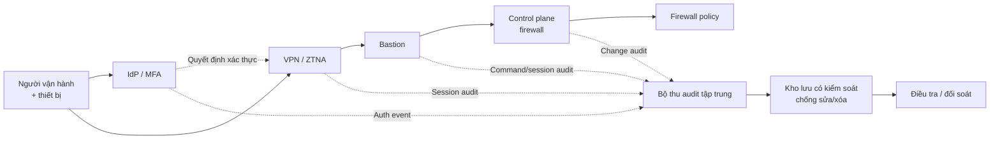

# Repudiation và audit trong threat modeling mạng

## Mục tiêu học tập

Sau bài học, bạn có thể:

1. Giải thích **Repudiation** (chối bỏ hành động) trong mô hình **STRIDE**, phân biệt với giả mạo danh tính (Spoofing), sửa đổi dữ liệu (Tampering) và khái niệm *non-repudiation* trong mật mã.
2. Lập sơ đồ luồng chứng cứ đi qua VPN, firewall, proxy, bastion, dịch vụ đám mây và ứng dụng để tìm các vị trí có nguy cơ mất khả năng quy trách nhiệm.
3. Thiết kế **audit trail** trả lời được “ai, làm gì, khi nào, ở đâu, trên đối tượng nào, kết quả ra sao” và hiểu giới hạn của địa chỉ IP, NAT, TLS và tài khoản dùng chung.
4. Đề xuất kiểm soát giúp log đáng tin cậy: định danh mạnh, đồng bộ thời gian, chuyển log an toàn, chống sửa/xóa, kiểm soát truy cập, giám sát thiếu log và quản lý vòng đời chứng cứ.
5. Phân tích sự kiện mạng dựa trên nhiều nguồn, đánh giá độ tin cậy của bằng chứng và chỉ ra các kết luận **chưa thể** rút ra từ dữ liệu hiện có.

## 1. Repudiation nghĩa là gì?

**Repudiation** là tình huống một chủ thể thực hiện hoặc bị cho là đã thực hiện hành động, sau đó **phủ nhận** hành động đó, trong khi hệ thống không có bằng chứng đủ tin cậy để xác minh. Trong threat modeling, đây là một trong sáu nhóm mối đe dọa của **STRIDE**:

| Nhóm STRIDE | Câu hỏi gợi mở trong môi trường mạng |
|---|---|
| **S**poofing | Có thể dùng định danh, token, địa chỉ hoặc thiết bị giả để truy cập không? |
| **T**ampering | Có thể sửa lưu lượng, cấu hình, bản ghi hay bằng chứng không? |
| **R**epudiation | Sau một thay đổi hoặc truy cập, có thể xác minh **chủ thể và hành động** đã xảy ra không? |
| **I**nformation Disclosure | Có dữ liệu nhạy cảm bị lộ qua traffic, log hoặc hệ thống quan sát không? |
| **D**enial of Service | Có thể làm gián đoạn dịch vụ hoặc cả hệ thống thu log không? |
| **E**levation of Privilege | Có thể có được quyền vượt mức đã cấp không? |

Ví dụ: firewall bị chỉnh sửa để mở truy cập từ Internet vào một máy chủ nội bộ. Một quản trị viên nói: “Tôi không thay rule đó”. Nếu chỉ có bản cấu hình hiện tại, không có sự kiện **ai xác thực, thay đổi rule nào, từ phiên nào, khi nào và hệ thống ghi nhận kết quả gì**, đội vận hành khó xác minh lời phủ nhận.

Repudiation không nhất thiết chứng minh người phủ nhận nói dối. Dữ liệu có thể thiếu do sự cố, log bị xóa, tài khoản bị đánh cắp, đồng hồ sai hoặc hành động được thực hiện qua tài khoản dùng chung. Threat modeling tìm cách **giảm sự mơ hồ**, đồng thời tránh kết luận vượt quá bằng chứng.

### 1.1. Audit, accountability và non-repudiation

- **Audit logging**: ghi lại các sự kiện quan trọng theo cấu trúc phù hợp với mục tiêu điều tra hoặc tuân thủ.
- **Audit trail**: chuỗi bản ghi có thể nối với nhau để tái dựng các bước dẫn đến một trạng thái hoặc quyết định.
- **Accountability** (khả năng quy trách nhiệm): liên hệ một hành động với định danh hoặc phiên đã được kiểm chứng, cùng quy trình giám sát và trách nhiệm tương ứng.
- **Non-repudiation** (chống chối bỏ, theo nghĩa mật mã): cơ chế bằng chứng giúp một bên độc lập kiểm chứng một thao tác đã được ký hoặc xác nhận bởi khóa tương ứng. **Chữ ký số** có thể hỗ trợ mạnh, nhưng cần cả quản lý khóa, xác minh danh tính, chính sách chứng thư và chuỗi chứng cứ; bản thân chữ ký không chứng minh người sở hữu hợp pháp đã trực tiếp thao tác nếu khóa hoặc thiết bị đã bị xâm phạm.

Một log có dòng `user=admin` **không tự chứng minh** cá nhân quản trị đã thực hiện thao tác. Tương tự, HMAC dùng **khóa đối xứng chia sẻ** giúp phát hiện sửa đổi, nhưng người cùng nắm khóa có thể tạo MAC; nó không cung cấp bằng chứng chống chối bỏ độc lập theo cách một chữ ký số được quản lý đúng có thể hỗ trợ.

## 2. Vì sao Repudiation đặc biệt khó trong mạng?

Trong hệ thống nhiều lớp, lưu lượng không còn mang cùng một định danh từ đầu đến cuối:

- **NAT/PAT** thay đổi IP và cổng nguồn; nhiều thiết bị có thể dùng chung một IP public.
- **VPN/ZTNA** có thể gắn phiên với người dùng và thiết bị, nhưng một địa chỉ IP trong tunnel không tự chứa danh tính đó.
- **Reverse proxy/load balancer** kết thúc kết nối phía client và tạo kết nối mới đến backend; backend có thể chỉ thấy IP của proxy.
- **Bastion/jump host** có thể đại diện nhiều phiên quản trị; nếu dùng tài khoản hệ điều hành dùng chung, log ở máy đích có thể không phân biệt người thao tác.
- **Container, Kubernetes, cloud network** có IP và workload ngắn hạn; IP hoặc pod có thể bị tái sử dụng sau khi triển khai lại.
- **TLS, mTLS, QUIC** bảo vệ nội dung trên đường truyền nhưng thiết bị quan sát trung gian không nhất thiết đọc được yêu cầu ứng dụng hoặc danh tính bên trong.
- **Sampling, mất gói, timeout và clock drift** làm audit trail thiếu hoặc sai thứ tự.

Vì vậy, **IP + port + timestamp** là dữ liệu hỗ trợ tương quan, **không phải bằng chứng độc lập về danh tính một con người**. Cần nối thông tin từ lớp xác thực, điểm thực thi chính sách, thiết bị mạng và ứng dụng.

### 2.1. Ví dụ luồng quản trị thay đổi firewall

Giả sử nhân viên vận hành đăng nhập từ máy cá nhân được quản lý, đi qua VPN, vào bastion, rồi chỉnh chính sách firewall qua hệ thống quản trị mạng.



Các **trust boundary** cần kiểm tra là: thiết bị người dùng ↔ hệ thống nhận dạng; Internet ↔ VPN/ZTNA; vùng VPN ↔ bastion; bastion ↔ control plane; nguồn phát log ↔ bộ thu; bộ thu ↔ kho lưu; kho lưu ↔ người điều tra.

Mọi boundary đều có câu hỏi: **ai có thể tạo/sửa/xóa sự kiện, hệ thống nhận biết nguồn gửi như thế nào, và bản ghi có còn đáng tin sau khi một thành phần bị xâm nhập hay không?**

## 3. Threat modeling Repudiation theo từng bước

### Bước 1: Xác định hành động phải quy trách nhiệm

Không phải mọi packet đều cần audit. Ưu tiên các thao tác có ảnh hưởng an ninh hoặc có thể dẫn đến tranh chấp:

- Đăng nhập/đăng xuất quản trị, xác thực thất bại, cấp hoặc thu hồi phiên VPN/ZTNA.
- Thêm, sửa, xóa rule firewall/ACL, định tuyến, NAT, DNS, VPN hoặc cấu hình IDS/IPS.
- Cấp, nâng, sử dụng hoặc thu hồi quyền; thay đổi certificate, khóa hoặc tài khoản dịch vụ.
- Truy cập dữ liệu nhạy cảm, xuất dữ liệu, kết nối tới vùng mạng cần kiểm soát.
- Bật/tắt audit, thay đổi chính sách retention, xóa sự kiện hoặc vô hiệu hóa collector.
- Thực hiện deployment hoặc thay đổi chính sách mạng trong Kubernetes/cloud control plane.

Với mỗi thao tác, cần xác định **đơn vị hành động**: một thay đổi rule gồm nhiều lệnh API phải có một change ID/transaction ID chung để liên hệ tất cả sự kiện.

### Bước 2: Lập bản đồ định danh và nguồn chứng cứ

| Điểm quan sát | Bằng chứng thường có | Giới hạn cần ghi nhận |
|---|---|---|
| Identity Provider (IdP) | User ID, phương thức xác thực, MFA, thiết bị, thời gian | Tài khoản hoặc phiên có thể bị chiếm đoạt; login không chứng minh hành động tiếp theo |
| VPN/ZTNA | Session ID, user/device, IP tunnel được cấp, bắt đầu/kết thúc | IP có thể được cấp lại; một số log thiếu cổng NAT |
| DHCP / NAT / firewall | Lease, ánh xạ IP:port và thời gian, quyết định allow/deny | NAT log có thể bị thiếu; clock drift gây tương quan sai |
| Bastion / PAM | Người dùng, mục tiêu truy cập, session, lệnh/phiên được kiểm soát | Không phải mọi cách truy cập đều được ghi; recording có thể chứa bí mật |
| Proxy / API gateway | Client identity đã xác thực, route, request ID, HTTP method, status | Header client tự gửi như `X-Forwarded-For` không đáng tin nếu chưa được proxy tin cậy chuẩn hóa |
| Ứng dụng / control plane | Action, resource, actor đã xác thực, before/after, outcome | Nếu app đã bị chiếm quyền, log cục bộ có thể bị giả hoặc bỏ qua |
| DNS / IDS / IPS / flow logs | Truy vấn tên miền, alert, 5-tuple, bytes, thời gian | Alert có false positive; NetFlow/VPC Flow Logs không chứa đầy đủ nội dung yêu cầu ứng dụng |
| SIEM / log archive | Chuỗi sự kiện nhiều nguồn, trạng thái ingest, bằng chứng bất biến | Vẫn chịu rủi ro mất log trước khi ingest, quyền quản trị quá rộng, retention sai |

**5-tuple** là `source IP`, `source port`, `destination IP`, `destination port`, `transport protocol`. Nó rất hữu ích để ghép nối phiên mạng, nhưng không gắn trực tiếp với một cá nhân.

### Bước 3: Đặt câu hỏi “chối bỏ” tại trust boundary

| Kịch bản đe dọa | Vì sao việc chối bỏ có thể thành công? | Kiểm soát đề xuất |
|---|---|---|
| Người quản trị thay rule rồi phủ nhận | Chỉ còn config cuối; không có `actor_id` hoặc change audit | Admin ID riêng, MFA, change ID, audit ở control plane, phê duyệt đối với thay đổi nhạy cảm |
| Dùng tài khoản `admin` chia sẻ qua SSH | Server chỉ thấy username chung | Truy cập qua bastion/PAM gắn phiên với user cá nhân; hạn chế shared accounts |
| Kẻ xâm nhập xóa log trên host | Host lưu log và log bị sửa dưới cùng quyền root | Forward sớm qua kênh xác thực tới kho khác quyền; cảnh báo ngừng gửi log |
| Kẻ tấn công gửi log giả về collector | Collector tin dữ liệu từ client bất kỳ | Xác thực mTLS/khóa nguồn, phân quyền theo producer, kiểm tra schema và dấu vết ingest |
| Thay đổi qua API nhưng không có request ID | Không nối được API call với change record | Sinh ID tại gateway/ứng dụng tin cậy và truyền xuyên dịch vụ |
| NAT làm hàng trăm máy dùng chung IP public | Không có mapping IP:port theo khoảng thời gian | Lưu mapping NAT/lease với timestamp chính xác, bảo vệ retention |
| Workload cloud bị xóa sau sự cố | IP ngắn hạn được tái sử dụng; audit chỉ ghi IP | Ghi workload ID, namespace, service account, cloud resource ID và deployment revision |

**Ranh giới thiết kế:** audit giúp tăng khả năng phát hiện và xác minh sự kiện; không mặc định ngăn một người đã được cấp quyền thực hiện thay đổi. Với thao tác quan trọng, kết hợp **phân quyền tối thiểu, phê duyệt, giám sát và khả năng rollback**.

### Bước 4: Đánh giá rủi ro và giả định tin cậy

Có thể dùng một ma trận đơn giản:

| Đối tượng và tình huống | Tác động | Khả năng xảy ra | Ưu tiên minh họa |
|---|---|---|---|
| Xóa toàn bộ audit của firewall đang vận hành | Cao: không truy vết thay đổi trọng yếu | Trung bình nếu quyền log admin bị chia sẻ | Cao |
| Thiếu correlation ID cho API thay đổi ACL | Trung bình–cao: khó chứng minh chuỗi thao tác | Cao nếu hệ thống không sinh ID | Cao |
| Một vài flow sample không có payload | Thấp–trung bình nếu đã có change audit ứng dụng | Thường gặp theo đặc tính telemetry | Trung bình |
| Clock lệch 2 phút giữa VPN và bastion | Trung bình–cao: tương quan nhầm phiên | Phụ thuộc vận hành đồng bộ giờ | Cao khi điều tra nhạy cảm |

Đây là ví dụ **xếp mức tương đối**; cần hiệu chỉnh theo tài sản, tác nhân, thời gian khôi phục, nghĩa vụ điều tra và các kiểm soát hiện có. Với mỗi rủi ro, ghi lại **bằng chứng cần thiết, cách bảo vệ, chủ sở hữu và tiêu chí kiểm thử**.

## 4. Thiết kế audit event có giá trị điều tra

Một bản ghi tốt cần phân biệt **sự kiện xảy ra ở nguồn** với **lúc hệ thống thu log tiếp nhận** và nguồn đã xác thực của bản ghi.

### 4.1. Bộ trường tối thiểu

| Nhóm | Trường gợi ý | Giải thích |
|---|---|---|
| Định danh sự kiện | `event_id`, `event_type`, `schema_version` | ID duy nhất, loại sự kiện, phiên bản cấu trúc |
| Thời gian | `occurred_at`, `ingested_at` | Theo UTC có timezone; phát hiện trễ hoặc clock drift |
| Chủ thể | `actor.id`, `actor.type`, `auth_session_id` | Danh tính đã xác thực hoặc service principal; tránh dùng display name làm khóa |
| Thiết bị / nguồn | `device_id`, `source.ip`, `source.port` | Ngữ cảnh kết nối, **không đồng nghĩa định danh con người** |
| Hành động | `action`, `resource.id`, `change_id` | Hành vi và đối tượng ảnh hưởng |
| Kết quả | `outcome`, `reason_code` | Phân biệt requested, denied, succeeded, failed |
| Tương quan | `request_id`, `trace_id`, `vpn_session_id` | Liên kết với nguồn log khác |
| Nguồn bằng chứng | `producer.id`, `collector.id` | Nguồn phát/thu có thể kiểm chứng qua hệ thống ingest |
| Kiểm soát quyền | `authorization.policy_id`, `approval_id` | Chính sách và phê duyệt dùng để quyết định |

Không phải trường nào cũng có ở tất cả sự kiện. Thiếu trường thì **đánh dấu rõ null/unknown**, không tự bịa danh tính, IP hay kết quả. Hệ thống cũng nên định nghĩa event catalog và mức độ bắt buộc theo từng loại hành động.

### 4.2. Ví dụ bản ghi thay đổi rule firewall

Các địa chỉ dưới đây thuộc dải dành cho tài liệu; dữ liệu chỉ minh họa.

```json
{
  "schema_version": "1.0",
  "event_id": "evt-fw-000127",
  "event_type": "firewall.rule.updated",
  "occurred_at": "2026-11-28T04:15:02.320Z",
  "ingested_at": "2026-11-28T04:15:02.880Z",
  "producer": { "id": "fw-control-plane-1" },
  "collector": { "id": "central-audit-ingest" },
  "actor": { "id": "usr-481", "type": "human" },
  "auth_session_id": "iam-session-719",
  "vpn_session_id": "vpn-session-036",
  "source": {
    "ip": "198.51.100.24",
    "port": 53120,
    "device_id": "device-managed-095"
  },
  "action": "update",
  "resource": {
    "type": "firewall_rule",
    "id": "fw-rule-1042"
  },
  "change_id": "chg-2047",
  "request_id": "req-0a81",
  "authorization": {
    "policy_id": "policy-net-admin",
    "approval_id": "approval-890"
  },
  "outcome": "succeeded",
  "reason_code": "change_applied",
  "changed_fields": ["source_cidr", "destination_port"],
  "config_version_before": "v182",
  "config_version_after": "v183"
}
```

Điểm cần chú ý:

- `actor.id` là định danh từ **hệ thống xác thực đáng tin**, được kiểm tra ở control plane, không lấy thẳng từ dữ liệu do client tự khai.
- `source.ip` có thể là IP đã qua VPN/proxy/NAT. Muốn liên kết đến thiết bị/người dùng, phải tra log mapping và phiên tương ứng.
- `outcome=succeeded` nên có nghĩa cụ thể: request được chấp nhận, cấu hình đã ghi hay **đã thực thi trên thiết bị**? Nếu đó là các bước riêng, ghi **các sự kiện riêng**.
- `changed_fields`/phiên bản cấu hình hỗ trợ đối chiếu thay đổi nhưng tránh log thông tin bí mật hay toàn bộ cấu hình nhạy cảm.
- `ingested_at` do pipeline tiếp nhận tạo; có ích để so sánh với `occurred_at`, nhưng không chứng minh tuyệt đối đồng hồ nguồn là đúng.

### 4.3. Tránh ghi lộ bí mật và dữ liệu cá nhân

**Không ghi** password, API key, session cookie, bearer token, khóa riêng, nội dung MFA hoặc toàn bộ payload nhạy cảm chỉ để “có thêm bằng chứng”. Với bản ghi command/session, cần có quy tắc che dữ liệu nhạy cảm. Khi cần chi tiết, dùng tham chiếu bất biến, bản diff được lọc, hoặc kho chứng cứ hạn chế truy cập.

Áp dụng phân quyền theo vai trò, ghi lại cả **ai đã đọc/xuất/xóa audit**, chính sách retention, xóa đúng hạn và hạn chế tìm kiếm theo dữ liệu cá nhân. Thời gian lưu phụ thuộc rủi ro và quy định áp dụng; **không tự đặt một thời hạn chung cho mọi hệ thống**.

## 5. Bảo vệ tính toàn vẹn và tính sẵn có của audit trail

Audit có thể bị vô hiệu khi người tạo hành động cũng có quyền sửa hoặc xóa bản ghi. Một pipeline điển hình:

```text
[IdP / VPN / Firewall / Bastion / API / Cloud audit]
                     |
             [Agent hoặc native export]
                     |
           [Collector xác thực nguồn]
                     |
         [Queue/buffer + kiểm tra schema]
                     |
      [Kho log tách quyền + kiểm soát retention]
                     |
    [Kiểm tra toàn vẹn / SIEM / cảnh báo / điều tra]
```

### 5.1. Biện pháp bảo vệ theo vòng đời log

| Giai đoạn | Kiểm soát | Điều cần kiểm thử |
|---|---|---|
| Sinh sự kiện | Mọi hành động quan trọng đều có audit; event ID và session ID | Sự kiện thành công/thất bại có đều được ghi không? |
| Đồng bộ thời gian | NTP hoặc dịch vụ đồng bộ giờ được bảo vệ, ghi UTC có offset rõ ràng | Clock drift có vượt ngưỡng; log thiếu timezone có bị từ chối không? |
| Chuyển tải | Kênh xác thực và bảo vệ như TLS/mTLS; xác minh producer | Nguồn giả có gửi thành công không; khi đứt mạng thì xử lý thế nào? |
| Tiếp nhận | Xác thực, kiểm tra schema, thêm ingest time, giới hạn quyền ghi | Có nhận biết replay, duplicate, out-of-order và log bị bỏ không? |
| Lưu trữ | Kho riêng quyền, append-only/immutable retention nếu có, hạn chế xóa | Quản trị viên nguồn có xóa hoặc thay log đã lưu không? |
| Kiểm chứng | Hash, chữ ký hoặc chuỗi hash khi phù hợp; quản lý khóa độc lập | Có phát hiện log bị sửa/xóa/chèn, kể cả khi mất một đoạn? |
| Giám sát | Heartbeat nguồn, cảnh báo gap, ingest lag, giảm đột ngột sản lượng log | Khi collector hết đĩa/ngừng chạy, ai nhận cảnh báo? |
| Điều tra | Lưu dấu ai truy xuất/xuất bằng chứng, chain of custody | Có truy được bản gốc, người truy cập, mốc thời gian và checksum không? |
| Kết thúc vòng đời | Retention, legal hold khi được yêu cầu, xóa theo chính sách | Có phát hiện xóa trái phép và bảo đảm xóa hợp lệ đúng hạn? |

**Append-only** giúp hạn chế sửa dữ liệu cũ; **immutable storage/WORM** giúp hạn chế xóa/sửa trong thời gian khóa. Tuy nhiên không cơ chế nào tự giải quyết trường hợp sự kiện **chưa từng được sinh hoặc chưa đến collector**. Phải giám sát sự vắng mặt của log và tính đầy đủ của chuỗi sự kiện.

### 5.2. Ví dụ chuỗi hash để phát hiện sửa đổi

Một hệ thống có thể tạo chuỗi:

```text
H0 = hash("audit-stream" || stream_id || epoch_id)
H1 = hash(H0 || canonical(event1))
H2 = hash(H1 || canonical(event2))
H3 = hash(H2 || canonical(event3))
...
```

`canonical(event)` biểu thị cách mã hóa bản ghi **xác định, nhất quán**; `||` là phép nối byte. Tạo bản ghi checkpoint định kỳ (ví dụ H3) và **ký số hoặc neo checkpoint tại hệ thống độc lập**. Nhờ đó, thay đổi bản ghi cũ sẽ làm sai chuỗi khi xác minh; kẻ có quyền sửa cả chuỗi không thể dễ dàng hợp thức hóa thay đổi nếu checkpoint gốc đã được bảo vệ ở ngoài quyền kiểm soát của họ.

Các giới hạn bắt buộc nêu rõ:

- Chỉ hash một file log rồi lưu hash **cùng nơi và cùng quyền** không chống lại kẻ có thể thay cả hai.
- Chống sửa đổi không đồng nghĩa chứng minh tính **đầy đủ**. Cần sequence number, heartbeat, checkpoint và theo dõi các khoảng trống.
- Hash chain không chứng minh bản ghi lúc sinh là trung thực; phải có nguồn log đủ tin cậy và định danh được kiểm chứng.
- Chữ ký số cần quản lý khóa, xoay vòng, thu hồi, bảo vệ khóa riêng, thời gian và quy trình xác minh; không mặc định có giá trị chứng cứ pháp lý trong mọi hoàn cảnh.

## 6. Tương quan bằng chứng: từ IP đến hành động

Giả sử lúc **11:15:02 ICT (04:15:02 UTC)** có sự kiện mở rule firewall. Người điều tra muốn kiểm tra một giả thuyết: hành động này có liên quan đến phiên VPN `vpn-session-036` hay không?

**Quy trình đọc bằng chứng**:

1. Từ **control plane**, lấy sự kiện `firewall.rule.updated`, `event_id`, `change_id`, `actor.id`, `auth_session_id`, thời gian và trạng thái thực thi.
2. Từ **IdP**, tìm `auth_session_id`: định danh được xác thực, thời điểm xác thực, MFA, thiết bị, kết quả quyết định truy cập.
3. Từ **VPN/ZTNA**, tìm `vpn_session_id`, mapping địa chỉ tunnel theo **khoảng thời gian**, account/device và thời gian session kết thúc.
4. Từ **bastion/proxy**, nối request/command/session ID với thao tác gửi tới control plane; kiểm tra bộ lọc proxy và danh tính client thực sự được xác thực.
5. Từ **NAT/firewall/flow logs**, ghép `protocol`, IP:port nguồn và đích, thời gian phù hợp; nếu có NAT, tra **mapping đúng thời điểm** và không coi mỗi IP public là một thiết bị.
6. Từ **change management**, đối chiếu approval, người phê duyệt, ticket và phiên bản cấu hình trước/sau.
7. Kiểm tra **ingest lag**, lệch giờ, log bị thiếu, tính toàn vẹn/checkpoint và vị trí lưu bản gốc.
8. Báo cáo **điều đã quan sát**, **giả thuyết hợp lý** và **điều chưa đủ bằng chứng** thành các phần riêng.

Ví dụ kết luận hợp lý: “Hệ thống control plane ghi nhận thay đổi `chg-2047` qua phiên đã xác thực `iam-session-719`, liên kết với VPN `vpn-session-036`; bản ghi cấu hình xác nhận phiên bản tăng từ v182 lên v183. Chưa đủ dữ liệu độc lập để khẳng định cá nhân sở hữu tài khoản trực tiếp thao tác tại bàn phím”.

### 6.1. Tương quan thời gian phải có sai số

Giả sử log VPN có lệch thời gian tối đa ±3 giây và log bastion ±2 giây. Khi ghép sự kiện theo timestamp cần chọn **cửa sổ có giải thích được** (bao gồm sai số và độ trễ thực tế), không ép các timestamp bằng nhau tuyệt đối. Nếu lệch giờ không rõ hoặc log chỉ ghi đến phút, đánh dấu tương quan độ tin cậy thấp hơn.

**Thời gian sự kiện** (`occurred_at`) và **thời gian nhận được** (`ingested_at`) cần được giữ riêng. Log có thể được buffer và gửi đến SIEM muộn nhiều phút mà sự kiện vẫn xảy ra đúng thời điểm nguồn ghi.

## 7. Audit và phát hiện dấu hiệu che giấu hành động

Audit vừa hỗ trợ điều tra sau sự cố vừa có thể phát hiện các thao tác có dấu hiệu muốn xóa dấu vết.

| Tín hiệu | Cách phát hiện | Cần đối chiếu |
|---|---|---|
| Hệ thống dừng đẩy log | Heartbeat mất, ingest rate về 0, tăng ingest lag | Bảo trì, lỗi đường truyền, collector quá tải |
| Audit configuration bị thay đổi | Event tắt log, đổi retention, giảm log level | Change approval, quyền người thao tác, lịch vận hành |
| Xóa hoặc sửa đối tượng log | Storage audit, checkpoint/hash validation | Chính sách xóa hợp lệ, thời hạn retention |
| Thay đổi firewall ngoài khung bảo trì | So `change_id` với ticket/approval và lịch thay đổi | Thay đổi khẩn cấp đã được ủy quyền |
| Tài khoản dùng chung thay đổi nhiều thiết bị | Cùng principal, nhiều session/điểm truy cập, bất thường giờ | Hoạt động automation, NAT/proxy |
| Chuỗi thao tác thiếu bước | Có `change_applied` nhưng thiếu `change_requested` hoặc phê duyệt | Thiếu log, ingest lag, đường đi bỏ qua workflow |

Ví dụ quy tắc giám sát ở mức ý tưởng:

```sql
-- Pseudocode SQL: tên bảng/trường phụ thuộc nền tảng log thực tế.
SELECT change_id, COUNT(*) AS applied_events
FROM audit_events
WHERE event_type = 'firewall.rule.updated'
  AND outcome = 'succeeded'
  AND occurred_at >= :window_start
  AND occurred_at < :window_end
  AND (authorization_approval_id IS NULL
       OR authorization_approval_id = '')
GROUP BY change_id;
```

Kết quả là **danh sách cần kiểm tra**, không phải kết luận gian lận. Một số thay đổi tự động/khẩn cấp có thể hợp lệ theo chính sách khác; nếu có exception, nên ghi rõ `exception_id`, người phê duyệt và hiệu lực thay vì bỏ qua audit.

### 7.1. Audit coverage quan trọng hơn số lượng log

Có nhiều packet capture hoặc flow log không bảo đảm truy vết được thao tác thay rule. Bắt gói mạng thường không nhìn thấy nội dung đã mã hóa trong TLS; một packet “allow TCP/443” không nói được API nào đã thực thi. Vì vậy cần **audit ở lớp quyết định nghiệp vụ** (control plane/ứng dụng), rồi dùng network telemetry làm chứng cứ hỗ trợ.

Ngược lại, chỉ có audit ứng dụng cũng có điểm mù nếu ứng dụng bị xâm nhập. Tương quan **nguồn độc lập** (IdP, bastion, firewall/NAT, application audit, cloud control plane, storage audit) giúp tăng khả năng kiểm chứng.

## 8. Thực hành threat modeling: thay đổi ACL cloud

**Bối cảnh:** Một kỹ sư dùng SSO và MFA, truy cập cloud console từ mạng doanh nghiệp. Người này có quyền sửa Network Security Group (NSG/security group). Sau đó phát hiện rule mới cho phép truy cập SSH từ nguồn quá rộng. Đội vận hành cần xác định liệu thay đổi có được phê duyệt và ai đã kích hoạt nó.

### 8.1. Tài sản, hành động và ranh giới

- **Tài sản**: security group/NSG, instance nội bộ, bản ghi audit, tài khoản cloud và phiên SSO.
- **Hành động nhạy cảm**: thêm/sửa/xóa ingress rule, thay cấu hình logging, xóa audit object.
- **Ranh giới tin cậy**: thiết bị → SSO/IdP → console/API → cloud control plane → data plane; control plane → audit log service → log archive.

### 8.2. Các câu hỏi phải trả lời trước khi chốt thiết kế

1. Mọi lệnh cập nhật ingress rule đều phát sinh **control-plane event** chứa resource ID, principal ID, thời gian, kết quả và request ID không?
2. SSO session có thể nối chắc với cloud assumed role/service principal, device và MFA event không? Có người dùng chung role/session mà không truy ra nguồn không?
3. Ai có quyền vô hiệu hóa audit hoặc xóa bản ghi? Có thể tách quyền sửa hạ tầng và quyền quản lý log không?
4. Log có được chuyển sang tài khoản/kho lưu độc lập, có hạn chế sửa/xóa, retention và cảnh báo khoảng trống không?
5. Có phân biệt thao tác **đã được API chấp nhận** với cấu hình **đã có hiệu lực** trên resource không?
6. Trong trường hợp khóa hoặc token bị đánh cắp, log còn chứng minh được điều gì và cần dữ liệu bổ sung nào?

### 8.3. Bảng yêu cầu bảo mật và tiêu chí nghiệm thu

| Yêu cầu | Ví dụ kiểm thử | Tiêu chí chấp nhận |
|---|---|---|
| Định danh người thay đổi | Tạo thay đổi từ hai tài khoản có quyền tương tự | Audit có **principal ID riêng** và phiên xác thực tương ứng |
| Ghi nhận thay đổi | Thêm rồi khôi phục một ingress rule trong môi trường test | Có event cho mỗi lần thay đổi, object ID, request ID, outcome, before/after hoặc version tham chiếu |
| Chống sửa/xóa | Dùng quyền vận hành thông thường thử sửa/xóa log đã lưu | Hành động bị chặn hoặc được phát hiện; không làm mất dấu bản gốc |
| Phát hiện log bị ngừng | Tạm ngừng agent/export trong lab đã cho phép | Có cảnh báo khoảng trống/heartbeat theo SLO đã định |
| Tương quan | Truy từ change ID đến IdP, control plane, network session | Có thể tái dựng chuỗi sự kiện kèm sai số thời gian được ghi nhận |
| Quyền riêng tư | Kiểm tra payload log sau bài test | Không chứa password, token, khóa riêng hoặc dữ liệu ngoài mục đích audit |

**Dư rủi ro:** ngay cả khi đủ các kiểm soát trên, session bị chiếm đoạt hoặc thiết bị quản trị bị điều khiển từ xa vẫn có thể khiến log gắn chính xác với **tài khoản** nhưng không khẳng định được **con người** trực tiếp ra lệnh. Đánh dấu rủi ro này trong báo cáo, bổ sung phòng vệ thiết bị, xác thực chống phishing, phê duyệt hai người hoặc kiểm soát phiên cho các thay đổi đặc biệt nhạy cảm.

## 9. Những lỗi thiết kế thường gặp

| Cách làm thiếu tin cậy | Hệ quả | Cách cải thiện |
|---|---|---|
| Chỉ log IP nguồn | Dễ nhầm người dùng sau NAT, proxy, VPN | Ghép danh tính được xác thực, session ID, mapping và time window |
| Chỉ log thành công | Không thấy dò quyền, thay đổi bị từ chối hoặc hành động đáng ngờ | Ghi sự kiện denied/failed theo schema rõ ràng |
| Tin mọi `X-Forwarded-For` | Client có thể tự giả mạo header | Chỉ tin header do proxy tin cậy thiết lập; có danh sách proxy được phép |
| Log chỉ nằm trên thiết bị bị điều tra | Người có quyền cao có thể xóa/sửa dấu vết | Forward nhanh sang kho độc lập, có kiểm soát bất biến và cảnh báo mất nguồn |
| Đồng bộ giờ không nhất quán | Ghép nhầm thứ tự và chủ thể | Đồng bộ giờ đáng tin, lưu UTC và đo clock drift |
| Thu toàn bộ payload để “điều tra cho dễ” | Lộ thông tin cá nhân, bí mật hoặc dữ liệu khách hàng | Thu vừa đủ, che nhạy cảm, phân quyền, giới hạn retention |
| Chỉ lưu checksum cạnh log | Kẻ có quyền sửa log có thể thay luôn checksum | Checkpoint và khóa/neo bằng chứng ngoài cùng ranh giới quyền |
| Coi alarm IDS là bằng chứng quyết định | False positive có thể gây quy kết sai | Đối soát packet/flow, host, IdP, app audit và giả thuyết khác |
| Không theo dõi tính đầy đủ | Thấy log còn lại và tưởng tất cả sự kiện đều đã lưu | Sequence/heartbeat/gap alert, kiểm tra ingest end-to-end |
| Gán mọi thao tác từ role dùng chung cho một người | Không thể phân biệt session, automation và người sử dụng | Per-user session, JIT/PAM, session recording được bảo vệ |

## 10. Bài tập tự kiểm tra

**Câu 1.** Hai kỹ sư dùng chung tài khoản `netadmin` để SSH vào router. Router lưu timestamp và lệnh cấu hình. Audit này đã ngăn được Repudiation chưa?

**Gợi ý trả lời:** Chưa đủ. Nó ghi nhận lệnh của tài khoản `netadmin`, nhưng thiếu bằng chứng độc lập về cá nhân đã dùng tài khoản tại thời điểm đó. Cần danh tính riêng, MFA, PAM/bastion gắn session và log router được bảo vệ.

**Câu 2.** Log firewall ghi `src_ip=203.0.113.7`, `dst_port=443` cho một truy cập đáng ngờ. Có thể kết luận nhân viên A thực hiện truy cập vì A từng có IP đó không?

**Gợi ý trả lời:** Không. Cần kiểm tra thời gian chính xác, NAT/PAT và DHCP lease, VPN session, proxy, user authentication và khả năng IP được cấp lại. Một địa chỉ IP có thể đại diện nhiều thiết bị hoặc nhiều phiên.

**Câu 3.** Hệ thống dùng hash chain cho log nhưng lưu checkpoint cùng kho với log, mọi admin đều có quyền ghi đè. Kẻ tấn công xóa vài sự kiện rồi tính lại toàn bộ hash. Lỗi ở đâu?

**Gợi ý trả lời:** Thiếu **neo tin cậy độc lập** và tách quyền. Cần đưa checkpoint/ chữ ký vào hệ thống ngoài khả năng thay đổi của cùng actor; bổ sung số thứ tự và giám sát thiếu log.

**Câu 4.** VPN báo đăng nhập thành công lúc 10:00, bastion báo phiên quản trị lúc 09:59:58. Có phải bằng chứng bastion bị truy cập trước VPN?

**Gợi ý trả lời:** Chưa chắc. Cần kiểm tra timezone, sai số đồng hồ, `occurred_at` so với `ingested_at`, độ phân giải timestamp và session IDs. Thứ tự timestamp chưa được chuẩn hóa không đủ để xác nhận quan hệ nhân quả.

**Câu 5.** Một thay đổi network ACL được ghi nhận trong cloud audit là `succeeded`; không có log flow tới máy chủ phía sau. Có thể kết luận chưa có lưu lượng nào lợi dụng rule mới không?

**Gợi ý trả lời:** Không. Flow log có thể sampling, ghi chậm, bị tắt, giới hạn retention hoặc chỉ ghi một phần lưu lượng. Cần xác minh cấu hình logging, nơi thu, phạm vi quan sát, log máy chủ/ứng dụng và thời gian rule có hiệu lực.

## 11. Checklist khi duyệt thiết kế

- [ ] Xác định rõ mọi **hành động có thể bị chối bỏ** và mức tác động nếu không truy vết được.
- [ ] Mỗi hành động nhạy cảm có audit tại **điểm quyết định/áp dụng**, không chỉ ở tầng packet.
- [ ] Chủ thể được gắn với **định danh xác thực riêng**, phiên, thiết bị và quyền thực tế.
- [ ] Log có **thời gian chuẩn**, event/request/change ID, resource, outcome và nguồn phát.
- [ ] Có thể ghép IdP, VPN, bastion, proxy, NAT/firewall, ứng dụng/cloud audit theo thời điểm.
- [ ] Kênh ingest xác thực nguồn; log tập trung được bảo vệ khỏi sửa/xóa bởi cùng chủ thể vận hành.
- [ ] Có cơ chế **phát hiện mất log**, ingest lag, clock drift và thay đổi chính sách audit.
- [ ] Chuỗi chứng cứ và thao tác truy xuất được ghi lại; kết luận phân biệt rõ **quan sát và suy luận**.
- [ ] Dữ liệu log được tối thiểu hóa, che bí mật, phân quyền và lưu/xóa theo chính sách được phê duyệt.
- [ ] Kiểm thử thực tế cả trường hợp hợp lệ, bị từ chối, mất kết nối, tài khoản bị chiếm đoạt và cố tình xóa log.

## 12. Tài liệu tham khảo

- **Microsoft STRIDE**: khung phân loại Spoofing, Tampering, Repudiation, Information Disclosure, Denial of Service và Elevation of Privilege.
- [NIST SP 800-92 — Guide to Computer Security Log Management](https://csrc.nist.gov/pubs/sp/800/92/final): các nguyên tắc thu thập, phân tích và lưu giữ log.
- [NIST SP 800-53 Rev. 5](https://csrc.nist.gov/pubs/sp/800/53/r5/upd1/final): nhóm kiểm soát **AU (Audit and Accountability)**, cùng các nhóm liên quan đến truy cập, nhận dạng và toàn vẹn hệ thống.
- [RFC 5424 — The Syslog Protocol](https://www.rfc-editor.org/rfc/rfc5424): định dạng syslog và cấu trúc thông điệp.
- [RFC 5425 — Transport Layer Security (TLS) Transport Mapping for Syslog](https://www.rfc-editor.org/rfc/rfc5425): truyền syslog qua TLS.
- [RFC 5848 — Signed Syslog Messages](https://www.rfc-editor.org/rfc/rfc5848): một cách tiếp cận xác thực và kiểm tra toàn vẹn thông điệp syslog.
- [RFC 3339 — Date and Time on the Internet: Timestamps](https://www.rfc-editor.org/rfc/rfc3339): cách biểu diễn timestamp có timezone rõ ràng.

**Nguyên tắc cốt lõi:** thiết kế để **tái dựng được hành động từ nhiều nguồn bằng chứng có giới hạn tin cậy đã biết**. Audit tốt giúp xác minh sự kiện và trách nhiệm vận hành; nó không cho phép suy diễn chắc chắn danh tính con người chỉ từ IP, tài khoản hoặc một dòng log đơn lẻ.
