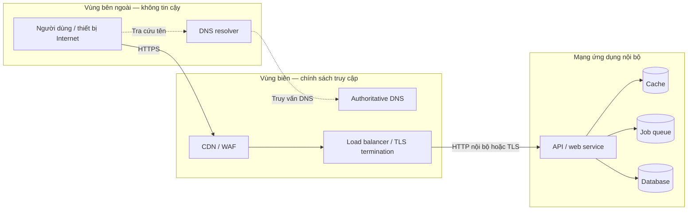

# Denial of Service (DoS): mô hình hóa mối đe dọa và bảo vệ tính sẵn sàng của mạng

## 1. Denial of Service là gì?

**Denial of Service (DoS)** là tình huống một hệ thống, dịch vụ hoặc tài nguyên mạng bị làm cho **không thể phục vụ** người dùng hợp lệ, hoặc phục vụ với chất lượng thấp đến mức không còn đáp ứng nhu cầu. Mục tiêu bị ảnh hưởng có thể là website, API, máy chủ DNS, thiết bị mạng, VPN gateway, kết nối Internet, cơ sở dữ liệu hoặc một dịch vụ phụ thuộc ở phía sau.

Trong bộ ba mục tiêu bảo mật **CIA (Confidentiality – Integrity – Availability)**, DoS chủ yếu đe dọa **Availability – tính sẵn sàng**. Một cuộc tấn công DoS không nhất thiết phải đánh cắp dữ liệu, chiếm quyền điều khiển máy chủ hay làm thay đổi nội dung; việc ngăn người dùng truy cập dịch vụ đã đủ gây thiệt hại.

Ví dụ: một cửa hàng trực tuyến vẫn mã hóa HTTPS đúng cách nhưng API thanh toán liên tục trả lỗi hoặc hết thời gian chờ do một thành phần bị quá tải. Dữ liệu có thể vẫn được giữ bí mật, nhưng khách hàng không thể đặt hàng. Đây là thất bại về tính sẵn sàng.

| Khái niệm | Ý nghĩa | Ví dụ |
|---|---|---|
| **DoS** | Dịch vụ bị từ chối hoặc suy giảm bởi lưu lượng/hành vi gây cạn tài nguyên; có thể bắt nguồn từ một hoặc ít nguồn | Một điểm truy cập công khai bị tiêu tốn hết số kết nối cho phép |
| **DDoS** (*Distributed DoS*) | Nhiều nguồn đồng thời gây quá tải; khó chặn chỉ bằng một địa chỉ IP | Lưu lượng lớn từ nhiều mạng khác nhau hướng vào cùng website |
| **Application-layer DoS** | Khai thác chi phí xử lý của một tính năng ở tầng ứng dụng | Yêu cầu báo cáo đòi hỏi truy vấn cơ sở dữ liệu rất tốn tài nguyên |
| **EDoS** (*Economic Denial of Sustainability*) | Lạm dụng tài nguyên tính phí, gây chi phí vận hành tăng mạnh | Lưu lượng bất thường làm tăng số lần gọi API và tài nguyên cloud |
| **Sự cố có tác động tương tự DoS** | Dịch vụ mất khả dụng do lỗi cấu hình, vòng lặp retry, đợt truy cập hợp lệ hoặc hỏng hạ tầng | Nhiều client cùng retry khi backend lỗi khiến hệ thống càng quá tải |

Không phải mọi sự cố quá tải đều là tấn công. Trong **threat modeling**, cần phân biệt **tác nhân cố ý gây gián đoạn**, **lượng truy cập hợp pháp tăng đột biến** và **lỗi tự gây ra**. Chúng có thể có cùng triệu chứng nhưng dẫn đến các quyết định xử lý rất khác nhau.

## 2. DoS nhắm vào tài nguyên và điểm nghẽn nào?

Một dịch vụ chỉ hoạt động khi các tài nguyên liên quan còn đủ năng lực. Đối tượng cần bảo vệ không chỉ là CPU máy chủ mà còn là đường truyền, thiết bị biên, bộ nhớ, số kết nối, hàng đợi, dịch vụ DNS và các phụ thuộc nội bộ.

### 2.1. Các nhóm thường gặp

| Nhóm | Cơ chế khái quát | Tài nguyên dễ chịu ảnh hưởng | Tín hiệu quan sát |
|---|---|---|---|
| **Volumetric / băng thông** | Lưu lượng vượt năng lực của đường kết nối hoặc mạng biên | Băng thông uplink, thiết bị và dịch vụ chống DDoS ở thượng nguồn | bit/giây tăng bất thường, mất gói, nghẽn đường truyền |
| **Protocol / state exhaustion** | Tạo áp lực lên cơ chế duy trì trạng thái kết nối hoặc xử lý gói | Bảng trạng thái firewall/NAT, hàng đợi kết nối TCP, bộ nhớ | nhiều kết nối chưa hoàn tất, bảng trạng thái gần ngưỡng, lỗi kết nối |
| **Application / Layer 7** | Gửi tác vụ tương đối ít byte nhưng có chi phí xử lý cao | CPU, worker, thread, connection pool, database, cache | request/giây, latency p95/p99, số truy vấn chậm, hàng đợi |
| **Dependency exhaustion** | Gây nghẽn thành phần dùng chung ở phía sau | DNS resolver, dịch vụ định danh, DB, queue, bên thứ ba | timeout theo chuỗi, lỗi từ upstream, hàng đợi tích tụ |
| **Resource/cost exhaustion** | Làm cạn quota hoặc ngân sách tài nguyên co giãn | hạn mức cloud, số phiên dịch vụ, chi phí API, số worker | autoscaling tăng, quota chạm trần, chi phí bất thường |

Các ví dụ minh họa thường được nhắc đến:

- **TCP SYN flood:** gây áp lực lên trạng thái hoặc hàng đợi kết nối TCP. Cơ chế bảo vệ như SYN cookies có thể giảm một số dạng cạn trạng thái; không thể thay thế bảo vệ đường truyền.
- **UDP reflection/amplification:** lợi dụng dịch vụ trung gian có thể gửi phản hồi về địa chỉ nguồn bị giả mạo; kết quả có thể tập trung một lượng lớn lưu lượng tại nạn nhân. Việc lọc địa chỉ nguồn giả mạo ở mạng xuất phát là một biện pháp quan trọng.
- **HTTP/HTTPS flood:** tập trung yêu cầu vào ứng dụng. Vì HTTPS được mã hóa, thiết bị chỉ nhìn lớp mạng không tự biết yêu cầu nào làm backend quá tải; cần số liệu từ CDN/WAF, nơi kết thúc TLS và ứng dụng.
- **Slow connection / slow request:** giữ tài nguyên kết nối hoặc worker lâu bất thường thay vì chỉ tăng số gói tin. Bảo vệ thường liên quan đến timeout hợp lý, giới hạn kết nối và kiến trúc xử lý không đồng bộ.
- **DNS DoS:** làm suy giảm khả năng phân giải tên miền hoặc hạ tầng DNS có thẩm quyền. Khi DNS ngừng đáp ứng, dịch vụ web có thể vẫn chạy nhưng người dùng khó tìm tới nó.

Điểm cốt lõi: **lượng dữ liệu lớn không phải điều kiện bắt buộc** để gây DoS. Một yêu cầu nhỏ nhưng buộc hệ thống thực hiện truy vấn nặng có thể tiêu tốn nhiều CPU, bộ nhớ hoặc thời gian khóa dữ liệu.

### 2.2. Đường truyền, hệ điều hành và ứng dụng có những ngưỡng khác nhau

Ví dụ một API có băng thông Internet còn dư nhưng cơ sở dữ liệu chỉ chịu được số lượng truy vấn đồng thời nhất định. Mở rộng băng thông không làm API phục hồi nếu điểm nghẽn là connection pool đến DB. Ngược lại, tăng số máy chủ ứng dụng thường không cứu được kết nối nếu đường truyền vào trung tâm dữ liệu đã bão hòa trước khi gói tin tới firewall.

Có thể hình dung năng lực đầu-cuối như một chuỗi phụ thuộc:

```text
Người dùng
   ↓
DNS → ISP/đường truyền → CDN/WAF → Load balancer
                                       ↓
                                 API Gateway
                                       ↓
                               Application worker
                                       ↓
                            Cache / Database / Queue
```

Mỗi mắt xích có ngưỡng riêng. Threat model phải chỉ rõ **mắt xích nào có thể cạn trước, ai điều khiển được lưu lượng vào đó, và hệ thống sẽ suy giảm như thế nào**.

## 3. Vì sao DoS là một mối đe dọa trong mô hình STRIDE?

**STRIDE** là một khung phân loại mối đe dọa: *Spoofing, Tampering, Repudiation, Information Disclosure, Denial of Service, Elevation of Privilege*. Chữ **D – Denial of Service** yêu cầu người phân tích hỏi: “Tác nhân nào có thể ngăn hệ thống thực hiện chức năng đã cam kết cho người dùng hợp lệ?”

Trong phân tích mạng, câu hỏi cần cụ thể hơn “có thể bị DDoS không?”:

1. **Tài sản nào cần luôn sẵn sàng?** Trang đăng nhập, thanh toán, DNS, API của đối tác, VPN, cơ sở dữ liệu, thiết bị biên?
2. **Ai có quyền gửi lưu lượng đến tài sản?** Toàn Internet, khách hàng đã đăng nhập, mạng nội bộ, đối tác qua VPN?
3. **Ranh giới tin cậy ở đâu?** Internet → CDN, CDN → load balancer, DMZ → ứng dụng, ứng dụng → DB, cloud → dịch vụ bên thứ ba?
4. **Tác vụ nào chi phí cao?** Tạo báo cáo, tìm kiếm không có cache, tải file lớn, xác thực mật khẩu, truy vấn phức tạp?
5. **Có giới hạn tài nguyên rõ ràng không?** Request rate, CPU, số kết nối, thời gian timeout, độ dài hàng đợi, quota cloud?
6. **Khi mất một phụ thuộc, lỗi có lan rộng không?** Retry đồng loạt, cache stampede, cạn connection pool, queue tăng không giới hạn?
7. **Tác động kinh doanh đo bằng gì?** Tỷ lệ thanh toán thành công, số phút gián đoạn, thời gian phản hồi, số khách hàng bị ảnh hưởng, chi phí phát sinh?

Threat modeling ghi nhận cả **đường tấn công có chủ ý** và **điểm yếu về khả năng chịu lỗi**. Mục tiêu là biết cần đầu tư kiểm soát ở đâu, không phải chỉ lập danh sách tên các kiểu DDoS.

## 4. Xây dựng threat model cho một dịch vụ trực tuyến

Giả sử một nền tảng bán hàng có website, API tìm kiếm sản phẩm, thanh toán, cơ sở dữ liệu và vùng mạng nội bộ. Phần lớn khách hàng truy cập qua Internet; hệ thống có CDN/WAF ở biên và backend trong mạng riêng.

### 4.1. Sơ đồ luồng dữ liệu và ranh giới tin cậy



Sơ đồ là mô hình giản lược để suy luận, không thay thế bản vẽ triển khai thực tế. Lưu ý **truy vấn DNS là một luồng riêng**, và TLS có thể kết thúc ở load balancer trước khi backend nhận yêu cầu. DoS có thể xảy ra tại DNS, CDN, đường truyền, TLS termination, API hoặc bất kỳ phụ thuộc nào bên trong.

**Tài sản và yêu cầu kinh doanh ví dụ:**

- Người dùng hợp lệ phải mở được trang sản phẩm và gửi đơn hàng trong giờ cao điểm.
- API thanh toán và dữ liệu đơn hàng được ưu tiên hơn tác vụ phân tích/báo cáo không thiết yếu.
- Hệ thống cần giới hạn ảnh hưởng tới các dịch vụ khác nếu một API bị lạm dụng.
- Nhóm vận hành phải biết thành phần nào đang nghẽn và có quyền áp dụng biện pháp giảm tải.

**Điểm vào** gồm endpoint công khai, tên miền DNS, cổng TLS, webhook của đối tác và giao diện quản trị được bảo vệ. **Bề mặt bị lợi dụng** không chỉ là endpoint có thể gọi trực tiếp: một endpoint công khai có thể làm đầy queue hay chiếm tài nguyên DB ở phía sau.

### 4.2. Viết kịch bản đe dọa cụ thể

Mỗi kịch bản nên mô tả **nguồn/điểm vào → điểm nghẽn → hậu quả → dấu hiệu → biện pháp**.

| Kịch bản | Điều kiện tạo rủi ro | Hậu quả | Tín hiệu cần giám sát | Phòng vệ ưu tiên |
|---|---|---|---|---|
| Lưu lượng lớn vào mạng biên | Đường uplink hoặc thiết bị xử lý đầu vào có giới hạn | Người dùng không truy cập được tất cả endpoint | bps/pps, mất gói, bão hòa uplink | DDoS protection ở ISP/CDN, Anycast, phối hợp upstream |
| Kết nối TCP làm cạn trạng thái | Năng lực trạng thái kết nối/timeout không phù hợp | Kết nối mới thất bại | SYN backlog, trạng thái TCP, tỷ lệ lỗi kết nối | SYN cookies khi phù hợp, timeout/bảo vệ kết nối, lọc tại biên |
| Yêu cầu tìm kiếm/báo cáo tốn kém | Endpoint công khai tạo truy vấn DB nặng, thiếu quota | p99 tăng, checkout bị chậm theo | DB CPU, slow query, active queries, pool waiting | giới hạn chi phí truy vấn, cache, quota, tách tài nguyên |
| Tăng đột biến ở API đăng nhập | Xác thực tiêu tốn CPU/worker, không có giới hạn theo tài khoản | Login bị gián đoạn, các API khác bị ảnh hưởng | request rate, CPU, lỗi/timeout, độ dài queue | WAF/bot management, rate limit theo nhiều chiều, quota xác thực |
| Dịch vụ DNS gián đoạn | Chỉ có một điểm phục vụ hoặc thiếu dự phòng | Người dùng không phân giải được tên dịch vụ | truy vấn/giây, timeout DNS, độ trễ phân giải theo vùng | DNS provider có dự phòng, phân tán điểm phục vụ, giám sát ngoài mạng |
| Retry lan truyền khi backend lỗi | Client/worker retry tức thời, không backoff | Sự cố nhỏ thành nghẽn toàn hệ thống | retry rate, hàng đợi, lỗi upstream, saturation | exponential backoff + jitter, giới hạn retry, circuit breaker |
| Cloud autoscaling tăng không kiểm soát | Chỉ tăng công suất mà thiếu giới hạn chi phí/nhận diện lưu lượng | chi phí lớn, có thể chạm quota | số instance, chi phí, quota, request bất thường | ngân sách, quota, lọc ở biên trước khi scale, cảnh báo chi phí |

Tác động thực tế có thể nối tầng: sự cố DNS làm người dùng không tìm thấy IP; nghẽn API làm nhiều client retry; retry lại gây thêm tải lên DB; ngay cả khi xử lý lưu lượng độc hại ở biên, các hàng đợi nội bộ có thể cần thời gian tiêu hóa hết.

### 4.3. Ưu tiên rủi ro, không đánh đồng mọi kịch bản

Một cách sàng lọc sơ bộ là chấm **khả năng xảy ra (L)** và **mức tác động (I)** từ 1 đến 3; dùng `R = L × I` để ưu tiên xem xét. Đây là thang **minh họa nội bộ**, không phải xác suất được đo hay chuẩn chung có thể thay thế đánh giá rủi ro thực tế.

| Kịch bản minh họa | L | I | R | Lý do |
|---|---:|---:|---:|---|
| API tìm kiếm công khai làm cạn DB | 3 | 3 | 9 | Dễ tiếp cận; ảnh hưởng chung tới checkout nếu dùng cùng DB |
| Gián đoạn DNS có thẩm quyền | 2 | 3 | 6 | Ít thường xuyên hơn trong giả định, nhưng ảnh hưởng rộng |
| Báo cáo nội bộ làm đầy queue riêng | 2 | 1 | 2 | Có giới hạn người dùng và đã tách khỏi đường thanh toán |

Phải **kiểm chứng các điểm L/I bằng số liệu, thiết kế thực tế và mối đe dọa liên quan**. Không nên coi `R = 9` là rủi ro gấp 4,5 lần `R = 2`: thang điểm thứ bậc chỉ có ý nghĩa sắp xếp công việc tương đối. Ưu tiên cuối cùng cần tính cả thiệt hại kinh doanh, phạm vi ảnh hưởng, mức dễ bị khai thác, thời gian khôi phục và hiệu lực của kiểm soát hiện có.

## 5. Định lượng quá tải: năng lực, hàng đợi và thời gian đáp ứng

Các khái niệm cơ bản giúp chuyển một mô tả DoS chung chung thành giả thuyết có thể đo:

- **Throughput:** số yêu cầu hoàn thành mỗi giây, thường đo bằng requests/giây (RPS), hoặc lưu lượng mạng bằng bit/giây (bps).
- **Packet rate:** số gói/giây (pps), quan trọng vì thiết bị mạng có thể hết khả năng xử lý gói trước khi hết băng thông tính theo bps.
- **Concurrency:** số yêu cầu hoặc kết nối đồng thời; không đồng nghĩa với RPS.
- **Latency:** độ trễ xử lý yêu cầu; p95/p99 thể hiện trải nghiệm chậm của nhóm yêu cầu ở phần đuôi phân phối.
- **Saturation:** mức sử dụng một tài nguyên tiến gần ngưỡng; ví dụ CPU, pool, queue, bảng trạng thái.
- **Error rate:** tỷ lệ yêu cầu thất bại hoặc timeout; cần phân biệt lỗi do chặn có chủ đích với lỗi backend.

Theo **định luật Little**, trong một hệ thống ổn định và với phạm vi đo nhất quán:

```text
L ≈ λ × W

L: số công việc trung bình đang nằm trong hệ thống
λ: tốc độ hoàn thành/công việc đến trung bình (yêu cầu/giây)
W: thời gian trung bình một công việc ở trong hệ thống (giây)
```

**Ví dụ:** trạng thái A có 700 yêu cầu/giây và mỗi yêu cầu lưu trong hệ thống trung bình 0,1 giây, nên khoảng `L = 700 × 0,1 = 70` yêu cầu đang xử lý/chờ. Ở trạng thái B, nếu hệ thống còn ổn định ở 2.000 yêu cầu/giây nhưng thời gian mỗi yêu cầu tăng lên 0,4 giây, thì `L = 2.000 × 0,4 = 800`, tức số công việc đồng thời lớn hơn nhiều. Con số này minh họa tại sao độ trễ tăng cùng tải có thể làm nhu cầu tài nguyên phình nhanh.

**Giới hạn quan trọng:** khi hệ thống đã sụp đổ, hàng đợi tăng vô hạn hoặc yêu cầu bị bỏ, không được tùy tiện áp dụng ví dụ trên để dự đoán năng lực chịu tải. Năng lực và ngưỡng bảo vệ phải được **đo bằng kiểm thử tải được cấp quyền, số liệu lịch sử và khả năng của từng thành phần**.

Một thiết kế tốt thường xác định trước điều kiện suy giảm, ví dụ: khi hàng đợi vượt ngưỡng, hệ thống **từ chối sớm** một số yêu cầu chi phí cao để bảo vệ thanh toán, thay vì giữ mọi kết nối mở cho đến khi tất cả cùng timeout.

## 6. Giám sát để phát hiện DoS và phân biệt với tăng trưởng hợp lệ

Chỉ có một biểu đồ “CPU 100%” là chưa đủ. DoS có thể bão hòa mạng trước khi CPU tăng; ngược lại nhiều sự cố ứng dụng chỉ biểu hiện ở pool kết nối DB, lock contention hoặc hàng đợi.

| Lớp quan sát | Chỉ số hữu ích | Cách diễn giải |
|---|---|---|
| **Mạng / ISP / edge** | bps, pps, packet drops, theo giao thức/đích, sức chứa uplink | Tìm áp lực băng thông hoặc xử lý gói trước khi vào hệ thống |
| **TCP / firewall / load balancer** | active connections, SYN backlog, connection errors, reset/timeout, state table | Phân biệt thiếu năng lực duy trì kết nối với lỗi ứng dụng |
| **CDN / WAF** | HTTP RPS theo path/host, mã trạng thái, tỷ lệ challenge/block, phân bố nguồn | Xác định endpoint chịu áp lực và tác động của chính sách biên |
| **Ứng dụng** | p50/p95/p99 latency, RPS thành công, 429/503/504, worker utilization | Xác định suy giảm trải nghiệm người dùng hợp lệ |
| **Phụ thuộc** | DB connections, slow query, pool wait, cache hit ratio, queue depth, retry rate | Tìm nghẽn thứ cấp và tình trạng lỗi lan truyền |
| **Kinh doanh / cloud** | giao dịch thành công, tỷ lệ thanh toán, chi phí, quota, autoscaling | Đánh giá tác động thực và nguy cơ tiêu hao ngân sách |

Tín hiệu tốt nhất thường là **tổ hợp** nhiều chỉ số. Chẳng hạn RPS tăng nhưng doanh thu và giao dịch hợp lệ không tăng tương ứng, DB chạm trần và p99 tăng có thể gợi ý lưu lượng không mang lại giá trị; tuy vậy không nên kết luận chỉ từ một chỉ số, vì chiến dịch marketing cũng có thể tạo mẫu tương tự.

### 6.1. Phân biệt flash crowd và DDoS

Một đợt giảm giá có thể khiến hàng chục nghìn người dùng thật truy cập đồng thời (**flash crowd**). DDoS có thể cũng tạo ra RPS cao nhưng đặc tính hành vi và kết quả khác. Phân tích cần dựa trên nhiều dấu hiệu:

- Mốc thời gian: lưu lượng tăng sau thông báo marketing, thay đổi DNS hay không có nguyên nhân kinh doanh rõ ràng?
- Tính đa dạng của hành vi: nhiều trang sản phẩm, phiên mua hàng hợp lý hay lặp lại bất thường trên endpoint đắt đỏ?
- Tỷ lệ hoàn thành tác vụ: đăng nhập, thêm giỏ hàng, checkout có diễn ra theo mẫu sử dụng thực không?
- Vị trí và nguồn: phân bố mạng, ASN, vùng địa lý thay đổi ra sao? Một IP có thể đại diện cho hàng nghìn người sau NAT; chỉ chặn theo IP dễ gây sai lệch.
- Độ tin cậy của chỉ số: có bot hợp pháp (công cụ tìm kiếm, giám sát) hay lưu lượng từ hệ thống nội bộ bị ghi đè địa chỉ tại reverse proxy?

**Không có chỉ số đơn lẻ nào chứng minh chắc chắn là DDoS.** Đặc biệt, User-Agent, số lượng IP hoặc quốc gia chỉ là gợi ý; nhiều người dùng hợp lệ có thể chia sẻ IP và tác nhân xấu có thể tạo lưu lượng giống người thật.

### 6.2. Phân tích lưu lượng đã mã hóa

TLS bảo vệ bí mật và toàn vẹn dữ liệu ứng dụng, **không tự ngăn DDoS**. Thiết bị mạng nhìn từ ngoài một phiên HTTPS thường thấy IP, cổng, kích thước, thời gian và nhiều metadata kết nối, nhưng **không thấy đường dẫn URL hay nội dung HTTP đã mã hóa**. Để giám sát và lọc chi tiết Layer 7, cần số liệu từ điểm đã kết thúc TLS được ủy quyền (CDN/WAF, reverse proxy, ứng dụng).

Nếu hệ thống sử dụng **HTTP/3 trên QUIC**, phải quan sát cả **UDP** thay vì mặc định mọi HTTPS đi qua TCP/443. Trong môi trường nhiều nhà cung cấp hoặc nhiều vùng cloud, cần ghép dữ liệu cùng mốc thời gian từ phía ISP, edge và ứng dụng để xác định nơi nghẽn xuất hiện đầu tiên.

### 6.3. Đặt ngưỡng dựa trên đường cơ sở

Một cảnh báo hữu ích có thể kết hợp **lưu lượng tăng vượt đường cơ sở trong nhiều khoảng thời gian** với **latency/error rate tăng** hoặc **saturation tại một thành phần**. Cần có đường cơ sở riêng cho giờ cao điểm, ngày lễ, phiên marketing, từng endpoint và từng khu vực; nếu chỉ dùng ngưỡng cố định, báo động sai sẽ rất nhiều.

Đo cả **số người dùng hợp lệ còn được phục vụ** sau khi bật giới hạn. Một chính sách chặn giảm RPS 90% nhưng đồng thời làm hỏng phần lớn yêu cầu thanh toán hợp lệ là phương án giảm tải chưa đạt yêu cầu kinh doanh.

## 7. Phòng vệ DoS/DDoS theo nhiều lớp

Không tồn tại một cấu hình firewall hay WAF nào giải quyết mọi loại DoS. Biện pháp phòng vệ hiệu quả phụ thuộc **điểm nghẽn và ranh giới được bảo vệ**.

### 7.1. Tại ISP, DNS và vùng biên

**Với quá tải băng thông:** dùng dịch vụ giảm thiểu DDoS của ISP/nhà cung cấp, CDN có mạng phân tán, Anycast khi phù hợp và phương án phối hợp upstream. Nếu đường truyền vào đã bão hòa, việc chặn gói **sau** đường truyền bằng firewall tại chỗ thường quá muộn. Một số nhà mạng hỗ trợ cơ chế định tuyến/lọc có kiểm soát như RTBH hoặc BGP FlowSpec; cần hiểu rủi ro chặn nhầm hoặc cô lập cả đích trước khi dùng.

**Với phản xạ/giả mạo địa chỉ nguồn:** các mạng phải triển khai lọc địa chỉ nguồn hợp lệ ở phía xuất phát theo tinh thần **BCP 38 / ingress filtering**. Người vận hành dịch vụ đích cần có năng lực giảm thiểu upstream; một tổ chức đơn lẻ không thể tự sửa việc giả mạo nguồn trên toàn Internet.

**Với DNS:** sử dụng nhà cung cấp DNS có năng lực chịu tải và dự phòng phù hợp, tránh một điểm lỗi, kiểm tra độ trễ/trạng thái phân giải từ ngoài mạng. **DNSSEC** xác thực tính toàn vẹn/xuất xứ dữ liệu DNS trong phạm vi thiết kế của nó; không mặc nhiên chống được nghẽn DNS hay DDoS.

### 7.2. Tại firewall, load balancer và TCP

- Giới hạn dịch vụ/cổng được công khai và phân đoạn mạng để giảm phạm vi bị tác động.
- Theo dõi **connection table**, backlog, timeout; cấu hình mức tối đa phù hợp với lưu lượng hợp pháp và năng lực bộ nhớ.
- Dùng những cơ chế phòng vệ TCP phù hợp như **SYN cookies** để giảm một số kiểu cạn trạng thái; kiểm tra tác động tới hiệu năng và tính năng kết nối.
- Quy định timeout cho kết nối nhàn rỗi, yêu cầu không hoàn chỉnh và thời gian đọc/ghi để tránh giữ tài nguyên vô thời hạn.
- Duy trì health check và khả năng chuyển khỏi instance bị lỗi; không coi việc thêm instance là giải pháp cho đường truyền đã nghẽn.

### 7.3. Tại CDN/WAF và API gateway

Biện pháp cần gắn với **danh tính và chi phí công việc**, không chỉ số lượng yêu cầu từ một địa chỉ IP:

- **Rate limiting** theo IP, API key, người dùng đã xác thực, tenant và endpoint; ưu tiên chính sách có thể cấu hình riêng cho các tác vụ đắt đỏ.
- **Quotas** theo người dùng/tenant trong một khoảng thời gian để tránh một khách hàng tiêu thụ hết ngân sách tài nguyên của các khách hàng khác.
- **Bot management / challenge / WAF rules** khi phù hợp; luôn đo false positive, tác động đến thiết bị trợ năng, client tự động và người dùng sau NAT.
- **Caching** đối với dữ liệu có thể lưu cache an toàn, giúp giảm tải backend khi có nhiều yêu cầu đọc tương tự. Không cache dữ liệu riêng tư hoặc phản hồi thay đổi liên tục một cách tùy tiện.
- **Bảo vệ origin**: hạn chế kết nối trực tiếp từ Internet vào origin khi CDN/WAF là cổng kiểm soát bắt buộc; cập nhật dải nguồn được phép theo nhà cung cấp và thiết kế thực tế.

Ví dụ **pseudocode** về quyết định cấp quyền tài nguyên:

```text
function handle(request):
    identity = authenticate_if_required(request)
    key = choose_key(identity, request.ip, request.tenant)
    policy = policy_for(request.route)

    if not token_bucket(key, policy).allow(cost_of(request)):
        return HTTP 429 with appropriate Retry-After

    if active_work(request.route) >= policy.max_concurrency:
        return HTTP 503 with bounded retry guidance

    return execute_with_deadline_and_resource_budget(request)
```

Điểm cần lưu ý: đây là **mô hình chính sách**, không phải một thư viện hoạt động sẵn. `cost_of(request)` nên dựa trên phép đo chi phí thật, chẳng hạn loại endpoint, kích thước đầu vào, độ phức tạp truy vấn và giới hạn cho tenant. Không tin tưởng tuyệt đối các header do client tự đặt để xác định IP gốc; sau proxy phải cấu hình **danh sách proxy đáng tin cậy** trước khi sử dụng thông tin IP chuyển tiếp.

**HTTP 429** thường biểu thị client vượt giới hạn được áp dụng; **HTTP 503** thường biểu thị dịch vụ tạm thời không có khả năng phục vụ. Hướng dẫn retry phải có giới hạn và backoff; retry đồng loạt ngay lập tức có thể làm quá tải nặng hơn.

### 7.4. Tại ứng dụng và hệ thống phụ thuộc

**Giới hạn công việc:** đặt giới hạn concurrency, deadline, độ lớn request/body, kích thước phân trang, số hàng đọc và thời gian chạy truy vấn; ưu tiên bảo vệ API quan trọng. Sử dụng hàng đợi có dung lượng giới hạn và khả năng từ chối sớm khi quá tải (**backpressure / load shedding**).

**Cô lập tài nguyên:** tách worker pool, DB pool hoặc quota của tác vụ báo cáo khỏi luồng thanh toán; triển khai mô hình **bulkhead** để một thành phần bị nghẽn không làm sập toàn bộ ứng dụng.

**Tránh lỗi lan truyền:** dùng **circuit breaker** để tạm dừng gọi phụ thuộc đang lỗi, retry có giới hạn với **exponential backoff và jitter**, và đặt timeout nhất quán giữa các tầng. Với thao tác tạo đơn/chi tiền, cần thiết kế idempotency để retry không tạo tác dụng phụ trùng lặp.

**Suy giảm có kiểm soát:** trong giờ cao điểm, có thể tạm ngưng các báo cáo nặng, giới hạn tính năng phụ, trả dữ liệu cache còn phù hợp hoặc chuyển sang chế độ đọc. Luôn thông báo trung thực về dữ liệu tạm thời và tránh hiển thị thông tin sai của giao dịch.

**Khả năng khôi phục:** dự phòng đa vùng hoặc nhiều nhà cung cấp có thể tăng tính sẵn sàng nếu điểm lỗi được tách độc lập và dữ liệu/định tuyến được quản lý đúng. **DNS failover không xảy ra tức thì** đối với mọi client vì còn cache, TTL và thời gian phát hiện lỗi. Việc tự động mở rộng cũng cần giới hạn ngân sách, giới hạn quota và cơ chế lọc tải để tránh EDoS.

## 8. Thiết kế bảo vệ theo mục tiêu vận hành

Một bản threat model thực dụng nên biến yêu cầu “chống DDoS” thành các câu hỏi có thể kiểm thử và giao trách nhiệm:

| Mục tiêu | Yêu cầu/phép đo ví dụ | Chủ thể phụ trách |
|---|---|---|
| Truy cập dịch vụ | SLO về tỷ lệ yêu cầu hợp lệ thành công; theo dõi p95/p99 latency | Đội ứng dụng và SRE |
| Chống nghẽn biên | Có playbook và đầu mối liên hệ nhà cung cấp DDoS; giám sát bps/pps | Network / Security |
| Chống cạn tài nguyên API | Có quota, giới hạn đồng thời, timeout, cơ chế bảo vệ endpoint tốn kém | Backend / API gateway |
| Phân lập sự cố | Tác vụ không thiết yếu không chiếm hết tài nguyên checkout | Kiến trúc sư và đội nền tảng |
| Giảm báo động sai | Có quan sát tỷ lệ yêu cầu hợp lệ bị chặn, kênh xử lý ngoại lệ | Security operations |
| Kiểm soát chi phí | Theo dõi ngân sách/quota cloud cùng với autoscaling | Cloud / FinOps |
| Phục hồi và điều tra | Có nhật ký thời gian, cấu hình đã thay đổi, người phê duyệt và kết quả | Incident commander / SOC |

**SLO** (*Service Level Objective*) là mục tiêu đo được về chất lượng dịch vụ, chẳng hạn tỷ lệ yêu cầu hợp lệ được phục vụ trong khoảng thời gian định sẵn. Chọn SLO phù hợp với tính năng kinh doanh; không chỉ đo “máy chủ vẫn ping được”. Một hệ thống trả hàng loạt HTTP 200 cho trang lỗi tĩnh có thể vẫn **không đáp ứng mục tiêu mua hàng**.

Cần xác định **thành phần quan trọng nhất** và ưu tiên khi cần giảm tải. Với dịch vụ bán hàng, có thể ưu tiên xem hàng, đăng nhập và thanh toán; tác vụ thống kê chạy nền có thể được hoãn an toàn. Với bệnh viện hoặc hạ tầng thiết yếu, mức ưu tiên phải dựa vào yêu cầu an toàn thực tế và quy trình vận hành được phê duyệt.

## 9. Quy trình ứng phó khi xuất hiện DoS/DDoS

Mục tiêu xử lý sự cố là **khôi phục khả năng phục vụ người dùng hợp lệ**, giảm khu vực ảnh hưởng và bảo toàn dữ liệu để điều tra sau đó.

### Giai đoạn A — Xác nhận và khoanh vùng

1. Xác nhận vấn đề qua **synthetic monitoring từ bên ngoài**, tỷ lệ giao dịch thành công, latency và lỗi ứng dụng; kiểm tra xem ảnh hưởng toàn hệ thống hay chỉ một endpoint/khu vực.
2. Đặt cùng mốc thời gian cho số liệu **ISP/edge → load balancer → API → DB/queue**. Xác định điểm đầu tiên có saturation hoặc packet drops.
3. Kiểm tra thay đổi hợp lệ gần đây: chiến dịch marketing, triển khai phiên bản mới, DNS, autoscaling, sự cố nhà cung cấp, retry storm.
4. Phân loại giả thuyết ban đầu: nghẽn đường truyền, state exhaustion, quá tải Layer 7, thiếu năng lực phụ thuộc hay lỗi nội bộ.

### Giai đoạn B — Giảm thiểu tác động

1. Với vấn đề đường truyền hoặc phân tán diện rộng, **liên hệ ISP/CDN/nhà cung cấp chống DDoS** để chặn hoặc hấp thụ lưu lượng trước khi tới đường nghẽn.
2. Với ứng dụng, ưu tiên **giới hạn endpoint nặng**, đóng băng tác vụ nền không thiết yếu, bật cache an toàn và áp dụng load shedding theo chính sách đã chuẩn bị.
3. Điều chỉnh firewall/WAF/rate limit theo tín hiệu đã kiểm chứng; thay đổi tăng dần và **đo mức chặn nhầm**. Chặn toàn bộ vùng địa lý hoặc một ASN có thể làm mất khách hàng thật.
4. Bảo vệ phụ thuộc dùng chung: giảm retry, giới hạn concurrency và xử lý hàng đợi theo năng lực thực, tránh đưa backend vào một vòng lặp quá tải mới.
5. Theo dõi tác động sau mỗi thay đổi. Nếu chất lượng phục vụ người dùng hợp lệ xấu hơn, thực hiện rollback theo playbook.

### Giai đoạn C — Phục hồi và rút kinh nghiệm

- Xác nhận tỷ lệ yêu cầu hợp lệ thành công, latency, hàng đợi, DB pool và số lỗi quay về vùng chấp nhận được.
- Khôi phục từ từ tác vụ bị hạn chế; theo dõi nguy cơ tái xuất hiện và lỗi còn tồn đọng.
- Lưu dấu mốc thời gian, metrics, log phù hợp chính sách riêng tư, quyết định đã áp dụng và thông tin từ nhà cung cấp.
- Thực hiện postmortem: **điểm nghẽn thật**, thời gian phát hiện (MTTD), thời gian phục hồi (MTTR), tác động người dùng, chi phí, false positive và kiểm soát cần cải thiện.

Tùy môi trường, **người điều phối sự cố (incident commander)** quyết định mức ưu tiên; đội mạng làm việc với upstream; SOC phân tích chỉ báo; SRE/backend bảo vệ chức năng và phụ thuộc; bộ phận hỗ trợ truyền thông tình trạng dịch vụ. Tách vai trò giúp tránh nhiều nhóm cùng sửa firewall hoặc scaling theo hướng mâu thuẫn nhau.

## 10. Kiểm thử phòng vệ an toàn và kiểm chứng giả thuyết

Không thể kết luận hệ thống “chịu DDoS” chỉ vì có WAF hoặc autoscaling. Cần kiểm chứng bằng **kiểm thử có phê duyệt**, trong môi trường được phép và giới hạn rõ phạm vi/tải:

- **Kiểm thử tải hợp lệ:** tăng lượng người dùng mô phỏng đến ngưỡng đã định, quan sát throughput, latency, saturation và error rate; xác định điểm gãy.
- **Kiểm thử giới hạn:** xác minh endpoint trả 429 theo quota, 503 khi hết năng lực, có hướng dẫn retry thích hợp và không cạn toàn bộ worker.
- **Kiểm thử lỗi phụ thuộc:** mô phỏng DB/cache chậm hoặc một dependency không sẵn sàng trong staging để đánh giá circuit breaker, backoff, backpressure và phục hồi.
- **Kiểm thử sự phân lập:** xác minh báo cáo nặng không chiếm hết tài nguyên checkout; kiểm tra tenant công suất lớn không làm khách hàng khác mất dịch vụ.
- **Kiểm thử chặn nhầm:** chạy kịch bản nhiều người dùng hợp lệ sau NAT/proxy, mobile client và các client tự động đã đăng ký để đánh giá chính sách rate limit/WAF.
- **Diễn tập vận hành:** đội phản ứng kiểm tra playbook, quyền áp dụng chính sách, thông tin liên hệ CDN/ISP và khả năng xác định điểm nghẽn từ metrics.

Không phát sinh lưu lượng gây gián đoạn vào hệ thống của bên khác hoặc môi trường production nếu không được ủy quyền cụ thể. Phòng vệ trước tải ở quy mô mạng lớn cần diễn tập phối hợp với nhà cung cấp phù hợp; kiểm thử tải ứng dụng trong staging **không chứng minh** khả năng hấp thụ DDoS quy mô Internet.

## 11. Ví dụ hoàn chỉnh: bảo vệ API tìm kiếm để giữ checkout hoạt động

**Bối cảnh:** API `GET /products/search` truy vấn DB, trong khi checkout dùng cùng DB pool. Nhiều yêu cầu tìm kiếm đồng thời có thể khiến checkout timeout, dù CPU frontend vẫn thấp.

**Tài sản cần bảo vệ:** hành trình mua hàng và trạng thái đơn hàng. **Mối đe dọa:** tác nhân bên ngoài gửi khối lượng yêu cầu đủ làm cạn pool DB hoặc người dùng thật tăng đột biến trong chiến dịch bán hàng. **Ranh giới tin cậy:** Internet → CDN/WAF → API → DB nội bộ.

**Dấu hiệu:** RPS tìm kiếm tăng, p95/p99 của tìm kiếm và checkout cùng cao, DB pool waiting tăng, các truy vấn chậm tích tụ. Metrics này cho biết **điểm nghẽn có thể nằm ở DB**, chưa tự chứng minh nguyên nhân là tấn công.

**Biện pháp ưu tiên:**

1. Đặt quota và giới hạn concurrency riêng cho tìm kiếm; giới hạn kích thước trang, độ phức tạp bộ lọc và thời gian chạy truy vấn.
2. Tối ưu truy vấn, index phù hợp và cache an toàn những truy vấn phổ biến; dùng hàng đợi giới hạn cho tác vụ không cần phản hồi tức thời.
3. Tách tài nguyên truy vấn chi phí cao khỏi transaction quan trọng khi kiến trúc cho phép (pool riêng, read replica phù hợp, hàng đợi công việc).
4. Thiết kế ứng dụng từ chối sớm phần tìm kiếm vượt ngân sách, giữ đủ năng lực cho checkout; giám sát tỷ lệ đơn hàng hoàn thành.
5. Ở WAF/CDN, theo dõi nguồn và hành vi để giảm tải bổ sung nếu cần, đồng thời kiểm tra khách hàng hợp lệ có bị chặn không.

**Tiêu chí thành công minh họa:** khi lưu lượng tìm kiếm tăng trong kịch bản kiểm thử được phép, checkout vẫn đạt SLO đã đặt; API tìm kiếm có thể trả 429/503 với chính sách rõ ràng, nhưng DB và checkout không sụp đổ. Đây là tiêu chí **chịu lỗi và suy giảm có kiểm soát**, thay vì chỉ cố tăng số request tối đa.

## 12. Những hiểu lầm cần tránh

1. **“Bật HTTPS là đã chống DDoS.”** TLS bảo vệ phiên trao đổi dữ liệu; bản thân bắt tay TLS và xử lý HTTPS vẫn tiêu tốn tài nguyên.
2. **“Chỉ cần mua thêm băng thông.”** Thêm băng thông không giải quyết nghẽn DB, connection pool, CPU TLS termination hoặc queue.
3. **“WAF có thể ngăn mọi DoS.”** WAF hữu ích ở nhiều tình huống HTTP/HTTPS; sự cố bão hòa đường truyền trước WAF cần kiểm soát upstream.
4. **“DDoS luôn có RPS rất cao.”** Có trường hợp dùng kết nối kéo dài hoặc tác vụ ít yêu cầu nhưng tốn tài nguyên.
5. **“IP nào nhiều request thì chặn là an toàn.”** NAT, proxy và các mạng dùng chung khiến một IP có thể đại diện cho rất nhiều người thật.
6. **“Tự động mở rộng luôn cứu dịch vụ.”** Autoscaling bị giới hạn bởi quota, năng lực phụ thuộc và thời gian khởi động; còn có nguy cơ tăng chi phí bất thường.
7. **“Có dashboard tổng CPU là đủ.”** Tính sẵn sàng phải được đo theo người dùng, đường truyền, phụ thuộc và SLO giao dịch.
8. **“Chặn lưu lượng là xong sự cố.”** Cần kiểm tra hàng đợi, backend, cân bằng tải và khôi phục người dùng hợp lệ sau khi giảm tải.

## 13. Câu hỏi tự luyện và tình huống thảo luận

**Câu 1.** Một website truy cập qua HTTPS bị gián đoạn. ISP báo uplink đạt 100% nhưng CPU ứng dụng chỉ 20%. Tại sao tăng số pod API chưa chắc giải quyết được? Nên kiểm tra thành phần nào trước?

**Câu 2.** Một khách hàng doanh nghiệp sử dụng hàng nghìn thiết bị qua chung một NAT IP. Chính sách `100 requests/phút/IP` có thể tạo ra vấn đề gì? Hãy đề xuất cách kết hợp quota theo tài khoản, tenant, endpoint và IP.

**Câu 3.** Sau khi một service phụ thuộc phản hồi chậm, retry rate tăng gấp nhiều lần và mọi request đều timeout. Đây có nhất thiết là DDoS không? Những kiểm soát nào giảm hiện tượng nghẽn lan truyền?

**Câu 4.** Có CDN/WAF trước máy chủ origin nhưng origin vẫn cho phép truy cập trực tiếp từ Internet. Vì sao đây là lỗ hổng trong kế hoạch chống DoS ở tầng ứng dụng?

**Câu 5.** Bật một rule WAF khiến lưu lượng giảm mạnh nhưng tỷ lệ checkout thành công cũng giảm. Bạn dùng những chỉ số nào để quyết định giữ, điều chỉnh hay rollback rule?

**Bài tập threat modeling:** chọn một hệ thống có DNS, gateway, API, cơ sở dữ liệu và một dịch vụ bên thứ ba. Vẽ luồng dữ liệu và ranh giới tin cậy; lập ít nhất ba kịch bản DoS tương ứng với **đường truyền**, **trạng thái kết nối** và **phụ thuộc ứng dụng**. Với mỗi kịch bản, ghi rõ dấu hiệu giám sát, kiểm soát phòng vệ, tiêu chí thành công theo người dùng hợp lệ và rủi ro còn lại.

## 14. Tóm tắt kiến thức

Trong threat modeling mạng, **Denial of Service** là mối đe dọa trực tiếp đến **khả năng phục vụ đúng lúc và đúng chất lượng**. DoS/DDoS có thể nhắm vào băng thông, kết nối, tài nguyên xử lý, DNS, database, các phụ thuộc hay ngân sách cloud. Cách phòng vệ đáng tin cậy là xác định đúng tài sản, luồng dữ liệu và ranh giới tin cậy; tìm điểm nghẽn bằng số liệu; triển khai kiểm soát **từ ISP/CDN tới firewall, gateway, ứng dụng và backend**; sau đó diễn tập khả năng suy giảm, phục hồi và tránh chặn nhầm người dùng hợp lệ.

**Tài liệu tham khảo để tìm hiểu sâu:** RFC 4732 (*Internet Denial-of-Service Considerations*), RFC 4987 (*TCP SYN Flooding Attacks and Common Mitigations*), BCP 38 / RFC 2827 (*Network Ingress Filtering*), các hướng dẫn OWASP về Denial of Service và tài liệu thực hành threat modeling theo STRIDE.
