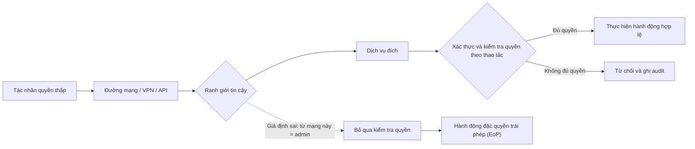
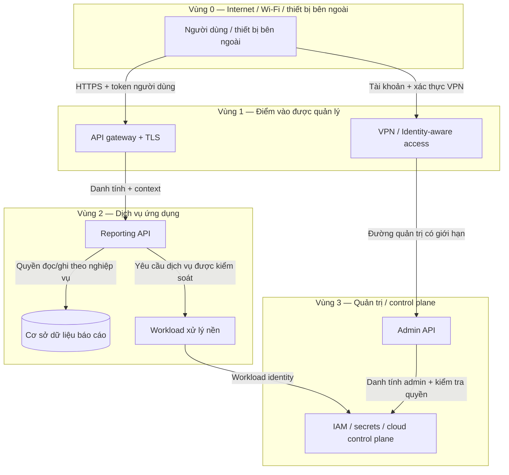

# Elevation of privilege qua network

> **Học phần:** `SECURITY_NETWORK_SECURITY`  
> **Chương:** Threat modeling mạng  
> **Trọng tâm:** Mô hình hóa các con đường mà một tác nhân có quyền thấp có thể đạt quyền cao hơn thông qua các kết nối mạng, dịch vụ, danh tính và chính sách tin cậy.

## Mục tiêu học tập

Sau bài này, người học có thể:

1. Giải thích **Elevation of Privilege (EoP)** trong mô hình STRIDE và phân biệt với việc chỉ truy cập được một địa chỉ, di chuyển ngang hoặc đánh cắp dữ liệu.
2. Xác định tài sản, tác nhân, quyền ban đầu, quyền mục tiêu, điểm vào, luồng dữ liệu và **ranh giới tin cậy** trong kiến trúc mạng.
3. Mô tả các kịch bản EoP liên quan VPN, firewall/segmentation, API nội bộ, service-to-service, DNS/Wi-Fi và cloud/Kubernetes.
4. Xây dựng threat statement, biểu diễn đường tấn công, đánh giá rủi ro và lựa chọn kiểm soát nhiều lớp.
5. Thiết kế kiểm tra phủ định về phân quyền, giám sát IDS/IPS và xử lý bằng chứng để xác nhận EoP đã được ngăn chặn.

## 1. Elevation of privilege qua network là gì?

**Elevation of privilege (leo thang đặc quyền)** xảy ra khi một tác nhân đang có mức quyền nhất định có thể thực hiện hành động hoặc sử dụng năng lực mà chính sách chỉ cấp cho một mức quyền cao hơn. Trong mạng, điều này thường xuất hiện khi quyền truy cập qua một kênh mạng bị nhầm với quyền thực hiện thao tác trên hệ thống bên kia.

Ví dụ: Nhân viên có tài khoản `viewer` được phép truy cập mạng qua VPN để đọc báo cáo. Nếu chỉ vì lưu lượng đến từ VPN, API quản trị cho người đó sửa vai trò của người dùng khác, thì ranh giới phân quyền đã bị vượt qua. **Quyền vào mạng** bị sử dụng như **bằng chứng có quyền quản trị**.

EoP có thể vượt qua nhiều loại ranh giới:

- **Ranh giới mạng:** Internet → DMZ → mạng nội bộ → mạng quản trị; VLAN nhân viên → VLAN máy chủ.
- **Ranh giới danh tính:** người dùng thường → admin; workload A → danh tính của workload B; service account ít quyền → tài khoản có quyền quản lý cloud.
- **Ranh giới ứng dụng:** endpoint đọc dữ liệu → endpoint thay đổi cấu hình, vai trò, bí mật hoặc quyền.
- **Ranh giới control plane:** luồng dữ liệu ứng dụng → API điều khiển Kubernetes, hypervisor, firewall, cloud IAM hoặc quản trị DNS.

**Kết nối tới được một IP/cổng không tự tạo ra EoP.** Để kết luận có EoP, cần chứng minh thêm một **quyết định cấp quyền sai** hoặc một khả năng dùng đặc quyền ngoài phạm vi cho phép. Thiết kế mạng tốt giảm cơ hội tiếp cận; xác thực và phân quyền đúng tại dịch vụ quyết định tác nhân có được phép thực hiện hành động hay không.

### Phân biệt các hiện tượng thường bị đánh đồng

| Hiện tượng | Ý nghĩa | Có chắc là EoP? |
|---|---|---|
| **Network reachability** | Gửi được gói tin đến IP/cổng đích | **Không**; mới chứng minh có đường mạng |
| **Lateral movement** | Tác nhân di chuyển từ máy/dịch vụ này sang máy/dịch vụ khác | **Không nhất thiết**; có thể vẫn dùng cùng mức quyền |
| **Privilege escalation** | Tác nhân đạt khả năng mà chính sách dành cho quyền cao hơn | **Có**; đây là kết quả cần chứng minh |
| **Authentication bypass** | Dịch vụ chấp nhận yêu cầu không có danh tính hợp lệ | **Có thể** dẫn đến EoP nếu mở được thao tác đặc quyền |
| **Authorization bypass** | Danh tính hợp lệ nhưng được phép làm điều nằm ngoài quyền | **Thường là nguồn EoP** khi hành động thuộc mức quyền cao hơn |
| **Information disclosure** | Đọc được dữ liệu không được cấp quyền | Là lỗ hổng kiểm soát truy cập; **không luôn** đồng nghĩa chiếm quyền quản trị |
| **Remote code execution (RCE)** | Có thể chạy mã trên thành phần từ xa | Mức đặc quyền phụ thuộc tiến trình bị chiếm và những danh tính có thể dùng tiếp |

Trong **STRIDE**, chữ **E** cuối cùng là *Elevation of Privilege*. Các nhóm STRIDE khác có thể tham gia cùng đường tấn công: Spoofing (giả mạo danh tính), Tampering (thay đổi dữ liệu), Repudiation (phủ nhận hành động), Information Disclosure (rò rỉ thông tin), Denial of Service (từ chối dịch vụ). Một đường tấn công có thể vượt qua nhiều nhóm; cần ghi rõ **điều kiện nào thực sự làm tăng quyền**.

## 2. Cách nhìn một đường leo thang quyền qua mạng

Một kịch bản EoP rõ ràng phải trả lời được sáu câu hỏi:

1. **Ai bắt đầu?** Người dùng thông thường, thiết bị Wi-Fi khách, tài khoản VPN, ứng dụng public hay workload ít quyền?
2. **Quyền gốc là gì?** Chỉ đọc báo cáo, gọi API công khai, kết nối trong subnet, dùng service account giới hạn?
3. **Tài sản có quyền cao hơn là gì?** Admin API, dịch vụ cấp token, kho bí mật, IAM, control plane, máy quản trị, database có thao tác ghi?
4. **Đường đi nào tồn tại?** DNS → endpoint → VPN/firewall → API gateway → backend → dịch vụ quản trị?
5. **Kiểm soát nào đã sai hoặc thiếu?** Để mạng nguồn quyết định quyền, không kiểm tra role ở backend, tin header nội bộ, dùng token chung quá rộng, service account quá quyền?
6. **Kết quả tăng quyền có thể quan sát là gì?** Thay đổi vai trò thành công, cấp token quyền cao, sửa chính sách firewall, tạo tài khoản quản trị hay truy vấn tài nguyên đặc quyền bằng danh tính thấp?

Một biểu diễn đường tấn công đơn giản:



Đường nét đứt thể hiện **giả định tin cậy nguy hiểm**. Đây là một sơ đồ phân tích, không phải khẳng định mọi hệ thống đều có lỗ hổng đó.

## 3. Mô hình hệ thống mẫu và trust boundary

Xét một nền tảng báo cáo doanh nghiệp có người dùng thường, quản trị viên, VPN, API gateway, backend, hệ thống quản trị và dịch vụ đám mây.



**Các ranh giới cần đánh dấu trên sơ đồ:**

- **Z0 → Z1:** thiết bị có được vào mạng hay gọi API không; danh tính người dùng và tư thế thiết bị được xác minh thế nào?
- **Z1 → Z2:** gateway truyền thông tin danh tính cho backend ra sao? Backend tự kiểm tra chữ ký, audience, scope, role và tài nguyên không?
- **Z2 → Z3:** workload nghiệp vụ có thể gọi quản trị không? Ai được quyền nhận token control plane? Có tách vai trò hay dùng chung service account?
- **Giữa các thành phần Z2:** có ranh giới riêng cho service-to-service, mTLS, token, quyền database và mạng east-west hay không?

**Đừng lấy subnet làm danh tính.** Địa chỉ IP nội bộ, vị trí trong VPN hoặc một kết nối mTLS chứng minh điều gì đó về nguồn kết nối, nhưng không tự chứng minh người dùng đứng sau được phép sửa quyền. Mỗi thao tác nhạy cảm cần kiểm tra **principal + action + resource + context** theo chính sách áp dụng.

### Bảng tài sản và quyền mục tiêu

| Tài sản | Đối tượng hợp lệ | Hành động đặc quyền | Ranh giới thực thi |
|---|---|---|---|
| Reporting API | Nhân viên có vai trò phù hợp | Đọc/sửa báo cáo được phân quyền | Ủy quyền ở API và phạm vi đối tượng dữ liệu |
| Admin API | Quản trị viên đã xác thực | Cấp vai trò, khóa tài khoản, đổi cấu hình | Identity-aware access, role/permission check tại Admin API |
| Database | Backend có danh tính dịch vụ | Cập nhật bảng quản trị/đọc dữ liệu nhạy cảm | Quyền kết nối, tài khoản DB, quyền theo bảng/tác vụ |
| Cloud IAM | Định danh workload được cấp quyền | Tạo khóa, đổi role, chỉnh policy | Workload identity, IAM policy và audit |
| DNS/VPN/firewall control plane | Đội quản trị có thẩm quyền | Đổi route, rule, DNS record, profile VPN | API quản trị, MFA, phân quyền và phê duyệt thay đổi |

## 4. Những kịch bản EoP điển hình

Các kịch bản dưới đây dùng để **xác định điều kiện phòng vệ cần có**, không giả định hệ thống nào cũng mắc lỗi. Ở mỗi kịch bản, điểm mấu chốt là **đường mạng + lỗ hổng xác thực/phân quyền/ủy quyền** có tạo ra khả năng đặc quyền vượt quyền ban đầu hay không.

### 4.1 Tin cậy quá mức vào người dùng VPN

**Bối cảnh:** Một user thuộc nhóm `viewer` có quyền VPN và quyền đọc báo cáo. Admin API được bảo vệ bằng ACL chỉ cho phép nguồn đến từ dải VPN, nhưng ứng dụng lại **không kiểm tra quyền quản trị** với từng thao tác.

**Đường rủi ro:** Tài khoản VPN thông thường → được phép đến Admin API → thao tác thay đổi role được backend chấp nhận.

**Điểm EoP:** Người dùng có vai trò `viewer` sửa được quyền của người khác. Mở cổng qua VPN **chưa phải** EoP; việc thao tác quản trị được chấp nhận mới là EoP.

**Phòng vệ:** Tách policy mạng và policy phân quyền. Bảo vệ Admin API bằng xác thực mạnh, role/permission check mỗi yêu cầu và từng đối tượng; áp dụng deny-by-default và ghi audit những thay đổi đặc quyền.

### 4.2 Confused deputy giữa các microservice

**Bối cảnh:** API gateway xác thực người dùng. Service A nhận yêu cầu của người dùng `viewer`, rồi gọi Service B bằng một **service token có quyền quản trị rộng**. Service B chỉ kiểm tra token của A mà không xét quyền của người dùng gốc hoặc ngữ cảnh nghiệp vụ.

**Đường rủi ro:** User quyền thấp → Service A (được phép gọi) → Service B tin quyền của A → hành động dành cho admin.

**Điểm EoP:** Hệ thống sử dụng quyền của Service A để thực hiện một hành động mà người dùng không được phép yêu cầu (*confused deputy*). mTLS giữa A và B có thể xác thực được hai service nhưng **không thay thế kiểm tra authorization theo mục đích gọi**.

**Phòng vệ:** Phân tách rõ danh tính service và quyền người dùng; truyền/trao đổi token có audience và scope hẹp; kiểm tra authorization tại Service B, không tin tùy ý header do client tự đặt; phân quyền theo thao tác và resource.

### 4.3 Dịch vụ public làm cầu nối đến endpoint nội bộ

**Bối cảnh:** Một API công khai có chức năng nhận URL từ người dùng để lấy tài nguyên. Khi thiếu kiểm soát địa chỉ đích, chức năng đó có thể bị lợi dụng để làm dịch vụ public gửi yêu cầu đến endpoint quản trị hoặc tài nguyên nội bộ mà client ngoài Internet không thể trực tiếp chạm tới.

**Khái niệm liên quan:** **Server-side request forgery (SSRF)** có thể tạo đường truy cập trái dự kiến. **SSRF không tự động là EoP**; phải xác định request có mang danh tính mạnh hơn, endpoint nội bộ có thiếu kiểm soát, hoặc thông tin truy cập đặc quyền có thể bị lộ/được sử dụng tiếp hay không.

**Điểm EoP:** Nếu dịch vụ public dùng quyền riêng của nó để thực hiện hành động admin thay cho user quyền thấp, ranh giới quyền đã bị vượt qua.

**Phòng vệ:** Hạn chế outbound theo allowlist, chặn đích nội bộ/metadata không cần thiết, kiểm tra redirect và DNS resolution nhất quán, dùng workload identity ít quyền, kiểm tra danh tính/nghiệp vụ ngay tại endpoint đích. Trong cloud, kiểm soát truy cập metadata và scope của identity đi kèm là hai lớp riêng.

### 4.4 Quyền service account quá rộng trong cloud hoặc Kubernetes

**Bối cảnh:** Một workload chỉ có nhiệm vụ ghi log nhưng gắn service account có quyền sửa secret, RBAC hoặc các tài nguyên quản trị khác. Workload có thể truy cập API của control plane.

**Đường rủi ro:** Workload quyền nghiệp vụ thấp bị điều khiển hoặc lạm dụng → sử dụng danh tính workload → gọi API control plane → thay đổi tài nguyên vượt nhu cầu.

**Điểm EoP:** Quyền của workload lớn hơn quyền nghiệp vụ và ranh giới dự kiến; tác nhân có thể thực hiện thao tác control plane qua danh tính đó. **NetworkPolicy** giảm khả năng đi tới API nhưng không thay thế **RBAC/IAM** khi một đường hợp lệ vẫn tồn tại.

**Phòng vệ:** Service account riêng cho từng workload, RBAC/IAM theo least privilege, không gắn token không cần thiết, hạn chế egress, khóa đường quản trị và audit sự kiện cấp quyền. Phân biệt quyền trong Kubernetes với quyền trong cloud provider: hai hệ có policy khác nhau.

### 4.5 Wi-Fi, DNS hoặc đường kết nối bị thao túng

**Bối cảnh:** Thiết bị kết nối Wi-Fi không tin cậy hoặc nhận resolver/router bất thường. Kẻ tấn công có thể tìm cách đổi hướng một workflow quản trị hoặc khiến thiết bị kết nối endpoint không mong đợi.

**Điểm cần phân biệt:** Giả mạo DNS hay thao túng route thuộc nhóm **Spoofing/Tampering**. Chúng chỉ trở thành một phần của chuỗi EoP nếu về sau có bước đánh cắp/đánh tráo danh tính, bỏ qua xác minh TLS hoặc thực thi thao tác vượt quyền. TLS với xác minh hostname và chứng chỉ đúng giúp chặn nhiều dạng chuyển hướng đơn giản.

**Phòng vệ:** Tách Wi-Fi khách/nhân viên/quản trị, bảo vệ DHCP/DNS, dùng VPN hoặc kết nối xác thực khi phù hợp, xác minh TLS, MFA và quản lý thiết bị. DNSSEC/DoH/DoT giúp giải quyết những tính chất cụ thể của DNS, **không tự kiểm tra quyền quản trị của API**.

### 4.6 Lỗi tin cậy proxy, header và danh tính kết nối

**Bối cảnh:** Backend tin header kiểu `X-User-Role` hoặc `X-Forwarded-For` như một bằng chứng có quyền cao hơn, trong khi có đường mạng cho client gọi backend trực tiếp hoặc proxy không chuẩn hóa header đầu vào.

**Điểm EoP:** Một giá trị điều khiển bởi client được backend chấp nhận như quyền admin. Các header chuyển tiếp chỉ có ý nghĩa trong **mô hình tin cậy proxy được cấu hình chính xác**; tên header không phải bằng chứng mật mã.

**Phòng vệ:** Chỉ nhận metadata danh tính từ gateway đã xác thực và tin cậy, chặn đường bypass, loại bỏ/ghi đè header do client tự gửi, xác minh token ở điểm thực thi và kiểm tra quyền ở backend.

## 5. Từ sơ đồ mạng đến threat statement

Một **threat statement** hữu ích ghi đủ: *tác nhân*, *điểm vào*, *ranh giới*, *giả định bị phá vỡ*, *hành động đặc quyền*, *tác động* và *bằng chứng kiểm chứng*. Tránh viết chung chung “hacker lấy admin qua mạng” vì không chỉ ra kiểm soát nào cần sửa.

Cấu trúc gợi ý:

> **Nếu** [tác nhân có quyền ban đầu] có thể [đi qua một luồng mạng hợp lệ hoặc ngoài dự kiến] đến [dịch vụ/tài sản], **và** [kiểm tra danh tính/quyền thất bại], **thì** tác nhân có thể [hành động đặc quyền cụ thể], gây [tác động]; **phát hiện bằng** [log/sự kiện] và **ngăn bằng** [chính sách/kiểm soát].

### Bảng phân tích kịch bản

| Mã | Quyền ban đầu / điểm vào | Ranh giới & điểm yếu giả định | Hành động ngoài quyền | Phòng vệ cần kiểm chứng |
|---|---|---|---|---|
| `EOP-01` | User `viewer` có VPN | VPN → Admin API; ACL mạng thay cho RBAC | Cấp vai trò admin | Mọi thay đổi role đều yêu cầu quyền admin trong ứng dụng |
| `EOP-02` | User ít quyền gọi Reporting API | Gateway → Service A → B; service token quá rộng | Sửa policy của B | B kiểm tra chủ thể/ủy quyền nghiệp vụ và scope của lời gọi |
| `EOP-03` | Client Internet dùng endpoint lấy URL | Public service → vùng nội bộ; egress không giới hạn | Điều khiển tính năng quản trị bằng danh tính service | Chặn destination không được phép, least privilege, kiểm tra quyền tại đích |
| `EOP-04` | Workload xử lý log | Pod/workload → control plane; service account quá quyền | Sửa secret/IAM policy | RBAC/IAM tối thiểu, egress policy và audit |
| `EOP-05` | User qua Wi-Fi không tin cậy | DNS/route → workflow admin; nhận sai danh tính đích | Dùng phiên quản trị trái phép | TLS validation, MFA, phân đoạn, session binding phù hợp |
| `EOP-06` | Client chạm trực tiếp backend | Proxy → backend; backend tin header role | Thực hiện lệnh quản trị | Chặn bypass proxy và authorization độc lập tại backend |

Mỗi hàng cần có **đường đi khả thi** và **lỗi cụ thể**. Nếu chỉ có giả thuyết “port mở”, hãy xếp vào *exposure cần kiểm tra* thay vì đánh dấu ngay là EoP.

## 6. Quy trình thực hiện threat modeling cho EoP

### Bước 1 — Xác định phạm vi và giả định

Ghi rõ sản phẩm/môi trường, endpoint, luồng quản trị, danh tính người dùng và workload, mạng nguồn (LAN, Wi-Fi, VPN, Internet, cloud) cùng thứ gì nằm ngoài phạm vi. Phân biệt **đường dùng hợp lệ**, ví dụ admin vào management API bằng VPN, và **đường không mong muốn**, ví dụ user `viewer` trực tiếp gọi cùng API.

### Bước 2 — Kiểm kê tài sản và thao tác đặc quyền

Liệt kê API cấp quyền, IAM, secret manager, Kubernetes control plane, hệ thống cập nhật DNS, thiết bị firewall, VPN, database và các hành động thay đổi cấu hình. Với mỗi hành động, xác định principal được phép và **điểm thực thi policy**. Một dịch vụ có thể có API đọc công khai và API ghi cực kỳ nhạy cảm; không nên gộp thành một nhãn “được vào server”.

### Bước 3 — Vẽ Data Flow Diagram (DFD) và trust boundary

Ghi các luồng **nguồn → đích**, giao thức, danh tính được gửi, ai kiểm tra token/chứng chỉ, route/firewall, nơi chuyển từ user token sang service token. Đánh dấu nơi dữ liệu không tin cậy đi vào vùng quyền cao. Không bỏ qua lưu lượng **east-west** giữa microservice và các luồng quản trị trong VPC/VNet.

### Bước 4 — Liệt kê kịch bản theo quyền ban đầu

Đối với mỗi tác nhân có quyền thấp, hỏi:

- Có thể tiếp cận **giao diện/quyền** nào qua VPN, Wi-Fi, API gateway hoặc một workload trung gian?
- Dịch vụ đích có suy luận đặc quyền dựa vào subnet, header, mTLS service identity hoặc token rộng không?
- Một service có làm việc thay cho người dùng nhưng không xét quyền của người dùng gốc không?
- Một tài khoản workload bị sử dụng ngoài mục đích có thể làm gì trong mạng và control plane?
- Khi DNS/route/proxy bị thao túng, xác thực dịch vụ và phiên có tiếp tục được thực thi không?

### Bước 5 — Đánh giá khả năng xảy ra và mức tác động

Có thể dùng thang định tính **1–5** cho *khả năng* và *tác động* rồi tính *điểm ưu tiên = khả năng × tác động*. Đây là **quy ước minh họa**, không phải thang điểm thay thế CVSS hay chính sách rủi ro tổ chức.

| Kịch bản mẫu | Khả năng (1–5) | Tác động (1–5) | Điểm minh họa | Lý do |
|---|---:|---:|---:|---|
| Viewer qua VPN sửa role vì thiếu RBAC | 4 | 5 | **20** | Nhiều người có VPN; quyền sửa role có tác động lớn |
| Workload log có cloud IAM rất rộng | 3 | 5 | **15** | Phụ thuộc việc workload bị lạm dụng; phạm vi quyền cao |
| Client kết nối tới cổng admin nhưng bị cả RBAC và MFA chặn | 2 | 2 | **4** | Có exposure, nhưng điều kiện EoP chưa thỏa |

Điểm phải được giải thích theo thực tế: **ai có quyền ban đầu**, có cần nhiều điều kiện cùng lúc không, kiểm soát bù trừ hoạt động ra sao, và quyền mục tiêu có thể gây ảnh hưởng tới tài sản nào. Không cộng điểm máy móc khi bằng chứng chưa đủ.

### Bước 6 — Chốt kiểm soát, người phụ trách và tiêu chí xác nhận

Với mỗi rủi ro, ghi **biện pháp ngăn chặn**, **giám sát**, **kiểm thử phủ định**, người sở hữu và trạng thái. Lặp lại threat model khi thêm endpoint, đổi mạng VPN, mở route giữa subnet, đổi RBAC/IAM, thêm service account, cấu hình DNS/DoH hoặc đổi kiến trúc proxy.

## 7. Thiết kế phòng vệ nhiều lớp

### 7.1 Identity, authentication và authorization

**Authentication** trả lời “ai đang gọi?”. **Authorization** trả lời “ai được phép làm hành động gì trên đối tượng nào?”. EoP thường nằm ở quyết định thứ hai.

- Kiểm tra quyền **phía server** cho từng thao tác và tài nguyên, kể cả khi gateway hoặc UI đã kiểm tra.
- Áp dụng **deny by default**, quyền tối thiểu, phân quyền theo đối tượng (object-level authorization) và kiểm tra vai trò/thuộc tính khi thực hiện thao tác.
- Xác thực token đúng chữ ký, issuer, audience, thời hạn, scope; tránh nhầm token dành cho dịch vụ A thành quyền của dịch vụ B.
- Phân biệt **service identity** với quyền của **end user**; khi ủy quyền qua nhiều service, bảo toàn ngữ cảnh một cách có kiểm soát.
- MFA hoặc xác thực mạnh cho tác vụ quản trị; bảo vệ phiên và token quản trị theo chính sách.
- Không dùng địa chỉ IP, VPN membership, DNS hostname hoặc một header tùy ý làm **bằng chứng duy nhất** về quyền.

### 7.2 Segmentation, firewall, VPN và zero trust

- Thiết kế vùng người dùng, DMZ, ứng dụng, dữ liệu và quản trị; kiểm soát route/ACL giữa vùng theo những luồng thực sự cần.
- Tách quyền kết nối **management plane** khỏi mạng người dùng và workload phổ thông; hạn chế các đường admin trực tiếp.
- Áp dụng nguyên tắc **least privilege** cho quy tắc firewall và egress; giám sát thay đổi cấu hình.
- Coi VPN là một cơ chế tạo kênh kết nối, **không phải vai trò admin**. Kiểm tra danh tính, quyền và ngữ cảnh ở mỗi dịch vụ nhạy cảm.
- Với Kubernetes, sử dụng NetworkPolicy khi hạ tầng mạng hỗ trợ thực thi, kết hợp RBAC và chính sách workload; NetworkPolicy không gán hoặc tước IAM permission.
- Với cloud, security group/NACL, private endpoint, workload identity và IAM policy giải quyết những lớp khác nhau; cần thiết kế phối hợp.

**Ví dụ bảng quyết định chính sách** (mang tính kiến trúc, không phải cú pháp cấu hình firewall):

| Nguồn | Đích | Quyền đường mạng | Quyền thao tác |
|---|---|---|---|
| `viewer` qua VPN | Reporting API | Cho phép HTTPS | Chỉ đọc báo cáo được cấp quyền |
| `viewer` qua VPN | Admin API | Có thể từ chối ngay tại mạng | Nếu có đường tới, server vẫn phải trả `403` với thao tác admin |
| Admin đã xác thực mạnh | Admin API | Chỉ từ kênh quản trị được duyệt | Cho thao tác tương ứng role, ghi audit |
| Workload báo cáo | Cloud IAM | Chỉ endpoint cần thiết | Không được tạo role, khóa hoặc policy ngoài nhiệm vụ |
| Wi-Fi khách | Mạng quản trị | Mặc định từ chối | Không có quyền quản trị |

### 7.3 Phòng vệ DNS, mạng không dây và trust của kết nối

DNS có thể đổi nơi client cố gắng kết nối nhưng không tạo quyền admin. Để chuỗi DNS/route manipulation không dẫn tới EoP: xác minh tên và chứng chỉ TLS, chặn bỏ qua xác thực, tách mạng Wi-Fi khách, bảo vệ resolver và tránh lộ endpoint quản trị. mTLS giúp định danh service **khi triển khai đúng**, nhưng phải đi kèm kiểm tra quyền ở ứng dụng.

### 7.4 Giảm tác động khi một thành phần bị chiếm

Giả sử một microservice bị điều khiển: nó nên chỉ có token, role, route và secret đủ phục vụ nhiệm vụ. Giới hạn token theo audience/scope, thời gian sống và context; tách account quản trị, tránh dùng chung credential giữa workload. Khi có bằng chứng token bị lộ, phải có khả năng thu hồi/đổi khóa và truy vết quyền đã được sử dụng.

## 8. Phát hiện EoP trong log và lưu lượng

EoP diễn ra ở giao điểm giữa mạng và phân quyền: chỉ có NetFlow thường **không đủ** chứng minh một hành động vượt quyền. Cần đối chiếu:

| Tín hiệu | Nguồn quan sát | Cần liên hệ với |
|---|---|---|
| User thông thường truy cập endpoint quản trị | API gateway, WAF, firewall, VPN | Danh tính user, role, endpoint, phản hồi `401/403/2xx` |
| Tăng thay đổi role, token, IAM policy | Audit log ứng dụng, IdP, cloud control plane | Ai khởi tạo, quyền trước/sau, yêu cầu thay đổi được phê duyệt |
| Kết nối east-west khác thường đến management plane | Flow log, firewall, IDS/IPS | Danh tính workload, route vừa thay, workload deployment |
| Backend nhận header danh tính từ nguồn không được tin cậy | Reverse proxy, API server, ingress log | Cấu hình proxy, trust boundary, token validation |
| DNS trỏ endpoint quản trị sang đích khác | DNS resolver/zone audit | Thay đổi hợp lệ, TLS validation và thay đổi luồng admin |
| Workload ít quyền gọi API có quyền cao | Service mesh, trace, app audit, cloud IAM log | Service identity, audience/scope token, resource bị tác động |

**Những điều quan trọng cần ghi trong audit:** thời điểm; chủ thể và danh tính workload; action và resource; decision `ALLOW/DENY`; lý do chính sách; nguồn kết nối; request/correlation ID; kết quả thay đổi trạng thái. Không ghi thô password, access token hoặc secret vào log.

IDS/IPS có thể cảnh báo luồng bất thường, nhưng nhiều trường hợp EoP dùng **HTTPS hợp lệ và tài khoản thật**, nên khả năng phát hiện phụ thuộc audit ứng dụng và IAM. Kết quả `200` cũng chưa tự chứng minh có EoP: có thể là thao tác đọc được phép. Phải xác nhận **hành động ngoài quyền đã thực sự thành công**.

## 9. Kiểm thử phòng vệ có kiểm soát

Kiểm thử trong môi trường được cho phép, bằng danh tính thử nghiệm và dữ liệu không nhạy cảm. Mục tiêu là **xác minh bất biến bảo mật**, không tìm cách chiếm hệ thống đang vận hành.

### Bất biến 1 — User quyền thấp không đổi được role

```gherkin
Feature: Admin role assignment is restricted
  Scenario: Viewer attempts an administrator-only operation
    Given a test user with the viewer role
    And the user can reach the API through the approved VPN
    When the user requests a role-changing operation
    Then the API denies the operation with HTTP 403
    And the target user's role remains unchanged
    And the authorization denial is recorded in audit logs
```

Chú ý: `401 Unauthorized` thường biểu thị thiếu hoặc không hợp lệ về xác thực; `403 Forbidden` thường biểu thị đã xác định danh tính nhưng không có quyền tương ứng. Một số hệ thống có thể cố ý che giấu tài nguyên bằng `404`; **kiểm tra trạng thái và audit thực tế quan trọng hơn số mã đơn lẻ**.

### Bất biến 2 — Chặn sử dụng service token sai ngữ cảnh

```gherkin
Scenario: A workload token cannot authorize unrelated admin actions
  Given Service A has a token scoped to report generation
  When Service A calls a privileged IAM or administration operation
  Then the destination validates token audience and permission
  And the operation is denied
  And no administrator state is changed
```

### Bất biến 3 — Kiểm soát đường mạng và quyền độc lập

| Trường hợp thử | Kỳ vọng ở tầng mạng | Kỳ vọng ở tầng ứng dụng |
|---|---|---|
| Wi-Fi khách → Admin API | Chặn theo segmentation | Vẫn yêu cầu authn/authz nếu có đường ngoài dự kiến |
| Viewer qua VPN → endpoint đọc | Cho đường HTTPS cần thiết | Chỉ trả tài nguyên được cấp |
| Viewer qua VPN → thao tác admin | Hạn chế đường khi có thể | Từ chối thao tác, không thay trạng thái |
| Workload báo cáo → cloud control plane | Egress hạn chế theo nhu cầu | IAM không cấp quyền quản trị |
| Admin hợp lệ → Admin API | Chỉ đi bằng kênh quản trị được duyệt | Role đúng, hành động được log đầy đủ |

Đối với các bài kiểm tra thất bại, phân biệt: **bị firewall chặn**, **không xác thực được**, **thiếu quyền**, **resource không tồn tại**, hoặc **ứng dụng lỗi**. Đây là các nguyên nhân có ý nghĩa và cách xử lý khác nhau.

## 10. Bài tập threat modeling có lời giải

**Bối cảnh giả lập:** Doanh nghiệp có hai VLAN: nhân viên và quản trị. VPN cho nhân viên truy cập reporting app. Dịch vụ reporting gọi service lưu cấu hình bằng token dịch vụ có quyền sửa toàn bộ cấu hình. Service lưu cấu hình nhận mọi request từ reporting và chỉ kiểm tra token dịch vụ. Hệ thống có log VPN và firewall, nhưng chưa có audit theo user ở service lưu cấu hình.

**Yêu cầu phân tích:**

1. Nêu ít nhất hai trust boundary và principal đi qua từng boundary.
2. Hành động nào tạo EoP, và bước nào mới chỉ là network reachability?
3. Đề xuất biện pháp ngăn chặn tại mạng, ứng dụng/danh tính và giám sát.
4. Đưa ra hai kiểm tra phủ định để xác minh thiết kế mới.

### Gợi ý đáp án

**Ranh giới:** VPN/client → reporting API (từ user token sang dịch vụ); reporting API → configuration service (từ danh tính user/role sang service token); configuration service → tài nguyên cấu hình quản trị. Đặt cổng VLAN đúng là một lớp nhưng không đủ mô tả các boundary danh tính.

**Điểm EoP:** Nhân viên quyền đọc yêu cầu reporting thực hiện thao tác làm configuration service thay đổi policy/config vốn dành cho admin. Có route từ reporting tới configuration service hoặc có token dịch vụ **chưa đủ để kết luận**; cần chứng minh service chấp nhận thao tác admin trái quyền người dùng.

**Ngăn chặn:**
- Mạng: chỉ cho phép luồng reporting ↔ configuration service cần thiết, hạn chế mạng quản trị và egress.
- Danh tính: token dịch vụ với scope tối thiểu; configuration service xác minh quyền theo thao tác, giữ ngữ cảnh người dùng trong cơ chế ủy quyền an toàn; tách API đọc và API quản trị theo policy.
- Giám sát: audit user, service identity, operation, resource, policy decision, correlation ID; cảnh báo thay đổi cấu hình ngoài quy trình.

**Kiểm tra phủ định:** (1) User `viewer` không thể đổi cấu hình dù VPN và kết nối backend bình thường; hệ thống trả từ chối và không thay dữ liệu. (2) Token reporting bị dùng cho thao tác IAM/config quản trị ngoài scope bị từ chối và được ghi log, kể cả khi có đường mạng.

## 11. Câu hỏi ôn tập

1. Vì sao việc mở được kết nối TCP tới Admin API chưa chứng minh có EoP?
2. Một user `viewer` đăng nhập VPN thành công có nên tự được quyền thay firewall rule không? Điểm kiểm tra cần đặt ở đâu?
3. Sự khác nhau giữa xác thực mTLS danh tính service và ủy quyền tác vụ theo người dùng là gì?
4. Khi một workload có token cloud IAM quá rộng, NetworkPolicy có đủ ngăn lạm dụng quyền không? Vì sao?
5. DNS spoofing tự nó có phải EoP không? Bước bổ sung nào mới làm thành chuỗi EoP?
6. Nguồn log nào giúp phân biệt một kết nối lạ với thao tác cấp quyền trái phép đã thành công?

**Định hướng trả lời:** Tất cả xoay quanh ba câu hỏi **ai đang gọi**, **được phép làm gì** và **kiểm soát nào thật sự ra quyết định**. Network reachability là điều kiện cho nhiều đường tấn công, nhưng EoP chỉ được xác nhận khi quyền được mở rộng ngoài chính sách.

## Tóm tắt

Trong threat modeling mạng, **Elevation of Privilege** là sự vượt qua ranh giới **đặc quyền**, thường thông qua một luồng mạng, dịch vụ trung gian hoặc danh tính máy. Firewall, segmentation, VPN, DNS protection, TLS và IDS/IPS tạo ra các lớp bảo vệ quan trọng; song chúng phải kết hợp với **authentication, authorization, IAM/RBAC theo nguyên tắc least privilege và audit** ngay tại điểm thực thi hành động. Hãy mô tả rõ quyền ban đầu, quyền mục tiêu, đường đi, sai sót chính sách, tác động và kiểm tra xác nhận để threat model trở thành kế hoạch phòng vệ có thể thực thi.

**Tài liệu học sâu:** STRIDE threat modeling; NIST SP 800-207 (*Zero Trust Architecture*); OWASP *Authorization Cheat Sheet*, *API Security Top 10*; MITRE ATT&CK (tactic *Privilege Escalation* và *Lateral Movement*). Các tài liệu này bổ trợ cách phân loại, thiết kế policy và lựa chọn kiểm soát theo môi trường cụ thể.
