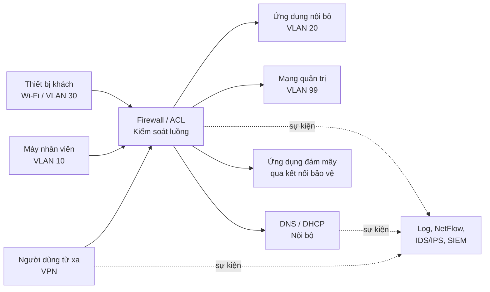
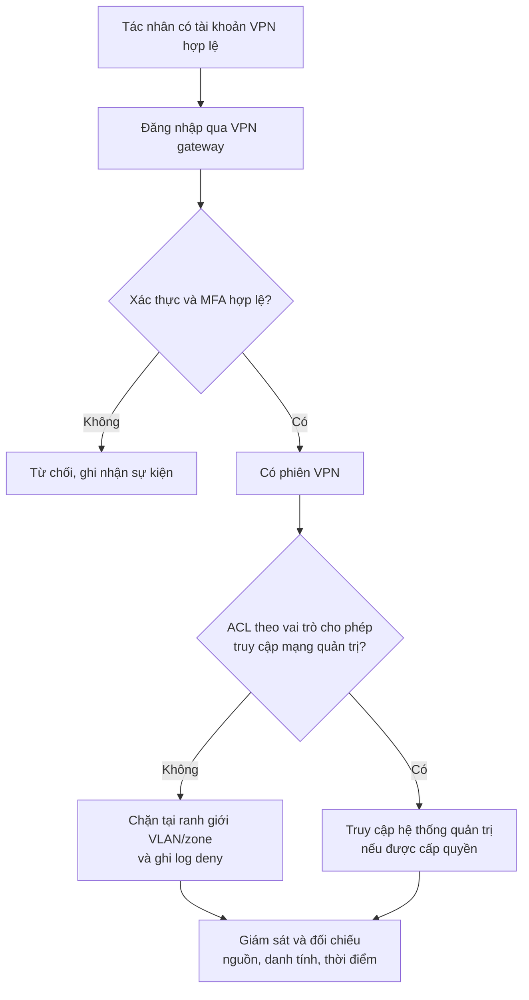
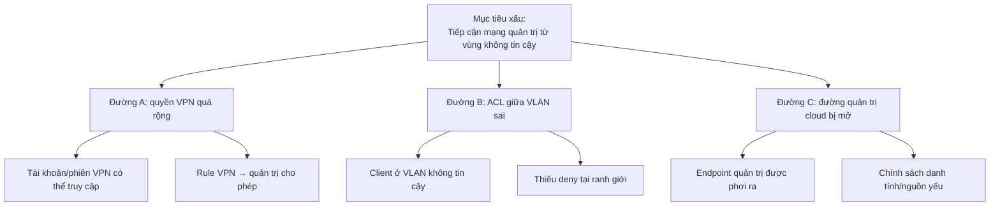

# Abuse case và misuse case trong threat modeling mạng

**Abuse case** và **misuse case** giúp đội thiết kế mạng nhìn một hệ thống từ góc độ các hành vi có thể gây hại, thay vì chỉ nhìn các chức năng hoạt động đúng. Ví dụ, yêu cầu nghiệp vụ “nhân viên kết nối VPN để truy cập ứng dụng nội bộ” mô tả điều mong muốn. Câu hỏi an ninh là: *Nếu tài khoản VPN bị chiếm đoạt, hoặc người dùng hợp lệ cố truy cập mạng quản trị ngoài nhiệm vụ của mình, điều gì sẽ xảy ra?*

Trong kiến trúc mạng an toàn, các kịch bản này chỉ ra điểm yếu ở phân đoạn VLAN, ACL/firewall, VPN, DNS, DHCP, Wi-Fi, IDS/IPS và cả đường kết nối lên đám mây. Kết quả quan trọng nhất không phải một câu chuyện về tấn công, mà là **yêu cầu bảo vệ có thể kiểm chứng**: ai được làm gì, qua ranh giới nào, điều gì bị từ chối, dấu hiệu nào được giám sát và hệ thống phải phản ứng ra sao.

## 1. Từ use case bình thường đến hành vi không mong muốn

### 1.1. Use case, misuse case và abuse case

| Khái niệm | Câu hỏi trọng tâm | Ví dụ liên quan mạng |
| --- | --- | --- |
| **Use case** | Người dùng hoặc thành phần hợp lệ cần hoàn thành việc gì? | Nhân viên đăng nhập VPN để truy cập ứng dụng nhân sự theo phân quyền. |
| **Misuse case** | Chức năng, quyền hoặc luồng được phép có thể bị sử dụng sai cách nào? | Người dùng VPN hợp lệ tìm cách truy cập dải quản trị mà công việc không yêu cầu. |
| **Abuse case** | Tác nhân có ý đồ xấu có thể lợi dụng hệ thống nhằm đạt mục tiêu gây hại nào? | Kẻ tấn công kiểm soát một thiết bị trong VLAN khách, phát phản hồi DHCP trái phép để dẫn thiết bị khác tới DNS do chúng kiểm soát. |

Trong tài liệu và các nhóm thực hành bảo mật, **misuse case** và **abuse case** có thể được dùng gần như đồng nghĩa. Một quy ước hữu ích cho bài này là:

- *Misuse case* nhấn mạnh **cách một chức năng hoặc quyền hợp lệ bị dùng sai**, có thể do cố ý, sơ suất hoặc tài khoản bị chiếm đoạt.
- *Abuse case* nhấn mạnh **mục tiêu gây hại và hành vi đối kháng**, thường được kể từ góc nhìn của kẻ tấn công.

Đây là **quy ước làm việc**, không phải ranh giới thuật ngữ được mọi tổ chức áp dụng giống nhau. Một sự kiện có thể được mô tả theo cả hai cách; hãy chọn góc nhìn giúp làm rõ yêu cầu bảo mật. Không nên xem mọi lỗi người dùng là hành vi tấn công, và không nên suy ý đồ độc hại chỉ từ một cảnh báo mạng.

### 1.2. Tại sao cần thêm “luồng xấu”?

Tài liệu thiết kế chức năng thường nói “VPN cho phép kết nối từ xa”, “DHCP tự cấp IP”, “DNS phân giải tên”, “tường lửa kiểm soát luồng”. Các câu đó chưa trả lời:

- Ai không được phép sử dụng chức năng này và làm sao hệ thống nhận biết?
- Quyền hợp lệ có vượt quá phạm vi công việc, mạng hoặc thời điểm cần thiết không?
- Nếu đầu vào sai, danh tính bị đánh cắp hoặc một thành phần mạng bị giả mạo thì hệ thống từ chối thế nào?
- Liệu IDS/IPS, nhật ký và đội vận hành có phát hiện được sự kiện đáng chú ý?
- Một kiểm soát thất bại có dẫn thẳng tới tài sản quan trọng hay còn lớp phòng vệ khác?

Misuse/abuse case làm lộ **đường đi từ hành vi đến tác động**, giúp thiết kế phòng vệ nhiều lớp thay vì đặt một thiết bị bảo mật rồi coi như đủ an toàn.

## 2. Bối cảnh để mô hình hóa: mạng doanh nghiệp mẫu

Giả sử một doanh nghiệp có nhân viên làm việc tại văn phòng, Wi-Fi khách, quản trị viên truy cập từ xa và dịch vụ ứng dụng triển khai trên đám mây.



*Sơ đồ là mô hình logic. Vị trí thực tế của DHCP relay, AP, switch L2/L3, thiết bị VPN và IDS phụ thuộc hạ tầng; không phải mọi lưu lượng cùng VLAN đều nhất thiết đi qua firewall.*

Ta giả định các chính sách mong muốn sau:

| Luồng | Chính sách dự kiến |
| --- | --- |
| Nhân viên → ứng dụng nội bộ | Cho phép các dịch vụ ứng dụng cần thiết sau xác thực và phân quyền. |
| Người dùng VPN → ứng dụng công việc | Chỉ cho phép mạng và cổng đúng vai trò, có xác thực mạnh. |
| Wi-Fi khách → Internet | Cho phép theo chính sách; cô lập khỏi mạng nhân viên, máy chủ và quản trị. |
| Thiết bị IoT → máy chủ điều khiển | Chỉ cho phép luồng cần thiết, chặn truy cập ngang không được phê duyệt. |
| Quản trị viên → VLAN 99 | Chỉ từ nguồn quản trị đã phê duyệt, có xác thực và ghi log. |
| Máy khách → DNS/DHCP hợp lệ | Sử dụng hạ tầng được chỉ định; phát hiện nguồn phản hồi trái phép. |
| Mạng nội bộ → dịch vụ đám mây | Có kiểm soát định tuyến, nhận dạng dịch vụ, mã hóa và giám sát. |

**Ranh giới tin cậy** là nơi mức độ tin cậy thay đổi: Internet → VPN gateway, Wi-Fi khách → mạng nội bộ, cổng máy trạm → hạ tầng DHCP, mạng ứng dụng → mạng quản trị, mạng doanh nghiệp → tài nguyên đám mây. Ranh giới không chỉ là đường nối trên hình; nó là nơi phải có quy tắc xác thực, phân quyền, lọc lưu lượng và quan sát.

Để bắt đầu, lập danh sách tài sản cần bảo vệ: thông tin đăng nhập, máy chủ ứng dụng, hệ thống quản trị, bí mật cấu hình, DNS/DHCP, thông tin khách hàng, bảng định tuyến và khả năng cung cấp dịch vụ. Xác định chủ sở hữu từng tài sản, các luồng hợp lệ và mức ảnh hưởng nếu tính bí mật, toàn vẹn hoặc sẵn sàng bị phá vỡ.

## 3. Cách xây dựng một misuse/abuse case

Một kịch bản tốt phải **cụ thể, có thể lần theo trên sơ đồ mạng và chuyển thành bài kiểm tra**. Mỗi case nên có các trường sau:

| Trường | Cần trả lời |
| --- | --- |
| **ID và tên** | Case nào, tên hành vi không mong muốn là gì? |
| **Use case liên quan** | Chức năng hoặc luồng hợp lệ nào bị sử dụng sai/lợi dụng? |
| **Tác nhân và năng lực** | Tác nhân nội bộ, thiết bị khách, tài khoản bị chiếm đoạt hay bên thứ ba? Có quyền gì? |
| **Tài sản/mục tiêu** | Tác nhân muốn đạt kết quả nào; tài sản nào bị ảnh hưởng? |
| **Điều kiện tiên quyết** | Cần đứng ở VLAN nào, có tài khoản hay có kết nối mạng nào? |
| **Điểm vào và ranh giới tin cậy** | Giao thức/cổng/đường truyền nào bị lợi dụng; vượt từ vùng tin cậy nào sang vùng nào? |
| **Luồng chính và biến thể** | Chuỗi sự kiện cấp cao dẫn đến tác động; nếu kiểm soát hoạt động thì chuỗi dừng ở đâu? |
| **Tác động** | Mất bí mật, sai lệch dữ liệu, gián đoạn, chiếm quyền hay vi phạm phân đoạn? |
| **Kiểm soát ngăn chặn** | Chính sách truy cập, MFA, phân đoạn, lọc, bảo vệ giao thức nào ngắt được đường đi? |
| **Dấu hiệu phát hiện** | Log, flow, cảnh báo, metric hoặc mối tương quan nào có thể quan sát? |
| **Ứng phó và phục hồi** | Ai xử lý, cô lập gì, khôi phục dịch vụ thế nào? |
| **Phép thử chấp nhận** | Cần đo hoặc quan sát điều gì để xác nhận kiểm soát đạt yêu cầu? |
| **Giả định, chủ sở hữu, rủi ro còn lại** | Phạm vi mô hình, người chịu trách nhiệm và những khoảng trống chưa giải quyết. |

Có thể dùng cấu trúc ngắn để viết một case:

> **Khi** [tác nhân có năng lực/điều kiện cụ thể] **thử** [hành vi qua điểm vào], **thì** [một hoặc nhiều ranh giới tin cậy có nguy cơ bị vượt qua], **dẫn tới** [tác động đối với tài sản]. **Hệ thống phải** [chặn/giới hạn hành vi], **ghi nhận** [bằng chứng] và **cho phép kiểm thử** [kết quả quan sát được].

Tránh mô tả như “hacker phá mạng”, “mạng bị tấn công” hoặc “dùng firewall để an toàn”. Các mô tả này thiếu điều kiện, luồng, tài sản và tiêu chí kiểm chứng.

### 3.1. Quy trình nhóm thực hiện

1. **Chọn use case bình thường.** Ví dụ “nhân viên kết nối VPN đến ứng dụng nội bộ”.
2. **Vẽ luồng dữ liệu.** Ghi vị trí client, gateway, VPN concentrator, firewall, ứng dụng, DNS và nguồn log.
3. **Đánh dấu ranh giới tin cậy.** Đặc biệt chú ý điểm kết thúc VPN, đường giữa VLAN và kết nối đến cloud.
4. **Xác định tác nhân và giả định.** Chỉ gán khả năng có cơ sở: tài khoản hợp lệ, thiết bị trên Wi-Fi khách, quyền quản trị được cấp, v.v.
5. **Đặt mục tiêu không mong muốn.** Ví dụ “truy cập mạng quản trị từ VPN người dùng”.
6. **Mô tả đường dẫn ở mức hành vi.** Xác định cơ chế/điểm yếu, kết quả mong muốn của tác nhân, các kiểm soát trên đường.
7. **Đề xuất kiểm soát + tín hiệu phát hiện.** Liên kết các yêu cầu với điểm có khả năng thực thi và nguồn quan sát.
8. **Đặt ưu tiên, viết phép kiểm thử và giao chủ sở hữu.** Ghi lại giả định/rủi ro còn lại; rà soát khi thiết kế thay đổi.

### 3.2. Một luồng xấu có nhiều điểm dừng



Một tài khoản đăng nhập thành công **không đủ** để chứng minh mọi luồng sau đăng nhập được phép. Quyết định quan trọng nằm ở **ủy quyền theo vai trò và phân đoạn tại điểm truy cập**, cùng với log chứng minh việc từ chối/cho phép.

## 4. Misuse case mẫu: quyền VPN bị sử dụng vượt phạm vi

### MC-01 — Người dùng VPN truy cập mạng quản trị ngoài nhiệm vụ

**Use case hợp lệ:** nhân viên hỗ trợ khách hàng kết nối VPN để dùng hệ thống hỗ trợ tại VLAN 20.

**Tác nhân:** người dùng có tài khoản và MFA hợp lệ; cũng có thể là phiên đăng nhập bị kẻ khác chiếm quyền sau xác thực. **Không mặc định** rằng đăng nhập hợp lệ đồng nghĩa người dùng có ý đồ xấu.

**Tiền điều kiện:** VPN đã thiết lập; firewall có chính sách quá rộng hoặc VPN cấp tuyến đi đến VLAN 99; thiết bị đích có dịch vụ quản trị đang lắng nghe.

**Luồng không mong muốn:**

1. Người dùng tạo phiên VPN đúng quy trình để vào hệ thống công việc.
2. Người dùng hoặc phần mềm trên thiết bị sử dụng tuyến mạng sẵn có để thử liên lạc với dịch vụ quản trị ở VLAN 99.
3. Nếu ACL cho phép mọi lưu lượng VPN vào nội bộ, phiên có thể đến được điểm quản trị ngoài phạm vi vai trò.
4. Nếu điểm đích còn phân quyền yếu, rủi ro có thể tăng lên thành can thiệp cấu hình hoặc tiếp cận dữ liệu nhạy cảm.

**Tác động:** vượt giới hạn phân quyền mạng, tăng bề mặt tấn công, nguy cơ thay đổi cấu hình thiết bị quan trọng.

**Yêu cầu bảo mật:**

- Quyền VPN áp dụng theo nhóm vai trò, danh tính thiết bị và ứng dụng được phép; chính sách mặc định **deny** giữa zone VPN người dùng và VLAN 99.
- Chỉ jump host/bastion hoặc mạng quản trị chuyên dụng có quyền truy cập dịch vụ quản trị theo cơ chế được phê duyệt.
- Hệ thống quản trị có xác thực độc lập, ghi log tài khoản và tác vụ; không dựa vào ACL như lớp bảo vệ duy nhất.
- Log firewall/VPN phải liên kết được nguồn phiên, thời điểm, đích và quyết định allow/deny; SIEM phát hiện truy cập không mong đợi.

**Kiểm thử chấp nhận:** dùng tài khoản thử nghiệm có vai trò nhân viên thông thường, đăng nhập VPN và thực hiện kiểm tra kết nối **được phê duyệt** đến cổng quản trị thử nghiệm. Kết quả mong đợi là **deny có log**, trong khi kết nối đến ứng dụng công việc vẫn thành công. Dùng tài khoản quản trị thử nghiệm từ nguồn quản trị hợp lệ để xác nhận luồng được phép không bị ảnh hưởng.

**Rủi ro còn lại:** thiết bị đầu cuối bị nhiễm mã độc, đặc quyền sai trong ứng dụng hoặc tài khoản quản trị bị lộ vẫn cần kiểm soát riêng (quản lý endpoint, PAM, giám sát phiên).

## 5. Abuse case mẫu: giả mạo nguồn DHCP và DNS

### AC-01 — Thiết bị trong VLAN khách cố phát thông số mạng trái phép

**Use case hợp lệ:** thiết bị khách kết nối Wi-Fi, nhận địa chỉ IP/DNS/gateway từ hệ thống DHCP được doanh nghiệp quản lý và truy cập Internet trong vùng cách ly.

**Tác nhân:** một thiết bị không tin cậy đang ở cùng miền quảng bá thích hợp với máy khách. **Giả định rõ:** thiết bị có thể phát lưu lượng DHCP ở lớp 2; nếu cơ chế client isolation và chính sách switch đã cô lập các máy, đường tấn công này có thể bị chặn từ sớm.

**Tiền điều kiện:** access switch/AP cho phép phản hồi DHCP từ cổng máy khách hoặc không có kiểm soát tin cậy phù hợp; có máy mới tham gia mạng hoặc cần gia hạn địa chỉ.

**Luồng đối kháng ở mức khái niệm:**

1. Thiết bị khách yêu cầu cấu hình DHCP.
2. Một thiết bị không được ủy quyền cố đưa phản hồi mang thông số DNS hoặc gateway sai lệch.
3. Nếu máy khách chấp nhận cấu hình không đáng tin cậy, các yêu cầu phân giải tên hoặc một phần lưu lượng có thể đi qua hạ tầng không được phê duyệt.
4. Người dùng gặp lỗi, bị dẫn đến dịch vụ giả hoặc lưu lượng nhạy cảm có nguy cơ bị quan sát/chuyển hướng tùy các biện pháp mã hóa và xác thực đầu cuối.

**Tác động:** vi phạm tính toàn vẹn cấu hình mạng, gián đoạn truy cập, rủi ro chuyển hướng DNS/lưu lượng.

**Kiểm soát phòng ngừa và giảm thiểu:**

- Bật **DHCP snooping** trên hạ tầng có hỗ trợ; cổng máy khách là *untrusted*, chỉ cho phép phản hồi server từ các cổng/đường đi đã phê duyệt.
- Cấu hình đúng cổng trusted đối với DHCP server/relay; rà soát việc sử dụng Option 82 và hành vi của DHCP relay theo sản phẩm.
- Bật client isolation, phân đoạn VLAN khách và ACL chặn truy cập nội bộ không cần thiết; quản lý thiết bị được phép kết nối.
- Theo dõi DHCP server identifier, địa chỉ IP/DNS/gateway thực nhận và phát hiện các phản hồi ngoài danh sách.
- Với DNS, sử dụng resolver tin cậy và cơ chế bảo vệ phù hợp cho ứng dụng; bảo vệ đầu cuối bằng TLS với xác thực chứng chỉ khi có thể.

**Phát hiện:** nhiều phản hồi DHCP từ nguồn lạ, client nhận DNS/gateway bất thường, cảnh báo DHCP snooping, thay đổi bất ngờ ở DHCP option, sự gia tăng lỗi phân giải tên hoặc kết nối đến resolver trái chính sách.

**Kiểm thử chấp nhận:** trong VLAN lab tách biệt, sử dụng nguồn DHCP thử nghiệm **được phê duyệt** trên cổng untrusted để xác minh phản hồi trái phép bị chặn, log thể hiện sự kiện, trong khi DHCP server hợp lệ tiếp tục cấp địa chỉ chính xác. Không làm thử trên phân đoạn sản xuất khi chưa lập phạm vi kiểm thử và kế hoạch khôi phục.

**Rủi ro còn lại:** switch/AP không hỗ trợ DHCP snooping, cấu hình trust sai, máy dùng IP/DNS tĩnh hoặc đường tấn công khác không đi qua DHCP cần được kiểm soát bằng các biện pháp bổ sung.

## 6. Abuse case mẫu: lạm dụng đăng nhập VPN

### AC-02 — Tài khoản bị dò đoán hoặc thông tin đăng nhập bị tái sử dụng

**Use case hợp lệ:** người dùng từ xa xác thực vào VPN để truy cập ứng dụng theo vai trò.

**Tác nhân:** bên ngoài Internet không có quyền truy cập ban đầu; có thể sở hữu danh sách tài khoản, mật khẩu bị lộ từ dịch vụ khác hoặc thông tin định danh công khai.

**Tiền điều kiện:** VPN gateway công khai dịch vụ đăng nhập; cơ chế chống thử đăng nhập lặp lại, phát hiện bất thường hoặc MFA chưa hiệu quả.

**Luồng đối kháng:** tác nhân cố xác thực bằng các thông tin không được cấp cho mình; nếu đăng nhập thành công, phiên có thể tiếp cận những mạng được chính sách VPN cho phép. Rủi ro gia tăng nếu tài khoản có quyền quá rộng và không có kiểm tra tính an toàn thiết bị.

**Tác động:** truy cập trái phép qua cổng từ xa, nguy cơ lộ dữ liệu và di chuyển ngang đến các hệ thống nội bộ.

**Yêu cầu bảo vệ:**

- Áp dụng MFA phù hợp mức rủi ro, ưu tiên phương thức chống lừa đảo khi có thể; bảo vệ khóa/phiên và quy trình khôi phục tài khoản.
- Giới hạn tốc độ và chính sách giảm thiểu thử đăng nhập hàng loạt; tránh cơ chế khóa làm gián đoạn hàng loạt tài khoản hợp lệ.
- Tách vùng VPN với mạng quản trị; thực thi least privilege theo vai trò/thiết bị, timeout và kiểm soát phiên.
- Tương quan log VPN/IdP: số lần thất bại, phân bố tài khoản, nguồn truy cập, bất thường về thời gian/thiết bị/địa lý và đăng nhập thành công sau chuỗi thất bại.
- Có quy trình khóa phiên và thu hồi token, xác minh người dùng, điều tra endpoint nếu có chỉ dấu chiếm tài khoản.

**Kiểm thử chấp nhận:** dùng tài khoản kiểm thử để xác minh chính sách chống thử xác thực lặp lại, thử thiếu MFA, thu hồi phiên và kiểm tra cảnh báo. Cần giới hạn tốc độ/thời điểm kiểm tra để không ảnh hưởng người dùng thật. Kết quả phải được ghi thành bằng chứng: log, timestamp, trạng thái truy cập và ID cảnh báo tương ứng.

## 7. Misuse/abuse case mở rộng trong phòng vệ mạng

Các tình huống sau có thể được đưa vào backlog phân tích, mỗi tình huống cần điều chỉnh theo sơ đồ thực tế.

| ID | Case | Tài sản và ranh giới | Kiểm soát ưu tiên | Dấu hiệu đo lường |
| --- | --- | --- | --- | --- |
| MC-02 | Quản trị viên sửa rule firewall vượt phạm vi thay đổi được duyệt | Tính toàn vẹn chính sách, mạng quản trị → vùng ứng dụng | RBAC, phê duyệt thay đổi, cấu hình dạng mã, audit log, kiểm tra sai lệch | Thay đổi rule không có ticket, policy drift, mở rộng bất thường đích/cổng |
| AC-03 | Thiết bị trong mạng khách cố truy cập dịch vụ nội bộ | Wi-Fi khách → VLAN ứng dụng/quản trị | Client isolation, ACL deny, phân đoạn zone, NAC theo khả năng | Flow bị chặn, truy cập liên VLAN ngoài baseline |
| AC-04 | Thiết bị bị xâm nhập cố sử dụng DNS cho trao đổi không phù hợp chính sách | Endpoint → resolver/DNS ngoài | Egress DNS policy, resolver nội bộ, phân tích truy vấn, phân quyền endpoint | Tên miền bất thường, nhịp truy vấn khác baseline, số lượng lỗi NXDOMAIN tăng; cần điều tra trước khi kết luận |
| AC-05 | Thiết bị giả mạo điểm truy cập Wi-Fi khiến người dùng kết nối nhầm | Thiết bị người dùng → mạng không tin cậy | WPA2/3-Enterprise khi phù hợp, xác thực chứng chỉ RADIUS, MDM, hướng dẫn nhận diện mạng | BSSID/SSID trái danh sách, sự kiện đổi mạng, xác thực chứng chỉ lỗi |
| AC-06 | Tài nguyên cloud vô tình mở cổng quản trị ra Internet | Internet → VM/bastion/service cloud | Security group/NSG tối thiểu, CSPM, IaC review, private endpoint, kiểm tra định kỳ | Phát hiện rule công khai, cloud configuration drift, cloud flow logs |
| AC-07 | Thiết bị trong VLAN phát lượng lớn yêu cầu DHCP nhằm chiếm pool | Cổng access → hạ tầng DHCP | DHCP snooping rate limit nếu hỗ trợ, giám sát pool, NAC, chia subnet hợp lý | Pool utilization tăng đột ngột, số yêu cầu/cổng tăng, nhiều client identifier mới |

**Chú ý khi đánh giá log:** một chỉ dấu như NXDOMAIN tăng hoặc nhiều lượt đăng nhập thất bại có thể đến từ lỗi vận hành. Một case chỉ được xác nhận sau khi đối chiếu thêm nguồn, danh tính, thời gian và bối cảnh.

## 8. Kết nối với STRIDE, attack tree và các lớp phòng vệ

Misuse/abuse case kể **kịch bản cụ thể**. STRIDE là bộ câu hỏi để tìm nhóm mối đe dọa; attack tree mô tả các điều kiện hoặc đường đi dẫn đến một mục tiêu. Ba công cụ hỗ trợ nhau và không thay thế hoàn toàn nhau.

| STRIDE | Câu hỏi áp vào môi trường mạng | Case liên quan |
| --- | --- | --- |
| **S — Spoofing** (giả mạo) | Một điểm cuối, DHCP/DNS, AP hoặc danh tính VPN có thể bị giả mạo? | AC-01, AC-02, AC-05 |
| **T — Tampering** (sửa đổi) | Có thể thay đổi ACL, route hoặc cấu hình máy chủ trái phép? | MC-02, AC-01 |
| **R — Repudiation** (phủ nhận hành vi) | Có truy được người và thay đổi khi xảy ra sự cố? | MC-02, MC-01 |
| **I — Information Disclosure** (lộ thông tin) | Luồng nào vượt vùng tin cậy hoặc làm lộ dữ liệu? | MC-01, AC-03, AC-04 |
| **D — Denial of Service** (từ chối dịch vụ) | Có thể làm cạn pool, quá tải VPN hoặc mất đường dịch vụ? | AC-07 |
| **E — Elevation of Privilege** (leo thang đặc quyền) | Quyền mạng hoặc hệ thống có thể bị mở rộng vượt vai trò? | MC-01, MC-02 |

Một ví dụ attack tree ở mức mục tiêu:



Các nhánh trên mang ý nghĩa **các con đường có thể xảy ra**, và điều kiện bên trong từng nhánh cần được đánh giá cùng nhau. Một sơ đồ đầy đủ hơn có thể biểu diễn quan hệ AND/OR, xác suất, phụ thuộc và các kiểm soát tương ứng. Khi ghi nhận case, luôn chỉ ra **điều kiện tiên quyết**, tránh khẳng định đường tấn công khả thi khi chưa xác minh hạ tầng.

Từ STRIDE và attack tree, đội thiết kế phải chuyển sang lớp phòng vệ thực thi được: phân đoạn và least privilege, firewall/ACL, VPN/IdP, bảo vệ DNS/DHCP/Wi-Fi, IDS/IPS, quan sát flow/log, quản lý cấu hình và ứng phó sự cố.

## 9. Ưu tiên case theo rủi ro, không theo độ hấp dẫn của câu chuyện

Không phải mọi kịch bản có thể tưởng tượng đều xứng đáng triển khai cùng lúc. Chấm điểm đơn giản có thể dùng để **sắp thứ tự thảo luận**, không nên coi là xác suất tấn công tuyệt đối.

| Thành phần | Mức thấp (1) | Mức trung bình (3) | Mức cao (5) |
| --- | --- | --- | --- |
| **Khả năng xảy ra (L)** | Tiền điều kiện khó đạt, nhiều lớp kiểm soát đã xác minh | Có một số đường khả thi nhưng chưa phổ biến | Điểm vào phơi bày, điều kiện dễ gặp, kiểm soát yếu/thiếu |
| **Ảnh hưởng (I)** | Ảnh hưởng cục bộ, phục hồi đơn giản | Gián đoạn một dịch vụ hoặc nhóm người dùng | Hệ thống trọng yếu, dữ liệu nhạy cảm, lan rộng/khó phục hồi |

Ví dụ quy ước tính **R = L × I**, từ 1 đến 25:

- **1–5:** thấp, ghi nhận và xem xét theo chu kỳ.
- **6–12:** trung bình, xếp lịch cải thiện có chủ sở hữu.
- **13–25:** cao, ưu tiên xử lý và kiểm chứng sớm.

Ngưỡng trên chỉ là **ví dụ minh họa**. Tổ chức có thể có ma trận rủi ro riêng, thang điểm khác hoặc yêu cầu tuân thủ bắt buộc ngay cả khi điểm thấp.

| Case mẫu | L | I | R | Giả định làm căn cứ |
| --- | ---: | ---: | ---: | --- |
| MC-01: VPN người dùng đến VLAN 99 | 3 | 5 | **15** | Đã thấy rule rộng nhưng quản trị đích vẫn yêu cầu xác thực |
| AC-01: DHCP giả trong VLAN khách | 3 | 4 | **12** | Một nhóm switch chưa bật DHCP snooping |
| AC-02: lạm dụng đăng nhập VPN | 4 | 5 | **20** | Cổng VPN công khai, một nhóm tài khoản chưa dùng MFA mạnh |
| AC-06: cổng quản trị cloud công khai | 2 | 5 | **10** | Quét cấu hình định kỳ, chưa thấy phơi bày hiện tại |

Các điểm này **không phản ánh một doanh nghiệp có thật**. Chúng minh họa cách gắn giả định vào đánh giá để người khác có thể phản biện. Sau khi triển khai kiểm soát, đánh giá lại **rủi ro còn lại (residual risk)** cùng bằng chứng cấu hình/kiểm thử.

## 10. Chuyển case thành yêu cầu an ninh và phép kiểm thử

Một case chỉ tạo giá trị khi kết nối được với thay đổi thiết kế và kết quả chấp nhận. Hãy theo dõi cả **prevention**, **detection** và **response**:

| Case | Yêu cầu bảo vệ | Phép kiểm thử/tiêu chí đạt | Bằng chứng vận hành |
| --- | --- | --- | --- |
| MC-01 | VPN người dùng không truy cập được VLAN quản trị; chỉ nhóm quản trị qua bastion được cấp quyền | Tài khoản thử thông thường bị deny đến đích quản trị; tài khoản chuyên trách qua bastion hoạt động đúng | Rule version, VPN session, firewall deny/allow log |
| AC-01 | Chặn phản hồi DHCP từ cổng không tin cậy | DHCP giả từ cổng lab untrusted bị loại; client vẫn nhận cấu hình đúng từ server hợp lệ | DHCP snooping counter/log, thông số lease trên client |
| AC-02 | MFA và giới hạn thử xác thực bất thường | Phiên thiếu MFA bị từ chối; thử nghiệm có kiểm soát kích hoạt tín hiệu giám sát; phiên bị thu hồi hết hiệu lực | IdP/VPN authentication log, alert ID, audit phiên |
| AC-03 | Wi-Fi khách không truy cập hệ thống nội bộ | Client khách chỉ đến được các đích đúng chính sách, bị deny với VLAN nội bộ | ACL/firewall log, kết quả reachability |
| AC-06 | Không có cổng quản trị cloud công khai ngoài danh mục ngoại lệ | Quét policy phát hiện rule không phù hợp; sửa cấu hình rồi kiểm tra lại | IaC diff, CSPM finding, cloud audit/flow log |

**Trình tự kiểm chứng hợp lý:**

1. Xác nhận **thiết kế và phạm vi phép thử**: subnet, tài khoản kiểm thử, tài sản đích, thời gian, ai phê duyệt.
2. Kiểm tra **chặn đúng**: chức năng bị cấm không thực hiện được.
3. Kiểm tra **cho phép đúng**: use case bình thường vẫn hoạt động; tránh kết luận an toàn khi thực tế mọi kết nối đều bị cắt.
4. Kiểm tra **phát hiện đúng**: dấu hiệu xuất hiện tại nguồn log, có độ trễ chấp nhận được, chứa đủ thông tin điều tra.
5. Kiểm tra **xử lý và phục hồi**: người trực vận hành biết làm gì, có runbook và khả năng hoàn tác.
6. Lưu **bằng chứng và rủi ro tồn tại**: phiên bản chính sách, kết quả thử, chủ sở hữu, thời điểm tái kiểm tra.

Không cần thực hiện hành vi gây gián đoạn hoặc truy cập ngoài quyền để xác minh kịch bản. Có thể dựng lab, dùng tài khoản và thiết bị thử nghiệm, kiểm tra rule, cấu hình hoặc mô phỏng sự kiện cho SIEM theo quy trình được cho phép.

### 10.1. Ví dụ bản ghi case theo cấu trúc dữ liệu

Cấu trúc sau dùng để lưu vào backlog hoặc tài liệu kiểm soát; **không phải cấu hình thiết bị mạng có thể chạy trực tiếp**.

```yaml
id: MC-01
title: "VPN user truy cập mạng quản trị ngoài vai trò"
type: misuse_case
related_use_case: "Nhân viên truy cập ứng dụng nội bộ qua VPN"
actor: "Người dùng VPN hợp lệ hoặc phiên bị chiếm đoạt"
entry_point: "VPN gateway"
trust_boundary: "User-VPN zone -> Management VLAN"
target_asset: "Giao diện quản trị thiết bị mạng"
preconditions:
  - "Phiên VPN đã xác thực"
  - "Thiếu hoặc sai ACL theo vai trò"
undesired_outcome: "Truy cập dịch vụ quản trị trái phân quyền"
controls:
  preventive:
    - "ACL deny mặc định giữa VPN người dùng và VLAN quản trị"
    - "Bastion và xác thực riêng cho quản trị"
  detective:
    - "Firewall deny log kèm danh tính phiên VPN"
  response:
    - "Rà soát quyền, cô lập phiên nếu có chỉ dấu lạm dụng"
acceptance_test:
  input: "Tài khoản VPN kiểm thử không có vai trò quản trị"
  expected: "Deny và có audit log; ứng dụng được phép vẫn truy cập được"
owner: "Nhóm mạng và an ninh"
status: "Cần xác minh trong môi trường kiểm thử"
```

Bản ghi nên liên kết được với **ID rủi ro**, yêu cầu thiết kế, thay đổi firewall/IaC, phép thử, kết quả và cảnh báo. Nếu quản trị bằng ticket, chỉ nên lưu dữ liệu cần thiết; không đưa mật khẩu, token hay bí mật hạ tầng vào tài liệu.

## 11. Thực hành thiết kế theo tình huống

**Tình huống:** Doanh nghiệp bổ sung mạng IoT cho camera và cảm biến, đặt ở VLAN 50. Các thiết bị này cần gửi dữ liệu đến máy chủ xử lý trong VLAN 20, còn quản trị viên cấu hình qua bastion. Mạng khách ở VLAN 30 và người dùng VPN thông thường không cần truy cập trực tiếp vào IoT.

Đội thiết kế có thể tạo ba case:

**Case A — Misuse:** tài khoản vận hành có quyền cấu hình camera sử dụng quyền đó để thay đổi tham số ngoài quy trình. Nguồn rủi ro là **phạm vi đặc quyền và khả năng truy vết thao tác**. Kiểm soát gồm RBAC, phê duyệt thay đổi, cấu hình chuẩn, nhật ký quản trị và đối chiếu định kỳ.

**Case B — Abuse:** thiết bị không tin cậy trong VLAN khách cố liên hệ trực tiếp đến camera hoặc cổng quản lý IoT. Ranh giới chính là **VLAN 30 → VLAN 50**. Yêu cầu là deny mặc định và ghi lại các nỗ lực đến dịch vụ bị cấm; phép thử dùng một máy khách kiểm thử và một đích IoT mô phỏng.

**Case C — Abuse:** camera bị xâm nhập cố sử dụng quyền mạng của chính nó để liên hệ đến các dịch vụ ngoài danh sách được phép. Ranh giới là **IoT → các mạng nội bộ khác/Internet**. Kiểm soát nên gồm egress allowlist, DNS có chính sách, quản lý firmware, phân đoạn, giám sát luồng và kế hoạch cô lập thiết bị.

**Điểm mấu chốt:** “Chặn Wi-Fi khách vào IoT” chưa bảo vệ đủ khi chính IoT bị xâm nhập hoặc tài khoản quản trị bị sử dụng sai. Một mô hình mối đe dọa hữu ích bao phủ nhiều tác nhân và nhiều chiều lưu lượng, rồi xác định lớp bảo vệ tương ứng.

## 12. Sai sót thường gặp khi viết misuse/abuse case

| Sai sót | Vì sao gây khó cho việc bảo vệ | Cách sửa |
| --- | --- | --- |
| Ghi chung “bị hacker tấn công” | Không xác định tài sản, điểm vào hay điều kiện | Nêu tác nhân, năng lực, giao thức/vùng mạng và kết quả không mong muốn |
| Coi mọi misuse đều có chủ ý | Dễ gán nhầm lỗi thao tác thành tấn công | Phân biệt hành vi, tác động và mức độ chắc chắn về ý đồ |
| Chỉ xét Internet → mạng nội bộ | Bỏ qua thiết bị cùng VLAN, quản trị viên và đường VPN/cloud | Xét các ranh giới nội bộ, north–south, east–west và cloud |
| Chỉ viết biện pháp chặn, không có phát hiện | Khi kiểm soát thất bại sẽ thiếu tín hiệu điều tra | Chỉ định log, flow, metric, điều kiện cảnh báo và owner |
| Chỉ thử luồng bị chặn | Dễ vô tình gây gián đoạn use case hợp lệ | Có kiểm thử dương tính cho chức năng được phép |
| Xem IDS/IPS là bằng chứng đủ | IDS có thể bỏ sót, báo nhầm hoặc không nhìn thấy lưu lượng mã hóa | Kết hợp log định danh, endpoint, firewall, DNS và flow khi khả thi |
| Lập rất nhiều case nhưng không ưu tiên | Đội vận hành khó xác định cần làm gì trước | Đánh giá rủi ro, chốt phạm vi, người phụ trách và hạn xử lý |
| Không cập nhật khi kiến trúc đổi | Case cũ bỏ sót kết nối mới, dịch vụ cloud hoặc thay đổi quyền | Gắn rà soát với thay đổi VPN, firewall, VLAN, DNS, SaaS/IaC |

## 13. Danh sách kiểm tra để một case sẵn sàng đưa vào triển khai

Trước khi đóng case ở vòng thiết kế, người rà soát cần trả lời được:

- [ ] Tài sản, use case hợp lệ, tác nhân và mục tiêu không mong muốn đã rõ.
- [ ] Điều kiện tiên quyết và giả định được ghi lại, tránh khẳng định khả năng chưa kiểm chứng.
- [ ] Điểm vào, VLAN/zone và ranh giới tin cậy được chỉ ra trên sơ đồ.
- [ ] Các tác động lên **bí mật, toàn vẹn và sẵn sàng** được xem xét.
- [ ] Có ít nhất một kiểm soát phòng ngừa và phương án phát hiện khả thi.
- [ ] Xác định thiết bị/hệ thống thực thi kiểm soát và nguồn log để đối chiếu.
- [ ] Phép thử gồm luồng bị cấm và luồng hợp lệ, với tiêu chí đo cụ thể.
- [ ] Có người phụ trách, ưu tiên dựa trên giả định, rủi ro còn lại và thời điểm rà soát.
- [ ] Phần kiểm thử được giới hạn trong môi trường hoặc phạm vi có quyền vận hành.

## 14. Tổng kết

**Use case** nói điều hệ thống cần cho phép; **misuse/abuse case** phơi bày hành vi cần ngăn chặn hoặc giới hạn. Trong threat modeling mạng, mỗi kịch bản nên nối được **tác nhân → điểm vào → ranh giới tin cậy → tài sản → tác động → kiểm soát → phép kiểm thử**.

Việc phân biệt hai nhãn có ích cho cách viết, nhưng độ chính xác của điều kiện, luồng mạng và bằng chứng quan trọng hơn thuật ngữ. Khi một case cho ra được chính sách ACL/VPN/DNS/DHCP/Wi-Fi rõ ràng, tín hiệu giám sát được và tiêu chí chấp nhận kiểm chứng được, nó đã trở thành đầu vào thiết thực để xây dựng kiến trúc mạng an toàn.
