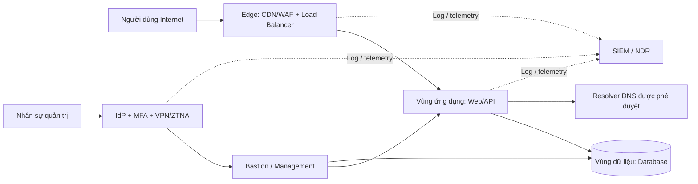

# Xác định control theo threat trong threat modeling mạng

Trong chương **Threat modeling mạng** của module **SECURITY_NETWORK_SECURITY**, sau khi xác định tài sản, luồng dữ liệu, ranh giới tin cậy và các mối đe dọa, bước tiếp theo là lựa chọn **security control** (biện pháp kiểm soát an ninh) để giảm rủi ro. Đây là bước biến kết quả mô hình hóa mối đe dọa thành quyết định kiến trúc có thể triển khai, kiểm tra và vận hành.

Một bản threat model chỉ nêu “có nguy cơ truy cập trái phép” chưa đủ để đội kỹ thuật hành động. Cần chỉ rõ **ai có thể làm gì, đi qua đường nào, khai thác điều kiện nào, gây ảnh hưởng gì**, rồi liên kết với control có mục tiêu, chủ sở hữu và bằng chứng hiệu quả cụ thể.

Sau bài học, bạn có thể:

- Phân biệt *threat*, *vulnerability*, *risk*, *control* và *residual risk* trong bối cảnh mạng.
- Xây dựng kịch bản đe dọa gắn với một **attack path** và một **trust boundary** xác định.
- Chọn và kết hợp control về phân đoạn mạng, firewall, VPN/ZTNA, xác thực kết nối, IDS/IPS, DNS, Wi-Fi và cloud.
- Lập ma trận **threat → mục tiêu bảo vệ → control → bằng chứng kiểm chứng** để chuyển thành backlog triển khai.
- Đánh giá phạm vi bảo vệ, hạn chế, chi phí vận hành, rủi ro còn lại và cách xác nhận control thực sự hoạt động.

## 1. Hiểu đúng các khái niệm trước khi chọn control

| Thuật ngữ | Ý nghĩa | Ví dụ trong hệ thống mạng |
| --- | --- | --- |
| **Asset – tài sản** | Thành phần hoặc dữ liệu cần được bảo vệ | Cơ sở dữ liệu khách hàng, DNS resolver, máy chủ quản trị |
| **Threat – mối đe dọa** | Tình huống có thể gây hại cho tài sản hoặc mục tiêu an ninh | Tài khoản VPN bị đánh cắp dẫn đến truy cập mạng nội bộ |
| **Threat actor / nguồn đe dọa** | Chủ thể hoặc nguồn có khả năng tạo ra hành vi bất lợi | Kẻ tấn công Internet, người dùng nội bộ lạm quyền, thiết bị nhiễm mã độc |
| **Vulnerability / weakness – điểm yếu** | Điều kiện có thể bị khai thác | Rule firewall quá rộng, quản trị thiếu MFA, DNS resolver bị cấu hình mở |
| **Attack path – đường tấn công** | Chuỗi điểm vào, kết nối và ranh giới mà tác nhân có thể đi qua | Internet → VPN → subnet nội bộ → máy chủ dữ liệu |
| **Risk – rủi ro** | Khả năng xảy ra kịch bản cùng mức thiệt hại nếu xảy ra | Lộ dữ liệu sau khi tài khoản quản trị bị chiếm |
| **Control – biện pháp kiểm soát** | Cơ chế kỹ thuật, quy trình hoặc vận hành để ngăn ngừa, phát hiện, hạn chế hay phục hồi sau sự cố | MFA, microsegmentation, chính sách egress, cảnh báo từ IDS |
| **Residual risk – rủi ro còn lại** | Rủi ro vẫn tồn tại sau khi áp dụng control, xét đến hiệu quả thực tế | Người có phiên VPN hợp lệ nhưng thiết bị đã bị xâm nhập |

**Control không phải tên của một sản phẩm.** “Mua firewall mới” không diễn đạt yêu cầu bảo vệ. “Chặn mọi kết nối trực tiếp từ vùng người dùng đến cơ sở dữ liệu, chỉ cho phép service ứng dụng qua TCP/5432 và cảnh báo khi có vi phạm” là một mục tiêu kiểm soát có thể kiểm chứng.

Một control có thể xử lý nhiều threat, và một threat thường cần **nhiều control kết hợp**. Ví dụ, để ngăn truy cập trái phép qua tài khoản quản trị, MFA làm giảm nguy cơ chiếm tài khoản, ZTNA/VPN giới hạn điểm vào, phân quyền tối thiểu giảm khả năng di chuyển bên trong, còn giám sát đăng nhập bất thường giúp phát hiện khi các lớp trước thất bại.

## 2. Bắt đầu từ kiến trúc và trust boundary

Chọn control theo tên công nghệ thường dẫn đến hai vấn đề: triển khai thứ hệ thống không cần và bỏ sót đường đi nguy hiểm thực sự. Cần bắt đầu bằng sơ đồ phản ánh các luồng **đang được phép** cùng các luồng **không được phép nhưng có thể bị lợi dụng**.

Một mô hình tối thiểu nên thể hiện:

1. **Tài sản và giá trị:** dữ liệu nhạy cảm, dịch vụ công khai, dịch vụ nội bộ, hệ thống điều khiển/giám sát, tài nguyên cloud.
2. **Điểm vào:** Internet, kết nối đối tác, VPN/ZTNA, mạng Wi-Fi, API công khai, DNS và hệ thống quản trị cloud.
3. **Vùng tin cậy:** Internet, DMZ/edge, application, database, management, thiết bị người dùng, workload cloud.
4. **Luồng giao tiếp:** nguồn, đích, giao thức, cổng, chiều khởi tạo kết nối, danh tính dịch vụ và yêu cầu mã hóa.
5. **Phụ thuộc:** DNS resolver, identity provider (IdP), PKI/certificate authority, NTP, thiết bị biên, nhà cung cấp chống DDoS.
6. **Chủ sở hữu:** đội chịu trách nhiệm hệ thống, cấu hình, cảnh báo và xử lý sự cố.

Ví dụ kiến trúc giả định cho một dịch vụ web có dữ liệu khách hàng:



Sơ đồ này gợi ý ít nhất bốn **ranh giới tin cậy**: Internet → edge, edge → ứng dụng, ứng dụng → dữ liệu và thiết bị/người dùng quản trị → mặt phẳng quản trị. Mỗi lần vượt ranh giới cần trả lời:

- Ai hoặc workload nào được **khởi tạo** kết nối?
- Có cần định danh, xác thực và ủy quyền trước khi truy cập không?
- Chỉ những **đích, cổng và phương thức** nào được phép?
- Dữ liệu có cần mã hóa và xác thực đầu bên kia không?
- Khi một vùng bị xâm nhập, điều gì cản kẻ tấn công đi sang vùng tiếp theo?
- Nếu control thất bại, tín hiệu nào sẽ xuất hiện và ai xử lý?

**Không mặc định “bên trong mạng là đáng tin”.** Một máy thuộc subnet nội bộ có thể bị chiếm quyền, một workload cloud có thể bị cấu hình sai và một tài khoản VPN hợp lệ có thể bị lợi dụng. Mô hình phải xét cả kịch bản đã vượt qua lớp phòng vệ ban đầu.

## 3. Viết threat thành kịch bản có thể hành động

### 3.1. Công thức mô tả threat

Một mô tả tốt có cấu trúc:

> **Tác nhân / điều kiện khởi phát** → **điểm vào và attack path** → **điểm yếu / giả định bị phá vỡ** → **hành vi bất lợi** → **tài sản và tác động**.

Ví dụ chưa đủ cụ thể: “Có thể bị tấn công lateral movement”.

Ví dụ cụ thể hơn: “Khi một container trong vùng ứng dụng bị chiếm quyền, nếu mọi workload cùng subnet được kết nối tự do, kẻ tấn công có thể truy cập trực tiếp TCP/5432 trên máy chủ database khác và thử dùng thông tin xác thực lấy được từ môi trường ứng dụng, làm tăng nguy cơ truy cập dữ liệu khách hàng”.

Với kịch bản cụ thể, có thể thiết kế control tại đúng chỗ:

- Hạn chế **đường đi** từ ứng dụng đến database theo danh tính workload và cổng cần thiết.
- Cấp tài khoản database quyền tối thiểu, không chia sẻ secret giữa các dịch vụ.
- Mã hóa và xác thực kết nối ứng dụng ↔ database khi phù hợp.
- Theo dõi lưu lượng từ các workload không nằm trong danh sách được phép đến database và cảnh báo đăng nhập bất thường.
- Có quy trình cô lập workload bị xâm nhập và thu hồi credential.

**Điểm cần phân biệt:** phân đoạn mạng giới hạn ai có thể *kết nối* tới database; nó không tự giới hạn người đã được phép kết nối có thể *truy vấn dữ liệu gì*. Quyền database và bảo vệ ứng dụng là control bổ sung bắt buộc cho kịch bản này.

### 3.2. Dùng STRIDE để tìm nhóm threat, rồi chuyển thành kịch bản

STRIDE là bộ gợi ý câu hỏi, không phải bản danh sách control bắt buộc:

| Nhóm STRIDE | Câu hỏi trong mạng | Threat điển hình |
| --- | --- | --- |
| **Spoofing** – giả mạo danh tính | Có thể mạo nhận người dùng, thiết bị, workload hoặc endpoint không? | Thiết bị giả danh trong Wi-Fi; chứng chỉ máy chủ không được xác minh |
| **Tampering** – sửa đổi | Có thể sửa dữ liệu hoặc cấu hình trên đường truyền không? | Thay đổi DNS response hoặc cấu hình định tuyến trái phép |
| **Repudiation** – chối bỏ | Có đủ dấu vết để quy trách nhiệm cho thao tác an ninh quan trọng không? | Thay đổi rule firewall không có audit log |
| **Information disclosure** – lộ thông tin | Dữ liệu hoặc metadata nào bị lộ qua đường truyền hay cấu hình? | API nội bộ mở Internet; DNS query nhạy cảm bị quan sát |
| **Denial of service** – gián đoạn dịch vụ | Điểm nghẽn nào có thể bị làm cạn tài nguyên? | SYN flood, UDP amplification, cạn bảng kết nối |
| **Elevation of privilege** – leo thang quyền | Quyền truy cập ở một vùng có thể được dùng để giành quyền cao hơn không? | Tài khoản VPN thông thường truy cập thẳng mạng quản trị |

Có thể bổ sung thông tin từ lịch sử sự cố, nhật ký thực tế, kiểm thử được cấp phép và kỹ thuật tấn công đã biết. STRIDE giúp **gợi ý loại rủi ro**, nhưng quyết định vẫn phải dựa trên kiến trúc và điều kiện khai thác của hệ thống đang xét.

## 4. Quy trình xác định control theo threat

Quy trình dưới đây có thể áp dụng lặp lại cho từng threat, từ hệ thống on-premises đến mạng cloud hoặc hybrid.

### Bước 1 — Ghi nhận kịch bản và mức phơi nhiễm

Tạo một bản ghi ngắn gồm: mã threat, tài sản bị ảnh hưởng, điểm vào, attack path, trust boundary, điều kiện tiền đề, hậu quả và những control đang tồn tại. Phân biệt **khả năng có thể về mặt kỹ thuật** với **khả năng có thể xảy ra trong bối cảnh vận hành**: một dịch vụ không được định tuyến từ Internet có mức phơi nhiễm khác với dịch vụ công khai.

Ví dụ:

```yaml
threat_id: T-NET-012
scenario: "Workload ứng dụng bị chiếm quyền rồi dò tìm database nội bộ"
asset: "Cơ sở dữ liệu khách hàng"
entry_point: "API public"
trust_boundary: "Application zone -> Data zone"
preconditions:
  - "Một workload ứng dụng đã bị xâm nhập"
  - "Mạng cho phép kết nối không cần thiết đến database"
impact:
  - "Nguy cơ lộ hoặc sửa đổi dữ liệu"
  - "Khả năng lan truyền sự cố sang vùng dữ liệu"
current_controls:
  - "Firewall giữa hai subnet"
gaps:
  - "Rule hiện tại cho phép toàn subnet ứng dụng đến cổng database"
```

Tên công cụ, cách tổ chức vùng và số cổng trong ví dụ là giả định minh họa; triển khai phải lấy từ inventory và kiến trúc thật.

### Bước 2 — Xác định mục tiêu bảo vệ đo lường được

Chuyển threat thành một hoặc nhiều **security requirements**. Ví dụ:

**“Chỉ workload API đã được cấp quyền mới kết nối tới DB trên cổng dịch vụ; các workload khác bị chặn và tạo dấu vết đủ để điều tra.”**

Mục tiêu trên có ba phần kiểm chứng: luồng hợp lệ phải hoạt động, luồng trái phép phải bị chặn, và phải quan sát được sự kiện phù hợp. Đây là cơ sở đánh giá control, thay vì chỉ xác nhận thiết bị đã bật.

### Bước 3 — Chọn cách xử lý rủi ro

Không phải mọi threat đều buộc phải triển khai cùng một tập sản phẩm:

- **Avoid – tránh:** loại bỏ kết nối hoặc chức năng không còn cần thiết, ví dụ gỡ API quản trị khỏi Internet.
- **Mitigate – giảm thiểu:** áp dụng control để giảm xác suất thành công hoặc mức thiệt hại, ví dụ microsegmentation, MFA và logging.
- **Transfer / share – chuyển giao hoặc chia sẻ một phần:** dùng dịch vụ chống DDoS upstream hay hợp đồng bảo hiểm có thể chuyển một phần tác động/vận hành, nhưng **trách nhiệm và rủi ro của tổ chức vẫn còn**.
- **Accept – chấp nhận:** ghi nhận và phê duyệt rủi ro còn lại theo thẩm quyền, thời hạn và điều kiện giám sát phù hợp.

Các yêu cầu bảo mật bắt buộc, nghĩa vụ pháp lý hoặc quy định nội bộ vẫn phải được đáp ứng dù điểm rủi ro ước tính thấp.

### Bước 4 — Chọn control ở nhiều điểm trên attack path

Xem xét khả năng **chặn đường vào**, **thu hẹp quyền sau xâm nhập**, **phát hiện** và **cô lập/khôi phục**. Phân loại theo mục đích:

| Loại control | Mục tiêu | Ví dụ trong network security |
| --- | --- | --- |
| **Preventive – phòng ngừa** | Ngăn hành vi trái phép hoặc giảm bề mặt tiếp xúc | Default-deny ACL, segmentation, MFA, mutual TLS, xác thực Wi-Fi 802.1X |
| **Detective – phát hiện** | Nhìn thấy dấu hiệu vượt chính sách hoặc khai thác | IDS/NDR, DNS query analytics, firewall flow log, cloud audit log |
| **Responsive / corrective – ứng phó, khắc phục** | Chặn, cô lập và sửa sai khi xảy ra vi phạm | Quarantine thiết bị, thu hồi token/chứng chỉ, rollback rule lỗi |
| **Recovery – phục hồi** | Khôi phục khả năng phục vụ an toàn | Khôi phục cấu hình từ phiên bản đã duyệt, failover, khôi phục dịch vụ đã kiểm chứng |
| **Compensating – bù trừ** | Giảm rủi ro tạm thời khi control mong muốn chưa thể triển khai | Bastion có giám sát và allowlist chặt khi chưa áp dụng được xác thực từng workload |

Một control như IPS có thể vừa phát hiện vừa chặn, nhưng phải được đo theo từng vai trò. Tương tự, ghi log không có quy trình xử lý cảnh báo chỉ đáp ứng một phần nhu cầu giám sát.

### Bước 5 — Kiểm tra độ phù hợp, điểm mù và tác động vận hành

Trước khi chọn control, đặt các câu hỏi:

- **Coverage:** control áp dụng được ở đúng trust boundary và cả IPv4/IPv6, ingress/egress, đường đi nội bộ, cloud và truy cập từ xa liên quan chưa?
- **Enforcement:** nó thực sự chặn luồng trái phép hay chỉ quan sát? Có quyền truy cập nào cho phép bypass không?
- **Identity:** rule có gắn với danh tính người dùng/workload được quản lý hay phụ thuộc hoàn toàn vào IP dễ thay đổi?
- **Observability:** có log, metric, timestamp, định danh nguồn/đích và correlation ID phù hợp để điều tra không?
- **Reliability:** mất thiết bị, lỗi cập nhật, hết hạn chứng chỉ hoặc lệch cấu hình sẽ ảnh hưởng thế nào đến tính sẵn sàng?
- **Cost/operability:** đội ngũ có đủ khả năng duy trì rule, cập nhật danh sách quyền, xử lý false positive và phản ứng cảnh báo không?
- **Dependencies:** control dựa vào DNS, IdP, PKI hay cloud API nào; khi phụ thuộc này lỗi sẽ fail-open hay fail-closed trong từng tình huống?

Ví dụ, IDS không thể bảo đảm nhìn được toàn bộ payload bên trong TLS/QUIC mã hóa. Cần bổ sung tín hiệu ở endpoint, reverse proxy, ứng dụng hoặc metadata đã được phê duyệt, thay vì giả định hệ thống giám sát mạng đọc được mọi nội dung.

### Bước 6 — Thiết kế cách xác minh trước khi triển khai

Định nghĩa test **cho phép** và test **từ chối** ở đúng vùng mạng, cùng cách ghi nhận bằng chứng. Ví dụ:

1. Workload API hợp lệ kết nối database thành công.
2. Workload khác trong cùng vùng không thể kết nối trực tiếp database.
3. Quy tắc giới hạn cổng và chiều kết nối vẫn đúng sau khi restart hoặc redeploy.
4. Log ghi nhận kết nối bị chặn với thời gian, nguồn và đích đủ để điều tra.
5. Khi thử cô lập workload bị xâm nhập trên môi trường kiểm thử, các luồng ngoài phạm vi cho phép ngừng hoạt động mà dịch vụ còn lại không bị gián đoạn ngoài dự kiến.

Test cần chạy trên tài nguyên thuộc phạm vi được ủy quyền. Với control có nguy cơ gây gián đoạn, ưu tiên môi trường staging, triển khai theo đợt và chuẩn bị rollback.

### Bước 7 — Ghi nhận residual risk, owner và chu kỳ rà soát

Sau khi test, cập nhật rủi ro dựa trên bằng chứng thực tế. Lưu **control owner**, người duyệt rủi ro, ngày rà soát, cảnh báo phải xử lý và điều kiện mở lại threat model, chẳng hạn thay đổi kiến trúc, mở cổng mới, migration cloud hoặc xảy ra sự cố.

**Control chỉ được xem là có hiệu quả khi được cấu hình, kiểm chứng và vận hành đúng.** Một rule tồn tại trong tài liệu nhưng chưa áp vào môi trường, hoặc một IDS không ai xem cảnh báo, không nên được tính như lớp giảm thiểu đã hoàn chỉnh.

## 5. Ma trận threat → control cho các lớp bảo vệ mạng

Bảng sau minh họa cách chọn control theo **kịch bản**, không theo danh sách sản phẩm. “Phòng ngừa” và “phát hiện/ứng phó” thường cần kết hợp để xử lý rủi ro còn lại.

| ID / Threat và tác động | Control phòng ngừa trọng tâm | Phát hiện, ứng phó và giới hạn cần biết |
| --- | --- | --- |
| **T01 – Dịch vụ Internet bị DDoS**, gây nghẽn băng thông hoặc cạn tài nguyên | Giảm bề mặt public; chống DDoS ở upstream/CDN; rate limit và thiết kế phân tải theo lớp lưu lượng | Theo dõi traffic, lỗi, độ trễ, saturation; có runbook kích hoạt bảo vệ. Firewall tại chỗ không cứu được đường truyền đã nghẽn trước khi lưu lượng tới nơi |
| **T02 – Tấn công di chuyển ngang (lateral movement)** từ máy/workload đã bị chiếm đến vùng dữ liệu | Phân đoạn theo vai trò, default-deny east–west, allowlist theo nhu cầu giao tiếp, xác thực service-to-service và quyền DB tối thiểu | Flow log/NDR phát hiện kết nối bất thường; cô lập workload và thu hồi secret. Rule cho phép API thật vẫn có thể bị lạm dụng qua ứng dụng |
| **T03 – Đánh cắp tài khoản truy cập từ xa** dẫn tới vào mạng quản trị | IdP + MFA chống phishing khi khả dụng, kiểm soát thiết bị, VPN/ZTNA giới hạn ứng dụng, bastion, quyền tối thiểu | Log đăng nhập, hành vi bất thường, review phiên; thu hồi session/token. VPN mã hóa đường truyền nhưng không tự chứng minh người dùng hoặc thiết bị an toàn |
| **T04 – Giả mạo hoặc can thiệp DNS** làm đổi đích truy cập | Resolver quản lý tập trung; hạn chế ai được truy vấn/đổi cấu hình; DNSSEC validation khi hệ sinh thái hỗ trợ; bảo vệ kênh và quyền quản trị DNS | Theo dõi thay đổi record, phản hồi bất thường, lỗi xác thực; khôi phục record/khóa. DNSSEC giúp xác thực dữ liệu DNS được ký, **không tự mã hóa truy vấn** |
| **T05 – Nghe lén hoặc giả mạo endpoint** trên đường truyền | TLS/mTLS hoặc giao thức mã hóa phù hợp; xác minh chứng chỉ và tên máy; cơ chế quản lý khóa | Giám sát lỗi handshake, chứng chỉ sắp hết hạn và sai cấu hình; thay khóa/thu hồi chứng chỉ. Mã hóa không ngăn tài khoản hợp lệ lạm quyền |
| **T06 – Wi-Fi giả mạo (evil twin) / thiết bị không được cấp quyền** | WPA3-Enterprise hoặc cấu hình enterprise được phê duyệt, 802.1X/EAP-TLS, **xác minh chứng chỉ máy chủ xác thực**, tách mạng khách và nội bộ | WIDS/WIPS, log RADIUS, quản lý thiết bị; cô lập thiết bị lạ. Chỉ bật 802.1X mà client không kiểm tra chứng chỉ có thể còn nguy cơ giả mạo |
| **T07 – Cấu hình cloud public ingress quá rộng** làm lộ dịch vụ quản trị/database | Private endpoint khi phù hợp, security group/NSG theo nhu cầu, chính sách IaC, giới hạn quyền sửa firewall và tài nguyên cloud | CSPM/config audit, cloud flow log, cảnh báo thay đổi, rollback IaC. Security group có trạng thái và network ACL có thể khác nhau tùy nhà cung cấp |
| **T08 – Dữ liệu bị đưa ra ngoài qua kênh outbound** từ máy/workload nhiễm mã độc | Egress allowlist theo nhu cầu, proxy, kiểm soát DNS/DoH theo chính sách, phân quyền dữ liệu và secret | Giám sát lưu lượng, đích lạ, DNS analytics và log ứng dụng; cô lập host. Mã hóa và kênh hợp lệ có thể che lưu lượng xấu; cần kết hợp tín hiệu ở endpoint/ứng dụng |
| **T09 – Quét cổng, dò dịch vụ hoặc khai thác giao thức** ở rìa mạng | Giảm cổng public, vá dịch vụ, giới hạn nguồn quản trị, IPS/WAF đúng mục tiêu và segmentation | IDS/IPS, inventory cổng và quản lý lỗ hổng, điều tra khi phát hiện. Phát hiện quét cổng không đồng nghĩa ngăn được khai thác tầng ứng dụng |

Không nên sao chép toàn bộ bảng thành checklist áp dụng cho mọi hệ thống. Chỉ triển khai những control giải quyết threat hiện hữu hoặc đáp ứng baseline bắt buộc, sau khi xác minh tính tương thích với luồng nghiệp vụ.

## 6. Đi sâu vào các nhóm control và phạm vi tác dụng

### 6.1. Network segmentation, firewall và microsegmentation

**Network segmentation** chia hệ thống thành vùng với mức tin cậy và chức năng khác nhau. **Microsegmentation** áp chính sách chi tiết hơn giữa các workload, host hoặc service. Hai cách tiếp cận giúp giảm **blast radius** khi một điểm bị xâm nhập.

Với threat ứng dụng web bị chiếm rồi kết nối đến dữ liệu, có thể đặt yêu cầu:

```text
Internet      -> Edge HTTPS                 : ALLOW TCP/443
Edge           -> Web/API được chỉ định     : ALLOW cổng ứng dụng cần thiết
Web/API hợp lệ -> Database                  : ALLOW TCP/5432 (ví dụ PostgreSQL)
Workload khác  -> Database                  : DENY + LOG theo chính sách
Vùng người dùng -> Database                 : DENY
Vùng quản trị   -> Bastion/ZTNA             : ALLOW sau xác thực
Mọi nguồn khác  -> Cổng quản trị            : DENY
```

Đây là **chính sách logic**, không phải cú pháp cấu hình cho một firewall cụ thể. Khi triển khai cần làm rõ IP/identity selectors, giao thức, chiều kết nối, cách xử lý stateful response, IPv6, DNS động và cơ chế cập nhật rule khi workload thay đổi.

- **Deny by default** giảm số đường đi ngoài dự kiến, nhưng phải lập inventory đủ để tránh chặn nhầm phụ thuộc thiết yếu.
- **Stateful inspection** có thể cho phép gói phản hồi của kết nối đã được chấp thuận, nhưng không thay thế xác thực ứng dụng.
- **Security group, NACL, Kubernetes NetworkPolicy, host firewall** có phạm vi, thứ tự đánh giá và khả năng hỗ trợ khác nhau; không mặc định chúng tương đương.
- **NAT không phải control xác thực**, và việc không có IP public chưa chắc đã chặn mọi đường truy cập qua peering, VPN, proxy hoặc tài khoản cloud.

### 6.2. VPN, ZTNA, xác thực thiết bị và service identity

Khi threat liên quan người dùng hoặc thiết bị không được phép đi vào mạng, một đường hầm mã hóa **chỉ là một phần của giải pháp**. Cần trả lời ai được kết nối, thiết bị có đáp ứng chính sách không, được truy cập ứng dụng nào và khi nào phải xác thực lại.

- Với nhân sự quản trị: sử dụng IdP, MFA có khả năng chống phishing khi phù hợp, thiết bị quản lý, quyền theo vai trò, bastion và ghi log phiên nhạy cảm.
- Với các service: ưu tiên danh tính workload, certificate rotation và mTLS khi yêu cầu xác thực hai chiều; vẫn phải có quyền ứng dụng/database tối thiểu.
- Với đối tác: tạo vùng và chính sách giới hạn riêng; hợp đồng kết nối riêng không đủ để cấp quyền vào toàn mạng nội bộ.

**ZTNA** thường được dùng để cấp quyền theo ứng dụng, danh tính và ngữ cảnh; thuật ngữ này không bảo đảm mọi sản phẩm đều có cùng khả năng. Phải xác minh chính sách và đường bypass thực tế.

### 6.3. IDS/IPS, giám sát lưu lượng và xử lý cảnh báo

**IDS** chủ yếu phát hiện tín hiệu đáng ngờ, còn **IPS** có khả năng can thiệp/chặn tùy chế độ triển khai. **NDR**, **SIEM**, telemetry firewall, resolver và endpoint bổ trợ cho nhau vì mỗi nguồn chỉ nhìn thấy một phần bức tranh.

Ví dụ với threat lateral movement, có thể kết hợp:

1. Firewall mặc định chặn kết nối giữa các vùng không được phép.
2. Flow log và NDR đánh dấu máy thuộc nhóm người dùng lần đầu liên hệ nhiều host ở vùng dữ liệu.
3. Log identity và database cho biết tài khoản nào đã đăng nhập hoặc bị từ chối.
4. Quy trình ứng phó đặt ngưỡng xác minh, cô lập host, lấy bằng chứng và phục hồi truy cập theo yêu cầu nghiệp vụ.

Lưu ý **tín hiệu bất thường không tự chứng minh có tấn công**. Các hoạt động hợp lệ như triển khai phần mềm, quét inventory được ủy quyền và backup cũng có thể tạo lưu lượng khác thường. Control cần có quy trình triage, giảm false positive và xác định mức ưu tiên.

### 6.4. DNS, Wi-Fi và môi trường cloud

Threat trong ba môi trường này thường bị bỏ qua nếu chỉ dùng sơ đồ “client–server” truyền thống:

| Môi trường | Trust boundary hay bị bỏ sót | Control cần xem xét |
| --- | --- | --- |
| **DNS** | Workload → resolver; resolver → authoritative service; quản trị → cấu hình zone | Resolver được kiểm soát, hạn chế recursion, DNSSEC validation nơi thích hợp, bảo vệ tài khoản/quyền thay đổi record, log theo chính sách dữ liệu |
| **Wi-Fi** | Thiết bị lạ/khách → WLAN nội bộ; client → máy chủ RADIUS | Enterprise authentication, kiểm tra server certificate, cách ly client/guest, phân VLAN theo vai trò, giám sát rogue AP |
| **Cloud/hybrid** | Internet → public endpoint; VPC/VNet → peering/transit; workload → managed service; người quản trị → control plane | Private connectivity khi cần, security group/NSG tối thiểu, IAM, cấu hình bằng IaC, audit trail, giám sát thay đổi, đánh giá route và policy nhiều tầng |

Ví dụ, threat “storage cloud lộ Internet” có thể xuất phát từ **quyền truy cập tài nguyên** chứ không chỉ firewall. Control chính phải bảo vệ IAM, resource policy và public access configuration; chặn network đơn thuần có thể không giải quyết đúng đường truy cập.

## 7. Ưu tiên control theo rủi ro và khả năng triển khai

Thời gian, ngân sách và năng lực vận hành luôn có giới hạn. Có thể dùng thang **Likelihood (L)** và **Impact (I)** từ 1 đến 5 để hỗ trợ thảo luận, với định nghĩa thống nhất trong nhóm:

- **Likelihood:** xét mức phơi nhiễm, điều kiện tiền đề, lịch sử sự cố, khả năng khai thác, cơ hội của tác nhân và các control hiện có.
- **Impact:** xét ảnh hưởng tới bí mật/toàn vẹn/sẵn sàng dữ liệu, tính liên tục dịch vụ, khách hàng và nghĩa vụ tổ chức.
- **Điểm sàng lọc:** `R = L × I` có thể dùng để xếp thứ tự thô; các giá trị là **thang đánh giá định tính**, không phải xác suất thống kê hay tổn thất tiền tệ.

Ví dụ minh họa về **rủi ro trước và sau khi dự kiến kiểm soát**:

| Threat | Ban đầu (L × I) | Control ưu tiên | Ước tính sau triển khai và kiểm chứng | Điều cần lưu ý |
| --- | --- | --- | --- | --- |
| T02 – lateral movement tới DB | 4 × 5 = **20** | Segmentation theo workload, xác thực service, audit kết nối | 2 × 5 = **10** | Nếu API hợp lệ bị chiếm và có quyền dữ liệu rộng, tác động vẫn cao |
| T03 – tài khoản truy cập từ xa bị chiếm | 4 × 4 = **16** | MFA chống phishing, quản lý thiết bị, quyền theo ứng dụng | 2 × 4 = **8** | Phải theo dõi session hijacking và hoạt động sau khi đã đăng nhập |
| T04 – can thiệp DNS | 3 × 4 = **12** | Bảo vệ quyền thay đổi zone, resolver và validation thích hợp | 2 × 4 = **8** | Không phải domain hay bản ghi nào cũng đã có DNSSEC |

Các điểm số trên **chỉ là ví dụ để diễn giải phương pháp**; không phải số đo thực tế của một hệ thống. Không tự động giảm điểm chỉ vì đã “mua” sản phẩm. Mỗi lần giảm rủi ro cần có bằng chứng kiểm thử, phạm vi coverage và một người chịu trách nhiệm xác nhận.

Ngoài điểm rủi ro, khi ưu tiên control nên xét:

1. **Baseline bắt buộc:** yêu cầu bảo mật tối thiểu, kiểm toán, hợp đồng và pháp luật không được bỏ vì risk score thấp.
2. **Giảm attack path lớn:** một control segmentation đúng ranh giới có thể giảm nhiều threat cùng lúc.
3. **Khả năng khai thác nhanh:** tài sản public với khai thác đang xảy ra thường phải được xử lý trước vấn đề khó tiếp cận.
4. **Thời gian triển khai và phụ thuộc:** có thể dùng biện pháp tạm thời được giám sát nếu kiến trúc chuẩn cần thêm thời gian.
5. **Rủi ro gián đoạn:** thay rule firewall diện rộng, DNS hoặc IdP có thể làm gián đoạn hoạt động nếu thiếu kế hoạch kiểm chứng và rollback.

## 8. Từ threat model tới backlog có thể kiểm tra

Không dừng ở bảng “đề xuất WAF, VPN, IDS”. Một backlog khả dụng phải ghi rõ **điều kiện thành công**, phạm vi, người triển khai, log cần có và rủi ro chưa xử lý.

### 8.1. Mẫu bản ghi control

```yaml
control_id: C-SEG-012
related_threats:
  - T-NET-012
objective: "Chỉ API workload được phê duyệt có quyền mở kết nối đến DB"
enforcement_point: "Firewall/security policy giữa application và data zone"
policy:
  allowed_source: "Service identity / nhóm workload API đã được phê duyệt"
  allowed_destination: "Database service"
  allowed_protocol: "TCP"
  allowed_port: 5432
  default_action: "Deny các nguồn khác"
owner: "Nhóm network/platform"
dependencies:
  - "Inventory workload và kết nối hợp lệ"
  - "Quy trình quản lý cấu hình và thay đổi"
evidence:
  - "Bản rule đã triển khai và lịch sử thay đổi"
  - "Test kết nối hợp lệ thành công"
  - "Test truy cập từ workload không được phép bị từ chối"
  - "Log thể hiện các kết nối bị chặn"
residual_risk: "Workload API hợp lệ bị chiếm vẫn có thể thử truy vấn DB"
review_trigger: "Thay đổi service, DB, network hoặc sự cố liên quan"
```

Trong hệ thống thực tế, còn cần **trạng thái triển khai**, ngày kiểm chứng, người phê duyệt và liên kết ticket/change request. Các trường trong ví dụ là mẫu quản lý control, không phải file cấu hình để áp trực tiếp lên thiết bị.

### 8.2. Kết quả bàn giao tối thiểu

| Artifact | Nội dung cần có | Người dùng artifact |
| --- | --- | --- |
| **Threat register** | Kịch bản, tài sản, attack path, mức rủi ro, giả định và evidence | Security architect, risk owner |
| **Control matrix** | Threat ID ↔ control ID ↔ mục tiêu ↔ coverage ↔ chủ sở hữu | Security/network/platform team |
| **Network policy specification** | Nguồn, đích, protocol/port, identity, chiều kết nối, hành động, lý do | Người triển khai firewall, cloud, Kubernetes |
| **Validation evidence** | Positive/negative test, kết quả log/telemetry, ngày thực hiện | QA, SecOps, kiểm toán |
| **Residual-risk decision** | Rủi ro còn lại, phương án xử lý, phê duyệt, hạn rà soát | Chủ sở hữu nghiệp vụ và bảo mật |
| **Runbook** | Tiêu chí cảnh báo, người trực, cô lập, khôi phục, điều kiện rollback | SOC/SecOps và vận hành |

Mối liên hệ giữa các artifact là điều kiện để trace được **mỗi control được triển khai nhằm xử lý threat nào**, và threat nào còn chưa có biện pháp phù hợp.

## 9. Ví dụ hoàn chỉnh: bảo vệ database sau một sự cố xâm nhập ứng dụng

### 9.1. Bối cảnh và threat

Một nền tảng có reverse proxy public, nhóm API backend và PostgreSQL chứa dữ liệu khách hàng. API cần đọc/ghi dữ liệu, còn hệ thống báo cáo chỉ cần kết nối tới một service báo cáo riêng. Hiện tất cả ứng dụng thuộc một subnet đều có thể mở TCP/5432 đến database.

Threat cần giải quyết:

> **T-NET-012:** Nếu một API container bị chiếm quyền, quyền kết nối rộng ở mạng nội bộ cho phép nó thăm dò hoặc kết nối tới database không thuộc phạm vi cần thiết. Khi kết hợp với credential bị lộ, điều này có thể dẫn đến truy cập dữ liệu vượt thẩm quyền.

**Bất biến an ninh mong muốn:** chỉ API service được liệt kê mới có kết nối từ zone ứng dụng tới database; database không nhận kết nối trực tiếp từ Internet, user subnet hoặc các workload không có nhu cầu.

### 9.2. Ghép control theo từng điểm trên attack path

| Điểm trong đường tấn công | Control lựa chọn | Vì sao cần |
| --- | --- | --- |
| Internet → reverse proxy/API | Chỉ expose endpoint cần thiết; TLS, xác thực/ủy quyền ứng dụng, WAF/rate limit theo threat | Giảm khả năng xâm nhập ban đầu |
| API workload → database zone | Default-deny; allowlist **đúng workload**, đích DB, TCP/5432 | Ngăn workload không liên quan truy cập DB |
| API hợp lệ → database | Credential riêng cho service, quyền DB tối thiểu, mã hóa/xác thực kết nối | Giảm thiệt hại ngay cả khi đường mạng hợp lệ bị lạm dụng |
| Giao tiếp bất thường | Flow log, audit login DB, cảnh báo nguồn mới liên hệ DB hoặc lỗi xác thực bất thường | Nhận diện nỗ lực vượt hoặc lạm dụng chính sách |
| Xác nhận xâm nhập | Cô lập workload, thu hồi secret, kiểm tra log/forensics, redeploy từ bản tin cậy | Giới hạn phạm vi thiệt hại và phục hồi an toàn |

**Chỉ chọn một rule firewall là chưa đủ:** rule đó không thể phân biệt truy vấn hợp lệ với truy vấn độc hại từ service được phép. Cần tiếp tục giới hạn danh tính và quyền dữ liệu.

### 9.3. Bộ kiểm chứng trước khi chấp nhận

Thực hiện trong staging hoặc môi trường kiểm thử được cấp quyền, rồi kiểm tra lại khi áp chính sách production:

| Test | Điều kiện đầu vào | Kết quả kỳ vọng |
| --- | --- | --- |
| **Positive A** | API service hợp lệ → DB qua cổng khai báo | Kết nối và tác vụ nghiệp vụ thành công |
| **Negative B** | Workload không thuộc allowlist → DB TCP/5432 | Kết nối bị chặn và có dấu vết nếu log được bật |
| **Negative C** | Host user subnet → DB TCP/5432 | Kết nối trực tiếp không được phép |
| **Negative D** | API service → một cổng DB không nằm trong chính sách | Kết nối bị chặn |
| **Detection E** | Một hành vi thử truy cập bị chặn trong cửa sổ kiểm thử | Log đúng nguồn/đích/thời gian; alert đến đúng người theo tiêu chí |
| **Resilience F** | Deploy lại API hoặc thay đổi địa chỉ pod/IP | Rule vẫn gắn với selector/danh tính mong muốn, không vô tình mở rộng |

Có thể dùng công cụ kiểm tra kết nối sẵn có hoặc packet capture trên host được cấp quyền để xác nhận SYN/ACK, timeout hay từ chối ở từng điểm. **Một kết nối thất bại không đủ để chứng minh firewall chặn đúng:** ứng dụng đích có thể không lắng nghe, DNS có thể sai hoặc route có thể lỗi. Muốn có bằng chứng kiểm soát, cần đối chiếu rule/flow log và kết quả ở phía nhận.

Khi test thành công, threat T-NET-012 có thể chuyển từ “chưa kiểm soát đầy đủ” sang “đã giảm thiểu ở một số attack path”. Vẫn phải ghi rủi ro API hợp lệ bị chiếm hoặc thông tin xác thực bị lộ và yêu cầu bổ sung như giám sát truy vấn bất thường.

## 10. Sai lầm thường gặp khi mapping threat sang control

1. **Gán sản phẩm thay vì yêu cầu:** “IDS giải quyết tấn công” quá mơ hồ. Phải nêu tín hiệu cần phát hiện, nguồn dữ liệu, ngưỡng cảnh báo và người phản ứng.
2. **Chọn control ở sai tầng:** TLS bảo vệ dữ liệu trên đường truyền nhưng không ngăn SQL injection; WAF không thay thế chính sách cổng giữa app và DB.
3. **Chỉ phòng ngừa mà thiếu phát hiện:** một rule bị thay đổi trái phép có thể làm mất tác dụng; cần giám sát cấu hình và lưu lượng.
4. **Chỉ xét lưu lượng từ Internet vào:** bỏ quên lưu lượng east–west, quản trị cloud, outbound, Wi-Fi khách và kết nối đối tác.
5. **Nhầm “có VPN” với “được cấp quyền đúng”:** VPN tạo kênh truy cập; quyền tối thiểu, MFA và giám sát phiên vẫn cần được thiết kế.
6. **Tin cậy tuyệt đối vào IP/port:** địa chỉ có thể thay đổi do NAT, autoscaling; giao thức ứng dụng có thể dùng các cổng khác với mặc định hoặc bị tunneling.
7. **Đánh dấu hoàn thành khi chưa test:** rule có thể không áp vào đúng interface/subnet, thiếu hỗ trợ IPv6 hoặc bị rule khác ưu tiên hơn.
8. **Bỏ qua rủi ro vận hành:** control cấu hình sai có thể khiến DNS, kết nối database hoặc hệ thống quản trị ngừng hoạt động.
9. **Không ghi residual risk:** các lớp kiểm soát có điểm mù; cần người chấp nhận rủi ro và điều kiện mở lại đánh giá.

## 11. Bài tập tự áp dụng

**Tình huống:** doanh nghiệp có mạng Wi-Fi cho nhân viên, mạng Wi-Fi khách, mạng quản trị camera/IoT, dịch vụ DNS nội bộ và một ứng dụng web chạy trên cloud. Hiện Wi-Fi khách có thể định tuyến đến một số subnet nội bộ; kỹ thuật viên dùng chung một tài khoản VPN để quản trị thiết bị. Đội SOC đang có firewall log nhưng chưa có cảnh báo tự động.

Hãy thử lập ba bản ghi threat theo khuôn:

```text
Threat ID:
Tài sản:
Tác nhân + điều kiện:
Điểm vào / attack path / trust boundary:
Tác động:
Control phòng ngừa:
Control phát hiện:
Control ứng phó / phục hồi:
Positive test:
Negative test:
Chủ sở hữu:
Rủi ro còn lại:
```

Gợi ý hướng giải cho ba threat có thể chọn:

- **Khách Wi-Fi → vùng quản trị IoT:** tách VLAN/SSID và chặn route/firewall giữa guest và management; giám sát kết nối bị từ chối; kiểm tra thiết bị khách chỉ tới Internet/dịch vụ được phép.
- **Tài khoản VPN dùng chung bị lạm dụng:** chuyển sang danh tính cá nhân, MFA, quyền theo vai trò và ghi nhận phiên; kiểm thử tài khoản thông thường không truy cập được vùng quản trị không thuộc trách nhiệm.
- **Thay đổi cấu hình firewall làm lộ cloud service:** lưu rule qua IaC, phân quyền thay đổi, cảnh báo khi có public ingress mới và quy trình rollback; kiểm chứng thay đổi được phát hiện và cổng không cần thiết vẫn bị đóng.

Đối với mỗi threat, hãy giải thích vì sao control được chọn **đúng đường tấn công**, nó có thể thất bại như thế nào và bằng chứng nào đủ để chấp nhận rủi ro còn lại.

## 12. Tổng kết

**Xác định control theo threat** là quá trình chuyển một nguy cơ mạng thành **yêu cầu bảo vệ có thể đo**, rồi chọn các lớp kiểm soát tương ứng với từng điểm trong attack path. Kết quả tốt phải trả lời rõ: *bảo vệ tài sản nào, chống kịch bản gì, chặn ở đâu, phát hiện thế nào, ai vận hành, test ra sao và rủi ro còn lại là gì*.

Trong kiến trúc mạng an toàn, **segmentation/firewall** hạn chế đường truy cập, **VPN/ZTNA và identity control** xác thực chủ thể, **TLS/mTLS** bảo vệ kết nối, **DNS/Wi-Fi/cloud controls** xử lý ranh giới đặc thù, còn **IDS/IPS và giám sát** giúp phát hiện và ứng phó khi các lớp trước không đủ. Ma trận threat–control và bằng chứng kiểm chứng là cầu nối để threat modeling thực sự định hướng thiết kế, triển khai và vận hành bảo mật mạng.
