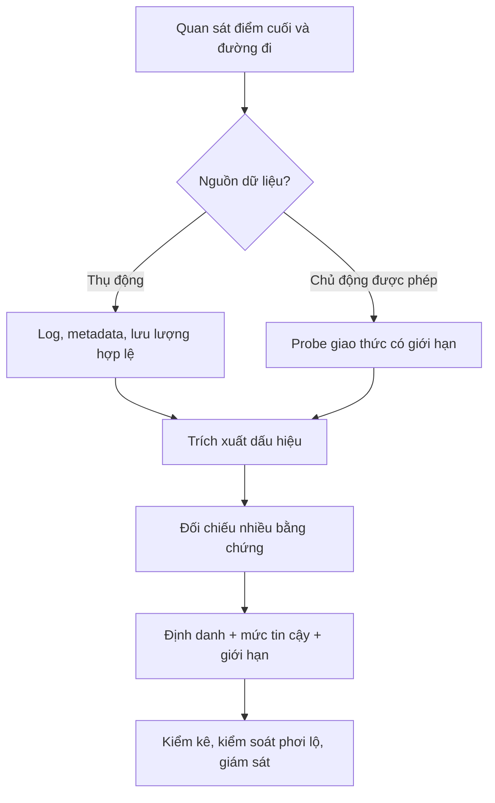
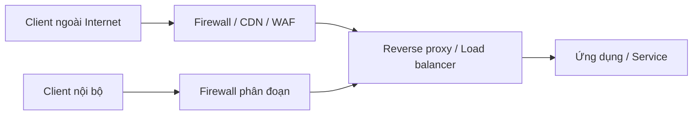

# Service fingerprinting: Nhận diện dịch vụ mạng từ dấu hiệu giao thức

## 1. Service fingerprinting là gì?

**Service fingerprinting** (lấy dấu vân tay dịch vụ) là quá trình thu thập và đối chiếu những đặc điểm quan sát được khi một dịch vụ mạng giao tiếp để suy ra **loại dịch vụ, giao thức, phần mềm triển khai, phiên bản hoặc cấu hình liên quan**. Các đặc điểm này có thể là banner ban đầu, HTTP header, thông tin bắt tay TLS, thông điệp lỗi, cấu trúc phản hồi hay cách một máy chủ xử lý yêu cầu hợp lệ.

Trong chương **Reconnaissance** của học phần **SECURITY_NETWORK_SECURITY**, kiến thức này giúp người học hiểu cách xác định bề mặt dịch vụ đang lộ ra mạng, kiểm chứng việc phân đoạn và firewall hoạt động như dự kiến, lập danh mục tài sản, phân tích lưu lượng, hỗ trợ threat modeling và tạo tín hiệu giám sát cho IDS/IPS. Việc nhận diện phải được thực hiện trong phạm vi được phép, chẳng hạn phòng lab, hệ thống do nhóm quản trị hoặc đợt đánh giá đã được phê duyệt.

**Mục tiêu học tập:**

- Giải thích sự khác nhau giữa phát hiện cổng, nhận diện dịch vụ, nhận diện hệ điều hành và xác minh lỗ hổng.
- Phân biệt fingerprinting **thụ động** với **chủ động**, biết khi nào dùng từng phương pháp.
- Đọc và đánh giá các tín hiệu từ HTTP, TLS, SSH, SMTP, DNS và một số dịch vụ phổ biến.
- Tiến hành quy trình kiểm chứng giới hạn trên một máy lab, ghi lại mức độ tin cậy và nguồn bằng chứng.
- Chuyển kết quả nhận diện thành các biện pháp bảo vệ: giảm bề mặt tấn công, kiểm soát truy cập, giám sát và vá lỗi.

## 2. Phạm vi của service fingerprinting trong reconnaissance

Reconnaissance là giai đoạn tìm hiểu mục tiêu và bối cảnh mạng trước khi đưa ra đánh giá. *Service fingerprinting* tập trung vào **dịch vụ đang thực sự trả lời trên một giao diện và cổng cụ thể**, thay vì chỉ suy đoán theo số cổng.

| Hoạt động | Câu hỏi được giải đáp | Ví dụ bằng chứng | Giới hạn |
| --- | --- | --- | --- |
| Host discovery | Host có thể liên lạc được không? | Trả lời ICMP, ARP/ND hay kết nối thử | Không trả lời chưa chắc host không tồn tại |
| Port scanning | Cổng nào có vẻ mở, đóng hoặc bị lọc? | TCP SYN/ACK, kết quả kết nối TCP | Cổng mở chưa cho biết chính xác dịch vụ |
| **Service fingerprinting** | Dịch vụ/giao thức/phần mềm nào đang trả lời? | `SSH-2.0-...`, HTTP header, TLS ALPN, phản hồi giao thức | Dấu hiệu có thể bị che, giả mạo hoặc đến từ proxy |
| OS fingerprinting | Hệ điều hành hoặc ngăn xếp TCP/IP nào có thể đang chạy? | Đặc điểm trả lời TCP/IP | Độ tin cậy thay đổi theo NAT, firewall, thiết bị trung gian |
| Vulnerability assessment | Cấu hình hoặc phiên bản có thực sự tồn tại điểm yếu không? | Dữ liệu phiên bản chuẩn xác, cấu hình, bản vá, kết quả kiểm tra được cho phép | Không thể kết luận từ banner đơn lẻ |

Ví dụ, **TCP/443 mở** chỉ gợi ý dịch vụ phổ biến là HTTPS. Nó có thể chứa reverse proxy, API gateway, ứng dụng web hoặc giao thức khác chạy trên TLS. Nếu máy chủ trả về `Server: nginx`, ta có thêm một tín hiệu về phần mềm ở **điểm kết thúc HTTP đang quan sát**, nhưng vẫn chưa biết ứng dụng phía sau, phiên bản đã vá hay cấu hình nội bộ.

### 2.1. Định nghĩa "fingerprint"

Một fingerprint là **tập hợp tín hiệu có thể đối chiếu**, không bắt buộc là một chuỗi nhận diện duy nhất. Hai máy chủ cùng dùng một phần mềm có thể có fingerprint khác nhau do phiên bản, cấu hình, module, bản vá, proxy hoặc đường đi mạng. Ngược lại, hai phần mềm khác nhau có thể trả về dấu hiệu gần giống nhau.



## 3. Fingerprinting thụ động và chủ động

### 3.1. Fingerprinting thụ động (passive)

Phương pháp **thụ động** dựa vào lưu lượng hoặc dữ liệu vận hành đã sẵn có: bản ghi kết nối, NetFlow/IPFIX, log reverse proxy, log firewall, IDS/NDR hoặc gói tin được phép quan sát tại một điểm thu thập. Người phân tích không phải tạo thêm kết nối thử đến dịch vụ.

Ví dụ một phiên SSH thường bắt đầu với dòng nhận diện giao thức như `SSH-2.0-OpenSSH_9.2`. Nếu điểm thu thập nhìn thấy phần trao đổi ban đầu và chính sách cho phép lưu giữ metadata, đây có thể là tín hiệu để nhận diện họ dịch vụ. Tương tự, log HTTP có thể ghi `Server`, `Content-Type`, status code hoặc hành vi chuyển hướng.

**Ưu điểm:** ít tác động đến mục tiêu, phù hợp giám sát liên tục và phát hiện thay đổi ngoài dự kiến. **Giới hạn:** chỉ nhìn được các phiên thực sự đi qua điểm giám sát; TLS mã hóa nhiều phần nội dung, một số metadata có thể bị che; proxy/load balancer làm mất hoặc thay đổi dấu hiệu ứng dụng gốc. Đặc biệt, không nên mặc định packet capture luôn đọc được chứng chỉ máy chủ trong TLS 1.3: thông điệp chứng chỉ được bảo vệ bằng mã hóa sau giai đoạn bắt tay ban đầu.

### 3.2. Fingerprinting chủ động (active)

Phương pháp **chủ động** gửi một số yêu cầu có chủ đích để xem dịch vụ phản hồi như thế nào: kết nối TCP, truy vấn HTTP `HEAD`, bắt tay TLS, truy vấn DNS hợp lệ hoặc probe phiên bản của Nmap.

**Ưu điểm:** có thể kiểm chứng một endpoint cụ thể ngay cả khi chưa có lưu lượng ứng dụng trong log; dễ lặp lại theo cửa sổ kiểm tra. **Giới hạn:** tạo lưu lượng, có thể bị ghi nhận như quét thăm dò; một số dịch vụ cũ phản ứng không ổn định với probe lạ. Cần định nghĩa rõ danh sách IP/cổng được phép, số yêu cầu, giới hạn thời gian và lịch kiểm tra.

| Tiêu chí | Thụ động | Chủ động |
| --- | --- | --- |
| Nguồn tín hiệu | Lưu lượng/log hiện có | Yêu cầu thử gửi tới dịch vụ |
| Tác động đến dịch vụ | Không phát sinh probe mới | Có phát sinh kết nối và yêu cầu |
| Khả năng nhìn thấy | Phụ thuộc lưu lượng, điểm giám sát và mã hóa | Phụ thuộc vị trí nguồn thử, firewall, giao thức |
| Tình huống phù hợp | Baseline và phát hiện thay đổi liên tục | Kiểm chứng tồn tại, chính sách phơi lộ, đối chiếu định danh |
| Rủi ro suy luận | Thiếu mẫu, chỉ thấy proxy | Sai lệch do chặn, deception, trả lời khác nhau theo client |

Nên **kết hợp hai nguồn** khi có điều kiện: quan sát thụ động phát hiện thay đổi, kiểm tra chủ động giới hạn giúp xác minh một endpoint đã được phê duyệt.

## 4. Dấu hiệu nhận diện theo giao thức

### 4.1. HTTP và HTTPS

HTTP cung cấp nhiều dấu hiệu dễ thấy:

- Header `Server`, `Via`, `X-Powered-By` (nếu được bật) có thể gợi ý web server, reverse proxy hoặc framework.
- Mã trạng thái `200`, `301`, `401`, `403`, `404`, `405` và cách chuyển hướng có thể giúp phân biệt luồng xử lý, nhưng hiếm khi đủ để xác định công nghệ.
- `Set-Cookie`, `WWW-Authenticate`, `Content-Type`, `Location` cung cấp ngữ cảnh về xác thực, ứng dụng và reverse proxy; không nên ghi lại giá trị cookie/secret thật trong báo cáo kiểm kê.
- Đường dẫn mặc định, trang chào mừng và thông báo lỗi có thể bộc lộ sản phẩm; việc cố tìm đường dẫn bí mật hoặc phá xác thực nằm ngoài fingerprinting căn bản.

Ví dụ **phản hồi minh họa**, không phải kết quả của một hệ thống đang chạy:

```http
HTTP/1.1 200 OK
Server: nginx
Content-Type: text/html; charset=utf-8
Via: 1.1 edge-proxy
```

Diễn giải: kết nối đã nhận phản hồi HTTP; có dấu hiệu reverse proxy và `nginx`. Chưa thể khẳng định ứng dụng phía sau được viết bằng gì, `nginx` thuộc phiên bản nào hoặc có lỗ hổng nào.

**Đặc biệt với HTTPS:** IP không nhất thiết tương ứng với một website. Header `Host` và **TLS SNI** có thể quyết định chứng chỉ, virtual host và backend trả lời. Cần thử đúng tên DNS được cấp trong phạm vi để tránh gán fingerprint của site mặc định cho ứng dụng đích.

### 4.2. TLS

TLS bổ sung nhiều đặc điểm: phiên bản giao thức thương lượng, cipher suite, ALPN (chẳng hạn `h2` hay `http/1.1`), tên chứng chỉ và chuỗi cấp phát (khi được nhìn thấy tại endpoint). Phản hồi bắt tay của server giúp xác định **cách điểm cuối TLS đang cấu hình**, chưa đủ xác định chính xác ứng dụng kinh doanh phía sau.

Với kết nối thông qua load balancer hoặc CDN, TLS thường kết thúc ở thiết bị biên, vì vậy fingerprint phản ánh **thiết bị biên**. Những kỹ thuật tổng hợp fingerprint TLS như JA3/JA4 (chủ yếu phân loại đặc điểm client handshake) hoặc JARM (thăm dò đặc điểm server TLS) dùng các tập tín hiệu chuyên sâu hơn, nhưng cũng cần quản trị false positive và phiên bản công cụ.

Không suy ra "ứng dụng an toàn" chỉ vì máy chủ hỗ trợ TLS mới; cần kiểm tra chính sách xác thực, quản trị chứng chỉ, quyền truy cập và bảo mật ứng dụng theo quy trình riêng.

### 4.3. SSH

Đầu phiên SSH thường có dòng identification dạng:

```text
SSH-2.0-OpenSSH_9.2p1
```

Tiền tố `SSH-2.0` cho biết phiên bản giao thức; phần còn lại là tên/phần mềm do endpoint công bố. Điều đó là **bằng chứng nhận diện ban đầu**, nhưng không chứng minh tất cả bản vá đã hoặc chưa được áp dụng. Các hệ điều hành có thể **backport** bản sửa bảo mật mà vẫn giữ chuỗi phiên bản upstream cũ. Thiết bị gateway cũng có thể phát banner thay cho server nội bộ.

### 4.4. SMTP, DNS và các giao thức khác

| Dịch vụ | Tín hiệu thường gặp | Lưu ý khi diễn giải |
| --- | --- | --- |
| SMTP | Lời chào `220`, tên máy/mail server, phản hồi `EHLO`, danh sách khả năng như `STARTTLS` | Banner có thể được chỉnh sửa; khả năng được quảng bá không bảo đảm cấu hình hoạt động đúng |
| DNS | Header và mã kết quả, cờ recursion, nội dung record, phản hồi EDNS | DNS thường dùng UDP/53 và có thể chuyển sang TCP; không kết luận phiên bản từ port 53 |
| FTP | Lời chào `220`, phản hồi điều khiển, khả năng TLS nếu có | Không gửi thông tin đăng nhập khi chỉ cần nhận diện dịch vụ |
| Redis/DB | Kết quả bắt tay hoặc phản hồi giao thức do chính công cụ quản trị hợp lệ cung cấp | Tránh gửi lệnh làm thay đổi dữ liệu hoặc yêu cầu xác thực ngoài phạm vi |
| RDP/SMB | Tham số thương lượng giao thức và yêu cầu bảo vệ kênh | Cần công cụ/kiểm soát phù hợp; không đồng nhất protocol version với sản phẩm OS |

Một phản hồi cũng có thể cố ý **gây nhiễu hoặc giả mạo**. Do đó phân tích cần ít nhất hai loại bằng chứng độc lập khi mục tiêu là xác định phần mềm cụ thể.

## 5. Port, giao thức và điểm nhìn: nguồn gây nhầm lẫn lớn

### 5.1. Số cổng chỉ là gợi ý

Số cổng gắn với dịch vụ theo quy ước, nhưng **không định danh bắt buộc** dịch vụ. HTTP có thể chạy trên `8080`, SSH có thể dùng cổng khác `22`, và TCP/443 có thể là một proxy hay giao thức riêng. Nên phân biệt:

- **`port`**: điểm kết nối tại Transport (L4).
- **`service`**: giao thức hoặc vai trò ứng dụng thực tế quan sát được.
- **`product`**: phần mềm cụ thể, ví dụ OpenSSH, nginx hay Apache HTTP Server.
- **`version`**: thông tin phiên bản; có thể thiếu hoặc không đáng tin khi chỉ dựa vào banner.

Một cổng ở trạng thái `filtered` hoặc không phản hồi **không chứng minh dịch vụ vắng mặt**. Có thể có firewall chỉ cho phép một nguồn IP, máy chủ chỉ bind trên interface nội bộ, hoặc load balancer yêu cầu hostname cụ thể.

### 5.2. Fingerprint phụ thuộc vị trí quan sát



Cùng một IP dịch vụ có thể trả kết quả khác nhau theo tuyến truy cập. Client Internet nhìn thấy CDN hoặc WAF, còn hệ thống nội bộ có thể nhìn thấy ứng dụng trực tiếp. Proxy có thể đổi header, terminate TLS, trả trang lỗi riêng hoặc định tuyến theo `Host`/SNI. Vì vậy, mỗi kết quả cần ghi **nguồn kiểm tra, IP đích, tên miền, giao thức, cổng và thời gian**.

### 5.3. Mức độ tin cậy của kết luận

| Kết luận | Ví dụ chứng cứ | Mức tin cậy minh họa |
| --- | --- | --- |
| Có một endpoint TCP chấp nhận kết nối trên `443` | TCP handshake thành công | Cao về **trạng thái kết nối tại thời điểm đo** |
| Endpoint nói HTTP qua TLS | TLS handshake + phản hồi HTTP hợp lệ | Cao về **giao thức được quan sát** |
| Endpoint công bố `Server: nginx` | Một header HTTP | Thấp đến vừa về **sản phẩm thực sự**, vì header có thể được thay đổi |
| Endpoint chạy `nginx` với phiên bản chính xác X | Header, cấu hình được cấp quyền đọc, hồ sơ package/bản build đối chiếu | Cao hơn khi chứng cứ cấu hình và tài sản thống nhất |
| Endpoint có lỗ hổng CVE cụ thể | Chỉ dựa banner phiên bản | **Chưa đủ kết luận**; phải kiểm tra gói đã vá, cấu hình và điều kiện tác động |

Mức tin cậy ở đây mang tính tương đối; không có thang điểm chung áp dụng được cho mọi kiến trúc. Trong báo cáo nên nêu rõ *bằng chứng nào hỗ trợ từng nhận định* và *điều gì chưa kiểm chứng*.

## 6. Quy trình thực hành trong môi trường được phép

Ví dụ dùng host lab **`192.0.2.10`** với hostname **`app.lab.test`**; đây là địa chỉ và miền dành cho tài liệu, thay bằng tài nguyên phòng lab thuộc phạm vi được phép trước khi chạy. Giả sử nhóm vận hành đồng ý kiểm tra chỉ ba cổng TCP `22`, `80`, `443` trong một cửa sổ bảo trì xác định.

### Bước 1 — Xác định phạm vi, đối tượng và baseline

Ghi lại địa chỉ IP, DNS name/hostname, nguồn thực hiện phép thử, các cổng được phép, thời gian và người chịu trách nhiệm. Kiểm tra inventory hiện có: dịch vụ dự kiến, phiên bản theo cấu hình/quản lý gói, nơi TLS kết thúc và những tuyến firewall tương ứng.

Đặt trước tiêu chí thành công, ví dụ: `22/tcp` chỉ được mở từ subnet quản trị; `443/tcp` mở từ mạng ứng dụng; `80/tcp` chỉ chuyển hướng HTTP sang HTTPS. Một phép kiểm tra từ nguồn không có quyền sẽ thấy kết quả khác và điều đó có thể hoàn toàn đúng với thiết kế.

### Bước 2 — Kiểm tra TCP và nhận diện dịch vụ với Nmap

```bash
# Quét phạm vi cổng nhỏ, có chủ đích, trên máy lab được phép
nmap -sT -sV --version-light -p 22,80,443 192.0.2.10
```

- `-sT`: dùng kết nối TCP để kiểm tra các cổng đã chỉ định.
- `-sV`: gửi một số probe nhằm nhận diện loại dịch vụ và phiên bản khi có thể.
- `--version-light`: dùng tập probe phiên bản nhẹ hơn so với mặc định, giúp giảm tương tác; **không** bảo đảm không có tác động.
- `-p 22,80,443`: giới hạn đúng ba cổng đã nằm trong phạm vi.

Ví dụ kết quả **giả lập**:

```text
PORT    STATE SERVICE  VERSION
22/tcp  open  ssh      OpenSSH 9.2p1 (protocol 2.0)
80/tcp  open  http     nginx
443/tcp open  ssl/http nginx
```

`open` chỉ nói rằng ở thời điểm đo cổng TCP chấp nhận kết nối từ nguồn thử. Cột `SERVICE`/`VERSION` là kết quả suy luận của công cụ, cần đối chiếu với log, cấu hình và yêu cầu giao thức. Không lấy chuỗi `OpenSSH 9.2p1` hay `nginx` làm bằng chứng duy nhất để kết luận lỗ hổng.

### Bước 3 — Đọc HTTP response có kiểm soát

```bash
# Chỉ yêu cầu header HTTP từ máy lab; yêu cầu HEAD có thể bị từ chối
curl -I --max-time 5 http://192.0.2.10/

# Đặt đúng SNI và Host header khi lab dùng virtual host HTTPS
curl -I --max-time 5 \
  --resolve app.lab.test:443:192.0.2.10 \
  https://app.lab.test/
```

`curl -I` sử dụng HTTP `HEAD`: thích hợp để đọc header trên nhiều dịch vụ nhưng **không đại diện** cho mọi luồng `GET` hoặc API. Nếu nhận `405 Method Not Allowed`, đó có thể chỉ là endpoint không hỗ trợ `HEAD`. `--resolve` cho phép ánh xạ hostname sang IP trong lệnh mà vẫn giữ hostname cho TLS SNI, HTTP `Host` và kiểm tra chứng chỉ. Chứng chỉ của lab nên hợp lệ với tên miền; không tắt kiểm tra TLS chỉ để đạt kết quả đẹp.

Ghi lại `HTTP status`, header liên quan, redirect `Location` (nếu có), và sự khác biệt giữa HTTP/HTTPS. Không ghi hay chia sẻ giá trị thực của cookie phiên, authorization header hoặc thông tin cá nhân.

### Bước 4 — Quan sát TLS handshake

```bash
openssl s_client -connect 192.0.2.10:443 \
  -servername app.lab.test \
  -alpn h2,http/1.1 -brief < /dev/null
```

Quan sát phiên bản TLS, bộ mã hóa thương lượng, tên máy chủ/chứng chỉ nếu công cụ hiển thị và lỗi xác minh chứng chỉ. Cờ `-servername` gửi SNI để chọn đúng virtual host. Thông tin chi tiết, các dòng log và hỗ trợ tùy thuộc phiên bản OpenSSL. Không tự suy luận rằng một cipher suite hiện đại chứng minh toàn bộ dịch vụ đã được harden.

### Bước 5 — Đối chiếu với nguồn nội bộ

Với hệ thống do bạn quản lý, kết quả chủ động nên được đối chiếu với danh mục máy chủ, manifest triển khai, cấu hình reverse proxy và log của firewall/service. Ví dụ một header `Server: nginx` tại `443/tcp` có thể đến từ ingress controller; ứng dụng thực tế là Java phía sau. Khi phát hiện khác biệt, đặt câu hỏi liệu có thay đổi triển khai, proxy mới, cổng mở ngoài kế hoạch hoặc lỗi cấu hình mạng.

### Bước 6 — Báo cáo và xác nhận trạng thái

| Endpoint / nguồn đo | Dịch vụ kỳ vọng | Quan sát | Mức tin cậy | Hành động |
| --- | --- | --- | --- | --- |
| `192.0.2.10:22` từ subnet quản trị | SSH quản trị | SSH banner trả về khi TCP kết nối | Cao về SSH; thấp về bản vá | Đối chiếu package và giới hạn IP quản trị |
| `app.lab.test:443` từ mạng ứng dụng | HTTPS qua reverse proxy | HTTP qua TLS, header gợi ý nginx | Cao về giao thức; vừa về sản phẩm biên | Kiểm tra chứng chỉ, proxy và luật truy cập |
| `192.0.2.10:80` từ mạng ứng dụng | Chuyển hướng HTTPS | Trả `301` (giả định) | Cao về hành vi phản hồi tại thời điểm đo | Xác minh `Location` và cấu hình proxy |

Trong báo cáo thực tế, bổ sung timestamp, địa chỉ nguồn, bằng chứng được làm sạch dữ liệu nhạy cảm, phương pháp, hạn chế, người phê duyệt và mức độ ưu tiên khắc phục. Các dòng trên là ví dụ minh họa, không phải phép đo đã được thực hiện.

## 7. Liên hệ với OSI, firewall và mô hình hóa mối đe dọa

Service fingerprinting sử dụng dấu hiệu từ nhiều lớp chứ không nằm trọn ở một lớp OSI:

| Lớp | Ví dụ tín hiệu | Ý nghĩa bảo mật |
| --- | --- | --- |
| L3 — Network | IP nguồn/đích, tuyến, vị trí subnet | Xác định vùng mạng và điểm kiểm soát lưu lượng |
| L4 — Transport | TCP/UDP, cổng, trạng thái kết nối | Xác định endpoint có thể được tiếp cận |
| L5–L7 — Phiên/Trình bày/Ứng dụng (mô hình khái niệm OSI) | TLS handshake, SSH banner, HTTP/DNS/SMTP response | Suy ra giao thức, vai trò, phần mềm hoặc chính sách |

Trong triển khai Internet thực tế, TLS thường được diễn giải như giao thức nằm giữa ứng dụng và vận chuyển; ánh xạ chính xác lên L5/L6 của OSI là một **phép gần đúng để học**. Điều quan trọng là phân biệt dấu hiệu IP/port với hành vi ứng dụng.

**Ví dụ threat modeling:** một dịch vụ quản trị SSH vốn chỉ cần subnet vận hành, nhưng lại trả lời trên một địa chỉ công cộng. Fingerprinting giúp phát hiện loại dịch vụ đang lộ; nguy cơ là tăng bề mặt truy cập trái phép. Hành động phòng vệ phù hợp là xác minh phạm vi cho phép, chỉ mở từ mạng quản trị hoặc qua kênh truy cập được kiểm soát, thực thi xác thực mạnh và theo dõi log đăng nhập. Chỉ che banner hoặc đổi cổng SSH không thay thế kiểm soát truy cập.

**Liên hệ phát hiện xâm nhập:** quá trình quét diện rộng hoặc liên tiếp nhiều cổng có thể tạo dấu hiệu cho IDS/IPS/NDR. Tuy nhiên việc có một kết nối thử **không đủ** để kết luận có tấn công: công cụ kiểm kê, hệ thống giám sát sức khỏe và nhà vận hành hợp lệ cũng tạo lưu lượng tương tự. Cần đối chiếu nguồn, lịch kiểm tra, tần suất và mục đích nghiệp vụ.

## 8. Sai số, bẫy phân tích và phương pháp xác minh

### 8.1. Banner có thể không phản ánh phiên bản thực

Một nhà phân phối có thể giữ số phiên bản ứng dụng trong banner nhưng đã backport bản vá. Ngược lại, dịch vụ có thể tự ẩn hoặc chỉnh sửa thông tin phiên bản, hoặc trả thông tin chung từ proxy. Không gán CVE chỉ từ một chuỗi được công bố. Đánh giá lỗ hổng cần thêm dữ liệu phiên bản gói theo nhà cung cấp, revision/bản build, tính năng cấu hình và điều kiện ảnh hưởng.

### 8.2. Đặc điểm thay đổi theo client và đường đi

SNI, `Host`, loại HTTP method, phiên bản TLS client hỗ trợ, proxy doanh nghiệp, WAF hoặc cân bằng tải có thể làm thay đổi phản hồi. Vì vậy phải tái hiện **cùng điều kiện** khi so sánh hai fingerprint theo thời gian. Nên ghi rõ phương pháp và điểm quan sát thay vì chỉ ghi kết luận "ngày hôm qua là nginx, hôm nay là Apache".

### 8.3. Tín hiệu thiếu không có nghĩa dịch vụ không tồn tại

Một dịch vụ có thể không gửi banner ngay sau TCP handshake; firewall có thể silently drop; UDP thường thiếu cơ chế phản hồi rõ ràng; thiết bị cũng có thể giới hạn tốc độ hoặc chỉ trả lời client hợp lệ. Trong các trường hợp đó, ghi "không xác định" hoặc "không quan sát thấy từ vị trí thử" chính xác hơn gán `closed` hay kết luận dịch vụ không tồn tại.

### 8.4. Fingerprint không thay thế xác minh cấu hình

| Sai lầm | Cách diễn giải đúng |
| --- | --- |
| `22/tcp` mở thì chắc chắn là OpenSSH | Cần banner hoặc handshake hợp lệ; có thể là dịch vụ khác hoặc proxy |
| Thấy `Server: nginx/1.x` là máy có CVE tương ứng | Banner là dữ liệu do server cung cấp; chưa biết patch/backport/config |
| Không thấy `Server` nghĩa là đã an toàn | Header bị ẩn không đóng cổng, không sửa lỗ hổng |
| `443/tcp` luôn là ứng dụng web gốc | Có thể là WAF, reverse proxy, CDN, gateway |
| Cổng `filtered` nghĩa là tất cả client đều bị chặn | Có thể chỉ nguồn đang thử bị chặn bởi policy |
| Một fingerprint khớp nghĩa là đã xác định chính xác sản phẩm | Cần nhiều dấu hiệu độc lập và nguồn quản trị đáng tin cậy |

## 9. Từ kết quả fingerprinting đến kiến trúc mạng an toàn

Sau khi nhận diện dịch vụ, nhóm phòng vệ cần xử lý theo **mức phơi lộ và mục đích nghiệp vụ**:

1. **Kiểm kê:** liên kết endpoint với chủ sở hữu tài sản, môi trường (dev/test/prod), mục đích sử dụng và vòng đời.
2. **Giảm phơi lộ:** đóng dịch vụ không cần thiết; chỉ bind vào interface phù hợp; giới hạn nguồn bằng firewall, security group hoặc ACL.
3. **Phân đoạn:** tách quản trị, ứng dụng và dữ liệu; kiểm tra tuyến đi và về thay vì chỉ dựa vào VLAN hoặc subnet.
4. **Bảo vệ phiên:** cấu hình TLS phù hợp, xác thực mạnh, quản lý chứng chỉ, kiểm soát kết nối quản trị hoặc VPN khi cần.
5. **Quản lý phiên bản và bản vá:** đối chiếu banner với gói thực tế, danh sách bản vá và thông báo nhà cung cấp; phân loại nguy cơ theo cấu hình thật.
6. **Giám sát thay đổi:** lưu baseline của dịch vụ được phép, cảnh báo khi xuất hiện cổng hoặc giao thức mới, và kiểm tra log firewall/IDS/IPS để xác minh.
7. **Kiểm tra lại:** chạy phép đo trong phạm vi cũ và nguồn quan sát cũ sau khi khắc phục, lưu bằng chứng đã giảm phơi lộ.

Giảm chi tiết banner có thể hạn chế lộ thông tin không cần thiết, nhưng chỉ là biện pháp bổ trợ. Các lớp bảo vệ có tác dụng quyết định vẫn là cấu hình an toàn, hạn chế truy cập, vá lỗi, phân đoạn và giám sát.

## 10. Tình huống thực hành tổng hợp

**Bối cảnh:** một nhóm vận hành có dịch vụ API tại `api.lab.test` (IP ví dụ `198.51.100.20`). Thiết kế công bố `443/tcp` ra mạng người dùng, chỉ cho phép `22/tcp` từ mạng quản trị, và yêu cầu HTTP `80/tcp` chuyển sang HTTPS.

Trong một phiên kiểm tra được phép, nhóm ghi nhận:

```text
Nguồn thử: subnet quản trị
22/tcp  open    ssh       banner: SSH-2.0-OpenSSH_9.2
80/tcp  open    http      301 Location: https://api.lab.test/
443/tcp open    ssl/http  TLS+HTTP, Server: edge-proxy

Nguồn thử: mạng người dùng
22/tcp  filtered
80/tcp  open    http
443/tcp open    ssl/http
```

**Phân tích:** việc `22/tcp` có thể truy cập từ mạng quản trị nhưng bị lọc từ mạng người dùng phù hợp với mục tiêu phân đoạn đã mô tả. Kết quả `Server: edge-proxy` nói về điểm biên quan sát được; cần xem sơ đồ reverse proxy để biết ứng dụng gốc. Hành vi `80/tcp` nên được kiểm tra thêm từ mạng người dùng với hostname đúng và xác minh redirect, vì bảng chỉ nói cổng mở ở nguồn này. Banner SSH chưa xác định trạng thái bản vá.

**Những điều còn thiếu:** xác nhận danh mục dịch vụ, bản build và bản vá thực tế; kiểm tra hostname/chứng chỉ TLS; đối chiếu firewall rule, log ứng dụng và luồng từ các mạng khác đã nằm trong phạm vi đánh giá. Không được kết luận "bảo mật tốt" chỉ từ ba cổng đo được.

### Câu hỏi tự kiểm tra

1. Vì sao nhìn thấy `443/tcp open` chưa đủ để khẳng định đó là HTTPS và càng chưa xác định được ứng dụng?
2. Nếu banner SSH hiển thị phiên bản cũ, bạn cần thêm dữ liệu gì trước khi kết luận có CVE cụ thể?
3. Điểm khác nhau về tác động hệ thống giữa fingerprinting thụ động và chủ động là gì?
4. Nếu kết quả TLS/HTTP thay đổi khi đổi SNI, điều đó gợi ý thành phần kiến trúc nào?
5. Khi dịch vụ chỉ trả lời từ mạng quản trị, kết quả "filtered" từ bên ngoài nên được báo cáo thế nào?

**Gợi ý trả lời:** (1) Cổng chỉ thể hiện khả năng kết nối L4; phải có handshake/phản hồi giao thức và hiểu proxy. (2) Bản build, chính sách patch/backport, cấu hình và điều kiện ảnh hưởng. (3) Thụ động đọc dữ liệu hiện có, chủ động tạo yêu cầu mới. (4) Virtual hosting, TLS terminator, proxy hoặc load balancer chọn backend theo SNI. (5) Ghi rõ vị trí và thời gian đo, nêu rằng cổng bị lọc *từ nguồn ấy*, không suy luận cho mọi nguồn.

## 11. Tổng kết

Service fingerprinting biến các tín hiệu mạng thành **giả thuyết có bằng chứng** về dịch vụ đang vận hành. Quy trình tốt bắt đầu từ phạm vi hợp lệ, phân biệt port với service/product/version, đối chiếu nhiều dấu hiệu và ghi rõ điểm quan sát cùng mức tin cậy. Trong SECURITY_NETWORK_SECURITY, kết quả hữu ích nhất khi được nối với kiểm kê tài sản, kiểm soát phơi lộ, phân đoạn firewall/VPN, phân tích lưu lượng và giám sát IDS/IPS để cải thiện kiến trúc mạng an toàn.

### Nguồn đọc thêm

- **Nmap Reference Guide** — mục *Service and Version Detection*, các chế độ probe và ý nghĩa của kết quả.
- **RFC 9110** — HTTP Semantics: phương thức, trạng thái và header HTTP.
- **RFC 8446** — The Transport Layer Security (TLS) Protocol Version 1.3.
- **RFC 4253** — The Secure Shell (SSH) Transport Layer Protocol, gồm chuỗi nhận diện.
- **RFC 1034 / RFC 1035** — Domain Names: Concepts and Facilities / Implementation and Specification.
- **RFC 5737** và **RFC 2606** — các dải IPv4 và tên miền dành riêng cho ví dụ, tài liệu và thử nghiệm.
