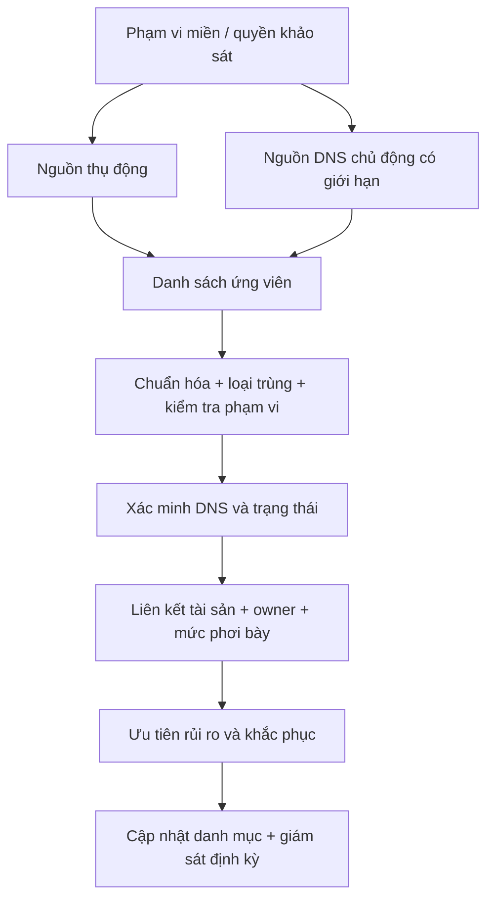

# Subdomain discovery: khám phá tên miền con trong reconnaissance mạng

## Mục tiêu học tập

Sau bài học, bạn có thể:

1. Giải thích **subdomain**, **FQDN**, **DNS zone**, **delegation** và vai trò của subdomain discovery trong giai đoạn reconnaissance của an ninh mạng.
2. Phân biệt nguồn khám phá **thụ động (passive)** và **chủ động (active)**; xây dựng quy trình kiểm kê tên miền con trong phạm vi được phép.
3. Dùng các truy vấn DNS để xác minh bản ghi A/AAAA, CNAME, NS, MX, TXT, SRV và hiểu vì sao một tên miền xuất hiện trong dữ liệu lịch sử chưa chắc đang hoạt động.
4. Nhận diện **wildcard DNS**, bản ghi tồn tại nhưng không có dịch vụ, CDN, split-horizon DNS, trùng lặp, kết quả lỗi và các nguyên nhân thường tạo kết luận sai.
5. Liên hệ phát hiện với rủi ro **shadow IT**, dịch vụ bị bỏ quên, lộ bề mặt quản trị, cấu hình DNS chưa dọn dẹp và nguy cơ subdomain takeover; đề xuất xác minh và khắc phục an toàn.
6. Tạo một bảng bằng chứng có nguồn, thời gian, trạng thái, chủ sở hữu và độ tin cậy để hỗ trợ giám sát, threat modeling và kiến trúc mạng an toàn.

## 1. Subdomain discovery là gì?

**Subdomain discovery** là quá trình phát hiện các tên miền con liên quan đến một miền gốc hoặc một **DNS zone** đã xác định, rồi đánh giá xem những tên nào tồn tại, trỏ đến tài nguyên nào và có thuộc phạm vi quản lý của tổ chức hay không.

Ví dụ trong miền tài liệu giả định `example.test`:

```text
example.test                     Miền gốc được đưa vào phạm vi
www.example.test                 Một tên miền con
api.example.test                 Một tên miền con khác
dev.api.example.test             Tên miền con ở nhiều cấp
_dmarc.example.test              Tên DNS dùng cho bản ghi chính sách email
example.test.attacker.invalid    KHÔNG thuộc cây DNS example.test
```

**FQDN** (*Fully Qualified Domain Name*) là tên đầy đủ tính từ một node đến root DNS, về mặt biểu diễn chuẩn có dấu chấm root ở cuối, ví dụ `api.example.test.`. Trong thực tế, giao diện và công cụ thường lược bỏ dấu chấm cuối khi hiển thị.

**DNS zone** là phạm vi dữ liệu DNS do một hệ thống authoritative DNS quản lý. Một miền có thể được chia thành nhiều zone do **delegation**; ví dụ `lab.example.test` có thể có NS riêng. Vì vậy, “thuộc cây tên” và “được cùng một nhóm quản trị” không luôn trùng nhau.

Tên DNS cũng **không đồng nghĩa với một máy chủ duy nhất**: một tên có thể ánh xạ tới nhiều IP, một IP phục vụ nhiều hostname, một hostname là alias qua CNAME, hoặc chỉ dùng cho email/chính sách mà không có trang web.

### 1.1. Vị trí trong an ninh mạng

Trong module **SECURITY_NETWORK_SECURITY**, subdomain discovery là một bước reconnaissance phục vụ **kiểm kê bề mặt tấn công**, giúp xác định những điểm cần quản lý và phòng vệ. Nó cung cấp đầu vào cho threat modeling, phân đoạn mạng, firewall, DNS security, phát hiện xâm nhập và đánh giá hạ tầng đám mây.



Quy trình trên **phân biệt ba kết quả khác nhau**:

- **Đã thấy tên**: nguồn bên ngoài hoặc danh mục nội bộ từng đề cập hostname.
- **Có bản ghi DNS hiện tại**: truy vấn cho một hoặc nhiều loại record thu được câu trả lời hợp lệ; không khẳng định HTTP/HTTPS đang chạy.
- **Dịch vụ đang hoạt động**: kiểm tra ứng dụng cho thấy dịch vụ đáp ứng tại thời điểm quan sát; cần thêm xác minh chủ sở hữu và quyền quản trị.

Từng mệnh đề phải được lưu cùng **thời điểm quan sát** và nguồn bằng chứng.

## 2. Chuẩn bị phạm vi và điều kiện khảo sát

Trước khi thu thập, xác định:

| Thành phần | Cần làm rõ |
|---|---|
| **Miền/zone được phép** | Miền gốc, những miền con được ủy quyền, các tên hoặc zone loại trừ. |
| **Mục tiêu** | Kiểm kê tài sản, phát hiện dịch vụ chưa quản lý, đối chiếu DNS với CMDB, hay theo dõi thay đổi. |
| **Quyền truy cập** | Chỉ đọc dữ liệu công khai, quyền tra cứu DNS nội bộ, API cloud, danh mục quản trị tài sản. |
| **Giới hạn kỹ thuật** | Số truy vấn/giây, khoảng thời gian vận hành, giới hạn nhà cung cấp và kênh ghi nhận sự cố. |
| **Dữ liệu cần lưu** | Hostname, loại record, kết quả, nguồn, timestamp, owner, ghi chú rủi ro. |
| **Điểm dừng** | Không mở rộng quét sang hạ tầng/miền của đối tác chỉ vì có CNAME, redirect hoặc cùng IP. |

Chỉ thực hiện **truy vấn chủ động** và kiểm tra dịch vụ đối với tài sản bạn sở hữu hoặc có quyền đánh giá rõ ràng. Có thể xem dữ liệu công khai theo phạm vi nghiên cứu, nhưng mọi hoạt động gửi truy vấn số lượng lớn hay thử nghiệm cấu hình đều phải tuân thủ quyền và giới hạn tương ứng.

Bài này sử dụng `lab.example.test` làm **môi trường mô phỏng**. Các địa chỉ `192.0.2.0/24` và `198.51.100.0/24` nằm trong dải tài liệu. Lệnh minh họa sẽ chỉ cho kết quả mô phỏng nếu bạn có lab DNS riêng; **không giả định các tên mẫu tồn tại ngoài Internet**.

### 2.1. Đúng miền chưa chắc đúng tổ chức

Giả sử có `shop.example.test` nhưng doanh nghiệp đã ủy quyền vận hành zone này cho một công ty khác; quyền kiểm tra có thể bị giới hạn. Ngược lại, một ứng dụng do doanh nghiệp sở hữu có thể dùng hostname thuộc miền nhà cung cấp SaaS, song miền đó **không tự động trở thành phạm vi subdomain discovery**.

Quy tắc so khớp phạm vi ở dạng văn bản phải kiểm tra **ranh giới nhãn DNS**:

- `api.example.test` thuộc `example.test`.
- `example.test` là apex của phạm vi `example.test`.
- `example.test.evil.invalid` không thuộc `example.test`.
- `notexample.test` không thuộc `example.test`.

Trong công cụ thật, cần chuẩn hóa chữ hoa/thường, dấu chấm cuối, tên quốc tế hóa (IDNA/Punycode) và làm rõ delegation. Không kiểm tra phạm vi bằng cách chỉ tìm chuỗi `example.test` xuất hiện ở bất kỳ vị trí nào.

## 3. Thu thập thụ động (passive discovery)

Phương pháp thụ động tìm tên từ những nguồn đã ghi nhận thông tin, thường **không cần gửi truy vấn tới máy chủ ứng dụng đích**. Tuy nhiên, truy cập dịch vụ tra cứu của bên thứ ba vẫn tạo lưu lượng tới nhà cung cấp dữ liệu và có thể chịu chính sách, giới hạn truy vấn.

| Nguồn | Tên có thể tìm được | Điểm mạnh | Giới hạn |
|---|---|---|---|
| **Certificate Transparency (CT)** | Tên trong SAN của chứng thư TLS công khai | Có thể thấy hostname từng được cấp chứng thư | Chứng thư có thể đã hết hạn; tên có thể chưa từng phục vụ ứng dụng |
| **Passive DNS** | DNS record và ánh xạ tên/IP được quan sát trước đây | Hữu ích cho lịch sử và thay đổi | Dữ liệu không đầy đủ, có thể cũ hoặc bị nhà cung cấp lọc |
| **Danh mục nội bộ/CMDB** | Hostname do doanh nghiệp quản lý | Dễ liên hệ owner và mục đích | Có thể thiếu tài sản phát sinh ngoài quy trình |
| **DNS authoritative / DNS provider API** | Các bản ghi đang được quản lý trong zone được cấp quyền | Độ chính xác cao cho zone trực tiếp quản trị | Không chứng minh dịch vụ phía sau còn chạy |
| **Cloud/ingress inventory** | Hostname trong load balancer, ingress, API gateway, IaC | Gắn được vào tài nguyên và phiên bản triển khai | Có thể không bao gồm ứng dụng SaaS hoặc DNS bên ngoài |
| **Tài liệu công khai, mã nguồn và liên kết web** | Hostname xuất hiện trong cấu hình công khai hoặc đường dẫn | Bổ sung các tên khó đoán | Thường chứa ví dụ, thông tin cũ hoặc host không thuộc phạm vi |
| **Công cụ tìm kiếm, tài liệu kỹ thuật, archive** | Tên từng được công bố hoặc lập chỉ mục | Phát hiện tên bị quên khỏi danh mục | Không thể coi chỉ mục là trạng thái DNS hiện tại |

### 3.1. Đọc kết quả Certificate Transparency đúng cách

CT log ghi chứng thư được công bố để tăng khả năng giám sát cấp phát chứng thư. Khi một chứng thư chứa `api.example.test` trong *Subject Alternative Name (SAN)*, ta có một **ứng viên hostname từng được khai báo trong chứng thư**.

Điều đó **không chứng minh**:

- Hostname hiện có DNS record.
- Máy chủ nhận kết nối HTTPS.
- Tên được tổ chức sở hữu hoặc cho phép khảo sát.
- Chứng thư vẫn còn hiệu lực, được tin cậy hoặc được máy chủ đang dùng.

Một chứng thư wildcard như `*.example.test` cũng **không liệt kê được mọi subdomain cụ thể**; wildcard trong chứng thư là cơ chế đối sánh tên, không phải danh mục các host đã tồn tại.

Dữ liệu từ CT thường bị lặp qua nhiều lần cấp chứng thư. Cần tách các tên trong SAN, chuẩn hóa, loại trùng, lưu thời gian phát hiện và **không tính mỗi chứng thư là một subdomain mới**.

### 3.2. Passive DNS là bằng chứng lịch sử

Ví dụ:

```text
2026-09-10  old-api.example.test -> 192.0.2.30
2026-11-28  Không còn A/AAAA tại resolver đang khảo sát
```

Kết quả thứ nhất hữu ích để phát hiện tài sản cũ, nhưng không thể suy ra ngày 28/11 hostname vẫn hoạt động. Nó cần có trạng thái **historical-only** hoặc **unverified** cho đến khi kiểm chứng.

DNS có thể khác nhau giữa resolver công cộng, resolver doanh nghiệp và authoritative server; cách một nhà cung cấp passive DNS quan sát cũng không phải hình ảnh đầy đủ của Internet.

## 4. Khám phá chủ động (active discovery) trong phạm vi được phép

Khám phá chủ động gửi truy vấn DNS để xác minh tên cụ thể hoặc tạo tên ứng viên bằng một danh sách nhỏ đã được chấp thuận. Phương pháp này cần kiểm soát tần suất và nhận biết tác động tới DNS resolver/authoritative server.

### 4.1. Truy vấn các record có ý nghĩa

Giả sử bạn đã cấu hình DNS lab để phân giải zone `lab.example.test`. Một số lệnh tiêu biểu:

```bash
# Kiểm tra IPv4/IPv6 cho một hostname
dig +noall +answer api.lab.example.test A
dig +noall +answer api.lab.example.test AAAA

# Xem alias; CNAME có thể trỏ tới hostname do nhà cung cấp quản lý
dig +noall +answer dev.lab.example.test CNAME

# Kiểm tra hạ tầng mail và delegation
dig +noall +answer lab.example.test MX
dig +noall +answer lab.example.test NS

# Các record liên quan bảo vệ email, chứng thư và khám phá dịch vụ
dig +noall +answer _dmarc.lab.example.test TXT
dig +noall +answer lab.example.test CAA
dig +noall +answer _sip._tcp.lab.example.test SRV

# Hỏi trực tiếp DNS server do bạn quản lý trong lab
dig @192.0.2.53 api.lab.example.test A +noall +answer
```

`dig +short` tiện để xem nhanh giá trị nhưng **không đủ** cho việc phân biệt NXDOMAIN, NODATA, timeout và lỗi server. Khi xác minh, dùng đầu ra đầy đủ hoặc xem `status`, `ANSWER SECTION`, `AUTHORITY SECTION` và địa chỉ resolver.

Ví dụ:

```text
$ dig @192.0.2.53 api.lab.example.test A +noall +answer

api.lab.example.test.  300  IN  A  192.0.2.20
```

Đây là đầu ra **minh họa**: giá trị TTL 300 giây và IP mô phỏng được xây dựng cho lab. Một record A không tự chứng minh ứng dụng HTTP đang hoạt động ở địa chỉ đó.

### 4.2. Ý nghĩa các loại DNS record đối với kiểm kê

| Record | Gợi ý khám phá | Hạn chế khi suy luận |
|---|---|---|
| **A / AAAA** | Hostname đang ánh xạ IPv4 / IPv6 | IP có thể thuộc CDN, proxy hoặc load balancer; không đại diện một server |
| **CNAME** | Bí danh, đôi khi dẫn tới dịch vụ bên thứ ba | Mục tiêu CNAME không tự chứng minh tài nguyên đã được cấp phát |
| **NS** | Tên name server, khả năng có delegation | NS không phải danh mục tất cả hostname |
| **MX** | Hạ tầng mail liên quan tên miền | MX target có thể thuộc nhà cung cấp email bên ngoài |
| **TXT** | Chính sách SPF/DMARC, xác minh domain, thông tin cấu hình | Có thể chứa dữ liệu nhạy cảm; không công bố hoặc xuất nguyên văn nếu không cần |
| **SRV** | Dịch vụ và cổng được khai báo, ví dụ SIP | Bản ghi tồn tại không bảo đảm service đang lắng nghe |
| **CAA** | Chính sách CA được phép cấp chứng thư | Không tiết lộ mọi host sử dụng TLS |
| **HTTPS/SVCB** | Tham số dịch vụ và một số đích kết nối khác | Cần hiểu độ ưu tiên/alias và fallback của từng ứng dụng |

Một tên có thể **không có A/AAAA** nhưng vẫn tồn tại record TXT hoặc MX. Truy vấn `A` trả về “không có dữ liệu” không đồng nghĩa “tên hoàn toàn không tồn tại”.

### 4.3. Kiểm tra delegation và authority

Nếu doanh nghiệp có zone `team.lab.example.test` với name server riêng, hãy kiểm tra bản ghi NS tại ranh giới delegation và đối chiếu với danh mục quản trị. Dữ liệu từ recursive resolver có thể đang cache theo TTL; trong tình huống cần xác nhận trạng thái cấu hình mới nhất, tra cứu authoritative server đã xác minh thuộc quyền quản lý (theo quy trình vận hành).

**Zone transfer (AXFR)** chỉ nên dùng khi bạn là quản trị viên hoặc được phép kiểm thử máy chủ DNS tương ứng. Khả năng chuyển toàn bộ zone cho client không được phép là một vấn đề cấu hình, nhưng đa số authoritative server hợp lệ sẽ từ chối:

```bash
# Chỉ trong lab / authoritative server thuộc quyền quản lý
dig @192.0.2.53 lab.example.test AXFR
```

Không dùng AXFR như cách mặc định khảo sát mọi DNS server ngoài phạm vi. Cần nhớ: zone có thể cho phép AXFR giữa các secondary/primary DNS được ủy quyền mà vẫn an toàn về quyền truy cập.

### 4.4. Sinh ứng viên từ quy ước đặt tên

Một số tên có thể xuất phát từ tài liệu, cấu hình IaC và danh mục dự án:

```text
api.lab.example.test
auth.lab.example.test
vpn.lab.example.test
mail.lab.example.test
dev.lab.example.test
staging.lab.example.test
monitor.lab.example.test
```

Khi được phép kiểm thử chủ động, có thể kiểm tra từng ứng viên với resolver thuộc môi trường lab. Danh sách mẫu chỉ nhằm giải thích kỹ thuật. Trong thực tế, **không suy diễn rằng tên phổ biến tồn tại**, không mở rộng sang từ điển lớn ngoài giới hạn đã thống nhất và không tăng tải lên DNS chỉ vì muốn tìm nhiều tên hơn.

Với mỗi ứng viên, lưu cả kết quả âm tính, thời gian, resolver và loại truy vấn. Điều đó giúp so sánh giữa các vòng kiểm kê và điều tra các trường hợp cache hoặc DNS response không nhất quán.

## 5. Chuẩn hóa, loại trùng và kiểm tra phạm vi

Một danh sách tổng hợp có thể chứa:

```text
API.LAB.EXAMPLE.TEST
api.lab.example.test.
*.lab.example.test
dev.lab.example.test
api.lab.example.test
example.test.evil.invalid
```

Các bước xử lý:

1. Loại khoảng trắng xung quanh; nhận diện chuỗi không hợp lệ hoặc dữ liệu dính URL, port, path.
2. Tách hostname khỏi URL một cách có cấu trúc; không dùng cách cắt chuỗi tùy tiện.
3. Chuẩn hóa dấu chấm cuối và chữ hoa/thường của DNS; xử lý Unicode bằng **IDNA** trước khi lưu tên so sánh.
4. Lưu wildcard (`*`) như **một mẫu**, không phải host cụ thể.
5. Kiểm tra thuộc phạm vi theo nhãn DNS; lưu riêng các tên ngoài phạm vi để điều tra quyền sở hữu nếu cần.
6. Loại trùng trong cùng miền và gom các **nguồn phát hiện** vào một bản ghi.
7. Lưu nguyên nguồn/chứng cứ và thời gian, không ghi đè phát hiện lịch sử bằng kết quả mới.

Ví dụ logic kiểm tra phạm vi cho tên đã chuẩn hóa về dạng ASCII/Punycode:

```python
def is_in_scope(fqdn: str, allowed_zone: str) -> bool:
    # Hai giá trị đã được chuẩn hóa IDNA và kiểm tra tính hợp lệ.
    fqdn = fqdn.rstrip(".").lower()
    allowed_zone = allowed_zone.rstrip(".").lower()
    return fqdn == allowed_zone or fqdn.endswith("." + allowed_zone)

assert is_in_scope("api.lab.example.test", "lab.example.test")
assert not is_in_scope("lab.example.test.evil.invalid", "lab.example.test")
assert not is_in_scope("notlab.example.test", "lab.example.test")
```

Đoạn mã chỉ minh họa **so khớp hậu tố nhãn**. Một công cụ thực tế còn cần kiểm tra label DNS hợp lệ, xử lý ký tự quốc tế hóa và phân quyền theo các zone đã được ủy quyền.

## 6. Xác minh phát hiện và tránh false positive

### 6.1. Hiểu các trạng thái DNS

| Kết quả | Diễn giải | Hành động kiểm tra |
|---|---|---|
| **NOERROR có answer** | Có câu trả lời cho record đã hỏi | Kiểm tra A/AAAA/CNAME/record liên quan; đối chiếu owner |
| **NOERROR không có answer tương ứng (NODATA)** | Tên có thể tồn tại nhưng không có loại record được hỏi | Thử record phù hợp khác, kiểm tra phần authority |
| **NXDOMAIN** | Resolver trả lời rằng tên không tồn tại trong ngữ cảnh truy vấn đó | Đối chiếu resolver, delegation, DNS nội bộ và cache âm |
| **SERVFAIL** | Resolver/authoritative gặp lỗi hoặc không hoàn tất việc phân giải | Xem DNSSEC, đường đi, authoritative và thời điểm thử |
| **Timeout** | Không nhận phản hồi đúng hạn | Kiểm tra mạng, firewall, resolver và giới hạn truy vấn |
| **REFUSED** | Server từ chối trả lời truy vấn | Kiểm tra chính sách ACL và quyền, không xem là “không tồn tại” |

DNSSEC có thể cung cấp bằng chứng xác thực về tính toàn vẹn một số câu trả lời DNS theo chuỗi tin cậy, nhưng không xác minh doanh nghiệp nào sở hữu tài nguyên ứng dụng phía sau.

### 6.2. Wildcard DNS có thể làm sai lệch kết quả

Một zone có thể cấu hình:

```dns
*.lab.example.test. 300 IN A 192.0.2.200
```

Lúc đó nhiều tên chưa từng được định nghĩa trực tiếp, chẳng hạn `random-a9f2.lab.example.test`, vẫn có thể nhận phản hồi A. Công cụ chỉ dựa vào “có IP” có thể **đếm sai hàng nghìn subdomain**.

Quy trình xác minh hợp lý:

1. Hỏi một số tên ngẫu nhiên, khó trùng với tên thật, trong **cùng vùng DNS** được phép.
2. So sánh phản hồi A, AAAA, CNAME, TTL và hành vi đối với các tên ứng viên.
3. Xem cấu hình DNS authoritative khi có quyền; phân biệt record explicit với kết quả được tạo bởi wildcard.
4. Đánh dấu tên là **suspected-wildcard** nếu bằng chứng chưa đủ, thay vì khẳng định hostname là ứng dụng thực.
5. Nếu được phép kiểm tra dịch vụ, xác nhận hostname có cấu hình ứng dụng riêng bằng dấu hiệu phù hợp, không chỉ thấy web server trả trang mặc định.

Wildcard DNS có ngữ nghĩa cụ thể: khi một tên có node phù hợp, wildcard **không nhất thiết** áp dụng cho mọi truy vấn dưới node đó. Không thể dựa vào một cặp truy vấn để kết luận tất cả hostname là do wildcard tạo ra.

### 6.3. Các nguồn sai lệch phổ biến khác

**Split-horizon DNS:** `portal.lab.example.test` có thể phân giải thành IP private khi dùng DNS doanh nghiệp nhưng không có bản ghi public; hãy ghi rõ resolver/vị trí quan sát. Không đưa tên nội bộ lên dịch vụ công khai nếu chính sách cấm.

**CDN và shared hosting:** Nhiều tên khác nhau trỏ tới cùng dải IP hoặc cùng edge server. Không nhập chúng thành một tài sản duy nhất chỉ vì trùng IP; cũng không coi IP của CDN là tài sản doanh nghiệp sở hữu.

**CNAME chain và redirect:** Tên `docs.lab.example.test` có thể CNAME đến SaaS hoặc HTTP redirect ra domain khác. Việc đó cho biết **phụ thuộc dịch vụ**, không tự cấp quyền quét miền đích.

**Dữ liệu lịch sử:** Certificate, archive hoặc passive DNS có thể giữ hostname đã ngừng dùng. Ghi trạng thái `historical` và xác minh hiện tại trước khi báo cáo “host đang chạy”.

**Tên dùng cho chính sách:** `_dmarc.lab.example.test` hoặc selector DKIM có thể là subdomain theo cấu trúc DNS nhưng không phải máy chủ web; kiểm kê theo **loại record và chức năng**, tránh áp cùng bộ kiểm tra HTTP.

**Thay đổi theo thời gian:** DNS provider, load balancer và deployment có thể đổi kết quả liên tục. Lưu TTL và thời điểm kiểm tra; không diễn giải một lần quan sát là trạng thái vĩnh viễn.

## 7. Từ hostname đến dịch vụ và tài sản thực

Phát hiện hostname là **bước đầu** của bản đồ bề mặt tấn công. Sau khi xác minh DNS, nối hostname với tài sản từ nguồn có thẩm quyền:

| Lớp dữ liệu | Ví dụ thông tin | Có thể suy ra điều gì? |
|---|---|---|
| DNS | `api.lab.example.test` → A `192.0.2.20` | Có một phép ánh xạ DNS tại thời điểm truy vấn |
| Load balancer / ingress | Virtual host, listener, backend service ID | Tên có thể được cấu hình để nhận traffic tại endpoint |
| TLS | Chứng thư, SAN, SNI/cấu hình mTLS | Có dấu hiệu cấu hình danh tính TLS; cần kiểm tra validity |
| Cloud inventory / IaC | Resource ID, environment, deployment owner | Khả năng truy ra chủ sở hữu và vòng đời tài nguyên |
| HTTP/API / access log | Host, route, status, request ID | Dịch vụ có xử lý yêu cầu; cần phân biệt 200/301/403/404/default page |
| Firewall / flow telemetry | Luồng cho phép/từ chối, 5-tuple | Đánh giá mức phơi bày và chiều kết nối |

Với ứng dụng HTTP trên cùng IP, giá trị **HTTP Host** và **TLS SNI** có thể quyết định virtual host được chọn. Vì vậy, kết quả kiểm tra IP trực tiếp có thể khác với kiểm tra bằng hostname. Đồng thời, chứng thư TLS hợp lệ không tự xác minh quyền sở hữu toàn bộ ứng dụng hoặc độ an toàn của dịch vụ.

Nếu đã được phép kiểm tra một endpoint lab:

```bash
# Chỉ dùng với tên trong lab có DNS và dịch vụ HTTP/TLS được cấu hình
curl --head --max-time 5 https://api.lab.example.test
```

Khi dùng HTTP HEAD, một số ứng dụng có thể không hỗ trợ phương thức này hoặc trả kết quả khác GET; kết quả cần được ghi nhận đúng như quan sát, không biến một status code thành tuyên bố “an toàn”.

### 7.1. Đặt trạng thái theo mức độ bằng chứng

Gợi ý phân loại:

- **candidate**: có trong nguồn thụ động hoặc danh sách ứng viên; chưa xác minh.
- **dns-verified**: record được xác nhận bởi nguồn DNS đã ghi rõ tại thời điểm cụ thể.
- **service-observed**: đã có bằng chứng dịch vụ liên quan hostname phản hồi trong phạm vi cho phép.
- **historical-only**: từng xuất hiện nhưng hiện chưa có bằng chứng đang tồn tại.
- **suspected-wildcard**: kết quả có thể do wildcard DNS; cần phân giải thêm.
- **out-of-scope**: không nằm trong miền/zone hoặc quyền kiểm thử đã xác định.

Các trạng thái này **không bắt buộc loại trừ nhau**. Ví dụ, tên có thể có record DNS hiện tại nhưng chưa xác định owner, hoặc vừa `dns-verified` vừa `suspected-wildcard`. Thiết kế kho dữ liệu nên lưu *bằng chứng độc lập* và nhiều nhãn, thay vì ép mọi trường hợp vào một trạng thái tuyệt đối.

## 8. Phân tích phát hiện dưới góc nhìn threat modeling

Một bản ghi DNS không tự động tạo lỗ hổng. Cần đối chiếu loại tài sản, mức tiếp xúc Internet, tính hợp lệ cấu hình và ảnh hưởng nếu bị lợi dụng.

| Phát hiện | Rủi ro cần kiểm tra | Điều kiện cần xác minh | Kiểm soát phù hợp |
|---|---|---|---|
| `admin.lab.example.test` có A/AAAA public | Giao diện quản trị có thể phơi bày | Dịch vụ gì, ai có quyền truy cập, chính sách xác thực | Giới hạn truy cập, MFA/SSO, ZTNA/VPN, giám sát và hardening |
| `staging.lab.example.test` còn được quảng bá | Môi trường thử nghiệm có thể chứa cấu hình yếu | Tài sản còn dùng không, dữ liệu có nhạy cảm không | Tách môi trường, ACL, loại bỏ khi hết vòng đời |
| CNAME đến dịch vụ SaaS đã giải phóng | Có thể phát sinh **dangling DNS** và rủi ro takeover | Nhà cung cấp còn gán tài nguyên không, ownership hiện tại, cách provider xử lý tên chưa claim | Xóa/cập nhật CNAME cũ, quản lý vòng đời tài nguyên, giám sát drift |
| Zone ủy quyền NS không còn rõ owner | Mất kiểm soát delegation | Ai quản lý NS, tình trạng tên miền và quy trình thay đổi | Quản trị NS/delegation tập trung, rà soát định kỳ |
| Hostname lạ xuất hiện trong CT log | Có thể phát sinh chứng thư ngoài quy trình | Chứng thư thực sự cho tên nào, chủ thể cấp, mục đích đăng ký | Giám sát CT, đối chiếu danh mục và chính sách cấp chứng thư |
| Tên wildcard trả về nhiều host | Báo cáo phóng đại bề mặt tấn công | Đã xác nhận wildcard hay record thực chưa | Tách wildcard khỏi discovered hosts, kiểm chứng theo ứng dụng |
| Subdomain cũ trong passive DNS | Shadow IT hoặc tài sản bỏ quên | DNS/dịch vụ hiện nay còn không, owner và retention lịch sử | Đối soát CMDB, DNS cleanup, đóng tài nguyên dư thừa |
| Tên nội bộ lộ trong tài liệu/CT | Tiết lộ cấu trúc, chức năng hoặc môi trường | Có thực sự nội bộ, dữ liệu đã công khai, tác động | Giảm thông tin lộ không cần thiết, bảo vệ nội dung nhạy cảm |

### 8.1. Dangling CNAME và subdomain takeover

Một CNAME có thể trỏ đến hostname của nhà cung cấp bên ngoài trong khi tài nguyên liên quan đã bị xóa. Một số dịch vụ cho phép người khác tạo tài nguyên mới gắn với tên chưa được xác nhận; nếu cơ chế kiểm soát không phù hợp, cấu hình đó **có thể** dẫn đến chiếm quyền phục vụ nội dung qua subdomain.

Tuy nhiên:

- **CNAME tồn tại không có nghĩa có lỗ hổng.**
- Phản hồi **NXDOMAIN**, **404** hay thông báo “not found” ở đích **không đủ** để chứng minh takeover khả thi.
- Cách nhà cung cấp xác minh domain, tài nguyên và ownership khác nhau.
- Không thử nhận/claim hostname của tổ chức hoặc đối tác khác để “xác nhận” khi chưa được ủy quyền; ưu tiên rà soát tài khoản quản trị và tài liệu chính thức của provider.

Giải pháp bền vững là **dọn DNS cùng lúc giải phóng tài nguyên**, tự động hóa kiểm tra tham chiếu bị treo, phân công owner và kiểm tra cấu hình sau deployment.

### 8.2. Xếp mức ưu tiên

Một cách tiếp cận thực tế là đánh giá theo:

1. **Độ tin cậy phát hiện**: lịch sử, DNS hiện tại, dịch vụ phản hồi, owner xác minh.
2. **Mức phơi bày**: Internet public, mạng đối tác, VPN-only, chỉ DNS nội bộ.
3. **Vai trò tài sản**: admin/API/SSO/mail, dịch vụ chứa dữ liệu nhạy cảm, môi trường staging.
4. **Mức kiểm soát hiện tại**: auth, MFA, firewall, WAF, segmentation, monitoring.
5. **Tác động và khả năng khai thác**: có điều kiện kỹ thuật và bằng chứng cụ thể hay chỉ giả thuyết.

Không xếp “critical” chỉ từ các chuỗi tên như `admin`, `prod` hoặc `internal`. **Hostname là gợi ý để điều tra**, không phải thước đo mức độ nguy hiểm.

## 9. Tình huống thực hành: kiểm kê lab.example.test

Giả định đội bảo mật có quyền quản trị toàn bộ `lab.example.test` và đã thu thập:

| Tên được phát hiện | Nguồn | Kết quả xác minh minh họa | Nhận định ban đầu |
|---|---|---|---|
| `api.lab.example.test` | CMDB, authoritative DNS | A `192.0.2.20`, có cấu hình ingress | Tài sản hiện tại, cần gắn owner và kiểm soát API |
| `vpn.lab.example.test` | DNS authoritative | A `192.0.2.21` | Ứng viên VPN, cần kiểm tra hạn chế truy cập |
| `dev.lab.example.test` | CT, DNS authoritative | CNAME tới dịch vụ được quản lý | Cần đối chiếu tài nguyên cloud và owner |
| `old.lab.example.test` | Passive DNS lịch sử | Không có A/AAAA trong lần tra cứu hiện tại | `historical-only`, cần kiểm tra thêm record khác |
| `random-a9f2.lab.example.test` | Truy vấn kiểm tra wildcard | A `192.0.2.200` giống nhiều tên ngẫu nhiên | `suspected-wildcard`, không đưa vào danh sách host thực |
| `admin.lab.example.test` | Tài liệu nội bộ | Không phân giải từ public resolver; có DNS nội bộ | Tài sản nội bộ, không kết luận public exposure |

Đây là **tập dữ liệu giả định**, không phản ánh một hệ thống đang vận hành. Từ bảng này:

- Mục tiêu **đối chiếu chủ sở hữu**: nối `api`, `vpn`, `dev` với team vận hành và tài nguyên IaC/cloud.
- Mục tiêu **phân tích mức phơi bày**: so sánh kết quả từ DNS internal/public và firewall policy đã được phép kiểm tra.
- Mục tiêu **giảm false positive**: tách kết quả wildcard khỏi danh sách ứng viên có host riêng.
- Mục tiêu **quản lý vòng đời**: đánh dấu `old` là tên lịch sử, xác minh xem còn dependency hay record khác trước khi đề nghị xóa.

### 9.1. Mẫu bảng kết quả có thể lưu dạng CSV

```csv
fqdn,source,observed_at_utc,record_type,record_value,verification,owner,risk_note
api.lab.example.test,authoritative_dns,2026-11-28T04:30:00Z,A,192.0.2.20,dns-verified,team-api,review_external_access
old.lab.example.test,passive_dns,2026-09-10T10:00:00Z,A,192.0.2.30,historical-only,unknown,verify_lifecycle
random-a9f2.lab.example.test,lab_dns,2026-11-28T04:31:00Z,A,192.0.2.200,suspected-wildcard,team-dns,do_not_count_as_host
```

Trong sản xuất, thêm `evidence_uri` hoặc mã tham chiếu tới log/danh mục an toàn, `resolver`, `first_seen`, `last_seen`, `asset_id`, `scope_id` và trường xác minh owner. Bảo vệ các thông tin nội bộ theo phân quyền, nhất là DNS của hệ thống quản trị, tên môi trường và lịch sử địa chỉ.

### 9.2. Hình dung pipeline phân tích

```text
Input domain/zone
   -> kiểm tra scope và quyền
   -> nguồn passive + danh mục nội bộ
   -> chuẩn hóa và deduplicate
   -> chọn ứng viên được phép truy vấn
   -> xác minh A/AAAA/CNAME/record liên quan
   -> phát hiện wildcard + sai lệch resolver
   -> liên kết CMDB/cloud/ingress/owner
   -> xếp ưu tiên theo bằng chứng + tác động
   -> báo cáo + xử lý + giám sát biến động
```

Với mạng doanh nghiệp lớn, quy trình này nên tự động hóa theo **chu kỳ phù hợp**, phân tách các bước thu thập/kiểm chứng và đặt giới hạn truy vấn rõ ràng; không phải cứ chạy thường xuyên và nhiều truy vấn hơn là hiệu quả hơn.

## 10. Giám sát và vận hành phòng vệ

Để chuyển reconnaissance thành kiểm soát an ninh lâu dài:

- **Giữ danh mục DNS làm nguồn quản trị**: mọi subdomain quan trọng có owner, mục đích, môi trường, thời điểm hết hạn hoặc lý do giữ lại.
- **Đối soát với cloud/IaC**: kiểm tra DNS record trỏ tới tài nguyên đã xóa, domain chưa xác minh hoặc cấu hình đích sai.
- **Giám sát cấp phát chứng thư**: cảnh báo tên mới hoặc yêu cầu cấp phát không khớp danh mục được phê duyệt.
- **Quản lý delegation và zone**: rà soát NS, DNS provider, quyền thay đổi, DNSSEC khi phù hợp và quy trình thay đổi.
- **Bảo vệ DNS/telemetry**: lưu thay đổi DNS, query logs theo chính sách, phát hiện bất thường và bảo vệ dữ liệu nhạy cảm.
- **Tích hợp quy trình incident response**: khi xuất hiện host lạ, kiểm tra change log, đăng ký DNS, deployment, lưu lượng và danh tính thay đổi trước khi kết luận.
- **Dọn tài sản có kiểm soát**: khi ngừng ứng dụng, cập nhật DNS, reverse proxy, chứng thư, firewall rule, secret, monitoring và CMDB theo thứ tự có kế hoạch.

Không nên dùng một lần chạy subdomain discovery để tuyên bố toàn bộ bề mặt tấn công đã được kiểm kê. Dữ liệu luôn phụ thuộc quyền truy cập, nguồn, thời điểm và vị trí quan sát.

## 11. Bài tập và đáp án

**Bài 1 — Phạm vi tên miền.** Một tổ chức cho phép kiểm tra `example.test` và toàn bộ tên con trực tiếp/gián tiếp thuộc miền đó. Tên nào nằm trong phạm vi: `api.example.test`, `api.example.test.invalid`, `example.test`, `notexample.test`?

**Đáp án:** `api.example.test` và `example.test` thuộc cây tên. Hai tên còn lại không thuộc phạm vi. Tuy nhiên, vẫn phải xem loại trừ cụ thể và delegation theo quyền kiểm thử.

**Bài 2 — Kết luận từ CT.** CT chứa `staging.example.test` trong chứng thư cấp năm trước. Có thể báo cáo ngay rằng hệ thống staging đang mở Internet không?

**Đáp án:** Không. CT chỉ cung cấp dấu vết tên đã xuất hiện trên chứng thư. Cần tra cứu DNS hiện tại, xác minh dịch vụ trong phạm vi cho phép và liên hệ owner.

**Bài 3 — Wildcard.** Mười tên ngẫu nhiên chưa biết đều trả cùng A record `192.0.2.200`. Công cụ đang báo 10 subdomain hoạt động. Bạn xử lý thế nào?

**Đáp án:** Đánh dấu nghi vấn wildcard, kiểm tra thêm các record và authoritative zone, so sánh ứng viên thực với tên ngẫu nhiên. Không đếm 10 tên thành 10 tài sản nếu chưa có bằng chứng cấu hình riêng.

**Bài 4 — NXDOMAIN từ public DNS.** `admin.example.test` trả NXDOMAIN tại resolver công cộng, nhưng DNS nội bộ trả A `10.10.10.8`. Tên này có tồn tại không?

**Đáp án:** Có thể tồn tại trong **view nội bộ** và không hiện diện công khai. Lưu kết quả theo resolver/view, phân biệt DNS nội bộ với public exposure.

**Bài 5 — Dangling CNAME.** `docs.example.test` trỏ đến hostname của một dịch vụ SaaS đã ngừng dùng. Có nên kết luận ngay “subdomain takeover confirmed” không?

**Đáp án:** Không. Cần xác minh trạng thái tài nguyên, chính sách xác thực domain của provider và quyền quản trị. Khuyến nghị owner kiểm tra và dọn CNAME không còn sử dụng; không tự claim đích bên thứ ba khi chưa có quyền.

**Bài 6 — Ưu tiên xử lý.** Có hai phát hiện: (A) `admin.example.test` public, có SSO/MFA và policy chỉ cho VPN; (B) `staging.example.test` public, owner chưa rõ, có dữ liệu test nhạy cảm. Nên xếp ưu tiên theo tên “admin” hay theo bằng chứng?

**Đáp án:** Theo **bằng chứng và tác động**. Phát hiện B có nhiều dấu hiệu cần kiểm tra gấp hơn dù tên A trông nhạy cảm. Đánh giá thực tế cần xác minh chính sách mạng, dữ liệu, quyền truy cập và owner.

## 12. Checklist khi thực hiện subdomain discovery

- [ ] Xác định miền/zone, tài sản, exclusions, quyền và giới hạn truy vấn.
- [ ] Thu thập từ nguồn thụ động và danh mục được phép; lưu provenance và thời điểm.
- [ ] Chuẩn hóa FQDN, IDNA, trailing dot, loại trùng và kiểm tra ranh giới nhãn DNS.
- [ ] Phân biệt tên trong dữ liệu lịch sử với DNS record hiện có và dịch vụ đang chạy.
- [ ] Xác minh các record liên quan: A/AAAA, CNAME, NS, MX, TXT, SRV, CAA, HTTPS/SVCB.
- [ ] Phân biệt NXDOMAIN, NODATA, SERVFAIL, REFUSED và timeout.
- [ ] Kiểm tra wildcard, split-horizon, cache, delegation, CNAME chain, CDN và IPv6.
- [ ] Ghép hostname với tài nguyên thực, owner, trạng thái vòng đời và chính sách phòng vệ.
- [ ] Chỉ đánh giá rủi ro sau khi có bằng chứng; tránh diễn giải IP/hostname thành kết luận về lỗ hổng.
- [ ] Lưu báo cáo đủ để tái kiểm tra: source, timestamp, resolver, bằng chứng, trạng thái và giới hạn.
- [ ] Tạo việc khắc phục cho DNS/tài sản bỏ quên và lên lịch đối soát định kỳ.

## 13. Tài liệu tham khảo

- [RFC 1034 — Domain Names: Concepts and Facilities](https://www.rfc-editor.org/rfc/rfc1034): cấu trúc tên miền, vùng DNS và cơ chế phân giải.
- [RFC 1035 — Domain Names: Implementation and Specification](https://www.rfc-editor.org/rfc/rfc1035): định dạng bản ghi và thông điệp DNS.
- [RFC 8499 — DNS Terminology](https://www.rfc-editor.org/rfc/rfc8499): chuẩn hóa thuật ngữ DNS.
- [RFC 4592 — The Role of Wildcards in the Domain Name System](https://www.rfc-editor.org/rfc/rfc4592): ý nghĩa và hành vi của wildcard DNS.
- [RFC 9162 — Certificate Transparency Version 2.0](https://www.rfc-editor.org/rfc/rfc9162): mô hình transparency log cho chứng thư.
- [NIST SP 800-115 — Technical Guide to Information Security Testing and Assessment](https://csrc.nist.gov/pubs/sp/800/115/final): cách lập kế hoạch, giới hạn và đánh giá kỹ thuật an ninh.
- [MITRE ATT&CK — Gather Victim Host Information / Gather Victim Network Information](https://attack.mitre.org/tactics/TA0043/): phân loại các hoạt động reconnaissance để phục vụ mô hình hóa mối đe dọa.

**Ghi nhớ:** *Subdomain discovery đưa ra các ứng viên tài sản và bằng chứng DNS; nó chưa xác nhận một dịch vụ đang chạy hoặc có lỗ hổng.* Một kết quả hữu ích cho an ninh mạng phải trả lời được **tên được tìm thấy từ đâu, được xác minh khi nào, thuộc quyền ai và hành động phòng vệ nào cần thực hiện**.
