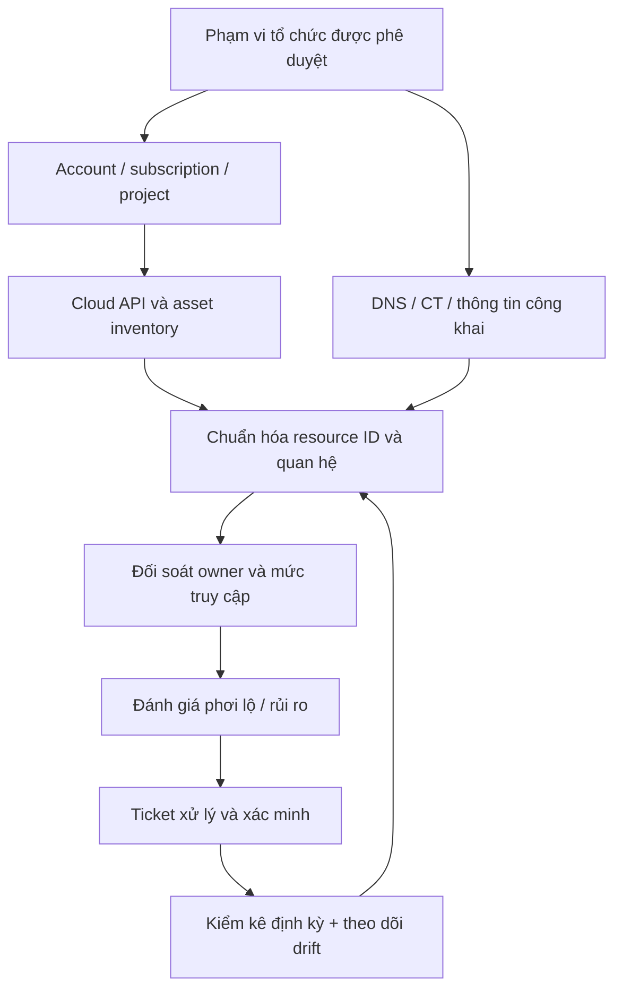
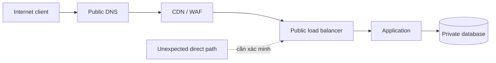

# Cloud asset discovery: phát hiện và kiểm kê tài sản đám mây trong reconnaissance

## 1. Cloud asset discovery là gì và vì sao quan trọng?

**Cloud asset discovery** là quá trình xác định, nhận diện, liên kết và cập nhật các tài sản của một tổ chức được triển khai trên hạ tầng đám mây. Tài sản có thể là tài khoản cloud, mạng ảo, máy ảo, load balancer, API, cơ sở dữ liệu, bucket lưu trữ, tên miền, địa chỉ IP, tài nguyên Kubernetes, chức năng serverless, danh tính máy và các mối quan hệ giữa chúng.

Trong **reconnaissance** (trinh sát/thu thập thông tin), một tác nhân tìm hiểu hệ thống trước khi quyết định bước tiếp theo. Đối với đội bảo mật, đây là hoạt động **nhìn lại hạ tầng từ góc độ người quan sát và từ dữ liệu quản trị được cấp quyền**, nhằm biết thực tế tổ chức đang sở hữu hoặc vận hành những gì và bề mặt nào có thể tiếp cận được.

Một tài sản không xuất hiện trong danh mục thường cũng không được đánh giá bản vá, cấu hình mạng, quyền truy cập, nhật ký hay trách nhiệm quản lý. Do môi trường cloud cho phép tạo và hủy tài nguyên nhanh chóng, một bảng kiểm kê thủ công có thể lạc hậu ngay trong ngày.

**Ví dụ:** ứng dụng chính của công ty chạy sau CDN và WAF, nhưng một môi trường thử nghiệm cũ có load balancer công khai trỏ thẳng tới máy chủ ứng dụng. Nếu nhóm vận hành chỉ xem hệ thống production chính, endpoint thử nghiệm có thể bị bỏ qua khi đánh giá truy cập từ Internet, kiểm soát firewall và giám sát.

Kết quả của cloud asset discovery cần trả lời được:

1. **Có những tài sản nào?** Loại tài nguyên, định danh chuẩn, nơi triển khai và thời điểm được nhìn thấy.
2. **Thuộc về ai?** Tổ chức, tài khoản/subscription/project, owner kỹ thuật, đơn vị sử dụng, môi trường `prod`/`dev`.
3. **Liên kết với nhau ra sao?** DNS → CDN/load balancer → mạng ảo → dịch vụ → dữ liệu, bao gồm các quan hệ liên vùng và liên tài khoản.
4. **Ai có thể truy cập?** Internet, mạng đối tác, VPN, mạng nội bộ, danh tính cloud, service account hoặc workload identity.
5. **Có rủi ro và khoảng trống giám sát nào?** Dịch vụ phơi lộ ngoài dự kiến, cấu hình thiếu kiểm soát, tài nguyên không có owner, nguồn log chưa bật.
6. **Danh mục còn đúng không?** Tài sản mới, tài sản thay đổi, tài sản đã xóa, quyền truy cập thay đổi và các bất thường theo thời gian.

Với module bảo mật mạng, cloud asset discovery là nền tảng để **phân đoạn mạng, thiết lập firewall/security group, quản lý VPN, bảo vệ DNS, triển khai IDS/IPS, phân tích lưu lượng và mô hình hóa mối đe dọa**. Không thể bảo vệ đầy đủ một thành phần nếu chưa biết nó tồn tại hoặc chưa hiểu đường kết nối của nó.

## 2. Xác định phạm vi và nguyên tắc được phép trước khi thu thập

Cloud discovery có thể được thực hiện từ hai góc nhìn bổ trợ:

- **Bên trong (authenticated inventory):** truy vấn API quản trị cloud bằng quyền chỉ đọc được cấp phù hợp, cho phép thấy tài sản riêng tư, cấu hình, mối quan hệ và nhiều metadata không công khai.
- **Bên ngoài (external attack surface discovery):** quan sát các dấu vết mà Internet có thể nhìn thấy như DNS, chứng chỉ công khai, IP, dịch vụ web công khai hoặc tín hiệu từ bên thứ ba. Góc nhìn này cho biết thứ gì *có vẻ* công khai nhưng không chứng minh ngay quyền sở hữu hoặc cấu hình thực tế.

Trong công việc phòng thủ, phải xác định **phạm vi được chủ sở hữu cho phép** trước khi kiểm tra. Phạm vi nên ghi rõ tổ chức, tài khoản cloud, subscription, project, tên miền, dải IP, môi trường, hình thức thu thập được phép và người phê duyệt. Quyền xem một tên miền trên Internet **không đồng nghĩa** quyền dò quét hoặc thử khai thác toàn bộ máy chủ liên quan.

| Thành phần phạm vi | Cần ghi rõ | Vì sao |
|---|---|---|
| Ranh giới tổ chức | Cloud organization/tenant, đơn vị kinh doanh, đối tác vận hành | Tránh bỏ sót hệ thống hợp pháp hoặc thu thập ngoài quyền hạn |
| Tài khoản quản trị | AWS account, Azure subscription, Google Cloud project | Là đơn vị kiểm kê/ủy quyền quan trọng |
| Vùng địa lý | Regions, zones, tài nguyên global | Tài sản có thể nằm ngoài region mặc định |
| Không gian mạng | VPC/VNet, subnet, CIDR, IP public, DNS zone | Hiểu đường truy cập và phân đoạn |
| Hình thức kiểm tra | API read-only, DNS/CT thụ động, xác minh endpoint nhẹ được phép | Hạn chế tác động và tuân thủ giấy phép kiểm tra |
| Đầu ra | Danh mục, đồ thị phụ thuộc, báo cáo rủi ro, owner | Biết ai phải xử lý kết quả |

**Nguyên tắc vận hành:** dùng danh tính đọc tối thiểu, ghi nhận thời điểm truy vấn, tuân thủ quota API, không nhúng access key/token vào tài liệu hoặc nhật ký, và tránh kích hoạt thay đổi cấu hình trong bước phát hiện. Các bài kiểm tra chủ động cần có giới hạn tốc độ, cửa sổ vận hành và đầu mối liên hệ khi phát hiện tác động.

## 3. Cloud asset bao gồm những loại tài sản nào?

Kiểm kê chỉ máy ảo là chưa đủ. Nhiều đường truy cập của ứng dụng hiện đại không đi qua VM do đội vận hành trực tiếp quản lý.

| Nhóm tài sản | Ví dụ AWS | Ví dụ Azure | Ví dụ Google Cloud | Ý nghĩa với an ninh mạng |
|---|---|---|---|---|
| Phạm vi quản trị | Organization, account | Tenant, management group, subscription | Organization, folder, project | Ranh giới quản lý, chính sách, cấp quyền |
| Compute | EC2, ECS/EKS, Lambda | Virtual Machines, AKS, Functions | Compute Engine, GKE, Cloud Run, Cloud Functions | Nơi xử lý yêu cầu hoặc chạy workload |
| Mạng & định tuyến | VPC, subnet, route table, Internet/NAT gateway | VNet, subnet, route table, public IP | VPC, subnet, route, Cloud NAT | Luồng kết nối và đường ra/vào |
| Biên & phân phối | ELB/ALB/NLB, CloudFront, API Gateway | Load Balancer, Front Door, Application Gateway, API Management | Cloud Load Balancing, Cloud CDN, API Gateway | Điểm xuất hiện công khai và kết thúc TLS |
| Điều khiển truy cập mạng | Security Group, NACL | NSG, Azure Firewall | VPC firewall rules, Cloud Armor | Quy tắc mạng được áp dụng thực tế |
| Dữ liệu & lưu trữ | S3, RDS, DynamoDB | Blob Storage, Azure SQL, Cosmos DB | Cloud Storage, Cloud SQL, Firestore | Dữ liệu nhạy cảm, endpoint và chính sách chia sẻ |
| Danh tính & bí mật | IAM role, IAM policy, KMS, Secrets Manager | Microsoft Entra ID, managed identity, Key Vault | Cloud IAM, service account, Secret Manager | Quyền sử dụng và truy cập tài nguyên |
| DNS & chứng chỉ | Route 53, ACM | Azure DNS, Key Vault certificates | Cloud DNS, Certificate Manager | Tên dịch vụ, định tuyến và xác thực TLS |
| Quan sát & an ninh | CloudTrail, Config, VPC Flow Logs | Activity Log, Azure Policy, Network Watcher | Cloud Audit Logs, VPC Flow Logs, Security Command Center | Khả năng phát hiện thay đổi và điều tra |

Một số tài sản **không có địa chỉ IP public** vẫn quan trọng: service account có quyền rộng, database private chứa dữ liệu khách hàng, queue nhận lệnh từ API công khai, role có thể được workload dùng để truy cập storage. Đây là lý do cần **quan hệ giữa tài sản**, bên cạnh danh sách endpoint Internet.

Ngoài tài nguyên thuộc tài khoản cloud, cần xét **SaaS, dịch vụ bên thứ ba, CDN quản lý bên ngoài và các endpoint đối tác** khi chúng nằm trong phạm vi tổ chức. Không nên tự quy mọi IP của nhà cung cấp CDN hoặc một bucket có tên giống công ty thành tài sản do công ty sở hữu.

## 4. Những nguồn thông tin dùng để phát hiện tài sản

### 4.1. Nguồn quản trị có xác thực

**Cloud control plane** là nguồn chính để biết các tài nguyên đã được khai báo hoặc quản lý bởi nhà cung cấp. Từ tài khoản/tenant được cấp quyền, quá trình kiểm kê có thể lấy danh sách resource ID, vùng, tag, mạng, endpoint và quan hệ cấu hình.

Các dịch vụ kiểm kê hỗ trợ:

- **AWS:** AWS Organizations cho cấu trúc account; AWS Resource Explorer hỗ trợ tìm tài nguyên được lập chỉ mục theo phạm vi cấu hình; AWS Config ghi nhận cấu hình và lịch sử thay đổi **đối với những loại tài nguyên được cấu hình ghi nhận**; AWS CloudTrail cho dấu vết hoạt động API.
- **Azure:** Azure Resource Graph truy vấn tài nguyên trong các subscription mà danh tính có quyền; Azure Policy giúp phát hiện cấu hình không tuân thủ; Azure Activity Log ghi nhận sự kiện quản trị; Defender for Cloud bổ sung một số góc nhìn bảo mật.
- **Google Cloud:** Cloud Resource Manager cho cấu trúc organization/folder/project; Cloud Asset Inventory hỗ trợ tìm kiếm tài sản và theo dõi thay đổi trong phạm vi hỗ trợ; Cloud Audit Logs ghi nhận hoạt động tùy loại log và cấu hình; Security Command Center cung cấp các phát hiện bảo mật khi được bật.

**Không một công cụ đơn lẻ nào đảm bảo kiểm kê hoàn toàn đầy đủ.** Chúng có phạm vi dịch vụ/tài nguyên được hỗ trợ, quyền truy cập, vùng và độ trễ lập chỉ mục khác nhau. Thiếu tài nguyên trong kết quả có thể do bộ lọc, không đủ quyền, tài nguyên mới, loại tài nguyên chưa hỗ trợ, dữ liệu lịch sử không tồn tại hoặc tài sản nằm trong một account khác.

### 4.2. Nguồn bên ngoài có thể quan sát

| Nguồn | Thông tin gợi ý | Giới hạn |
|---|---|---|
| DNS records (A, AAAA, CNAME, MX, NS, TXT) | Tên dịch vụ, đích DNS, đơn vị cung cấp mail và vùng DNS | Record có thể cũ, trỏ tới dịch vụ không thuộc tổ chức hoặc chưa còn hoạt động |
| Certificate Transparency (CT) | Tên miền xuất hiện trong chứng chỉ TLS công khai | Chứng chỉ được cấp không chứng minh endpoint còn chạy; wildcard không liệt kê mọi host |
| Public IP, ASN, thông tin phân bổ mạng | Nhà mạng/nhà cung cấp đứng tên dải IP | IP cloud thay đổi/được dùng chung; sở hữu IP của provider không chứng minh sở hữu workload |
| Header/đặc tính dịch vụ công khai | Dấu hiệu CDN, reverse proxy, loại gateway, cấu hình TLS nhìn thấy | Có thể bị che, thay đổi, hoặc không đại diện cho origin |
| Tài liệu, kho mã, IaC, CMDB được cấp quyền | Endpoint dự kiến, tài nguyên từng triển khai, owner | Tài liệu/IaC không chứng minh tài nguyên thực đang tồn tại |
| Billing và asset inventory của nhà cung cấp | Tài nguyên có chi phí, thay đổi theo account, loại dịch vụ | Không phát hiện mọi tài nguyên miễn phí, ngừng sử dụng hoặc do bên khác thanh toán |

**Đối chiếu nguồn** là bước bắt buộc. Ví dụ CNAME `api.example.com` trỏ tới một hostname CDN cho thấy tuyến truy cập công khai, nhưng chưa thể kết luận toàn bộ IP của CDN là IP do tổ chức quản lý. Số liệu từ control plane, cấu hình DNS, owner và log truy cập giúp xác nhận.

### 4.3. Quan sát thụ động và xác minh chủ động

Trong thực hành, **phát hiện thụ động** là thu thập từ API/nguồn dữ liệu sẵn có hoặc hồ sơ công khai mà không trực tiếp gửi lượng truy vấn kiểm tra tới mọi endpoint. **Xác minh chủ động** là gửi yêu cầu hoặc kiểm tra trực tiếp lên đích thuộc phạm vi được phép để xác định hành vi hiện tại.

Các bước xác minh nhẹ có thể là tra cứu DNS do tổ chức quản lý hoặc yêu cầu HTTP `HEAD` tới một hostname đã xác nhận. Ngay cả `HEAD` cũng có thể kích hoạt xử lý ở phía server; cần giới hạn số lần, không thử endpoint lạ và không coi việc có phản hồi `200` là bằng chứng dịch vụ an toàn.

Tránh đánh giá phơi lộ chỉ qua một lần kiểm tra tại một vị trí mạng: firewall theo vùng, split-horizon DNS, CDN, VPN và chính sách danh tính có thể khiến kết quả khác nhau giữa các điểm quan sát.

## 5. Quy trình phát hiện tài sản theo từng bước

### Bước 1 — Xác định gốc tổ chức và đơn vị quản trị

Bắt đầu từ **organization/tenant** hoặc danh sách account/subscription/project đã được phê duyệt. Với mỗi đơn vị, ghi owner, môi trường, business service, trạng thái hoạt động và phạm vi regions được sử dụng.

Đây thường là nơi phát hiện **shadow cloud**: account thử nghiệm dùng tên riêng, subscription được tạo ngoài quy trình, project không có owner hay môi trường đã tách khỏi organization chính. Nếu danh sách đầu vào không bao gồm những account đó, việc quét một vài VPC của production không thể tìm thấy chúng.

### Bước 2 — Thu thập tài nguyên từ control plane

Với từng account/subscription/project và từng phạm vi region/global, truy vấn danh sách tài nguyên và metadata phù hợp. Phân loại tối thiểu:

- Compute, container, serverless, storage, database, queue và các dịch vụ phụ thuộc.
- VPC/VNet, subnet, route, public IP, NAT, peering, VPN, private endpoint và kết nối hybrid.
- Load balancer, API gateway, ingress, CDN, DNS và chứng chỉ.
- Security group/NSG/firewall policy, IAM role/principal, service account và quan hệ truy cập.
- Logging, monitoring, backup, mã hóa và các cấu hình bảo vệ liên quan.

Thu thập cả **tài nguyên global** lẫn **regional**; không mặc định region CLI hiện tại là toàn bộ hạ tầng. Phân trang theo API, xử lý giới hạn tốc độ và lưu thông tin lỗi/thiếu quyền để không nhầm kết quả rỗng thành “không có tài sản”.

### Bước 3 — Liên kết DNS, endpoint và địa chỉ công khai

Xây ánh xạ từ **tên miền/hostname → record DNS → CDN/load balancer/public IP → dịch vụ phía sau**. Kết hợp chứng chỉ, cấu hình gateway và service discovery nội bộ. Khi qua CDN hoặc reverse proxy, ghi rõ đâu là **điểm kết thúc công khai** và đâu là **origin**.

Không suy ra origin chỉ bằng cách dò ngẫu nhiên địa chỉ IP của provider. Trong quy trình phòng thủ, hãy dùng thông tin đã được cấp phép từ cấu hình CDN/load balancer, IaC hoặc API cloud.

### Bước 4 — Xác minh quyền truy cập và mức phơi lộ

Phân loại tài sản theo **khả năng đến được từ các nguồn cụ thể**, thay vì chỉ theo nhãn “public/private”:

- Công khai trên Internet và *có chủ đích*: website, cổng API phục vụ khách hàng.
- Công khai nhưng *chưa được phê duyệt*: console quản trị, môi trường thử nghiệm, endpoint nội bộ bị cấu hình sai.
- Chỉ truy cập từ VPN, mạng đối tác hoặc subnet được phép.
- Không có ingress trực tiếp nhưng có thể bị gọi gián tiếp qua API hoặc worker.
- Tài nguyên dữ liệu có policy/chính sách chia sẻ khiến danh tính ngoài phạm vi dự kiến truy cập được.

Đánh giá cả **đường truy cập**: security group cho phép inbound không đảm bảo có tuyến mạng từ Internet; ngược lại hệ thống không có public IP vẫn có thể bị truy cập qua load balancer hoặc proxy công khai. Với bucket/storage, quyết định truy cập cần xét policy, ACL, cơ chế chia sẻ, block-public-access và các kiểm soát tổ chức, tùy nhà cung cấp.

### Bước 5 — Chuẩn hóa định danh, gán owner và đối soát

Lưu bản ghi theo **định danh chuẩn của nhà cung cấp**, không chỉ tên hiển thị dễ trùng:

- AWS: account ID, region, loại tài nguyên, ARN hoặc ID dịch vụ.
- Azure: tenant/subscription và resource ID đầy đủ.
- Google Cloud: organization/folder/project, resource name và loại tài sản.

Gắn **owner**, môi trường, dữ liệu nhạy cảm, mức quan trọng kinh doanh và nguồn phát hiện. Nếu tag thiếu, dùng bảng đối chiếu account/project, IaC hoặc hệ thống quản lý dịch vụ để tìm người chịu trách nhiệm; **không tự gán owner theo suy đoán**.

### Bước 6 — Phân tích rủi ro và xử lý sai lệch

Ưu tiên tài sản có kết hợp **phơi lộ ngoài dự kiến + độ nhạy dữ liệu + khả năng tác động + thiếu kiểm soát hoặc owner**. Gửi kết quả cho nhóm phụ trách để xác nhận trước khi yêu cầu thay đổi hệ thống.

Một hostname còn trong DNS nhưng tài nguyên đích đã bị xóa là tín hiệu **dangling DNS record**. Tình trạng này có thể tạo nguy cơ chiếm quyền tên miền phụ nếu loại dịch vụ đích cho phép bên khác đăng ký lại định danh tương ứng; cần kiểm chứng theo nhà cung cấp, không mặc định mọi CNAME không phản hồi đều có thể bị chiếm dụng.

### Bước 7 — Theo dõi thay đổi và duy trì độ mới

Chạy kiểm kê theo lịch và kết hợp sự kiện tạo/sửa/xóa tài nguyên từ control plane hoặc nhật ký quản trị. Bản ghi cần có `first_seen`, `last_seen`, nguồn quan sát và trạng thái. Đánh dấu tài sản “không còn thấy” để kiểm tra chứ không lập tức xóa lịch sử: thiếu quyền hoặc lỗi API cũng có thể làm tài sản biến mất khỏi kết quả.

Quy trình tổng quát:



## 6. Ví dụ kiểm kê AWS trong phạm vi được cấp quyền

Ở AWS, một hệ thống có thể trải trên nhiều **account**, nhiều **region** và một số dịch vụ **global**. Cách tiếp cận là liệt kê account được phép từ tổ chức hoặc danh sách đã duyệt; kiểm tra khả năng assume role đọc; sau đó thu thập tài nguyên theo dịch vụ/region và đối soát với AWS Config hoặc Resource Explorer khi đã cấu hình.

Ví dụ các lệnh **đọc metadata** với AWS CLI, thực hiện bằng profile được cấp quyền và trong region thuộc phạm vi:

```bash
# Xác định danh tính AWS đang dùng trước khi thu thập
aws sts get-caller-identity --profile inventory-read

# Liệt kê một số thông tin máy EC2 trong region được duyệt
aws ec2 describe-instances \
  --profile inventory-read \
  --region ap-southeast-1 \
  --query 'Reservations[].Instances[].{Id:InstanceId,Vpc:VpcId,PrivateIp:PrivateIpAddress,PublicIp:PublicIpAddress,State:State.Name}' \
  --output table

# Liệt kê các load balancer và phạm vi mạng liên quan
aws elbv2 describe-load-balancers \
  --profile inventory-read \
  --region ap-southeast-1 \
  --query 'LoadBalancers[].{Name:LoadBalancerName,Scheme:Scheme,DNS:DNSName,Vpc:VpcId}' \
  --output table
```

Các lệnh này **không tạo/sửa tài nguyên** nhưng cần quyền đọc phù hợp; ví dụ profile `inventory-read` và region `ap-southeast-1` chỉ là giá trị minh họa, không phải cấu hình đã kiểm chứng của bất kỳ hệ thống nào. AWS CLI có cơ chế phân trang ở nhiều thao tác nhưng mỗi API và công cụ tổng hợp có quy tắc riêng; cần kiểm tra việc lấy đủ kết quả khi xây hệ thống kiểm kê.

Đối với một load balancer có `Scheme=internet-facing`, cần kiểm tra thêm listener, target group, route, security group và điểm kết thúc TLS. **`internet-facing` là tín hiệu công khai ở mức thiết kế**, nhưng không thay thế kiểm tra khả năng truy cập thực tế hoặc chính sách bảo vệ ở trước nó.

Với S3, kết quả liệt kê bucket chỉ cho thấy bucket tồn tại trong phạm vi credential. Việc đánh giá có truy cập public hay không còn phải xét bucket policy, ACL, access point, account-level/bucket-level Block Public Access và những kiểm soát liên quan. Không kết luận “bucket private” chỉ vì không có IP public; object storage được truy cập qua endpoint và cơ chế định danh riêng.

### Những nguồn AWS nên đối chiếu

| Nguồn | Phần bổ sung cho danh mục |
|---|---|
| AWS Organizations | Danh sách account và cấu trúc tổ chức trong phạm vi được phép |
| AWS Config (nếu được bật) | Snapshot/lịch sử cấu hình của các loại resource được ghi nhận |
| AWS Resource Explorer | Tìm kiếm tài nguyên được chỉ mục theo phạm vi/region và cấu hình |
| AWS CloudTrail | Lịch sử sự kiện API để lần theo thay đổi tạo/sửa/xóa trong phạm vi log |
| VPC Flow Logs | Quan sát metadata luồng lưu lượng ở những network interface/subnet/VPC đã bật log |
| IAM / Access Analyzer | Thông tin về policy và một số dạng quyền truy cập ngoài phạm vi tin cậy, tùy cấu hình |

**Lưu ý:** “CloudTrail có sự kiện tạo tài nguyên” là dấu hiệu về thay đổi, **không chứng minh tài nguyên hiện còn tồn tại**. Ngược lại, tài nguyên có thể tồn tại từ trước khoảng lưu trữ log. Kết hợp snapshot hiện tại với log thay đổi mới tạo thành góc nhìn đáng tin cậy hơn.

## 7. Ví dụ kiểm kê Azure trong phạm vi được cấp quyền

Trên Azure, cần hiểu cấu trúc **tenant → management group → subscription → resource group → resource**. Azure Resource Graph giúp truy vấn tài nguyên trên các subscription mà tài khoản có quyền truy cập, nhưng không tự suy ra mọi subscription thuộc tổ chức nếu quyền chưa bao phủ.

Ví dụ truy vấn đọc metadata bằng Azure CLI:

```bash
# Xác định subscription đang sử dụng
az account show --query '{subscription:id,tenant:tenantId,name:name}' --output json

# Ví dụ Resource Graph: liệt kê resource và phạm vi quản trị
az graph query \
  -q "Resources | project id, name, type, location, resourceGroup, subscriptionId | limit 50" \
  --output table
```

Lệnh `az graph` cần extension/hỗ trợ Azure Resource Graph và quyền phù hợp. `limit 50` **chỉ lấy mẫu**; quy trình kiểm kê đầy đủ phải xử lý phân trang/giới hạn kết quả và chọn subscription chính xác. Không lấy kết quả 50 bản ghi làm bằng chứng rằng toàn tổ chức chỉ có 50 tài nguyên.

Khi đánh giá đường truy cập ngoài Internet, cần liên kết **public IP, load balancer, Application Gateway/Front Door, NSG, Azure Firewall, Private Endpoint, VNet peering, route table** và endpoint ứng dụng. Một resource tên “private” không đảm bảo mọi đường truy cập đã bị chặn; xác định cả cấu hình và lưu lượng tại đúng vị trí.

**Azure Policy** có thể bổ sung thông tin cấu hình không phù hợp tiêu chuẩn; **Defender for Cloud** cung cấp một số phát hiện bảo mật; **Activity Log** dùng để đối chiếu thay đổi trong phạm vi log. Kết quả từ các nguồn này phụ thuộc quyền, cấu hình và các tính năng đã được triển khai.

## 8. Ví dụ kiểm kê Google Cloud trong phạm vi được cấp quyền

Google Cloud tổ chức tài nguyên theo **organization → folder → project** và nhiều dịch vụ quản lý resource riêng. **Cloud Asset Inventory** cho phép tra cứu tài sản trong scope phù hợp với quyền của danh tính.

Ví dụ với Google Cloud CLI:

```bash
# Xác định project mặc định; không thay thế việc duyệt toàn bộ project
gcloud config get-value project

# Tìm metadata tài sản trong một project đã được phê duyệt
gcloud asset search-all-resources \
  --scope=projects/PROJECT_ID \
  --limit=50 \
  --format='table(name,assetType,location)'
```

`PROJECT_ID` là chỗ điền project thật trong phạm vi được phép. Cần quyền Cloud Asset Inventory phù hợp. `--limit=50` là giới hạn minh họa; muốn kiểm kê đầy đủ phải bỏ hoặc xử lý giới hạn một cách có kiểm soát. Những loại tài nguyên và metadata được trả về phụ thuộc vào API, scope, quyền và khả năng hỗ trợ của dịch vụ.

Đánh giá phơi lộ cần xét **Cloud Load Balancing, Cloud Armor, VPC firewall rules, external IP, Cloud Run/Cloud Functions ingress, API Gateway, Cloud Storage IAM** và các đường truyền giữa project. Với Cloud Storage, các quyền `allUsers`/`allAuthenticatedUsers` là tín hiệu cần xem xét trong phạm vi cơ chế IAM, nhưng phải đối chiếu với các chính sách ngăn public access và cấu hình thực tế trước khi kết luận.

**Cloud Audit Logs, VPC Flow Logs và Security Command Center** có thể bổ trợ cho danh mục tài sản, miễn là loại log/dịch vụ liên quan đã được bật và retention đáp ứng nhu cầu. Một số tài sản trong container hoặc tài nguyên do ứng dụng tạo ra không xuất hiện như một resource cloud độc lập theo cách người dùng kỳ vọng; cần bổ sung từ nền tảng orchestration tương ứng.

## 9. Chuẩn hóa dữ liệu trong một danh mục đa đám mây

Ba nhà cung cấp sử dụng cách đặt tên và định danh khác nhau. Một danh mục dùng chung cần giữ **native resource ID** để truy vết, đồng thời có trường chuẩn để tìm kiếm và đánh giá rủi ro.

Mẫu bản ghi JSON minh họa:

```json
{
  "provider": "aws",
  "scope": {
    "organization": "org-placeholder",
    "account": "account-placeholder",
    "region": "ap-southeast-1"
  },
  "resource_id": "native-resource-id-placeholder",
  "resource_type": "load_balancer",
  "display_name": "example-public-api",
  "environment": "staging",
  "owner": "team-example",
  "business_service": "customer-api",
  "network": {
    "public_endpoint": "api.example.com",
    "exposure": "needs-verification",
    "origin_protected": "unknown"
  },
  "sensitivity": "internal",
  "discovery_source": ["cloud-api", "managed-dns"],
  "first_seen": "2026-11-01T00:00:00Z",
  "last_seen": "2026-11-28T00:00:00Z",
  "verification_status": "pending",
  "confidence": "medium"
}
```

Các giá trị đều **giả định**; `first_seen` và `last_seen` là thời gian hệ thống kiểm kê quan sát, không nhất thiết là thời gian tài nguyên thực sự được tạo hoặc xóa. Trường `exposure` ban đầu có thể là `needs-verification` để tránh kết luận vội từ tên DNS hoặc sơ đồ.

### Những quy tắc chuẩn hóa quan trọng

1. **Khóa chính:** phối hợp provider + account/subscription/project + native resource ID; bổ sung region nếu ID của dịch vụ không đủ định danh toàn cục.
2. **Tách trạng thái khỏi nhận định:** `is_publicly_addressed`, `is_internet_reachable` và `is_approved_public` là ba câu hỏi khác nhau. Một endpoint có địa chỉ public chưa chắc đến được; một endpoint đến được từ Internet vẫn có thể được chủ động phê duyệt.
3. **Ghi nguồn chứng cứ:** mỗi nhận định phơi lộ nên kèm phương pháp và thời gian phát hiện, ví dụ kiểm tra policy, đối chiếu cấu hình mạng, quan sát HTTP được phép.
4. **Duy trì quan hệ:** `resolves_to`, `routes_to`, `attached_to`, `assumes_role`, `reads_from`, `managed_by` giúp lập sơ đồ phụ thuộc.
5. **Dedupe có ngữ cảnh:** một hostname có thể đổi IP; một IP cloud có thể được dùng lại; nhiều record cùng trỏ tới CDN. Không đồng nhất “cùng IP” với “cùng tài sản” hoặc “cùng owner”.
6. **Lưu độ tin cậy:** ví dụ `confirmed` với control plane + owner xác nhận; `probable` với bằng chứng DNS/CT; `unknown` khi chưa liên kết được tài khoản quản lý.
7. **Lưu thay đổi:** không ghi đè mất lịch sử quan trọng của tag, quy tắc mạng, owner hoặc tình trạng public/private.

Danh mục tài sản hiệu quả là một **đồ thị có thời gian**, không chỉ bảng tĩnh. Nó cho phép truy vấn: “Những public endpoint nào kết nối tới cơ sở dữ liệu chứa thông tin khách hàng?” hoặc “Những tài nguyên nào mới xuất hiện nhưng chưa có owner và chưa được đưa vào logging?”

## 10. Xác minh bề mặt tấn công bên ngoài

**External Attack Surface Management (EASM)** là quá trình liên tục nhìn hệ thống từ phía Internet và đối chiếu với trách nhiệm sở hữu. Cloud asset discovery cung cấp dữ liệu đầu vào rất quan trọng cho EASM.

### 10.1. DNS và chứng chỉ công khai

Giả sử tổ chức được phép quản lý `example.com`. Từ hệ thống DNS chính thức, đội phòng thủ có thể lập danh sách:

```text
www.example.com   → CDN / website
api.example.com   → API gateway
vpn.example.com   → VPN gateway
dev.example.com   → endpoint thử nghiệm (cần kiểm chứng)
```

Sơ đồ này chỉ là ví dụ, không phải kết quả tra cứu thực tế. Có thể bổ sung các tên miền từ chứng chỉ được ghi vào Certificate Transparency, sau đó đối chiếu từng tên với DNS và bản ghi cấu hình ở control plane. Một tên miền đã xuất hiện trong CT không chứng minh nó đang hoạt động hay thuộc tài khoản cloud hiện tại.

**Dangling DNS** đáng chú ý khi record vẫn trỏ tới dịch vụ đã giải phóng. Phải xác định nhà cung cấp dịch vụ đích, trạng thái sở hữu và cơ chế gán tên để đánh giá nguy cơ **subdomain takeover**. Việc kiểm chứng trong bài toán phòng thủ nên dừng ở xác nhận cấu hình/ownership và báo cáo; không tự đăng ký hoặc chiếm dụng tài nguyên của người khác.

### 10.2. Public endpoint và ranh giới TLS

Với HTTPS, đội phòng thủ cần xác định **điểm kết thúc TLS**, chứng chỉ, chính sách xác thực, lớp WAF/CDN và đường kết nối tới origin. Nếu origin bị truy cập trực tiếp ngoài CDN, một số chính sách an ninh đặt tại CDN có thể không áp dụng cho đường đi đó.

Sơ đồ ví dụ:



Không thể kết luận “origin bị bypass” chỉ từ việc load balancer có hostname public; phải kiểm tra chính sách cho phép nguồn, phương thức xác thực và tuyến truy cập đã phê duyệt.

### 10.3. Tránh nhầm dấu hiệu với chứng cứ

| Dấu hiệu | Kết luận có thể xem xét | Điều chưa được chứng minh |
|---|---|---|
| Hostname xuất hiện trong CT | Tên từng được đưa vào một chứng chỉ công khai | Host đang chạy hoặc là máy chủ của tổ chức |
| IP thuộc dải public cloud | IP do provider phân bổ/quản lý | Tổ chức sở hữu workload tại IP này |
| CNAME trỏ tới CDN | Tên có đường định tuyến qua CDN | Toàn bộ hệ thống origin được bảo vệ |
| Bucket/object storage có URL | Có endpoint truy cập của dịch vụ lưu trữ | Dữ liệu cho phép người không xác thực đọc |
| Cloud resource có nhãn `public` | Có khả năng được thiết kế để nhận truy cập ngoài | Không có firewall hay authentication |
| Không thấy endpoint qua một vantage point | Không truy cập được từ vị trí kiểm tra | Dịch vụ đã biến mất hoặc không tồn tại đường truy cập khác |

## 11. Kết hợp asset discovery với network threat modeling

Một danh mục có giá trị bảo mật khi nó trả lời được **mối đe dọa ảnh hưởng tới tài sản và đường dữ liệu nào**. Trong STRIDE, việc phát hiện tài sản cung cấp bối cảnh cho nhiều nhóm rủi ro:

| Nhóm rủi ro | Câu hỏi được đặt từ danh mục |
|---|---|
| **Spoofing** | Danh tính dịch vụ/API nào xác thực lẫn nhau? Certificate và workload identity thuộc về ai? |
| **Tampering** | Đường cấu hình, storage hoặc pipeline nào có thể bị sửa trái phép? |
| **Repudiation** | Tài sản nào chưa có audit log để biết ai đã đổi chính sách? |
| **Information Disclosure** | Bucket, database, endpoint, backup hoặc secret nào có thể bị truy cập ngoài dự kiến? |
| **Denial of Service** | Endpoint công khai nào phụ thuộc vào một gateway/region hoặc backend có giới hạn năng lực? |
| **Elevation of Privilege** | Role/service account nào có phạm vi quyền quá rộng hoặc đường trust liên tài khoản chưa rõ? |

Ví dụ giả định về một ứng dụng thanh toán:

```text
app.example.com (public DNS)
    ↓
CDN / WAF
    ↓
public API gateway (TLS)
    ↓
private payment service (workload identity)
    ↓
private DB + object storage (data sensitivity: high)
```

Khả năng khám phá được **public DNS** mới là điểm khởi đầu. Mô hình hóa cần làm rõ gateway xác thực thế nào, payment service có thể gọi DB qua đâu, role cloud nào được dùng, security group/firewall bảo vệ chặng nào và nhật ký có ghi được truy cập bất thường không.

### Ranh giới tin cậy cần đánh dấu

- **Internet → edge:** đầu vào công khai, DNS, CDN/WAF, kiểm soát bot/DDoS.
- **Edge → ứng dụng:** origin có thể truy cập trực tiếp không; TLS có được duy trì, xác thực upstream thế nào?
- **Ứng dụng → dữ liệu:** subnet, firewall, private endpoint, service identity, quyền tối thiểu và giám sát.
- **Account/project → account/project khác:** peering, IAM trust, shared services, VPN hoặc private connectivity.
- **Cloud → on-premises/SaaS:** routing qua VPN/leased line, DNS hybrid, quyền truy cập và phụ thuộc bên thứ ba.

Nếu chỉ dùng một **danh sách IP**, các đường đi qua IAM, private endpoint, gateway hoặc dịch vụ do cloud quản lý có thể không hiện rõ. Phải kết hợp luồng mạng với **luồng danh tính và quyền**.

## 12. Đánh giá và ưu tiên phát hiện

Một tài sản “công khai” **không mặc nhiên là lỗ hổng**: trang web, API khách hàng và dịch vụ DNS có thẩm quyền cần có mặt trên Internet để hoạt động. Rủi ro tăng khi khả năng truy cập không phù hợp mục đích, dữ liệu nhạy cảm, quyền rộng, thiếu bảo vệ hoặc không có người chịu trách nhiệm.

| Phát hiện ví dụ | Nguy cơ cần kiểm chứng | Cách xử lý phù hợp |
|---|---|---|
| Endpoint admin staging có DNS công khai | Người ngoài có thể tiếp cận chức năng quản trị | Xác minh owner, nhu cầu public, yêu cầu VPN/SSO/allowlist và log |
| S3/Blob/Cloud Storage có chia sẻ công khai ngoài dự kiến | Lộ dữ liệu nếu policy thực sự cho đọc | Đánh giá policy hiệu lực và phạm vi dữ liệu, sau đó chỉnh quyền qua quy trình |
| API origin cho phép truy cập ngoài CDN/WAF | Có đường đi vòng kiểm soát biên | Kiểm tra security policy và thiết kế lại ingress |
| Account/project không có owner | Thiếu trách nhiệm patching, giám sát và chi phí | Đối soát billing, tag, IaC, đơn vị quản trị |
| DNS record trỏ tới tài nguyên không còn sở hữu | Có khả năng dangling record/takeover tùy provider | Xác nhận tình trạng resource và xóa/sửa DNS theo change management |
| Không có log ở một network quan trọng | Khó phát hiện và điều tra truy cập bất thường | Xác minh nhu cầu, quyền riêng tư, bật loại logging thích hợp |
| Role/service account có trust rộng | Có thể làm lan rộng tác động nếu một workload bị xâm nhập | Đánh giá least privilege, điều kiện trust, thời hạn và người sử dụng |

Có thể dùng một bảng ưu tiên dựa trên **Exposure (E)**, **Business Impact (I)**, **Control Gap (G)** với thang nội bộ 1–3. Ví dụ `priority = E × I × G` chỉ là **điểm sàng lọc**; không phải xác suất tấn công hay chuẩn bắt buộc. Kết quả phải được chuyên gia xem xét trước khi quyết định chặn dịch vụ hoặc điều chỉnh quyền.

Đối với phát hiện mức cao, nên có các trường **bằng chứng, phạm vi ảnh hưởng, owner, biện pháp giảm thiểu, hạn xử lý, xác minh lại và rủi ro còn lại**. Không chuyển cả danh sách IP/tên miền chưa kiểm chứng thành ticket “vulnerability” hàng loạt.

## 13. Tự động hóa kiểm kê và phát hiện drift

Môi trường cloud thay đổi liên tục: CI/CD tạo workload mới, autoscaling bổ sung instance, container có vòng đời ngắn, IP được gán lại, policy được sửa, tên miền mới xuất hiện.

Thiết kế một pipeline kiểm kê có thể gồm:

1. **Discovery theo lịch:** lấy ảnh chụp tài sản theo account/subscription/project; đảm bảo phân trang và quan sát lỗi.
2. **Theo dõi sự kiện thay đổi:** dùng audit event hoặc event bus để ghi nhận tạo/sửa/xóa tài nguyên, đồng thời giữ snapshot định kỳ nhằm khắc phục event bị mất.
3. **Chuẩn hóa:** hợp nhất native ID, gắn scope, owner, environment và tag.
4. **Enrichment:** nối DNS, chứng chỉ, IP, security policy, load balancer, luồng mạng và phân loại dữ liệu.
5. **Đối chiếu:** so sánh với nguồn sự thật đã phê duyệt như IaC, CMDB và yêu cầu khai báo dịch vụ.
6. **Cảnh báo drift:** tài sản public mới, thay đổi ingress, tài nguyên có owner rỗng, log bị tắt, sự thay đổi trust IAM đáng chú ý.
7. **Xác minh và đóng vòng:** đội phụ trách xác nhận, cập nhật cấu hình hoặc ghi nhận ngoại lệ có thời hạn.

Pseudocode:

```text
for each approved_cloud_scope:
    current = list_resources_read_only(scope, all_relevant_regions)
    assert_collection_quality(current)  # kiểm tra lỗi/quyền/phân trang
    normalized = normalize_ids_and_metadata(current)
    enrich_with_dns_network_iam_and_owner(normalized)
    compare_to_previous_snapshot(normalized)
    publish_reviewable_changes_and_risk_findings()
```

**Chất lượng dữ liệu là kiểm soát bảo mật.** Nếu API lỗi `AccessDenied` hoặc không thể hoàn tất phân trang, pipeline phải đánh dấu `inventory_incomplete` và cảnh báo người vận hành, thay vì ngầm coi tài sản trước đó đã bị xóa.

Khi cảnh báo tài sản mới, phân biệt **tài sản tạm thời được tạo có chủ đích** (CI/CD, autoscaling) với **tài sản không được phê duyệt**. Có thể gắn trách nhiệm theo account/project, namespace, IaC module hoặc workload identity để giảm báo động sai khi VM/container thay đổi liên tục.

### KPI phản ánh mức độ đầy đủ

| KPI | Ý nghĩa | Cách diễn giải |
|---|---|---|
| Coverage account/project | Tỷ lệ đơn vị quản trị đã được kiểm kê | Mẫu số phải lấy từ nguồn tổ chức đáng tin cậy |
| Coverage region/service | Mức bao phủ vùng và loại resource trong scope | Không coi API “trả 200” là đã bao phủ mọi dịch vụ |
| Owner coverage | Tỷ lệ tài sản có owner được xác minh | Tag tự do chưa chắc đúng; cần xác minh với quy trình ownership |
| Discovery lag | Thời gian từ khi tài sản xuất hiện tới khi được nhận diện | Tài sản thời gian sống ngắn cần cơ chế sự kiện bổ trợ |
| Public-exposure review time | Thời gian xác minh endpoint công khai mới | Nên phân theo mức quan trọng |
| Drift remediation time | Thời gian xử lý sai lệch được xác nhận | Đo cùng mức ảnh hưởng và ngoại lệ hợp lệ |
| False-positive rate | Tỷ lệ phát hiện không thật hoặc đã được phê duyệt | Giúp tránh làm quá tải nhóm vận hành |

## 14. Những khó khăn thường gặp

### 14.1. Tài sản không có owner hoặc nằm ở môi trường shadow IT

Một account không nằm trong tổ chức trung tâm có thể không xuất hiện qua Organizations/Resource Graph/Cloud Asset Inventory của tenant hiện tại. Cần đối chiếu nguồn vận hành hợp pháp: billing, danh sách hợp đồng cloud, đăng ký tài khoản doanh nghiệp, DNS zone và hệ thống quản lý danh tính. Không tự cho rằng một host có tên giống thương hiệu chắc chắn do doanh nghiệp sở hữu.

### 14.2. Ephemeral workload và Kubernetes

Instance serverless, job, pod và IP có thể tồn tại trong thời gian rất ngắn. Snapshot hàng ngày có thể bỏ lỡ chúng. Với Kubernetes, nên bổ sung kiểm kê **cluster → namespace → service/ingress → workload → identity → policy** từ nền tảng orchestration được cấp quyền; không chỉ nhìn các VM/node ở control plane cloud.

### 14.3. Mạng riêng, hybrid và nhiều lớp proxy

IP private không có nghĩa một dịch vụ chỉ truy cập được từ một nhóm nhỏ. VPN, Direct Connect/ExpressRoute/Cloud Interconnect, peering, private endpoint, transit gateway, service mesh và các proxy có thể tạo đường truy cập qua nhiều trust boundary. Cần dựng **đồ thị định tuyến và quyền**, không dựa vào tên subnet “private”.

### 14.4. Quyền hạn và quota của API kiểm kê

Quyền chỉ đọc vẫn có thể rất rộng: metadata có tên host nội bộ, tag chứa dữ liệu kinh doanh hoặc một số chuỗi nhạy cảm do con người đặt sai. Phải lưu trữ danh mục theo phân quyền và không thu thập secrets để phục vụ inventory. Nếu API bị giới hạn tốc độ, cần backoff, phân trang, cache và phân lịch thu thập thay vì tăng tần suất truy vấn không kiểm soát.

### 14.5. Public exposure có tính ngữ cảnh

Một bucket public chứa ảnh marketing được phê duyệt có rủi ro khác một bucket chứa dữ liệu riêng tư. Một API có xác thực mạnh vẫn có thể bị DoS; một website công khai có thể cần WAF nhưng không cần giới hạn địa chỉ IP. Quyết định quản lý phải dựa trên **mục tiêu sử dụng, độ nhạy dữ liệu và kiểm soát bù trừ**.

## 15. Tình huống thực hành: tìm tài sản cloud bị bỏ sót

**Bối cảnh giả định:** nhóm bảo mật được giao rà soát một ứng dụng khách hàng chạy ở nhiều cloud. CMDB liệt kê website và API production, nhưng trong Certificate Transparency có hostname `old-api.example.com` chưa được ghi nhận. DNS vẫn trả về CNAME đến một dịch vụ được quản lý trên cloud.

**Cách tiếp cận phòng thủ:**

1. Xác nhận `example.com` nằm trong phạm vi tổ chức và việc tra cứu DNS/metadata được phê duyệt.
2. Từ control plane các account/subscription/project có quyền, tìm cấu hình DNS, gateway, load balancer và dịch vụ liên quan; đối chiếu native resource ID và billing.
3. Dựa trên bằng chứng, phân biệt ba khả năng: dịch vụ còn hoạt động và được phê duyệt, cấu hình cũ chưa xóa, hoặc CNAME đang trỏ tới tài nguyên không còn được sở hữu.
4. Nếu tìm thấy chủ sở hữu, hỏi mục đích vận hành, dữ liệu được xử lý và chính sách ingress. Nếu chưa tìm thấy, phân loại **ownership unknown** và yêu cầu nhóm quản trị xác minh, thay vì thử đăng ký tài nguyên đích.
5. Đánh giá liệu đường đi có bỏ qua CDN/WAF hoặc cấu hình xác thực thông thường; dùng kiểm tra cấu hình đã được cấp quyền và các phép xác minh nhẹ thuộc phạm vi cho phép.
6. Ghi phát hiện với bằng chứng, owner/nhóm xử lý, rủi ro, quyết định và lần tái xác minh sau thay đổi.

Mẫu bảng đầu ra:

| Trường | Giá trị minh họa |
|---|---|
| Asset | `old-api.example.com` |
| Discovery source | DNS + CT |
| Ownership | Chưa xác nhận |
| Cloud linkage | CNAME tới hostname dịch vụ cloud, chưa đối soát resource ID |
| Exposure | Có tên public; mức truy cập thực tế chờ xác minh |
| Risk hypothesis | Dangling DNS hoặc môi trường cũ chưa được quản lý |
| Next action | Đội DNS/cloud xác nhận service và owner trước khi thay đổi |
| Status | Needs verification |

**Kết quả mong muốn** là chuyển một dấu vết mơ hồ thành một bản ghi có thể kiểm chứng, có người chịu trách nhiệm và có hướng xử lý. Không cần chiếm dụng endpoint hoặc thử khai thác để chứng minh rằng kiểm kê đang có khoảng trống.

## 16. Những nhầm lẫn cần tránh

1. **“Cloud inventory chỉ là liệt kê VM và IP.”** Workload serverless, DNS, storage, IAM, policy và các quan hệ phụ thuộc có thể quan trọng hơn một VM đơn lẻ.
2. **“Tài sản có IP public tức là đã bị lộ dữ liệu.”** IP public là một điều kiện mạng; cần xét đường truy cập, xác thực, phân quyền và dữ liệu thực.
3. **“Tôi dùng Resource Graph/Asset Inventory một lần là đã thấy toàn bộ cloud.”** Kết quả chịu ảnh hưởng bởi scope, permission, region, loại resource và thời điểm.
4. **“CT có tên miền nghĩa là hostname đó còn hoạt động.”** CT ghi nhận việc cấp/chứa tên trong chứng chỉ, không phải trạng thái dịch vụ hiện tại.
5. **“Không thấy qua Internet thì an toàn.”** Dịch vụ private vẫn có thể gặp rủi ro từ IAM, kết nối hybrid, mạng nội bộ và chuỗi phụ thuộc.
6. **“Trùng IP là trùng chủ sở hữu.”** Cloud/CDN có tài nguyên dùng chung và IP có thể được tái sử dụng.
7. **“Danh mục hiện tại đủ cho năm sau.”** Cloud thay đổi liên tục; cần ghi lịch sử, tự động hóa và kiểm chứng mức bao phủ.
8. **“Bật log giúp tìm thấy mọi tài sản.”** Log chỉ quan sát các hoạt động được ghi nhận trong phạm vi và thời gian lưu giữ; cần kết hợp snapshot cấu hình.

## 17. Câu hỏi tự kiểm tra và bài tập ứng dụng

**Câu 1.** Vì sao hostname trong Certificate Transparency hoặc một địa chỉ IP thuộc dải cloud chưa đủ để kết luận công ty sở hữu tài sản đó?

**Câu 2.** Hãy giải thích sự khác biệt giữa `public IP`, `internet reachable` và `approved public service`, kèm một ví dụ cho từng trường hợp.

**Câu 3.** Một pipeline inventory trả về danh sách rỗng sau khi quyền API bị thu hồi. Vì sao không nên đánh dấu mọi tài sản là “đã xóa”? Nêu hai kiểm tra chất lượng dữ liệu cần bổ sung.

**Câu 4.** Trong mô hình `Internet → CDN → load balancer → API → DB`, cần kiểm tra những đường đi và lớp bảo vệ nào trước khi kết luận origin được bảo vệ khỏi truy cập trực tiếp?

**Câu 5.** Nêu tối thiểu năm trường cần có trong bản ghi danh mục để phục vụ threat modeling, phân công xử lý và theo dõi drift.

**Bài tập thiết kế:** giả định tổ chức sở hữu hai AWS account, một Azure subscription và một Google Cloud project. Hãy lập kế hoạch **được phép, chỉ đọc** để:

- Xác định các đơn vị quản trị và regions cần kiểm kê.
- Thu thập tối thiểu một nhóm compute, một nhóm mạng/ingress, một nhóm dữ liệu và một nhóm IAM mỗi cloud.
- Đối soát DNS với các public endpoint nhưng không tự suy đoán quyền sở hữu từ IP chung của provider.
- Gắn native resource ID, owner, môi trường, `first_seen`/`last_seen` và nguồn bằng chứng.
- Ưu tiên ba phát hiện tiềm năng và viết tiêu chí xác minh/khắc phục cho mỗi phát hiện.
- Đề xuất cách phát hiện resource public mới hoặc thay đổi ingress qua sự kiện cấu hình và snapshot định kỳ.

## 18. Tổng kết

**Cloud asset discovery** là năng lực liên tục trả lời **tổ chức đang có tài sản nào, nằm ở đâu, kết nối với gì, ai quản lý và ai có thể truy cập**. Trong reconnaissance phục vụ phòng thủ, cần kết hợp **control plane được cấp quyền** với **dấu vết bên ngoài** (DNS, chứng chỉ, endpoint) rồi **chuẩn hóa, đối soát và xác minh** trước khi đánh giá rủi ro.

Danh mục đáng tin cậy giúp phát hiện tài sản bị bỏ sót, hiểu ranh giới mạng và danh tính, nhận diện phơi lộ ngoài dự kiến, bảo vệ DNS/CDN/origin, triển khai firewall, quan sát IDS/IPS và xây dựng **network threat model** gắn với tài sản thật. Giá trị lớn nhất của kiểm kê nằm ở quá trình **theo dõi thay đổi, gán owner và khép vòng xử lý**, chứ không chỉ ở số lượng địa chỉ IP thu được.

**Tài liệu nên đọc tiếp:** AWS Well-Architected Framework – Security Pillar; AWS Resource Explorer và AWS Config documentation; Microsoft Azure Resource Graph documentation; Google Cloud Asset Inventory documentation; NIST SP 800-53 CM-8 (*System Component Inventory*); CIS Benchmarks cho AWS, Azure và Google Cloud; OWASP Attack Surface Analysis.
