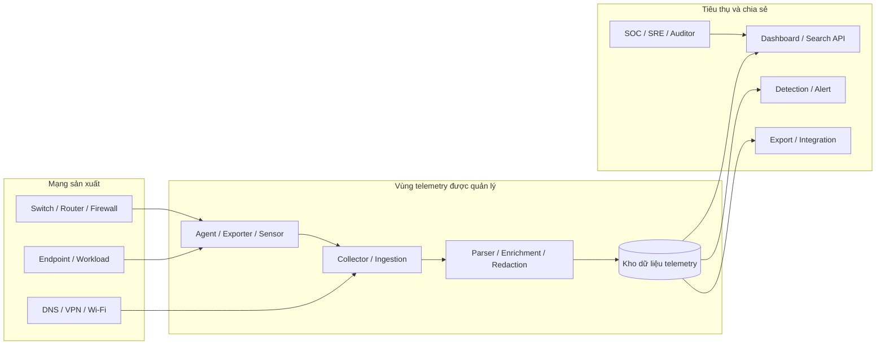

# Network telemetry bị lạm dụng

> **Học phần:** `SECURITY_NETWORK_SECURITY` · **Chương:** Reconnaissance  
> **Trọng tâm:** Nhận diện cách dữ liệu giám sát mạng có thể bị lạm dụng để trinh sát hạ tầng và cách bảo vệ toàn bộ vòng đời telemetry, từ thu thập, truyền tải, lưu trữ, truy vấn đến xuất dữ liệu.

## Mục tiêu học tập

Sau bài này, người học có thể:

1. Giải thích **network telemetry** là gì, khác gì so với packet capture, network logs và kết quả quét chủ động.
2. Xác định những trường thông tin trong NetFlow/IPFIX, DNS, firewall, VPN, Wi-Fi, IDS/IPS và cloud flow logs có thể giúp người không được phép suy ra kiến trúc mạng.
3. Mô hình hóa chuỗi lạm dụng telemetry: lấy quyền đọc, truy vấn/tổng hợp, suy diễn tài sản, phát tán dữ liệu hoặc can thiệp vào tín hiệu giám sát.
4. Đặt ranh giới tin cậy và kiểm soát phù hợp cho sensor, collector, pipeline, storage, dashboard, API và export.
5. Thiết kế cảnh báo dựa trên audit trail, đối chiếu với nhiệm vụ hợp lệ và xử lý sự cố mà không làm lộ thêm dữ liệu nhạy cảm.

## 1. Network telemetry và bề mặt thông tin bị lộ

**Network telemetry** là dữ liệu được thu thập để quan sát hoạt động của mạng và dịch vụ: lưu lượng, sự kiện kết nối, trạng thái thiết bị, hiệu năng, lỗi, thay đổi cấu hình hoặc tín hiệu an ninh. Hệ thống phòng vệ dùng telemetry để phân tích lưu lượng, xây dựng baseline, phát hiện xâm nhập và xử lý sự cố.

Ví dụ, bản ghi flow có thể cho biết máy `10.20.4.17` liên lạc với `10.30.8.12` trên TCP 443 trong một khoảng thời gian, truyền một lượng byte nhất định. Một log DNS có thể cho biết máy trạm đã hỏi `db-int.corp.example`; một log VPN liên kết kết nối với tài khoản và thời điểm. Khi **kết hợp nhiều nguồn**, một người chỉ có quyền đọc log có thể suy đoán hệ thống quan trọng, cách phân đoạn mạng, lịch làm việc và những đường kết nối đang thực sự được sử dụng.

Đây là nghịch lý quan trọng: **cùng một dữ liệu giúp đội an ninh bảo vệ mạng cũng có thể giúp đối tượng trái phép hiểu và lập bản đồ mạng**. Vì vậy, telemetry là **tài sản cần được bảo vệ**; việc cấp quyền truy cập quan sát không nên mặc nhiên rộng hơn nhu cầu công việc.

### Ba cách hiểu cụ thể về “bị lạm dụng”

| Kiểu lạm dụng | Ví dụ | Tác hại chính |
|---|---|---|
| **Đọc hoặc suy diễn trái phép** | Người có tài khoản dashboard chỉ để kiểm tra sự cố của nhóm A xem được mọi log VPN và flow của tổ chức | Lộ topology, danh tính, hệ thống nhạy cảm, hành vi sử dụng |
| **Sử dụng ngoài mục đích đã cho phép** | Tài khoản phân tích xuất dữ liệu DNS và lịch VPN hàng loạt để xây hồ sơ nhân sự, không liên quan nhiệm vụ | Lạm dụng quyền hợp lệ, mất kiểm soát dữ liệu, vi phạm chính sách |
| **Thao túng hoặc phá hỏng telemetry** | Đổi cấu hình collector, làm mất bản ghi, gửi sự kiện giả hoặc làm nhiễu bảng điều khiển | Giám sát sai lệch, che dấu hoạt động, quyết định phản ứng bị ảnh hưởng |

Hai nhóm đầu hỗ trợ **reconnaissance/trinh sát**; nhóm cuối làm giảm **tính toàn vẹn và tính sẵn sàng** của hệ thống giám sát. Một vụ việc có thể đồng thời thuộc nhiều nhóm.

**Phân biệt reconnaissance với scanning:** Trinh sát bằng telemetry có thể hoàn toàn thụ động đối với mạng đích vì dữ liệu đã được collector ghi lại. Nó không đòi hỏi gửi gói tin quét mới. Tuy nhiên, dữ liệu telemetry có thể thiếu hoặc bị lấy mẫu nên các suy luận về topology, port hay dịch vụ phải được kiểm chứng.

## 2. Nguồn telemetry nào có giá trị với người trinh sát?

Không phải mọi hệ thống thu thập cùng một loại dữ liệu. Cần xem cụ thể **trường nào được ghi**, **độ chi tiết**, **thời gian lưu** và **ai được đọc**.

| Nguồn | Trường thường gặp | Điều có thể bị suy ra | Giới hạn cần nhớ |
|---|---|---|---|
| **NetFlow / IPFIX / sFlow** | IP nguồn/đích, port, giao thức, thời gian, số gói/byte, interface; có thể có trường bổ sung | Mối liên hệ giữa subnet, host, đường đi lưu lượng, nhịp hoạt động | Flow không mặc nhiên chứa payload; sFlow thường dùng sampling, không bao quát mọi gói |
| **Firewall, NAT, proxy** | Rule, allow/deny, IP/port, NAT translation, URL/host tùy thiết bị, user nếu tích hợp | Ranh giới phân đoạn, dịch vụ cho phép, đường ra Internet, chính sách truy cập | Log `deny` không chứng minh đích đang chạy dịch vụ; NAT có thể che IP gốc |
| **DNS resolver logs** | Client, QNAME, QTYPE, RCODE, resolver, thời điểm | Tên hệ thống nội bộ, dịch vụ, mẫu truy cập, giai đoạn triển khai | Cache và DoH/DoT có thể khiến sensor mạng không thấy toàn bộ truy vấn |
| **VPN / ZTNA / IdP** | User, thiết bị, IP cấp, giờ đăng nhập, posture, nhóm quyền, thành công/thất bại | Mối quan hệ người dùng–thiết bị–vùng mạng, thời điểm truy cập từ xa | “VPN connected” không chứng minh user có quyền với mọi tài nguyên nội bộ |
| **Wi-Fi controller / RADIUS** | SSID, AP, thời điểm kết nối, tài khoản/thiết bị, roaming, VLAN được cấp | Vị trí tương đối trong phạm vi AP, thiết bị, phân tách khách/nhân viên | Vị trí và định danh có sai số; MAC có thể được random hóa |
| **IDS/IPS, NDR, SIEM alerts** | Rule, severity, host, hướng kết nối, indicator, liên kết sự kiện | Điểm yếu đang bị phát hiện, host bị nghi ngờ, vùng được giám sát | Alert là tín hiệu điều tra, không phải bằng chứng chắc chắn có tấn công |
| **PCAP / SPAN / TAP** | Packet headers, timing, payload nếu có thể quan sát/giải mã | Chi tiết phiên, giao thức, đôi khi thông tin nhạy cảm trong payload | TLS/QUIC mã hóa payload; capture phụ thuộc vị trí sensor và luật truy cập |
| **SNMP / thiết bị mạng** | Interface, link, routing/neighbor metrics, cấu hình một phần tùy quyền | Vai trò switch/router, interface, mạng đang hoạt động | Mức dữ liệu phụ thuộc MIB, phiên bản, view và chính sách SNMP |
| **Cloud VPC/VNet flow logs** | Metadata flow, hướng kết nối, địa chỉ/port, action, interface | Workload, phân đoạn cloud, endpoint truy cập, mẫu east-west | Không chứa payload; trường, sampling và status khác giữa nhà cung cấp |
| **Application trace / service mesh** | Tên dịch vụ, span, route, latency, status, danh tính workload | Quan hệ microservice, endpoint nhạy cảm, dependency | Đây là telemetry ứng dụng liên quan mạng; không phải packet trace thuần túy |

**Ví dụ bản ghi flow giả lập** (địa chỉ chỉ dành cho môi trường minh họa):

```text
start=2026-11-28T02:10:00Z end=2026-11-28T02:10:07Z
src=10.20.4.17:53120 dst=10.30.8.12:443 proto=TCP
packets=28 bytes=18420 action=ALLOW
```

Dữ liệu này cho biết một luồng đến TCP 443 được ghi nhận. Nó **không chứng minh** ứng dụng là HTTPS hợp lệ, user đã được xác thực, lưu lượng chứa gì hoặc server đã xử lý thành công yêu cầu. Khi nối với DNS, service inventory và log ứng dụng, ý nghĩa có thể rõ hơn nhưng cũng tăng nguy cơ lộ thông tin.

### Những trường dữ liệu nên được phân loại nhạy cảm

- **Sơ đồ địa chỉ và danh tính tài sản:** IP nội bộ, subnet, hostname, zone DNS riêng, instance ID, pod/service name, interface và security group.
- **Thông tin liên kết danh tính:** username, nhóm quyền, thiết bị, địa chỉ IP được cấp, thời điểm đăng nhập/roaming, session ID.
- **Metadata hành vi:** domain được hỏi, tần suất truy cập, lượng byte, mốc thời gian, quan hệ giữa ứng dụng và backend.
- **Thông tin cấu hình phòng vệ:** rule ID, policy decision, tên IDS signature, vị trí sensor, đường truy cập quản trị.
- **Payload hoặc dữ liệu ứng dụng vô tình lọt vào log:** URL chứa tham số nhạy cảm, header, cookie, thông tin khách hàng, bí mật trong PCAP.

Một địa chỉ IP riêng lẻ có thể không nhạy cảm bằng **tập dữ liệu tổng hợp lâu dài có thể nối với tài khoản và hệ thống kinh doanh**. Cần đánh giá rủi ro cả ở mức **từng trường** lẫn **khả năng liên kết nhiều nguồn**.

## 3. Pipeline telemetry và những ranh giới tin cậy

Mô hình tổng quát:



Mỗi mũi tên đặt ra ba câu hỏi: **ai gửi/nhận**, **chứng thực và mã hóa như thế nào**, và **quyền được phép sử dụng dữ liệu ra sao**.

| Ranh giới | Rủi ro chính | Phòng vệ trọng tâm |
|---|---|---|
| Sensor/agent → collector | Nguồn gửi giả, nghe lén, mất bản ghi hoặc tạo dữ liệu sai | Xác thực exporter/collector, kênh bảo mật khi hỗ trợ, allowlist nguồn, quản lý agent |
| Collector → parser/enricher | Chuỗi log không tin cậy, schema thay đổi, trường chứa secret | Validation schema, xử lý an toàn, loại bỏ/che dữ liệu, provenance |
| Parser → storage | Phân quyền ghi quá rộng, dữ liệu nhạy cảm lưu quá lâu | Phân tách writer/reader, mã hóa lưu trữ, retention, phân loại dữ liệu |
| Storage → dashboard/search API | Tài khoản đọc vượt phạm vi, truy vấn xuyên tenant/vùng, chia sẻ dashboard | SSO, RBAC/ABAC, lọc theo tenant, row/field-level access, audit truy vấn |
| Storage → export/integration | Bulk export, sao chép dữ liệu ra đối tác hoặc bucket sai | Quyền export riêng, giới hạn dữ liệu, phê duyệt, ghi log, quản lý đích |
| Operator → control plane | Tắt collector, đổi retention, xóa log hoặc thêm nguồn giả | Tách quyền vận hành với quyền xóa, MFA, change control, audit bất biến phù hợp |

**Không xem mạng quản trị là tuyệt đối tin cậy.** Đường kết nối từ collector tới backend và từ người dùng tới dashboard vẫn cần kiểm soát danh tính, quyền, tính toàn vẹn và khả năng truy vết. Tư duy này phù hợp với kiến trúc zero trust và segmentation trong học phần.

## 4. Các cách telemetry có thể hỗ trợ reconnaissance

### 4.1 Lập bản đồ tài sản và phân đoạn

Dữ liệu flow, DNS và firewall cho thấy IP/subnet nào thường liên lạc với nhau, cổng nào xuất hiện và luồng nào được cho phép hoặc từ chối. Kết hợp thời điểm, tên dịch vụ và inventory có thể gợi ý đường đi từ tầng ứng dụng đến cơ sở dữ liệu hoặc các endpoint quản trị.

Đây là suy diễn từ **lưu lượng quan sát được**, không đồng nghĩa có toàn bộ topology vật lý hay toàn bộ ACL. Một hệ thống im lặng trong kỳ quan sát có thể vẫn tồn tại; NAT, load balancer, sampling, cache và traffic được mã hóa làm tăng bất định.

### 4.2 Hiểu lịch vận hành và ưu tiên mục tiêu

Biểu đồ kết nối theo thời gian có thể gợi ý batch job, kỳ sao lưu, cửa sổ bảo trì, nhịp triển khai hoặc thời điểm đội vận hành truy cập máy quản trị. Kẻ lạm dụng dữ liệu có thể ưu tiên nghiên cứu những hệ thống xuất hiện nhiều trong luồng quan trọng.

Ví dụ, nếu service A gần như luôn gọi service B ngay sau khi nhận sự kiện đăng nhập, người xem trái phép có thể suy ra B tham gia xử lý danh tính. Đó chỉ là **giả thuyết**: để xác nhận chức năng cần tài liệu kiến trúc và bằng chứng khác.

### 4.3 Liên kết người dùng, thiết bị và dịch vụ

Log VPN có thể ghép user với IP phiên; DNS log ghép IP với hostname được hỏi; flow log ghép IP với endpoint truy cập. Nếu ai đó được phép đọc cả ba nguồn mà không có rào cản, họ có thể xây hồ sơ truy cập chi tiết hơn quyền hạn nhiệm vụ cho phép.

Nhận diện tài khoản/thói quen truy cập liên quan đến **dữ liệu cá nhân**. Cần dùng kiểm soát theo mục đích, phạm vi và thời gian lưu, tránh dùng telemetry để theo dõi cá nhân ngoài chính sách.

### 4.4 Tận dụng dashboard, API, report hoặc bản export có quyền quá rộng

Một tài khoản đọc phục vụ dashboard tổng hợp có thể được cấp thêm quyền tìm kiếm raw logs hoặc tải PCAP toàn mạng. Các đường như saved search được chia sẻ công khai, API token dùng chung, bucket export sai quyền hoặc account nhà cung cấp tích hợp quá rộng làm tăng khả năng lộ dữ liệu.

**Quyền `read` không đồng nghĩa tác động thấp** nếu dữ liệu đọc chứa danh sách tài sản, chi tiết cấu hình, danh tính và lịch vận hành. Bulk export làm tăng quy mô và thời gian tồn tại của dữ liệu ngoài phạm vi kiểm soát ban đầu.

### 4.5 Lạm dụng hệ thống thu thập để suy giảm giám sát

Đối tượng có quyền sửa pipeline có thể cố tình gây thiếu dữ liệu, làm đầy hàng đợi, thay nhãn asset, bỏ qua trường nhận dạng hoặc thay đổi bộ lọc. Thông tin tổng hợp sau đó có thể che đi luồng bất thường hoặc đánh lạc hướng việc điều tra.

Ví dụ, có một lượng alert giảm đột ngột **không tự chứng minh hệ thống an toàn hơn**: cần kiểm tra độ phủ collector, ingestion lag, thay đổi parser, nguồn telemetry hoạt động và chính sách lưu trữ.

### 4.6 Biến telemetry collector thành một phần của bề mặt tấn công

Collector/agent thường có vị trí mạng tốt, được thiết bị tin cậy và có quyền đọc dữ liệu. Nếu service này bị cấu hình sai hoặc có quyền quản trị quá rộng, tác động có thể lan từ **mất dữ liệu quan sát** sang **sửa cấu hình** hoặc **lạm dụng danh tính dịch vụ**.

Giảm rủi ro bằng tài khoản riêng cho collector, chế độ **read-only** khi nhiệm vụ cho phép, tách control plane và data plane, vá phần mềm, hạn chế outbound, không để secret thừa trong agent và giám sát mọi thay đổi.

## 5. Threat model: ai có thể làm gì với telemetry?

Xác định rõ **threat actor**, **quyền khởi đầu**, **hành động**, **tài sản**, **ranh giới** và **tác động**. Các tác nhân thường gặp:

- **Người ngoài chưa xác thực:** cố truy cập dashboard hoặc đường export lộ ra Internet.
- **Người dùng nội bộ có quyền thấp:** nhìn được dashboard của nhóm mình nhưng không được xem tài sản, danh tính hoặc bản ghi thô của nhóm khác.
- **Tài khoản SOC/SRE hoặc integration bị lộ:** có quyền tìm kiếm, xuất hoặc chuyển dữ liệu trong phạm vi rộng.
- **Nhà cung cấp tích hợp:** được cấp kết nối theo hợp đồng nhưng quyền dịch vụ hoặc lưu trữ kéo dài quá nhu cầu.
- **Tác nhân đã chiếm một workload:** có thể sử dụng service identity của workload để đọc/ghi telemetry nếu IAM/RBAC sai.

### Áp dụng STRIDE

| STRIDE | Mối đe dọa trong telemetry | Ví dụ tác động |
|---|---|---|
| **S — Spoofing** | Exporter giả hoặc tài khoản dashboard bị chiếm | Dữ liệu sai nguồn; truy vấn dưới danh tính người khác |
| **T — Tampering** | Sửa parser, rule enrichment, cấu hình sensor, bản ghi hoặc alert | Suy lệch kết luận phân tích; che dấu dấu hiệu |
| **R — Repudiation** | Không có audit về ai xem/export/chỉnh pipeline | Khó truy vết lạm dụng quyền hoặc dữ liệu bị xuất |
| **I — Information disclosure** | Lộ log DNS/VPN/PCAP/topology hoặc truy vấn xuyên tenant | Hỗ trợ reconnaissance, lộ thông tin cá nhân và tài sản |
| **D — Denial of service** | Làm quá tải ingestion/search, gây rớt log hoặc ngừng alert | Mất khả năng phát hiện và điều tra |
| **E — Elevation of privilege** | Tài khoản xem dashboard được phép thay policy, hoặc integration dùng token quản trị quá rộng | Điều khiển pipeline, đọc thêm nguồn, cấp quyền mới |

Một kịch bản có thể có nhiều nhóm STRIDE. **Lộ thông tin** chưa tự là **leo thang quyền**; chỉ ghi EoP nếu tác nhân thực sự đạt năng lực cao hơn chính sách đã cấp.

### Threat statement mẫu

> Một tài khoản phân tích chỉ được phép xem chỉ số tổng hợp của nhóm A có thể dùng Search API để đọc log DNS/VPN của mọi nhóm vì quyền tìm kiếm không giới hạn theo tenant. Dữ liệu trả về cho phép liên kết user, host và lịch kết nối ngoài mục đích được cấp. Biện pháp là thực thi quyền theo tenant và trường dữ liệu ngay tại API/storage, tách quyền export và giám sát truy vấn vượt phạm vi.

Tuyên bố trên xác định **ai**, **đường đi**, **kiểm soát thiếu**, **dữ liệu bị lộ** và **điểm thực thi**. Nhờ vậy có thể biến nó thành yêu cầu kỹ thuật và test.

## 6. Xếp hạng rủi ro theo ngữ cảnh

Không nên coi mọi dashboard như nhau. Mức rủi ro phụ thuộc độ chi tiết, phạm vi dữ liệu, khả năng liên kết, quyền export và tác động kinh doanh.

Để thảo luận, có thể chấm **Likelihood (1–5)** và **Impact (1–5)** rồi lấy tích làm **điểm ưu tiên minh họa**. Đây không phải thang chuẩn hay phép đo tuyệt đối.

| Tình huống | Likelihood | Impact | Điểm minh họa | Lý do |
|---|---:|---:|---:|---|
| Raw log VPN+DNS toàn công ty cho nhóm phân tích rộng | 4 | 4 | **16** | Dễ nối người dùng–máy–dịch vụ; phạm vi dữ liệu lớn |
| Chỉ số tổng hợp, không có tên/IP gốc, theo từng tenant | 2 | 2 | **4** | Độ chi tiết và phạm vi bị giới hạn |
| PCAP chứa payload được truy cập qua export không kiểm soát | 3 | 5 | **15** | Có thể chứa dữ liệu mật; tác động lớn |
| Collector có quyền thay network config nhưng chỉ cần đọc metrics | 3 | 5 | **15** | Tài khoản dịch vụ thừa quyền trên hạ tầng |

Khi xếp hạng thực tế, hỏi: dữ liệu có mã hóa không; có trường nhạy cảm không; người nào đã được cấp quyền; có truy cập đa tenant không; query và export có audit không; dữ liệu sẽ được sao chép đi đâu; thời gian lưu bao lâu; và các kiểm soát hiện tại có được kiểm tra định kỳ hay không.

## 7. Biện pháp bảo vệ theo từng lớp

### 7.1 Thu thập đủ dùng, giảm dữ liệu nhạy cảm

- Xác định **mục đích** của từng nguồn: phát hiện DDoS, chẩn đoán VPN, điều tra truy cập, theo dõi hiệu năng hay audit quản trị.
- Chỉ thu các trường và mức chi tiết cần thiết. Chẳng hạn dashboard hiệu năng phổ thông có thể dùng số liệu tổng hợp thay vì raw flow gắn với user.
- Tránh ghi token, cookie, password, tham số URL nhạy cảm hoặc payload cá nhân nếu không có nhu cầu và cơ sở phù hợp.
- Che/mask/pseudonymize các trường định danh khi nghiệp vụ cho phép; giữ ánh xạ giải mã ở nơi bảo vệ riêng.
- Tách raw PCAP và log có định danh khỏi dashboard chỉ cần biểu đồ tổng hợp.

**Ẩn danh và pseudonymization khác nhau:** băm IP hoặc username bằng một hàm cố định thường vẫn có thể bị dò hoặc liên kết theo thời gian. Biện pháp bảo vệ phải xét khả năng tái định danh qua dữ liệu khác và ai được giữ khóa/ánh xạ.

### 7.2 Bảo mật exporter, agent và kênh truyền

- Dùng cơ chế xác thực và bảo vệ kênh do sản phẩm/giao thức hỗ trợ; segment collector trong vùng quản lý riêng.
- NetFlow/IPFIX qua UDP trong một số triển khai **không mặc nhiên có xác thực hoặc mã hóa đầu cuối**. Đừng giả định flow record nhận được luôn đúng nguồn; dùng mạng quản lý tin cậy, ACL và tùy chọn bảo vệ transport nếu có.
- Với SNMP, ưu tiên **SNMPv3 authPriv** nếu được hỗ trợ, hạn chế MIB/view và quyền quản trị; các community string của mô hình cũ không cung cấp bảo vệ tương đương.
- Quản lý phiên bản agent/collector, quyền OS và bí mật kết nối; tách quyền đọc chỉ số khỏi quyền thay đổi thiết bị.
- Theo dõi trạng thái collector: nguồn mất dữ liệu, độ trễ ingestion, packet drops, thay đổi schema và lỗi parse.

### 7.3 Kiểm soát danh tính và truy vấn

**Phân quyền theo vai trò (RBAC)** kết hợp **theo thuộc tính (ABAC)** phù hợp với nguồn telemetry nhiều nhóm/vùng:

| Vai trò mẫu | Được đọc | Không mặc nhiên được làm |
|---|---|---|
| NOC vận hành mạng | Metrics/flow tổng hợp của hệ thống phụ trách | Xem username/PCAP toàn tổ chức; tải raw dữ liệu |
| SOC analyst | Sự kiện an ninh trong phạm vi được giao | Xóa log, tắt collector, tự cấp thêm quyền |
| Incident responder | Raw telemetry có liên quan một vụ việc đã được phê duyệt | Bulk export không thời hạn hoặc ngoài phạm vi vụ việc |
| Pipeline operator | Sức khỏe collector/parser, quản lý cấu hình có kiểm soát | Đọc tất cả dữ liệu cá nhân nếu không cần |
| Audit/compliance | Bằng chứng thay đổi quyền, truy cập và export | Sửa/xóa dữ liệu chứng cứ |
| Service integration | API/data tối thiểu theo contract và tenant | Truy vấn tự do mọi nguồn hoặc mở rộng quyền |

Áp dụng SSO, MFA với vai trò nhạy cảm, token audience/scope hẹp và thời hạn phù hợp. Đặt chính sách tại **search API/storage**; chỉ ẩn nút “Export” trên giao diện người dùng là chưa đủ. Giới hạn tenant, index, dataset, field, time range và quyền tạo saved query, bulk export.

### 7.4 Mã hóa, lưu trữ, retention và chuỗi chứng cứ

Mã hóa dữ liệu khi truyền và khi lưu, kiểm soát khóa, tách backup và quyền xóa. Lưu dữ liệu theo thời gian phục vụ nhu cầu điều tra/chính sách; hết hạn thì xóa có kiểm soát. Có thể dùng kho lưu chống sửa đổi với chính sách phù hợp cho các audit log trọng yếu, nhưng **immutability không thay thế phân quyền đọc**.

Khi xuất dữ liệu phục vụ điều tra, lưu thông tin **ai tạo bản export, vì sao, phạm vi, thời hạn, nơi đến, checksum, quyền truy cập và thời điểm xóa**. Không phát tán raw PCAP hoặc dữ liệu người dùng chỉ vì “giúp debug nhanh”. Tránh log chứa bí mật đăng nhập.

### 7.5 Tách mạng và quản trị pipeline

Cho sensor chỉ gửi đến collector được duyệt; collector chỉ gửi vào pipeline/storage cần thiết; dashboard chỉ có API cần dùng; hệ thống quản trị collector nằm trong mặt phẳng quản trị được bảo vệ. Đây là thực hành segmentation và least privilege: **quyền truy cập mạng** và **quyền đọc/sửa dữ liệu** được thực thi độc lập.

Với cloud, kiểm tra cả IAM của bucket/lake/stream, private endpoint, security group, logging control plane và quyền của các workload tạo/chuyển log. Một object storage bucket chứa flow logs có thể bị lộ qua policy sai ngay cả khi dashboard SIEM được bảo vệ tốt.

## 8. Phát hiện hành vi lạm dụng telemetry

Phải giám sát **hệ thống giám sát**. Hệ thống audit cho dashboard và pipeline nên ghi:

- **Actor:** tài khoản người dùng hoặc service identity, vai trò và tenant.
- **Action:** xem, tìm kiếm, đổi quyền, tạo saved search, export, đổi retention, bật/tắt nguồn, sửa parser.
- **Scope:** dataset, tenant, time range, số bản ghi, số byte được truy cập, độ nhạy/nhóm trường khi có thể.
- **Outcome:** allow/deny, request/correlation ID, mốc thời gian, địa chỉ hoặc thiết bị nguồn đủ phục vụ điều tra.
- **Context:** ticket/vụ việc liên quan, sự chấp thuận cho quyền nâng cao, đích export và thay đổi cấu hình.

Không ghi chính các secret hoặc query chứa payload nhạy cảm vào audit trail nếu có cách ghi **metadata query** đủ phục vụ kiểm soát. Audit phải được bảo vệ độc lập với tài khoản điều khiển pipeline đang được điều tra.

### Tín hiệu giám sát hữu ích

| Tín hiệu | Ý nghĩa có thể có | Bằng chứng cần đối chiếu |
|---|---|---|
| Tài khoản xem nhiều tenant/dataset lần đầu | Mở rộng trinh sát ngoài trách nhiệm | Vai trò, ticket, lịch on-call, thay đổi phân quyền |
| Xuất dữ liệu lớn, phạm vi thời gian rất dài hoặc lặp lại | Thu thập hàng loạt | Số bản ghi/byte, đích export, phê duyệt, nhiệm vụ hiện tại |
| Analyst chỉ chuyên về hiệu năng truy vấn raw VPN/DNS/PCAP | Vượt phạm vi nghiệp vụ | Yêu cầu điều tra được giao, nguồn và trường được truy cập |
| New API token, quyền search/export được mở rộng | Tài khoản hoặc integration thay đổi quyền | Sự kiện IAM, quy trình phê duyệt, người thực hiện |
| Collector mất dữ liệu, ingest lag tăng, parser đổi đột ngột | Hỏng hoặc bị thao túng telemetry | Healthcheck, config diff, deployment, lưu lượng sensor thực |
| Truy cập dashboard từ thiết bị/địa điểm/giờ khác thường | Tài khoản có thể bị sử dụng sai | IdP/VPN, MFA, thiết bị, thay ca trực |
| Export tới bucket/integration mới | Dữ liệu có thể ra ngoài vùng kiểm soát | Danh sách đích được phép, IAM storage, data classification |

Các tín hiệu này có **false positive**. Một nhân sự trực sự cố có thể cần đọc nhiều nguồn và export dữ liệu lớn hợp lệ. Hãy dùng baseline theo vai trò, loại vụ việc, thời điểm, lịch trực và quyền được phê duyệt; cảnh báo là để **xác minh**, không kết luận vi phạm ngay.

### Ví dụ logic phát hiện (mã giả)

```text
INPUT: telemetry_access_audit

FOR EACH (actor, window = 1 hour):
    count distinct datasets
    count distinct tenants
    sum exported_bytes
    detect first_seen_scope(actor)
    detect new_export_destination(actor)
    join approved_roles, tickets, change_log

    IF cross_tenant_read_without_approval
       OR export_outside_authorized_scope
       OR high_volume_export_and_new_destination
    THEN create_review_alert(actor, evidence_summary)

NOTE:
    Các ngưỡng high_volume phụ thuộc baseline theo vai trò.
    Không đưa raw log hoặc dữ liệu cá nhân vào thông báo rộng rãi.
```

Bộ phát hiện nên có cơ chế mở case, ghi nhận quyết định và phản hồi để giảm cảnh báo nhiễu. Kiểm tra khả năng hoạt động của chính bộ phát hiện khi nguồn log bị tắt hoặc ingest bị gián đoạn.

## 9. Tình huống thực tế: quyền đọc log rộng hơn nhu cầu

**Bối cảnh giả lập:** Doanh nghiệp dùng nền tảng quan sát chung cho mạng nội bộ và cloud. Nhóm NOC cần xem độ trễ, số luồng, tỷ lệ lỗi của ứng dụng. Tài khoản `noc-viewer` lại có quyền truy cập raw index DNS, VPN và cloud flow logs từ mọi đơn vị. Search API cho phép export qua token của tài khoản; export không yêu cầu khai báo mục đích.

**Chuỗi sự kiện minh họa:**

1. Một người đăng nhập hợp lệ với vai trò `noc-viewer`.
2. Tài khoản đọc được các truy vấn DNS nội bộ và log VPN nằm ngoài đội phụ trách.
3. Từ những trường được đọc, người đó có thể liên kết một số hostname, IP và thời điểm người dùng truy cập, qua đó có nguy cơ lập bản đồ hoạt động hạ tầng.
4. Tài khoản tạo bản export chứa raw record ở phạm vi lớn; audit hiện tại chỉ ghi “Login success”, không ghi search scope hay export destination.

**Nhận định:** Đây là **lạm dụng quyền truy cập telemetry**, tiềm ẩn **information disclosure** và reconnaissance. Chưa có bằng chứng tài khoản đã chiếm quyền admin, thay đổi mạng hay kiểm soát máy chủ. Không nên gộp mọi bước trong kịch bản thành EoP.

### Ma trận quyền trước và sau khắc phục

| Hành động | Trước | Sau |
|---|---|---|
| Xem metrics tổng hợp của ứng dụng thuộc nhóm | Cho phép | Cho phép |
| Đọc raw DNS/VPN của mọi nhóm | Cho phép ngoài nhu cầu | Chỉ cho vai trò và phạm vi được duyệt |
| Xem tài sản khác tenant | Không có kiểm tra tại API | Từ chối theo tenant/resource |
| Bulk export | Có thể dùng quyền đọc mặc định | Quyền riêng, có audit và giới hạn phạm vi |
| Đổi parser/collector | Tùy role chung | Role vận hành riêng, MFA/change control |
| Tra cứu ai đã truy cập dữ liệu | Chỉ có login log | Audit search/export theo actor, scope và đích |

### Phân tích trong một vụ việc thật

Thực hiện theo quyền và quy trình của tổ chức:

1. **Bảo toàn bằng chứng:** audit đăng nhập, quyền tài khoản, yêu cầu Search API, metadata export, object storage access, lịch cấp quyền và ticket liên quan.
2. **Xác định phạm vi:** dataset và tenant đã truy vấn, thời gian, số bản ghi, trường nhạy cảm, nơi bản export được lưu và ai có thể truy cập.
3. **Kiểm chứng mục đích:** đối chiếu nhiệm vụ/vụ việc; phân biệt hành vi phân tích hợp lệ với mở rộng phạm vi không được phép.
4. **Ngăn rủi ro tiếp diễn:** thu hẹp role, thu hồi token/export không cần, bảo vệ bản sao, khắc phục policy tại API/storage và tăng audit.
5. **Đánh giá tác động:** dữ liệu nào có thể bị lộ và có thể liên kết với danh tính hay hệ thống quan trọng không; xử lý theo chính sách bảo mật và quyền riêng tư.
6. **Xác minh sau khắc phục:** tái chạy kiểm thử với account có quyền thấp; đọc dữ liệu đúng nhóm thành công, truy cập ngoài nhóm và bulk export trái phép bị từ chối, có log quyết định.

## 10. Kiểm thử phủ định: bảo vệ telemetry khỏi reconnaissance trái phép

Các kiểm thử dưới đây dành cho môi trường **lab hoặc hệ thống được phép kiểm tra**, dùng dữ liệu nhân tạo. Không cần gửi lưu lượng quét vào môi trường bên ngoài.

### Kịch bản A — Cô lập tenant tại Search API

```gherkin
Feature: Telemetry access is limited by tenant
  Scenario: Analyst attempts to read another tenant's flow logs
    Given analyst_A belongs only to tenant_A
    And flow log records exist for tenant_A and tenant_B
    When analyst_A searches flow records scoped to tenant_B
    Then the search is denied or returns no unauthorized records
    And no tenant_B data is exported
    And the access decision is recorded in audit
```

Đừng chỉ kiểm tra giao diện. Thử cả **API** theo đường ứng dụng hợp lệ của người dùng thử nghiệm để bảo đảm phân quyền thực thi ở server, kể cả saved search và export.

### Kịch bản B — Quyền export tách khỏi quyền xem

```gherkin
Scenario: Read-only dashboard user cannot perform bulk export
  Given noc_viewer can read approved aggregated metrics
  And noc_viewer has no raw export permission
  When noc_viewer requests export of raw VPN records
  Then the export is denied
  And no downloadable artifact is created
  And an authorization event is recorded
```

### Kịch bản C — Quyền điều hành pipeline được tách biệt

```gherkin
Scenario: Analyst cannot disable a telemetry collector
  Given soc_analyst has permission to search security events
  And soc_analyst has no collector administration permission
  When soc_analyst requests to disable a collector
  Then the configuration change is denied
  And telemetry collection remains enabled
  And the denial is recorded in protected audit logs
```

**Điều kiện đạt:** Không chỉ dựa vào mã HTTP như `403`; kiểm tra cả **trạng thái hệ thống không đổi**, không phát sinh export, không lọt bản ghi của tenant khác và audit trail đủ để truy vết. Nếu API sử dụng `404` để che giấu tài nguyên, tiêu chí vẫn là không trả dữ liệu trái quyền.

## 11. Checklist triển khai cho SOC, NOC và cloud

1. **Inventory:** Liệt kê sensor, exporter, collector, dataset, dashboard, integration, kho export, chủ sở hữu và mục đích.
2. **Data classification:** Gắn mức nhạy cảm theo trường và khả năng liên kết; đặc biệt xem DNS, VPN, identity, PCAP, secret trong URL/header.
3. **Least privilege:** Tách quyền xem biểu đồ, raw search, cross-tenant search, export, thay retention và quản trị collector.
4. **Trust boundary:** Xác thực và bảo vệ các kênh cần thiết; segment pipeline, storage và dashboard; kiểm soát endpoint truy cập bên ngoài.
5. **Data minimization:** Giảm mức chi tiết, mask hoặc tổng hợp dữ liệu ở bước hợp lý; tránh ghi secret vào telemetry.
6. **Retention và export:** Xác định thời gian lưu, quyền tạo bản sao, đích hợp lệ và quy trình xóa; giữ audit các lần export nhạy cảm.
7. **Integrity và availability:** Theo dõi sensor health, ingest lag, drops, thay đổi cấu hình, parser, quyền xóa; bảo vệ log audit độc lập.
8. **Detection:** Đặt baseline theo vai trò, ticket, tenant và dữ liệu; giám sát truy vấn rộng, hành vi export và thay đổi quyền.
9. **Validation:** Kiểm thử thường kỳ account quyền thấp, API trực tiếp, cross-tenant access và quyền điều hành pipeline.
10. **Incident readiness:** Có quy trình giữ bằng chứng, thu hồi token, xác định phạm vi và đánh giá tác động quyền riêng tư.

## 12. Những hiểu nhầm thường gặp

**“Chỉ là metadata, không thể chứa thông tin nhạy cảm.”** Sai. Metadata DNS/VPN/flow có thể suy ra tài sản quan trọng, hành vi truy cập và liên kết người–thiết bị–dịch vụ, nhất là khi tổng hợp dài hạn.

**“Chỉ có quyền read nên không ảnh hưởng bảo mật.”** Sai. Quyền đọc raw log hoặc PCAP phạm vi rộng có thể làm lộ sơ đồ mạng và nội dung nhạy cảm; quyền export có thể biến lộ cục bộ thành thất thoát dữ liệu lâu dài.

**“Đã bật TLS là không cần bảo vệ telemetry.”** TLS che nội dung ứng dụng trên đường truyền, nhưng tên endpoint, địa chỉ, thời gian, độ lớn kết nối và log ở endpoint vẫn có thể quan sát được. Hệ thống có quyền giải mã hoặc capture ở điểm cuối có thể có thêm dữ liệu.

**“Có firewall cho phép collector là dữ liệu collector gửi luôn đúng.”** Không. Cần xác thực nguồn, kiểm soát quyền agent, kiểm tra chất lượng, phát hiện dữ liệu giả, mất gói hoặc thay đổi pipeline.

**“IDS/IPS đã ghi log thì chắc chắn phát hiện truy cập dashboard sai phạm.”** Chưa chắc. Hành vi đọc dữ liệu qua HTTPS và tài khoản hợp lệ có thể không tạo signature mạng rõ ràng. Audit của Search API, storage, IAM và export rất quan trọng.

**“Không thấy flow nghĩa là không có kết nối.”** Không chắc. Sampling, vị trí sensor, chính sách log, cache, mất gói và retention đều có thể tạo khoảng trống. Phân biệt **không quan sát được** với **không tồn tại**.

## 13. Bài tập áp dụng và lời giải

**Đề bài:** Một môi trường hybrid cloud có mạng văn phòng, Wi-Fi khách, VPN, nhiều VPC/VNet và SIEM tập trung. Dữ liệu gồm flow logs, DNS, VPN, firewall, Wi-Fi controller và một số PCAP phục vụ xử lý sự cố. Nhóm vận hành cần biểu đồ lưu lượng; nhóm SOC cần truy vấn an ninh; nhà cung cấp hỗ trợ chỉ cần số liệu hiệu năng của một ứng dụng. Hiện ba nhóm cùng sử dụng role `telemetry-reader`, có thể tìm kiếm toàn bộ index và tải dữ liệu.

**Câu hỏi:**

1. Nêu ba loại dữ liệu có thể giúp lập bản đồ mạng hoặc lịch hoạt động.
2. Cho biết ba trust boundary của pipeline và rủi ro ở mỗi boundary.
3. Đề xuất ít nhất bốn điều chỉnh quyền/quy trình để giảm reconnaissance trái phép.
4. Nếu phát hiện một export lớn trong giờ trực sự cố, cần kiểm chứng gì trước khi kết luận lạm dụng?
5. Thiết kế hai kiểm thử phủ định xác minh quyền đã được thu hẹp.

### Gợi ý lời giải

**(1)** Flow log tiết lộ IP/subnet và luồng thường xuyên; DNS log có thể lộ tên dịch vụ nội bộ; VPN/Wi-Fi log gợi ý thiết bị/người dùng và thời gian; PCAP có thể lộ nhiều hơn nếu capture được nội dung không mã hóa.

**(2)** Sensor → collector: nguồn giả hoặc gói tin thất lạc; collector → storage: xử lý sai/ghi dữ liệu nhạy cảm quá rộng; storage → Search API/export: truy vấn trái tenant hoặc copy raw dữ liệu ngoài quyền. Mỗi boundary cần cơ chế xác thực/kiểm soát phù hợp, không chỉ một firewall.

**(3)** Tách vai trò NOC dashboard, SOC raw search và nhà cung cấp theo tenant; kiểm soát row/field-level tại API/storage; cấp quyền export riêng với audit và giới hạn; mask dữ liệu định danh cho biểu đồ; thời hạn token và quyền hỗ trợ theo yêu cầu; giữ log truy vấn và thay đổi quyền.

**(4)** Xem incident/ticket, người thực hiện, phạm vi dữ liệu, quyền được cấp, thời điểm, số lượng, đích lưu export, lịch trực và yêu cầu nghiệp vụ. Quy mô lớn là tín hiệu cần rà soát, chưa đủ khẳng định vi phạm.

**(5)** Tài khoản nhà cung cấp không đọc được raw DNS/VPN của mạng khác; tài khoản NOC xem được metrics được cấp nhưng không thể export PCAP. Kiểm tra server response, dữ liệu thực tế, việc có tạo artifact hay không và audit event.

## Tổng kết

Telemetry là nền tảng của **phân tích lưu lượng, giám sát xâm nhập, bảo vệ DNS, firewall, VPN, Wi-Fi và hạ tầng đám mây**. Chính dữ liệu ấy có thể bị lạm dụng để trinh sát tài sản, quan hệ dịch vụ, phân đoạn mạng hoặc hành vi người dùng. Cần bảo vệ telemetry như một tài sản nhạy cảm: **thu thập có mục đích, giảm dữ liệu dư thừa, xác thực đường truyền và danh tính, phân quyền đọc/query/export, giám sát việc sử dụng và bảo vệ tính toàn vẹn của pipeline**. Mô hình hóa rủi ro theo ranh giới tin cậy giúp duy trì khả năng phát hiện sự cố mà không tạo thêm nguồn lộ thông tin.

**Tài liệu đọc thêm:** RFC 7011 (*Specification of the IP Flow Information Export (IPFIX) Protocol*), RFC 5424 (*The Syslog Protocol*), RFC 3411 (*SNMP Management Frameworks*); NIST SP 800-92 (*Guide to Computer Security Log Management*), NIST SP 800-207 (*Zero Trust Architecture*); OWASP *Logging Cheat Sheet*. Tính năng và trường dữ liệu thực tế phải đối chiếu với thiết bị, collector, nhà cung cấp cloud và chính sách tổ chức.
