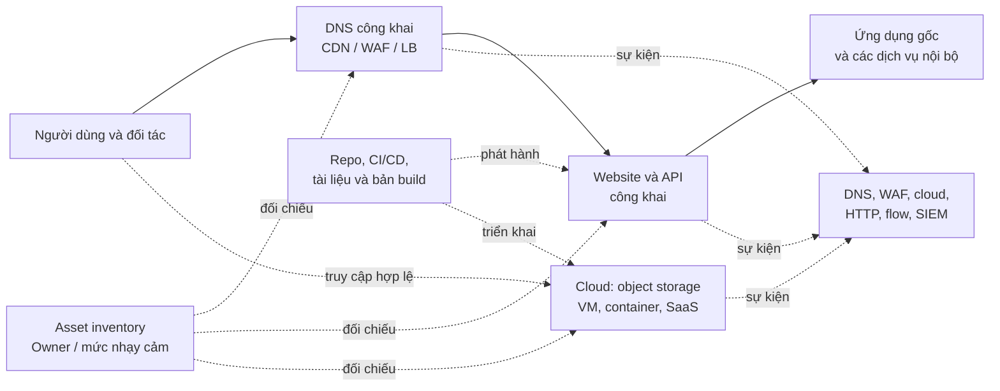
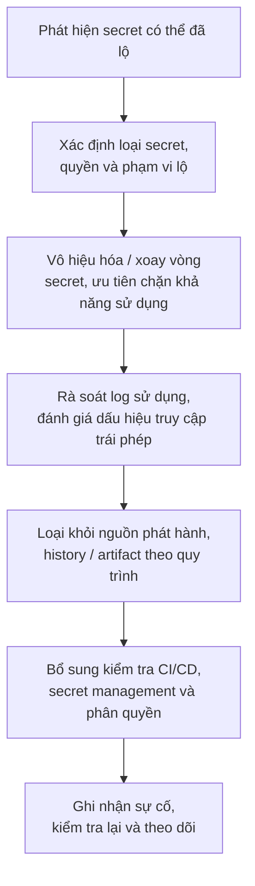
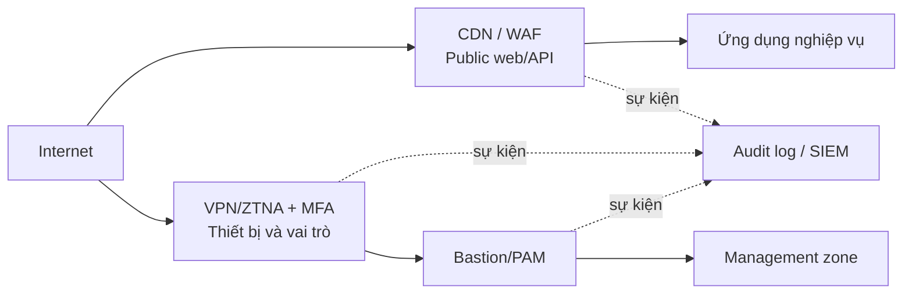

# Giảm thông tin lộ ra ngoài trong giai đoạn Reconnaissance

Trước khi tìm cách xâm nhập một hệ thống, đối tượng tấn công thường tiến hành **reconnaissance** (*trinh sát/thu thập thông tin*) để nhận biết doanh nghiệp sử dụng tên miền nào, dịch vụ nào mở ra Internet, phần mềm có thể thuộc phiên bản gì, ai là người quản trị và tài nguyên nào có dấu hiệu cấu hình thiếu an toàn. Nhiều dữ liệu được tổng hợp từ các nguồn công khai mà không cần gửi lưu lượng đến hệ thống đích. Vì vậy, giảm thông tin lộ ra ngoài là một phần thiết yếu của **quản lý bề mặt tấn công bên ngoài** (*External Attack Surface Management – EASM*).

Mục tiêu không phải làm hệ thống “vô hình”: tên miền, địa chỉ kết nối và nhiều siêu dữ liệu cần được công bố để dịch vụ hoạt động. Mục tiêu đúng là **chỉ công bố những gì có mục đích nghiệp vụ**, giảm thông tin giúp suy luận về nội bộ, hạn chế truy cập trái phép đến tài nguyên và phát hiện sớm khi có dữ liệu nhạy cảm bị lộ.

Trong mô-đun **Network Security**, chủ đề này liên kết trực tiếp với phân đoạn mạng, firewall/ACL, VPN, bảo vệ DNS, Wi-Fi, hạ tầng cloud, IDS/IPS và threat modeling. Một firewall tốt không sửa được bí mật đã bị đưa vào kho mã nguồn công khai; ngược lại, che tên công nghệ trong HTTP header cũng không thể bù cho một cổng quản trị mở không xác thực. Cần đặt việc giảm lộ lọt thông tin trong kiến trúc phòng vệ nhiều lớp.

## 1. Hiểu đúng thông tin bị lộ trong reconnaissance

### 1.1. Reconnaissance thụ động và chủ động

| Hình thức | Đặc điểm | Ví dụ nguồn thông tin | Khả năng phát hiện từ hệ thống của mình |
| --- | --- | --- | --- |
| **Thụ động (passive)** | Thu thập từ dữ liệu công khai hoặc bên thứ ba, thường không gửi truy vấn trực tiếp đến dịch vụ của tổ chức | Trang web công khai, tài liệu, hồ sơ mã nguồn, dữ liệu đăng ký tên miền, Certificate Transparency, công cụ tìm kiếm | Khó quan sát trực tiếp; thường cần tự giám sát nguồn công khai |
| **Chủ động (active)** | Tương tác trực tiếp với tài sản mục tiêu để hỏi trạng thái hoặc đặc tính | Truy vấn DNS đến authoritative resolver, yêu cầu HTTP, kiểm tra cổng và dịch vụ trong phạm vi cho phép | Có thể xuất hiện trong DNS, WAF, firewall, web hoặc flow log; không phải mọi phép dò đều được ghi nhận |

**Thụ động không đồng nghĩa vô hại**: tài liệu công khai có thể vô tình chứa khóa API hoặc sơ đồ mạng nội bộ. **Chủ động không đồng nghĩa tấn công**: đội vận hành cũng cần kiểm kê dịch vụ và đo mức lộ diện một cách hợp pháp, có phạm vi và giới hạn tác động rõ ràng.

### 1.2. Phân loại theo mức độ cần thiết và tác động

| Nhóm thông tin | Ví dụ | Xử lý phù hợp |
| --- | --- | --- |
| **Bắt buộc công khai** | Tên miền phục vụ khách hàng, bản ghi DNS cần để định tuyến, chứng chỉ TLS của website | Giữ công khai nhưng chuẩn hóa, giảm chi tiết không cần và kiểm soát dịch vụ đứng sau |
| **Công khai có chủ đích** | Email hỗ trợ, tài liệu API cho đối tác, trang trạng thái dịch vụ | Rà soát mục đích, độ chính xác, phạm vi người xem và nội dung nhạy cảm |
| **Siêu dữ liệu hỗ trợ suy luận** | Tên máy theo vai trò, phiên bản framework trong header, comment HTML, thông tin người tạo trong tài liệu | Loại bỏ hoặc khái quát hóa khi không phục vụ người dùng; ưu tiên loại bỏ chi tiết có giá trị nhận dạng nội bộ |
| **Thông tin nội bộ cần giới hạn** | Sơ đồ VLAN, IP riêng, đường dẫn build, tài liệu vận hành, danh sách tài khoản quản trị | Yêu cầu xác thực và phân quyền, tách môi trường, kiểm tra chính sách chia sẻ |
| **Bí mật không được công khai** | Mật khẩu, private key, token truy cập, chuỗi kết nối có thông tin xác thực | Ngăn phát hành; nếu đã lộ, thu hồi/xoay vòng ngay và điều tra phạm vi sử dụng |

Một địa chỉ IP riêng xuất hiện trong thông báo lỗi thường là dấu hiệu cần sửa, nhưng **IP riêng không phải bí mật tương đương mật khẩu**. Ngược lại, token có quyền truy cập thật có thể phải xử lý khẩn cấp dù xuất hiện trong một tập tin tưởng như ít người đọc.

## 2. Xác định phạm vi và bề mặt thông tin công khai

Trước khi loại bỏ thông tin, cần biết tổ chức đang sở hữu và vận hành những gì.



*Đây là sơ đồ logic minh họa. Không phải mọi luồng đều đi qua cùng một WAF, và các nguồn công khai như Certificate Transparency hay kho mã bên thứ ba có thể nằm ngoài hệ thống ghi log của doanh nghiệp.*

Lập một bảng kiểm kê tối thiểu:

| Trường | Ví dụ | Tại sao cần |
| --- | --- | --- |
| Tài sản | **portal.example.org** | Xác định chính xác thực thể cần kiểm tra |
| Loại | Website, API, IP công khai, bucket, repo, domain, SaaS | Chọn phép kiểm kê và cấu hình phòng vệ thích hợp |
| Môi trường | Production / staging / development | Tránh công khai nhầm môi trường thử nghiệm |
| Chủ sở hữu | Nhóm ứng dụng / hạ tầng | Có người xử lý phát hiện |
| Mục đích công khai | Đăng nhập khách hàng | Quyết định cần giữ hay giới hạn |
| Thông tin có thể lộ | Header, lỗi chi tiết, tệp backup, tài liệu | Xác định rủi ro cụ thể |
| Biện pháp hiện có | WAF, ACL, authentication, policy bucket | Gắn việc khắc phục với điểm thực thi |
| Lần rà soát gần nhất | Ngày kiểm kê được xác nhận | Theo dõi tài sản bỏ quên và thay đổi |

Nên bao gồm tên miền phụ, IP/ASN do tổ chức quản lý, hệ thống hosting, dịch vụ cloud, trang trạng thái, bộ tài liệu, kho mã công khai và tài sản của nhà cung cấp đã được ủy quyền. Với SaaS và bên thứ ba, cần phân biệt **tài sản do mình quản lý** với **dịch vụ chỉ đang sử dụng**, tránh thay đổi ngoài quyền.

### 2.1. Luồng thông tin nào thực sự cần công khai?

Đối với mỗi tài sản, trả lời bốn câu hỏi:

1. **Ai cần truy cập?** Mọi người trên Internet, khách hàng, đối tác đã xác thực hay chỉ nhân viên?
2. **Cần biết gì?** Tên miền và endpoint chính thức, trạng thái dịch vụ hay sơ đồ nội bộ?
3. **Cần hoạt động bằng đường nào?** HTTPS qua CDN/WAF, VPN, private link, bastion hoặc hệ thống quản trị?
4. **Điều gì xảy ra nếu công khai nhầm?** Lộ dữ liệu, hỗ trợ giả mạo, mở rộng bề mặt tấn công, gián đoạn vận hành?

Nếu một trang tài liệu chỉ dành cho nhân viên, cách xử lý là **chuyển vào khu vực có xác thực và phân quyền**. Chỉ thêm chỉ thị không cho công cụ tìm kiếm lập chỉ mục không tạo ra lớp kiểm soát truy cập.

## 3. Giảm lộ thông tin qua DNS và tên miền

DNS là nguồn thông tin thiết yếu cho việc tìm hiểu hệ thống. Một bản ghi có thể tiết lộ tên dịch vụ, nhà cung cấp, vai trò môi trường hoặc hệ thống dự phòng. Cần giảm thông tin ngoài mục đích công khai **mà không phá vỡ khả năng phân giải**.

### 3.1. Rà soát bản ghi DNS công khai

| Đối tượng | Dữ liệu có thể suy ra | Biện pháp |
| --- | --- | --- |
| **A/AAAA** | IP công khai, dịch vụ trực tiếp hoặc nguồn origin | Chỉ xuất bản đích phục vụ người dùng; tránh đưa origin nội bộ hoặc endpoint quản trị ra DNS công khai nếu không cần |
| **CNAME** | Tên dịch vụ trung gian, tên nhà cung cấp và đường dẫn đến hosting | Xóa alias lỗi thời; xử lý bản ghi trỏ đến dịch vụ đã hủy để giảm nguy cơ chiếm quyền subdomain |
| **MX/TXT** | Nhà cung cấp email, chính sách email, các thông tin xác minh dịch vụ | Chỉ giữ dữ liệu cần thiết; tránh đưa thông tin nhạy cảm trong TXT mô tả tùy tiện |
| **NS/SOA** | Nhà cung cấp DNS, authoritative name server và một số siêu dữ liệu quản trị | Dùng cấu hình chuẩn, hạn chế việc tiết lộ tên máy nội bộ không cần thiết |
| **PTR (reverse DNS)** | Tên máy có thể phản ánh môi trường, vai trò hoặc vị trí | Đặt hostname phù hợp yêu cầu vận hành, tránh đặt tên quá chi tiết cho hệ thống công khai |
| **SRV** | Dịch vụ và vị trí máy chủ theo giao thức | Chỉ công bố khi client ngoài Internet thực sự cần |

**Không xóa TXT phục vụ xác thực tên miền, email hoặc chứng thực dịch vụ khi chưa xác minh phụ thuộc.** SPF/DKIM/DMARC giúp bảo vệ luồng email, nhưng không có mục đích làm toàn bộ DNS bí mật. DNSSEC bảo đảm tính xác thực và toàn vẹn dữ liệu DNS theo mô hình tin cậy; **DNSSEC không mã hóa hoặc che giấu bản ghi DNS công khai**.

Chú ý một nguy cơ riêng của CNAME: tên miền phụ còn trỏ đến một dịch vụ cloud/SaaS đã ngừng sử dụng có thể trở thành điểm chiếm quyền nếu nhà cung cấp cho phép người khác đăng ký lại định danh tài nguyên. Quy trình hủy dịch vụ phải đồng thời dọn DNS và xác minh tài sản liên quan.

### 3.2. Split-horizon DNS và phân tách tên

**Split-horizon DNS** cung cấp câu trả lời khác nhau tùy vị trí/ngữ cảnh của resolver. Có thể dùng namespace nội bộ cho công cụ quản trị, giấu bớt tên nội bộ khỏi DNS công khai và tránh đưa IP riêng lên public zone khi không có yêu cầu nghiệp vụ.

Ví dụ quy hoạch:

| Tên | Người truy cập dự kiến | Hướng triển khai |
| --- | --- | --- |
| **www.example.org** | Khách hàng Internet | DNS công khai → CDN/WAF |
| **api.example.org** | Ứng dụng/đối tác | DNS công khai → API gateway, xác thực và giới hạn truy cập |
| **admin.corp.example.org** | Nhân viên quản trị | Resolver nội bộ + VPN/Zero Trust Access + phân quyền |
| **metrics.corp.example.org** | Nền tảng vận hành | DNS nội bộ, private network, không mở public listener |

**DNS nội bộ không phải lớp bảo vệ duy nhất.** Người ngoài có thể biết hostname từ log, thông tin trong JavaScript, tài liệu hoặc Certificate Transparency; dịch vụ quản trị vẫn cần được bảo vệ bằng định tuyến, firewall và xác thực. Nếu dùng tên nội bộ trong **chứng chỉ TLS công khai**, nhiều tên sẽ xuất hiện trong log Certificate Transparency.

### 3.3. Certificate Transparency (CT) và thông tin đăng ký

Khi CA cấp nhiều loại chứng chỉ TLS công khai, thông tin chứng chỉ được ghi vào các log **Certificate Transparency**. Tên trong chứng chỉ, gồm các DNS name thuộc phần Subject Alternative Name, có thể bị bên thứ ba tra cứu. Điều này hỗ trợ giám sát cấp phát chứng chỉ trái phép nhưng cũng giúp phát hiện hostname công khai.

Biện pháp thiết kế:

- Trước khi cấp chứng chỉ, xác nhận tên đưa vào chứng chỉ phù hợp với mục đích công khai; tránh đặt tên gợi cấu trúc nội bộ hoặc vai trò đặc quyền không cần thiết.
- Với hệ thống chỉ dùng nội bộ, cân nhắc PKI nội bộ được quản trị đúng cách khi phù hợp, thay vì cấp chứng chỉ công khai chứa hostname nội bộ.
- Với wildcard certificate, cân nhắc vận hành và phạm vi rủi ro của khóa; wildcard **không xóa các hostname đã xuất hiện trong những nguồn khác**, và không làm dịch vụ trở nên không thể tìm thấy.
- Giám sát CT cho domain do mình sở hữu để phát hiện chứng chỉ lạ hoặc tên chưa có trong inventory.
- Sử dụng chế độ bảo vệ thông tin đăng ký tên miền theo dịch vụ registrar/quy định hiện hành khi có thể; vẫn bảo đảm thông tin liên hệ an ninh và sở hữu tên miền chính xác.

**Dữ liệu từng công khai có thể tồn tại lâu dài.** Xóa bản ghi DNS hoặc đổi certificate không đảm bảo xóa lịch sử đã được bên thứ ba lưu lại. Đánh giá rủi ro phải xét cả thông tin cũ.

## 4. Giảm lộ thông tin từ website và API

HTTP/HTTPS thường tiết lộ tên phần mềm, phiên bản, cấu trúc đường dẫn, tài liệu kỹ thuật và thông báo lỗi. Một số dữ liệu cần thiết cho chuẩn giao thức; phần dư thừa có thể được giảm ngay từ quá trình phát triển và cấu hình edge.

### 4.1. HTTP header và thông báo lỗi

| Nguồn lộ thông tin | Ví dụ | Cách giảm thiểu |
| --- | --- | --- |
| **Server / X-Powered-By** | Tên hoặc phiên bản web server/framework | Ẩn thông tin phiên bản không cần thiết ở proxy và framework; vẫn phải vá lỗi kịp thời |
| **Thông báo lỗi chi tiết** | Stack trace, đường dẫn thư mục, câu SQL, tên service nội bộ | Trả lỗi tổng quát với mã tương quan; lưu chi tiết trong hệ thống log được phân quyền |
| **Trang mặc định** | Trang chào của web server hoặc console mẫu | Xóa nội dung mẫu và route không phục vụ khách hàng |
| **Tệp build và bản đồ mã** | Source map, file debug, thông tin cấu trúc code | Cấu hình phát hành artifact có kiểm soát; không đưa dữ liệu nhạy cảm vào frontend |
| **Tài liệu API** | Schema, endpoint thử nghiệm, mẫu token | Công khai có chủ đích hoặc yêu cầu xác thực nếu nội dung dành riêng cho đối tác/nội bộ |
| **Trang chẩn đoán** | Health check chi tiết, metrics, debug, profiler | Phân tầng endpoint public và private, yêu cầu xác thực và giới hạn mạng |
| **Trang directory listing** | Danh sách tệp, file backup hoặc log | Tắt liệt kê thư mục và không triển khai tệp riêng tư vào public document root |

Ví dụ cấu hình NGINX:

```nginx
server {
    listen 443 ssl;
    server_name www.example.org;

    # Chỉ minh họa phần giảm chi tiết phiên bản,
    # không phải cấu hình NGINX hoàn chỉnh.
    server_tokens off;

    # Chặn một số tài nguyên nhạy cảm nếu bị đặt nhầm
    # trong document root. Việc chính vẫn là loại chúng
    # khỏi gói phát hành ngay từ CI/CD.
    location ~ /\.(git|env)(/|$) {
        return 404;
    }
}
```

**Giới hạn của ví dụ:** **server_tokens off** thường loại phiên bản khỏi header/trang lỗi do NGINX tạo nhưng vẫn có thể để lại tên **nginx**, và lớp proxy/CDN khác có thể tự thêm header. Cấu hình ví dụ chưa bao gồm TLS certificate, upstream hay các route ứng dụng thực tế. Quy tắc chặn tệp chỉ là lớp phụ, **không thay thế** việc không triển khai secret/backup, kiểm tra xác thực và vá phiên bản phần mềm.

Đối với HTTP status code, nên tránh lỗi tiết lộ thông tin cho client, nhưng vẫn trả đúng mã phản hồi (401, 403, 404, 5xx) theo ngữ nghĩa. Che mọi lỗi thành HTTP 200 gây khó giám sát và làm sai hành vi client.

### 4.2. Các quan niệm dễ sai khi che nội dung web

- **robots.txt không phải access control.** File này đưa ra hướng dẫn cho crawler hợp tác và có thể vô tình quảng bá đường dẫn nhạy cảm.
- **noindex không chặn truy cập trực tiếp.** Tài liệu cần bảo mật phải có xác thực và phân quyền ở máy chủ, nơi lưu trữ hoặc gateway.
- **Ẩn header không làm mất lỗ hổng phần mềm.** Phải tiếp tục cập nhật bản vá, cấu hình tối thiểu và kiểm tra phụ thuộc.
- **Minify hoặc obfuscate JavaScript không giữ được bí mật.** Mã được gửi xuống trình duyệt vẫn có thể bị xem xét; không đặt token dài hạn, private key hay bí mật nội bộ trong frontend.
- **Đổi tên đường dẫn admin không đủ bảo vệ.** Phải có xác thực mạnh, RBAC, ràng buộc thiết bị/mạng khi cần và ghi log.
- **CORS không phải cơ chế phân quyền API.** CORS chủ yếu điều khiển khả năng đọc phản hồi giữa các origin trong trình duyệt; API vẫn cần kiểm tra danh tính, quyền và dữ liệu ở server.

Một API cần công khai endpoint đăng nhập có thể vẫn an toàn nếu có MFA, hạn chế thử xác thực, giám sát và chính sách phân quyền phù hợp. Đừng dùng việc “không tìm thấy URL” như tiêu chí duy nhất cho bảo mật.

## 5. Tránh phát hành mã nguồn, bí mật và tài liệu nội bộ

Kho mã nguồn, pipeline CI/CD và tài liệu là nơi thông tin về kiến trúc mạng có thể rò rỉ ra ngoài qua các thao tác rất bình thường như commit nhầm, upload artifact, chụp màn hình hoặc chia sẻ link.

### 5.1. Kiểm soát trong vòng đời phát triển

1. **Phân loại nội dung.** Xác định secret, dữ liệu khách hàng, IP/hostname nội bộ, sơ đồ mạng, log và cấu hình không được public.
2. **Đưa secret vào secret manager.** Cấp quyền theo workload/role; ưu tiên credential ngắn hạn khi khả thi; hạn chế biến môi trường và log bị in ra vô ý.
3. **Loại bỏ tệp không cần phát hành.** Không xuất bản file cấu hình môi trường, tệp backup, history, báo cáo test chứa dữ liệu thật hoặc folder metadata của hệ thống quản lý phiên bản.
4. **Quét trước phát hành.** Dùng secret scanning, kiểm tra dependency/artifact và xác nhận nội dung gói build; có quy tắc xử lý false positive.
5. **Rà soát quyền kho mã và link chia sẻ.** Mọi người trong công ty không nhất thiết cần mọi tài liệu, đặc biệt là tài liệu sự cố và sơ đồ mạng quản trị.
6. **Làm sạch dữ liệu kiểm thử.** Dùng dữ liệu tổng hợp/ẩn danh trong ví dụ, screenshot và demo; không sao chép thông tin sản xuất khi không cần.
7. **Xem xét lịch sử.** Bí mật có thể còn trong commit cũ, tag, release artifact, issue hoặc log kể cả khi HEAD đã xóa.

### 5.2. Nếu đã lộ credential thì làm gì?

**Xóa token khỏi file và commit không đủ**: token vẫn có thể tồn tại trong history, cache, bản sao hoặc log. Quy trình ứng phó điển hình:



Thứ tự thực tế có thể điều chỉnh khi cần cô lập khẩn cấp. Nếu token liên quan tới dữ liệu cá nhân hoặc hệ thống trọng yếu, kích hoạt quy trình ứng phó và thông báo phù hợp với chính sách tổ chức. **Đừng gửi nguyên secret vào ticket hoặc chat** để “chứng minh đã lộ”; dùng định danh an toàn, thông tin đã che và kho lưu bằng chứng được kiểm soát.

### 5.3. Metadata trong tài liệu công khai

File PDF, tài liệu văn phòng và ảnh đôi khi chứa tác giả, tên máy, phần mềm tạo file, GPS/EXIF, comment hoặc lịch sử chỉnh sửa. Tài liệu công bố ra ngoài nên được xuất bản qua quy trình:

- Kiểm tra metadata và các trường ẩn có thể truy cập.
- Xóa comment, thay đổi theo dõi, ghi chú nội bộ hoặc nội dung ẩn không cần thiết.
- Kiểm tra hình ảnh/screenshot: tab trình duyệt, địa chỉ quản trị, thông báo, mật khẩu và danh tính nhân viên.
- Xác nhận bản xuất sau cùng bằng cách mở lại chính file sẽ phát hành.

**Xóa metadata không đảm bảo loại bỏ mọi dữ liệu nhạy cảm** nếu nội dung vẫn xuất hiện trong hình ảnh, text layer hay file đính kèm.

## 6. Hạn chế lộ dịch vụ mạng và kiến trúc nội bộ

Một dịch vụ thật sự có thể truy cập từ Internet sẽ có các đặc tính mà người ngoài quan sát được: IP, giao thức, phản hồi ở cổng dịch vụ và một phần cấu hình handshake. Vì vậy, biện pháp hiệu quả nhất là **không đặt những dịch vụ không cần Internet lên Internet**.

| Phạm vi | Dấu hiệu reconnaissance có thể thu được | Kiểm soát cần ưu tiên |
| --- | --- | --- |
| Cổng quản trị | SSH/RDP, web console, giao diện quản trị switch/firewall | Đưa sau VPN/ZTNA/bastion, ACL nguồn, MFA, phân quyền và audit |
| Server/app production | Port, hostname, chứng chỉ, banner, response code | Chỉ mở các cổng cần phục vụ, cập nhật vá lỗi, loại bỏ dịch vụ thừa |
| Staging/development | Trang debug, API thử nghiệm, dữ liệu giả định | Tách môi trường, không public mặc định, dùng dữ liệu thử |
| Kết nối giữa VLAN | Đích có thể đi đến từ vùng thấp tin cậy | Phân đoạn và mặc định deny; kiểm tra luồng theo vai trò |
| Bảo vệ DNS/DHCP | Server resolver/relay, cấu hình phản hồi | Kiểm soát resolver, hạn chế quản trị, DHCP snooping khi thích hợp |
| Thiết bị Wi-Fi | SSID, kiểu bảo mật và một số thông tin phát sóng | WPA2/3-Enterprise nếu phù hợp, cấu hình chứng chỉ, cô lập khách, kiểm soát AP lạ |
| IDS/IPS/quan sát | Thiếu log ở một số nhánh hoặc zone | Bố trí cảm biến tại ranh giới cần thiết, đồng bộ thời gian và bổ sung telemetry |

**Ẩn SSID không tạo bảo mật mạnh**: SSID có thể xuất hiện trong quá trình kết nối và việc ẩn tên có thể làm trải nghiệm thiết bị phức tạp hơn. Ưu tiên xác thực và mã hóa Wi-Fi đúng chuẩn, phân đoạn mạng và quản trị cấu hình.

Tương tự, đổi cổng SSH/RDP khỏi mặc định có thể giảm nhiễu trong log nhưng không thay thế ACL/VPN, xác thực mạnh hoặc bản vá. Một hệ thống cố giấu tất cả banner nhưng vẫn cho phép đăng nhập quản trị công khai bằng mật khẩu yếu vẫn có rủi ro cao.

### 6.1. Tách đường người dùng và đường quản trị



Mô hình này hạn chế đường vào mạng quản trị. Vẫn cần rule cụ thể giữa ứng dụng và dịch vụ backend, kiểm soát truy cập từ VPN, bảo vệ bastion và quy trình thu hồi phiên.

## 7. Hạn chế thông tin và quyền truy cập ở hạ tầng đám mây

Cloud tạo thêm bề mặt phát hiện vì tài nguyên có thể được cấp phát/thu hồi tự động, có tên miền do nhà cung cấp quản lý hoặc được công khai khi bật một tùy chọn cấu hình.

| Bề mặt cloud | Sai sót điển hình | Phòng vệ |
| --- | --- | --- |
| **Object storage** | Bucket/container công khai ngoài ý muốn hoặc liệt kê được tệp | Block public access mặc định theo nhu cầu, chính sách IAM tối thiểu, review ACL/bucket policy |
| **VM và load balancer** | Port quản trị hoặc origin mở trực tiếp | Security group/NSG hạn chế nguồn, private subnet, VPN/bastion |
| **Container/Kubernetes** | Dashboard, metrics, registry hoặc API quản trị phơi ra ngoài | Endpoint private, IAM/RBAC, chính sách ingress, xác thực, kiểm soát artifact |
| **Serverless/API Gateway** | API debug, endpoint cũ hoặc yêu cầu không xác thực | Kiểm kê endpoint, authn/authz, giới hạn tốc độ, cấu hình môi trường |
| **CDN/WAF** | Origin trực tiếp vẫn truy cập được, bỏ qua lớp bảo vệ edge | Restrict origin theo mạng/định danh kết nối phù hợp, TLS từ edge đến origin, log |
| **IaC/CI/CD** | Cấu hình debug mở quyền hoặc secret nằm trong state/log | Policy as code, secret scanner, kiểm tra quyền truy cập state, review thay đổi |
| **SaaS** | File chia sẻ bằng đường dẫn công khai, guest access quá rộng | Cấp quyền theo nhóm, giới hạn link, kiểm toán chia sẻ và vòng đời tài liệu |

Bật WAF trước web app **không đủ** nếu origin IP vẫn nhận kết nối tùy ý từ Internet. Cần xác minh đường đến origin bị giới hạn đúng theo thiết kế và cả những luồng cần thiết từ monitoring/backup. Mặt khác, chỉ dùng IP allowlist của một CDN có thể chưa phân biệt traffic thuộc đúng tenant hoặc phân phối đúng hostname; nên cân nhắc các cơ chế xác thực giữa edge và origin được nền tảng hỗ trợ.

**Metadata service của instance** là nguồn thông tin/credential nhạy cảm đối với các workload có quyền. Cần thiết kế bảo vệ SSRF, quyền IAM tối thiểu và cấu hình metadata service phù hợp nền tảng. Không dựa vào việc endpoint metadata “ít ai biết”.

Đưa asset cloud vào inventory tự động và phát hiện sai lệch chính sách (*configuration drift*). Mỗi lần tạo load balancer, public IP, gateway, bucket hoặc một tên miền mới cần được ghi nhận cùng chủ sở hữu và mục đích công khai.

## 8. Những gì không thể hoặc không nên che hoàn toàn

Bảo vệ bằng cách giảm thông tin công khai có giới hạn kỹ thuật và nghiệp vụ:

1. **Tên miền và bản ghi DNS thiết yếu** phải được công bố để Internet phân giải. Những bản ghi còn hiện diện sẽ tiếp tục là nguồn thông tin công khai.
2. **Địa chỉ đích, giao thức và thời điểm kết nối** có thể quan sát ở nhiều điểm trên đường truyền; TLS bảo vệ nội dung phù hợp nhưng không đảm bảo ẩn toàn bộ metadata mạng.
3. **Chứng chỉ TLS công khai** và tên miền liên quan có thể được ghi nhận trong CT. Không thể giả định xóa một hostname sẽ xóa lịch sử CT.
4. **Thông tin pháp lý, liên hệ hỗ trợ và điều khoản dịch vụ** đôi khi phải công khai theo hợp đồng hoặc quy định. Cần công khai đúng, tránh nội dung không cần thiết.
5. **Cảnh báo sự cố và trạng thái dịch vụ** là thông tin hữu ích cho khách hàng. Có thể công bố tình trạng và hướng dẫn xử lý mà không tiết lộ cấu hình nội bộ.
6. **Tên hoặc phiên bản phần mềm bị che** vẫn có thể được suy luận từ hành vi giao thức; việc vá lỗ hổng và giới hạn khả năng truy cập quan trọng hơn.

Tiêu chí ra quyết định không phải “thông tin này có thể bị thấy không?” mà là **“ai thực sự cần thấy nó, thấy trong bối cảnh nào, có gây rủi ro đáng kể không và có cách thay thế ít lộ hơn không?”**

## 9. Quy trình tự đánh giá mức lộ diện

Một nhóm bảo vệ mạng có thể vận hành chu kỳ **kiểm kê → kiểm chứng → phân loại → sửa → giám sát**. Chỉ thực hiện truy vấn trực tiếp tới tài sản thuộc phạm vi cho phép; với hệ thống của bên thứ ba, tuân theo quyền kiểm thử và chính sách dịch vụ.

### 9.1. Bước 1 — Thu thập inventory từ nguồn mình quản lý

Ưu tiên các nguồn có căn cứ sở hữu: domain registrar, DNS management, cloud asset inventory, IPAM/CMDB, danh mục ứng dụng, API gateway, hệ thống CI/CD và các dịch vụ đã khai báo. Sau đó đối chiếu với tài sản nhìn thấy công khai. Không bắt đầu bằng danh sách hostname đoán mò rồi coi tất cả đều thuộc tổ chức.

Có thể dùng các câu hỏi kiểm kê:

- Có tên miền phụ **không có owner** hoặc không còn nghiệp vụ?
- Có IP/cổng công khai **không nằm trong danh sách cho phép**?
- Có web app môi trường thử nghiệm hoặc API cũ còn route công khai?
- Có domain trỏ đến dịch vụ SaaS đã hủy?
- Có chứng chỉ mới cấp cho hostname chưa được ghi trong inventory?
- Có tài nguyên storage hay tài liệu chuyển từ private sang public mà không qua phê duyệt?

### 9.2. Bước 2 — Kiểm tra tín hiệu công khai với mục tiêu minh họa

Các lệnh dưới đây minh họa **kiểm tra đọc** trên tên miền dùng làm ví dụ; thay địa chỉ bằng **domain thuộc quyền quản trị và được phép kiểm tra** khi áp dụng. Chúng không chứng minh một tài nguyên an toàn nếu không phát hiện vấn đề.

```bash
# Kiểm tra các bản ghi công khai có liên quan
dig example.org A
dig example.org AAAA
dig example.org MX
dig example.org NS
dig example.org TXT

# Kiểm tra một số header trên endpoint được phép quản trị
curl -I https://www.example.org

# Xác minh một đường dẫn thật sự cần kiểm tra
# bằng phương pháp đọc, không gửi dữ liệu nhạy cảm
curl -I https://www.example.org/health
```

Tùy hệ điều hành, công cụ **dig** có thể cần cài thêm. Một số endpoint không hỗ trợ phương thức **HEAD**, trả mã khác với **GET**, hoặc đi qua nhiều lớp proxy; vì vậy cần đối chiếu kết quả với cấu hình thực tế. Không đưa cookie, bearer token hay API key thật vào lịch sử dòng lệnh, script hoặc ảnh chụp màn hình.

**Lưu ý:** Truy vấn DNS công khai cho thấy dữ liệu DNS đang được xuất bản, không đủ để phát hiện mọi DNS name trước đây, hệ thống chỉ có IP công khai hay tài nguyên cloud. HTTP header từ CDN cũng có thể khác origin. Inventory phải kết hợp nhiều nguồn hợp pháp.

### 9.3. Bước 3 — Phân loại và ghi phát hiện

Mỗi phát hiện nên có:

| Trường | Nội dung ví dụ |
| --- | --- |
| Asset | **stage-api.example.org** |
| Bằng chứng | URL/header hoặc cấu hình xác nhận, timestamp, môi trường |
| Loại lộ diện | API staging có thể truy cập công khai |
| Mức độ | Trung bình/cao tùy dữ liệu và quyền truy cập |
| Mức chắc chắn | Đã xác minh bằng cấu hình hoặc chỉ là quan sát ban đầu |
| Biện pháp | Chuyển staging về private access; chặn luồng công khai |
| Chủ sở hữu | Đội API và Cloud |
| Thời hạn | Theo SLA nội bộ |
| Tiêu chí đóng | Public route bị từ chối; đường truy cập hợp lệ nội bộ vẫn dùng được |

Phân biệt **phát hiện** với **lỗ hổng đã xác nhận**. Header lộ tên phần mềm có thể chỉ là ưu tiên thấp; unauthenticated metrics tiết lộ credential hoặc cấu hình nhạy cảm có thể là vấn đề nghiêm trọng hơn. Khi chưa xác định quyền truy cập hoặc nội dung thực tế, ghi rõ giả định thay vì khẳng định bị xâm nhập.

### 9.4. Bước 4 — Ưu tiên theo tác động

Một mô hình đánh giá đơn giản dựa trên:

- **Mức độ nhạy cảm:** secret, dữ liệu cá nhân, cấu hình quản trị hay chỉ tên công nghệ.
- **Khả năng tiếp cận:** có thực sự công khai và truy cập được không; có cần đăng nhập hay đường nội bộ?
- **Khả năng lợi dụng:** thông tin có cho phép vượt kiểm soát hoặc liên kết với một điểm yếu khác?
- **Quy mô ảnh hưởng:** một môi trường thử nghiệm hay nhiều hệ thống trọng yếu?
- **Khả năng khắc phục:** có thể thu hồi token, thay quyền ACL hoặc phải thiết kế lại nghiệp vụ?

Ví dụ bảng ưu tiên minh họa:

| Phát hiện | Ưu tiên tham khảo | Lý do |
| --- | --- | --- |
| API key còn hiệu lực xuất hiện trong repo công khai | **Khẩn cấp** | Bí mật có thể bị sử dụng ngay; cần thu hồi/xoay vòng, xem log |
| Console quản trị cloud mở Internet không cần thiết | **Cao** | Bề mặt quản trị nhạy cảm; giới hạn mạng và xác thực |
| File backup chứa cấu hình nội bộ có thể tải công khai | **Cao** | Lộ cấu hình, credential hoặc dữ liệu; cần xác minh nội dung |
| Subdomain cũ còn trỏ đến tài nguyên SaaS đã xóa | **Cao/trung bình tùy xác minh** | Có thể có nguy cơ takeover nếu điều kiện nhà cung cấp thỏa |
| Header thể hiện tên web server nhưng không hiện phiên bản | **Thấp** | Thường chỉ cung cấp dữ liệu chung; ưu tiên xử lý bề mặt tấn công thực tế trước |

Mức ưu tiên trên mang tính học tập, phải điều chỉnh theo mức nhạy cảm, kiểm soát đang có và quy trình rủi ro của từng tổ chức.

### 9.5. Bước 5 — Sửa và kiểm thử lại

Mỗi biện pháp cần có hai loại phép thử:

- **Thử âm tính:** từ Internet hoặc từ vai trò không được phép, thông tin/dịch vụ nhạy cảm không còn được truy cập.
- **Thử dương tính:** chức năng cần thiết vẫn hoạt động từ đường truy cập được phép, gồm đối tác, monitoring, chứng chỉ, email và tác vụ vận hành.

Ví dụ khi đóng public route của hệ thống **metrics**, kiểm tra rằng truy cập chưa xác thực từ ngoài bị chặn nhưng collector nội bộ vẫn đọc được qua kết nối và định danh phù hợp. Nếu chỉ thấy metric endpoint “không còn vào được” mà quên kiểm tra hệ thống giám sát, bản sửa có thể làm mất quan sát an ninh.

## 10. Giám sát phát hiện thông tin mới bị lộ

Không thể rà soát một lần rồi ngừng: release mới, tài nguyên cloud mới, thay đổi DNS và nhân viên mới có thể tạo thêm nguồn lộ diện. Cần thu thập tín hiệu từ nhiều lớp:

| Tín hiệu | Nguồn quan sát | Phản ứng mong muốn |
| --- | --- | --- |
| Tên miền/chứng chỉ mới | DNS inventory, CT monitoring | Đối chiếu với danh mục tài sản và owner, xác minh thay đổi có phê duyệt |
| Dịch vụ Internet mới | Cloud asset discovery, cấu hình security group, kiểm kê IP/port được phép | Đánh giá mục đích công khai, đóng dịch vụ không cần |
| Bí mật được phát hiện | Secret scanning trong repo, pipeline và artifact | Tạo cảnh báo riêng tư, xác minh, thu hồi/xoay vòng |
| Storage/public share mới | Cloud configuration audit, SaaS access review | Kiểm tra ACL/chính sách public và nhu cầu chia sẻ |
| Lỗi ứng dụng phơi stack trace | Application telemetry, error monitoring, synthetic test | Chặn chi tiết gửi ra client, giữ log lỗi nội bộ |
| Request bất thường vào đường dẫn nhạy cảm | WAF/web logs, IDS/IPS | Tương quan với tài sản, mẫu truy cập và kết quả; giảm false positive |
| Thay đổi DNS hoặc route bất ngờ | DNS change log, IaC diff, cấu hình mạng | So sánh với yêu cầu thay đổi, phát hiện drift và rollback có kiểm soát |

Các nỗ lực truy vấn đến đường dẫn nhạy cảm hoặc rất nhiều lỗi 404 **không tự chứng minh tấn công thành công**. Cần tương quan log allow/deny, response, authentication, quyền sử dụng, flow và dữ liệu tài sản trước khi kết luận.

Đặt mục tiêu đo được:

- **Tỷ lệ tài sản public có owner và mục đích công khai**: số tài sản được xác nhận / tổng số tài sản Internet-facing đã kiểm kê.
- **Số phát hiện lộ secret còn hiệu lực** và thời gian từ phát hiện đến thu hồi quyền.
- **Số cổng quản trị Internet-facing ngoài danh mục cho phép**.
- **Số subdomain/tài nguyên cloud không còn owner**.
- **Thời gian khắc phục** các phát hiện mức cao.
- **Tỷ lệ thay đổi DNS/cloud đã được đối chiếu inventory**.

Các chỉ số này cần nguồn dữ liệu tin cậy; nếu inventory bỏ sót tài sản thì tỷ lệ bao phủ có thể tạo cảm giác an toàn giả.

## 11. Mối liên hệ với threat modeling và phòng vệ nhiều lớp

Việc giảm lộ diện nên được ghi thành **abuse case** hoặc **misuse case** khi một thông tin có thể hỗ trợ đường tấn công cụ thể.

### Case 1 — Tài liệu cấu hình bị phát hành nhầm

- **Tài sản:** hệ thống quản trị và thông tin kết nối nội bộ.
- **Điểm lộ:** file hướng dẫn cài đặt được đặt trong trang tài liệu public.
- **Nguy cơ:** người ngoài biết đường dẫn nội bộ, tên máy, nhóm quản trị hoặc chi tiết kết nối; nếu có secret thì rủi ro tăng mạnh.
- **Ngăn ngừa:** rà soát nội dung trước xuất bản, đưa tài liệu vào kho có SSO/RBAC, cấm secret trong tài liệu.
- **Phát hiện:** rà soát link chia sẻ, tìm phát hành ngoài danh mục, secret scanning và phân loại tài liệu.
- **Kiểm thử:** người dùng không được cấp quyền không đọc được nội dung; người dùng hợp lệ vẫn truy cập đúng; tài liệu đã phát hành ngoài ý muốn được thu hồi theo quy trình.

### Case 2 — Origin vượt qua lớp edge bảo vệ

- **Tài sản:** web/API production, WAF và origin server.
- **Điểm lộ:** origin có IP công khai và cho phép truy cập trực tiếp trong khi kiến trúc yêu cầu chỉ đi qua edge.
- **Nguy cơ:** một số rule, rate limit hoặc cơ chế ghi log tại edge không được áp dụng cho luồng truy cập thẳng origin.
- **Ngăn ngừa:** private origin khi có thể, giới hạn kết nối edge → origin, kiểm tra danh tính kết nối và quy tắc mạng.
- **Phát hiện:** cloud flow/firewall log ghi nhận truy cập đến origin từ nguồn ngoài danh mục, thay đổi security group.
- **Kiểm thử:** yêu cầu thử từ Internet đến origin không được chấp nhận; request qua edge vẫn hoạt động và có log đầy đủ.

### Case 3 — Bản ghi DNS chứa tài nguyên bỏ quên

- **Tài sản:** subdomain của ứng dụng cũ.
- **Điểm lộ:** CNAME trỏ đến dịch vụ SaaS hoặc hosting đã ngừng dùng.
- **Nguy cơ:** nếu nhà cung cấp cho phép chiếm lại tên tài nguyên, bên khác có thể kiểm soát nội dung gắn với tên miền.
- **Ngăn ngừa:** dọn DNS khi hủy dịch vụ, tự động đối chiếu asset inventory và cảnh báo alias không có owner.
- **Phát hiện:** rà soát bản ghi DNS, trạng thái tài nguyên tương ứng và quy trình hủy dịch vụ.
- **Kiểm thử:** xác nhận tên miền đã được xóa hoặc trỏ đến dịch vụ đang được quản lý; không suy kết luận takeover chỉ từ trạng thái không phân giải.

### STRIDE liên quan

| STRIDE | Dạng rủi ro có thể bắt nguồn từ lộ thông tin | Lớp phòng vệ |
| --- | --- | --- |
| **S – Spoofing** | Thông tin chi tiết về nhà cung cấp, quy trình hỗ trợ giúp tạo thông điệp giả mạo thuyết phục | MFA, chống phishing, quy trình xác minh danh tính |
| **T – Tampering** | Endpoint quản trị hoặc credential lộ giúp tiếp cận luồng sửa cấu hình | RBAC, quản lý secret, change control, audit |
| **R – Repudiation** | Thiếu log, thiếu owner khiến khó xác định ai đổi quyền public | Audit log, đồng bộ thời gian, quy trình phê duyệt |
| **I – Information Disclosure** | File backup, stack trace, tài liệu hoặc dữ liệu công khai ngoài ý muốn | Data classification, authz, review release, storage policy |
| **D – Denial of Service** | Bề mặt dịch vụ không cần thiết làm tăng điểm có thể bị quá tải | Giảm service public, giới hạn truy cập, giám sát |
| **E – Elevation of Privilege** | Tài khoản đặc quyền hoặc access token bị lộ làm tăng nguy cơ vượt quyền | Secrets management, least privilege, session control |

**Reconnaissance tạo thông tin, không trực tiếp xác nhận xâm nhập.** Cần mô hình hóa bước tiếp theo và kiểm soát cắt đứt đường đi để tránh đánh đồng dữ liệu công khai với một lỗ hổng có thể khai thác.

## 12. Tình huống thực hành: giảm dấu vết của một hệ thống bán hàng

Một doanh nghiệp vận hành:

- **shop.example.org**: website khách hàng dùng qua CDN/WAF.
- **api.example.org**: API public có xác thực theo vai trò.
- **admin.example.org**: công cụ quản trị dành cho nội bộ.
- **stage.example.org**: website thử nghiệm.
- Một kho object storage để phân phối hình ảnh sản phẩm, cùng kho lưu log/backup nội bộ.

Trong một đợt rà soát, nhóm vận hành phát hiện:

1. **stage.example.org** có thể truy cập tự do và hiển thị lỗi chi tiết.
2. **admin.example.org** trỏ đến IP công khai của một VM, dù dự kiến chỉ truy cập qua VPN.
3. Gói phát hành frontend có chứa đường dẫn API môi trường thử và một source map có thể tải công khai.
4. Một object storage chứa bản sao cấu hình cũ có policy public.
5. Các bản ghi DNS còn CNAME của dịch vụ marketing đã hủy.

### Kế hoạch xử lý

| Phát hiện | Hành động | Kiểm thử xác nhận |
| --- | --- | --- |
| Staging lộ công khai | Chuyển sau private access/VPN, tắt lỗi chi tiết với client, tách dữ liệu thử | Khách Internet không vào được; QA hợp lệ vẫn sử dụng |
| Admin VM có IP public | Chặn truy cập quản trị trực tiếp, buộc qua gateway/bastion và MFA, kiểm toán quyền | Đường ngoài bị deny có log; quản trị qua đường chuẩn hoạt động |
| Source map và endpoint test | Điều chỉnh artifact release; loại dữ liệu không cần; kiểm tra frontend không chứa secret | Artifact public không lộ thông tin nhạy cảm; web chính hoạt động |
| Storage sai policy | Khóa quyền public, rà soát tệp và log truy cập; thu hồi secret nếu có | Public request bị deny; ứng dụng được cấp quyền đọc đúng |
| CNAME cũ | Xác minh dịch vụ đã hủy và dọn DNS qua quy trình thay đổi | Bản ghi cũ không còn trỏ đến tài nguyên bỏ quên; không ảnh hưởng domain đang dùng |

Nếu xuất hiện token trong bản sao cấu hình, phải **xử lý như sự cố credential bị lộ** ngay cả khi quyền public đã bị đóng. Với tài sản public có người dùng thật, thay đổi DNS/CDN cần tính TTL, cache, ảnh hưởng dịch vụ và kế hoạch rollback.

### Kết quả mong đợi

Đội vận hành có thể giải thích rõ **tại sao một tài sản phải xuất hiện trên Internet**, chủ sở hữu của nó là ai, các cổng/endpoint nào được phép, thông tin gì được phát hành, dấu hiệu nào giám sát thay đổi và bằng chứng nào xác nhận các luồng không mong muốn đã bị chặn.

## 13. Checklist triển khai thực tế

Dùng checklist này trong rà soát kiến trúc, chuẩn bị release hoặc kiểm tra định kỳ:

- [ ] Có inventory domain, subdomain, IP, dịch vụ công khai, cloud resource và owner rõ ràng.
- [ ] Mỗi tài sản public có mục đích nghiệp vụ và nhóm chịu trách nhiệm.
- [ ] DNS public không chứa tên/quy hoạch nội bộ không cần thiết; đã rà soát CNAME bỏ quên.
- [ ] Hiểu tên miền nào có trong Certificate Transparency và không coi CT là bí mật.
- [ ] Mạng quản trị, staging, metrics và hệ thống vận hành được bảo vệ bằng truy cập private hoặc xác thực/ACL đúng thiết kế.
- [ ] Các port, dịch vụ và endpoint thử nghiệm không cần công khai đã bị đóng.
- [ ] Trang lỗi client không xuất stack trace, secret hay đường dẫn nội bộ; log chi tiết chỉ ở phía vận hành.
- [ ] Không dùng robots.txt, noindex hoặc che URL làm biện pháp phân quyền duy nhất.
- [ ] Repo, pipeline, frontend bundle và artifact được quét secret; không phát hành backup hay tệp cấu hình nhạy cảm.
- [ ] Đã rà soát metadata và nội dung ẩn trong tài liệu, ảnh và tệp công bố.
- [ ] Object storage, security group và public share được kiểm tra theo nguyên tắc quyền tối thiểu.
- [ ] Nếu có CDN/WAF, origin được bảo vệ khỏi truy cập trực tiếp ngoài thiết kế.
- [ ] Có cảnh báo domain/chứng chỉ mới, credential lộ và cấu hình cloud thay đổi bất thường.
- [ ] Có quy trình thu hồi/xoay vòng secret và rà soát dấu hiệu lạm dụng.
- [ ] Mỗi thay đổi bảo mật được kiểm thử cả luồng bị chặn và luồng hợp lệ.
- [ ] Có lịch rà soát lại và đo số tài sản chưa có owner, số phát hiện chưa xử lý, thời gian khắc phục.

## 14. Ghi nhớ

**Giảm thông tin lộ ra ngoài** là quá trình liên tục kết hợp **kiểm kê tài sản, giảm dữ liệu công bố không cần thiết, giới hạn dịch vụ Internet-facing, quản lý quyền truy cập, bảo vệ bí mật và giám sát thay đổi**. Thông tin cần công khai để dịch vụ hoạt động vẫn phải được công bố chính xác; dữ liệu nội bộ và bí mật phải có cơ chế bảo vệ tương xứng.

Đánh giá thành công không dựa trên việc đối tượng bên ngoài có tìm được tên web server hay không. Thước đo thực chất là: hệ thống có những đường vào công khai đúng mục đích hay không, thông tin nhạy cảm có được bảo vệ hay không, kiểm soát truy cập có chặn các luồng trái phép không, và đội an ninh có biết khi bề mặt lộ diện thay đổi hay không. Khi các biện pháp này đi cùng threat modeling, firewall/VPN, DNS, cloud policy và giám sát IDS/IPS, reconnaissance của đối tượng tấn công sẽ khó chuyển hóa thành rủi ro vận hành có tác động cao.
