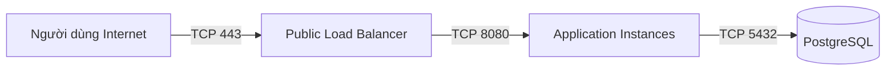
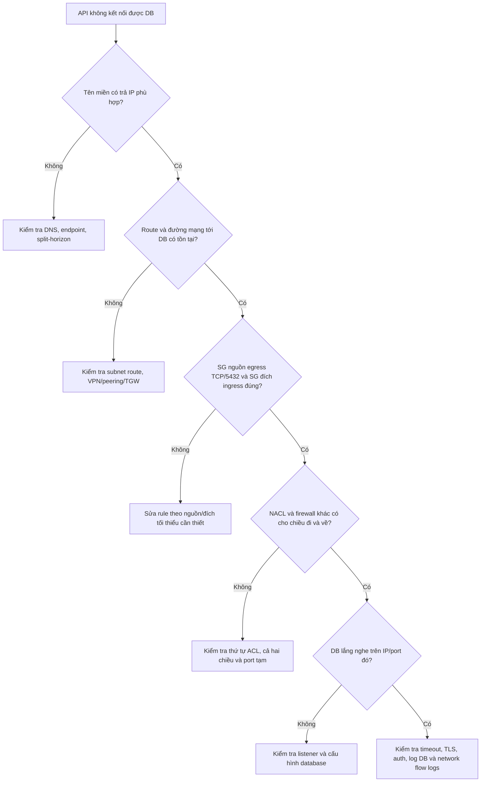

# Security group: kiểm soát kết nối mạng đến từng workload

Trong một hệ thống có web server, API server và cơ sở dữ liệu, các thành phần cần trao đổi với nhau nhưng không nên có cùng mức độ tiếp cận. Người dùng Internet có thể truy cập giao diện HTTPS; chỉ tầng web được phép kết nối tới API; chỉ API được phép truy cập port của database. **Security group** là một cơ chế phổ biến trong hạ tầng cloud để diễn đạt các quy tắc đó ở mức lưu lượng mạng.

Trong module **SECURITY_NETWORK_SECURITY** về các lớp phòng vệ mạng, security group đóng vai trò một lớp kiểm soát truy cập gần tài nguyên. Nó phối hợp với phân đoạn mạng, routing, network ACL, firewall, VPN, IDS/IPS, bảo vệ DNS, xác thực ứng dụng và giám sát lưu lượng để tạo nên kiến trúc an toàn.

Bài này sử dụng **AWS Security Groups** làm mô hình tham chiếu cụ thể vì đây là tên chính thức của tính năng trong AWS. Các nhà cung cấp khác có cơ chế tương đương về mục tiêu, nhưng thuật ngữ, cách gắn tài nguyên, chế độ stateful, mặc định và khả năng tham chiếu nhóm có thể khác. Chẳng hạn, Azure có **Network Security Group (NSG)** với quy tắc ưu tiên và allow/deny; Google Cloud cung cấp các chính sách **VPC firewall**. Không nên áp nguyên xi hành vi AWS cho mọi nền tảng.

Sau khi học, bạn có thể:

- Mô tả security group kiểm soát **inbound** và **outbound**, sự khác biệt giữa stateful và stateless, allow và deny.
- Thiết kế quyền truy cập giữa các tầng public, application, database theo nguyên tắc **least privilege**.
- Hiểu sự khác nhau giữa security group, network ACL, host firewall, WAF và cơ chế xác thực/phân quyền.
- Đọc các quy tắc IPv4/IPv6, CIDR, TCP/UDP port và tham chiếu security group, đồng thời phát hiện cấu hình quá rộng.
- Chẩn đoán tình huống dịch vụ không kết nối được bằng cách kết hợp rule, routing, listener, DNS, flow log và packet capture.

## 1. Security group là gì và bảo vệ phần nào?

**Security group (SG)** trong AWS là tập hợp các quy tắc cho phép lưu lượng vào và ra đối với tài nguyên mạng tương ứng, thường được gắn với **elastic network interface (ENI)** của các workload như EC2 và một số dịch vụ được quản lý. Để có kết nối thành công, lưu lượng còn phải đi qua đúng route, các chính sách mạng khác và tới một ứng dụng sẵn sàng nhận kết nối.

Một SG không phải địa chỉ IP, subnet hoặc VPN. Nó là **chính sách về luồng giao tiếp** được thực thi bởi hạ tầng mạng cloud tại phạm vi hỗ trợ của dịch vụ.

```text
                         INTERNET
                             |
                    TCP 443 (HTTPS)
                             v
                  +-------------------+
                  | Public Load       |
                  | Balancer          |
                  | SG: sg-frontend   |
                  +-------------------+
                             |
                    TCP 8080 từ SG frontend
                             v
                  +-------------------+
                  | Application/API   |
                  | SG: sg-application|
                  +-------------------+
                             |
                    TCP 5432 từ SG application
                             v
                  +-------------------+
                  | PostgreSQL        |
                  | SG: sg-database   |
                  +-------------------+

Không có quy tắc cho phép trực tiếp:
Internet ----------------------> API:8080
Internet ----------------------> Database:5432
```

Sơ đồ minh họa logic kiểm soát. Triển khai thực tế còn phụ thuộc việc load balancer có public endpoint hay không, subnet, gateway, route, dịch vụ database, cài đặt ứng dụng và các chính sách khác.

### 1.1. Phạm vi của kiểm soát

Với AWS, một SG thường trả lời các câu hỏi:

1. **Hướng nào?** Lưu lượng đi vào tài nguyên (*inbound/ingress*) hay đi ra (*outbound/egress*)?
2. **Từ/đến đâu?** Một địa chỉ IPv4, IPv6, dải CIDR, nhóm SG được tham chiếu hoặc loại đích được hỗ trợ khác.
3. **Giao thức gì?** TCP, UDP, ICMP/ICMPv6 hoặc giao thức IP phù hợp.
4. **Port hoặc kiểu ICMP nào?** Ví dụ TCP `443`, TCP `5432`, UDP `53` hoặc kiểu/thông điệp ICMP tương ứng.

SG hoạt động chủ yếu ở lớp mạng và vận chuyển. Nó **không tự quyết định** người dùng có được xem `/admin`, một token có hợp lệ, certificate TLS có được tin cậy hay truy vấn SQL có đúng quyền. Đó là việc của TLS, cơ chế xác thực, IAM, ứng dụng, database, WAF và những lớp kiểm soát tương ứng.

### 1.2. Security group khác Network Access Control theo nghĩa 802.1X

Thuật ngữ *network access control* còn được dùng để chỉ kiểm soát thiết bị/người dùng **gia nhập mạng** (NAC), ví dụ xác thực 802.1X trên switch hoặc Wi-Fi. Security group cloud giải quyết vấn đề liên quan nhưng khác phạm vi: **những workload đã có khả năng tham gia mạng được phép giao tiếp với nhau như thế nào**. Một thiết bị được 802.1X chấp nhận vẫn có thể bị policy security group chặn khi gọi API hay database trong cloud.

## 2. Các đặc tính quan trọng của AWS Security Groups

### 2.1. Mô hình allow-only: không có luật deny tường minh

AWS SG sử dụng những quy tắc **allow**. Nếu không có rule phù hợp cho một kết nối mới, lưu lượng không được SG cho phép. AWS SG không có luật `DENY` với độ ưu tiên cao hơn một luật allow khác.

Ví dụ inbound chỉ có:

| Protocol | Port | Source | Ý nghĩa |
|---|---:|---|---|
| TCP | `443` | `0.0.0.0/0` | Cho phép IPv4 đến HTTPS. |
| TCP | `22` | `203.0.113.10/32` | Chỉ cho phép SSH từ một địa chỉ quản trị IPv4. |

Không có inbound rule cho TCP `5432` nghĩa là **SG không cho phép kết nối mới từ bên ngoài đến port đó**, ngay cả khi ứng dụng database đang lắng nghe. Nhưng một SG khác gắn trên cùng ENI có thể có rule bổ sung; phải xem tập hợp SG thực tế trước khi kết luận.

### 2.2. Stateful: phản hồi của kết nối đã cho phép

Security group AWS về cơ bản là **stateful**. Khi một kết nối được phép khởi tạo, lưu lượng phản hồi thuộc kết nối được theo dõi thông thường được phép quay về mà không cần khai báo một rule đối xứng riêng cho chiều trả lời.

Ví dụ:

```text
Client 10.0.1.20:53000 → Server 10.0.2.15:443  SYN
  Inbound server SG cho phép TCP/443 từ client

Server 10.0.2.15:443 → Client 10.0.1.20:53000  SYN/ACK
  Phản hồi thuộc kết nối được theo dõi -> được phép quay lại
```

Điều này **không có nghĩa** server có thể tự mở bất kỳ kết nối mới tới client. Luồng **khởi tạo từ server** vẫn phải phù hợp với outbound rule của server và inbound rule ở phía nhận (khi áp dụng).

UDP không có bắt tay TCP, nhưng AWS vẫn có cơ chế theo dõi luồng UDP để xử lý lưu lượng phản hồi. Việc theo dõi có giới hạn về thời gian, tài nguyên và trường hợp áp dụng; không nên xem stateful là sự cho phép vĩnh viễn. Các tình huống theo dõi kết nối đặc biệt, đường đi bất đối xứng hoặc thay đổi chính sách phải được kiểm chứng theo tài liệu dịch vụ và luồng thực tế.

**So với network ACL dạng stateless:** nếu ACL kiểm tra cả hai chiều độc lập, bạn cần khai báo riêng rule cho chiều phản hồi, bao gồm port tạm thời (*ephemeral port*) khi phù hợp. Đừng tự thêm dải ephemeral inbound vào SG chỉ vì thấy TCP client sử dụng port nguồn cao; phản hồi của kết nối đã được SG cho phép thường không cần rule ấy.

### 2.3. Nhiều SG trên cùng interface: hợp nhất quyền cho phép

Một ENI trong AWS có thể được gắn nhiều SG trong phạm vi dịch vụ hỗ trợ. Các rule allow của chúng được đánh giá **theo hợp**: nếu bất kỳ SG được gắn nào cho phép một luồng mới theo hướng tương ứng, SG layer không chặn luồng đó.

```text
ENI của một EC2
   ├── sg-web: inbound TCP/443 từ Internet
   └── sg-admin: inbound TCP/22 từ mạng quản trị

Quyền inbound hiệu lực từ hai SG:
   • HTTPS từ Internet
   • SSH từ mạng quản trị
```

Vì thế, việc kiểm tra riêng `sg-web` và thấy không có SSH không chứng minh EC2 không truy cập được bằng SSH: `sg-admin` có thể đang cho phép. **Không tồn tại “SG chặn” để ghi đè lên một SG khác đang allow.**

### 2.4. Quy tắc mặc định phụ thuộc loại SG và cách tạo

Trong AWS, **default security group** của VPC có quy tắc đặc trưng, thường cho phép traffic giữa các tài nguyên cùng được gắn default SG và có outbound rộng. Khi tạo một SG mới, cấu hình điển hình là **không có inbound allow**, còn outbound có thể được khởi tạo theo mặc định cho phép rộng. Cách hiển thị và quản lý mặc định còn phụ thuộc console, API và công cụ Infrastructure as Code; hãy **đọc các rule thật sự được triển khai** thay vì tin một giả định.

Một dự án dùng Terraform/CloudFormation có thể chủ động loại bỏ outbound mặc định để chỉ cho phép các kết nối đi ra được chỉ định. Khi xét bảo mật, cần đánh giá **cả inbound lẫn outbound**.

## 3. Cấu trúc một rule

Một rule có thể được mô tả bằng các trường sau:

| Thuộc tính | Ví dụ | Cách đọc |
|---|---|---|
| Direction | `Inbound` / `Outbound` | Kiểm soát kết nối đi vào hay khởi tạo đi ra. |
| Protocol | `TCP`, `UDP`, `ICMP`, `ICMPv6` | Giao thức cần xét. |
| Port / Port range | `443`, `8080`, `5432`, `10000–10100` | Port đích của luồng khởi tạo theo hướng xét; ICMP dùng loại/code tương ứng. |
| Source / Destination | `10.20.0.0/16`, `203.0.113.10/32`, `::/0` | Tập địa chỉ được phép giao tiếp. |
| SG reference | `sg-application` | Cho phép endpoint thuộc nhóm SG được tham chiếu trong phạm vi tính năng hỗ trợ. |
| Description | `Allow HTTPS to public ALB` | Mục đích nghiệp vụ để kiểm toán, vận hành. |

Trong AWS, source của inbound là bên khởi tạo đến tài nguyên; destination của outbound là đầu nhận từ tài nguyên. Với kết nối qua NAT, proxy hoặc load balancer, địa chỉ mà một rule nhìn thấy có thể **khác địa chỉ gốc người dùng**. Cần hiểu datapath trước khi chọn CIDR hay SG reference.

### 3.1. Đọc CIDR và ý nghĩa của port

| Giá trị | Phạm vi | Đánh giá nhanh |
|---|---|---|
| `0.0.0.0/0` | Mọi địa chỉ IPv4 | Có thể phù hợp public HTTPS; thường quá rộng với SSH/database. |
| `::/0` | Mọi địa chỉ IPv6 | Quy tắc IPv6 riêng; không được quên kiểm tra khi hệ thống dual-stack. |
| `203.0.113.10/32` | Một IPv4 cụ thể (ví dụ tài liệu) | Phù hợp địa chỉ egress cố định của văn phòng/điểm quản trị nếu được phép. |
| `10.20.0.0/16` | Một dải mạng IPv4 lớn | Chỉ nên dùng nếu toàn bộ mạng này thật sự có nhu cầu truy cập. |
| `10.20.4.0/24` | Một subnet IPv4 hẹp hơn | Có thể phù hợp cho nhóm dịch vụ cùng subnet, nhưng IP/subnet vẫn không bảo đảm danh tính ứng dụng. |

`0.0.0.0/0` **không bao gồm IPv6**; `::/0` là phạm vi IPv6 rộng tương ứng. Một rule cho TCP `443` cũng không tự cho UDP `443` (được dùng bởi QUIC/HTTP/3). Số port chỉ là thông tin transport; ứng dụng có thể lắng nghe dịch vụ khác trên port đó, vì vậy vẫn cần xác thực, mã hóa và logging.

### 3.2. Tham chiếu SG thay cho IP tĩnh

Giả sử các instance API được scale tự động. Nếu rule database inbound ghi từng IP của API, cấu hình phải sửa mỗi lần instance thay đổi. Thay vào đó có thể tham chiếu nhóm:

```text
sg-database:
  Inbound TCP/5432:
    Source = sg-application
```

Ý nghĩa: cho phép các endpoint phù hợp với SG nguồn được tham chiếu truy cập database qua TCP `5432`, trong phạm vi kết nối và kiểu tham chiếu mà nền tảng hỗ trợ. Khi một instance hợp lệ mới được gắn `sg-application`, rule database không cần thêm IP riêng cho instance đó.

**SG reference không phải xác thực danh tính ứng dụng.** Bất kỳ workload nào được gắn nhóm nguồn và có đường mạng phù hợp đều có thể trở thành nguồn hợp lệ theo policy. Quyền sửa SG và quyền gắn SG vào tài nguyên phải được hạn chế bằng IAM/quy trình quản trị. Tham chiếu nhóm cũng không có nghĩa tự động mở routing giữa các VPC; hỗ trợ tham chiếu cross-VPC phụ thuộc loại kết nối, tính năng và giới hạn hiện hành của AWS.

## 4. Thiết kế security group theo kiến trúc nhiều tầng

Xét hệ thống gồm load balancer public, API private và PostgreSQL private:



Các rule khởi tạo luồng gợi ý:

| SG gắn với | Inbound cho kết nối mới | Outbound cần thiết trong luồng chính |
|---|---|---|
| `sg-frontend` (ALB) | TCP `443` từ nguồn người dùng được phép; có thể `0.0.0.0/0` khi thực sự public | TCP `8080` đến `sg-application`. |
| `sg-application` (API) | TCP `8080` từ `sg-frontend` | TCP `5432` đến `sg-database`; thêm các đích tối thiểu khác theo nhu cầu. |
| `sg-database` (PostgreSQL) | TCP `5432` từ `sg-application` | Chỉ các kết nối chủ động khác nếu chức năng thực sự yêu cầu. |

Traffic phản hồi của các kết nối đã được cho phép thường được xử lý qua theo dõi trạng thái, không cần mở ngược toàn bộ các port inbound/outbound.

### 4.1. Vì sao đây là phân đoạn có chủ đích?

- Internet chỉ có thể khởi tạo kết nối đến HTTPS ở điểm public; không có rule trực tiếp từ Internet tới app/database.
- API nhận kết nối ứng dụng từ frontend mà không nhận từ toàn bộ VPC.
- Database chỉ nhận TCP `5432` từ nhóm workload API được phép; người dùng Internet không có đường kết nối trực tiếp theo chính sách này.
- Khi scale frontend/API, rule tham chiếu SG vẫn phù hợp mà không phụ thuộc từng địa chỉ IP tạm thời.
- Lưu lượng đi ra từ workload cũng có thể được thu hẹp, giúp giảm rủi ro kết nối đến hệ thống ngoài danh sách cần thiết.

Đây là **microsegmentation theo vai trò workload** ở cấp network. Chỉ mở đúng SG vẫn chưa đủ để bảo vệ API/database: cần bảo mật đường đi (TLS khi cần), xác thực, phân quyền, giữ bí mật và log.

### 4.2. Những đường đi phụ cần thống kê

Một sơ đồ ba tầng đơn giản có thể bỏ sót:

- Health check của load balancer tới API, dùng port/path do target group quy định.
- DNS resolver, thời gian đồng bộ (NTP), kiểm tra certificate và các dịch vụ hạ tầng.
- Agent giám sát, logging, cập nhật hệ điều hành, secret manager, artifact registry.
- Truy cập quản trị qua bastion, VPN, Systems Manager hoặc cơ chế quản trị có xác thực.
- Kết nối từ API ra dịch vụ cloud thông qua VPC endpoint, NAT hoặc proxy.
- Traffic giữa các node, giữa pod trong môi trường Kubernetes/EKS hoặc luồng dịch vụ phụ trợ.

Giới hạn outbound mạnh chỉ có hiệu lực nếu ghi nhận **đúng các luồng cần thiết**. Chặn quá rộng có thể khiến ứng dụng không phân giải DNS, không tải secret, không báo metrics hoặc không gửi thông báo.

## 5. Ví dụ Infrastructure as Code với Terraform (AWS)

Ví dụ sau mô tả ba SG và các luồng bắt buộc ở mục trước, với tài nguyên rule tách riêng. Đây là **mẫu học tập**; cần rà soát yêu cầu health check, egress, IAM, mạng, IPv6 và cách quản lý rule mặc định trước khi áp dụng vào hệ thống thực.

```hcl
variable "vpc_id" {
  type = string
}

resource "aws_security_group" "frontend" {
  name   = "demo-frontend"
  vpc_id = var.vpc_id
}

resource "aws_security_group" "application" {
  name   = "demo-application"
  vpc_id = var.vpc_id
}

resource "aws_security_group" "database" {
  name   = "demo-database"
  vpc_id = var.vpc_id
}

# Người dùng IPv4 được phép truy cập HTTPS tại frontend public.
resource "aws_vpc_security_group_ingress_rule" "frontend_https" {
  security_group_id = aws_security_group.frontend.id
  ip_protocol       = "tcp"
  from_port         = 443
  to_port           = 443
  cidr_ipv4         = "0.0.0.0/0"
  description       = "Public HTTPS ingress"
}

# Frontend được khởi tạo kết nối tới API trên TCP/8080.
resource "aws_vpc_security_group_egress_rule" "frontend_to_application" {
  security_group_id            = aws_security_group.frontend.id
  ip_protocol                  = "tcp"
  from_port                    = 8080
  to_port                      = 8080
  referenced_security_group_id = aws_security_group.application.id
  description                  = "Frontend to application"
}

resource "aws_vpc_security_group_ingress_rule" "application_from_frontend" {
  security_group_id            = aws_security_group.application.id
  ip_protocol                  = "tcp"
  from_port                    = 8080
  to_port                      = 8080
  referenced_security_group_id = aws_security_group.frontend.id
  description                  = "Application from frontend"
}

# API chỉ khởi tạo kết nối database qua TCP/5432.
resource "aws_vpc_security_group_egress_rule" "application_to_database" {
  security_group_id            = aws_security_group.application.id
  ip_protocol                  = "tcp"
  from_port                    = 5432
  to_port                      = 5432
  referenced_security_group_id = aws_security_group.database.id
  description                  = "Application to PostgreSQL"
}

resource "aws_vpc_security_group_ingress_rule" "database_from_application" {
  security_group_id            = aws_security_group.database.id
  ip_protocol                  = "tcp"
  from_port                    = 5432
  to_port                      = 5432
  referenced_security_group_id = aws_security_group.application.id
  description                  = "PostgreSQL from application"
}
```

Lưu ý khi đọc ví dụ:

1. Tài nguyên `aws_vpc_security_group_ingress_rule` và `aws_vpc_security_group_egress_rule` là kiểu rule độc lập trong AWS provider Terraform; hãy chọn phiên bản provider tương thích với mã hạ tầng đang dùng.
2. Để outbound thật sự giới hạn, cần kiểm tra và loại trừ **mọi rule outbound mặc định hoặc rule khác** đang cho phép rộng trong cấu hình hiệu lực.
3. Rule `0.0.0.0/0` chỉ dùng ở frontend dự kiến public. Một hệ thống phục vụ qua CDN, VPN hoặc mạng nội bộ có thể giới hạn nguồn chặt hơn.
4. Cấu hình SG **không tạo** VPC, subnet, route, ALB, instance, PostgreSQL hay listener; cần triển khai các thành phần đó và gắn SG đúng ENI/tài nguyên.
5. Cần bổ sung các luồng hạ tầng thật sự cần thiết; nếu ứng dụng sử dụng IPv6 hoặc QUIC, phải xét rule tương ứng thay vì suy luận từ rule IPv4/TCP.

### 5.1. Phần nào nên được quản lý bằng IaC?

Nên đưa **định nghĩa SG, rule, description, ownership và mối liên hệ với workload** vào hệ thống quản lý cấu hình để có review, history và phát hiện khác biệt (*drift*). Hạn chế chỉnh rule thủ công dài hạn trên console vì khó biết ai đã mở `0.0.0.0/0` hoặc vì sao đã thêm một port.

Thay đổi không tự động an toàn chỉ vì đi qua Terraform; vẫn phải review phạm vi CIDR, các SG liên kết, inbound/outbound, quyền thay đổi và tác động đến ứng dụng.

## 6. Security group so với những lớp phòng vệ khác

| Cơ chế | Vị trí/đối tượng thường bảo vệ | Stateful? | Điểm khác biệt |
|---|---|---|---|
| **AWS Security Group** | ENI/workload hỗ trợ trong VPC | Chủ yếu stateful | Allow-only, hợp rule giữa nhiều SG; gần tài nguyên. |
| **AWS Network ACL (NACL)** | Ranh giới subnet | Stateless | Có allow/deny, thứ tự rule và đánh giá hai chiều riêng; cần xét ephemeral port. |
| **Host firewall** | Hệ điều hành máy ảo/máy chủ | Tùy hệ điều hành và quy tắc | Kiểm soát ngay trên host, có thể gắn policy theo dịch vụ/tiến trình và địa chỉ. |
| **Network firewall/NGFW** | Các luồng tại điểm mạng đi qua thiết bị | Tùy sản phẩm | Có thể kiểm tra sâu, lọc ứng dụng, IPS, rule deny; phụ thuộc đường đi qua firewall. |
| **WAF** | HTTP/HTTPS ở tầng ứng dụng | Xử lý dựa trên nội dung request | Có thể kiểm soát path, header, payload và mẫu tấn công HTTP; không thay SG. |
| **IAM, authN/authZ** | Danh tính và quyền truy cập dịch vụ/tài nguyên | Không phải firewall mạng | Quyết định *ai* được thực hiện *hành động nào* sau khi có kết nối phù hợp. |
| **VPN, mTLS** | Đường truyền/phiên xác thực | Không trực tiếp thay SG | Bảo vệ kết nối, danh tính hai đầu và/hoặc đường đi; vẫn cần policy phạm vi truy cập. |

Ví dụ, nếu network ACL cho phép mọi luồng trên subnet, security group vẫn có thể hạn chế port tới API. Nếu SG cho TCP `5432` từ app nhưng database không xác thực tài khoản, kẻ kiểm soát một app server được phép vẫn có thể cố truy cập dữ liệu. Điều này cho thấy **network reachability khác quyền truy cập dữ liệu**.

### 6.1. Vì sao security group không thay thế subnet private?

Subnet được coi là private thường vì kiến trúc định tuyến và khả năng tiếp cận từ Internet, không phải chỉ do nhãn tên. SG hạn chế những kết nối được phép khi traffic tới ENI, nhưng không định nghĩa routing hay tự tạo ranh giới địa chỉ. Muốn database thật sự không public phải kiểm tra đồng thời:

- Database có public IP/public endpoint hay không, và thuộc mạng nào.
- Route table, Internet gateway, NAT, peering, transit gateway hoặc VPN.
- SG, NACL và firewall ở từng đoạn của đường đi.
- Cơ chế xác thực, TLS, quyền truy cập database và chính sách kết nối ứng dụng.

Một SG chặt chẽ là cần thiết, nhưng không phải lý do duy nhất để tuyên bố tài nguyên “private”.

## 7. Quy tắc inbound, outbound và các lỗi thiết kế hay gặp

### 7.1. Inbound quá rộng

Những rule cần ưu tiên rà soát:

```text
Ingress TCP/22     source 0.0.0.0/0    # SSH từ mọi IPv4
Ingress TCP/3389   source ::/0         # RDP từ mọi IPv6
Ingress TCP/3306   source 0.0.0.0/0    # MySQL public
Ingress TCP/5432   source 0.0.0.0/0    # PostgreSQL public
Ingress ALL        source 0.0.0.0/0    # Mở mọi giao thức IPv4
```

Không phải mọi `0.0.0.0/0` đều sai: frontend public có thể cần nhận HTTPS từ nhiều mạng. Tuy nhiên với cổng quản trị và database, cần giới hạn nguồn vào bastion/VPN, SG workload hoặc mạng quản trị được cho phép. Thay port SSH `22` sang một port khác **không thay thế** kiểm soát danh tính và nguồn truy cập.

### 7.2. Egress mở hoàn toàn

Outbound cho phép mọi đích có thể hữu ích khi triển khai thử, nhưng trong môi trường nhạy cảm nó làm tăng bề mặt rủi ro khi workload bị chiếm quyền và tìm cách liên hệ hệ thống ngoài. Egress theo allowlist giúp thu hẹp khả năng kết nối, dù khó quản lý hơn nếu ứng dụng phụ thuộc dịch vụ cloud bên ngoài hoặc hostname/IP thay đổi.

Khi thiết kế egress:

1. Kiểm kê mọi kết nối **khởi tạo từ workload**, không đếm nhầm gói phản hồi thuộc kết nối inbound đã được theo dõi.
2. Phân loại đích cố định theo SG reference/CIDR và đích động theo dịch vụ/prefix list hoặc cơ chế kiểm soát egress phù hợp.
3. Xác định nhu cầu DNS, đồng bộ thời gian, telemetry, cập nhật OS và truy cập API dịch vụ cloud.
4. Cân nhắc VPC endpoint, proxy egress hoặc DNS Firewall nếu SG không thể biểu diễn chính sách theo tên miền.
5. Thử nghiệm tại môi trường phù hợp, theo dõi lỗi và loại bỏ rule tạm sau khi xác nhận.

**SG thông thường lọc theo địa chỉ/giao thức/port, không theo hostname tùy ý hay HTTP URL.** Với DNS trong AWS, một số luồng tới DNS resolver do VPC cung cấp không bị SG chặn theo cách kiểm soát network thông thường; muốn hạn chế truy vấn tên miền có thể cần các cơ chế như Route 53 Resolver DNS Firewall hoặc thiết kế resolver phù hợp.

### 7.3. Phạm vi nguồn không tương ứng với người được cấp quyền

Nếu một rule cho `10.0.0.0/8`, phạm vi này lớn hơn nhiều so với một subnet ứng dụng. Nếu cho `sg-application`, mọi workload được gắn vào SG ấy có thể được hưởng quyền nguồn phù hợp. Với môi trường nhiều nhóm vận hành, phải phân quyền thay đổi SG, quản lý tag, bảo vệ deployment và kiểm toán định kỳ.

**Đặt tên SG không tạo quyền.** Một nhóm tên `sg-trusted` không tự động xác minh chủ thể hay bảo đảm workload là tin cậy.

## 8. Troubleshooting: SG có phải nguyên nhân không?

Tình huống: API trong private subnet không truy cập được PostgreSQL qua TCP `5432`. Tránh giả định lỗi SG ngay lập tức: timeout có thể đến từ SG, NACL, route, listener, DNS, database hoặc đường đi trả lời.

### 8.1. Trình tự kiểm tra



Với truy cập qua load balancer/proxy, phải tách **client → LB/proxy** và **LB/proxy → backend** thành hai luồng. Inbound frontend được phép không đảm bảo outbound frontend và inbound backend đã đúng.

### 8.2. Cách phân biệt một số triệu chứng

| Quan sát | Có thể liên quan | Cách kiểm chứng |
|---|---|---|
TCP `connect` timeout, client lặp SYN mà không thấy SYN-ACK | SG, NACL, route, host không phản hồi, đường về hoặc capture thiếu gói | Đối chiếu SG gắn ENI, VPC flow logs, route và capture hai đầu. |
TCP nhận RST ngay | Không có listener hoặc thành phần chủ động reject | Kiểm tra port/bind process, host firewall, proxy và packet phía đích. |
TCP bắt tay xong, TLS lỗi | TLS version, SNI, CA, certificate/mTLS | Log client/server và cấu hình TLS; SG đã cho luồng transport ban đầu. |
TCP/TLS xong, HTTP `403` | WAF, authZ, API policy hoặc ứng dụng | Xem log WAF/API/identity; không kết luận SG chặn. |
Kết nối lúc được lúc không | Load balancer health, pod/instance SG khác nhau, route bất đối xứng, connection limits | Xác định đúng backend/ENI tại từng lần, so rule và log. |
IPv4 truy cập được, IPv6 không | Thiếu rule IPv6, tuyến/endpoint IPv6 hoặc listener | Kiểm tra `::/0`/CIDR IPv6, AAAA, routing, NACL IPv6. |

### 8.3. Lệnh AWS CLI để đọc cấu hình (không thay đổi tài nguyên)

Các lệnh sau dùng AWS CLI với profile/region và quyền đọc phù hợp. Thay ID minh họa bằng giá trị của hệ thống bạn được phép kiểm tra.

```bash
# Đọc inbound/outbound rules của một SG.
aws ec2 describe-security-groups \
  --group-ids sg-0123456789abcdef0 \
  --query 'SecurityGroups[].{Id:GroupId,Ingress:IpPermissions,Egress:IpPermissionsEgress}'

# Xác định ENI nào đang gắn SG được quan tâm.
aws ec2 describe-network-interfaces \
  --filters 'Name=group-id,Values=sg-0123456789abcdef0' \
  --query 'NetworkInterfaces[].{Id:NetworkInterfaceId,IP:PrivateIpAddress,Groups:Groups,Description:Description}'

# Đọc chi tiết từng rule hiện có trong SG.
aws ec2 describe-security-group-rules \
  --filters 'Name=group-id,Values=sg-0123456789abcdef0'
```

Không nên chỉ đọc một dòng trên console rồi kết luận. Với ENI, hãy xem **tất cả SG được gắn** và các rule của chúng; kiểm tra đúng IP đích, giao thức và hướng. AWS Reachability Analyzer có thể hỗ trợ phân tích cấu hình đường đi cho những trường hợp được hỗ trợ, nhưng nó không thay thế phép thử kết nối ứng dụng thực tế.

### 8.4. Đọc VPC Flow Logs cho đúng

VPC Flow Logs cung cấp các bản ghi lưu lượng ở phạm vi cấu hình quan sát của VPC/subnet/ENI, có thể gồm nguồn, đích, port, protocol và hành động `ACCEPT` hoặc `REJECT`. Cần nhớ:

- `ACCEPT` thể hiện lưu lượng được cho phép ở phạm vi đánh giá của flow log, **không chứng minh ứng dụng đã đọc request hay xác thực thành công**.
- `REJECT` cho biết traffic bị từ chối theo cơ chế ghi nhận, nhưng **không nhất thiết chỉ ra chính xác SG rule nào** gây ra; NACL hoặc điều kiện khác có thể liên quan.
- Flow logs có thời gian tổng hợp và những giới hạn quan sát/ghi nhận; không phải bản sao từng packet hay nguồn duy nhất để xác minh trạng thái TCP.
- Vẫn cần log ứng dụng, flow log của đúng ENI, route và capture endpoint khi có quyền.

### 8.5. Vì sao SG cho phép rồi vẫn timeout?

Khi inbound/outbound đều được cho phép, các lớp khác vẫn có thể cản trở:

- Route không có đường tới đích, hoặc subnet chỉ có đường chiều đi mà không có đường về.
- NACL stateless từ chối một chiều, đặc biệt các port phản hồi.
- Dịch vụ `bind` trên loopback `127.0.0.1` thay vì private IP.
- Process chết, port không lắng nghe, DB cấu hình chỉ nhận một nhóm người dùng/địa chỉ.
- Chọn nhầm IP sau NAT, nhầm DNS public/private, VPN tunnel hoặc đích IPv6.
- Proxy/LB tạo một kết nối mới từ nguồn khác so với nguồn bạn đã cho trong SG.
- Lỗi TLS/xác thực hoặc ứng dụng timeout sau khi TCP thành công.

SG là một giả thuyết cần kiểm tra trong chuỗi đường truyền, không phải lời giải thích mặc định cho mọi kết nối thất bại.

## 9. Dùng security group trong threat modeling

Xét mối đe dọa: một container trong tầng API bị khai thác. Kẻ tấn công có quyền chạy chương trình với khả năng gửi traffic từ network namespace của workload đó. Security group vẫn có thể giúp giới hạn **những đích kết nối được phép**, nhưng không thể thay thế việc vá lỗi, giới hạn quyền container và bảo vệ dữ liệu.

| Tài sản/luồng | Nguy cơ | Kiểm soát mạng | Lớp bổ sung |
|---|---|---|---|
Internet → API/private DB | Kẻ ngoài mạng tìm cách truy cập trực tiếp | Không tạo rule ingress public tới API/DB; thiết kế subnet/route phù hợp | WAF/ALB, TLS, authN/authZ. |
Frontend → API | Workload frontend bị chiếm quyền, gọi API trái phép | Chỉ mở port API cần thiết từ frontend SG | Token service-to-service, mTLS, phân quyền ứng dụng. |
API → Database | Lạm dụng quyền của ứng dụng để đọc dữ liệu | DB ingress chỉ từ API SG, port DB duy nhất | DB auth, role tối thiểu, audit log, mã hóa. |
API → Internet | Dữ liệu bị đưa ra ngoài hoặc mã độc gọi C2 | Giới hạn egress theo nhu cầu, proxy/VPC endpoint khi phù hợp | EDR, logging, DNS security, DLP theo kiến trúc. |
Người quản trị → máy chủ | Phơi lộ SSH/RDP, brute force | Giới hạn nguồn quản trị qua VPN/bastion/cơ chế quản trị có kiểm soát | MFA, SSH key/identity, IAM, session audit. |

Điểm quan trọng: **SG reference mô tả tư cách mạng của workload, không đánh giá liệu workload đó đã bị xâm nhập hay chưa**. Nếu API bị kiểm soát, nó vẫn có thể mở kết nối DB trên port được cấp quyền. Vì vậy, kiến trúc **defense in depth** vẫn cần xác thực và phân quyền giữa các dịch vụ, giám sát xâm nhập và chính sách dữ liệu.

### 9.1. Kiểm soát thay đổi và phát hiện cấu hình lệch

Một quy trình vận hành tốt thường có:

1. **Owner và mục đích** của từng SG/rule, ghi vào description/tag theo chuẩn của hệ thống.
2. **Review trước thay đổi:** phạm vi nguồn/đích, protocol, port, áp dụng IPv4 và IPv6, các SG đang gắn.
3. **Tự động phát hiện rule rộng:** ví dụ SSH/RDP/DB từ mọi địa chỉ, outbound all không có lý do hoặc SG ít dùng nhưng còn gắn.
4. **Nhật ký thay đổi:** ai thêm, sửa hoặc xóa rule; hệ thống AWS có thể dùng CloudTrail và công cụ đánh giá policy phù hợp.
5. **Kiểm chứng sau thay đổi:** kiểm tra luồng hợp lệ vẫn hoạt động và luồng không được phép bị từ chối ở điểm đo phù hợp.
6. **Thu hồi rule tạm:** không để một lần debug biến thành lỗ hổng thường trực.

Khi thay đổi security group trên môi trường đang chạy, cần cân nhắc các kết nối đã được theo dõi và đặc điểm datapath; đừng mặc định mọi kết nối hiện hữu sẽ bị cắt hoặc duy trì ngay lập tức theo cùng cách trong mọi trường hợp.

## 10. Những hiểu lầm cần tránh

| Nhận định sai | Cách hiểu đúng |
|---|---|
| “Đã không có rule inbound `5432` trong SG A nên DB an toàn.” | Phải xem **mọi SG gắn với đúng ENI**, rule outbound, đường route và lớp xác thực DB. |
| “Có rule deny ở SG B sẽ chặn allow từ SG A.” | AWS SG là allow-only; các allow rule giữa SG gắn cùng interface được hợp nhất. |
| “Phải mở inbound ephemeral ports để cho phản hồi của kết nối outbound.” | Với SG stateful thông thường, phản hồi của kết nối được theo dõi không cần rule inbound riêng; NACL stateless là trường hợp khác. |
| “`0.0.0.0/0` cho phép cả IPv6.” | IPv4 và IPv6 được khai báo riêng; `::/0` là phạm vi IPv6 rộng. |
| “Security group cho port `443` đồng nghĩa HTTPS an toàn.” | Port chỉ là transport; cần kiểm tra TLS, certificate, auth và cấu hình ứng dụng. |
| “Chỉ cần cấu hình SG là dịch vụ có thể truy cập.” | Còn phụ thuộc route, NACL, host firewall, listener, DNS, endpoint và mạng đích. |
| “SG tham chiếu nhau nên ứng dụng đã xác thực danh tính.” | SG reference là điều kiện truy cập theo membership của endpoint, không thay xác thực service/user. |
| “Hai VPC có SG reference thì tự thông nhau.” | Tham chiếu group không tạo route hoặc kết nối VPC; hỗ trợ cross-VPC còn phụ thuộc tính năng. |
| “Flow log `ACCEPT` nghĩa là HTTP request thành công.” | Log mạng không chứng minh kết quả TLS/HTTP hay logic ứng dụng. |
| “Security group của AWS giống hệt Azure NSG hoặc GCP firewall.” | Mục đích tương tự nhưng cấu trúc rule, ưu tiên, deny, phạm vi và mặc định khác nhau. |

## 11. Bài tập áp dụng

### Bài tập 1: tìm rule rộng quá mức

Một database EC2 đang có inbound `TCP 5432` từ `0.0.0.0/0`. API chạy ở các instance có SG `sg-api`. Database chỉ được API truy cập. Bạn nên thay đổi thế nào?

**Gợi ý:** Nếu kiến trúc kết nối hỗ trợ SG reference, thay inbound DB bằng `TCP 5432` từ `sg-api`, rà soát tất cả SG gắn trên database ENI, outbound phía API, NACL, route và xác thực database. Nếu không hỗ trợ reference trên đường đi, cân nhắc CIDR tối thiểu tương ứng sau khi xác nhận điểm nguồn thực tế. Không quên kiểm tra IPv6.

### Bài tập 2: giải thích phản hồi stateful

Một máy API được phép khởi tạo kết nối TCP `5432` đến DB. SG của DB không có outbound rule riêng cho port ngẫu nhiên ở client. Vì sao phản hồi vẫn có thể trở lại?

**Gợi ý:** Kết nối được SG cho phép và hạ tầng theo dõi trạng thái; dữ liệu phản hồi thuộc kết nối đó thông thường được phép. Không nhầm với NACL stateless kiểm tra cả hai chiều độc lập.

### Bài tập 3: không thể kết nối dù SG trông đúng

Một API có outbound TCP `5432` tới SG của DB, DB có inbound TCP `5432` từ SG API, nhưng `connect` timeout. Bạn cần những bằng chứng nào trước khi sửa SG?

**Gợi ý:** Kiểm tra SG gắn trên đúng ENI, IP/port đích, địa chỉ DNS, route, NACL hai chiều, listener DB, firewall OS, TCP SYN/SYN-ACK và flow logs. Xác định packet có tới DB hay không rồi mới sửa rule nếu có bằng chứng thiếu allow.

### Bài tập 4: đánh giá hai luồng khác nhau

Một frontend gửi request tới API được, nhưng API không gửi được kết nối mới tới một dịch vụ giám sát. Có thể dựa vào outbound rule frontend để kết luận API đủ quyền không?

**Gợi ý:** Không. Cần phân biệt từng ENI, SG, hướng và loại kết nối. API khởi tạo luồng mới nên phải có outbound rule tương ứng cùng đường mạng và chính sách đích.

### Bài tập 5: mô hình hóa rủi ro khi API bị xâm nhập

Kẻ tấn công đã có quyền chạy lệnh trong API, còn DB chỉ cho SG API truy cập. SG database có tự bảo vệ được trước mọi truy vấn trái phép không?

**Gợi ý:** Không. Workload API là nguồn mạng được cho phép nên vẫn có thể gọi database. Phải dùng DB authentication/authorization, vai trò tối thiểu, audit, giới hạn truy vấn và giám sát.

## 12. Checklist trước khi đưa security group vào vận hành

- [ ] Đúng tài nguyên/ENI và tập **tất cả SG được gắn** đã được kiểm tra.
- [ ] Mỗi inbound rule có **nguồn, port, protocol, mục đích** cụ thể; không còn SSH/RDP/DB mở rộng tùy tiện.
- [ ] Egress đã được thống kê: API, database, DNS, NTP, telemetry, hạ tầng và dịch vụ cloud cần thiết.
- [ ] Quy tắc IPv4 và IPv6 được đánh giá độc lập; không quên HTTP/3/UDP nếu dịch vụ sử dụng.
- [ ] Tham chiếu SG được sử dụng đúng phạm vi hỗ trợ; quyền gắn/sửa SG được kiểm soát bằng IAM.
- [ ] Routing, subnet, NACL, host firewall, VPN/NAT, load balancer và DNS tương thích với policy.
- [ ] TLS/mTLS, authN/authZ, secrets và các lớp bảo vệ ứng dụng được xem xét riêng.
- [ ] Quy tắc có owner, mô tả, review, nhật ký thay đổi và cơ chế thu hồi rule tạm.
- [ ] Đã thử luồng **được phép** hoạt động và luồng **không được phép** bị chặn từ các điểm đo phù hợp.
- [ ] Có flow logs/metrics và quy trình điều tra khi cảnh báo hoặc kết nối thất bại.

Security group là công cụ đơn giản nhưng có tác động lớn: nó giúp biến yêu cầu “frontend được gọi API, API được gọi DB” thành các quy tắc mạng có thể kiểm tra và kiểm toán. Bảo vệ hiệu quả đòi hỏi kết hợp **nguồn–đích tối thiểu, stateful filtering đúng cách, phân đoạn mạng, xác thực ứng dụng và giám sát liên tục**.
