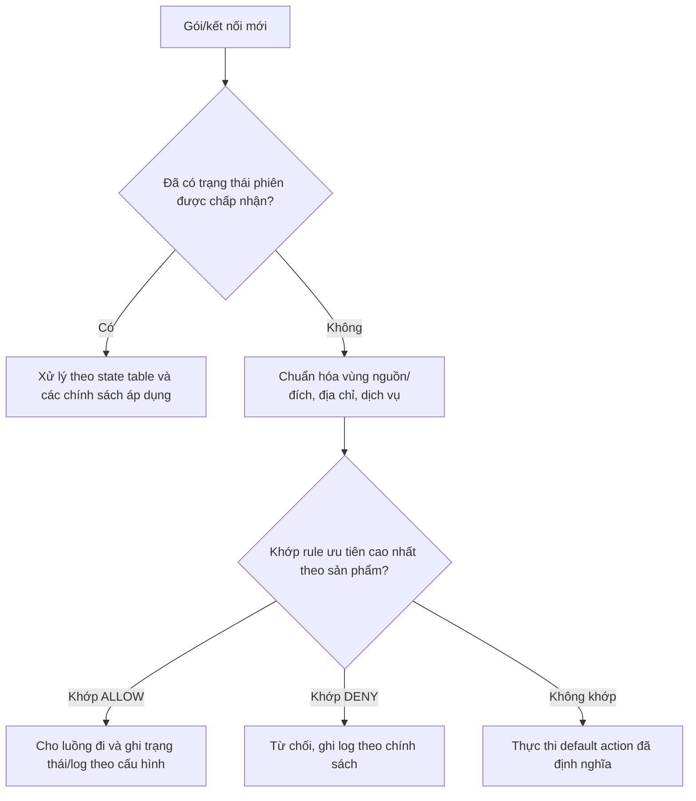
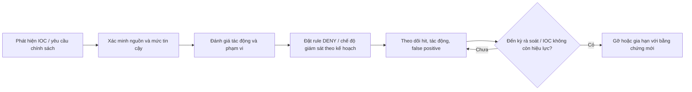
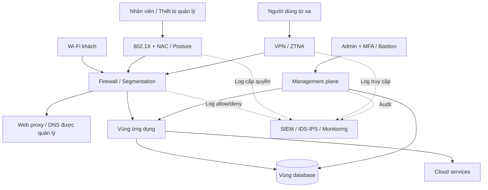

# Allowlist và blocklist

> **Học phần:** `SECURITY_NETWORK_SECURITY`  
> **Chương:** Network access control  
> **Phạm vi:** Xây dựng và vận hành chính sách cho phép/chặn truy cập mạng theo danh tính, thiết bị, vùng mạng, IP, cổng, giao thức, tên miền và ngữ cảnh ứng dụng. Bài học liên hệ với phân đoạn mạng, firewall, VPN, DNS, IDS/IPS, Wi-Fi và hạ tầng đám mây.

## Mục tiêu học tập

Sau bài này, người học có thể:

1. Phân biệt **allowlist** (danh sách cho phép) và **blocklist** (danh sách chặn), nhận biết phạm vi phù hợp của từng cách tiếp cận.
2. Chuyển yêu cầu truy cập thành quy tắc có **nguồn, đích, hành động, điều kiện, phạm vi, thứ tự và thời hạn**, tránh quyết định chỉ dựa vào một IP hay tên miền.
3. Giải thích cách firewall, ACL, NAC/802.1X, VPN/ZTNA, DNS filtering và cloud security controls thực thi chính sách ở các tầng khác nhau.
4. Thiết kế chính sách theo nguyên tắc **least privilege**, phân đoạn, **default deny** tại ranh giới phù hợp, đồng thời xử lý ngoại lệ có kiểm soát.
5. Phân tích các rủi ro như chặn nhầm, bỏ lọt, giả mạo danh tính thiết bị, thay đổi IP/DNS, IPv6, CDN và luồng được mã hóa.
6. Viết ca kiểm thử, giám sát quyết định allow/deny và tổ chức vòng đời thay đổi chính sách.

## 1. Bài toán kiểm soát truy cập mạng

**Network access control (NAC)** theo nghĩa rộng là quá trình quyết định **ai hoặc thiết bị nào được truy cập tài nguyên nào, từ đâu, qua giao thức nào và trong điều kiện gì**. Trong thực tế, thuật ngữ *NAC* còn được dùng hẹp hơn cho hệ thống kiểm soát thiết bị khi nối vào mạng có dây/không dây (chẳng hạn 802.1X). Bài này xét cả chính sách danh sách cho phép/chặn và việc triển khai ở những lớp kiểm soát liên quan.

Hai kiểu danh sách thường gặp:

- **Allowlist:** Chỉ những đối tượng hoặc luồng thỏa tiêu chí cho phép rõ ràng mới được đi qua ranh giới áp dụng. Những đối tượng còn lại bị từ chối khi **không có quy tắc cho phép khác**.
- **Blocklist:** Từ chối những đối tượng hoặc luồng khớp tiêu chí chặn. Những đối tượng còn lại có thể được cho phép **nếu chính sách nền cho phép**; một blocklist tự nó không cấp quyền truy cập.

Ví dụ: Chỉ máy chủ ứng dụng `10.20.10.15` được kết nối tới database `10.30.20.10` trên TCP 5432 là một chính sách **allowlist**. Chặn các địa chỉ IP đã được xác minh là nguồn phát tán lưu lượng độc hại là một ví dụ **blocklist**. Cả hai thường cùng tồn tại trong một kiến trúc phòng vệ.

**Điểm quan trọng:** Danh sách là một phần của **policy**. Quyền truy cập cuối cùng còn phụ thuộc thứ tự rule, mặc định allow/deny, tính stateful, danh tính, cấu hình route và các lớp bảo vệ khác. Không thể suy ra hành vi của toàn hệ thống chỉ từ sự tồn tại của một allowlist hoặc blocklist.

## 2. So sánh allowlist và blocklist

| Tiêu chí | Allowlist | Blocklist |
|---|---|---|
| Câu hỏi chính | *Luồng nào thực sự cần được phép?* | *Luồng nào cần bị chặn vì rủi ro?* |
| Thiết lập điển hình | Cho phép cụ thể, từ chối các trường hợp không được phép | Chặn cụ thể; các luồng khác theo chính sách nền |
| Phù hợp | Dịch vụ quản trị, kết nối east-west, egress nhạy cảm, đối tác cố định | Chặn IOC, tên miền độc hại, mạng vi phạm, phản ứng sự cố |
| Ưu điểm | Thu hẹp bề mặt tấn công, dễ chứng minh quyền truy cập theo nghiệp vụ | Bổ sung phòng vệ nhanh cho mối đe dọa đã biết; linh hoạt với truy cập Internet rộng |
| Thách thức | Cần inventory chính xác, dễ chặn nhầm khi ứng dụng đổi endpoint | Không chặn được rủi ro chưa biết; feed sai gây chặn nhầm hoặc nhanh lỗi thời |
| Bản chất | **Phòng ngừa dựa vào nhu cầu được cấp** | **Loại trừ dựa vào điều kiện bị cấm** |

Không có danh sách nào luôn tốt hơn trong mọi tình huống. Dịch vụ thanh toán nội bộ chỉ cần ba luồng hợp lệ là ứng viên rõ ràng cho allowlist. Người dùng văn phòng truy cập nhiều website công cộng thường cần kết hợp kiểm soát web, DNS, endpoint và blocklist có ngữ cảnh thay vì cố liệt kê trước mọi website hợp lệ. Ngay trong trường hợp dùng blocklist, API quản trị và mạng cơ sở dữ liệu vẫn nên được bảo vệ bằng quyền truy cập rõ ràng.

### Ví dụ một cặp chính sách

**Cho phép tối thiểu:**

```text
Nguồn:      App subnet 10.20.10.0/24
Đích:       Database 10.30.20.10
Giao thức:  TCP
Cổng đích:  5432
Hành động:  ALLOW
Mặc định ở ranh giới ứng dụng → database: DENY
```

**Chặn mối đe dọa đã xác minh:**

```text
Nguồn:      Nhóm IP rủi ro đã được xác minh
Đích:       Dịch vụ công khai
Hành động:  DENY
Hiệu lực:   Có thời hạn, rà soát theo vòng đời IOC
Chính sách nền: Các rule ứng dụng/Internet vẫn tiếp tục áp dụng
```

Các địa chỉ IP trong ví dụ là minh họa. Rule thực tế còn phải xét NAT, IPv6, return traffic, chiều kết nối và đối tượng dịch vụ.

## 3. Một quyết định truy cập gồm những thuộc tính gì?

Mô hình tổng quát của một yêu cầu mạng:

```text
AccessRequest = (
    principal,      # user, device, workload / service account
    source,         # IP/subnet, segment, interface, site, VPN zone
    destination,    # IP, subnet, service, domain hoặc resource
    protocol,       # TCP, UDP, ICMP...
    destinationPort,
    context,        # device posture, time, MFA, risk, environment...
    action          # read, admin, connect... nếu lớp kiểm soát hiểu được
)
```

Một **L3/L4 firewall** thông thường chỉ nhìn thấy một phần như IP, port, giao thức, vùng mạng và trạng thái kết nối. Một **identity-aware proxy/ZTNA** có thể gắn thêm danh tính người dùng và posture. Một **API** lại hiểu thao tác `read` hay `admin`. Do đó, phải đặt chính sách tại **đúng điểm thực thi**.

| Thuộc tính | Ví dụ | Hạn chế cần nhớ |
|---|---|---|
| IP / subnet nguồn | `10.20.10.0/24` | NAT, DHCP, roaming và IP chia sẻ làm đổi ngữ nghĩa nguồn |
| IP / subnet đích | `10.30.20.10/32` | IP có thể thay; load balancer/CDN có nhiều địa chỉ |
| Cổng / giao thức | TCP 5432, UDP 53 | Port không bảo đảm xác định đúng ứng dụng hoặc quyền thao tác |
| FQDN / tên miền | `api.partner.example` | Nhiều IP, CNAME, TTL, DNS mã hóa hoặc resolver khác nhau |
| Danh tính người dùng | Nhóm `Finance-Viewer` | Cần xác thực đáng tin; role thay đổi theo vòng đời |
| Danh tính thiết bị | Chứng chỉ thiết bị, trạng thái MDM | Chỉ MAC address không phải xác thực mạnh |
| Workload / service identity | Service account, mTLS identity | Phải giới hạn audience, scope, quyền tài nguyên |
| Điều kiện thời điểm / rủi ro | Phiên VPN hợp lệ, MFA, posture đạt | Hệ thống phải lấy/kiểm tra tín hiệu có nguồn gốc tin cậy |

**Không nên gộp “có thể kết nối TCP” với “được phép thực hiện thao tác”.** Cho phép truy cập cổng của database không tự cấp quyền SQL; đường đến Admin API không cấp quyền quản trị. Firewall, IAM, RBAC và authorization của ứng dụng là các lớp bổ sung cho nhau.

## 4. Cách rule được đánh giá

Các nền tảng không dùng cùng một thuật toán ưu tiên. Có hệ thống **first match** theo thứ tự từ trên xuống, có hệ thống **deny overrides**, có hệ thống gom rule theo priority hoặc thực thi nhiều policy nối tiếp. Khi thiết kế, phải xác định rõ **ngữ nghĩa của sản phẩm đang sử dụng**.

### Ví dụ minh họa: firewall giả định xử lý first match

| Ưu tiên | Nguồn | Đích | Dịch vụ | Hành động | Giải thích |
|---:|---|---|---|---|---|
| 10 | Quản trị viên qua kênh quản trị | Bastion | TCP 22 | ALLOW | Hỗ trợ quản trị đúng kênh |
| 20 | App subnet | Database | TCP 5432 | ALLOW | Luồng nghiệp vụ |
| 30 | Mọi nguồn khác | Database | Any | DENY | Khóa đường vào database |
| 40 | Mạng người dùng | Internet proxy | TCP 443 | ALLOW | Đi web qua proxy |
| 1000 | Any | Any | Any | DENY | Từ chối mặc định |

Trong mô hình này, rule trên cùng khớp đầu tiên quyết định kết quả. Nếu đặt một rule `ALLOW Any → Database` ở ưu tiên 5, các rule DENY phía sau có thể không còn tác dụng. Ngược lại, nếu đưa `DENY Any → Any` lên trước tất cả, luồng hợp lệ cũng có thể bị chặn.



Sơ đồ chỉ minh họa logic; **stateful firewall** thường cho phép lưu lượng phản hồi của phiên đã được chấp nhận mà không cần rule mở toàn bộ dải cổng tạm thời, nhưng nhiều thiết bị vẫn áp thêm chính sách như inspection, IPS hoặc thay đổi phiên. **Stateless ACL** có thể yêu cầu rule ở cả chiều đi và về. Không nên coi hành vi một thiết bị là mặc định của thiết bị khác.

### Xung đột giữa các lớp chính sách

Giả sử mạng cho phép client tới TCP 443, DNS filter chặn tên đích, web proxy có allowlist tên miền và ứng dụng tự kiểm tra role. **Quyết định cuối cùng phải đi qua tất cả những lớp còn áp dụng**. Một ALLOW ở firewall không thể bỏ qua DENY của proxy, và không thể thay thế authorization của backend.

Khi xử lý sự cố, hãy xác định **thiết bị hoặc lớp nào thực sự đã ra quyết định từ chối**: NAC, DNS, firewall, VPN, proxy, WAF, IAM hay ứng dụng.

## 5. Allowlist: thiết kế theo nhu cầu truy cập hợp lệ

Bắt đầu từ **luồng nghiệp vụ**, không bắt đầu từ danh sách IP được tìm thấy trong log. Một thiết kế tốt trả lời: *Dịch vụ nào cần kết nối với tài nguyên nào để thực hiện nhiệm vụ gì? Ai sở hữu luồng đó? Khi nào được hủy?*

### Quy trình xây dựng allowlist

1. **Kiểm kê tài sản và phụ thuộc:** Ứng dụng, backend, database, DNS, NTP, identity provider, hệ thống cập nhật, mạng dự phòng, endpoint cloud và đối tác.
2. **Xác định ranh giới:** Internet/DMZ, VLAN nhân viên, VLAN quản trị, Wi-Fi khách, VPN, subnet workload, VPC/VNet và cloud control plane.
3. **Xác định principal và nhu cầu:** Danh tính người dùng/thiết bị/workload nào cần quyền gì, trên tài nguyên nào.
4. **Định nghĩa rule tối thiểu:** Giới hạn nguồn, đích, cổng, giao thức, hướng kết nối, thời hạn, môi trường, owner và hành vi log.
5. **Kiểm tra phụ thuộc nền:** DNS resolution, chứng chỉ, đăng nhập, time sync, health check, load balancer và return traffic.
6. **Đánh giá tác động:** Đo luồng hiện hành, kiểm tra ứng dụng và khả năng phục hồi; phân biệt lưu lượng “đang xảy ra” với lưu lượng “được phê duyệt”.
7. **Triển khai có kiểm soát:** Review, stage, canary, giám sát deny bất thường và chuẩn bị rollback.
8. **Tái chứng nhận định kỳ:** Xóa quyền hết hạn, rule không còn owner và ngoại lệ rộng thiếu lý do.

### Policy-as-code minh họa

Đây là **mô tả chính sách trung lập với nhà cung cấp**, không phải cấu hình sẵn chạy trên firewall:

```yaml
policyId: pay-app-to-db
owner: payments-platform
environment: production
source:
  workloadIdentity: payments-api
  subnet: 10.20.10.0/24
destination:
  asset: payments-db
  address: 10.30.20.10/32
  protocol: tcp
  port: 5432
decision: allow
reason: "Ứng dụng thanh toán cần đọc/ghi dữ liệu nghiệp vụ"
expiresAt: "2027-02-28"
reviewRequired: true
logging: metadata
```

Để mã hóa rule thực sự, cần ánh xạ `workloadIdentity`, `asset`, `expiresAt` và `logging` sang cơ chế được sản phẩm hỗ trợ. Firewall chỉ hiểu IP/port sẽ **không thể** trực tiếp xác minh workload identity hoặc expiry nếu không có hệ quản lý ngoài hỗ trợ.

### Lựa chọn điểm thực thi chính sách

| Trường hợp | Cách cho phép phù hợp | Lớp bổ sung |
|---|---|---|
| Ứng dụng → database | Subnet/workload → cổng DB cần thiết | Xác thực DB, quyền theo schema/bảng |
| Nhân viên → trang báo cáo | Identity-aware policy, thiết bị và nhóm quyền | Authorization theo tài nguyên của ứng dụng |
| Admin → management plane | Bastion/ZTNA/VPN quản trị, MFA | RBAC trên thiết bị hoặc API |
| Pod A → Pod B | NetworkPolicy hỗ trợ bởi CNI, service identity | mTLS và authorization service-to-service |
| Máy trạm → DNS resolver | Chỉ resolver được quản lý | Chính sách endpoint/DoH, kiểm tra DNS |
| Wi-Fi khách → Internet | Cổng ra Internet cần thiết, chặn mạng nội bộ | Isolation, rate limiting, DNS/web protection |

### Default deny và default allow

- **Default deny** tại ranh giới nhạy cảm là nền tảng hữu ích của allowlist: không có rule hợp lệ thì từ chối.
- **Default allow** có thể được dùng trong vùng ít nhạy cảm hơn hoặc đường truy cập Internet theo yêu cầu kinh doanh, nhưng vẫn phải được giới hạn bằng egress policy, bảo vệ endpoint và blocklist theo ngữ cảnh.
- Cần đánh giá từng ranh giới thay vì áp một khẩu hiệu cho toàn bộ hạ tầng. Ví dụ, chặn DNS/NTP/identity provider mà ứng dụng phụ thuộc có thể khiến hệ thống hoạt động sai.

Trong triển khai sản xuất, thay đổi default action phải tính đến đường truy cập quản trị khẩn cấp, luồng giám sát, công cụ backup và khả năng khôi phục cấu hình.

## 6. Blocklist: chặn đối tượng không được phép

Blocklist hữu ích khi xác định được **một chỉ dấu rủi ro** hoặc nhóm đối tượng không được phép, đặc biệt với IOC (indicator of compromise), domain phishing, IP phát tán tấn công hoặc tài nguyên bị cấm theo chính sách.

Nguồn hình thành blocklist gồm thông tin mối đe dọa đã được thẩm định, sự kiện IDS/IPS, kết luận điều tra nội bộ, quy định truy cập của tổ chức hoặc yêu cầu của chủ tài sản. Mỗi mục nên có **nguồn, lý do, phạm vi áp dụng, thời điểm tạo, thời hạn hiệu lực và người sở hữu**.

### Vòng đời một mục chặn



### Tiêu chí xác minh trước khi chặn

| Câu hỏi | Vì sao quan trọng? |
|---|---|
| Chỉ dấu là **IP**, **CIDR**, **FQDN**, **URL** hay danh tính? | Mỗi loại được thực thi ở lớp khác nhau |
| Chỉ dấu có nguồn đáng tin và độ mới phù hợp không? | IOC có thể bị thay đổi chủ sở hữu, hết tác dụng hoặc gắn nhầm |
| IP có dùng chung bởi CDN, cloud hoặc NAT không? | Chặn một IP có thể ảnh hưởng nhiều dịch vụ hợp pháp |
| Domain có tên gần giống tên tốt, wildcard quá rộng không? | Chặn nhầm cả miền cha, subdomain hoặc dịch vụ không liên quan |
| Rule có thực sự áp lên lưu lượng cần chặn không? | Route, bypass proxy, DoH, IPv6 và overlay network có thể thay đổi đường đi |
| Có cơ chế theo dõi và hết hạn không? | Blocklist lâu ngày thành nợ kỹ thuật và dễ gây sự cố |

**Đừng biến blocklist thành nguồn chân lý duy nhất** để quyết định quyền. Một IP chưa có trong danh sách chặn không đồng nghĩa đáng tin hoặc được phép vào mạng quản trị. Blocklist theo IOC cũng không thay thế vá lỗi, xác thực, phân quyền và phát hiện hành vi bất thường.

### Độ chính xác: false positive và false negative

- **False positive:** Đối tượng hợp lệ bị chặn, ví dụ IP của CDN dùng chung bị gán nhầm là độc hại. Hệ quả là gián đoạn ứng dụng và tăng gánh nặng hỗ trợ.
- **False negative:** Đối tượng có rủi ro không khớp danh sách; nguyên nhân có thể do IOC chưa biết, đổi IP/domain hoặc luồng đi qua kênh khác.

Các chỉ số nên theo dõi gồm tỷ lệ hit theo rule, số vụ chặn nhầm được xác minh, tỷ lệ xử lý ngoại lệ đúng hạn, thời gian cập nhật feed, số mục hết hạn và tác động đến luồng hợp lệ. Mọi số đo đều phụ thuộc phạm vi ghi log và tập dữ liệu đánh giá.

## 7. Những bẫy kỹ thuật thường gặp

### 7.1 IP không luôn đồng nghĩa một dịch vụ hay một người dùng

Trong môi trường dùng **NAT**, nhiều người dùng cùng xuất hiện dưới một IP công cộng. Trong cloud/CDN, nhiều tên miền có thể chia sẻ một IP. IP được cấp qua DHCP có thể đổi. Một block theo IP có thể chặn nhầm; một allow theo IP quá rộng có thể cấp quyền cho nhiều workload hơn dự kiến.

Khi chính sách cần phân biệt người dùng hoặc dịch vụ, ưu tiên **danh tính đã xác thực** ở lớp có hỗ trợ, rồi giới hạn đường mạng để giảm tiếp xúc.

### 7.2 DNS/FQDN, CNAME, TTL và đường đi mã hóa

Rule theo FQDN có thể cần hệ thống quản lý tự phân giải tên ra IP. IP kết quả có thể thay đổi theo resolver, vị trí, TTL, CDN, `CNAME` và cân bằng tải. Một số firewall/proxy có cơ chế FQDN object hoặc lọc hostname, nhưng **khả năng hỗ trợ và cách đồng bộ khác nhau theo nhà cung cấp**.

Chặn DNS bằng policy tại resolver chỉ tác động những truy vấn đi qua resolver được quản lý. Endpoint có thể dùng DoH/DoT riêng nếu được cấu hình như vậy; kết quả DNS có sẵn trong cache; một ứng dụng có thể kết nối bằng IP trực tiếp. Do đó **DNS filtering không thay thế firewall/egress policy**. Ngược lại, chặn IP không đủ phân biệt website khi IP được dùng chung.

TLS mã hóa payload HTTP; SNI có thể bị giới hạn khả năng quan sát bởi ECH. Lọc URL/path trong HTTPS cần điểm kiểm soát thực sự hiểu và được phép đọc lưu lượng ứng dụng, ví dụ proxy kiểm soát kết nối hoặc gateway của chính dịch vụ; không giả định L3 firewall nhìn thấy URL bên trong TLS.

### 7.3 IPv6 cần chính sách tương ứng

Nếu chỉ viết rule IPv4, kết nối qua **IPv6** có thể đi theo đường khác hoặc không chịu kiểm soát tương đương. Kiểm kê địa chỉ, route, DNS `AAAA`, firewall IPv6 và các đường tunnel/overlay được cho phép. Không mặc định tắt IPv6 là biện pháp đủ để giải quyết quản trị chính sách.

### 7.4 Giao thức, cổng và return traffic

Mở TCP 443 **không chứng minh** traffic là HTTPS hợp lệ; UDP 443 thường được HTTP/3/QUIC sử dụng. DNS dùng cả UDP/TCP 53. ICMP phục vụ một số chẩn đoán và chức năng mạng; chặn cứng mọi ICMP có thể gây khó khăn cho vận hành hoặc chức năng giao thức.

Với **stateful firewall**, phiên được cho phép có thể tạo state để lưu lượng trả lời đi qua; với ACL **stateless** có thể cần rule ở hai chiều. NAT có thể đổi IP/port tại một điểm trên đường đi, nên chọn rule theo góc nhìn của thiết bị thực thi (trước hay sau NAT tùy nền tảng).

### 7.5 MAC allowlist và Wi-Fi

MAC address có thể bị **giả mạo** và có thể thay đổi qua randomization. MAC allowlist chỉ phù hợp như lớp quản lý bổ trợ hoặc cho thiết bị hạn chế tính năng, không nên xem là phương thức xác thực mạnh.

Với mạng hỗ trợ, **802.1X/EAP** và hạ tầng AAA/RADIUS giúp gắn kết kết nối với danh tính người dùng/thiết bị; hệ NAC có thể trả về VLAN, dACL hoặc vai trò truy cập theo posture và chính sách. Cơ chế **MAC Authentication Bypass (MAB)** dành cho thiết bị không hỗ trợ 802.1X mang mức bảo đảm thấp hơn và cần vùng quyền hạn hẹp, giám sát phù hợp.

## 8. Áp dụng allowlist/blocklist theo từng lớp phòng vệ

| Vị trí | Thứ được lọc | Ví dụ chính sách | Khả năng và giới hạn |
|---|---|---|---|
| **Switch / WLAN NAC** | Danh tính thiết bị/người dùng, cổng, VLAN, vai trò | Thiết bị quản lý được vào VLAN nhân viên; khách vào VLAN khách | 802.1X có thể xác thực; MAC đơn thuần dễ giả mạo |
| **Router / L3 ACL** | IP, subnet, giao thức, port tùy tính năng | Chỉ app subnet tới DB subnet theo TCP 5432 | Không hiểu quyền thao tác DB; stateless cần xét chiều về |
| **Stateful firewall / NGFW** | Phiên, IP/port, zone, đôi khi ứng dụng/user | Chặn Internet trực tiếp tới DB; chỉ đường qua app | Cách nhận dạng ứng dụng, TLS, thứ tự rule khác nhau |
| **VPN / ZTNA** | Principal, thiết bị, tài nguyên, ngữ cảnh | Nhóm Helpdesk chỉ vào bastion hỗ trợ | VPN kết nối được không tạo quyền admin ở máy đích |
| **DNS policy / RPZ** | Tên miền/truy vấn DNS | Chặn tên miền phishing đã thẩm định | Không kiểm soát mọi kết nối trực tiếp IP hoặc resolver khác |
| **Secure web gateway / proxy** | URL, domain, danh tính, phương thức tùy tính năng | Chỉ workload cập nhật ra domain nhà cung cấp đã duyệt | Lọc HTTPS phụ thuộc kiến trúc và khả năng quan sát |
| **WAF / API gateway** | Endpoint, method, token, request context | Chặn route không được phép, giới hạn API công khai | Không thay thế kiểm tra authorization trong backend |
| **Cloud SG / NACL** | Luồng giữa workload/subnet | SG chỉ mở DB 5432 cho app SG | Security Group/NACL có ngữ nghĩa stateful/stateless khác nhau tùy cloud |
| **Kubernetes NetworkPolicy** | Ingress/egress của pod được CNI hỗ trợ | Chỉ namespace/workload được gọi DB service | Không thay thế RBAC/IAM, mTLS hay phân quyền ứng dụng |
| **EDR / endpoint firewall** | Tiến trình, ứng dụng, địa chỉ/cổng | Chỉ agent được quản lý mới được kết nối dịch vụ | Cần bảo vệ cấu hình và kiểm soát người dùng có đặc quyền cục bộ |

Một rule chặn trên DNS hoặc firewall có thể giảm đường tấn công, nhưng **giám sát xâm nhập (IDS/IPS)** vẫn quan trọng để phát hiện hành vi chưa biết hoặc dấu hiệu vi phạm chính sách. Các alert giúp đề xuất blocklist mới sau khi xác minh; việc tự động chặn cần cơ chế giới hạn phạm vi và khả năng rollback.

## 9. Kiến trúc mẫu: phân đoạn và truy cập theo vai trò

Giả sử doanh nghiệp có mạng khách, mạng nhân viên, vùng ứng dụng, dữ liệu và quản trị; đồng thời có VPN và workload trong cloud.



### Ma trận truy cập đề xuất

| Nguồn | Đích | Điều kiện | Quyết định |
|---|---|---|---|
| Wi-Fi khách | Mạng ứng dụng, DB, quản trị | Bất kỳ truy cập trực tiếp | **DENY** |
| Wi-Fi khách | Internet | Qua dịch vụ truy cập được quản lý | **ALLOW có kiểm soát** |
| Nhân viên đạt posture | Ứng dụng báo cáo | HTTPS và danh tính hợp lệ | **ALLOW** ở đường mạng; app kiểm tra role |
| VPN nhân viên | Database trực tiếp | Không có nhu cầu nghiệp vụ | **DENY** |
| Ứng dụng báo cáo | Database báo cáo | Đúng workload/segment và cổng DB | **ALLOW** |
| Bastion quản trị | Giao diện quản trị DB | Admin đã MFA, phạm vi được cấp | **ALLOW có audit** |
| Workload cloud | API control plane | Chỉ quyền công việc, không dùng admin token rộng | **Theo IAM và egress policy** |
| Mọi nguồn khác | Tài nguyên nhạy cảm | Không có rule đặc thù | **DENY mặc định** |

Đây là ma trận **mục tiêu thiết kế**, chưa phải cấu hình triển khai. Không thể dùng `ALLOW` ở tầng mạng để bỏ qua kiểm tra quyền trên database, service, IAM hay API. Đường quản trị cần kiểm soát danh tính và khả năng ghi audit.

### Phân biệt allowlist với microsegmentation

**Allowlist** là cách diễn đạt những luồng được phép. **Microsegmentation** là chiến lược chia nhỏ miền tin cậy và đặt policy giữa các workload/vùng. Microsegmentation thường dùng allowlist cho các luồng east-west, nhưng còn yêu cầu nhận diện tài sản, điểm thực thi, theo dõi thay đổi workload và quản lý chính sách nhất quán.

## 10. Thiết kế quy trình thay đổi chính sách

Một rule không có chủ sở hữu và ngày rà soát có thể trở thành **quyền truy cập tồn đọng**. Một blocklist không được hết hạn có thể gây gián đoạn khi IP/domain đổi mục đích sử dụng.

### Quy trình chuẩn

1. **Yêu cầu:** Ghi owner, nghiệp vụ, nguồn, đích, protocol/port, loại identity, thời hạn, hệ thống ảnh hưởng và lý do.
2. **Đối chiếu inventory:** Xác minh tài sản/địa chỉ/tên miền và luồng phụ thuộc. Kiểm tra cả NAT, IPv6, DNS, proxy và fallback path.
3. **Threat modeling:** Xem rule có tạo đường từ vùng quyền thấp vào dữ liệu/control plane không; đánh giá quyền bị mở rộng và tác động nếu nguồn bị chiếm.
4. **Review:** Đánh giá xung đột với rule hiện tại, mức quá rộng, quyền của người yêu cầu và người phê duyệt.
5. **Kiểm thử trước áp dụng:** Mô phỏng đường lưu lượng hoặc deploy vùng thử nghiệm; chạy test cho luồng được phép và bị chặn.
6. **Triển khai theo từng giai đoạn:** Canary hoặc scope hẹp, chọn thời điểm, theo dõi deny tăng và sức khỏe dịch vụ.
7. **Ghi audit và giám sát:** Lưu version rule, người thay đổi, ticket, mốc thời gian, tác động.
8. **Hết hạn/tái chứng nhận:** Loại rule thừa, dọn IOC và review ngoại lệ.

### Metadata tối thiểu nên có trên rule

```yaml
id: nac-allow-reporting-api
kind: allowlist
owner: platform-network
requestedBy: reporting-team
source: managed-employee-vpn
destination: reporting-api
service: tcp/443
reason: "Truy cập báo cáo nội bộ đã xác thực"
changeTicket: "CHG-EXAMPLE-001"
reviewBy: "2027-01-31"
audit:
  decisionLog: true
  logOwner: security-operations
```

Đây là mô hình **tài liệu quản trị**, không phải schema chuẩn của một thiết bị. Trong hệ thống thực, thêm thông tin như zone, thứ tự rule, danh tính chính xác, phạm vi môi trường, thời hạn, version cấu hình và đường rollback.

## 11. Giám sát allow/deny và phân biệt lỗi

Chỉ dựa vào số lượng gói bị chặn có thể dẫn đến kết luận sai. Một rule blocklist có số hit tăng có thể do tấn công, bot quét tự động hoặc ứng dụng nội bộ bị cấu hình sai. Khi một rule allowlist ít hit, có thể là luồng không còn cần hoặc sensor không ghi đầy đủ.

### Trường nên có trong log quyết định

| Trường | Mục đích |
|---|---|
| Thời điểm, thiết bị và interface/zone | Xác định điểm thực thi và bối cảnh |
| Rule ID / policy version | Biết chính xác rule nào đưa ra quyết định |
| Nguồn/đích, IP/port/protocol, NAT translation khi có | Truy vết luồng đã thực sự xét |
| Danh tính user/device/workload khi hệ thống hỗ trợ | Phân biệt nhiều principal đi qua cùng IP |
| Hành động `ALLOW`/`DENY`, lý do và trạng thái phiên | Giải thích quyết định và loại lỗi |
| Session/correlation ID | Liên kết firewall, VPN, DNS, proxy, ứng dụng |
| Số lượng hit, thời gian, bytes | Nhận diện xu hướng và ảnh hưởng |
| Owner, ticket hoặc chính sách ngoại lệ | Hỗ trợ xử lý, review và audit |

Cần giới hạn quyền đọc log vì bản thân metadata truy cập có thể phản ánh topology, tên tài sản và hành vi người dùng. Tránh ghi token, password hoặc payload nhạy cảm vào log công khai.

### Chẩn đoán theo triệu chứng

| Hiện tượng | Khả năng | Kiểm tra |
|---|---|---|
| DNS phân giải được nhưng TCP timeout | Firewall/ACL/route/NAT hoặc listener | Log rule, route thực tế, vùng source/dest, cổng |
| Chỉ IPv6 lỗi/khác IPv4 | Chính sách IPv6 chưa tương đương | `AAAA`, route IPv6, ACL và policy theo family |
| Ứng dụng qua CDN bị chặn sau khi thêm IP deny | IP dùng chung, feed sai | Nguồn IOC, tenant/CDN, mức ảnh hưởng, rollback |
| Có VPN nhưng API trả `403` | Đã qua mạng; app không cấp quyền | RBAC/authorization, danh tính và resource |
| Một trình duyệt đi được, trình duyệt khác bị DNS chặn | Resolver/DoH/cache khác nhau | Cấu hình DNS, proxy và endpoint policy |
| Firewall log ALLOW nhưng web vẫn lỗi | Lớp khác chặn, TLS/app lỗi | Proxy, WAF, chứng chỉ, HTTP status |
| Chặn theo DNS nhưng client vẫn kết nối bằng IP | DNS filtering không bao phủ direct-IP | Egress firewall, proxy, endpoint policy |
| Wi-Fi MAC được cho nhưng user không truy cập được | Mạng chỉ qua lớp MAC; 802.1X/role/ACL khác | Log NAC, RADIUS, VLAN assignment |
| Hết phiên truy cập nhưng vẫn thấy kết nối cũ | Stateful sessions và chính sách phiên | State table, timeout, cơ chế reevaluate của thiết bị |

**Quy trình điều tra:** Tái hiện có kiểm soát, ghi nguồn/đích/giao thức, xác định đường đi, tra rule và trạng thái kết nối tại từng điểm thực thi, kiểm tra log của lớp tiếp theo. Nếu vừa đổi rule, phân biệt phiên **đã tồn tại** với **kết nối mới**; nhiều nền tảng không hủy phiên cũ ngay khi thay rule.

## 12. Những cách kiểm soát có thể bị vượt ngoài dự kiến

Phân tích các khoảng trống này nhằm **thiết kế phòng vệ và kiểm thử hợp lệ**, không nhằm coi một cơ chế lọc là vô dụng.

| Khoảng trống thiết kế | Tình huống | Cách khắc phục |
|---|---|---|
| **Tin IP nguồn như danh tính** | NAT/DHCP thay đổi hoặc nhiều user dùng chung IP | Xác thực người dùng/thiết bị, gắn IP với phiên tin cậy khi cần |
| **Quá tin MAC allowlist** | Thiết bị sử dụng MAC không đáng tin | 802.1X/certificate, VLAN giới hạn cho MAB, giám sát |
| **Chỉ kiểm soát IPv4** | Luồng IPv6 đi ngoài rule dự kiến | Chính sách IPv4/IPv6 đồng bộ và kiểm tra route |
| **Chỉ lọc DNS thường** | Ứng dụng dùng resolver khác hoặc direct IP | Quản lý DNS endpoint, egress policy và proxy |
| **Rule ALLOW quá rộng** | `Any → Any` hoặc CIDR lớn dùng làm ngoại lệ | Thu nhỏ phạm vi, đặt owner và thời hạn, review |
| **Dựa hoàn toàn vào blocklist** | IOC đổi địa chỉ hoặc chưa xuất hiện trong feed | Least privilege, detection, segmentation và endpoint controls |
| **Thiếu thứ tự/ưu tiên rõ ràng** | Rule cho phép nằm trước deny đặc thù ở hệ first-match | Kiểm thử policy evaluation và rule shadowing |
| **Chỉ kiểm tra mạng, không kiểm tra nghiệp vụ** | User tới Admin API và ứng dụng không kiểm tra role | Authorization tại ứng dụng và least-privilege IAM |
| **Kênh cloud/overlay chưa được kiểm kê** | Luồng VPC peering, private endpoint, tunnel đi khác đường | Inventory kết nối, central policy và flow audit |

**Threat model gợi ý:** “Nếu một workload bị chiếm có thể đi từ subnet ứng dụng sang API quản trị do rule CIDR quá rộng, nó có thể tiếp cận control plane. Biện pháp là giới hạn route/ACL đến đúng workload, yêu cầu identity-aware authn/authz tại API và giám sát các kết nối quản trị ngoài luồng”. Đây là kịch bản rủi ro; **reachability chưa tự chứng minh leo thang đặc quyền**.

## 13. Thực hành thiết kế chính sách trong môi trường giả lập

Dùng địa chỉ giả lập thuộc dải dành cho tài liệu và các mạng riêng trong một **lab được phép kiểm tra**. Không thay firewall thực tế khi chưa có quy trình change control.

### Đề bài

Công ty có các nhóm mạng:

- **Users:** `10.10.10.0/24`.
- **Applications:** `10.20.10.0/24`; report API tại `10.20.10.20:443`.
- **Databases:** `10.30.10.0/24`; reporting DB tại `10.30.10.10:5432`.
- **Management:** `10.40.10.0/24`; bastion tại `10.40.10.10:22`.
- **Guest Wi-Fi:** `10.50.10.0/24`, chỉ được truy cập Internet theo chính sách.
- **VPN:** Quyền truy cập phân theo vai trò, không mặc định tương đương admin.

Yêu cầu: nhân viên được gọi report API; chỉ report API tới reporting DB; admin truy cập bastion qua kênh quản trị; khách không tới các mạng riêng. Blocklist domain phishing được áp dụng ở resolver/proxy theo chính sách, có thời hạn rà soát.

### Ma trận kết quả mong đợi

| Nguồn | Đích | Điều kiện | Kỳ vọng | Lớp cần thực thi |
|---|---|---|---|---|
| Nhân viên quản lý được | `10.20.10.20:443` | Authn hợp lệ | ALLOW kết nối | Firewall/NAC + app auth |
| Nhân viên thường | `10.30.10.10:5432` | Bất kỳ | DENY | Segmentation/firewall |
| Report API workload | `10.30.10.10:5432` | Workload được phép | ALLOW | Network ACL + DB auth |
| Workload khác | `10.30.10.10:5432` | Không có quyền | DENY | Microsegmentation |
| Admin đã MFA | Bastion `:22` | Từ kênh quản trị | ALLOW | ZTNA/VPN + SSH auth |
| Wi-Fi khách | Các mạng `10.10/10.20/10.30/10.40` | Bất kỳ | DENY | Guest isolation + firewall |
| Wi-Fi khách | Internet | Qua đường ra được quản lý | ALLOW có giới hạn | Firewall/proxy |
| User báo cáo | Admin API | Không có role admin | DENY thao tác | Authorization ứng dụng |
| Thiết bị người dùng | Domain bị xác định phishing | Policy DNS/web có hiệu lực | DENY theo policy | Resolver/proxy + endpoint |

### Mã giả bộ đánh giá truy cập

Đây là ví dụ **mô phỏng logic first-match** cho việc thảo luận thứ tự rule, không thay thế cơ chế của nhà cung cấp:

```python
def decide(request, ordered_rules):
    for rule in ordered_rules:
        if rule.matches(request):
            return {
                "decision": rule.action,
                "rule_id": rule.id,
            }
    return {
        "decision": "DENY",
        "rule_id": "implicit-default-deny",
    }

# Quy tắc "matches" chỉ được định nghĩa khi rõ nguồn/đích,
# giao thức, cổng, danh tính và phạm vi mỗi điều kiện.
# Những quyết định ứng dụng/IAM phải được kiểm tra riêng.
```

Không được lấy kết quả thử nghiệm một policy simulator thay cho xác nhận thực tế của route, NAT, DNS, stateful session và policy ứng dụng.

### Bộ ca kiểm thử tối thiểu

```gherkin
Feature: Network access control follows approved application flows

  Scenario: Application service reaches its database
    Given a trusted reporting workload in the applications zone
    When it requests the reporting database on TCP 5432
    Then the intended network path is allowed
    And database authentication is still required

  Scenario: Employee cannot directly reach the reporting database
    Given a regular employee in the users zone
    When the employee initiates a new TCP 5432 connection to reporting DB
    Then the connection is denied by segmentation policy
    And the decision identifies the applied rule

  Scenario: Guest Wi-Fi cannot access management
    Given an unauthenticated guest device in the guest Wi-Fi zone
    When it attempts a new connection to the management bastion
    Then the network policy denies access
    And no management session is established

  Scenario: VPN connectivity does not grant administrator rights
    Given a viewer user with a valid VPN session
    When the user requests an administrator-only API action
    Then the application denies that action
    And the protected resource remains unchanged
```

Trong các ca kiểm thử, ghi riêng **luồng hợp lệ được phép**, **luồng ngoài phạm vi bị chặn**, **decision log có rule ID**, và **tài nguyên nghiệp vụ không đổi** sau yêu cầu bị từ chối. Có thể bổ sung test IPv6, DoH, phiên đã mở trước khi đổi policy và khả năng quay lại cấu hình trước.

## 14. Tình huống vận hành: chặn nhầm dịch vụ qua CDN

**Bối cảnh:** SOC đưa một IP có tín hiệu rủi ro vào blocklist toàn doanh nghiệp. Sau thay đổi, người dùng báo lỗi với hai dịch vụ hợp pháp. Điều tra nhận thấy IP bị chặn còn được sử dụng trong hạ tầng đa tenant hoặc luồng CDN tại thời điểm đó.

**Phân tích:** Rule theo IP có thể quá rộng so với đối tượng cần chặn. Việc IP liên quan một sự kiện rủi ro **không mặc nhiên** chứng minh mọi dịch vụ dùng IP đó là độc hại. Nếu áp rule toàn mạng, tác động sẽ lan sang các dịch vụ không liên quan.

**Hướng xử lý có kiểm soát:**

1. Liên hệ các log hit rule, thời điểm thay đổi, phạm vi client và dịch vụ bị ảnh hưởng; giữ bằng chứng IOC.
2. Xác minh nguồn/thời gian của IOC và khả năng dùng chung IP. Tránh rút kết luận chỉ từ một kết quả DNS tại một thời điểm.
3. Nếu bằng chứng cho thấy chặn nhầm, điều chỉnh phạm vi hoặc rollback theo quy trình khẩn cấp; chọn lớp nhận diện chính xác hơn (proxy/domain/URL) khi phù hợp và có thể quan sát.
4. Kiểm tra lại ứng dụng hợp lệ và khả năng chặn đối tượng thực sự cần chặn; giám sát những đường khác có thể bypass.
5. Cập nhật owner, ticket, lý do, expiry và điều kiện kích hoạt lại block để tránh lặp sự cố.

**Bài học:** Một danh sách chặn càng rộng càng cần đánh giá **độ chính xác của chỉ dấu**, **tác động kinh doanh** và **vòng đời thay đổi**.

## 15. Câu hỏi ôn tập và định hướng trả lời

1. **Allowlist có đồng nghĩa chặn tất cả những gì không có trong danh sách?**  
   Chỉ đúng tại **phạm vi thực thi** có default deny và không có rule cho phép khác. Phải xem policy evaluation của thiết bị.
2. **Một IP không nằm trong blocklist có được phép truy cập Admin API không?**  
   Không thể kết luận; quyền vào mạng và authorization của API phải được kiểm tra độc lập.
3. **Vì sao không nên coi MAC allowlist là xác thực thiết bị mạnh?**  
   MAC dễ bị giả mạo/thay đổi và không chứng minh danh tính thiết bị; 802.1X/certificate cung cấp cách xác thực tốt hơn.
4. **Khi bảo vệ database, dùng allowlist IP hay database role?**  
   Nên phối hợp: chỉ cho đường mạng cần thiết và vẫn bắt buộc xác thực, phân quyền tại DB.
5. **Vì sao FQDN allowlist khó vận hành trên CDN/cloud?**  
   IP đích thay đổi, dùng chung, phụ thuộc DNS/cache/resolver; thiết bị lọc có thể chỉ hỗ trợ một phần cơ chế.
6. **Blocklist domain ở DNS có chặn mọi kết nối đến dịch vụ đó không?**  
   Không. Direct IP, cache, DoH hoặc resolver khác có thể không đi qua điểm lọc DNS.
7. **Các trường nào cần trong log để giải thích một kết nối bị chặn?**  
   Rule ID, source/dest, IP/port/protocol, vùng, thời gian, NAT, danh tính khi có, action và policy version.
8. **Khi áp một rule mới khiến mất dịch vụ, thao tác an toàn là gì?**  
   Khoanh vùng rule và luồng bị ảnh hưởng, dùng bằng chứng, rollback/điều chỉnh theo change control, xác nhận lại cả an ninh lẫn nghiệp vụ.

## 16. Checklist áp dụng trong hệ thống thật

- [ ] Đã phân loại vùng mạng, ứng dụng, dữ liệu, control plane, danh tính và chủ sở hữu các luồng.
- [ ] Có mô tả **luồng được phép theo nghiệp vụ** thay vì sao chép tất cả traffic quan sát được.
- [ ] Điểm thực thi chính sách hỗ trợ đúng loại điều kiện (IP, port, domain, identity, workload, application).
- [ ] Có default action rõ ràng tại từng ranh giới và biết ngữ nghĩa rule priority/stateful/NAT.
- [ ] Đã xét IPv4, IPv6, DNS, proxy, VPN, Wi-Fi, cloud, overlay và return traffic.
- [ ] Quyền quản trị được tách khỏi quyền kết nối; các ứng dụng và IAM tự thực thi authorization.
- [ ] Blocklist có nguồn, mức tin cậy, phạm vi, owner, thời hạn và quy trình khắc phục false positive.
- [ ] Rule ALLOW rộng hoặc tạm thời có lý do, review, ngày hết hạn và kế hoạch thu hẹp.
- [ ] Có kiểm thử positive/negative, log quyết định, theo dõi ảnh hưởng và rollback.
- [ ] Quyền thay đổi policy, log rule, audit và bản sao cấu hình được bảo vệ phù hợp.

## Tổng kết

**Allowlist** giới hạn quyền truy cập theo những luồng cần thiết; **blocklist** từ chối những đối tượng hoặc điều kiện rủi ro đã được nhận diện. Trong kiến trúc mạng an toàn, cả hai là công cụ bổ sung: dùng allowlist và least privilege ở các ranh giới nhạy cảm, dùng blocklist đã xác minh để phản ứng và giảm rủi ro còn lại. Việc bảo vệ hiệu quả phụ thuộc vào điểm thực thi, danh tính đáng tin, chính sách nhiều lớp, phân đoạn, DNS/VPN/IDS/IPS và vận hành rule có kiểm chứng. Một kết nối được firewall cho phép vẫn phải qua **xác thực và phân quyền của dịch vụ đích**.

**Tài liệu học sâu:** NIST SP 800-41 Rev. 1 (*Guidelines on Firewalls and Firewall Policy*); NIST SP 800-207 (*Zero Trust Architecture*); IEEE 802.1X (port-based network access control); RFC 5280 (chứng chỉ X.509), RFC 7011 (IPFIX). Cú pháp rule, hành vi ưu tiên, statefulness, FQDN matching và tích hợp danh tính luôn cần xác nhận bằng tài liệu của nền tảng đang triển khai.
