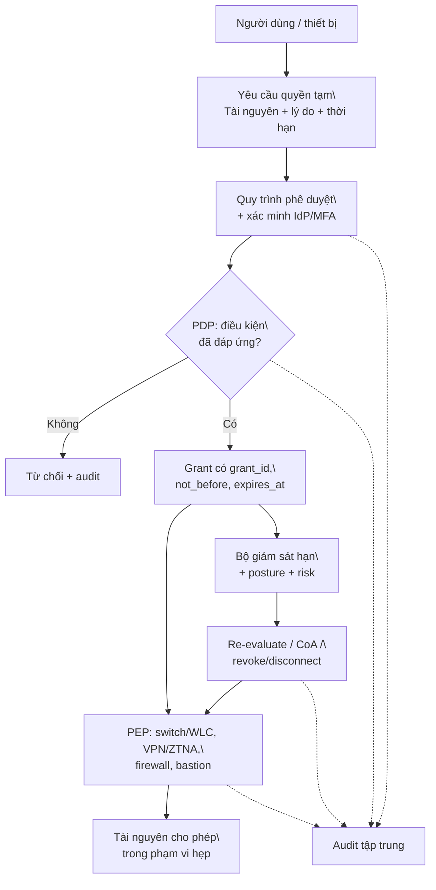

# Temporary access trong Network Access Control

## Mục tiêu học tập

Sau bài học, bạn có thể:

1. Giải thích **temporary access** (quyền truy cập tạm thời) trong Network Access Control (NAC), phân biệt quyền tạm với tài khoản tạm, phiên mạng, địa chỉ IP được cấp và quyền truy cập thường trực.
2. Thiết kế chính sách cấp quyền có **thời điểm bắt đầu, thời điểm hết hạn, phạm vi tài nguyên, danh tính, thiết bị, lý do và người phê duyệt**.
3. Phân tích cách thực thi truy cập tạm thời qua **802.1X/EAP, RADIUS, VLAN/dACL/SGT, VPN/ZTNA, firewall, bastion và hệ thống IAM/PAM**.
4. Mô tả luồng **yêu cầu → đánh giá → phê duyệt → cấp quyền → giám sát → hết hạn/thu hồi → kiểm toán**, kể cả khi phiên còn mở hoặc có lỗi mạng.
5. Nhận diện rủi ro như quá hạn không thu hồi, cache quyền, tài khoản chia sẻ, mở rộng phạm vi, thiết bị mất chuẩn an toàn và quy trình truy cập khẩn cấp.
6. Xây dựng kịch bản thử nghiệm chứng minh quyền chỉ có hiệu lực trong khoảng cho phép, được **thu hồi thực tế** và có đủ dấu vết để điều tra.

## 1. Temporary access là gì và vì sao cần?

Trong **Network Access Control**, *temporary access* là khả năng cho một danh tính hoặc thiết bị truy cập **một tập tài nguyên mạng xác định**, trong **một khoảng thời gian có giới hạn** và dưới những điều kiện kiểm tra cụ thể. Hết hạn, hết lý do công việc hoặc khi điều kiện không còn đáp ứng, quyền phải được thu hồi.

Nhu cầu thường gặp:

- **Khách và nhà thầu:** cần dùng Wi-Fi khách, truy cập một dịch vụ hỗ trợ hoặc một vùng dự án trong vài giờ/ngày.
- **Nhân viên hỗ trợ sự cố:** cần mở kết nối từ bastion đến một máy chủ production để xử lý một ticket được duyệt.
- **Nhóm triển khai:** cần quyền kết nối đến một dịch vụ hoặc cổng quản trị trong cửa sổ bảo trì.
- **Thiết bị mới/chưa đạt chuẩn:** chỉ được vào **vùng onboarding/remediation** để đăng ký chứng thư, cập nhật hệ điều hành hoặc cài agent.
- **Truy cập khẩn cấp (*break-glass*):** sử dụng quy trình đặc biệt khi hạ tầng xác thực/chính sách chính gặp sự cố, với giám sát và truy cứu tăng cường.

Ví dụ: một nhà thầu được phép vào `build.corp.example.test:443` từ **09:00 đến 17:00 giờ Việt Nam** trong ngày bảo trì. Quyền phải gắn với danh tính nhà thầu, thiết bị đã xác minh, ứng dụng/cổng đích và ticket; việc nhà thầu còn kết nối Wi-Fi sau 17:00 **không có nghĩa** họ được tiếp tục dùng ứng dụng.

Mục tiêu của module `SECURITY_NETWORK_SECURITY` là xây dựng các lớp phòng vệ mạng từ phân đoạn, firewall, VPN, IDS/IPS và xác thực kết nối tới DNS, mạng không dây, đám mây, phân tích lưu lượng và threat modeling. Temporary access áp dụng trực tiếp các lớp này để hạn chế **ai có thể kết nối tới đâu và trong bao lâu**, qua cả mạng nội bộ lẫn kết nối từ xa.

### 1.1. Quyền truy cập tạm thời không chỉ là tài khoản hết hạn

| Khái niệm | Điều được giới hạn | Điều **không** được đảm bảo chỉ bởi cơ chế đó |
|---|---|---|
| **Account expiration** | Thời gian tài khoản còn được dùng để xác thực mới | Phiên đã xác thực trước đó có thể vẫn hoạt động |
| **Access grant expiration** | Quyền/nhóm/role/policy có hiệu lực tới một mốc | Thiết bị thực thi có thể đang cache quyền cũ |
| **Session timeout** | Tuổi tối đa của phiên kết nối/xác thực | Một phiên mới có thể được cấp lại nếu quyền nền chưa bị thu hồi |
| **Idle timeout** | Thời gian phiên không có hoạt động | Phiên liên tục hoạt động có thể tồn tại tới khi bị giới hạn khác |
| **DHCP lease** | Thời gian dùng địa chỉ IP được cấp | Không phải thời hạn cho phép truy cập tài nguyên |
| **VPN tunnel lifetime** | Tuổi kết nối hoặc khóa/tunnel VPN | Không thay thế kiểm tra quyền cho từng tài nguyên |
| **Token TTL** | Thời hạn dùng một access token cụ thể | Refresh token, cookie hoặc phiên mạng riêng có thể vẫn còn |
| **Temporary firewall rule** | Cửa sổ rule allow được triển khai | Phiên TCP đã được stateful firewall theo dõi có thể cần xử lý riêng |

Vì vậy, chính sách tốt cần cùng lúc quy định **thời hạn cấp quyền**, **thời hạn phiên**, **điểm kiểm tra lại** và **hành vi khi thu hồi**.

## 2. Các nguyên tắc cốt lõi

1. **Least privilege:** cấp quyền tối thiểu về tài nguyên, giao thức, cổng, hành động và phạm vi mạng.
2. **Just-in-time (JIT):** kích hoạt quyền gần thời điểm thực hiện công việc, rồi tự hết hạn.
3. **Just-enough access (JEA):** chỉ cấp đủ thao tác cần thiết; ví dụ quyền đọc log thay vì quyền quản trị máy chủ toàn diện.
4. **Identity-first:** dùng danh tính cá nhân hoặc workload được xác thực; không coi IP/VLAN là danh tính người dùng.
5. **Device trust:** xét trạng thái thiết bị, chứng thư, endpoint posture và mức độ quản lý khi chính sách yêu cầu.
6. **Explicit expiry and revocation:** mốc hết hạn là bắt buộc, không phụ thuộc thao tác thu hồi bằng tay.
7. **Continuous/periodic evaluation:** đánh giá lại khi quyền, phiên, rủi ro hoặc trạng thái thiết bị thay đổi.
8. **Auditability:** mỗi quyết định có bằng chứng: ai yêu cầu, ai duyệt, điều kiện, lúc bắt đầu/hết hạn, thực thi và thu hồi.
9. **Defense in depth:** NAC, microsegmentation/firewall, ứng dụng và IAM đều giới hạn quyền ở lớp tương ứng.

**Zero Trust** phù hợp với tư duy này: không tin một yêu cầu chỉ vì thiết bị đang ở mạng “nội bộ”. Quyền kết nối phải được xác thực và ủy quyền đúng tài nguyên, đồng thời được đánh giá lại theo khả năng của hệ thống.

### 2.1. Bốn trục giới hạn quyền

Một quyền temporary access có thể được mô hình hóa như:

```text
GRANT = {
  actor:        một danh tính cụ thể,
  device:       thiết bị / trạng thái được phép,
  resource:     ứng dụng, IP/hostname, segment hoặc dịch vụ,
  action:       tập hành động/port/protocol hợp lệ,
  time_window:  [not_before, expires_at),
  conditions:   MFA, posture, vị trí/chính sách, phê duyệt,
  ticket:       lý do và mã yêu cầu,
  controls:     logging, rate limit, reauthentication, revocation
}
```

Ký hiệu khoảng `[not_before, expires_at)` nghĩa là quyền **có hiệu lực ở thời điểm bắt đầu và không còn hiệu lực từ đúng thời điểm hết hạn**. Cách diễn giải biên thời gian phải nhất quán trong các dịch vụ quản lý và thực thi.

Quyền truy cập tại một thời điểm chỉ nên được cho phép khi **tất cả các điều kiện bắt buộc** đều thỏa. Nếu không có ngoại lệ được phê duyệt, chính sách **deny by default** được ưu tiên.

## 3. Kiến trúc thực thi temporary access

Các thành phần thường có:

- **Identity Provider (IdP):** xác minh người dùng hoặc workload, MFA và thông tin danh tính.
- **Policy Decision Point (PDP):** quyết định có cho phép truy cập dựa trên thời gian, role, thiết bị, địa điểm, tình trạng rủi ro và ticket.
- **Policy Administration Point (PAP):** nơi quản lý chính sách/quy trình phê duyệt và cấp quyền.
- **Policy Enforcement Point (PEP):** chặn hoặc cho phép traffic/session tại switch, wireless controller, VPN gateway, ZTNA connector, proxy, firewall hay ứng dụng.
- **NAC/RADIUS:** có thể gắn xác thực cổng mạng với VLAN, downloadable ACL (dACL), Security Group Tag (SGT) hoặc thuộc tính tương đương tùy hãng.
- **PAM/bastion:** cho phép phiên quản trị có giới hạn và ghi audit; phù hợp quyền cần dùng lệnh nhạy cảm.
- **Log/SIEM/asset inventory:** kiểm chứng quyền, phiên, lịch sử thay đổi và hiệu lực thực tế.



Điểm mấu chốt: **PDP quyết định, PEP thực thi**. Việc grant đã hết hạn trong cơ sở dữ liệu PDP **không đủ** nếu PEP vẫn đang giữ ACL hoặc phiên truy cập cũ.

### 3.1. Những mô hình áp dụng thường gặp

| Mô hình | Điểm thực thi | Phạm vi thích hợp | Vấn đề cần kiểm tra |
|---|---|---|---|
| **802.1X có NAC** | Switch cổng có dây, wireless controller/AP | Người/thiết bị vào LAN/Wi-Fi | RADIUS attributes, reauth, CoA, VLAN/dACL sau timeout |
| **Guest Wi-Fi** | Captive portal + WLC/NAC | Khách truy cập Internet hoặc tài nguyên được duyệt | Giới hạn thời gian, isolation, tài khoản/sponsor, portal logout |
| **VPN** | VPN concentrator/gateway | Kết nối từ xa đến subnet được phép | Tunnel timeout, split tunnel, route, policy, token và phiên tồn tại |
| **ZTNA / application proxy** | Connector/proxy theo ứng dụng | Truy cập đúng một ứng dụng dịch vụ | Session policy, thiết bị, quyền ở backend, ứng dụng bỏ qua proxy |
| **Firewall time-based rule** | Firewall/SDN policy | Cửa sổ mở một tuyến/giao thức/cổng | Session table, rule cleanup, IPv6 và đường mạng thay thế |
| **PAM / bastion** | Gateway quản trị | SSH/RDP/DB admin có kiểm soát | JIT credential, session recording, kill session, tài khoản dùng chung |
| **Cloud IAM + security controls** | Cloud control plane + network policy | Quyền thay đổi hạ tầng tạm thời | Role session expiry, quyền API và đường data plane cần kiểm soát riêng |

Không có một điểm thực thi nào mặc định bao phủ mọi lớp. Ví dụ, NAC ở switch có thể giới hạn thiết bị vào VLAN, nhưng ứng dụng vẫn phải xác thực request và kiểm tra quyền dữ liệu.

## 4. Mối liên hệ với IEEE 802.1X, EAP và RADIUS

### 4.1. Luồng xác thực cổng mạng

Với mạng có dây hoặc WPA-Enterprise, mô hình điển hình gồm:

- **Supplicant:** client (người dùng hoặc thiết bị) thực hiện xác thực.
- **Authenticator:** switch hoặc access point/wireless controller bảo vệ cổng/SSID.
- **Authentication server:** thường là NAC/RADIUS phối hợp xác thực qua EAP và chính sách hệ thống.

```text
Client/Supplicant        Switch/AP (Authenticator)      NAC/RADIUS
       |                           |                         |
       | --- EAPoL / EAP --------> |                         |
       |                           | --- RADIUS/EAP -------> |
       |                           | <--- Access-Accept ---- |
       |                           |    + policy attributes  |
       | <--- link được cho phép -- |                         |
       |                           |                         |
       |    ... tới hạn / đổi posture / thu hồi ...          |
       |                           | <--- CoA/Disconnect --- |
       |  reauth, đổi dACL/VLAN,    |                         |
       |  hoặc ngắt phiên          |                         |
```

**EAP-TLS** có thể xác minh chứng thư thiết bị/người dùng theo cấu hình hệ thống; nó không tự quyết định nhóm VLAN hay thời hạn quyền. **RADIUS Access-Accept** có thể mang thuộc tính phục vụ enforcement như `Session-Timeout`, VLAN assignment hoặc thuộc tính riêng của nhà cung cấp.

Các chi tiết quan trọng:

- `Session-Timeout` có thể chỉ định số giây tối đa được phục vụ trước khi phiên bị kết thúc hoặc tái xác thực, tùy thiết bị và điều kiện kèm theo.
- `Idle-Timeout` giới hạn nhàn rỗi ở những thiết bị hỗ trợ; không thay thế mốc hết hạn quyền tuyệt đối.
- **RADIUS Change of Authorization (CoA)** và **Disconnect-Request** (khi thiết bị hỗ trợ và đã cấu hình bảo vệ) có thể yêu cầu thay đổi/quét phiên đang hoạt động.
- Cấu hình **VLAN động**, **downloadable ACL**, role hoặc **SGT** phụ thuộc năng lực, phiên bản và cơ chế tích hợp của switch/WLC/NAC. Không nên giả định mọi thiết bị hiểu cùng một thuộc tính.
- RADIUS accounting (`Start`, `Interim-Update`, `Stop`) hỗ trợ đối soát phiên; bộ phận vận hành vẫn cần xác minh log và phiên thực tế nếu dữ liệu accounting bị mất.

Nếu NAC đặt guest vào **remediation VLAN** nhưng policy firewall giữa VLAN và mạng production cho phép quá rộng, thiết kế vẫn thất bại. Kiểm soát truy cập phải hiệu lực xuyên các lớp phân đoạn.

### 4.2. MAB và thiết bị không hỗ trợ 802.1X

Một số thiết bị như máy in, camera hoặc thiết bị IoT cũ có thể dùng **MAC Authentication Bypass (MAB)** ở môi trường đã được kiểm soát. Địa chỉ MAC có thể giả mạo nên **không tương đương xác thực chứng thư hoặc danh tính mạnh**.

Nếu cần truy cập tạm cho thiết bị loại này:

1. Đưa vào segment có phạm vi hẹp theo loại thiết bị/chức năng.
2. Ghi asset ID, MAC, cổng switch hoặc SSID và người bảo trợ.
3. Chỉ cho phép dịch vụ cần thiết đến đích cụ thể.
4. Giới hạn thời gian, giám sát hành vi bất thường và thu hồi bằng NAC/port ACL.
5. Có lộ trình thay bằng phương án định danh mạnh hơn khi khả thi.

## 5. Quy trình vòng đời một quyền tạm thời

Một hệ thống được thiết kế tốt cần coi quyền tạm là một **đối tượng có vòng đời** chứ không phải “mở rule rồi nhớ đóng”.

| Trạng thái | Ý nghĩa | Chuyển trạng thái điển hình |
|---|---|---|
| `REQUESTED` | Có yêu cầu, chưa được quyết định | `APPROVED` hoặc `DENIED` |
| `APPROVED` | Đã phê duyệt, chưa tới thời gian có hiệu lực hoặc chưa triển khai | `ACTIVE`, `CANCELLED` |
| `ACTIVE` | Đã được PEP xác nhận áp dụng chính sách | `SUSPENDED`, `EXPIRED`, `REVOKED` |
| `SUSPENDED` | Tạm đình chỉ do posture/risk; có thể kiểm tra lại | `ACTIVE` hoặc `REVOKED` |
| `EXPIRED` | Qua mốc `expires_at` và đã thực thi ngừng cấp | Kết thúc |
| `REVOKED` | Thu hồi sớm theo lệnh/quyết định | Kết thúc |
| `DENIED` / `CANCELLED` | Yêu cầu không được cấp hoặc bị hủy | Kết thúc |

Trong thực tế, có thể cần thêm trạng thái **REVOKE_PENDING / ENFORCEMENT_FAILED**: thời hạn đã hết nhưng PEP chưa xác nhận đóng quyền. **Không được báo “thu hồi thành công” chỉ vì tác vụ gỡ quyền đã được gửi.**

### 5.1. Request → approval

Người yêu cầu cung cấp ít nhất:

- **Who:** user/principal ID, loại tài khoản, nhóm công việc và thiết bị.
- **Why:** ticket, yêu cầu bảo trì/sự cố, đơn vị phê duyệt.
- **What:** ứng dụng hoặc resource ID, protocol/port, quyền đọc/ghi/quản trị.
- **When:** thời điểm bắt đầu/hết hạn, múi giờ và thời lượng tối đa.
- **Where/how:** phương thức truy cập (VPN, ZTNA, bastion, Wi-Fi khách), điều kiện thiết bị.
- **Risk:** dữ liệu nhạy cảm, độ phơi bày, ảnh hưởng nếu quyền bị lạm dụng.

Người phê duyệt cần có trách nhiệm với tài nguyên. Những trường hợp nhạy cảm có thể yêu cầu **nguyên tắc bốn mắt** (người yêu cầu và người phê duyệt khác nhau). Không nên để một người tự duyệt cho mình quyền admin production nếu quy trình không có kiểm soát thay thế.

### 5.2. Activate → monitor

Khi tới cửa sổ hiệu lực, policy engine kiểm tra lại:

1. Grant còn hợp lệ và chưa bị thu hồi?
2. Người dùng được xác thực đúng IdP và đạt mức MFA yêu cầu?
3. Thiết bị còn được quản lý/đủ posture, chứng thư còn hiệu lực?
4. Tài nguyên thuộc phạm vi cho phép và chưa thay đổi chủ sở hữu?
5. Giới hạn đồng thời, vị trí, rủi ro hoặc approval vẫn đáp ứng?
6. Enforcement point có áp dụng thành công policy mới?

Khi có thay đổi quyền cao, thiết bị bị mất quản lý, đánh dấu compromised hay lộ credential, hệ thống cần **re-evaluate** và thu hồi sớm; không mặc định chờ đến hạn.

### 5.3. Expire → revoke → verify

Đến thời điểm kết thúc, chỉ xóa bản ghi grant hoặc xóa người dùng khỏi một group chưa đủ. Cần xác định PEP nào đã thực thi quyền và xử lý phù hợp:

- **NAC/802.1X:** cập nhật policy, áp dụng CoA, reauthentication hoặc disconnect tùy hạ tầng; kiểm tra quyền VLAN/dACL thực tế.
- **VPN/ZTNA:** kết thúc quyền phiên theo ứng dụng/tunnel, vô hiệu hóa token hay phiên khi nền tảng hỗ trợ, chặn xác thực lại.
- **Firewall:** gỡ rule/đối tượng động, đồng thời xem hành vi của **state table/conntrack** và các kết nối được phép trước đó.
- **Bastion/PAM:** đóng phiên quản trị, vô hiệu hóa credential JIT, kiểm tra process/kết nối phụ còn hoạt động.
- **Cloud/IAM:** hết hạn role session hoặc credential tạm, hủy quyền API; các kết nối ở data plane có thể cần enforcement riêng.
- **Ứng dụng:** kiểm tra quyền ở từng request hoặc giới hạn session để tránh một phiên ứng dụng tiếp tục dùng quyền cao.

Phải có **bằng chứng xác nhận** đã đóng quyền: status từ PEP, session terminated/accounting Stop, kiểm tra không thể thiết lập phiên mới và nếu yêu cầu chính sách thì xác nhận phiên cũ cũng bị cắt.

## 6. Ví dụ thiết kế: nhà thầu truy cập một ứng dụng nội bộ

Giả sử doanh nghiệp có ứng dụng nội bộ `reports.corp.example.test`. Nhà thầu cần xem báo cáo từ 09:00 đến 12:00 giờ Việt Nam trong ngày làm việc, chỉ qua ZTNA. Hệ thống có IdP, device posture, application proxy và audit tập trung.

| Thành phần | Giá trị chính sách minh họa |
|---|---|
| Actor | `contractor-024`, định danh cá nhân tại IdP |
| Thiết bị | `managed-device-218`, trạng thái tuân thủ chính sách |
| Tài nguyên | `reports.corp.example.test`, cổng HTTPS |
| Quyền | Read-only tại ứng dụng; không có quyền admin hoặc tải hàng loạt |
| Bắt đầu | `2026-11-30T02:00:00Z` (09:00 ICT) |
| Kết thúc | `2026-11-30T05:00:00Z` (12:00 ICT) |
| Điều kiện | MFA, session mới hoặc reauth, kiểm tra posture, không có cảnh báo rủi ro cao |
| Phê duyệt | Owner ứng dụng; lưu ticket và grant ID |
| Enforcement | ZTNA proxy + application authorization |
| Audit | Request/grant, decision, phiên, deny, expiration/revoke |

Ví dụ cấu hình **pseudocode YAML**, không phải cú pháp của sản phẩm NAC hay ZTNA cụ thể:

```yaml
grant_id: nac-temp-20261130-024
actor_id: contractor-024
device_id: managed-device-218
ticket_id: CHANGE-4821

resource:
  application_id: reports-app
  hostname: reports.corp.example.test
  protocol: tcp
  port: 443
  allowed_actions:
    - report.read

validity:
  not_before: "2026-11-30T02:00:00Z"
  expires_at: "2026-11-30T05:00:00Z"
  max_session_seconds: 1800

requirements:
  idp_authenticated: true
  mfa: true
  device_compliant: true
  access_via: ztna
  approval_id: approval-792

enforcement:
  default: deny
  on_expiry: disconnect_and_deny_new_sessions
  on_posture_failure: revoke
  audit_decisions: true
```

**Tại sao cần cả `max_session_seconds`?** Nếu phiên bắt đầu lúc 11:55, thời hạn tuyệt đối 12:00 vẫn là giới hạn quan trọng: phiên **không thể hợp lệ đến 12:25** chỉ vì max session là 30 phút. Cần áp dụng giới hạn nhỏ hơn giữa **thời gian phiên còn được dùng** và **thời gian quyền còn hợp lệ**, đồng thời bảo đảm PEP ngắt/hạn chế phiên đang hoạt động theo khả năng thực tế.

### 6.1. Quy tắc quyết định ở mức khái niệm

```python
def allow_temporary_access(grant, request, now_utc):
    if grant.status != "ACTIVE":
        return False
    if not (grant.not_before <= now_utc < grant.expires_at):
        return False
    if grant.actor_id != request.authenticated_actor_id:
        return False
    if grant.device_id != request.verified_device_id:
        return False
    if not request.mfa_ok or not request.device_compliant:
        return False
    if not request.resource_in_scope or not request.action_in_scope:
        return False
    if grant.revoked or request.risk_blocked:
        return False
    return True
```

Đây là **minh họa logic** ở PDP. Khi triển khai, cần tin dữ liệu danh tính và thiết bị từ nguồn xác thực, kiểm soát race condition, dùng cơ sở dữ liệu giao dịch, quản lý đồng hồ và tính đến cache ở PEP. Chỉ viết hàm trả về `False` sau giờ hết hạn **không có nghĩa** tất cả kết nối hiện tại tự ngắt.

## 7. Tính đúng đắn của thời gian và đồng bộ hóa

Temporary access đặc biệt dễ sai ở ranh giới thời gian.

### 7.1. UTC, múi giờ và thời điểm hết hạn

- Lưu thời điểm dưới dạng **instant có timezone rõ ràng**, thường chuẩn hóa UTC.
- Hiển thị giờ địa phương theo vùng và quy tắc lịch tương ứng (ví dụ `Asia/Ho_Chi_Minh`), nhưng không bỏ offset khi gửi API.
- Không dùng chuỗi `2026-11-30 12:00` thiếu timezone làm dữ liệu quyết định.
- Xác định rõ **hết hạn tại `expires_at`** hay cuối một giây/phút nào đó; dùng kiểm tra `now < expires_at`.
- Khi gia hạn, tạo sự kiện phê duyệt/audit mới và đánh giá lại quyền; không cho phép client tự kéo dài TTL.

**Ví dụ:** `expires_at = 2026-11-30T05:00:00Z` tương ứng 12:00 ICT. Một sự kiện lúc `05:00:00.001Z` phải bị từ chối nếu chính sách dùng khoảng nửa mở nêu trên.

### 7.2. Clock drift và độ trễ chính sách

Đồng hồ của IdP, PDP, PEP, NAC, VPN và SIEM có thể lệch nhau. Cần đồng bộ NTP/dịch vụ thời gian đáng tin, giám sát độ lệch và xác định **nguồn thời gian có thẩm quyền** cho quyết định.

Ngoài lệch giờ còn có:

- **Propagation delay:** quyền đã được thu hồi ở trung tâm nhưng chưa đến mọi PEP.
- **Policy cache:** PEP vẫn dùng quyết định cũ đến khi re-evaluate.
- **Offline enforcement:** một thiết bị không nhận được yêu cầu CoA/Disconnect.
- **Queue/worker lag:** tác vụ hết hạn chờ xử lý chậm.
- **Clock rollback:** đồng hồ bị chỉnh ngược gây sai thời hạn nếu lập trình thiếu bảo vệ.

Thiết kế cần **ngưỡng trễ thu hồi mục tiêu** rõ ràng, cảnh báo vi phạm và chính sách khi PEP mất kết nối với PDP. Ở tài nguyên nhạy cảm, có thể yêu cầu fail closed; với hạ tầng thiết yếu, phương án continuity phải được xác định và phê duyệt riêng trước khi xảy ra sự cố.

### 7.3. Những TTL thường bị nhầm

- **DNS TTL** chỉ kiểm soát thời gian cache DNS record, không ảnh hưởng hiệu lực grant.
- **DHCP lease** chỉ là thời hạn sử dụng IP và không phải cơ chế ủy quyền.
- **TLS certificate validity** biểu thị thời gian chứng thư được xem là hợp lệ trong quá trình kiểm tra, không tự động bằng thời hạn truy cập nghiệp vụ.
- **OAuth access-token expiry** kiểm soát token; refresh token hoặc phiên khác có thể cấp token mới nếu hệ thống không thu hồi quyền nguồn.
- **Stateful firewall idle timeout** có thể giữ kết nối đủ lâu sau khi rule allow bị gỡ; cần chủ động xử lý nếu mục tiêu là chặn mọi lưu lượng từ thời điểm hết hạn.

## 8. Rủi ro và lạm dụng liên quan temporary access

| Rủi ro | Hậu quả có thể xảy ra | Kiểm soát đề xuất |
|---|---|---|
| **Grant quá rộng** | Nhà thầu có thể di chuyển ngang sang mạng/ứng dụng ngoài nhu cầu | Scope theo app/resource, segment và hành động; deny mặc định |
| **Hết hạn trên giấy, phiên vẫn chạy** | Tiếp tục truy cập sau giờ đã duyệt | CoA/disconnect, session TTL, per-request authorization, kiểm tra conntrack |
| **Dùng group đặc quyền thường trực** | Quyền “tạm” thành quyền lâu dài vì quên xóa | JIT membership, expiration bắt buộc, đối soát định kỳ |
| **Phê duyệt thiếu độc lập** | Người yêu cầu tự cấp quyền nhạy cảm | Approval từ resource owner hoặc PAM policy, kiểm tra xung đột vai trò |
| **Shared account / guest chung** | Khó quy trách nhiệm, thu hồi ảnh hưởng nhiều người | Per-user identity/session, MFA, sponsor và audit |
| **Thiết bị không an toàn** | Lộ dữ liệu, malware mở đường từ endpoint vào mạng | Posture, endpoint protection, quarantine/remediation zone |
| **Cache hoặc mạng bị phân vùng** | Một PEP không nhận trạng thái revoke | Giới hạn tuổi policy cache, health alert, reconcile và xác minh enforcement |
| **Thông tin thiết bị giả mạo** | Dựa vào MAC/IP đơn thuần để vượt chính sách | Danh tính EAP-TLS/thiết bị quản lý, xác minh posture từ nguồn đáng tin |
| **Quên đường truy cập thay thế** | ZTNA chặn nhưng SSH trực tiếp còn mở | Kiểm soát toàn bộ ingress/egress, segmentation, firewall và ứng dụng |
| **Thiếu log và correlation ID** | Không tái dựng ai đã được cấp và đã dùng quyền khi nào | Audit grant/decision/session/revoke, đồng bộ giờ, log tập trung |
| **Quy trình khẩn cấp bị lạm dụng** | Break-glass trở thành lối vào quyền admin thường trực | Mục tiêu cụ thể, phê duyệt hậu kiểm, cảnh báo tức thời, thời hạn ngắn |
| **Gia hạn lặp vô hạn** | Quyền tạm tích lũy thành lâu dài | Số lần/giới hạn gia hạn, phê duyệt mới và rà soát rủi ro |

Một cuộc tấn công có thể tận dụng quyền tạm hợp lệ khi tài khoản người dùng bị chiếm đoạt; vì thế kiểm soát MFA, thiết bị và anomaly detection vẫn cần thiết ngay cả khi grant có TTL ngắn.

## 9. Hai tình huống cần thiết kế riêng

### 9.1. Guest/BYOD onboarding và remediation

Một khách tới văn phòng cần Internet nhưng không được vào production; một thiết bị nhân viên vừa cài lại hệ điều hành cần nhận profile/chứng thư trước khi được vào mạng nội bộ.

Luồng gợi ý:

1. Kết nối vào SSID guest/onboarding; switch/WLC đưa thiết bị vào segment giới hạn.
2. Người dùng đăng ký với sponsor hoặc dùng SSO theo chính sách, nhận grant thời hạn ngắn.
3. Hệ thống kiểm tra loại thiết bị, chứng thư và posture cần thiết.
4. PEP chỉ cấp Internet, dịch vụ cập nhật hoặc endpoint onboarding đã được allowlist; tránh cho phép truy cập nội bộ mặc định.
5. Sau khi thiết bị đủ chuẩn và người dùng được cấp quyền, áp chính sách mới qua reauthentication/CoA.
6. Hết hạn hoặc sponsor thu hồi thì khóa quyền, ngắt phiên và ghi log.

Captive portal **chỉ xác minh ở bước portal** không nhất thiết bảo vệ mọi đường mạng ở tầng liên kết. Đảm bảo kiểm soát ở switch/WLC/firewall vẫn hoạt động sau khi xác thực, đặc biệt đối với IPv6 và kết nối giữa các thiết bị khách (client isolation).

### 9.2. Break-glass để khôi phục sự cố

Khi IdP hoặc hệ thống PAM chính không sẵn sàng, đội trực có thể cần phương án khẩn cấp để khôi phục dịch vụ. Cơ chế này phải được thiết kế **từ trước**:

- Xác định người trực được phép, tài sản tối thiểu, mục đích và mức thời hạn.
- Bảo vệ credential khẩn cấp bằng kho truy cập kiểm soát được, MFA/hardware factor nếu khả thi.
- Theo dõi sử dụng bằng cảnh báo tức thời và audit tại bastion/thiết bị; log gửi tới điểm độc lập khi có thể.
- Quy định điều kiện kích hoạt, xác minh danh tính qua kênh thay thế và phê duyệt/hậu kiểm.
- Sau sự cố: thu hồi grant, rotate credential nếu cần, đối soát cấu hình/phiên, đóng ticket và tổ chức review.

**Break-glass không đồng nghĩa bỏ qua tất cả kiểm soát.** Nếu một thành phần danh tính không hoạt động, tổ chức cần quyết định kiểm soát bù cụ thể; tài khoản khẩn cấp dùng thường ngày là anti-pattern nguy hiểm.

## 10. Audit: chứng minh quyền đã được áp dụng và thu hồi

Audit tốt cần trả lời hai nhóm câu hỏi: **ai có quyền** và **quyền thực sự được sử dụng/thực thi thế nào**.

### 10.1. Sự kiện nên ghi

| Loại sự kiện | Trường quan trọng |
|---|---|
| `access.requested` | request ID, actor, resource, lý do, yêu cầu thời hạn, thiết bị |
| `access.approved` / `denied` | approver, quyết định, điều kiện, approval ID |
| `grant.created` | grant ID, scope, `not_before`, `expires_at`, policy version |
| `grant.activated` | thời gian, PEP ID, policy hash/version, kết quả xác nhận |
| `session.started` / `ended` | session ID, principal, device, VPN/NAC/bastion, thời gian, nguyên nhân |
| `access.denied` | resource, action, reason code, policy ID và nguồn đã xác thực |
| `grant.expired` / `revoked` | nguyên nhân, ai/điều kiện kích hoạt, thời gian gửi thu hồi |
| `enforcement.confirmed` | thiết bị PEP, trạng thái cuối, số phiên đã ngắt, thời gian |
| `enforcement.failed` | điểm thực thi, loại lỗi, số lần thử, mức ưu tiên xử lý |
| `access.extended` | grant cũ/mới, thời hạn mới, approval mới và ticket |

Một bản ghi nên có `occurred_at` (UTC), `ingested_at`, nguồn đã xác thực, `event_id` và `correlation_id` để nối workflow approval với các log từ PEP. Các log có chứa IP, thiết bị, lịch sử truy cập và danh tính phải được bảo vệ phù hợp quyền riêng tư, phân quyền và thời hạn lưu.

### 10.2. Ví dụ audit event minh họa

```json
{
  "event_id": "evt-28744",
  "event_type": "grant.revoked",
  "occurred_at": "2026-11-30T05:00:00Z",
  "ingested_at": "2026-11-30T05:00:01Z",
  "grant_id": "nac-temp-20261130-024",
  "actor_id": "contractor-024",
  "resource_id": "reports-app",
  "reason_code": "EXPIRED",
  "requested_action": "disconnect_and_deny_new_sessions",
  "enforcement": {
    "pep_id": "ztna-gateway-01",
    "status": "confirmed",
    "confirmed_at": "2026-11-30T05:00:01Z",
    "terminated_sessions": 1
  },
  "correlation_id": "access-ticket-4821"
}
```

Đây là dữ liệu **giả lập**. Trong hệ thống thật, không suy luận `status=confirmed` chỉ từ việc tác vụ chạy xong: cần xác nhận từ PEP và, với quyền nhạy cảm, kiểm tra khả năng tạo phiên mới và tình trạng phiên cũ. Nếu chưa nhận xác nhận, lưu `pending` hoặc `failed` và cảnh báo.

### 10.3. Số liệu vận hành có ích

- **Grant có thời hạn:** tỷ lệ grant có `expires_at` hợp lệ và không vượt mức tối đa theo policy.
- **Over-privileged grants:** số grant vượt quyền/tài nguyên đề nghị hoặc thiếu approval.
- **Revocation latency:** chênh lệch giữa thời điểm phải thu hồi và thời điểm PEP xác nhận không còn cấp quyền.
- **Stale sessions:** số phiên còn hiệu lực sau `expires_at`.
- **Unknown owner:** số grant/tài nguyên không xác định rõ chủ sở hữu.
- **Failed enforcement:** số lần CoA/disconnect/gỡ rule thất bại và thời gian khắc phục.
- **Exception usage:** số lần break-glass, số lần gia hạn, mức độ đáp ứng hậu kiểm.

Chỉ số cần định nghĩa rõ dữ liệu nguồn và phạm vi đo. Tỷ lệ “job expire chạy thành công” không có nghĩa **thu hồi quyền trên toàn bộ PEP thành công**.

## 11. Kiểm thử thực tế trong lab được cấp phép

Giả sử một lab có:

- Một máy khách `client-A` đã đăng ký danh tính thử nghiệm.
- NAC/IdP thử nghiệm và một PEP (switch/WLC hoặc ZTNA gateway).
- Một dịch vụ test `app.lab.example.test:443` và một dịch vụ đối chứng `admin.lab.example.test:22`.
- Một grant có hiệu lực trong **10 phút** cho `client-A` vào **chỉ** `app.lab.example.test:443`.

Để giảm nhầm lẫn, hãy đánh dấu thời gian bắt đầu bằng đồng hồ UTC và giữ log tại PEP và ứng dụng.

### 11.1. Ma trận kiểm thử

| Thời điểm / tác động | Hành vi mong đợi | Bằng chứng |
|---|---|---|
| **Trước `not_before`** | Truy cập app bị từ chối | PDP deny, PEP drop/deny, kết nối không thành công |
| **Bắt đầu cửa sổ** | Xác thực đạt và PEP áp policy | Grant activated, session start, policy version |
| **Trong cửa sổ, đúng tài nguyên** | Kết nối HTTPS tới app được phép | Access log ứng dụng, session ID, source đã xác thực |
| **Trong cửa sổ, sai tài nguyên/cổng** | Kết nối SSH tới admin host bị chặn | Firewall/PEP deny, không có quyền network path |
| **Thiết bị mất posture** | Thu hồi hoặc chuyển quarantine theo chính sách | Policy decision, CoA, session terminated |
| **Đúng `expires_at`** | Không cấp phiên mới và xử lý phiên đang mở như đã thiết kế | Grant expired, enforcement confirmed, thử kết nối thất bại |
| **Sau hạn, reconnect** | Bị từ chối dù DHCP lease/tunnel cũ còn | Log PEP và application authorization |
| **Thu hồi sớm từ approver** | Quyền dừng trước hạn, không tái kích hoạt ngoài quy trình | Revoked event, kết quả áp dụng PEP |
| **PEP mất liên lạc PDP** | Hành vi theo chính sách outage đã phê duyệt; không bỏ qua TTL | Log failover/cache, cảnh báo và kiểm thử |
| **Gia hạn hợp lệ** | Chỉ hiệu lực sau phê duyệt mới, có thay đổi thời hạn được audit | New approval/grant version, audit trail đầy đủ |

**Không dùng kết quả một lệnh `ping` để chứng minh ACL ứng dụng.** ICMP có thể bị chặn hoặc được phép độc lập với TCP/443. Phải kiểm thử đúng giao thức/port/ứng dụng, đồng thời đối chiếu log của PEP.

### 11.2. Kiểm tra chủ động có giới hạn

Trong lab được cho phép, có thể dùng các lệnh sau trên client:

```bash
# Kiểm tra dịch vụ HTTPS trong phạm vi lab
curl --head --connect-timeout 3 --max-time 6 https://app.lab.example.test

# Xem thời gian UTC của máy thử (Linux)
date -u +'%Y-%m-%dT%H:%M:%SZ'

# Nếu có quyền xem log tại máy thử, ghi nhận địa chỉ và route
ip addr show
ip route show
```

Kết quả HTTP `200`, `302`, `401` hoặc `403` cần được hiểu theo chính sách ứng dụng. Một TCP handshake thành công **chưa chứng minh người dùng được phép đọc dữ liệu**; một phản hồi `401` thường chứng tỏ có đường kết nối đến ứng dụng nhưng người dùng chưa được xác thực ở tầng ứng dụng.

Cần kiểm tra thêm **phiên đã tồn tại trước lúc hết hạn**, vì yêu cầu ngắt phiên cũ khác với từ chối kết nối mới. Nếu policy yêu cầu ngắt ngay, quan sát đúng hành vi và số phiên còn lại ở gateway/firewall.

### 11.3. Quy trình xử lý khi kiểm thử thất bại

Nếu quyền vẫn còn sau hạn:

1. Xác minh timezone, đồng hồ PDP/PEP và giá trị `expires_at` thực tế.
2. Xem trạng thái grant ở policy store; đối chiếu audit `expired/revoked`.
3. Xác định PEP cụ thể và kiểm tra rule/session table hoặc role đang áp dụng.
4. Kiểm tra có đường kết nối thay thế, IP stack IPv6, session cookie hoặc policy cache còn hiệu lực.
5. Kiểm tra CoA/Disconnect, queue và kết quả API; xử lý sự kiện mất xác nhận.
6. Chặn đường truy cập theo thủ tục vận hành được phép, ghi lại thời gian và kết quả xác minh.
7. Tạo incident/bug có bằng chứng và cập nhật cơ chế revoke/reconcile phù hợp.

Không xóa log hoặc reset cấu hình rộng trong quá trình kiểm tra; giữ dữ liệu để điều tra nguyên nhân.

## 12. Mối quan hệ với firewall, VPN, microsegmentation và cloud

Temporary access phải phù hợp với kiến trúc mạng an toàn tổng thể:

**Firewall/ACL:** rule nên quy định chính xác traffic nguồn → đích → protocol/port, chiều vào/ra và thời điểm. Một allow cho `TCP/443` khác `UDP/443`; policy phải xét cả IPv4/IPv6. Khi gỡ rule, kiểm tra ảnh hưởng đối với stateful connections/NAT.

**VPN/ZTNA:** VPN có thể cho một thiết bị vào mạng; ZTNA thường giới hạn theo ứng dụng. Trong cả hai trường hợp, quyền tạm phải được gắn với danh tính và phiên cụ thể, có thời điểm hết hạn và hành vi thu hồi được kiểm chứng.

**Microsegmentation:** sau khi thiết bị vào mạng, workload/ứng dụng đích vẫn cần chính sách east-west giới hạn. Truy cập tạm tới một máy không đồng nghĩa truy cập cả subnet.

**IDS/IPS/monitoring:** thời gian và scope grant cung cấp ngữ cảnh cho detection; traffic bất thường ngoài thời gian/phạm vi là chỉ báo cần điều tra. Một grant hợp lệ không phải bằng chứng toàn bộ hành vi của phiên là an toàn.

**Cloud và container:** nhóm bảo mật cloud, network policy Kubernetes, service mesh hoặc API gateway có thể thực thi hạn chế ở các lớp khác nhau. Khi workload được tạo/xóa liên tục, nên gắn quyền với **resource identity/service account** và label đáng tin hơn là IP ngắn hạn; xác minh cơ chế selector và phiên bản policy.

**DNS:** hostname thuận tiện cho người dùng nhưng có thể trỏ đến nhiều IP hoặc thay đổi theo thời gian. Nếu enforcement dựa vào IP, cần xác định cách đồng bộ thay đổi DNS và tránh vô tình mở tới IP ngoài dự kiến. Không giả định DNS TTL bằng thời hạn quyền.

## 13. Anti-pattern và cách sửa

| Anti-pattern | Vì sao nguy hiểm | Cách sửa |
|---|---|---|
| “Tạm thời” nhưng không có `expires_at` | Không có ranh giới kết thúc được máy kiểm tra | Bắt buộc mốc UTC, giới hạn tối đa và quy trình gia hạn |
| Thêm nhà thầu vào group `network-admin` trong nhiều tuần | Vượt quyền, phạm vi lớn và dễ quên xóa | JIT role theo đúng tài nguyên, timeout ngắn và approval |
| Chỉ xóa user khỏi group | Phiên đã cấp quyền và PEP cache vẫn tồn tại | Thu hồi ở từng PEP, disconnect/reauth, xác minh |
| Cấp quyền theo public IP văn phòng | Nhiều người dùng cùng IP, không chứng minh danh tính | IdP + device identity + per-session policy |
| Guest Wi-Fi dùng chung mật khẩu lâu dài | Khó thu hồi từng khách và khó điều tra | Sponsor/per-guest credential hoặc phương pháp guest identity phù hợp |
| Dùng DHCP lease như thời hạn ủy quyền | Người dùng vẫn có thể kết nối với lease cũ | NAC policy và kiểm soát thực thi độc lập với DHCP |
| Đặt session timeout nhưng cấp lại ngay vô hạn | Quyền có thể kéo dài ngoài thời gian phê duyệt | Kiểm tra absolute expiry khi reauth/token refresh |
| Mất PDP thì mặc định permit all | Bất kỳ phiên mới nào cũng có thể vượt điều kiện | Outage policy được phê duyệt và giới hạn riêng từng loại tài nguyên |
| Cấp quyền qua firewall nhưng ứng dụng không kiểm tra role | Người dùng có thể đọc/ghi quá quyền dù kết nối hợp lệ | Authorization ở lớp ứng dụng theo role/action |
| Không giám sát failed revoke | Tin rằng hệ thống an toàn dù quyền cũ còn | Alert, retry có giới hạn, reconcile, báo trạng thái trung thực |
| Ghi log nhưng thiếu grant/session ID | Không thể nối approval với traffic và sự kiện thu hồi | Dùng correlation ID xuyên IAM/NAC/PEP/SIEM |

## 14. Bài tập và đáp án

**Bài 1 — Quyền đã hết nhưng tunnel còn.** Grant của nhà thầu hết lúc 12:00. Hệ thống IAM đã loại nhà thầu khỏi group, nhưng VPN tunnel mở trước đó vẫn truy cập được subnet nội bộ lúc 12:15. Temporary access đã được thu hồi đúng chưa?

**Đáp án:** **Chưa**. Việc xóa group mới thay đổi nguồn quyền; điểm thực thi VPN/firewall chưa chặn phiên cũ. Cần disconnect/re-evaluate và kiểm tra session/route/firewall thực tế, đồng thời ghi nhận độ trễ thu hồi.

**Bài 2 — MAB và thiết bị IoT.** Một camera không hỗ trợ 802.1X được whitelist theo MAC trong 24 giờ. Có thể khẳng định người gửi traffic là camera hợp lệ không?

**Đáp án:** Không. MAC có thể bị giả mạo. Cần segment riêng, giới hạn đích/giao thức, kiểm soát cổng switch và inventory, giám sát hành vi; thay bằng định danh mạnh khi khả thi.

**Bài 3 — Giới hạn phiên.** Grant từ 09:00 tới 11:00, tối đa 60 phút mỗi phiên. Một user đăng nhập lúc 10:50; phiên có thể tiếp tục đến 11:50 không?

**Đáp án:** Theo chính sách có hạn tuyệt đối 11:00, **không**. Session timeout một giờ là giới hạn bổ sung; hệ thống cần dừng quyền lúc 11:00 và xác nhận thực thi.

**Bài 4 — Kiểm tra port.** Nhà thầu chỉ có quyền TCP/443 tới một app. Kiểm tra ping báo thành công nhưng `curl` HTTPS không kết nối. Kết luận nào phù hợp?

**Đáp án:** Ping dùng ICMP, không chứng minh TCP/443 được phép. Cần kiểm tra DNS, route, PEP, ACL TCP/443, TLS, application listener và policy app trong thời gian grant.

**Bài 5 — Thời hạn trong sự cố.** Khi IdP hỏng, một tài khoản break-glass được dùng để sửa firewall. Có cần lưu audit và thời hạn không?

**Đáp án:** Có. Phải có phạm vi và thời gian ngắn, phương pháp xác minh thay thế, giám sát tức thời, hậu kiểm, thu hồi/rotate credential sau sự cố và lưu log tại nguồn độc lập nếu khả thi.

**Bài 6 — Kiểm soát cloud.** Kỹ sư được cấp temporary cloud IAM role để sửa security group trong 30 phút. Sau hạn, một kết nối TCP tới workload vẫn hoạt động. Đây có mâu thuẫn không?

**Đáp án:** Không nhất thiết. IAM role hết hạn điều khiển quyền **API/control plane**, không tự chặn kết nối ở **data plane**. Cần chính sách riêng tại firewall/security group/ứng dụng nếu mục tiêu là đóng luồng truy cập đang hoạt động.

## 15. Checklist thiết kế và nghiệm thu

- [ ] Có **actor/owner**, thiết bị hoặc workload identity được xác thực.
- [ ] Quyền được giới hạn theo **resource, protocol/port/action**, không cấp cả subnet nếu chỉ cần một ứng dụng.
- [ ] Có lý do, ticket, phê duyệt và giới hạn thời lượng phù hợp mức rủi ro.
- [ ] Có `not_before`, `expires_at` chuẩn UTC và xử lý đúng thời điểm biên.
- [ ] Có MFA/phương pháp xác thực phù hợp; posture thiết bị được xem xét theo chính sách.
- [ ] Quy trình cấp, gia hạn, thu hồi sớm và break-glass được định nghĩa rõ.
- [ ] PDP/PEP tương thích: reauthentication, CoA, disconnect, policy push và cách nhận xác nhận.
- [ ] Kiểm tra cả **phiên mới** và **phiên đang hoạt động** sau hết hạn.
- [ ] Chính sách xét đầy đủ IPv4/IPv6, VPN routes, split tunneling, firewall states và đường đi thay thế.
- [ ] Có xử lý cache, mất kết nối, clock drift, queue lag, retry và reconciliation.
- [ ] Log kết nối được grant ID, session ID, request/approval ID, PEP, thời gian, lý do và outcome.
- [ ] Có giám sát expired grants, stale sessions, failed revocation và tài khoản/quyền không owner.
- [ ] Đã thử nghiệm trong lab: trước hạn, trong hạn, sau hạn, mất posture, thu hồi sớm, lỗi PEP, gia hạn.
- [ ] Quy tắc DNS, segmentation, quản trị dịch vụ và ứng dụng phối hợp chặn các đường truy cập không được cấp.

## 16. Tài liệu tham khảo

- [NIST SP 800-207 — Zero Trust Architecture](https://csrc.nist.gov/pubs/sp/800/207/final): mô hình quyết định và thực thi quyền truy cập theo tài nguyên, danh tính và bối cảnh.
- [NIST SP 800-53 Rev. 5 — Security and Privacy Controls](https://csrc.nist.gov/pubs/sp/800/53/r5/upd1/final): các nhóm kiểm soát Access Control, Identification and Authentication, Audit and Accountability.
- **IEEE 802.1X**: port-based network access control, supplicant, authenticator và xác thực qua EAP.
- [RFC 5216 — The EAP-TLS Authentication Protocol](https://www.rfc-editor.org/rfc/rfc5216): nền tảng xác thực bằng chứng thư trong EAP-TLS (tham khảo thêm [RFC 9190 — EAP-TLS 1.3](https://www.rfc-editor.org/rfc/rfc9190)).
- [RFC 2865 — Remote Authentication Dial In User Service (RADIUS)](https://www.rfc-editor.org/rfc/rfc2865): thuộc tính RADIUS và giao tiếp xác thực/ủy quyền.
- [RFC 2866 — RADIUS Accounting](https://www.rfc-editor.org/rfc/rfc2866): bản ghi Start/Stop và accounting.
- [RFC 5176 — Dynamic Authorization Extensions to RADIUS](https://www.rfc-editor.org/rfc/rfc5176): CoA và Disconnect-Request để thay đổi phiên đã được cấp quyền.
- [RFC 3339 — Date and Time on the Internet: Timestamps](https://www.rfc-editor.org/rfc/rfc3339): biểu diễn thời điểm có timezone rõ ràng.

**Điểm cần nhớ:** Quyền tạm thời chỉ thật sự “tạm thời” khi **được cấp đúng đối tượng, đúng tài nguyên, đúng khoảng thời gian và được thu hồi tại mọi điểm thực thi liên quan**. Hết hạn trong cơ sở dữ liệu hoặc trong ticket chỉ là một bước; kết quả phải được chứng minh bằng trạng thái PEP và các thử nghiệm truy cập phù hợp.
