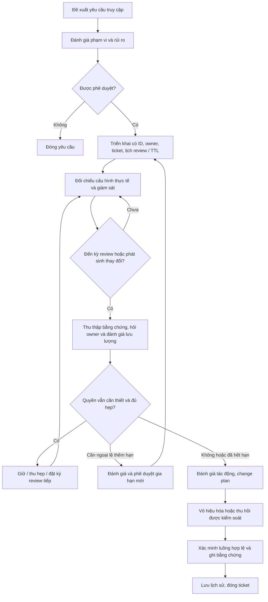
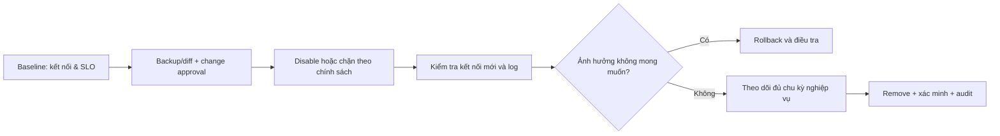

# Rule review và expiration trong Network Access Control

## 1. Vì sao phải rà soát và đặt thời hạn cho quy tắc truy cập mạng?

**Network Access Control (NAC)** trả lời câu hỏi: **ai hoặc thiết bị/dịch vụ nào được kết nối đến tài nguyên nào, theo giao thức và điều kiện nào?** Cơ chế thực thi có thể nằm tại switch, hệ thống 802.1X/RADIUS, firewall, router ACL, VPN gateway, cloud security group, network security group, Kubernetes NetworkPolicy hoặc các điểm kiểm soát truy cập giữa những phân đoạn mạng.

Mỗi quy tắc cho phép (*allow rule*) tạo ra một **đường kết nối được chấp thuận**; mỗi quy tắc chặn (*deny rule*) áp dụng một giới hạn. Một quy tắc đúng ở thời điểm triển khai có thể trở thành rủi ro khi ứng dụng đổi chủ, máy chủ được thay thế, địa chỉ IP được cấp lại, đối tác kết thúc hợp đồng hoặc nhu cầu hỗ trợ khẩn cấp đã qua.

Vì vậy, hai hoạt động cần vận hành cùng nhau:

- **Rule review — rà soát quy tắc:** đánh giá định kỳ và theo sự kiện xem một quy tắc còn phục vụ mục đích kinh doanh hợp lệ, đúng phạm vi, đúng chủ sở hữu, đúng điều kiện bảo vệ và có bằng chứng phê duyệt hay không.
- **Rule expiration — hết hạn quy tắc:** định nghĩa mốc kết thúc hiệu lực cho quyền truy cập có thời hạn, sau đó kích hoạt quy trình vô hiệu hóa/thu hồi có kiểm soát; gia hạn phải được đánh giá lại và ghi nhận rõ.

**Ví dụ:** nhóm triển khai cần cho phép máy chủ hỗ trợ của một nhà cung cấp truy cập cổng quản trị vào môi trường thử nghiệm trong 48 giờ. Nếu quy tắc được để vô thời hạn, sáu tháng sau nhà cung cấp không còn hợp đồng vẫn có thể có đường truy cập. Hệ thống nên ghi rõ mục đích, nguồn truy cập, đích, thời gian hết hạn, người chịu trách nhiệm và cách thu hồi.

Trong quản trị bảo mật mạng, đây là phần duy trì **least privilege** (quyền tối thiểu) và **Zero Trust** (không tự tin cậy chỉ vì một kết nối nằm trong mạng nội bộ). Mục tiêu không phải giảm số lượng quy tắc bằng mọi giá, mà là **giảm những đường truy cập không còn cần thiết, quá rộng hoặc không kiểm soát được** trong khi vẫn giữ dịch vụ hợp lệ hoạt động.

## 2. Những lớp và đối tượng nào cần đưa vào review?

Một danh sách “firewall rules” có thể chỉ là một phần rất nhỏ trong những chính sách đang tạo ra đường kết nối giữa các vùng mạng.

| Cơ chế | Đối tượng kiểm soát điển hình | Cần chú ý khi review |
|---|---|---|
| Firewall truyền thống/NGFW | IP/CIDR, zone, port, protocol, application/user identity tùy thiết bị | thứ tự quy tắc, NAT, kết nối VPN, địa chỉ động, logging, policy shadowing |
| Router/switch ACL | gói tin theo nguồn, đích, giao thức và chiều | vị trí áp dụng, hướng inbound/outbound, thứ tự match, implicit deny tùy nền tảng |
| Cloud security group / NSG | kết nối đến VM, NIC, subnet hoặc workload | quyền hiệu lực từ nhiều nhóm/chính sách, stateful behavior, account/project/region |
| Cloud network ACL và firewall policy | lưu lượng theo subnet/VPC và phân đoạn | ưu tiên/thứ tự, stateful hay stateless, allow/deny, phạm vi áp dụng |
| VPN / ZTNA | người dùng hoặc nhóm truy cập ứng dụng/mạng qua gateway | danh tính, tư thế thiết bị, thời hạn hợp đồng, quyền đến subnet/dịch vụ |
| 802.1X / NAC tại cổng mạng/Wi-Fi | cấp quyền cho người dùng hoặc thiết bị đã xác thực | VLAN/role được gán, nhóm thiết bị, ngoại lệ cho thiết bị không hỗ trợ 802.1X |
| Kubernetes NetworkPolicy | ingress/egress giữa pod/namespace/IP block | policy chọn pod nào, allow kết hợp, plugin mạng có thực thi không, DNS egress |
| Service mesh/microsegmentation | dịch vụ, workload identity, nhãn và luồng east–west | quy tắc động theo nhãn, danh tính máy, mTLS, khả năng theo dõi luồng |

**Một chính sách ở tầng mạng không thay thế xác thực ứng dụng và IAM.** Cho phép nguồn IP kết nối tới máy chủ DB chỉ giải quyết khả năng đến được cổng mạng; tài khoản DB, chứng chỉ TLS, quyền truy vấn và quản lý bí mật vẫn phải được kiểm soát riêng. Ngược lại, IAM mạnh không có nghĩa cổng quản trị nên mở cho toàn Internet.

### 2.1. Không áp dụng cùng ngữ nghĩa cho mọi loại quy tắc

Để đánh giá hiệu lực, trước tiên phải hiểu cơ chế của đúng nền tảng:

- **Firewall/ACL kiểu first-match:** quy tắc được xét theo thứ tự/ưu tiên; một quy tắc ở trên có thể làm quy tắc bên dưới không bao giờ được dùng (*shadowed rule*). Không thể đánh giá từng dòng độc lập khỏi thứ tự thực thi.
- **AWS Security Group:** chủ yếu là các quy tắc **allow**, có trạng thái (*stateful*) và quyền được hợp nhất từ các security group gắn vào tài nguyên. Không có logic “deny ưu tiên trên” hay thứ tự đánh giá rule như firewall truyền thống.
- **AWS Network ACL:** cho phép **allow và deny**, xử lý theo số thứ tự quy tắc; là cơ chế **stateless**, nên cần xét cả chiều đi và chiều về.
- **Azure Network Security Group:** có quy tắc allow/deny, độ ưu tiên và trạng thái kết nối; phải xét kết hợp NSG ở subnet/NIC, các quy tắc mặc định và hành vi của traffic flow hiện có.
- **Kubernetes NetworkPolicy tiêu chuẩn:** policy có tính **cộng gộp cho phép** đối với pod được chọn; thường không có quy tắc deny có ưu tiên như firewall truyền thống. Phải xét cả ingress và egress cùng khả năng thực thi của CNI.
- **NAC 802.1X:** phạm vi truy cập có thể xuất phát từ quyết định xác thực qua RADIUS và role/VLAN được gán; việc hết hạn tài khoản hay ngoại lệ thiết bị có thể làm thay đổi quyền mạng mà không sửa một ACL IP nào.

Với sản phẩm có phiên bản, chính sách kế thừa hoặc extension riêng, nên xác minh hành vi theo tài liệu chính thức của nền tảng trước khi kết luận một rule vô hiệu, thừa hoặc sẽ bị chặn sau khi xóa.

## 3. Biểu diễn một quy tắc để có thể quản lý vòng đời

Quy tắc mạng không nên chỉ tồn tại dưới dạng “allow 10.1.0.0/16 → 10.2.0.5:5432”. Để review và expiration có ý nghĩa, cần giữ **thông tin kỹ thuật lẫn ngữ cảnh nghiệp vụ**.

| Trường | Nội dung tối thiểu | Mục đích |
|---|---|---|
| `rule_id` / `policy_id` | ID duy nhất trên thiết bị/nền tảng; scope account/region/device | truy vết chính xác quy tắc cần xem xét |
| `enforcement_point` | firewall, security group, router ACL, VPN policy, NAC role... | xác định nơi quy tắc có hiệu lực |
| `source` và `destination` | IP/CIDR, zone, subnet, service identity hoặc nhóm động | biết ai được phép đi tới đâu |
| `protocol_ports` | TCP/UDP/ICMP, port hoặc ứng dụng ở mức policy | nhận diện bề mặt truy cập |
| `direction` / `action` / `priority` | ingress/egress, allow/deny, thứ tự nếu có | diễn giải rule đúng ngữ nghĩa |
| `business_purpose` | dịch vụ nghiệp vụ và nhu cầu cụ thể | biết vì sao cần giữ |
| `owner` và `approver` | người/nhóm vận hành, người chấp thuận | có nơi xác nhận và xử lý |
| `ticket_reference` | change request hoặc hồ sơ ngoại lệ | truy lại căn cứ phê duyệt |
| `created_at` / `expires_at` | thời điểm hiệu lực, mốc hết hạn UTC | quản lý tuổi thọ |
| `last_reviewed_at` / `next_review_at` | lịch sử đánh giá và kỳ review tiếp | phát hiện thiếu review |
| `evidence` | log, flow, trace, dependency map, chứng cứ nghiệp vụ | giải thích quyết định |
| `state` | active, pending-review, scheduled-expiry, disabled, retired | vận hành vòng đời có kiểm soát |

Một số nền tảng không cho lưu đủ các trường trên trực tiếp trong đối tượng firewall. Khi đó có thể liên kết **ID quy tắc ↔ bản ghi trong CMDB/IaC/change-management**. Không dùng description tự do làm nguồn sự thật duy nhất về quyền sở hữu và thời hạn nếu trường đó dễ bị ghi đè hoặc không được kiểm soát.

**Nguyên tắc:** mỗi đường cho phép cần có **owner và lý do sử dụng**. Ngoại lệ thiếu owner hoặc không tìm được bằng chứng phê duyệt phải được đánh dấu kiểm tra, chứ không tự suy đoán rằng nó còn hợp lệ vì đang có lưu lượng.

## 4. Phân loại quy tắc và chu kỳ review

Chu kỳ nên dựa trên **rủi ro, độ nhạy của đích, mức phơi lộ và tính tạm thời**. Không có một giá trị 30 hay 90 ngày phù hợp cho mọi tổ chức.

| Loại quy tắc | Ví dụ | Chính sách vòng đời minh họa |
|---|---|---|
| Cấu hình nền có chủ đích | luồng giữa các dịch vụ production đã được thiết kế | không nhất thiết có ngày xóa; **bắt buộc review định kỳ và khi có thay đổi** |
| Truy cập vận hành định kỳ | mạng quản trị → host management qua bastion/VPN | review theo quyền và owner, điều chỉnh khi nhân sự/thiết bị thay đổi |
| Ngoại lệ triển khai ngắn hạn | IP đội dự án → endpoint staging trong 7 ngày | có `expires_at`, tự phát cảnh báo, hết hạn theo chính sách đã duyệt |
| Quyền vendor/đối tác | VPN partner → API nội bộ tới hết hợp đồng | kiểm tra giới hạn hợp đồng, owner và kết thúc truy cập đúng hạn |
| Quyền xử lý sự cố | hỗ trợ khẩn cấp vào cổng quản trị trong vài giờ | có TTL ngắn, phê duyệt khẩn cấp, hậu kiểm và thu hồi |
| Quy tắc không rõ mục đích | allow rộng, không có owner/ticket | ưu tiên điều tra; giới hạn/thu hồi sau khi đánh giá tác động |
| Quy tắc chặn bảo vệ | deny egress tới mạng độc hại hoặc vùng không được phép | review độ chính xác và phụ thuộc, **không tự xóa chỉ vì không có hit** |

**Ví dụ chính sách nội bộ, không phải thời hạn bắt buộc theo tiêu chuẩn:** quyền khẩn cấp có thể kết thúc sau 4 giờ; ngoại lệ dự án sau 7–30 ngày; các quy tắc production quan trọng review theo quý hoặc nửa năm. Tổ chức cần định nghĩa cụ thể mức rủi ro, vai trò phê duyệt và phương án khi owner không phản hồi.

Sự kiện có thể buộc review sớm hơn lịch: thay đổi ứng dụng, dịch chuyển workload, đổi CIDR, kết thúc hợp đồng, sự cố bảo mật, nâng cấp firewall, thay đổi route/VPN, tạo VPC peering, phát hiện public endpoint mới hoặc thay đổi chính sách Zero Trust.

## 5. Sơ đồ vòng đời của quy tắc truy cập

Một quy trình chuẩn nên bắt đầu ngay **khi đề xuất quyền**, không chờ đến kỳ kiểm kê đầu tiên mới tìm owner và lý do sử dụng.



Phải phân biệt các mốc:

- **`next_review_at`:** hạn **đánh giá lại**; đến hạn không tự có nghĩa kết nối phải bị cắt.
- **`expires_at`:** hạn **của quyền được cấp có thời hạn**; hết hạn kích hoạt thực thi chính sách thu hồi hoặc quy trình ngoại lệ đã định.
- **`last_hit_at`:** lần gần nhất hệ thống ghi nhận rule khớp với lưu lượng, nếu nền tảng có dữ liệu đủ tin cậy; không đồng nghĩa lần dùng hợp lệ cuối cùng.
- **`disabled_at` và `removed_at`:** thời điểm tắt rule và thời điểm xóa hẳn; giữ tách biệt để đánh giá ảnh hưởng và phục hồi.

Trong trường hợp có nhu cầu nghiêm ngặt “quyền tạm thời hết hạn phải tự dừng”, cơ chế enforcement nên được thiết kế trước để **thực thi TTL tại nơi kiểm soát** hoặc qua automation đã phê duyệt, đồng thời có quy trình xử lý thất bại. Chỉ gửi email nhắc mà không thay đổi quyền sẽ không đạt mục tiêu tự thu hồi.

## 6. Thu thập danh mục và xác định phạm vi hiệu lực của rule

Trước khi đánh giá, cần biết **policy nào đang được áp dụng thực sự**, không chỉ một bản export do nhóm vận hành lưu từ trước.

### 6.1. Nguồn dữ liệu cần liên kết

| Nguồn | Dữ liệu nhận được | Điều cần kiểm tra |
|---|---|---|
| Running config / cloud control-plane API | rule ID, action, source/destination, scope, status | quyền đọc, region/account, revision và phạm vi thật |
| IaC / Git / policy-as-code | cấu hình mong muốn, lịch sử PR, người duyệt | có drift với cấu hình hiện hành không |
| CMDB / service catalog | owner, môi trường, mức quan trọng, phụ thuộc | owner/tài sản có còn tồn tại không |
| Change/ticketing | lý do cấp quyền, phê duyệt, TTL, lịch sử ngoại lệ | có đúng scope và thời hạn không |
| Traffic/flow logs | metadata luồng đi qua các điểm kiểm soát | log có đầy đủ, sampling, NAT/aggregation thế nào |
| Firewall rule counters | lần trùng khớp/byte cho rule, nếu hỗ trợ | counter có bị reset, đứng sau quy tắc khác, có log mọi hướng không |
| DNS, discovery, asset inventory | tên dịch vụ, public/private endpoint, thay đổi IP | dữ liệu còn mới và mối liên kết có đúng không |
| Identity & endpoint management | nhóm người dùng, tư thế thiết bị, vendor lifecycle | đối tượng có còn quyền hợp lệ không |

**Quy tắc “không có hit trong 90 ngày” không tự chứng minh là không dùng.** Có thể đó là đường truyền dự phòng cho disaster recovery, endpoint chỉ hoạt động cuối quý, gói tin không đi qua điểm đo, log không bật hoặc counter vừa bị reset. Ngược lại, rule có nhiều hit cũng không tự chứng minh là **cần thiết**; lưu lượng có thể đến từ ứng dụng cũ, bot hoặc kết nối không được phê duyệt.

### 6.2. Mô hình hóa đường đi thực tế

Xét luồng truy cập của người dùng đến cơ sở dữ liệu:

```text
Internet client
    ↓ HTTPS
CDN / WAF
    ↓
Public load balancer
    ↓  [Ingress rule A]
Web/API subnet
    ↓  [Egress rule B + Ingress rule C]
Private database subnet
    ↓
Database authentication & authorization
```

Xóa `rule A` có thể chặn toàn bộ ứng dụng, còn `rule B` hoặc `rule C` ảnh hưởng kết nối API→DB. Để kết luận rule “thừa”, phải xem cả **routing, NAT, nhiều firewall liên tiếp, policy khác, stateful connection, DNS và cơ chế xác thực**.

Với hạ tầng cloud, cần tính cả đường tới tài nguyên qua VPN, peering, transit gateway, private endpoint, IPv6 và kết nối liên vùng/liên account. Một security group không có `0.0.0.0/0` vẫn có thể nhận lưu lượng từ Internet qua load balancer công khai ở phía trước; ngược lại một rule allow rộng có thể không được Internet tới trực tiếp nếu không có đường route phù hợp.

## 7. Checklist review từng rule

Đánh giá một quy tắc theo **nhu cầu truy cập, đường đi, ngữ nghĩa thực thi, tài sản đích, phạm vi quyền và bằng chứng**.

### 7.1. Mục đích và tính hợp lệ

1. **Owner rõ ràng?** Người hoặc nhóm phụ trách có còn hoạt động, còn nhận trách nhiệm không?
2. **Lý do hợp lệ?** Ticket còn mô tả hệ thống, dữ liệu, giao thức và nhu cầu thực tế không?
3. **Ứng dụng còn tồn tại?** Đích hoặc nguồn đã chuyển cloud/account, xóa VM, đổi domain, kết thúc hợp đồng hay chưa?
4. **Được phê duyệt đúng cấp?** Truy cập production, DB nhạy cảm hoặc mạng quản trị có quyền phê duyệt thích hợp không?
5. **Có giới hạn thời gian?** Quy tắc tạm thời đã hết hạn, có được gia hạn theo quy trình hay bị giữ vô thời hạn?

### 7.2. Tính tối thiểu của quyền truy cập

Kiểm tra source, destination, protocol, port, action và identity:

- Có thể thu hẹp `0.0.0.0/0` hoặc `::/0` thành nhóm nguồn cụ thể hoặc đưa qua ZTNA/VPN/bastion có xác thực không?
- Có cho phép cả `0–65535` port khi thực tế chỉ cần một hoặc hai cổng không?
- Có mở **egress ra Internet** quá rộng trong khi ứng dụng chỉ cần đi đến các dịch vụ đã biết không?
- CIDR quá rộng có bao trùm cả subnet không thuộc ứng dụng hoặc tenant khác không?
- Có thể sử dụng service group, prefix list, nhãn workload, security group reference hoặc identity-based policy thay IP tĩnh khi nền tảng hỗ trợ không?
- Có phân tách mạng quản trị, môi trường dev/staging/prod, vùng dữ liệu và mạng đối tác không?

**Chú ý:** một số hệ thống cần egress cho DNS, đồng bộ thời gian, cập nhật hệ thống, điều khiển cloud hoặc dịch vụ nền tảng. Đừng thu hẹp theo suy đoán nếu chưa biết luồng phụ thuộc và cách truy cập qua private endpoint/proxy.

### 7.3. Tính chính xác của hiệu lực và thay đổi

Tùy loại firewall và cách kết hợp policy, cần phát hiện:

| Vấn đề | Ví dụ khái quát | Cách review |
|---|---|---|
| **Overly permissive** | mọi nguồn đến cổng quản trị | thu hẹp nguồn/đích và thêm xác thực theo nhu cầu |
| **Redundant** | hai rule cùng cấp một đường allow tương đương | xem ngữ nghĩa hợp nhất, route và owner trước khi gộp/xóa |
| **Shadowed** | rule cụ thể sau rule bao phủ phía trên ở firewall first-match | kiểm tra thứ tự và action, không áp dụng máy móc cho AWS SG |
| **Conflict** | rule allow và deny có phạm vi chồng lấn | xác định thứ tự, mức policy và hành vi thực tế |
| **Orphan** | rule có owner/tài sản đã ngừng hoạt động | đối soát discovery, ticket và log trước khi thu hồi |
| **Stale** | rule không còn đúng theo thiết kế hoặc quá hạn review | hỏi chủ dịch vụ, theo dõi bằng chứng và lập phương án xử lý |
| **Expired exception** | quyền vendor/khẩn cấp vượt TTL | thực thi kế hoạch thu hồi hoặc phê duyệt mới trước hạn |
| **Unlogged critical access** | luồng vào hệ thống nhạy cảm không có log phù hợp | bật telemetry hợp lý và đánh giá giới hạn quyền riêng tư |

**“Không có deny rule” không luôn có nghĩa tài nguyên mở.** Nhiều hệ thống dùng implicit deny hoặc chỉ cho phép những luồng được rule cho qua. Phải hiểu default behavior và thứ tự áp dụng để tránh kết luận sai.

## 8. Xây dựng quyết định giữ, sửa, gia hạn hoặc thu hồi

Kết quả review nên có quyết định dễ kiểm chứng:

| Kết quả | Khi nào dùng | Đầu ra cần lưu |
|---|---|---|
| **Retain** — giữ | rule cần thiết, phạm vi hợp lệ, owner xác nhận | bằng chứng, lần review, hạn review tiếp |
| **Narrow** — thu hẹp | nghiệp vụ vẫn cần nhưng nguồn, port, destination hoặc thời gian quá rộng | thiết kế scope mới, kế hoạch thay đổi và test |
| **Replace** — thay thế | cần đổi IP-based allow sang identity/SG reference, VPN/ZTNA hoặc kiến trúc mới | rule mới, kiểm chứng đường đi, kế hoạch bỏ rule cũ |
| **Renew** — gia hạn | quyền tạm thời vẫn cần và đã được phê duyệt lại | lý do, người duyệt, `expires_at` mới và điều kiện bù trừ |
| **Disable** — vô hiệu hóa | không còn nhu cầu nhưng cần quan sát tác động trước khi xóa | change ID, giám sát, thời điểm hết thử nghiệm |
| **Remove** — xóa | đã xác nhận không cần hoặc đã thay thế, hết giai đoạn quan sát | bằng chứng xóa, kết quả test, lịch sử cấu hình |
| **Investigate** — điều tra | thiếu owner, thiếu log hoặc đường đi chưa rõ | người được giao, hạn trả lời, kiểm soát tạm thời |

**Đừng gắn trạng thái “approved” vĩnh viễn** chỉ vì một owner đã nhấp xác nhận trước đó. Việc phê duyệt cần dựa trên **phạm vi cụ thể và thời điểm cụ thể**, nhất là đối với quyền truy cập khẩn cấp hoặc bên thứ ba.

### Ví dụ đánh giá một rule

Giả sử firewall có rule:

```text
ID          FW-PARTNER-142
Action      allow
From        partner-vpn-zone
To          app-prod-zone / 10.40.20.16
Protocol    TCP
Port        8443
Purpose     Đối tác kiểm thử tích hợp trong tháng 6
Owner       integration-team
Created     2026-06-01
Expires     2026-06-30
```

Nếu review vào tháng 7 và hợp đồng đã kết thúc, owner xác nhận không còn kết nối, có change plan đã duyệt, kết quả phù hợp là **thu hồi**. Nếu đối tác vẫn sử dụng cổng này để hỗ trợ khách hàng theo hợp đồng mới, phải xem lại nhu cầu, nguồn VPN, xác thực, log và xin **gia hạn có hạn mới**. Quyết định không thể chỉ dựa vào việc rule còn có hit.

## 9. Rule expiration: thiết kế thời hạn và tránh ngoại lệ “vĩnh viễn”

### 9.1. Phân biệt expiration với review due date

Đối với rule **tạm thời**, một mốc `expires_at` rõ ràng giúp tránh để ngoại lệ tồn tại lâu hơn nhu cầu được cấp. Đối với rule **nền tảng production**, thay vì tự xóa sau một thời hạn cứng, có thể dùng `next_review_at` và yêu cầu owner chứng minh tính cần thiết.

Sự khác biệt cần được thể hiện trong cả dữ liệu và tự động hóa:

```text
expires_at      → Quyền tạm thời không còn được phê duyệt sau mốc này.
next_review_at  → Cần đánh giá lại; không mặc nhiên làm mất hiệu lực.
```

Không để “review quá hạn” tự chuyển thành “rule hết hiệu lực” khi chính sách chưa quy định như vậy. Việc này có thể gây gián đoạn production. Ngược lại, không để “rule tạm đã hết hạn” tiếp tục mở chỉ vì chưa ai đọc email.

### 9.2. Trường dữ liệu về thời gian

Nên lưu thời điểm tuyệt đối theo UTC (ISO 8601) cùng ID và phiên bản của rule. Gắn thêm **nguồn tạo thời hạn**, người phê duyệt, reason và trạng thái automation. Đối với chính sách “đến cuối ngày” phải xác định múi giờ rõ ràng; ví dụ `2026-12-01T17:00:00Z` không giống “17:00 giờ Việt Nam”.

**Chu kỳ TTL chỉ là giới hạn trên của quyền**, không phải cam kết rằng hệ thống tự hủy không có lỗi. Cần cơ chế kiểm tra chênh lệch giữa trạng thái mong muốn và thực tế, retry có giới hạn, báo động khi thu hồi thất bại và chủ thể chịu trách nhiệm xử lý.

### 9.3. Quy trình trước và tại thời điểm hết hạn

Một quy trình vận hành minh họa:

1. **Tạo rule:** xác nhận owner, business justification, source/destination, action, ticket, TTL, phương án rollback.
2. **Nhắc trước hạn:** gửi thông báo cho owner vào thời gian phù hợp với độ nhạy của quyền, ví dụ 7 ngày và 1 ngày trước mốc với ngoại lệ dài; quyền rất ngắn có thể dùng nhắc sát hơn.
3. **Đánh giá yêu cầu gia hạn:** owner giải thích vì sao còn cần, team an ninh xác minh scope và biện pháp bù trừ, cấp phê duyệt mới.
4. **Đến hạn:** nếu không được gia hạn hợp lệ, bộ điều khiển hoặc quy trình thay đổi **vô hiệu hóa quyền theo chính sách được phê duyệt**. Nếu không thể thực thi tự động an toàn, phải có cơ chế xử lý được giao người phụ trách và theo dõi SLA.
5. **Xác minh:** kiểm tra rule đã ngừng hiệu lực, không còn đường truy cập không được phê duyệt, log/metric không báo lỗi dịch vụ ngoài dự kiến.
6. **Lưu lịch sử:** ghi thời điểm, actor/automation, bằng chứng và nguyên nhân nếu thất bại.

**Gia hạn không phải “sửa ngày cho xong”.** Lần gia hạn cần xem lại phạm vi truy cập, xác thực, owner và tính cần thiết, nhất là quyền cấp cho vendor, mạng quản trị hoặc dịch vụ public.

## 10. Thu hồi rule an toàn và cách xác minh tác động

**Thu hồi quyền** có thể ảnh hưởng kết nối đang tồn tại, kết nối mới hoặc cả hai tùy nền tảng, cơ chế stateful, cache phiên và việc áp dụng policy. Vì vậy, không xem thao tác xóa một dòng config là đã hoàn tất.

### 10.1. Chuẩn bị change plan

Trước thay đổi cần có:

- **Phạm vi chính xác:** rule ID, policy/device/account/region, đối tượng nguồn/đích, owner.
- **Bằng chứng không còn cần:** CMDB, ticket hoàn tất, xác nhận owner, flow/log trong khoảng quan sát hợp lý và phân tích phụ thuộc.
- **Mức tác động:** ứng dụng, người dùng, SLA/SLO, đường dự phòng, batch job, DR test, VPN hoặc tích hợp đối tác.
- **Phương án xác minh:** lưu lượng nào phải tiếp tục được phép; luồng nào phải bị từ chối sau khi thu hồi.
- **Kế hoạch rollback:** phiên bản cấu hình/điểm khôi phục, điều kiện rollback, người được quyền thực hiện và thời gian giám sát.
- **Khung thay đổi:** giờ vận hành, quy trình change/emergency change phù hợp rủi ro.

### 10.2. Thực thi theo giai đoạn

Đối với những nền tảng có khả năng và chính sách cho phép, có thể **vô hiệu hóa trước rồi mới xóa**:



Không phải nền tảng nào cũng hỗ trợ `disable` riêng cho từng rule. Nếu không có, có thể chọn phương án **gỡ qua IaC có khả năng rollback**, thay đổi nhóm đính kèm hoặc giải pháp tương đương được phê duyệt. Tuyệt đối không dựng “deny all” tùy tiện để thay một lệnh vô hiệu hóa vì phạm vi có thể vượt xa rule cần thu hồi.

Trong quá trình xác minh, kiểm tra **kết nối mới** bên cạnh phiên đã có sẵn. Một số firewall/state table vẫn giữ phiên hoạt động sau khi thay policy; việc curl một dịch vụ qua kết nối keep-alive không chứng minh rule mới đang chặn kết nối mới.

### 10.3. Khi nào không nên thu hồi ngay?

Một rule không có traffic trong ba tháng nhưng phục vụ đường **khôi phục thảm họa theo quý**, đồng bộ chứng chỉ, backup tối, thiết bị IoT hiếm dùng hoặc công việc kết toán cuối năm có thể vẫn cần. Với các trường hợp đó, yêu cầu owner cung cấp **chu kỳ sử dụng kỳ vọng và test kế hoạch** trước khi thu hồi.

Nếu rule đang tạo ra phơi lộ nghiêm trọng và bị phát hiện trong sự cố đang diễn ra, chính sách ứng phó khẩn cấp có thể cho phép thu hẹp/chặn ngay để giảm thiệt hại. Quyết định cần do đầu mối có thẩm quyền thực hiện, ghi nhận tác động và hậu kiểm.

## 11. Bằng chứng và phương pháp phân tích rule hiệu lực

### 11.1. Vì sao hit counter không đủ?

**Hit counter** thường đếm rule được match tại một enforcement point, không nhất thiết là toàn bộ giao dịch nghiệp vụ:

- Log có thể tắt, lấy mẫu, bị giới hạn dung lượng hoặc không có dữ liệu cũ.
- Counter có thể reset khi reboot, commit cấu hình, thay rule hoặc failover.
- Một NAT/proxy chuyển nhiều client thành một nguồn; nguồn IP có thể không phản ánh user thực.
- Rule dự phòng rất ít được dùng nhưng là thành phần của phương án phục hồi.
- Một rule allow quá rộng có thể nhận lưu lượng không còn được phê duyệt; hit cao không biện minh cho quyền lớn.
- Ở một số cloud, flow log được ghi theo interface/5-tuple mà **không có rule ID**; cần suy luận mapping cẩn thận.

**Cách làm:** kết hợp config snapshot, traffic/flow log, owner attestation, dependency map, ticket, DNS/service registry và test kết nối được phép. Mỗi nguồn có độ bao phủ riêng; ghi rõ khoảng quan sát và sự thiếu hụt.

### 11.2. Phân tích quy tắc chồng lấn và hiệu lực

Giả sử firewall **first-match** được cấu hình:

```text
Priority   Source          Destination      Port    Action
100        10.0.0.0/8      10.20.5.10       443     allow
200        10.1.2.0/24     10.20.5.10       443     deny
300        10.1.2.0/24     10.20.5.10       8443    allow
```

Trong **mô hình giả định** mọi trường match khác đều giống nhau và priority 100 được xét trước, traffic từ `10.1.2.0/24` tới `10.20.5.10:443` đã bị rule 100 cho phép; rule 200 không còn cơ hội chặn traffic đó. Rule 300 dùng cổng khác nên không bị rule 100 che theo port.

Đây là ví dụ về **shadowing do thứ tự**. Nếu cùng ba ý định chính sách được chuyển sang AWS Security Group, không thể bê nguyên bảng priority/deny sang vì SG không hoạt động theo mô hình đó. Reviewer cần phân tích **effective policy** trên đúng enforcement point.

### 11.3. Phạm vi nguồn và đích thực

Đường kết nối phụ thuộc vào:

```text
Identity/device posture (khi có)
        + DNS / endpoint resolution
        + Routing / peering / VPN / NAT
        + Firewall & policy precedence
        + Ingress/egress controls
        + TLS / application authentication
        = Mức truy cập có hiệu lực trong tình huống cụ thể
```

Không nên dùng một công thức Boolean đơn giản cho mọi công nghệ: thứ tự stateful connection, default route, NAT và identity enforcement có thể làm thay đổi luồng. Nhưng cách nhìn chuỗi điều kiện này giúp người review không đánh giá rule như một bảng IP tách rời hạ tầng.

## 12. Ví dụ bản ghi policy có thời hạn

Mẫu YAML **minh họa dữ liệu quản trị**, không phải định dạng cấu hình có thể áp vào firewall/cloud trực tiếp:

```yaml
rule_id: NAC-TEMP-0012
enforcement_point: edge-firewall-prod
environment: production
action: allow
direction: ingress
source:
  type: vpn_group
  value: approved-maintenance-vendors
destination:
  type: application_group
  value: inventory-api
service:
  protocol: tcp
  ports: [8443]
owner: platform-operations
approver: security-change-approver
business_purpose: "Bảo trì tích hợp đã lên lịch"
ticket_reference: "CHG-EXAMPLE-2026"
created_at: "2026-11-27T00:00:00Z"
expires_at: "2026-12-02T00:00:00Z"
last_reviewed_at: "2026-11-27T00:00:00Z"
next_review_at: "2026-12-01T00:00:00Z"
expiration_action: "revoke_after_approved_change"
state: active
evidence:
  - "owner-confirmed-business-window"
  - "approved-access-path"
```

Ví dụ này dùng **nhóm truy cập VPN** và **nhóm dịch vụ** thay vì mở toàn bộ mạng nội bộ. Trong hệ thống thật, nếu firewall không hiểu tên nhóm ở dạng này thì controller/IaC phải ánh xạ sang đối tượng mà enforcement point hỗ trợ, và phải xử lý thay đổi thành viên nhóm.

**Điều cần phân biệt:** thời điểm tạo, thời hạn quyền và lần review là ba dữ kiện riêng. `next_review_at` nằm trước `expires_at` để nhóm vận hành có thể xác minh nhu cầu gia hạn mà không để quyền gián đoạn ngoài dự tính.

## 13. Tự động hóa: phát hiện rule sắp hết hạn và drift

Để mở rộng quy trình tới hàng nghìn quy tắc, tự động hóa nên được dùng trước tiên cho **đọc, phân loại, cảnh báo và tạo bằng chứng**. Thao tác thay đổi policy cần được giới hạn theo mức độ rủi ro và chính sách được phê duyệt.

### 13.1. Cơ chế đề xuất

1. **Thu thập cấu hình hiện hành** từ thiết bị/cloud API và trạng thái mong muốn từ IaC theo quyền đọc tối thiểu.
2. **Chuẩn hóa** rule ID, scope, source/destination, protocol, action, thời hạn và owner.
3. **Đối chiếu** với CMDB, ticket/change và chứng cứ duy trì nhu cầu.
4. **Phát hiện drift:** rule có trong production nhưng không có trong Git/policy registry; rule bị sửa phạm vi hoặc không được cập nhật TTL; một grant đã hết hạn nhưng vẫn active.
5. **Phân loại rủi ro:** mở rộng tới nguồn Internet, cổng quản trị, mạng dữ liệu nhạy cảm, quyền vendor, rule thiếu owner.
6. **Giao review:** tạo nhiệm vụ cho owner, người duyệt và đội network/security; lưu bằng chứng cùng mốc thời gian.
7. **Thực thi có kiểm soát:** thu hồi các rule đã hết hạn theo workflow đã được phê duyệt; xác minh trạng thái sau thay đổi và mở incident nếu thất bại.
8. **Báo cáo:** coverage của review, số ngoại lệ quá hạn, thời gian thu hồi, false positive, số change gây gián đoạn.

Pseudocode:

```text
for rule in enumerate_effective_rules(approved_scopes):
    record = reconcile(rule, policy_registry, inventory, change_tickets)

    if record.missing_owner or record.unknown_business_purpose:
        queue_for_investigation(rule.id)
        continue

    if record.is_temporary and now_utc() >= record.expires_at:
        if record.has_valid_renewal_approved_before_expiry:
            update_registry_with_new_expiry(rule.id)
        else:
            trigger_approved_expiry_workflow(rule.id)
            verify_effective_state_and_raise_on_failure(rule.id)
        continue

    if now_utc() >= record.next_review_at:
        request_owner_attestation_with_evidence(rule.id)
    if record.config_differs_from_approved_state:
        create_drift_alert(rule.id)
```

**Pseudocode** này mô tả quyết định và phân nhánh; nó không là mã triển khai trực tiếp. Trong production phải xử lý quyền, concurrency, idempotency, lỗi API, race condition giữa gia hạn và job thu hồi, retry có giới hạn, audit và khả năng khôi phục. Trạng thái **“automation báo đã xóa” không đủ**: cần truy vấn lại enforcement point để xác nhận hiệu lực, đặc biệt với policy có propagation delay.

### 13.2. Thiết kế chống lỗi automation

Tránh các tình huống:

- **Thu hồi dựa trên dữ liệu stale:** một renewal đã được duyệt nhưng bảng cache chưa cập nhật; cần kiểm tra phiên bản/trạng thái hiện hành trước thay đổi.
- **Xóa nhầm vì thay đổi định danh:** ID rule đã được tái sử dụng hoặc chuyển account/region; dùng ID kết hợp scope và revision.
- **Tự bật lại quyền do IaC:** rule bị xóa thủ công nhưng pipeline cấu hình lại tạo nó ở lần deploy tới; thay đổi phải cập nhật nguồn sự thật phù hợp.
- **Batch xóa quá rộng:** một bug hoặc lỗi giờ hệ thống đánh dấu hàng nghìn rule hết hạn cùng lúc; áp dụng giới hạn thay đổi, canary, review và rate limit.
- **Không biết thất bại:** API trả lỗi hoặc permission thiếu; phải ghi trạng thái `expiry_failed`, cảnh báo và không tuyên bố đã thu hồi.
- **Xóa tài nguyên dự phòng:** automation không hiểu DR/đợt batch hiếm; rule có phụ thuộc theo mùa nên cần policy/owner ghi nhận rõ.

Thiết kế hiệu quả nhất là **policy-as-code + thời hạn + người chịu trách nhiệm + xác minh sau triển khai**, kết hợp với giám sát thực tế và khả năng can thiệp khi có sự cố.

## 14. Rule review trên cloud, VPN và NAC ở các tình huống khác nhau

### 14.1. AWS security group, NACL và policy khác

Một EC2 có thể chịu ảnh hưởng của security group ở ENI và network ACL ở subnet. Đối với SG, nếu nguồn `0.0.0.0/0` được allow tới TCP/22 thì cần kiểm tra có tuyến Internet tới resource hay không, dịch vụ có đang lắng nghe không, bastion/SSM hoặc cơ chế truy cập được phê duyệt, và nhu cầu thật.

AWS SG **không có khái niệm rule deny có thứ tự**. Nếu hai SG gắn cùng ENI, quyền allow phù hợp từ một SG vẫn có thể cho phép đường truy cập ngay cả khi SG còn lại không có rule đó. Xóa một allow ở một SG chưa chắc chặn kết nối nếu còn allow tương đương ở SG khác.

AWS NACL lại có allow/deny theo số thứ tự và là **stateless**. Khi review cần xét cả đường trở về và port phù hợp cho phiên; không chuyển cấu hình SG sang NACL bằng cách sao chép nguyên các dòng.

### 14.2. Azure NSG và chính sách nền tảng

Khi xem NSG cần xác định nó gắn vào subnet, NIC hoặc cả hai; thứ tự ưu tiên, rule mặc định và những policy mạng bổ sung ảnh hưởng đến lưu lượng. Quy tắc chỉ đọc `allow` cụ thể chưa cho biết **effective network path** nếu có load balancer, UDR, Azure Firewall hoặc private endpoint liên quan.

### 14.3. Google Cloud VPC firewall và workload identity

Trong Google Cloud cần xem **project, VPC, direction, priority, target/selector, source/destination, rules của hierarchical firewall policy nếu áp dụng**, và các yếu tố route/ingress của dịch vụ quản lý. Một rule phục vụ workload theo tag hoặc service account có thể bị ảnh hưởng khi workload đổi nhãn/danh tính dù policy không sửa.

### 14.4. VPN, ZTNA và truy cập đối tác

Quyền từ VPN đến nhiều subnet dễ trở thành quyền tồn tại lâu dài. Review phải gắn **nhóm người dùng, thời hạn hợp đồng, xác thực nhiều yếu tố, độ tin cậy thiết bị, group membership và resource được phép**. Trong giải pháp ZTNA, một grant theo ứng dụng/identity có thể thay thế cấp quyền IP CIDR rộng cho toàn VPN.

Ngoài rule mạng, cần thu hồi **account, group membership, chứng chỉ và phiên truy cập** khi quyền hết hạn. Chỉ xóa firewall rule mà vẫn giữ access token hoặc group grant có thể tạo đường truy cập khác chưa bị phát hiện.

### 14.5. Mạng không dây và 802.1X/NAC

Thiết bị được gán VLAN hoặc role theo danh tính khi kết nối Wi-Fi/LAN. Quyền tạm thời của nhà thầu hoặc thiết bị thử nghiệm cần có TTL tương ứng tại hệ thống NAC/RADIUS/IdP. Khi hết hạn, hệ thống có thể không cập nhật ngay mọi phiên đang kết nối; phải hiểu **session timeout, reauthentication và cơ chế chấm dứt phiên** của nền tảng để xác minh thu hồi có hiệu lực.

### 14.6. Kubernetes NetworkPolicy

Kubernetes NetworkPolicy áp dụng cho pod được chọn theo label và direction. Một pod có thể được nhiều policy chọn, nên **xóa một allow policy không chắc chặn luồng** nếu một policy khác vẫn cấp phép. Một policy “default deny” thường được dựng bằng chính sách cô lập theo direction; hiệu lực còn phụ thuộc CNI hỗ trợ NetworkPolicy. Cần kiểm thử đường DNS và liên dịch vụ sau khi thay đổi, tránh làm mất kết nối thiết yếu của cluster.

## 15. Chấm mức ưu tiên review theo rủi ro

Khi hàng chục nghìn rule cần đánh giá, có thể sàng lọc bằng các yếu tố:

- **Exposure (E):** nguồn Internet hoặc mạng đối tác rủi ro, đích public/private và khả năng tiếp cận hiệu lực.
- **Criticality (C):** hệ thống đích quan trọng, dữ liệu nhạy cảm, ảnh hưởng đến nghiệp vụ.
- **Breadth (B):** dải IP và cổng mở rộng, nhiều zone, nhiều danh tính.
- **Control gap (G):** thiếu owner, không có TTL cho quyền tạm, thiếu giám sát, thiếu xác thực.
- **Change sensitivity (S):** nguy cơ gây outage nếu sửa vội; yếu tố này dùng để chọn **phương thức thu hồi**, không đồng nhất với mức nguy hiểm của quyền.

Ví dụ một mô hình **sàng lọc nội bộ minh họa**: chấm E, C, B, G từ 1–3 rồi tính `R = E × C × B × G`. Một rule nguồn Internet đến cổng quản trị, thiếu owner, đích nhạy cảm có điểm cao và nên được review sớm. Điểm số chỉ để **xếp thứ tự xử lý**, không là xác suất khai thác hay thang chuẩn có tính tuyến tính. Nếu hệ thống kinh doanh cực kỳ nhạy với downtime, cùng một rủi ro cao có thể cần quy trình thay đổi chặt hơn chứ không phải xóa tức thì.

| Ví dụ | Rủi ro truy cập | Rủi ro thay đổi | Hành động hợp lý |
|---|---|---|---|
| Allow Internet → SSH/RDP vào server production | cao | có thể cao | xác minh khẩn và thu hẹp thông qua bastion/ZTNA; quản lý change |
| Rule vendor hết hạn cho lab tách biệt | trung bình | thường thấp hơn | thu hồi theo TTL và xác minh |
| Rule DR hiếm dùng, có owner/ticket rõ | phụ thuộc hệ thống | cao nếu xóa sai | giữ trong chu kỳ review có kiểm chứng diễn tập |
| Egress đến dịch vụ DNS/tạo chứng chỉ theo kiến trúc | phụ thuộc phạm vi | cao nếu xóa sai | đối chiếu phụ thuộc trước khi thu hẹp |
| Rule không owner/không lý do trong DMZ | cần điều tra ưu tiên | chưa rõ | thu thập bằng chứng và quyết định theo tác động |

Kết quả review tốt phải ghi **điều chưa biết**. “Không có evidence” là lý do để điều tra thêm; không tự động được xem là “đã an toàn” hoặc “không cần dùng”.

## 16. Audit trail, báo cáo và chỉ số chất lượng

Một chương trình review trưởng thành cần chứng minh **ai đã đánh giá, dựa trên bằng chứng nào, quyết định gì và policy thực tế thay đổi ra sao**.

### 16.1. Bằng chứng cho một chu kỳ review

- Snapshot/diff cấu hình với rule ID và scope tại thời điểm review.
- Owner, người phê duyệt, ticket và lý do nghiệp vụ.
- Khoảng thời gian log/flow được xem, hạn chế dữ liệu và cách liên kết tới rule.
- Đánh giá rủi ro, phương án thay thế/thu hẹp, tác động dự kiến.
- Biên bản change, kiểm thử trước/sau, rollback nếu xảy ra, cấu hình sau thay đổi.
- Mốc hết hạn mới hoặc lịch review tiếp; trường hợp ngoại lệ phải có cấp phê duyệt và điều kiện theo dõi.

**Không đưa secrets, thông tin xác thực, khóa riêng hoặc thông tin nhận dạng không cần thiết vào ticket/log.** Danh sách policy có sơ đồ mạng nội bộ và endpoint nhạy cảm cần phân quyền truy cập phù hợp.

### 16.2. Chỉ số theo dõi

| KPI | Định nghĩa gợi ý | Cảnh báo khi |
|---|---|---|
| Rule ownership coverage | % rule active có owner đã xác minh | tăng nhóm không xác định owner |
| Review on-time rate | % rule đến kỳ được review đúng hạn | review trễ tập trung vào mạng nhạy cảm |
| Expired active grants | số/quyền tạm hết hạn nhưng còn hiệu lực | có quyền không được thu hồi đúng SLA |
| Mean time to revoke | thời gian từ hết hạn/xác nhận không còn cần đến khi ngừng hiệu lực | quy trình thu hồi quá chậm |
| Overly broad rule count | số rule vượt chính sách phạm vi được phép, có bối cảnh | mở rộng do ngoại lệ mới |
| Change-induced incidents | số sự cố có liên hệ với thay đổi rule | thiếu đánh giá tác động/test |
| Drift detection time | thời gian nhận diện khác biệt giữa policy phê duyệt và hiện hành | quyền không được quản lý bằng nguồn sự thật |
| False-positive review findings | tỷ lệ rule bị gắn nghi vấn nhưng đã có căn cứ rõ | logic phân loại/correlation cần cải thiện |

Không chỉ tối ưu “số rule bị xóa”. Một đội xóa hàng trăm rule gây gián đoạn nghiêm trọng không làm an ninh tốt lên. Cần đo cả **giảm phơi lộ không cần thiết và duy trì dịch vụ hợp lệ**.

## 17. Tình huống thực hành: quyền vendor hết hạn giữa hệ thống đang vận hành

**Bối cảnh:** một đối tác được cấp quyền VPN tới dịch vụ quản lý kho trong hai tuần. Firewall cho phép `vendor-vpn-zone → warehouse-api:8443`, kèm ticket và `expires_at`. Ngày hết hạn tới gần; lưu lượng vẫn xuất hiện đều mỗi ngày.

**Dữ kiện review:** hợp đồng hỗ trợ giai đoạn một đã kết thúc nhưng có một yêu cầu mới đang chờ duyệt. Hệ thống API còn chạy trong giờ kinh doanh; log tại firewall ghi nhận traffic từ gateway của đối tác, song không thể tự xác định request nào thuộc hợp đồng mới.

**Cách xử lý:**

1. Xác minh rule ID, scope, route, owner và nguồn VPN hiện tại; kiểm tra liệu nhóm vendor có đường vào khác hay không.
2. Hỏi owner nghiệp vụ và đội vận hành xác nhận **công việc còn được phép** cùng thời gian cần thiết. Không xem log hit là căn cứ phê duyệt.
3. Nếu cần gia hạn: tạo change/renewal với nguồn, đích, port, mục đích và **hạn mới ngắn, rõ ràng**, có người phê duyệt phù hợp.
4. Nếu không có phê duyệt hợp lệ trước expiration: thực thi quy trình thu hồi đã duyệt tại firewall/VPN/NAC; kiểm tra cả việc tài khoản/nhóm vendor còn hiệu lực không.
5. Sau thay đổi, kiểm tra request hợp lệ của khách hàng vẫn thành công và kết nối mới từ đối tác tới `warehouse-api:8443` bị từ chối theo chính sách. Lưu bản ghi audit và kết quả.

**Bẫy thường gặp:** nhóm vận hành sửa thẳng `expires_at` nhưng không có renewal record; hoặc chỉ xóa rule firewall trong khi ZTNA gateway vẫn cấp truy cập theo policy khác. Do đó, phải kiểm tra **đường truy cập hiệu lực** xuyên các lớp chứ không chỉ trạng thái một dòng.

### Biểu mẫu review ngắn gọn

| Câu hỏi | Kết quả ví dụ |
|---|---|
| Rule nào? | `FW-VENDOR-084` trên firewall vùng ứng dụng |
| Quyền cấp? | VPN group của vendor → API quản lý kho, TCP/8443 |
| Owner và mục đích? | đội vận hành kho, hỗ trợ hợp đồng kỳ một |
| Khi nào hết hạn? | cuối kỳ hai tuần được duyệt |
| Có được gia hạn? | chưa, yêu cầu mới đang chờ |
| Bằng chứng sử dụng? | có log hit nhưng không chứng minh nhu cầu hợp lệ |
| Quyết định tại hạn? | thực thi thu hồi theo policy, escalations nếu business phản đối |
| Test sau thay đổi? | API nội bộ hoạt động; quyền vendor không còn truy cập |

## 18. Các lỗi phổ biến và cách tránh

1. **“Có hit nghĩa là nên giữ.”** Lưu lượng chỉ chứng minh có kết nối tại điểm ghi nhận, không chứng minh rule được phê duyệt.
2. **“Không có hit thì xóa ngay.”** DR, batch hiếm, logging thiếu và failover có thể không xuất hiện trong khoảng nhìn.
3. **“Review date và expiration là một.”** Review đánh giá lại; expiration là mốc giới hạn quyền tạm thời, cần hành động được định nghĩa rõ.
4. **“Gia hạn chỉ cần đổi timestamp.”** Gia hạn phải xác nhận lại owner, mục đích, scope và thẩm quyền phê duyệt.
5. **“Chỉ cần rà soát ingress.”** Egress rộng làm tăng đường ra ngoài, lộ dữ liệu và khả năng di chuyển giữa các dịch vụ.
6. **“Một rule bị xóa thì đường đi đã bị chặn.”** Có thể còn allow ở enforcement point khác, SG khác, VPN/ZTNA policy khác hoặc phiên stateful đang tồn tại.
7. **“Mọi firewall đều xét first-match.”** AWS SG, Kubernetes NetworkPolicy và các cơ chế khác có ngữ nghĩa hợp nhất khác nhau.
8. **“Một file Excel là đủ.”** Dữ liệu cần liên kết cấu hình thực, native ID, owner, ticket, log và tự động phát hiện drift.
9. **“Automation báo thành công thì chắc chắn đã thu hồi.”** Cần xác minh lại trạng thái trên control plane/thiết bị và đường kết nối được bảo vệ.
10. **“Cứ giảm số rule là mạng an toàn hơn.”** Thay đổi thiếu phân tích có thể vô hiệu hóa bảo vệ quan trọng hoặc làm gián đoạn hệ thống.

## 19. Câu hỏi tự kiểm tra và bài tập

**Câu 1.** Vì sao một rule firewall không có hit trong 90 ngày chưa đủ chứng minh có thể xóa? Nêu ít nhất ba tình huống gây sai lệch.

**Câu 2.** Phân biệt `next_review_at` và `expires_at`. Nêu loại rule thích hợp với mỗi mốc và hệ quả của việc nhầm chúng.

**Câu 3.** Một AWS EC2 gắn hai security group; SG thứ nhất mở cổng 443 cho một mạng, SG thứ hai cũng mở cổng đó cho mạng ấy. Điều gì có thể xảy ra nếu xóa allow ở SG thứ nhất? Vì sao?

**Câu 4.** Một cổng quản trị production đang allow `0.0.0.0/0` và `::/0`. Thiết kế quy trình thu hẹp rule phù hợp với nhu cầu vendor mà vẫn duy trì hoạt động kinh doanh.

**Câu 5.** Một rule hết hạn đã bị automation xóa trong Git, nhưng vẫn hiện trên firewall sau khi pipeline triển khai báo lỗi. Bạn sẽ báo cáo trạng thái nào và xác minh ra sao?

**Câu 6.** Quyền Wi-Fi của nhà thầu hết hạn tại NAC, nhưng thiết bị vẫn kết nối và được truy cập VLAN nội bộ. Có những cơ chế session/reauthentication nào cần kiểm tra?

**Bài tập thiết kế:** hệ thống bao gồm DMZ, cụm API, database nội bộ, VPN đối tác, AWS Security Group và Kubernetes NetworkPolicy. Hãy:

1. Lập một **danh mục 6–8 rule minh họa** với owner, ticket, source/destination, action, scope và thời hạn.
2. Phân loại rule thành **permanent-with-review**, **temporary-with-expiration** và **needs-investigation**; giải thích căn cứ.
3. Thiết kế quy trình **nhắc trước hạn, renewal, thu hồi, xác minh và rollback** cho rule tạm.
4. Chỉ ra ít nhất hai tình huống có **nhiều lớp policy** khiến xóa một rule chưa đủ chặn đường truy cập.
5. Đề xuất metrics và evidence để chứng minh cải thiện bảo mật mà vẫn giữ SLO ứng dụng.

## 20. Tổng kết

**Rule review và expiration** là phần vận hành liên tục của **Network Access Control**: biến mỗi quyền truy cập thành một quyết định **có phạm vi, có owner, có lý do, có thời gian và có thể kiểm chứng**. Khi rà soát, cần hiểu đúng ngữ nghĩa của từng enforcement point, liên kết cấu hình với luồng thực tế và nhu cầu nghiệp vụ, phát hiện rule quá rộng hoặc thiếu owner, rồi giữ, thu hẹp, gia hạn hay thu hồi có kiểm soát.

**Quyền tạm thời** cần có ngày hết hạn và cơ chế thực thi; **quyền nền tảng** cần có kỳ review và bằng chứng còn cần thiết. Thu hồi phải được xác minh qua cả cấu hình và kết nối thực tế, có rollback khi thay đổi gây gián đoạn. Cách làm này kết nối trực tiếp quản trị firewall/ACL, VPN, NAC, phân đoạn mạng, cloud, DNS, IDS/IPS và threat modeling thành một kiến trúc mạng an toàn có thể duy trì lâu dài.

**Tài liệu tham khảo để đọc sâu:** NIST SP 800-41 Rev.1 (*Guidelines on Firewalls and Firewall Policy*); NIST SP 800-207 (*Zero Trust Architecture*); NIST SP 800-53 Rev.5 (nhóm kiểm soát AC, CM, AU và SC); CIS Controls v8 (nhất là Network Infrastructure Management, Access Control Management và Continuous Vulnerability Management); tài liệu chính thức về AWS Security Groups, AWS Network ACL, Azure NSG, Google Cloud VPC firewall và Kubernetes NetworkPolicy.
