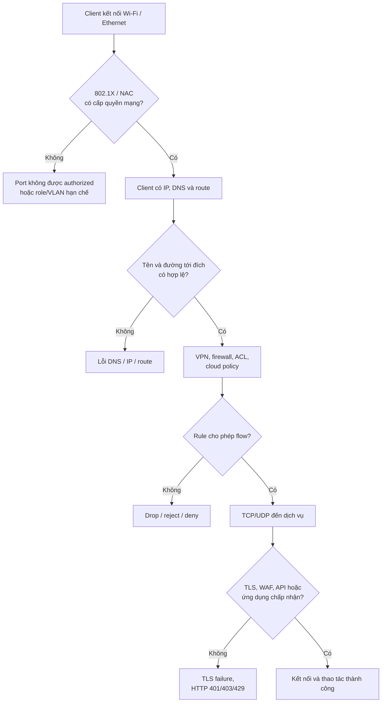
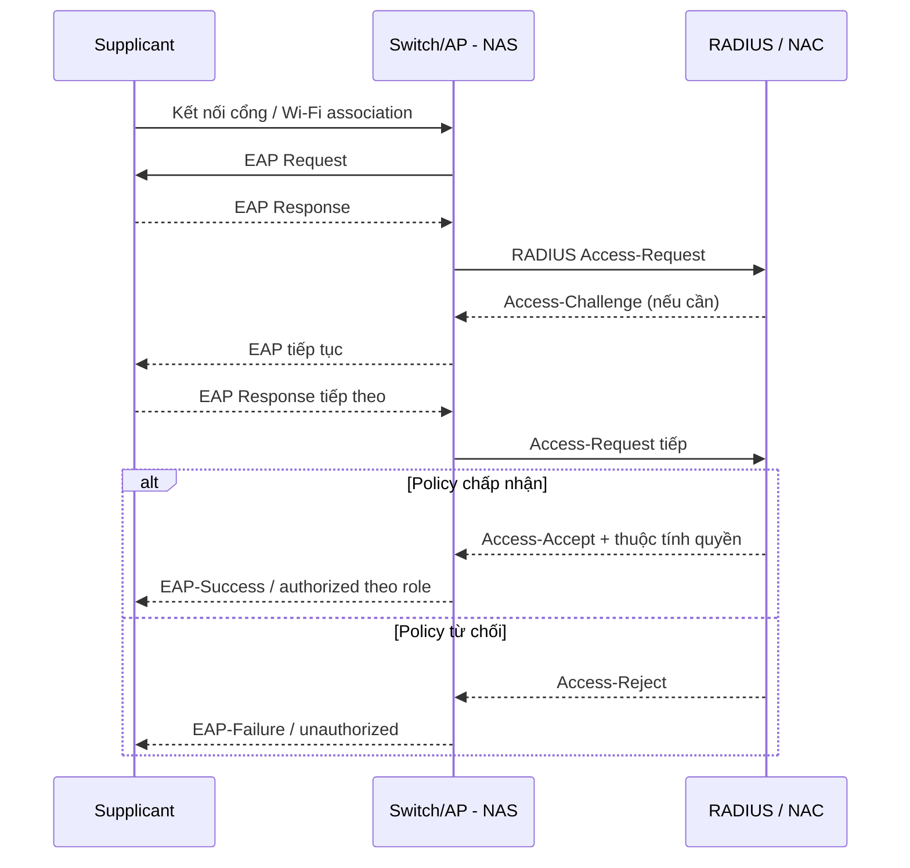
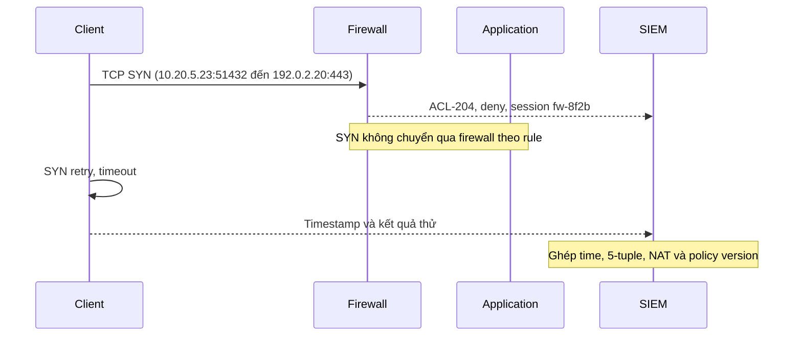

# Bằng chứng khi một kết nối bị từ chối trong Network Access Control

Một người dùng báo: “Tôi đã kết nối Wi-Fi và VPN nhưng không mở được ứng dụng nội bộ”. Nhật ký firewall có dòng **deny**, máy khách báo *connection timed out*, còn ứng dụng không ghi nhận yêu cầu. Có phải Network Access Control (NAC) đã từ chối kết nối? Câu trả lời cần dựa trên **bằng chứng có thể đối chiếu**: cùng một triệu chứng không truy cập được có thể bắt nguồn từ 802.1X, RADIUS, quyền VPN, DNS, định tuyến, firewall, cloud ACL, TLS hoặc bản thân ứng dụng.

Trong **Network Security**, việc chứng minh một kết nối bị từ chối giúp vận hành phân đoạn mạng, firewall/ACL, VPN, IDS/IPS và các mô hình truy cập dựa trên danh tính, thiết bị và chính sách. Bằng chứng có giá trị phải chỉ ra **ai hoặc thiết bị nào yêu cầu truy cập, đến đích nào, lúc nào, qua ranh giới tin cậy nào, kiểm soát nào quyết định, và kết quả thực tế là gì**. Bài học hướng dẫn cách thu thập, đọc, đối chiếu và báo cáo những dữ kiện đó bằng ví dụ trong mạng thử nghiệm.

## 1. Phân biệt kết nối thất bại với kết nối bị chính sách từ chối

Ba tình huống cần tách riêng:

1. **Connection failure (kết nối thất bại):** client không hoàn thành kết nối, nhưng nguyên nhân chưa xác định.
2. **Policy denial (bị chính sách từ chối):** một điểm thực thi như NAC, firewall, gateway hoặc identity-aware proxy chủ động không cho phép yêu cầu.
3. **Application authorization denial (ứng dụng từ chối quyền):** đường mạng và lớp giao thức cần thiết đã hoạt động, nhưng ứng dụng hoặc API không cho phép thao tác.

Ví dụ, **HTTP 403 Forbidden** cho biết một thành phần HTTP hiểu yêu cầu và từ chối thực hiện. Điều này chưa chứng minh firewall tầng mạng đã chặn TCP. Ngược lại, **TCP timeout** có thể do firewall drop, mất tuyến, server ngừng hoạt động hoặc phản hồi không tìm được đường về.

| Quan sát | Điều có thể kết luận | Điều chưa thể kết luận |
| --- | --- | --- |
| Timeout tại client | Chưa nhận kết quả mong đợi trong thời gian chờ | Chắc chắn firewall hoặc NAC chặn |
| TCP RST | Một thành phần từ chối/đóng phiên TCP | RST đến từ firewall hay server, nếu chỉ nhìn một phía |
| ICMP Destination Unreachable | Thiết bị thông báo không đến được đích hoặc không cho phép, tùy mã lỗi | Mọi cổng và mọi luồng đều bị chặn |
| HTTP 401 | Thành phần HTTP yêu cầu thông tin xác thực hợp lệ | Xác thực 802.1X hoặc VPN đã thất bại |
| HTTP 403 | Thành phần HTTP từ chối yêu cầu | ACL L3/L4 chặn luồng |
| RADIUS Access-Reject | Máy chủ RADIUS từ chối yêu cầu liên quan phiên mạng | Mọi luồng IP của thiết bị đều bị từ chối |
| Firewall log action=deny | Một quyết định deny đã được ghi tại thiết bị đó | Mọi thiết bị khác trên đường đều deny |
| Không thấy log server | Chưa ghi nhận yêu cầu ở hệ thống log đang xem | Gói không đến server nếu chưa kiểm chứng độ phủ log |

**Kết luận nguyên nhân phải hẹp bằng phạm vi bằng chứng.** Dòng deny đúng phiên ở firewall là bằng chứng trực tiếp về quyết định policy tại firewall; lời báo lỗi timeout đơn lẻ chỉ mô tả triệu chứng.

## 2. Hành trình của một kết nối và nơi có thể bị từ chối

Giả sử người dùng muốn truy cập ứng dụng HTTPS trong VLAN nội bộ qua kết nối VPN. Họ có thể phải vượt qua nhiều lớp kiểm soát:



Sơ đồ là mô hình logic, không khẳng định mọi mạng có đủ thiết bị hoặc xử lý theo đúng thứ tự này. Điểm kiểm soát có thể nằm trong máy khách, switch, AP, VPN concentrator, firewall, cloud virtual network, proxy, load balancer hoặc ứng dụng.

| Lớp | Bằng chứng cần tìm | Lưu ý |
| --- | --- | --- |
| L2 / Wi-Fi / 802.1X | AP/controller association, EAPOL/EAP, RADIUS, port state | Bắt được sóng Wi-Fi không đồng nghĩa được quyền dùng mạng |
| DHCP / IP | Lease, subnet, gateway, ARP/ND, địa chỉ IP | Có IP vẫn có thể thuộc quarantine VLAN |
| DNS | Resolver, query/response, IP được trả lúc thử | NXDOMAIN khác với firewall deny |
| VPN / ZTNA | Login result, session, role, route/entitlement, posture | Tunnel Connected không đồng nghĩa mọi tài nguyên đều được phép |
| Firewall / ACL / cloud | Rule hit, action, zone, interface, flow/NAT | Cần đối chiếu đúng phiên và chiều đi |
| TCP / UDP / ICMP | SYN/SYN-ACK/RST, retry, datagram, ICMP error | Không dựa vào timeout để quy kết thiết bị |
| TLS / WAF / API | TLS alert, status HTTP, request ID, WAF rule | Có thể bị từ chối dù TCP handshake đã thành công |

## 3. Mẫu định danh một kết nối để tìm bằng chứng

Một sự kiện “không vào được web” phải được chuyển thành bản ghi có thể tra cứu:

| Trường | Ví dụ minh họa | Mục đích |
| --- | --- | --- |
| Thời điểm và múi giờ | 2026-11-28T09:15:32+07:00 | Ghép dữ kiện từ các nguồn |
| Danh tính thử nghiệm | user-test-27 | Đối chiếu AuthN/AuthZ |
| Thiết bị và vùng | laptop-test, VLAN 20, VPN-user zone | Xác định điểm xuất phát |
| Source | 10.20.5.23:51432 | Nhận diện flow trước NAT |
| Destination | 192.0.2.20:443 | Nhận diện đích và dịch vụ |
| Protocol | TCP | Chọn cách đọc packet |
| Hostname | app.example.net | Đối chiếu DNS, SNI, HTTP Host khi có |
| Session ID | vpn-demo-117, fw-demo-8f2b | Ghép phiên VPN/firewall |
| Kết quả mong đợi | Vai trò employee được vào HTTPS | Xác định deny đúng hay sai |
| Triệu chứng | TCP timeout / HTTP 403 | Điểm bắt đầu điều tra |

Địa chỉ **192.0.2.20** thuộc dải dành cho tài liệu; các địa chỉ, tài khoản và ID trong bài đều là ví dụ, không phải sự kiện có thật.

Cần ghi **5-tuple** gồm source IP, source port, destination IP, destination port và protocol. Nếu có NAT, phải biết 5-tuple **trước và sau NAT**; một flow tại firewall có thể không còn cặp IP/cổng giống máy khách. Nếu qua proxy, một request HTTP có thể tạo kết nối mới khác với TCP session phía client. Với HTTP/2 hoặc HTTP/3, nhiều request ứng dụng có thể cùng sử dụng một kết nối transport: cần request ID/trace ID ngoài 5-tuple.

Với dual stack IPv4/IPv6, ghi địa chỉ thực mà client đã chọn. Kết nối IPv4 thành công không chứng minh IPv6 cũng được phép, và ngược lại.

## 4. Hiểu các tín hiệu TCP, UDP và ICMP

### 4.1. TCP: thành công, timeout và reset

TCP thường bắt đầu bằng bắt tay ba bước:

```text
Client                               Server
SYN -------------------------------->
<---------------------------- SYN+ACK
ACK -------------------------------->
              Established
```

Khi gói SYN không có phản hồi, client có thể retransmit rồi timeout:

```text
Client                [điểm chưa biết]              Server
SYN --------------------> ?                           ...
SYN (retransmit) -------> ?                           ...
Client: timeout
```

**Drop** là hành vi loại gói mà không gửi phản hồi lỗi. Nhưng timeout không đủ chứng minh drop do chính sách, vì còn có lỗi route, host down, mất ARP, kết nối bất đối xứng hoặc capture sai điểm.

**Reject** có thể trả TCP RST hoặc ICMP error, tùy thiết bị và giao thức. **TCP RST** cũng có thể xuất phát trực tiếp từ server khi cổng không lắng nghe, proxy chủ động đóng phiên hoặc ứng dụng chủ động ngắt kết nối. Cần tra nguồn RST, packet hai phía và log quyết định.

| Mẫu packet | Diễn giải tối thiểu | Dữ kiện tiếp theo |
| --- | --- | --- |
| SYN → SYN+ACK → ACK | Handshake TCP đã hoàn tất | TLS, HTTP, quyền ứng dụng |
| SYN lặp lại, không trả lời | Client không thấy handshake response | Capture hai đầu, route, ACL, firewall |
| SYN → RST | TCP bị từ chối/đóng trước khi thiết lập | Xác minh ai phát RST |
| Kết nối thiết lập → RST sau đó | Phiên bị ngắt khi đã thiết lập | App, middlebox, policy inspection, session log |
| Bắt tay thành công nhưng HTTP 403 | Tầng HTTP từ chối request | WAF/API gateway/app rule và request ID |

### 4.2. UDP không có TCP handshake

Không nhận phản hồi UDP có thể do firewall, server không mở dịch vụ, datagram không hợp lệ, ứng dụng không cần trả lời hoặc packet loss. Một số trường hợp có **ICMP Port Unreachable**, nhưng không phải lúc nào cũng được gửi. Vì vậy, một phép thử UDP timeout hiếm khi đủ để quy nguyên nhân.

Với DNS qua UDP/53, nên xem **truy vấn và phản hồi DNS thật**, resolver, transaction ID, response code và thời gian; không coi việc gửi một datagram UDP bất kỳ là kiểm tra DNS hợp lệ.

### 4.3. ICMP có mã lỗi riêng

ICMPv4 và ICMPv6 có nhiều *type/code*. Ví dụ thông báo unreachable có thể biểu thị mạng/host/port không thể tới hoặc bị cấm theo quản trị. Cần đọc mã thực, địa chỉ phát và phần gói gốc được trích trong ICMP, rồi đối chiếu với route và policy. **Ping thất bại** chỉ cho biết phép thử ICMP không thành công; không đủ kết luận HTTPS cũng bị chặn.

### 4.4. TLS và HTTP

Kết nối TCP có thể được thiết lập, nhưng TLS thất bại do chứng chỉ, trust chain, hostname, mTLS, SNI, cipher hoặc chính sách proxy. TLS alert không mặc định là lỗi NAC.

Các mã HTTP thường gặp:

- **401 Unauthorized**: cần xác thực hợp lệ với resource.
- **403 Forbidden**: thành phần HTTP từ chối request theo chính sách của nó.
- **407 Proxy Authentication Required**: proxy yêu cầu xác thực.
- **429 Too Many Requests**: request bị giới hạn tốc độ tại thành phần HTTP.
- **502/503/504**: thường liên quan upstream/gateway/service, không tự chứng minh deny truy cập.

Quan trọng là xác định **ai tạo ra phản hồi HTTP**: CDN, WAF, reverse proxy, API gateway hay application. Request ID hoặc trace ID giúp liên kết chính xác hơn tên header đơn lẻ.

## 5. Bằng chứng của 802.1X, EAP, RADIUS và NAC

Một mô hình 802.1X gồm **supplicant** (máy khách), **authenticator/NAS** (switch/AP/controller) và **RADIUS/NAC server**. Máy khách trao đổi EAP với authenticator; NAS chuyển tải dữ liệu liên quan trong thông điệp RADIUS với server chính sách.



Thông điệp và số vòng trao đổi chỉ minh họa; còn phụ thuộc EAP method, posture, thiết bị mạng và triển khai. Một mạng khách không dùng 802.1X có thể có quy trình truy cập khác.

### 5.1. Mức độ chứng minh từ từng sự kiện RADIUS

| Sự kiện | Chứng cứ | Giới hạn |
| --- | --- | --- |
| **Access-Request** | NAS đã gửi yêu cầu xác thực/ủy quyền | Chưa phải quyết định chấp nhận |
| **Access-Challenge** | Cần trao đổi EAP/xác thực thêm | Không đồng nghĩa từ chối |
| **Access-Accept** | RADIUS chấp nhận và có thể kèm VLAN, ACL, role | Không chứng minh client được truy cập mọi tài nguyên |
| **Access-Reject** | RADIUS từ chối phiên yêu cầu | Cần reason/policy/session để biết nguyên nhân |
| **Accounting Start/Stop/Interim** | NAS báo thông tin kế toán phiên nếu đã cấu hình | Không có accounting không chứng minh không có session |
| **NAS port/session state** | Authenticator đã authorized/restricted/denied/disconnected | Cần xét fallback, MAB, guest/quarantine VLAN |

Để nối Access-Reject với người dùng đang báo lỗi, cần thu **thời gian**, NAS identifier, client/device identifier, SSID/cổng, session/Acct-Session-Id khi có, EAP method, reason code và policy id. Các trường định danh cần được bảo vệ theo quy định nội bộ.

**Access-Accept không có nghĩa mọi luồng được allow.** NAC có thể gán **quarantine VLAN**, downloadable ACL hoặc role hạn chế. Người dùng vẫn có thể nhận IP và chỉ vào remediation portal. MAC Authentication Bypass (MAB) hoặc failover policy cũng thay đổi cách hiểu trạng thái; phải xem cấu hình hiệu lực.

### 5.2. AuthN, AuthZ và posture khác nhau

- **Authentication (AuthN)**: danh tính/chứng chỉ có hợp lệ?
- **Authorization (AuthZ)**: danh tính đó có quyền truy cập VLAN, service hoặc resource cụ thể?
- **Posture/Compliance**: thiết bị có đáp ứng điều kiện hệ điều hành, chứng chỉ, quản lý thiết bị và trạng thái an toàn?

Ví dụ, laptop xác thực EAP-TLS thành công nhưng bị gán role hạn chế do posture chưa đạt. Log Access-Accept là đúng, song **nội dung role/ACL** mới giải thích vì sao không vào ứng dụng.

Chứng chỉ EAP-TLS hết hạn, CA không tin cậy hoặc cấu hình danh tính sai phải được xử lý bằng cơ chế phát hành/xác minh chứng chỉ chuẩn. **Không tắt xác thực chứng chỉ server** để thử vượt lỗi.

## 6. Bằng chứng tại firewall, ACL, VPN và cloud

### 6.1. Đọc log deny có đầy đủ ngữ cảnh

Một dòng log mẫu **giả định**, không phải schema của một sản phẩm cụ thể:

```text
timestamp=2026-11-28T02:15:32Z
device=fw-app-zone
src_zone=vpn-users dst_zone=applications
src_ip=10.20.5.23 src_port=51432
dst_ip=192.0.2.20 dst_port=443 protocol=tcp
action=deny rule_id=ACL-204 reason=policy-deny
session_id=fw-8f2b ingress=port5 egress=port7
```

Cần kiểm tra:

1. **Có đúng luồng đang lỗi không?** So 5-tuple, thời điểm, NAT, zone và session ID.
2. **Gói có thực sự đi qua thiết bị này không?** Kiểm tra interface, VRF, routing/ECMP và policy-based routing.
3. **Quy tắc nào đã khớp?** Rule ID, policy version, nhóm identity/device và thứ tự rule tại thời điểm lỗi.
4. **Action có ý nghĩa gì?** Drop, reject, reset, IPS block, WAF policy hoặc chỉ log-only?
5. **Có đường đi khác không?** Return path, load balancer, host firewall, cloud network ACL.
6. **Log có đầy đủ không?** Sampling, buffering, flow aggregation, clock skew hoặc log forwarding bị trễ.

**Bằng chứng mạnh**: client capture thấy SYN đến đúng IP/cổng; firewall log cùng thời điểm/5-tuple với rule ID và action=deny; capture trên egress đã xác minh không thấy SYN đi tiếp. Từ đó có thể nêu firewall đã chặn **luồng thử nghiệm**. Ảnh chụp rule hiện tại chỉ cho biết policy đang tồn tại khi chụp, chưa chứng minh nó khớp ở thời điểm lỗi.

### 6.2. VPN có hai tầng quyết định

**VPN login thành công** chứng minh lớp xác thực/thiết lập tunnel đã qua một bước. Quyền đến ứng dụng còn phụ thuộc nhóm người dùng, assigned address, pushed route, split tunnel, firewall, ZTNA entitlement và phân quyền ứng dụng.

Ví dụ VPN client hiển thị **Connected** nhưng truy cập tài nguyên vẫn thất bại do:

- DNS split-horizon trả không đúng địa chỉ hoặc client dùng resolver khác.
- Tuyến đến subnet ứng dụng không tồn tại hoặc bị chuyển ra interface ngoài.
- Policy VPN-user → admin zone chủ động deny.
- Thiết bị không đạt posture và bị giới hạn role.
- Ứng dụng trả HTTP 403 dù mạng đã thông.

Để chứng minh đúng nguyên nhân, ghép **VPN session ID**, identity, assigned IP, role/policy với firewall log ở thời điểm đúng; sau reconnect, địa chỉ và session có thể đã thay đổi.

### 6.3. Các kiểm soát trong cloud

| Thành phần | Cách ra quyết định thường gặp | Kiểm tra bằng chứng |
| --- | --- | --- |
| Stateful firewall hoặc security group | Theo luồng kết nối và rule cho chiều khởi tạo | NIC, policy áp dụng, session state, ingress/egress |
| Stateless network ACL | Đánh giá inbound/outbound độc lập | Return traffic, ephemeral port, subnet association |
| Kubernetes NetworkPolicy | Rule ingress/egress áp lên pod/namespace theo CNI | Selector, enforcement support, default policy, hai chiều |
| Identity-aware proxy/ZTNA | Quyền theo user, device posture, ứng dụng | Auth session, entitlement, policy result và request ID |

Không được khẳng định **security group cụ thể** gây từ chối chỉ từ flow log **REJECT** nếu nền tảng không cho rule ID trong log đó. Cần đối chiếu effective rules, route, network ACL, endpoint firewall và telemetry liên quan.

Một policy stateful cho phép response của phiên hợp lệ không có nghĩa mọi packet chiều về đều thông: NAT lỗi, asymmetric routing, state timeout hoặc ứng dụng không trả lời vẫn có thể tạo timeout.

## 7. Packet capture: quan sát gói ở đúng điểm

Packet capture chứng minh gói **được thấy tại giao diện đang bắt**, chứ không mặc định chứng minh gói đã vượt qua các thiết bị tiếp theo.

| Quan sát | Giả thuyết hợp lý | Bước kiểm tra |
| --- | --- | --- |
| SYN retransmit, không SYN-ACK | Gói đi hoặc về bị mất/chặn, hoặc endpoint không phản hồi | Capture tại client, hai phía firewall, server |
| SYN+SYN-ACK+ACK | TCP handshake hoàn thành | Xem TLS, HTTP, application auth |
| SYN→RST | Có thành phần đóng/từ chối TCP | Kiểm tra nguồn RST và log thiết bị |
| DNS NXDOMAIN | Resolver trả kết quả tên không tồn tại theo quan sát | Kiểm tra tên, resolver, split DNS, thời điểm |
| RADIUS Access-Reject | RADIUS từ chối phiên | NAS session state, reason/policy |
| Server nhận SYN, client không thấy SYN-ACK | Có vấn đề tạo/gửi phản hồi hoặc đường về | Server capture và return route |
| Firewall ingress thấy gói, egress không thấy | Gói có thể bị xử lý/drop tại ranh giới | Log policy, capture validity, tuyến thay thế |

Cần ghi interface, VLAN/VRF, thời gian, bộ lọc, hướng, độ tin cậy của điểm bắt và khả năng rơi gói. SPAN có thể bỏ sót dưới tải; offloading làm gói trong capture khác hình thức trên dây; đường ECMP hoặc bất đối xứng có thể khiến traffic đi qua giao diện khác.

### 7.1. Lệnh kiểm tra có giới hạn trong phạm vi được quản trị

Trên Linux:

```bash
# Kiểm tra IP và tuyến đến đích thử nghiệm
ip -4 address
ip route get 192.0.2.20

# Kiểm tra tên qua cơ chế resolver của hệ điều hành
getent ahosts app.example.net

# Quan sát tiến trình kết nối HTTP/TLS
curl --verbose --connect-timeout 5 https://app.example.net/

# Chỉ bắt gói thuộc đích và cổng thử nghiệm
sudo tcpdump -ni eth0 -tttt \
  'host 192.0.2.20 and (tcp port 443 or icmp or icmp6)'
```

Trên Windows PowerShell:

```powershell
Get-NetIPConfiguration
Resolve-DnsName app.example.net
Test-NetConnection app.example.net -Port 443 -InformationLevel Detailed
Get-NetRoute -AddressFamily IPv4
```

Thay hostname, interface và IP bằng **đích thuộc quyền kiểm tra**. **TcpTestSucceeded=False** chỉ xác nhận một phép thử TCP không thành công, chưa chỉ ra lỗi policy. Lệnh **curl --verbose** có thể lộ header/cookie nếu người vận hành đính kèm thông tin xác thực; dùng phiên kiểm thử và tránh chia sẻ log chứa token thật. **getent** dùng name service của máy, không phải lúc nào cũng tương đương một truy vấn DNS đơn thuần.

Với Wi-Fi/NAC, bổ sung log supplicant/OS, AP/controller và RADIUS. Không cần quét cổng hàng loạt, gây tải mạng hoặc thử truy cập ngoài phạm vi để xác minh một kết nối bị từ chối.

## 8. Đối chiếu thời gian, NAT và các hệ thống log

Mỗi hệ thống có thể dùng timezone khác nhau hoặc chậm chuyển log. Log trên SIEM có **ingestion time** khác với **event time**; muốn ghép sự kiện phải dùng timestamp gốc và biết sai lệch đồng hồ.

Quy trình tương quan:

1. Ghi thời điểm user thử truy cập và chuẩn hóa **UTC**.
2. Xác định **hostname → IP** thực client dùng tại thời điểm đó.
3. Lấy 5-tuple, VLAN/zone, identity, VPN/802.1X session.
4. Theo dấu trước/sau NAT, proxy hoặc load balancer bằng session/flow/request ID.
5. Đối chiếu quyết định policy tại từng điểm thực thi.
6. Tìm quan sát độc lập trên client/server hoặc ingress/egress.
7. Ghi phần thiếu và **mức tin cậy** thay vì khẳng định tuyệt đối.



Một bảng minh họa cho cùng một kết nối:

| Nguồn | UTC | Quan sát | Ý nghĩa |
| --- | --- | --- | --- |
| Client pcap | 02:15:31.900 | SYN 10.20.5.23:51432 → 192.0.2.20:443 | Đã phát sinh yêu cầu TCP |
| Firewall log | 02:15:32.010 | action=deny, rule=ACL-204, đúng 5-tuple | Quyết định deny trực tiếp |
| Capture phía server | 02:15:32–02:15:40 | Không thấy SYN; điểm bắt gói đã được xác minh | Phù hợp với deny trước server |
| Client event | 02:15:37.200 | Timeout sau retransmit | Triệu chứng cuối cùng |

**Kết luận phù hợp:** “Firewall ở ranh giới VPN user → application đã từ chối flow thử nghiệm theo ACL-204.” Tránh mở rộng thành “mọi người dùng đều bị NAC chặn” nếu chưa có bằng chứng.

## 9. Ba tình huống phân tích

### 9.1. Tình huống A: 802.1X từ chối truy cập Wi-Fi

**Triệu chứng:** laptop nhìn thấy SSID doanh nghiệp, nhưng không vào mạng công việc.

**Bằng chứng thu được:** client báo EAP authentication failure; AP ghi port/session chưa authorized; RADIUS cùng thời điểm trả **Access-Reject** với policy báo chứng chỉ EAP-TLS không hợp lệ. Không có DHCP lease sử dụng được.

**Kết luận:** quá trình xác thực/ủy quyền truy cập qua 802.1X bị từ chối. Không có lease chỉ là dấu hiệu đi kèm; bằng chứng chính nằm ở RADIUS, AP và client EAP.

**Hướng xử lý:** xác minh thời hạn/chains và trust của chứng chỉ, thông tin danh tính, cấu hình EAP; phát hành hoặc gia hạn chứng chỉ đúng quy trình. Sau sửa, đối chiếu Access-Accept, trạng thái authorized, VLAN/role và truy cập ứng dụng. Không vô hiệu hóa bước kiểm tra chứng chỉ server.

### 9.2. Tình huống B: VPN Connected nhưng bị ACL chặn dịch vụ

**Triệu chứng:** VPN đã kết nối và có IP 10.20.5.23, nhưng HTTPS đến 192.0.2.20:443 timeout.

**Bằng chứng:** VPN/IdP ghi authenticated và role **contractor**; client có tuyến, gửi TCP SYN; firewall ghi **deny** theo rule **ACL-204** áp cho role contractor; capture egress không thấy packet đó. Một tài khoản đúng quyền employee vẫn truy cập được cùng dịch vụ.

**Kết luận:** chính sách truy cập ứng dụng từ zone VPN của vai trò contractor đã từ chối luồng TCP. Lỗi không nằm ở bước xác thực VPN.

**Xử lý:** xác minh deny là đúng yêu cầu hay gán quyền sai. Nếu cần mở quyền, dùng quy trình thay đổi policy cho đúng vai trò/resource, kiểm thử cả luồng allow và deny, không nới toàn bộ subnet.

### 9.3. Tình huống C: API từ chối sau khi TCP/TLS đã thành công

**Triệu chứng:** ứng dụng gọi HTTPS tới API và nhận **HTTP 403**.

**Bằng chứng:** DNS, TCP và TLS hoạt động; response có request ID minh họa **req-demo-4f1**; API gateway log cùng ID ghi **authorization_denied** vì user thiếu scope; network firewall có flow allow.

**Kết luận:** API gateway từ chối quyền ứng dụng. Thay firewall ACL không khắc phục vấn đề; cần kiểm tra identity, role, scope hoặc rule API.

**Bài học:** cụm từ “không vào được” có thể chỉ ba lớp khác nhau. Điểm thực thi phải được xác định trước khi chỉnh chính sách.

## 10. Khi không có bằng chứng trực tiếp về deny

Có lúc không có log policy do cấu hình chưa bật, dữ liệu hết hạn hoặc lỗi không tái hiện được. Khi đó cần:

- Ghi rõ **dữ liệu nào thiếu**, nguồn nào chưa thể truy cập và thời điểm cần kiểm tra.
- Giữ cách diễn đạt “timeout chưa rõ nguyên nhân” nếu chỉ có dấu hiệu client.
- Kiểm tra route, interface/drop counters, policy hit counters, flow table, NAT, cloud flow log, RADIUS/NAC audit và server access log.
- Tạo **một phép thử lặp lại có phạm vi và được phép**, với pcap ở hai phía điểm nghi vấn.
- Nêu các giả thuyết cạnh tranh như firewall drop, routing, return path, host down hoặc DNS sai.
- Nếu chưa thể xác nhận, giao người phụ trách và thông tin cần bổ sung; không đưa ra kết luận chắc chắn.

Ví dụ diễn đạt đúng:

> Client thử TCP đến 192.0.2.20:443 tại 02:15 UTC và bị timeout. Capture client có SYN retransmit. Hiện thiếu log firewall và capture phía server cùng thời điểm; chưa đủ bằng chứng xác nhận policy deny. Bước tiếp theo là đối chiếu đường đi và log tại ranh giới VPN → applications.

**Một dòng allow cũng không đủ kết luận phiên truy cập thành công**, vì packet có thể bị từ chối sau một ranh giới khác hoặc lỗi chiều phản hồi.

## 11. Kiểm tra đường đi bất đối xứng và phiên stateful

Đường đi và đường về có thể khác nhau:

```text
Client -- VPN -- Firewall A -- Load balancer -- Server
                   [ingress]                |
                                            |
               <-- Firewall B <-------------+
                    [return path]
```

Khi một firewall stateful chỉ thấy chiều đi hoặc chiều về, session state có thể không được thiết lập như mong đợi. NACL stateless đòi hỏi quyền lưu lượng trả về; NAT có thể đổi source port và flow log chỉ thể hiện địa chỉ đã dịch. Ứng dụng cũng có thể trả về từ backend khác.

Bắt buộc kiểm tra:

- DNS (nhiều bản ghi A/AAAA), IPv4/IPv6, endpoint được load balancer chọn.
- Client route, VPN pushed route, VRF, policy-based route và ECMP.
- NAT translation, session state, flow timeout, return ephemeral port.
- Cả inbound và outbound rule trên cloud ACL; host-based firewall ở server.
- Capture ingress/egress tại đúng interface và cả chiều trả về.
- Độ phủ log, sampling, mirror packet loss và lệch đồng hồ.

Capture tại một điểm chỉ là ảnh của giao thông nhìn thấy ở điểm đó; cần đặt nó trong sơ đồ và thời điểm thực tế.

## 12. Báo cáo sự kiện có thể kiểm toán

Một báo cáo nên giữ **quan sát, suy luận và kiến nghị** tách bạch. Mẫu YAML dưới đây là cấu trúc lưu bằng chứng, không phải file cấu hình thiết bị mạng:

```yaml
case_id: NAC-TEST-013
observed_at: "2026-11-28T02:15:32Z"
event_type: "connection_denied"
scope: "Kiểm thử được phép: VPN-user -> application"
client:
  identity_ref: "user-test-27"
  device_ref: "managed-device-05"
  vpn_session: "vpn-demo-117"
flow:
  protocol: tcp
  source: "10.20.5.23:51432"
  destination: "192.0.2.20:443"
  hostname: "app.example.net"
  nat_translation: null
symptom: "TCP timeout"
observations:
  - source: client-pcap
    detail: "SYN retransmit, chưa nhận SYN-ACK"
  - source: firewall-log
    detail: "deny; ACL-204; fw-8f2b"
  - source: post-firewall-capture
    detail: "không thấy SYN, capture đã được xác minh hoạt động"
conclusion: "ACL-204 từ chối luồng thử nghiệm tại firewall"
confidence: high
expected_behavior: "Đối chiếu policy quyền nhóm người dùng"
owner: "Đội Network Security"
next_action: "Xác minh quyền role trước khi điều chỉnh"
```

Để lưu dấu vết phục vụ quản trị, ghi nguồn log, event time và timezone, interface, filter, phiên bản policy, session/request ID, người thu thập và giới hạn quan sát. Với chứng cứ có yêu cầu kiểm toán hoặc điều tra chính thức, áp quy trình **chain of custody**, kiểm soát truy cập, kiểm tra tính toàn vẹn/hashing theo tiêu chuẩn tổ chức.

**Dữ liệu nhạy cảm**: RADIUS, VPN, DNS, HTTP và pcap có thể chứa account, địa chỉ thiết bị, token, cookie hoặc dữ liệu người dùng. Chỉ lấy phần cần cho sự kiện, áp phân quyền, che định danh khi chia sẻ, hạn chế thời gian lưu và không đưa mật khẩu/private key/bearer token vào ticket.

### 12.1. Đánh giá độ tin cậy

| Mức | Cơ sở ví dụ |
| --- | --- |
| **Cao** | Log quyết định policy gắn được với phiên + capture/quan sát độc lập phù hợp |
| **Trung bình** | Có log policy trực tiếp nhưng thiếu góc nhìn độc lập hoặc còn lệch thời gian/NAT |
| **Thấp** | Chỉ có triệu chứng client, ảnh rule hiện tại hoặc suy luận không xác minh được |

Mức này là quy ước tham khảo; cần nêu phạm vi, giả định và phần chưa chắc chắn thay vì chỉ ghi một nhãn.

## 13. Kiểm thử nghiệm thu chính sách truy cập

Thiết kế mạng giả định:

- Nhân viên hợp lệ được truy cập ứng dụng **app.example.net:443**.
- Wi-Fi khách không truy cập VLAN nội bộ.
- Người dùng thông thường không được mở giao diện quản trị mạng.
- Nhóm quản trị chỉ truy cập hệ thống quản trị qua bastion được phê duyệt.
- Thiết bị chưa đạt posture chỉ được vào vùng remediation.

| Phép thử | Kết quả mong đợi | Bằng chứng |
| --- | --- | --- |
| Nhân viên → ứng dụng 443 | Allow | NAC role, firewall allow, HTTP/app thành công |
| Wi-Fi khách → ứng dụng nội bộ | Deny | Client test, rule deny và packet/flow phù hợp |
| Nhân viên → cổng quản trị | Deny | Log policy deny, không có phiên quản trị được cấp |
| Quản trị qua bastion → quản trị | Allow theo vai trò | Bastion auth log, policy allow, session audit |
| Thiết bị posture không đạt → app | Deny hoặc quarantine | NAC posture/role decision, ACL hiệu lực |
| Thiết bị posture không đạt → portal khắc phục | Allow hạn chế | Đường tới remediation portal hoạt động đúng |

Thực hiện phép thử bằng tài khoản/thiết bị test được cho phép, ở số lượng kết nối nhỏ và đúng cổng mục tiêu; không quét hàng loạt. Khi thay đổi rule, ghi phiên bản chính sách và phương án hoàn tác; kiểm thử **đường phải chặn và đường phải cho phép** để tránh làm gián đoạn nghiệp vụ.

Chính sách **fail closed** có thể bảo vệ tốt hơn ở vùng nhạy cảm, nhưng cần thiết kế RADIUS redundancy, ngoại lệ thiết bị thiết yếu và phương án khôi phục. Việc chọn fail-open hay fail-closed phải dựa trên yêu cầu đã được phê duyệt, không phải thủ thuật xử lý sự cố tùy tiện.

## 14. Những sai lầm thường gặp

| Suy luận sai | Vì sao sai | Cách kiểm chứng đúng |
| --- | --- | --- |
| “Ping không được nghĩa là firewall chặn web” | ICMP và TCP/443 có policy riêng | Thử giao thức/cổng thực, xem log |
| “VPN Connected là quyền vào mọi subnet” | Xác thực tunnel khác phân quyền resource | Kiểm tra role, route, VPN policy và ACL |
| “Access-Accept là ứng dụng mở được” | NAC có thể gán restricted VLAN/ACL | Đọc thuộc tính session, luồng end-to-end |
| “RST chắc do firewall” | RST có thể từ host hoặc proxy | Capture ở nhiều điểm, log policy |
| “Không có log server nghĩa là packet không đến” | Log có thể bị tắt, lấy mẫu hoặc không ghi loại sự kiện | Xác minh log/capture và thời gian |
| “Firewall allow nghĩa là toàn bộ kết nối OK” | Return path, NAT, TLS, app còn có thể lỗi | Theo dõi cả hai chiều và các tầng |
| “HTTP 403 là 802.1X chặn” | HTTP 403 do thành phần HTTP tạo | API/WAF/app request ID, policy |
| “Rule deny hiện tại chứng minh lần lỗi cũ” | Rule có thể mới đổi hoặc không match flow | Log hit, policy version, event time |
| “Tắt MFA/802.1X để thử lại” | Làm thay đổi điều kiện và suy yếu kiểm soát | Dùng tài khoản/chứng chỉ test và log |
| “Bắt tất cả payload cho chắc” | Có thể thu secret và thông tin cá nhân không cần | Bắt gói có bộ lọc, giới hạn lưu giữ |

## 15. Checklist trước khi kết luận một kết nối bị từ chối

- [ ] Đã ghi chính xác thời gian có timezone, nguồn và tài sản được phép kiểm tra.
- [ ] Có hostname, IP thực khi kết nối, protocol, source/destination port và 5-tuple.
- [ ] Biết identity, device, VLAN/zone, role, NAS/RADIUS/VPN session nếu áp dụng.
- [ ] Đã phân biệt thất bại kết nối, từ chối theo policy và từ chối quyền ứng dụng.
- [ ] Đã kiểm tra IP/DHCP, DNS, route, NAT, IPv4/IPv6 và return path.
- [ ] Đã đọc Access-Request/Accept/Reject, posture và port/session nếu có 802.1X/NAC.
- [ ] Đã xác định thiết bị quyết định policy và rule/action hiệu lực tại event time.
- [ ] Có đối chiếu log/capture độc lập, hoặc ghi rõ khoảng trống bằng chứng.
- [ ] Đã chuẩn hóa thời gian, kiểm tra log sampling/forwarding và giới hạn capture.
- [ ] Kết luận chỉ nêu phạm vi có thể chứng minh, không đồng nhất timeout với deny.
- [ ] Sau thay đổi, đã kiểm tra cả luồng phải deny và luồng phải allow.
- [ ] Ghi đủ người phụ trách, ticket, policy version, quyết định khắc phục, rủi ro còn lại.
- [ ] Đã bảo vệ dữ liệu nhạy cảm và hạn chế lưu giữ log/capture cần thiết.

## 16. Ghi nhớ

**Kết nối thất bại chưa đủ chứng minh bị chính sách từ chối.** Bằng chứng tốt nối được **yêu cầu cụ thể → danh tính/thiết bị → đường đi → quyết định tại điểm thực thi → kết quả quan sát**. RADIUS Access-Reject, firewall policy deny và HTTP 403 đều có ý nghĩa, nhưng **mỗi loại chỉ chứng minh một tầng và một phạm vi nhất định**.

Khi biết đọc TCP/UDP/ICMP, EAP/802.1X, RADIUS, firewall, VPN, cloud flow log và TLS/HTTP, người vận hành sẽ xác định đúng nguyên nhân, tránh mở quyền không cần thiết, đồng thời kiểm chứng rằng kiến trúc mạng **chặn truy cập trái phép và vẫn cho phép hoạt động hợp lệ**. Đó là nền tảng của Network Access Control có thể giám sát, kiểm toán và bảo trì.
