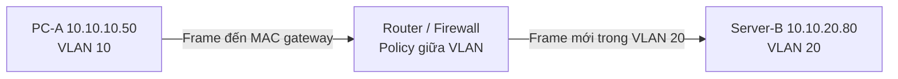

# VLAN: phân đoạn mạng ở lớp 2 và kiểm soát luồng giữa các vùng

Một văn phòng có mạng nhân viên, khách, camera IP, máy in và máy chủ. Nếu tất cả cùng nằm trong một miền quảng bá Ethernet, lưu lượng broadcast lan rộng, thiết bị ở các nhóm khác nhau dễ tiếp cận nhau ở lớp 2 và sự cố có thể ảnh hưởng nhiều bộ phận. **Virtual LAN (VLAN)** cho phép chia một hạ tầng chuyển mạch vật lý thành nhiều miền lớp 2 logic, giúp tổ chức lưu lượng và tạo ranh giới ban đầu cho chính sách bảo mật.

VLAN là một phần của chủ đề **Segmentation** trong module **SECURITY_NETWORK_SECURITY**. Hiểu VLAN giúp thiết kế phân đoạn giữa người dùng và workload, kết hợp với firewall/ACL, VPN, xác thực cổng mạng, giám sát xâm nhập, DNS security, mạng không dây và hạ tầng ảo hóa/cloud. Tuy vậy, **VLAN tự nó không thay thế firewall, xác thực hay mã hóa**: khi có thiết bị định tuyến giữa các VLAN, quyền truy cập phải được kiểm soát riêng.

Sau bài này, bạn có thể:

- Giải thích VLAN ID, broadcast domain, access port, trunk port và khung Ethernet có 802.1Q tag.
- Phân biệt VLAN, IP subnet, vùng bảo mật, VRF và cơ chế định tuyến giữa VLAN.
- Thiết kế nhóm VLAN theo mức tin cậy và mô tả luồng cần cho phép hoặc từ chối.
- Nhận diện lỗi cấu hình VLAN, trunk, native VLAN/PVID và rủi ro lớp 2.
- Kiểm tra cấu hình, packet và kết quả truy cập mà không kết luận sai từ một dấu hiệu đơn lẻ.

## 1. VLAN giải quyết vấn đề gì?

**VLAN là một miền quảng bá (broadcast domain) logic ở lớp liên kết dữ liệu**, thường được triển khai trên switch Ethernet theo chuẩn IEEE 802.1Q. Các cổng thuộc cùng VLAN có thể trao đổi frame lớp 2 theo chính sách chuyển mạch; frame broadcast thông thường được chuyển trong VLAN đó, không tự động tràn sang VLAN khác.

Ví dụ:

```text
                    Một switch vật lý
        +--------------------------------------+
        | VLAN 10: Nhân viên   cổng 1, 2, 3    |
        | VLAN 20: Khách      cổng 4, 5       |
        | VLAN 30: Camera     cổng 6, 7, 8    |
        +--------------------------------------+

VLAN 10: PC-A --- PC-B         (broadcast riêng)
VLAN 20: Guest-A --- Guest-B   (broadcast riêng)
VLAN 30: Cam-A --- Cam-B       (broadcast riêng)
```

Trong thiết kế trên, một ARP Request do PC-A phát ra trong VLAN 10 thông thường không được bridge tới các cổng access của VLAN 20 hoặc VLAN 30. Tuy nhiên nếu một router, switch lớp 3 hoặc firewall được cấu hình cho phép chuyển giữa các VLAN, **lưu lượng IP vẫn có thể đi từ PC-A tới Guest-A**. VLAN giới hạn miền chuyển mạch, còn chính sách lớp 3–7 quyết định có cho phép liên lạc xuyên ranh giới hay không.

### 1.1. Vì sao không chỉ dùng hai dải IP khác nhau?

Giả sử hai nhóm máy dùng `10.10.10.0/24` và `10.10.20.0/24` nhưng đều cắm vào cùng một VLAN. Việc chúng có subnet khác nhau **không tự tách broadcast domain**: broadcast Ethernet vẫn có thể đến cả hai nhóm, và các host có thể cấu hình lại IP để giao tiếp trực tiếp nếu điều kiện mạng cho phép.

Ngược lại, nếu cùng dải IP được đặt ở hai VLAN không nối lớp 2 với nhau, các host trong hai VLAN có thể không giải quyết được ARP để nói chuyện trực tiếp, dù chúng tưởng thuộc cùng subnet. Thiết kế thông thường là **mỗi VLAN người dùng/workload tương ứng một IP subnet riêng** để routing và troubleshooting rõ ràng. Đây là quy ước tốt, không phải yêu cầu cứng của mọi công nghệ.

### 1.2. VLAN không phải ranh giới vật lý tuyệt đối

Nhiều VLAN có thể dùng chung switch, dây uplink và thiết bị quản trị. Một lỗi cấu hình trunk hoặc switch có thể tác động nhiều VLAN. Nếu yêu cầu cách ly cực cao, có thể cần thiết bị riêng, VRF, firewall, hoặc biện pháp cách ly bổ sung tùy mô hình đe dọa.

## 2. Ethernet và thẻ VLAN IEEE 802.1Q

Ở Ethernet thông thường, frame có MAC đích, MAC nguồn, trường EtherType/Length, payload và FCS. Trên liên kết **tagged**, IEEE 802.1Q chèn thêm một thẻ dài **4 byte** giữa Source MAC và EtherType/Length gốc.

```text
Ethernet không gắn tag:
  Destination MAC | Source MAC | EtherType | Payload | FCS

Ethernet có tag 802.1Q:
  Destination MAC | Source MAC | TPID 0x8100 | TCI | EtherType | Payload | FCS
                                    2 byte    2 byte
```

FCS được tính lại khi frame được sửa đổi trên đường chuyển tiếp. Thiết bị cần xử lý kích thước frame lớn hơn do tag thêm 4 byte; giới hạn frame và MTU phụ thuộc phần cứng/cấu hình. Một số môi trường còn dùng **802.1ad (Q-in-Q)** để xếp nhiều tag trong cùng frame, phục vụ kịch bản mạng nhà cung cấp dịch vụ.

### 2.1. Các trường trong TCI

| Trường | Số bit | Ý nghĩa |
|---|---:|---|
| PCP (Priority Code Point) | 3 | Phân lớp ưu tiên lưu lượng ở Ethernet/802.1p; có thể hỗ trợ cơ chế QoS. |
| DEI (Drop Eligible Indicator) | 1 | Cờ đánh dấu frame có thể bị ưu tiên loại bỏ khi tắc nghẽn. |
| VID (VLAN Identifier) | 12 | Số định danh VLAN được mang trong tag. |

VID có 12 bit nên về mặt biểu diễn nhận các giá trị `0–4095`, nhưng:

- **VID 0** biểu thị frame có thông tin ưu tiên (*priority-tagged*) nhưng không chỉ định VLAN riêng bằng VID; việc gán VLAN phụ thuộc cổng/quy tắc thiết bị.
- **VID 4095** được dành riêng, không dùng làm VLAN thông thường.
- **VID 1–4094** là các giá trị dùng để định danh VLAN theo chuẩn; một số switch dành thêm VLAN ID cho tính năng hoặc áp dụng giới hạn theo nền tảng. VLAN 1 thường có vai trò mặc định trên nhiều switch, nhưng cách hoạt động cụ thể khác nhau.

**VLAN ID có ý nghĩa trong phạm vi mạng lớp 2/trunk được cấu hình**, không phải một “địa chỉ toàn cầu”. Hai mạng độc lập có thể cùng dùng VLAN 20 mà không thuộc cùng miền quảng bá.

### 2.2. Tagged và untagged là cách frame được truyền trên một cổng

Một frame **tagged** có thẻ 802.1Q; frame **untagged** không có thẻ đó. Trên cổng người dùng thông thường, máy tính gửi và nhận frame untagged. Switch gán frame vào VLAN theo cấu hình cổng khi nhận, rồi có thể gắn tag khi chuyển qua uplink trunk.

```text
PC nhân viên                  SW-A                     SW-B                 Server
untagged                    VLAN 10                  VLAN 10               untagged
    |                         |                         |                      |
    +--- access VLAN 10 ------+--- trunk tagged 10 -----+---- access VLAN 10 --+
```

Tại máy PC, một capture trên cổng access thường không thấy VLAN tag vì tag không tồn tại trên đoạn link này. Kết luận “mạng không dùng VLAN” từ một capture như vậy là sai.

## 3. Access port, trunk port, native VLAN và PVID

### 3.1. Access port

**Access port** thường thuộc một VLAN duy nhất cho dữ liệu người dùng. Frame untagged đi vào port được phân loại vào VLAN access; frame đi ra thiết bị đầu cuối thường ở dạng untagged.

Ví dụ: `Gi1/0/10` là access port của VLAN 10. Laptop trên cổng đó không cần tự gắn tag để tham gia VLAN 10. Nếu cổng thực tế gán nhầm VLAN 20, máy có thể nhận DHCP từ mạng khách hoặc không truy cập được gateway nhân viên.

Một số tính năng như **voice VLAN** cho phép một cổng nối điện thoại IP và PC dùng cách gắn tag khác nhau cho voice/data. Đó là cấu hình có chủ đích; không nên suy từ mô tả “access” rằng mọi frame trên mọi thiết bị đều hoàn toàn untagged.

### 3.2. Trunk port

**Trunk** chuyên chở lưu lượng của nhiều VLAN qua cùng một liên kết, thường giữa hai switch, switch–router, switch–firewall, switch–hypervisor hoặc switch–access point có nhiều SSID/VLAN.

```text
Switch tầng 1                                 Switch lõi
 VLAN 10 -----\                            /--- VLAN 10
 VLAN 20 ------+=== trunk: VLAN 10,20,30 ==+--- VLAN 20
 VLAN 30 -----/                            \--- VLAN 30
```

Một trunk phải được cấu hình thống nhất về VLAN được phép (*allowed VLANs*), tagging/untagging, native VLAN/PVID, MTU và tính năng tương thích. **Không nên để trunk mang mọi VLAN theo mặc định** khi chỉ cần vài VLAN. Dải VLAN được phép trên trunk chính là một phần của bề mặt tiếp xúc.

### 3.3. Native VLAN và PVID

Trong cách gọi phổ biến trên switch Cisco, **native VLAN** là VLAN gán cho frame untagged nhận trên một trunk 802.1Q; khi gửi ra trunk, traffic thuộc native VLAN có thể được gửi không tag theo cấu hình. Trong các nền tảng khác, thuật ngữ **PVID (Port VLAN ID)** thường là VLAN được gán cho frame untagged/priority-tagged khi chúng đi vào cổng.

Hai đầu trunk nên đồng thuận về cách xử lý untagged và tagged frame; cấu hình lệch native VLAN/PVID có thể khiến frame được phân loại sang VLAN không đúng.

Ví dụ lỗi:

```text
Switch A trunk: native VLAN 99   -------  Switch B trunk: native VLAN 10

Frame untagged từ A  -------------------> B phân loại vào VLAN 10
```

Tùy thiết bị, hệ thống có thể phát cảnh báo native VLAN mismatch hoặc loại frame, nhưng **không được giả định mọi switch tự chặn sai lệch này**. Khi có yêu cầu cao, có thể dùng một VLAN native không chứa người dùng, giới hạn VLAN allowed và cấu hình tagged-only nếu phần cứng/hệ điều hành hỗ trợ.

### 3.4. So sánh các kiểu port

| Tiêu chí | Access | Trunk |
|---|---|---|
| Mục đích thường gặp | Nối PC, camera, máy in | Nối switch, firewall/router, hypervisor, AP nhiều SSID |
| VLAN cho data thông thường | Một VLAN access | Nhiều VLAN được phép |
| Frame trên dây | Thường untagged | Thường tagged theo VID; có thể có native untagged |
| Lỗi phổ biến | Cắm nhầm VLAN, port bị disable | Thiếu allowed VLAN, native mismatch, tag sai |
| Nguy cơ cần xét | Thiết bị đầu cuối giả mạo, DHCP/ARP, MAC flooding | Cấu hình mở quá rộng, trunk negotiation sai, chuyển frame vào vùng không đúng |

## 4. VLAN, subnet, VRF và firewall khác nhau thế nào?

| Khái niệm | Phạm vi chính | Chức năng |
|---|---|---|
| **VLAN** | Lớp 2 | Chia miền chuyển mạch/broadcast trên Ethernet. |
| **IP subnet** | Lớp 3 | Tổ chức địa chỉ IP và cách host chọn đích local hay gửi qua gateway. |
| **SVI (Switch Virtual Interface)** | Giao diện lớp 3 của VLAN trên switch hỗ trợ L3 | Làm địa chỉ gateway hoặc giao diện để quản lý/định tuyến cho VLAN. |
| **Inter-VLAN routing** | Lớp 3 | Chuyển gói IP giữa các subnet gắn với các VLAN. |
| **VRF** | Lớp 3 | Tách bảng định tuyến/miền routing trong một thiết bị; có thể kết hợp VLAN. |
| **ACL / firewall policy** | Lớp 3–7 tùy giải pháp | Cho phép hoặc từ chối các luồng giữa vùng và dịch vụ. |
| **Microsegmentation** | Theo workload/identity và policy | Siết truy cập ở mức chi tiết hơn subnet/VLAN; triển khai phụ thuộc nền tảng. |

VLAN 10 và VLAN 20 có thể **cách ly lớp 2** nhưng vẫn được switch lớp 3 định tuyến qua lại. Nhiều thiết bị khi bật IP routing và cấu hình SVI cho cả hai VLAN có thể cho phép giao tiếp IP theo routing mặc định nếu không có ACL/firewall bổ sung. **Đừng coi “hai VLAN” đồng nghĩa “đã chặn truy cập qua lại”.**

### 4.1. Khi một host gửi packet sang VLAN khác

Giả sử:

- PC-A: `10.10.10.50/24`, gateway `10.10.10.1`, thuộc VLAN 10.
- Server-B: `10.10.20.80/24`, gateway `10.10.20.1`, thuộc VLAN 20.
- Firewall/router có giao diện lớp 3 cho cả hai VLAN và policy cho phép đúng dịch vụ.

Quy trình:

1. PC-A thấy `10.10.20.80` **khác mạng local** (`10.10.10.0/24`), nên chọn next hop `10.10.10.1`.
2. PC-A dùng ARP tìm MAC của **gateway trong VLAN 10**, không tìm MAC của Server-B.
3. Frame tới gateway được xử lý lớp 3; router/firewall kiểm tra route và chính sách giữa vùng VLAN 10 → VLAN 20.
4. Nếu policy cho phép, router tạo frame mới gửi vào VLAN 20 với MAC phù hợp của next hop/Server-B.
5. Luồng phản hồi phải có đường về và phù hợp chính sách trạng thái hoặc các quy tắc chiều về của mạng.



Việc định tuyến **thay đổi header lớp 2 theo từng hop**, trong khi địa chỉ IP nguồn/đích thường giữ nguyên nếu không có NAT. Mỗi VLAN có miền ARP/broadcast riêng; router không bridge broadcast ARP thông thường giữa hai VLAN.

## 5. Thiết kế VLAN theo mức tin cậy

Không nên tạo VLAN chỉ theo số lượng phòng ban hoặc theo sơ đồ tổ chức nếu điều đó không phản ánh luồng truy cập. Hãy xuất phát từ tài sản, mức tin cậy, độ nhạy cảm dữ liệu và kết nối cần có.

Ví dụ mô hình văn phòng kết hợp hạ tầng ứng dụng:

| VLAN | Tên đề xuất | Subnet minh họa | Thiết bị/workload | Mục tiêu |
|---:|---|---|---|---|
| 10 | `CORP` | `10.10.10.0/24` | Laptop nhân viên | Truy cập dịch vụ doanh nghiệp theo quyền. |
| 20 | `GUEST` | `10.10.20.0/24` | Khách Wi-Fi | Chỉ các dịch vụ Internet và hạ tầng thiết yếu được cho phép. |
| 30 | `IOT` | `10.10.30.0/24` | Camera, máy in, thiết bị thông minh | Giảm tiếp cận tới máy người dùng và hệ thống nhạy cảm. |
| 40 | `SERVER` | `10.10.40.0/24` | API và máy chủ nội bộ | Chỉ nhận kết nối dịch vụ cần thiết. |
| 50 | `MGMT` | `10.10.50.0/24` | IP quản trị switch/firewall/AP | Chỉ từ trạm quản trị hoặc VPN được ủy quyền. |

Các subnet dùng `10.10.x.0/24` chỉ là ví dụ thiết kế. Trong mạng thật phải tránh dải địa chỉ trùng với mạng WAN/VPN, site khác hoặc subnet cloud cần kết nối.

### 5.1. Ma trận luồng truy cập (security policy)

| Nguồn → Đích | Chính sách ví dụ | Ghi chú |
|---|---|---|
| `GUEST → Internet` | Allow các dịch vụ cần thiết qua cổng ra có kiểm soát | Có thể lọc DNS và hạn chế dịch vụ theo chính sách tổ chức. |
| `GUEST → CORP/SERVER/MGMT` | Deny theo mặc định | Ngoại lệ phải có nghiệp vụ và đánh giá rủi ro rõ ràng. |
| `CORP → SERVER` | Allow HTTPS/TCP `443` hoặc ứng dụng được chỉ định | Không mở tất cả port chỉ vì cùng mạng công ty. |
| `CORP → IOT` | Chỉ allow dịch vụ in/thiết bị cần thiết | Một số giao thức khám phá mạng cần cơ chế trung gian có kiểm soát. |
| `IOT → SERVER` | Chỉ allow đích thu thập, quản lý, telemetry | Thiết bị IoT không tự do truy cập database/hạ tầng quản trị. |
| `MGMT → Switch/Firewall/AP` | Allow SSH/HTTPS/SNMP bảo mật từ trạm quản trị được cấp quyền | Xác thực mạnh, logging và kiểm toán. |
| `VLAN bất kỳ → DNS/DHCP/NTP` | Cho phép chính xác dịch vụ nền có nhu cầu | DHCP relay, DNS resolver, NTP và các dịch vụ nền cần được thiết kế riêng. |

**Ma trận là chính sách mong muốn, không tự được VLAN thi hành.** Cần chuyển ma trận thành ACL, firewall rules, VRF route leaking có kiểm soát, host firewall hoặc chính sách thích hợp. Các thiết bị cùng VLAN thường có thể nói chuyện trực tiếp ở lớp 2 mà **không đi qua firewall giữa VLAN**; nếu cần cô lập từng thiết bị, cân nhắc private VLAN, port isolation, policy trên switch/wireless hoặc microsegmentation.

### 5.2. Quy tắc phân đoạn có thể vận hành được

1. Tạo VLAN theo nhóm có mức tin cậy và nhu cầu giao tiếp tương đồng.
2. Liệt kê flow **source → destination → protocol/port → purpose** trước khi viết rule.
3. Đặt các điểm định tuyến giữa vùng qua thiết bị có khả năng áp chính sách và ghi log phù hợp.
4. Giới hạn cả inbound và outbound giữa các vùng theo nhu cầu; chú ý DNS, DHCP relay, NTP, cập nhật và giám sát.
5. Dùng mô tả, sơ đồ và mapping VLAN–subnet–gateway–trunk để hỗ trợ thay đổi và điều tra.
6. Xác minh định kỳ cả những luồng **được phép** và **không được phép**.

## 6. Cấu hình minh họa trên switch kiểu Cisco IOS

Các ví dụ bên dưới phục vụ học khái niệm; cú pháp khác nhau theo hãng, dòng thiết bị, phiên bản hệ điều hành và khả năng L2/L3. Cần xem cấu hình thực tế và kế hoạch rollback trước khi áp dụng.

### 6.1. Tạo VLAN và cấu hình access port

```text
configure terminal
vlan 10
 name CORP
vlan 20
 name GUEST
vlan 30
 name IOT
vlan 40
 name SERVER
vlan 50
 name MGMT
vlan 999
 name UNUSED_NATIVE

interface GigabitEthernet1/0/10
 description Employee laptop - VLAN 10
 switchport mode access
 switchport access vlan 10
 spanning-tree portfast
 spanning-tree bpduguard enable
 no shutdown
end
```

`portfast` và `bpduguard` ở đây dành cho **cổng nối thiết bị đầu cuối được kiểm soát**, không áp dụng tùy tiện cho uplink nối switch. Tùy công nghệ, một cổng có voice VLAN hoặc kết nối thiết bị đặc biệt cần cấu hình khác.

### 6.2. Cấu hình trunk có danh sách VLAN tối thiểu

```text
configure terminal
interface GigabitEthernet1/0/48
 description Uplink to distribution switch
 switchport mode trunk
 switchport trunk native vlan 999
 switchport trunk allowed vlan 10,20,30,40,50
 no shutdown
end
```

Yêu cầu thực hiện **đồng bộ ở hai đầu**: danh sách VLAN cần đi qua, cách gắn tag và native VLAN. Ví dụ trên chọn VLAN 999 làm native không có thiết bị người dùng; danh sách allowed VLAN không bao gồm VLAN 999 để tránh truyền traffic người dùng của native VLAN trên uplink. Hành vi cụ thể cần xác minh trên switch thực tế. Một số nền tảng hỗ trợ yêu cầu gắn tag ngay cả với native VLAN, nhưng cú pháp và tương thích phải được kiểm tra.

Đối với cổng chỉ nối PC, việc chuyển sang trunk thường **không cần thiết** và có thể tăng rủi ro khi không kiểm soát thiết bị đầu cuối.

### 6.3. Lệnh quan sát trạng thái

```text
show vlan brief
show interfaces trunk
show interfaces GigabitEthernet1/0/10 switchport
show interfaces GigabitEthernet1/0/48 switchport
show mac address-table vlan 10
show spanning-tree vlan 10
show interfaces status
```

Các lệnh trên giúp trả lời VLAN có tồn tại, port ở access/trunk, VLAN được phép, native VLAN, bảng MAC và trạng thái STP hay không. Tùy hãng và phiên bản, tên lệnh và trường dữ liệu có thể khác. Khi thiết bị làm layer-3 gateway, còn cần xem SVI/interface IP, bảng route, ACL và firewall policy; **thấy VLAN tồn tại chưa có nghĩa định tuyến hoặc policy đúng**.

## 7. Inter-VLAN routing: đi qua gateway và chính sách

Muốn hai VLAN ở các subnet khác nhau giao tiếp bằng IP, cần một **router hoặc switch lớp 3** (hoặc firewall). Có hai mô hình phổ biến:

- **Router-on-a-stick:** một cổng vật lý giữa switch và router dùng trunk 802.1Q; router có các subinterface như `Gi0/0.10`, `Gi0/0.20`, mỗi subinterface có IP gateway cho VLAN tương ứng.
- **SVI trên switch lớp 3:** switch có `interface vlan 10`, `interface vlan 20` với địa chỉ gateway; chuyển IP giữa các VLAN bằng khả năng routing của switch.

```text
 VLAN 10 (10.10.10.0/24)    ──┐
                              ├── L3 gateway / firewall ── mạng khác
 VLAN 20 (10.10.20.0/24)    ──┘
```

Khi có cả hai interface VLAN ở cùng thiết bị và đã bật routing, lưu lượng có thể được chuyển giữa chúng dựa trên route. Để thực thi ma trận ở mục 5, cần gắn ACL/firewall rule đúng hướng và đúng điểm kiểm soát. Nếu các VLAN được định tuyến trên L3 switch trước khi lưu lượng tới firewall, firewall đặt ở đoạn khác có thể **không nhìn thấy** luồng inter-VLAN đó.

### 7.1. DHCP giữa nhiều VLAN

DHCPv4 client thường dùng broadcast trong mạng local. Broadcast DHCP từ VLAN 20 **không tự bridge** sang VLAN 10 hoặc tới DHCP server ở VLAN 40. Nếu DHCP server đặt ở mạng khác, gateway thường cần **DHCP relay** được cấu hình đúng; relay chuyển tiếp thông tin cần thiết theo mô hình L3.

Ví dụ: máy khách VLAN 20 gửi DHCP Discover; gateway VLAN 20 làm relay tới DHCP server cho scope `10.10.20.0/24`, rồi đưa phản hồi về VLAN 20. DHCP server phải có scope tương ứng và chính sách firewall phải cho phép luồng cần thiết. DHCPv6, SLAAC và Router Advertisement của IPv6 có cách hoạt động khác DHCPv4; không áp dụng máy móc cơ chế broadcast IPv4.

### 7.2. Một số lưu lượng không tự đi xuyên VLAN

ARP, các broadcast Ethernet, nhiều cơ chế khám phá thiết bị dùng broadcast/multicast link-local không được router chuyển qua VLAN theo cách thông thường. Ví dụ, việc in bằng thiết bị tìm qua mDNS hoặc các hệ thống IoT có thể cần gateway/proxy/relay cho giao thức khám phá, sau đó mới áp policy tới dịch vụ đích.

**Không khắc phục bằng cách bridge mọi VLAN lại với nhau.** Thay vào đó, xác định giao thức khám phá, triển khai proxy/relay được quản lý và cho phép đúng kết nối.

## 8. Rủi ro bảo mật liên quan VLAN

VLAN có ích cho phân đoạn nhưng vẫn nằm trên thiết bị, firmware và cấu hình có thể có lỗi. Một số vấn đề thường gặp:

| Rủi ro | Điều kiện/ảnh hưởng | Hướng phòng vệ |
|---|---|---|
| **Trunk negotiation không được kiểm soát** | Cổng dành cho thiết bị đầu cuối bị chuyển/đàm phán thành trunk trên một số nền tảng | Ép `access mode` trên cổng người dùng; tắt cơ chế tự động thương lượng trunk nếu thiết bị hỗ trợ. |
| **Native VLAN mismatch** | Frame untagged bị phân loại sai VLAN giữa hai đầu trunk | Đồng bộ native VLAN/PVID, rà soát tag và giới hạn allowed VLAN. |
| **VLAN hopping qua cấu hình lỗi** | Lưu lượng bị đưa vào VLAN ngoài ý định khi có cấu hình trunk/tag sai hoặc cơ chế xử lý đặc biệt | Hạn chế trunk, không dùng VLAN người dùng làm native trên uplink, cập nhật firmware và kiểm thử cách xử lý tagged/untagged. |
| **Double tagging** | Trong một số điều kiện native VLAN và xử lý nhiều tag, frame có thể bị phân loại sang VLAN khác | Thiết kế native VLAN không mang người dùng, tagging nhất quán, hạn chế VLAN qua trunk; không mặc định mọi mạng đều dễ bị khai thác. |
| **ARP spoofing** | Máy cùng miền lớp 2 có thể cố đầu độc ánh xạ IP–MAC | Dynamic ARP Inspection (khi hỗ trợ), kiểm soát DHCP bindings, endpoint security và mã hóa. |
| **Rogue DHCP server** | Thiết bị không tin cậy phát địa chỉ/gateway/DNS sai trong VLAN | DHCP snooping, port trusted/untrusted đúng vị trí, NAC và giám sát. |
| **MAC flooding hoặc broadcast storm** | Quá tải tài nguyên switch/đoạn VLAN hoặc tác động đến forwarding | Port security, storm control, giám sát, hạn chế thiết bị, phân đoạn đủ nhỏ. |
| **STP manipulation** | Thiết bị cắm vào cổng không kiểm soát ảnh hưởng topology L2 | BPDU Guard trên cổng edge, Root Guard tại vị trí phù hợp, kiểm soát kết nối switch. |
| **Inter-VLAN access quá rộng** | L3 routing cho lưu lượng đi từ mạng khách đến server/mgmt | ACL/firewall theo mặc định từ chối, chỉ mở dịch vụ cần thiết và giám sát luồng. |

**VLAN hopping không phải một tính chất mặc định của mọi VLAN.** Điều kiện xảy ra phụ thuộc tagging, native VLAN, thương lượng trunk và thiết bị triển khai. Cách đánh giá đúng là rà soát cấu hình và kiểm chứng bảo vệ trong phạm vi được phép, không dựa trên giả định rằng cứ có trunk là có thể vượt VLAN.

### 8.1. Biện pháp lớp 2 phải gắn với điểm triển khai phù hợp

- **802.1X/NAC:** xác thực thiết bị/người dùng trước khi cấp quyền mạng; có thể nhận VLAN động theo thuộc tính RADIUS. Cần chính sách cho thiết bị không hỗ trợ 802.1X và trường hợp máy chủ RADIUS không sẵn sàng.
- **DHCP snooping:** giúp phân biệt port có thể gửi DHCP server response và duy trì binding (trên nền tảng hỗ trợ); cấu hình trusted port sai có thể làm DHCP ngừng hoạt động.
- **Dynamic ARP Inspection:** kiểm tra ARP dựa trên thông tin binding hoặc nguồn tin cậy; thiết bị dùng IP tĩnh có thể cần cơ chế xác minh khác.
- **IP Source Guard / port security:** hạn chế nguồn IP/MAC hoặc số lượng MAC trên một cổng; cần tính đến điện thoại IP, VM và thiết bị nhiều MAC.
- **BPDU Guard, Root Guard, storm control:** giảm rủi ro topology/storm, nhưng bật sai trên uplink hay cổng chuyên dụng có thể gây gián đoạn.
- **Quản trị switch:** tách traffic quản trị, khóa dịch vụ thừa, giới hạn SSH/HTTPS/SNMPv3 và lưu log thay đổi.

Các tính năng này bổ sung cho VLAN, không phải bảo đảm tuyệt đối trước mọi tấn công lớp 2.

## 9. VLAN trong Wi-Fi, ảo hóa và cloud

### 9.1. Wi-Fi SSID và VLAN

Một access point có thể map `CORP-WIFI` vào VLAN 10 và `GUEST-WIFI` vào VLAN 20. Uplink giữa AP và switch thường là trunk mang các VLAN liên quan. Một SSID cũng có thể cấp VLAN động thông qua 802.1X/RADIUS theo người dùng/thiết bị, tùy hệ thống WLAN.

```text
Laptop -- SSID CORP-WIFI --\
                           AP === trunk VLAN 10,20 === Switch
Phone  -- SSID GUEST-WIFI -/
```

Tách VLAN cho hai SSID giúp chia miền lớp 2, nhưng **guest isolation** còn cần policy chặn guest → corp, có thể có client isolation trong cùng SSID/VLAN, DNS policy và Internet egress thích hợp. Bảo vệ radio/Wi-Fi như WPA2-Enterprise/WPA3-Enterprise và xác thực 802.1X xử lý lớp vấn đề khác với việc gán VLAN.

### 9.2. Hypervisor và container

Trên hypervisor, một virtual switch có thể nối port group với VLAN ID cụ thể hoặc mang traffic tagged qua uplink vật lý. Nếu port group của server thuộc VLAN 40 nhưng uplink switch không cho VLAN 40 đi qua, VM có thể không liên lạc được dù cấu hình IP trong VM đúng.

Trong mạng container, workload có thể dùng bridge, overlay hoặc CNI với chính sách mạng riêng. Không nên suy ra pod hoặc container luôn tương ứng một 802.1Q VLAN; hãy xác minh loại network datapath thực tế.

### 9.3. Cloud VPC và overlay

AWS VPC, Azure VNet, Google Cloud VPC cung cấp phân đoạn mạng logic và routing/security policies theo cơ chế của nền tảng. **Subnet cloud không đồng nghĩa một VLAN 802.1Q mà người dùng có thể quan sát trên trunk.** Mạng datacenter quy mô lớn có thể dùng overlay (ví dụ VXLAN với VNI) hoặc giải pháp ảo hóa/SDN để vượt giới hạn phạm vi VLAN truyền thống.

Khi kết nối on-premises với cloud qua VPN/Direct Connect/ExpressRoute/Interconnect, cần phân biệt **tag VLAN trên liên kết Ethernet của kết nối** với **phân đoạn, route và firewall policy bên trong mạng cloud**. Mở cùng một VLAN ID ở hai nơi không tự nối hai miền mạng.

## 10. Quan sát VLAN bằng công cụ mạng

### 10.1. Trên switch

Tùy hệ điều hành switch, các lệnh quan sát thường cho biết:

```text
show vlan brief
show interfaces trunk
show interfaces GigabitEthernet1/0/10 switchport
show mac address-table vlan 20
show spanning-tree vlan 20
show interfaces status
```

Kiểm tra lần lượt: VLAN tồn tại và active? Port đúng access/trunk? Trunk có cho phép VID đi qua? Cùng VID có bị STP block ở một nhánh? Switch học MAC của endpoint ở VLAN nào? Có lỗi port/security hoặc broadcast storm không?

### 10.2. Trên Linux và packet capture

Các lệnh sau là ví dụ quan sát; kết quả phụ thuộc card mạng, driver, namespace và thiết kế liên kết:

```bash
# Xem interface, địa chỉ IP và VLAN sub-interface nếu có
ip -br link
ip -br addr
ip -d link show

# Xem routing và bảng ARP/neighbor
ip route
ip neigh show

# Trên Linux bridge có VLAN filtering, xem VLAN membership
bridge vlan show

# Nếu bắt trên liên kết tagged, hiện địa chỉ MAC và thông tin VLAN
sudo tcpdump -eni eth0

# Bắt những frame VLAN 20 nếu tag có thể nhìn thấy tại điểm bắt
sudo tcpdump -eni eth0 'vlan 20'

# Kiểm tra một số tính năng offload của NIC
ethtool -k eth0
```

**Không thấy tag trong tcpdump không đủ để kết luận frame không được gắn VLAN ở mọi điểm.** Trên access port, tag thường bị bỏ trước khi tới host; NIC VLAN offload cũng có thể chuyển thông tin tag ra metadata thay vì bytes hiển thị. Muốn xác minh trunk, ưu tiên capture tại vị trí đúng, ví dụ mirror cổng trunk hoặc thiết bị hỗ trợ hiển thị tag, rồi đối chiếu cấu hình switch.

Trong Wireshark, có thể dùng display filter:

| Mục tiêu | Display filter |
|---|---|
| Frame có tag 802.1Q được nhận diện | `vlan` |
| Frame chứa VLAN ID 20 | `vlan.id == 20` |
| ARP trên các frame quan sát được | `arp` |
| DHCPv4 trong bản Wireshark nhận diện bằng dissector BOOTP | `bootp` hoặc trường DHCP tương ứng tùy phiên bản |
| ICMPv4 | `icmp` |
| IPv6 Neighbor Discovery | `icmpv6` |

Filter **chỉ nhìn dữ liệu đã thu và đã được dissector phân tích**. Một số frame có tag lồng nhau, cơ chế đóng gói khác hay offload khiến kết quả cần đối chiếu thêm. Địa chỉ MAC, IP, VLAN ID và thời gian nên được ghi cùng nhau để theo vết.

## 11. Phân tích lỗi VLAN theo triệu chứng

### 11.1. Máy được cấp IP từ mạng sai

**Triệu chứng:** Laptop nhân viên có IP `10.10.20.45`, gateway `10.10.20.1`, trong khi đáng ra thuộc VLAN 10 với IP `10.10.10.0/24`.

**Giả thuyết:** Cổng access/port group/SSID map sai VLAN; DHCP relay/scope hoặc môi trường có rogue DHCP. **Kiểm tra:** port vật lý, `show interfaces ... switchport`, VLAN membership, DHCP transaction và scope; đối chiếu MAC trong bảng switch. Chỉ sửa port sau khi xác định đúng hệ thống và thiết bị đang cắm.

### 11.2. Máy có IP đúng nhưng không ping được gateway

**Triệu chứng:** PC ở VLAN 20 có `10.10.20.50/24`, gateway `10.10.20.1`, nhưng không liên lạc được gateway.

**Giả thuyết:** VLAN bị thiếu trên trunk, gateway/SVI chưa hoạt động, STP blocking, sai tagging/PVID hoặc host firewall/ICMP policy. **Kiểm tra:** ARP cho gateway, trạng thái SVI, MAC table, trunk allowed VLAN, native mismatch và capture hai đầu. Không được kết luận thiếu trunk chỉ từ việc ping thất bại.

### 11.3. Hai máy cùng VLAN nói chuyện được, khác VLAN không được

**Triệu chứng:** Hai thiết bị trong VLAN 10 hoạt động, nhưng truy cập server VLAN 40 timeout.

**Giả thuyết:** Thiếu inter-VLAN routing, gateway không hoạt động, ACL/firewall từ chối, route chiều về sai hoặc dịch vụ đích không lắng nghe. **Kiểm tra:** default gateway của mỗi host, route table, packet SYN/reply, các policy áp tại điểm L3 và log server. VLAN hoạt động ở lớp 2 không chứng minh đường L3 thông.

### 11.4. Một VLAN hoạt động ở tầng này nhưng lỗi ở tầng khác

**Triệu chứng:** VLAN 30 hoạt động ở switch A, nhưng camera sau switch B không nhận DHCP hay gửi stream về server.

**Giả thuyết:** VLAN 30 chưa nằm trong allowed list trên một trunk, VLAN chưa được tạo/active ở một switch, native/PVID mismatch hoặc uplink/STP có vấn đề. **Kiểm tra:** mô hình trunk dọc tuyến, danh sách allowed, MAC forwarding, DHCP relay và trạng thái uplink; tìm **điểm đầu tiên** mà frame VLAN 30 không đi qua.

### 11.5. Mạng khách vẫn nhìn thấy máy nhân viên

**Triệu chứng:** Thiết bị trong VLAN 20 (GUEST) truy cập được IP máy thuộc VLAN 10 (CORP).

**Quan sát:** Hai VLAN khác nhau vẫn có thể được routing. **Kiểm tra:** VLAN membership có đúng không, gateway ở đâu, có inter-VLAN routing và ACL/firewall nào cho phép không, luồng có qua firewall hay bị định tuyến trên L3 switch trước đó. Cần **chính sách từ chối giữa vùng**, và nếu cần, host firewall/microsegmentation. Đặt hai VLAN khác nhau không tự chặn mọi kết nối.

### 11.6. Packet capture không thấy VLAN tag

**Triệu chứng:** Ở máy khách `tcpdump` không hiện `802.1Q` dù switch báo port thuộc VLAN 10.

**Giải thích:** Access port thường gửi untagged; capture của NIC có thể bị VLAN offload hoặc công cụ không hiện metadata. **Kiểm tra:** switch port mode, mirror đúng uplink trunk, capability NIC và cấu hình offload trước khi kết luận thiếu VLAN.

### 11.7. Lưu lượng broadcast tăng mạnh

**Triệu chứng:** Máy trong VLAN 10 có độ trễ cao, uplink nhiều broadcast, MAC flapping hoặc STP topology thay đổi thường xuyên.

**Giả thuyết:** Loop lớp 2, rogue device, broadcast storm hoặc quy mô VLAN quá lớn. **Kiểm tra:** STP trạng thái/đổi root, MAC table, counters, loop detection và traffic rate theo VLAN. Phải xác định đường loop và thành phần gây phát sinh; không coi tăng broadcast là chắc chắn có tấn công.

### 11.8. Bảng xử lý nhanh

| Triệu chứng | Lớp kiểm tra trước | Bằng chứng cần tìm |
|---|---|---|
Không có link | 1 | NIC/switch/AP link và error counters. |
Nhận IP/gateway sai | 2 và DHCP | Access VLAN, SSID mapping, DHCP scope/relay/rogue DHCP. |
Không ARP được gateway | 2–3 | VLAN membership, trunk, SVI, ARP/NDP và MAC table. |
Chỉ một VLAN không qua uplink | 2 | Allowed VLAN, tagging, native/PVID và STP. |
Liên lạc cùng VLAN được, khác VLAN không | 3–4 | Route, gateway, ACL/firewall, return path, listener. |
Guest tới Corp được ngoài ý muốn | 3 và policy | Định tuyến inter-VLAN và policy deny tại đúng điểm. |
Pcap không hiện tag | Điểm capture | Access/trunk, NIC offload, mirror và dissector. |

## 12. Quy trình kiểm thử phân đoạn trước khi vận hành

Một mạng được gọi là “đã phân đoạn an toàn” cần chứng minh cả **luồng hợp lệ** lẫn **luồng bị từ chối** theo chính sách. Thực hiện kiểm tra trong phạm vi được cấp quyền, với thiết bị thử nghiệm và lịch thay đổi phù hợp.

1. **Định nghĩa ma trận policy:** nguồn VLAN/subnet, đích VLAN/subnet, port, giao thức, kết quả mong đợi.
2. **Kiểm tra L2:** port đúng membership; trunk chỉ chứa VLAN được phép; native/PVID thống nhất; STP ổn định; MAC table đúng.
3. **Kiểm tra dịch vụ nền:** DHCP, DNS, NTP, quản trị và các cơ chế khám phá cần thiết hoạt động đúng từ VLAN tương ứng.
4. **Kiểm tra L3/policy:** thử các kết nối được cho phép và các kết nối phải bị chặn; quan sát ở firewall/ACL và endpoint.
5. **Kiểm tra lưu lượng không nằm trên đường dự kiến:** chú ý inter-VLAN routing chạy trực tiếp trên L3 switch hoặc đường tunnel/overlay.
6. **Đối chiếu log:** firewall/IDS/IPS, switch events, DHCP/802.1X, DNS và ứng dụng; tránh suy luận quá mức từ `ping`.
7. **Ghi kết quả:** VLAN ID, subnet, địa chỉ gateway, nguồn/đích thử nghiệm, thời gian, rule, trạng thái và các ngoại lệ.

Mẫu biên bản:

| Mục | Kết quả minh họa |
|---|---|
| Kiểm tra | Guest VLAN 20 → Server VLAN 40 TCP/443 |
| Kỳ vọng | Deny vì không có nghiệp vụ cho Guest truy cập Server |
| Đường đi | Guest AP → switch access → firewall L3 → Server |
| L2 | AP map đúng VLAN 20, trunk cho phép VLAN 20 và VLAN 40 trên các nhánh thích hợp |
| L3/policy | Firewall log ghi deny cho luồng Guest → Server |
| Xác minh | Client không thiết lập được kết nối; server không nhận request tương ứng |
| Lưu ý | Không dựa chỉ vào timeout; đối chiếu log/policy và điểm capture |

## 13. Câu hỏi ôn tập tình huống

**Câu 1.** VLAN 10 và VLAN 20 dùng hai subnet khác nhau. Vì sao laptop VLAN 10 vẫn truy cập được database VLAN 20?

**Gợi ý:** Có router/switch L3/firewall định tuyến giữa hai subnet và policy cho phép hoặc chưa hạn chế. VLAN tách lớp 2 nhưng không mặc định cấm lưu lượng IP.

**Câu 2.** Một laptop cắm vào access VLAN 10. Wireshark trên laptop không thấy 802.1Q tag. Cấu hình switch có sai không?

**Gợi ý:** Chưa thể kết luận. Access port thông thường gửi frame untagged cho laptop, và NIC có thể xử lý tag trước capture. Kiểm tra port mode và nếu cần bắt trên trunk.

**Câu 3.** Client VLAN 30 có IP tĩnh hợp lệ nhưng không ARP được gateway. Nêu ít nhất ba điều cần kiểm tra.

**Gợi ý:** Access port/SSID/VLAN membership; allowed VLAN trên trunk; trạng thái gateway/SVI; STP; VLAN native/PVID; IP/mask của client; lỗi interface.

**Câu 4.** Vì sao nên giới hạn VLAN allowed trên trunk?

**Gợi ý:** Giảm VLAN không cần thiết đi qua đường uplink và giới hạn tác động của cấu hình lỗi/tấn công lớp 2. Cần đảm bảo không loại bỏ VLAN phục vụ nghiệp vụ.

**Câu 5.** Mạng khách và mạng nhân viên được gán hai SSID/VLAN. Thiết bị khách vẫn dùng được API nội bộ qua gateway. Cần thêm gì?

**Gợi ý:** ACL/firewall giữa các vùng, áp đúng nơi inter-VLAN routing diễn ra; cân nhắc client isolation và xác thực ứng dụng. VLAN khác nhau không phải phép kiểm tra authorization.

**Câu 6.** Bật DHCP snooping và DAI làm máy in IP tĩnh mất kết nối. Điều gì có thể xảy ra?

**Gợi ý:** DAI có thể không có binding thích hợp cho thiết bị IP tĩnh; cần xác minh cơ chế xác thực IP–MAC phù hợp (ví dụ entry tĩnh/ARP ACL theo khả năng thiết bị) và cấu hình trusted ports có kiểm soát.

## 14. Checklist thiết kế và vận hành VLAN an toàn

- [ ] Có bảng ánh xạ VLAN ID, tên, subnet, gateway, owner và mức tin cậy.
- [ ] Mỗi access port/SSID/port group được gán vào đúng VLAN; cổng không dùng được khóa hoặc đưa vào cấu hình cô lập phù hợp.
- [ ] Trunk chỉ cho VLAN cần thiết; hai đầu thống nhất tagging, native VLAN/PVID và MTU.
- [ ] Không để cổng người dùng tự thương lượng trunk ngoài ý định; áp dụng kiểm soát lớp 2 phù hợp với thiết bị.
- [ ] DHCP, DNS, NTP, IPv6 NDP và các dịch vụ nền được thiết kế theo từng VLAN.
- [ ] Điểm định tuyến inter-VLAN được xác định rõ; ACL/firewall áp dụng ở **đúng đường đi thực tế**.
- [ ] Mặc định từ chối luồng giữa các vùng không có nhu cầu; chỉ mở protocol/port và nguồn–đích được phê duyệt.
- [ ] Wi-Fi, hypervisor, container và cloud overlay được đối chiếu với mapping VLAN/segment thực tế.
- [ ] Có log và chỉ số switch, STP, DHCP, firewall, IDS/IPS để phát hiện lỗi/tấn công.
- [ ] Đã thử cả luồng được phép và luồng phải bị chặn; kết quả được ghi lại để kiểm toán.

**Ghi nhớ:** VLAN là công cụ phân đoạn lớp 2, làm gọn broadcast domain và tổ chức các vùng mạng logic. **Ranh giới bảo mật hoàn chỉnh** cần thêm chính sách tại điểm định tuyến, xác thực và phân quyền ứng dụng, bảo vệ lớp 2, giám sát cũng như quản trị cấu hình nhất quán trên switch, Wi-Fi, mạng ảo và cloud.
