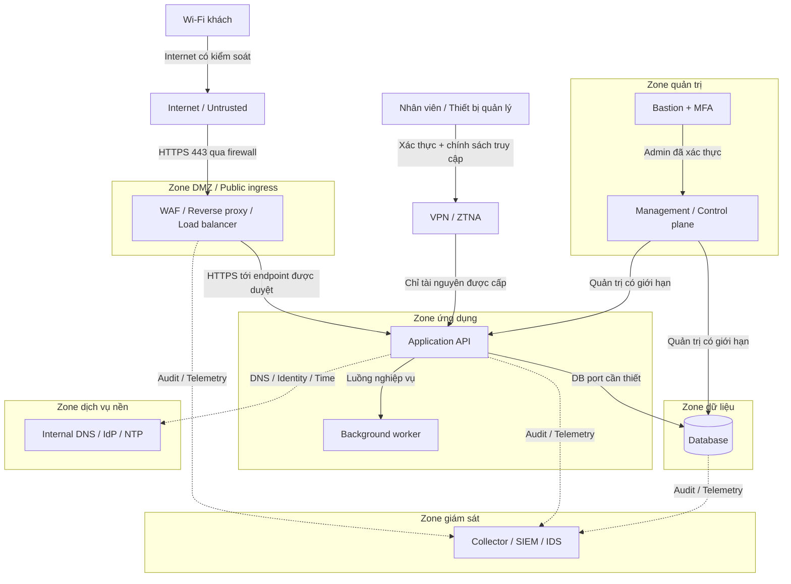

# Security zone

> **Học phần:** `SECURITY_NETWORK_SECURITY`  
> **Chương:** Segmentation  
> **Chủ đề:** Security zone — thiết kế và bảo vệ các vùng mạng theo mức độ phơi lộ, chức năng, độ nhạy tài sản và ranh giới kiểm soát truy cập.

Một hệ thống mạng an toàn cần phân biệt các khu vực có vai trò khác nhau: Internet, mạng khách, máy trạm, dịch vụ công khai, backend, dữ liệu, hạ tầng quản trị, VPN, mạng giám sát và tài nguyên đám mây. **Security zone** là cách tổ chức các tài sản và luồng truy cập thành vùng có chính sách bảo vệ nhất quán, để một sự cố ở vùng này không dễ lan sang vùng khác.

## Mục tiêu học tập

Sau bài này, người học có thể:

1. Giải thích security zone, trust boundary và sự khác nhau giữa **phân vùng logic**, **subnet/VLAN** và **chính sách phân đoạn được thực thi**.
2. Phân loại vùng theo chức năng, độ phơi lộ và rủi ro, từ DMZ, người dùng, Wi-Fi khách, ứng dụng, dữ liệu đến quản trị, VPN và cloud.
3. Vẽ sơ đồ lưu lượng giữa các vùng, xác định điểm thực thi firewall/ACL, microsegmentation, identity-aware access và giám sát.
4. Xây dựng ma trận **zone-to-zone**, quy tắc least privilege, default deny, kiểm soát đường đi ngược và ngoại lệ.
5. Thiết kế đường truy cập an toàn cho dịch vụ public, ứng dụng nội bộ, database và control plane; nhận ra rủi ro di chuyển ngang.
6. Kiểm thử đường đi thực tế và phân tích log, route, NAT, DNS, IDS/IPS để xác định chính sách nào cho phép hoặc chặn lưu lượng.

## 1. Security zone là gì?

**Security zone** là một nhóm tài sản hoặc điểm kết nối được áp dụng chính sách bảo vệ mạng tương đồng, dựa trên đặc điểm nghiệp vụ, yêu cầu an toàn và rủi ro. Một zone có thể gồm một hay nhiều subnet, VLAN, workload, network interface hoặc tập tài nguyên được quản lý; cũng có thể chỉ gồm một nhóm workload nhỏ khi dùng microsegmentation.

Ví dụ:

- **Internet/Untrusted:** nguồn truy cập ngoài phạm vi quản lý trực tiếp.
- **DMZ/Public services:** reverse proxy hoặc cổng dịch vụ nhận kết nối từ Internet.
- **User:** laptop và thiết bị nhân viên được quản lý.
- **Application:** API/backend xử lý nghiệp vụ.
- **Data:** cơ sở dữ liệu, kho lưu trữ dữ liệu nhạy cảm.
- **Management:** bastion, thiết bị/quản trị hệ thống và giao diện control plane.
- **Guest:** thiết bị khách hoặc thiết bị chưa được xác minh.
- **Monitoring:** collector, logging, IDS/IPS, SIEM.

Đường ranh giới giữa hai zone là nơi các quy tắc truy cập cần được xác định và thực thi. Quy tắc có thể dựa trên địa chỉ, cổng, giao thức, danh tính, ngữ cảnh thiết bị hoặc yêu cầu ứng dụng, tùy khả năng của điểm kiểm soát.

**Ba khái niệm cần phân biệt:**

| Khái niệm | Trả lời câu hỏi | Lưu ý |
|---|---|---|
| **Security zone** | Tài sản nào có cùng vai trò/rủi ro và chính sách? | Là mô hình chính sách và phạm vi quản trị |
| **Subnet / VLAN / VPC subnet** | Địa chỉ hoặc lưu lượng L2/L3 được tổ chức ra sao? | Là cấu trúc mạng; có thể được dùng để hiện thực zone nhưng tự nó chưa bảo đảm phân đoạn |
| **Trust boundary** | Ở đâu dữ liệu/danh tính/quyền phải được xác minh lại? | Có thể đi qua zone hoặc tồn tại ngay trong cùng zone |
| **Segmentation control** | Cơ chế nào thực sự chặn/cho phép đường truy cập? | Firewall, ACL, security group, network policy, identity-aware gateway... |

**Chỉ đặt máy chủ vào VLAN khác chưa chứng minh đã bảo vệ được zone.** Nếu định tuyến giữa VLAN tự do và không có rule giới hạn, các máy chủ vẫn có thể kết nối với nhau. Ngược lại, microsegmentation có thể tách workload trong cùng subnet khi có điểm thực thi chính sách phù hợp.

### Mục đích bảo mật

- **Giảm bề mặt tấn công:** Một máy khách không cần kết nối trực tiếp tới database, bộ quản trị hoặc thiết bị mạng.
- **Hạn chế di chuyển ngang:** Khi một endpoint bị chiếm, quyền truy cập từ đó đến các zone khác vẫn bị giới hạn.
- **Cô lập dịch vụ public:** Lưu lượng Internet chỉ đến những điểm vào cần thiết, không đi thẳng vào vùng dữ liệu/quản trị.
- **Tập trung quan sát:** Các điểm chuyển vùng là nơi hữu ích để đặt log, firewall, IDS/IPS và đo lưu lượng.
- **Áp chính sách nhất quán:** Giảm rule đơn lẻ khó quản lý và gắn đường mạng với tài sản, mục đích, người sở hữu.

Không zone nào mặc nhiên “an toàn tuyệt đối”. Một máy chủ bên trong zone được bảo vệ vẫn có thể bị lạm dụng; cần xác thực, phân quyền và giám sát ngay cả khi các hệ thống ở gần nhau.

## 2. Nguyên tắc thiết kế zone

### 2.1 Phân nhóm theo chức năng và rủi ro

Bắt đầu bằng danh mục **tài sản và luồng dữ liệu**: hệ thống nhận lưu lượng công khai, backend, database, hệ thống danh tính, DNS, dịch vụ cloud, thiết bị quản trị, Wi-Fi và đối tác. Xác định mỗi tài sản phục vụ ai, dữ liệu quan trọng đến đâu, ai quản lý và điều gì xảy ra nếu tài sản bị chiếm.

Không nên xếp mọi hệ thống có cùng mức nhạy cảm vào một zone nếu chúng có **vai trò và quyền kết nối rất khác nhau**. Ví dụ, một máy chủ ứng dụng cần nhận request từ gateway và gọi database, trong khi database nên chỉ chấp nhận các luồng từ ứng dụng được phê duyệt. Chúng cần hai zone dù đều quan trọng.

### 2.2 Least privilege và kiểm soát hai chiều

**Least privilege** ở mạng nghĩa là cho phép chính xác luồng cần thiết: nguồn nào, đích nào, cổng/giao thức nào, theo hướng nào, cho mục đích gì. Chính sách ở ứng dụng và IAM tiếp tục giới hạn hành động được phép.

Với zone nhạy cảm, mô hình phổ biến là **default deny** cho những kết nối mới xuyên ranh giới, rồi mở từng luồng đã được duyệt. Tuy nhiên phải tính đến hạ tầng nền như DNS, NTP, xác thực, giám sát, sao lưu, health check và xử lý sự cố. Default deny là **quyết định trong phạm vi chính sách cụ thể**, không phải lệnh tự động chặn mọi gói trong cả mạng.

### 2.3 Đặt điểm thực thi ở đường đi thật

Một rule chỉ có tác dụng nếu luồng đi qua **policy enforcement point (PEP)**. Các đường đi khác như route nội bộ, L2 adjacency, kết nối private, VPN, peering, overlay hay cloud transit có thể bỏ qua firewall dự định nếu kiến trúc không kiểm tra cẩn thận.

Trong cùng zone có thể có **east-west traffic** không qua firewall biên. Khi đó, cân nhắc firewall phân tán, host firewall, security group hoặc network policy để giới hạn giao tiếp giữa workload.

### 2.4 Danh tính và ngữ cảnh vẫn quan trọng

Zone mô tả một phần **vị trí mạng**, không chứng minh người dùng hoặc workload được phép thực hiện thao tác. Một người có VPN vào user zone không tự có quyền tới admin zone; một dịch vụ được firewall cho phép đến database vẫn phải xác thực và phân quyền trong database. Zero Trust nhấn mạnh việc kiểm tra danh tính, quyền và ngữ cảnh đối với từng tài nguyên.

## 3. Phân loại security zone thường gặp

| Zone | Tài sản ví dụ | Đối tượng truy cập chính | Nguy cơ nổi bật |
|---|---|---|---|
| **External / Internet** | Client công khai, hệ thống ngoài tổ chức | Không được coi là danh tính nội bộ | Lưu lượng thù địch, giả mạo, quét dịch vụ, DDoS |
| **DMZ / Public ingress** | Reverse proxy, WAF, public load balancer | Internet → dịch vụ công khai cần thiết | Thành phần phơi lộ bị chiếm làm bàn đạp |
| **User / Corporate** | Laptop, desktop, ứng dụng nhân viên | Người dùng đã xác thực và thiết bị quản lý | Phishing, mã độc, thiết bị bị chiếm |
| **Guest / BYOD** | Wi-Fi khách, thiết bị chưa được quản lý | Internet giới hạn; thường không vào tài nguyên nội bộ | Thiết bị không đáng tin, khó xác minh trạng thái |
| **Application** | API, backend, worker, message processor | Gateway và dịch vụ được cấp quyền | Lateral movement, quyền service quá rộng |
| **Data** | Database, data warehouse, kho bí mật | Ứng dụng/bộ phận xử lý có thẩm quyền | Rò rỉ, sửa/xóa dữ liệu, ransomware |
| **Management** | Bastion, hypervisor, thiết bị mạng, cloud control plane | Quản trị viên được xác thực mạnh | Chiếm quyền điều khiển diện rộng |
| **Identity / Shared services** | DNS, NTP, IdP, PKI, directory | Nhiều zone phụ thuộc dịch vụ nền | Chuyển hướng, giả mạo, đứt xác thực |
| **Security monitoring** | SIEM, log collector, sensor, NDR/IDS | Agent/sensor gửi telemetry, SOC phân tích | Lộ topology, xóa/sửa log, mất tín hiệu |
| **Partner / Third party** | Kết nối nhà cung cấp/đối tác | Chỉ dịch vụ cụ thể theo hợp đồng | Quyền đối tác mở rộng ra mạng nội bộ |
| **OT / IoT** | Thiết bị nhà máy, cảm biến, camera, printer | Gateway và hệ thống điều khiển cần thiết | Phần mềm cũ, khó vá, yêu cầu sẵn sàng cao |
| **Cloud workloads** | VPC/VNet, subnet, pod, managed service | Workload và private endpoint được phép | Peering/transit, IAM và egress sai phạm vi |

Đây là **nhóm mẫu**, không phải danh mục bắt buộc hay thứ bậc tin cậy cố định. Có thể tách thành nhiều zone con, ví dụ production và staging, mạng thanh toán, dữ liệu cá nhân, hệ thống sao lưu, quản trị mạng và quản trị ứng dụng. Tên zone cần đi kèm định nghĩa, owner và rule rõ ràng.

### Độ tin cậy không nên là “số tầng” tuyến tính

Có thể xem DMZ bị phơi lộ hơn backend, nhưng không nên suy ra rằng mọi kết nối từ “vùng trong” sang “vùng ngoài” đều an toàn hoặc mọi hệ thống trong data zone đều tin tưởng lẫn nhau. Chẳng hạn một backend xử lý nội dung do người dùng gửi lên có thể cần mức cô lập riêng dù vẫn nằm ở tầng ứng dụng.

Thay vì một thứ hạng đơn giản, hãy ghi **chính sách kết nối cụ thể giữa các cặp zone** và kiểm tra **danh tính/tài nguyên** tại các điểm xử lý yêu cầu.

## 4. Sơ đồ kiến trúc mẫu: vùng mạng và trust boundary

Xét một ứng dụng web nội bộ có endpoint công khai và một hệ thống quản trị riêng:



Sơ đồ mô tả **các luồng được cho phép theo chức năng**, không phải tất cả luồng thực tế. Cần bổ sung route, gateway, interface, CIDR, thiết bị thực thi, vùng cloud/overlay và chính sách chiều về khi triển khai. Liên kết từ Wi-Fi khách ra Internet **không hàm ý** khách được đi ngược vào DMZ, ứng dụng hoặc mạng nhân viên.

### Gắn điểm thực thi và câu hỏi kiểm soát

| Ranh giới | Điểm thực thi thường gặp | Câu hỏi cần trả lời |
|---|---|---|
| Internet → DMZ | Edge firewall, WAF, DDoS protection | Chỉ dịch vụ/cổng public nào được nhận kết nối mới? |
| DMZ → App | Internal firewall, service mesh / host firewall | Reverse proxy có thể gọi đúng backend, endpoint và port cần thiết không? |
| App → Data | Segmentation firewall, security group, NetworkPolicy | Chỉ workload có danh tính/nhiệm vụ phù hợp được truy cập DB? |
| User/VPN → App | NAC, VPN/ZTNA, identity-aware gateway | Danh tính người dùng, thiết bị và tài nguyên được cho phép ra sao? |
| Management → Workloads | Bastion, PAM, IAM/RBAC, audit | Ai có quyền quản trị, thao tác nào, trong phiên nào? |
| Các zone → Shared services | Firewall, DNS policy, IdP access policy | Cần dịch vụ nền nào; tránh mở truy cập hai chiều không cần thiết? |
| Các zone → Monitoring | Egress policy, auth collector, audit | Sensor có chỉ được gửi telemetry cần thiết; ai đọc/xóa log? |

## 5. Ma trận zone-to-zone: từ kiến trúc đến rule

Một **zone matrix** diễn đạt chính sách theo cặp vùng nguồn–đích trước khi chuyển thành ACL, firewall rule hay cloud policy. Đừng viết rule trước khi biết ứng dụng thực sự cần luồng gì.

Giả định lab có các mạng sau (địa chỉ dùng cho minh họa trong tổ chức):

| Zone | Subnet giả định | Tài sản chính |
|---|---|---|
| Guest | `10.10.10.0/24` | Wi-Fi khách |
| User | `10.10.20.0/24` | Laptop nhân viên |
| DMZ | `10.10.30.0/24` | Reverse proxy `10.10.30.10` |
| App | `10.10.40.0/24` | API `10.10.40.20` |
| Data | `10.10.50.0/24` | DB `10.10.50.30` |
| Management | `10.10.60.0/24` | Bastion `10.10.60.10` |
| Shared DNS | `10.10.70.0/24` | Resolver `10.10.70.53` |

**Yêu cầu nghiệp vụ:** Người dùng ngoài Internet truy cập website qua DMZ; reverse proxy chuyển request tới API; API gọi DB trên TCP 5432; nhân viên quản trị vào bastion qua kênh quản trị có MFA; các zone cần được phân giải DNS từ resolver được quản lý.

| Nguồn | Đích | Dịch vụ / điều kiện | Quyết định chính sách |
|---|---|---|---|
| Internet | Reverse proxy trong DMZ | TCP 443, đúng public endpoint | **ALLOW** kết nối; WAF/TLS kiểm tra bổ sung |
| Internet | App, Data, Management | Mọi kết nối trực tiếp | **DENY** |
| Guest | User, App, Data, Management | Mọi kết nối mới | **DENY** |
| Guest | Internet | Qua egress được duyệt | **ALLOW có kiểm soát** |
| DMZ reverse proxy | App API | TCP 443 đến đúng endpoint | **ALLOW** |
| DMZ | Data | Mọi kết nối mới | **DENY** |
| App API | Database | TCP 5432, đúng nguồn/đích | **ALLOW**; DB vẫn xác thực |
| Các App khác | Database | Không có nhu cầu được cấp | **DENY** |
| User/VPN | App API | Qua cổng truy cập danh tính | **ALLOW theo policy**; API kiểm tra role |
| User/VPN | Management | Trừ kênh admin có thẩm quyền | **DENY** |
| Admin qua bastion | API/quản trị thiết bị | Đúng nguồn, giao thức, role và MFA | **ALLOW có audit** |
| Zone được cấp | Shared DNS | UDP/TCP 53 đến resolver được quản lý | **ALLOW** |
| Mọi zone | Đường khác chưa cấp phép vào Data/Management | Không có rule | **DEFAULT DENY** |

**Nguyên tắc đọc ma trận:** Hàng `ALLOW` chỉ thể hiện được phép đưa kết nối qua ranh giới tương ứng; dịch vụ đích vẫn kiểm tra authentication, authorization và TLS. Hàng `DENY` diễn đạt những kết nối không có nhu cầu. Rule nên mô tả cả **source identity/asset** khi điểm thực thi có hỗ trợ, tránh dùng toàn bộ CIDR nếu chỉ một máy cần kết nối.

### Mô tả chính sách trung lập với nhà cung cấp

```yaml
policyId: zone-app-to-reporting-db
owner: reporting-team
environment: production
fromZone: application
fromWorkload: reporting-api
toZone: data
toAsset: reporting-db
protocol: tcp
destinationPort: 5432
decision: allow
reason: "Reporting API cần kết nối dữ liệu"
approval: "CHG-EXAMPLE-204"
reviewBy: "2027-02-28"
logging:
  connectionDecision: true
```

Đây là **mẫu tài liệu**, không phải YAML chuẩn chạy trực tiếp trên mọi thiết bị. Hệ thực thi có thể chỉ hỗ trợ CIDR/port; các điều kiện như `fromWorkload`, `reviewBy` hoặc `approval` cần giải pháp policy management và identity integration bổ sung.

## 6. Các công nghệ hiện thực security zone

| Công nghệ | Vai trò | Điều không nên mặc định |
|---|---|---|
| **VLAN / subnet** | Tổ chức broadcast domain và địa chỉ; thuận tiện đặt boundary | VLAN tách riêng không tự chặn luồng L3 nếu inter-VLAN routing mở |
| **VRF / routing domain** | Tách bảng định tuyến, kiểm soát việc route giữa các miền | Route isolation không thay thế kiểm tra quyền ở endpoint |
| **Router ACL** | Lọc theo IP, giao thức, port theo khả năng thiết bị | ACL stateless có thể cần rule chiều về; không hiểu quyền ứng dụng |
| **Stateful firewall** | Kiểm soát phiên, zone pair, NAT, inspection, logging | Rule ALLOW không cấp quyền admin hoặc thay thế TLS |
| **NGFW / IDS / IPS** | Phân loại ứng dụng và phát hiện/chặn mẫu tấn công | Mã hóa, QUIC/ECH, throughput và cấu hình ảnh hưởng khả năng quan sát |
| **Host firewall / distributed firewall** | Giới hạn lưu lượng giữa máy/workload kể cả cùng subnet | Cần quản lý policy nhất quán và bảo vệ agent/host |
| **802.1X / NAC / RADIUS** | Xác thực điểm truy cập có dây/Wi-Fi, gán role/VLAN/dACL | MAC allowlist không phải xác thực thiết bị mạnh |
| **VPN / ZTNA / identity-aware proxy** | Cấp đường truy cập theo user, device, app, context | Vào VPN không tương đương được truy cập toàn mạng |
| **Cloud security group / NACL** | Lọc luồng ở NIC hoặc subnet tùy nền tảng | SG và NACL có ngữ nghĩa stateful/stateless khác nhau |
| **Kubernetes NetworkPolicy** | Hạn chế pod ingress/egress khi CNI hỗ trợ | Không thay thế Kubernetes RBAC, service auth hoặc cloud IAM |
| **Service mesh / mTLS / API gateway** | Xác thực workload và thực thi policy ở tầng dịch vụ | mTLS chứng thực service, không luôn bảo đảm quyền end user |
| **DNS policy** | Phân giải tên riêng, chặn tên có rủi ro theo chính sách | DNS trả IP không cấp quyền kết nối; DoH và cache cần được xét |

**Chọn công nghệ theo đường lưu lượng thật và yêu cầu quản lý**. Ví dụ, hai pod cùng node có thể không đi qua firewall biên; hai VPC có thể có đường peering riêng; máy trạm có thể kết nối mạng khác khi roaming; giao thức UDP và IPv6 có thể chịu rule khác TCP/IPv4. Mọi đường cần được inventory và thử nghiệm.

### Lưu lượng north-south và east-west

- **North-south:** vào/ra môi trường, ví dụ Internet → DMZ hoặc data center → Internet. Tường lửa biên thường có tác dụng rõ.
- **East-west:** giữa ứng dụng, máy chủ, workload và zone nội bộ. Nếu cho phép quá rộng, kẻ tấn công có thể di chuyển ngang sau khi một máy bị chiếm.

**Microsegmentation** thu nhỏ vùng tin cậy đến từng workload hoặc nhóm ứng dụng, giúp hạn chế east-west. Nó vẫn cần phân loại tài sản, chính sách có owner và khả năng quan sát; một “zero trust” được gắn nhãn nhưng không có thực thi/kiểm thử không tạo ra ranh giới thực.

## 7. DMZ: cô lập dịch vụ hướng Internet

**DMZ (demilitarized zone)** là vùng đặt các thành phần cần tiếp nhận hoặc xử lý lưu lượng từ mạng ít tin cậy, ví dụ public reverse proxy, WAF hoặc mail gateway. Mục tiêu là hạn chế việc một dịch vụ public bị xâm phạm dẫn đến truy cập trực tiếp các vùng quan trọng.

### Mô hình chuẩn cho ứng dụng web

```text
Internet
   |
   | HTTPS 443 đến địa chỉ public
   v
[Edge Firewall / DDoS protection]
   |
   v
[DMZ: WAF + Reverse Proxy]
   |
   | HTTPS / mTLS tới đúng backend
   v
[Application Zone: API]
   |
   | Cổng DB được cấp phép
   v
[Data Zone: Database]

Bị chặn trực tiếp:
  Internet  -X-> Data / Management
  DMZ       -X-> Database
  Guest     -X-> Application / Management
```

Kiến trúc có thể dùng load balancer managed service và cloud-native WAF, không nhất thiết cần máy vật lý riêng cho DMZ. Điều cốt lõi là **đường đi bắt buộc qua điểm thực thi có quyền phù hợp**, không tạo đường tắt từ public endpoint đến DB/control plane.

### Những sai lầm dễ gặp ở DMZ

1. Đặt reverse proxy trong DMZ nhưng cho phép `DMZ → Internal Any/Any`.
2. Gắn quyền cloud IAM hoặc secret quản trị rộng cho service public.
3. Bỏ qua xác thực giữa reverse proxy và backend vì “đều nằm trong nội bộ”.
4. Cho phép server trong DMZ trực tiếp mở phiên quản trị tới tất cả server.
5. Chỉ kiểm soát inbound, để DMZ outbound tùy ý tới Internet và các subnet khác.
6. Cho Internet truy cập một public IP có NAT trực tiếp về backend hoặc control plane mà không đi qua policy dự kiến.

Đặt kiểm soát ở cả **inbound, outbound và east-west** phù hợp với chức năng; cùng với vá lỗi, hardening, authn/authz, TLS và log theo ngữ cảnh.

## 8. User, guest, Wi-Fi, VPN và management zone

### User và guest có mức tin cậy khác nhau

Máy nhân viên đã được quản lý có thể được cấp truy cập ứng dụng nội bộ theo vai trò. Thiết bị khách/BYOD không được xác minh nên thường chỉ được kết nối Internet qua kênh giới hạn. Có thể dùng:

- **802.1X/EAP/RADIUS** để xác thực người dùng/thiết bị trước khi cấp VLAN hoặc role.
- **NAC posture** để kiểm tra trạng thái thiết bị khi nền tảng hỗ trợ.
- **Guest isolation**, hạn chế giao tiếp client-to-client và chặn tới hạ tầng nội bộ.
- **ACL/firewall theo zone** để áp dụng ranh giới dù SSID hoặc VLAN đã tách.

**MAC address** có thể bị giả mạo hoặc thay đổi qua randomization; MAC allowlist chỉ là lớp bổ trợ, không phải căn cứ duy nhất để cho thiết bị vào management zone.

### VPN là đường truy cập, không phải quyền quản trị

Một tài khoản VPN hợp lệ có thể cần truy cập reporting app nhưng không nên mặc nhiên kết nối được server dữ liệu hoặc thiết bị mạng. Với **split tunneling**, cần hiểu những route nào đi qua VPN và nơi DNS được phân giải; với **full tunnel**, vẫn cần giới hạn truy cập theo ứng dụng/role. Kiểm tra các trường hợp DNS nội bộ, DoH, route và policy VPN để tránh lộ tên nội bộ hoặc tạo đường truy cập sai.

### Management zone cần bảo vệ đặc biệt

Zone quản trị có thể chứa giao diện hypervisor, switch/router, firewall, Kubernetes API, bastion, hệ thống cấp quyền và control plane cloud. Một tài khoản ở đây thường ảnh hưởng đến nhiều hệ thống.

Thiết kế phổ biến: chỉ cho kết nối từ **bastion/identity-aware gateway**, bắt buộc xác thực mạnh, phân quyền theo thao tác, ghi audit phiên và giới hạn thời gian/nguồn truy cập. Tách **management plane** khỏi **data plane**; không dùng tài khoản/SSH key quản trị chung trên mọi host khi có thể hạn chế theo vai trò.

## 9. Zone trong cloud và hybrid network

Cloud có nhiều cách tạo và bảo vệ zone: **VPC/VNet, subnet, route table, security group, network ACL, private endpoint, workload identity, cloud firewall** và nền tảng quản lý chính sách. Những thành phần này không tự tạo security zone an toàn nếu route/peer/transit được mở và IAM quá rộng.

| Tình huống | Rủi ro thiết kế | Kiểm soát nên kiểm tra |
|---|---|---|
| VPC A peering VPC B | Đường mới cho workload truy cập subnet không dự kiến | Route, SG/NACL, firewall, identity và luồng được duyệt |
| Transit gateway / hub-spoke | Một hub có thể nối nhiều mạng tưởng như độc lập | Route segmentation, policy giữa spoke, log |
| Public load balancer tới private backend | Chính sách backend quá rộng hoặc public endpoint bypass | Listener, target group, SG/firewall, WAF, TLS |
| Private endpoint tới dịch vụ managed | Đường “private” bị hiểu nhầm là tự có quyền | IAM, endpoint policy, resource policy, DNS/route |
| Kubernetes nhiều namespace | Coi namespace như network isolation mặc định | CNI hỗ trợ NetworkPolicy, default deny và chính sách pod-to-pod |
| Hybrid VPN / dedicated link | VPC có route tới management hoặc data center rộng | Prefix/route advertisement, firewall zone, DNS forwarding |
| Multi-account/subscription | IAM/role và resource sharing vượt môi trường | Guardrails, identity boundary, log control plane, policy ownership |

Trong Kubernetes, một NetworkPolicy chỉ có hiệu lực khi plugin mạng hỗ trợ thực thi các trường yêu cầu. Sự vắng mặt policy không đồng nghĩa đã chặn pod-to-pod. Ngoài ra, rule ingress/egress là các điều kiện độc lập; một luồng có thể cần được cho phép ở **cả phía gửi và phía nhận** tùy policy áp dụng.

### Cloud không thay thế threat modeling

Khi mô hình hóa mối đe dọa, vẽ cả **cloud control plane** và các dịch vụ API quản trị. Nhiều sai sót có thể không bắt nguồn từ đường L3/L4: một workload có quyền IAM tạo role hoặc đọc secret rộng vẫn gây tác động lớn dù nó nằm trong private subnet. Cần phối hợp security zone với RBAC/IAM, quản lý danh tính workload và audit.

## 10. Dịch vụ nền và lưu lượng thường bị bỏ sót

Bản thiết kế default deny có thể làm gián đoạn hệ thống nếu bỏ quên các dịch vụ nền:

| Phụ thuộc | Vì sao cần | Hướng kiểm soát |
|---|---|---|
| **DNS** | Phân giải tên dịch vụ nội bộ/công cộng | Chỉ tới resolver được duyệt; xét UDP/TCP 53, split DNS, DoH/DoT |
| **Time sync / NTP** | Đồng hồ cho TLS, token, log và ứng dụng | Chỉ tới nguồn thời gian được quản lý |
| **IdP / Directory / PKI** | Đăng nhập, xác minh chứng chỉ, cấp/kiểm tra token | Luồng xác thực tối thiểu, chính sách danh tính |
| **Monitoring / Log collector** | Điều tra và phát hiện IDS/IPS | Hướng gửi một chiều khi phù hợp; phân quyền collector |
| **Backup / Restore** | Phục hồi sự cố và dữ liệu | Quyền tối thiểu, đường restore riêng, hạn chế rủi ro lan truyền |
| **Update / Artifact registry** | Cập nhật phần mềm/container image | Proxy hoặc egress allowlist được quản lý |
| **Health check / Load balancer** | Kiểm tra dịch vụ có sẵn sàng không | Chỉ mở từ probe chính thức tới endpoint sức khỏe |
| **Service discovery / message broker** | Ứng dụng giao tiếp với dịch vụ phụ thuộc | Giới hạn theo đúng workload, port và danh tính |

Ví dụ, DNS qua UDP 53 có thể hoạt động nhưng một số truy vấn hợp lệ cần TCP 53; chặn TCP sẽ tạo lỗi khó đoán. Tương tự, chỉ kiểm soát IPv4 có thể bỏ qua luồng IPv6. Thiết kế zone phải xem cả IPv4, IPv6, overlay, NAT và các cơ chế khám phá dịch vụ.

## 11. Mối đe dọa và sai sót thường gặp

Security zone nhằm giảm khả năng xảy ra và tác động của các chuỗi tấn công. Có thể dùng STRIDE và attack path để suy luận ở từng boundary.

| Rủi ro | Giả định hoặc sai sót | Hệ quả có thể có | Biện pháp |
|---|---|---|---|
| **Lateral movement** | User zone được phép kết nối tới toàn bộ server zone | Một endpoint bị chiếm mở rộng đường tấn công | Least privilege, kiểm soát east-west, endpoint protection |
| **Vượt zone qua route/peering** | Tin rằng subnet/VPC khác nhau là tự cô lập | Luồng đi ngoài PEP được thiết kế | Kiểm toán route, peering, tunnel, overlay, log đường đi |
| **DMZ thành bàn đạp** | DMZ được đi tới Data/Management quá rộng | Service public bị chiếm gây lan truyền | Chặn DMZ → DB/Admin mặc định, chỉ mở backend cần thiết |
| **Giả mạo IP/thiết bị** | Coi IP/MAC là danh tính mạnh | Cấp nhầm quyền vào zone | 802.1X, service identity, xác thực tại đích |
| **Lạm dụng tài khoản VPN** | VPN member được coi tương đương admin | Truy cập management/control plane | Access theo user/device/resource, MFA, PAM |
| **Sửa chính sách trái phép** | Quyền quản trị firewall/cloud quá rộng | Tắt ranh giới hoặc mở đường backdoor | IAM/RBAC, separation of duties, audit, change control |
| **DNS/hệ thống nền bị chiếm** | Resolver, IdP không được bảo vệ riêng | Chuyển hướng, gián đoạn, đánh cắp danh tính | Zone/shared-services riêng, TLS, DNS bảo mật, quyền tối thiểu |
| **Điểm mù IDS/IPS** | Chỉ giám sát ở biên Internet | Không thấy east-west bất thường | Sensor/flow logs theo boundary, audit service/identity |
| **Rule tồn đọng** | Không có owner, expiry, kiểm thử | Policy mở rộng theo thời gian | Rule lifecycle, tự động rà soát, recertification |
| **Phân đoạn quá thô** | Mọi ứng dụng dùng một server zone lớn | Hệ thống trong zone tin nhau quá mức | Tách zone con hoặc microsegmentation |

**Không đánh đồng việc đi tới được cổng với leo thang quyền.** Một đường mạng mới có thể làm tăng rủi ro, nhưng để kết luận Elevation of Privilege cần bằng chứng rằng tác nhân thực hiện được thao tác ngoài quyền được cấp. Vì vậy threat model nên mô tả cả đường mạng và kiểm soát authorization.

### STRIDE nhìn từ ranh giới zone

- **Spoofing:** giả mạo danh tính máy/dịch vụ hoặc địa chỉ nguồn để đi qua policy quá dựa vào IP.
- **Tampering:** thay route/firewall rule, DNS hoặc cấu hình proxy làm lệch đường đi.
- **Repudiation:** thiếu log quyết định cho phép/chặn, không xác định ai đổi rule.
- **Information Disclosure:** zone người dùng/khách đọc được dữ liệu hoặc telemetry nội bộ.
- **Denial of Service:** chặn nhầm dịch vụ nền hoặc bị flood ở cửa ngõ.
- **Elevation of Privilege:** dùng đường mạng sai phạm vi cùng lỗ hổng phân quyền để điều khiển admin API/DB/control plane.

## 12. Giám sát và phát hiện xâm nhập giữa các zone

Phân đoạn có hiệu quả khi có khả năng kiểm chứng **đường nào thật sự đi qua** và **rule nào ra quyết định**. Thu thập phù hợp từ firewall, ACL, DNS, VPN/ZTNA, NAC/RADIUS, cloud flow logs, IDS/IPS, service mesh và audit ứng dụng.

### Trường dữ liệu quan trọng

| Trường | Mục đích |
|---|---|
| Timestamp, device, interface/zone | Biết lưu lượng được quan sát ở đâu, lúc nào |
| Source/destination IP, port, protocol, direction | Ghép luồng với zone và dịch vụ |
| NAT translation, routing context, IPv4/IPv6 | Xác định tên/địa chỉ thật ở điểm thực thi |
| Source/destination zone, rule ID, action, policy version | Truy ra quyết định allow/deny |
| User/device/workload identity khi có | Không đánh đồng nhiều principal chung IP |
| Session ID, bytes, duration, connection state | Phân biệt luồng mới, luồng tồn tại và bất thường |
| Correlation ID với proxy/app/IAM | Kiểm tra liệu truy cập mạng có dẫn đến thao tác nghiệp vụ |

Không ghi token, password hoặc secret thô trong log. Bảo vệ telemetry vì chính nó có thể tiết lộ sơ đồ mạng, địa chỉ máy chủ và hành vi người dùng.

### Phát hiện nên gắn với zone matrix

Các cảnh báo gợi ý:

- Guest zone có kết nối **được chấp nhận** tới App/Data/Management, trái với ma trận.
- Workload không thuộc nhóm được cấp truy cập DB liên tục thử TCP 5432 tới Data zone.
- Máy nhân viên phát sinh nhiều kết nối mới tới cổng quản trị trong các vùng không được cấp.
- DMZ bắt đầu liên lạc tới control plane hoặc nhiều subnet nội bộ chưa nằm trong danh sách phụ thuộc.
- Một rule firewall hoặc cloud security group mở rộng từ nguồn hẹp thành `0.0.0.0/0` hay `::/0` ở dịch vụ nhạy cảm.
- Lượng `DENY` đột biến ngay sau deploy: có thể là quét mạng hoặc **ứng dụng hợp lệ thiếu rule**.
- Một boundary không còn gửi log hoặc flow record; việc “không thấy alert” có thể do sensor/collector hỏng.

Bất thường chỉ là tín hiệu điều tra, chưa chứng minh mã độc. Đối chiếu lịch triển khai, change ticket, lưu lượng hợp lệ, danh tính workload, ứng dụng và quyền của tài sản.

## 13. Quy trình thiết kế và triển khai security zone

### Bước 1 — Kiểm kê tài sản và người sở hữu

Liệt kê host, ứng dụng, container, subnet, VLAN, VPC/VNet, data classification, IAM principal, thiết bị Wi-Fi, VPN, DNS và các điểm vào. Gắn owner, môi trường production/staging, mức quan trọng và yêu cầu uptime. Không trộn môi trường thử nghiệm và production chỉ vì chúng dùng chung địa chỉ hoặc cùng nhóm vận hành.

### Bước 2 — Vẽ các luồng cần thiết

Dùng sơ đồ data flow: `source → PEP → destination`, xác định **mục đích nghiệp vụ**, protocol/port, TLS/mTLS, identity, DNS, thời điểm thực thi, kênh quản trị và phụ thuộc. Luồng đang tồn tại không tự chứng minh được phê duyệt.

### Bước 3 — Nhóm thành các zone phù hợp

Gắn tài sản vào vùng theo vai trò, rủi ro và yêu cầu bảo vệ. Xác định nơi cần tách thêm (DB dữ liệu nhạy cảm, management, payment service, backup) và các đường không được phép. Chọn mức phân đoạn có thể quản trị, tránh quá nhiều zone mà thiếu owner và chính sách.

### Bước 4 — Lập ma trận zone-to-zone

Với mỗi cặp vùng, quyết định **ALLOW cụ thể** hay **DENY** cho kết nối mới. Chỉ rõ nguồn, đích, cổng/giao thức, danh tính/ngữ cảnh nếu hệ thống hỗ trợ. Nêu default action, rule precedence và việc stateful/stateless tác động return traffic thế nào.

### Bước 5 — Thiết kế PEP và đường đi

Kiểm tra routing/VRF, L2 path, NAT, peering, transit, private endpoint, VPN, host firewall và cloud network policy. Đảm bảo không có đường bypass PEP; xác định ai quản lý rule và log.

### Bước 6 — Thử nghiệm và triển khai theo giai đoạn

Chạy thử trong lab/staging, dùng quan sát trước khi bật deny diện rộng khi phù hợp, triển khai canary với log đầy đủ và phương án rollback. Kiểm tra cả luồng được phép, luồng bị chặn, tác động đến DNS/NTP/identity, IPv6, dịch vụ dự phòng, timeout và phiên cũ.

### Bước 7 — Theo dõi và rà soát

Đối chiếu flow log và ma trận, xử lý ngoại lệ có thời hạn, gỡ rule không còn dùng và rà soát khi ứng dụng đổi endpoint, thêm cloud peer, chuyển VPN hoặc mở dịch vụ mới. Duy trì **version, ticket, owner, lý do, ngày rà soát** cho rule.

### Mẫu nhật ký chính sách

```yaml
ruleId: SEG-APP-DATA-015
fromZone: APP
fromAsset: reporting-api
toZone: DATA
toAsset: reporting-db
service: tcp/5432
decision: allow
owner: platform-team
businessReason: "Reporting API cần truy cập dữ liệu"
ticket: "CHG-DEMO-015"
expiresOrReviewAt: "2027-02-28"
logDecision: true
rollbackPlan: "Khôi phục version policy trước đã xác minh"
```

Mẫu này dành cho tài liệu nghiệp vụ, chưa phải file cấu hình chuẩn của bất kỳ firewall hay cloud provider nào.

## 14. Thực hành: kiểm tra ba ranh giới quan trọng

### Bối cảnh lab

Giả định một tổ chức có các zone và subnet tại mục 5. Thêm một máy `10.10.20.25` (nhân viên), một thiết bị khách `10.10.10.25`, một máy reverse proxy `10.10.30.10`, API `10.10.40.20` và database `10.10.50.30`. Tất cả là **dữ liệu minh họa dùng trong môi trường được phép**.

**Nhiệm vụ 1:** Cho Internet vào reverse proxy TCP 443; chặn Internet truy cập trực tiếp API và DB.

**Nhiệm vụ 2:** Cho reverse proxy gọi API TCP 443 và chỉ API gọi DB TCP 5432; chặn máy User/Guest gọi DB trực tiếp.

**Nhiệm vụ 3:** Bảo đảm người dùng không trở thành admin chỉ vì có đường mạng/VPN; kiểm tra authorization ở ứng dụng và tại management plane.

### Các bất biến bảo mật cần giữ

```gherkin
Feature: Security zone boundaries are enforced

  Scenario: Public client can reach only approved ingress
    Given an Internet client without internal network access
    When it opens a new connection to the public reverse proxy on TCP 443
    Then the approved ingress path is allowed
    And direct connections to the private database are denied

  Scenario: Guest Wi-Fi cannot enter internal security zones
    Given a guest device in the guest zone
    When it attempts a new connection to the database or bastion
    Then segmentation policy denies the connection
    And the correct deny rule is logged

  Scenario: Reporting API can reach its own database
    Given the authorized reporting API workload in APP zone
    When it connects to reporting DB on TCP 5432
    Then the network path is allowed
    And database credentials and permissions are still required

  Scenario: Another workload cannot access reporting DB
    Given a different workload without an approved database dependency
    When it opens a new connection to reporting DB on TCP 5432
    Then the new connection is denied
    And no database session is created

  Scenario: Network access does not authorize admin operations
    Given a viewer with a valid VPN session
    When the viewer requests an administrator-only action
    Then the application denies the operation
    And protected state remains unchanged
```

### Ghi bằng chứng kiểm thử

| Ca thử | Kết quả mạng kỳ vọng | Bằng chứng cần thu |
|---|---|---|
| Internet → reverse proxy 443 | ALLOW | Kết nối TLS, rule ID, log reverse proxy |
| Internet → DB 5432 | DENY | Firewall deny hoặc không có route, không có DB session |
| DMZ → API 443 | ALLOW đúng nguồn | Rule match, TLS/mTLS, log API |
| Guest → Management | DENY | Zone/ACL decision, không tạo phiên |
| App không được cấp → Data | DENY | Log policy, DB từ chối/không nhận kết nối |
| Viewer → admin API | DENY ở authorization | `403` hoặc mã tương ứng, audit, trạng thái không đổi |

Không chỉ dựa vào việc một công cụ kiểm tra kết nối báo timeout: timeout còn có thể do thiếu route, host tắt hoặc firewall drop. **Xác định điểm từ chối thực tế** bằng route, policy hit và log phía đích. Với tình huống `403`, lưu lượng có thể đã qua mạng thành công nhưng bị ứng dụng từ chối đúng theo quyền.

### Kiểm tra đường đi trong lab

Các lệnh dưới đây chỉ nhằm quan sát trên host được phép:

```bash
# Kiểm tra địa chỉ và route ở Linux
ip address
ip route

# Kiểm tra DNS nội bộ có trả đúng endpoint đang được cấp không
getent hosts reporting-db.internal.example

# Kiểm tra một endpoint HTTPS trong lab (thay bằng tên được phép)
curl -v https://reporting.internal.example/
```

Kết quả DNS thành công không chứng minh policy giữa APP và DATA đã đúng. `curl -v` không thể xác minh toàn bộ zone matrix; nên kết hợp log từ điểm thực thi chính sách và kiểm tra với các danh tính/network zone riêng biệt.

## 15. Chẩn đoán khi security zone gây lỗi hoặc bị vượt qua

| Triệu chứng | Giả thuyết | Hướng kiểm tra |
|---|---|---|
| Client phân giải tên được nhưng không kết nối API | Route, firewall/ACL, policy source/zone sai | Tìm route, rule, interface, NAT và log session |
| App kết nối được API nhưng không tới DB | Luồng APP → DATA chưa cho phép hoặc DB auth lỗi | Phân biệt TCP timeout/refused với lỗi xác thực DB |
| Chỉ một phần user VPN lỗi | Role, posture, route, split DNS hoặc policy nhóm khác | So sánh identity, VPN profile, DNS resolver và route |
| Guest truy cập được host nội bộ | Chưa thực thi guest isolation hoặc đường bypass | Kiểm tra VLAN, routing, ACL, VPN/overlay và host firewall |
| Vừa deploy firewall rule thì nhiều kết nối vẫn tồn tại | Stateful session được giữ từ trước | Xem session table, chính sách reevaluate và timeout |
| Một ứng dụng cloud vượt qua firewall trung tâm | Peering/private endpoint/route ngoài PEP | Kiểm tra route table, SG/NACL và flow logs |
| Chỉ IPv6 đi qua khi IPv4 bị chặn | Policy IPv6 thiếu hoặc route khác | Kiểm tra DNS AAAA, IPv6 ACL/firewall, policy dual-stack |
| IDS không thấy lưu lượng east-west | Sensor chỉ ở biên, TLS/overlay hoặc SPAN không đúng | Kiểm tra điểm thu flow, service mesh, cloud log và agent |
| Firewall log ALLOW nhưng API trả `403` | Network policy đã cho qua; ứng dụng từ chối quyền | Xem authentication/authorization, không mở rộng firewall |
| Hết TTL DNS và IP đổi làm rule FQDN lỗi | Cơ chế đồng bộ IP/FQDN theo vendor khác nhau | Kiểm tra resolver, TTL, policy FQDN object, CDN |
| Có `DENY` bất thường sau khi tách zone | Thiếu dependency nền hoặc môi trường mới | Xác minh owner, luồng DNS/NTP/IdP/log, change ticket |

Một kỹ thuật triage hiệu quả là lần theo **hostname → DNS → IP → route → PEP/rule → TCP/UDP → TLS → authentication/authorization → ứng dụng**. Lưu thông tin source zone, destination zone, protocol, thời điểm, identity, rule ID và policy version để không sửa sai lớp kiểm soát.

## 16. Câu hỏi ôn tập có định hướng

1. **VLAN và security zone có giống nhau không?**  
   Không. VLAN tách broadcast domain ở L2; security zone định nghĩa nhóm tài sản cùng chính sách. VLAN có thể giúp xây zone nhưng cần ACL/firewall hoặc điểm thực thi để hạn chế kết nối xuyên vùng.

2. **Nếu database và backend ở hai subnet, database có an toàn hơn ngay không?**  
   Chưa đủ. Nếu các subnet có thể định tuyến tự do, cần thêm policy chỉ cho đúng nguồn/đích/cổng và quyền database.

3. **Vì sao không nên cho DMZ trực tiếp truy cập tất cả hệ thống nội bộ?**  
   Thành phần public có nguy cơ bị tấn công; quyền kết nối rộng biến nó thành bàn đạp sang Data hoặc Management.

4. **User có VPN vào mạng nội bộ có được quyền quản trị không?**  
   Không. VPN là kênh truy cập; quyền phải xác thực và kiểm tra ở cổng dịch vụ và ứng dụng/control plane.

5. **Khi đã dùng security group trên cloud, có cần IAM không?**  
   Có. Security group giới hạn lưu lượng, còn IAM xác định workload/user có thể thực hiện hành động trên tài nguyên nào.

6. **Log deny tăng sau rollout có chứng minh chính sách đang tốt không?**  
   Chưa chắc. Có thể là lưu lượng độc hại, nhưng cũng có thể chặn nhầm DNS, IdP, health check hoặc phụ thuộc nghiệp vụ.

7. **Vì sao cần microsegmentation trong một zone ứng dụng lớn?**  
   Các workload có nhu cầu khác nhau; thu hẹp east-west giảm tác động khi một workload bị xâm phạm.

8. **Điểm thực thi có quan trọng hơn tên zone không?**  
   Chính sách không phát huy tác dụng nếu luồng có thể đi đường khác mà không qua PEP. Cần kiểm tra route, overlay, peer và host policy.

## 17. Checklist thiết kế security zone

- [ ] Có danh mục tài sản, owner, môi trường, độ nhạy dữ liệu và yêu cầu kinh doanh của mỗi luồng.
- [ ] Zone được định nghĩa theo chức năng/rủi ro và có tiêu chí rõ; không chỉ dựa vào tên VLAN/subnet.
- [ ] Đã tách public ingress, user/guest, application, data, management và shared services theo nhu cầu.
- [ ] Sơ đồ có cả north-south, east-west, đường VPN, cloud peering, private endpoint và overlay.
- [ ] Zone matrix mô tả kết nối mới được phép; ranh giới nhạy cảm có default deny phù hợp.
- [ ] Mỗi rule có nguồn, đích, giao thức, cổng, danh tính khi hỗ trợ, owner và lý do nghiệp vụ.
- [ ] Đã xét IPv4/IPv6, NAT, return traffic, DNS, NTP, IdP, backup và monitoring.
- [ ] Đã xác minh mọi luồng đi qua PEP thực sự; không có route phụ bỏ qua policy.
- [ ] Quản trị và control plane yêu cầu danh tính mạnh, MFA/RBAC/PAM, audit phù hợp.
- [ ] Firewall/SG/NetworkPolicy được phối hợp với xác thực và phân quyền của dịch vụ.
- [ ] Có kiểm thử positive/negative, giám sát allow/deny, IDS/IPS và khả năng rollback.
- [ ] Thay đổi rule có ticket, version, owner, ngày review; ngoại lệ được thu hẹp và gỡ khi hết nhu cầu.

## Kết luận

**Security zone** là đơn vị thiết kế chính sách giúp phân đoạn những tài sản có vai trò và rủi ro khác nhau. Hiệu quả của phân đoạn không nằm ở số lượng VLAN hay subnet, mà nằm ở **những đường kết nối được cấp chính xác, điểm thực thi không bị bỏ qua, danh tính được kiểm tra và khả năng phát hiện vi phạm**. Kết hợp zone matrix, firewall/ACL, NAC/Wi-Fi, VPN/ZTNA, DNS, IDS/IPS, IAM/RBAC và giám sát tạo ra kiến trúc mạng có khả năng giới hạn tác động khi một thiết bị hoặc dịch vụ bị xâm phạm.

**Tài liệu đọc thêm:** NIST SP 800-207 (*Zero Trust Architecture*), NIST SP 800-41 Rev. 1 (*Guidelines on Firewalls and Firewall Policy*), NIST SP 800-125B (*Secure Virtual Network Configuration for Virtual Machine Protection*), NIST SP 800-82 (*Guide to Operational Technology Security*), CIS Controls về Network Infrastructure Management và Network Monitoring and Defense. Cần kiểm tra cú pháp, hành vi firewall/security group, khả năng NetworkPolicy, route/NAT và hỗ trợ identity theo từng nền tảng đang triển khai.
