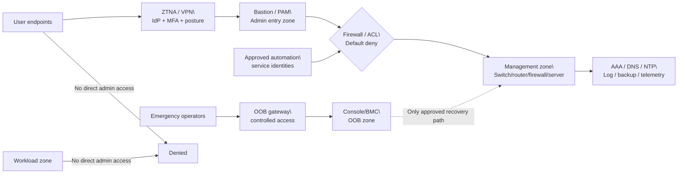

# Segmentation cho management plane

## Mục tiêu học tập

Sau bài học, bạn có thể:

1. Phân biệt **management plane**, **control plane** và **data plane**, từ đó xác định đúng những giao diện, tài khoản và luồng cần được bảo vệ bằng phân đoạn mạng.
2. Thiết kế mạng quản trị có ranh giới rõ ràng với mạng người dùng, ứng dụng, đối tác và Internet bằng **VLAN, subnet, VRF, firewall/ACL, bastion, VPN/ZTNA** và mạng **out-of-band (OOB)** khi phù hợp.
3. Lập **ma trận luồng cho phép** cho quản trị thiết bị, dịch vụ xác thực, DNS, NTP, log, giám sát, sao lưu, quản lý cấu hình và automation, có xét cả IPv4 lẫn IPv6.
4. Nhận diện các đường **lateral movement** đến hạ tầng quản trị và các lỗi như route leak, ACL quá rộng, management API public, jump host dùng chung, đường quản trị dự phòng bị bỏ quên.
5. Xây dựng quy trình triển khai từng bước có kiểm tra trước/sau thay đổi, quyền khôi phục khẩn cấp, audit và giám sát.
6. Chứng minh rằng người dùng hoặc workload không được phép **không thể kết nối** tới management interface, trong khi các luồng quản trị và vận hành hợp lệ vẫn hoạt động.

## 1. Segmentation cho management plane là gì?

**Management plane** là tập giao diện, giao thức và dịch vụ mà người hoặc hệ thống vận hành sử dụng để cấu hình, giám sát, cập nhật, sao lưu và quản lý thiết bị/hệ thống. Ví dụ:

- SSH, HTTPS/Web UI và API quản trị trên router, switch, firewall, load balancer.
- Giao diện quản lý hypervisor, máy chủ vật lý, BMC/IPMI/Redfish, storage và thiết bị bảo mật.
- Quản trị Wi-Fi controller, VPN gateway, DNS appliance, hệ thống IDS/IPS.
- Truy cập console quản trị cloud, Kubernetes API server, control plane của platform hoặc service mesh.
- Kênh quản lý cấu hình, cập nhật phần mềm, backup, monitoring, syslog và truy cập từ bastion.

**Segmentation cho management plane** là thiết kế tách các bề mặt đó thành vùng tin cậy và chỉ cho phép **những luồng quản trị được xác định, có xác thực và được giám sát** đi qua ranh giới. Mục tiêu là giảm khả năng một máy người dùng, workload ứng dụng hoặc đối tác bị chiếm quyền có thể đi thẳng đến giao diện quản trị và leo thang thành quyền điều khiển toàn mạng.

Trong phạm vi `SECURITY_NETWORK_SECURITY`, đây là một mắt xích giữa phân đoạn mạng, firewall, VPN/ZTNA, xác thực kết nối, IDS/IPS, bảo vệ dịch vụ DNS và thiết kế an ninh cho hạ tầng cloud. Phân đoạn làm giảm bề mặt truy cập; **IAM/MFA, hardening, mã hóa, quản lý thay đổi và giám sát** phải tiếp tục bảo vệ bên trong vùng quản trị.

### 1.1. Ba plane dễ bị nhầm

| Plane | Chức năng chính | Ví dụ điển hình | Cần bảo vệ bằng gì? |
|---|---|---|---|
| **Data plane / forwarding plane** | Chuyển tiếp lưu lượng người dùng hoặc ứng dụng | Packet qua switch, router, firewall; traffic client → web | Phân đoạn các vùng nghiệp vụ, ACL/firewall, kiểm soát east-west |
| **Control plane** | Duy trì thông tin giúp thiết bị chọn đường/chính sách chuyển tiếp | BGP/OSPF, routing protocol, một số giao thức neighbor/control | Control-plane policing, peer authentication, lọc nguồn và rule phù hợp |
| **Management plane** | Cho phép con người/công cụ thay đổi hoặc theo dõi trạng thái hệ thống | SSH, REST API admin, SNMP quản trị, console, config/backup | Mạng quản trị riêng, PEP/ACL, AAA/MFA, bastion/PAM, audit |

Một thiết bị có thể dùng **cùng CPU hoặc cùng cổng mạng** cho nhiều plane; đây là phân chia **chức năng và mức tin cậy**, không mặc định là ba bộ phần cứng khác nhau. Ví dụ, BGP là giao thức control plane; SSH vào router để sửa BGP là thao tác management plane.

**Quản trị ngoài băng (OOB)** là cách truy cập quản trị qua hạ tầng mạng độc lập hoặc phần nào độc lập với đường truyền dịch vụ. OOB hữu ích khi mạng production lỗi, nhưng **không tự an toàn** nếu credential yếu, được nối trở lại mạng người dùng hoặc thiếu logging.

## 2. Vì sao management plane là mục tiêu nhạy cảm?

Một giao diện quản trị bị chiếm quyền có thể gây ảnh hưởng rộng hơn một ứng dụng riêng lẻ:

- Đổi firewall rule để mở đường vào vùng nội bộ.
- Thay DNS/routing để chuyển hướng lưu lượng.
- Tạo tài khoản quản trị, cấp quyền mới hoặc vô hiệu hóa log/IDS.
- Cập nhật firmware/cấu hình sai gây mất kết nối trên diện rộng.
- Đọc hoặc xuất bí mật, backup cấu hình và certificate.
- Thay chính sách phân đoạn, VPN, cloud security group hoặc Kubernetes network policy.

**Kịch bản:** laptop nhân viên nhiễm mã độc vẫn được phép kết nối `TCP/22` đến tất cả switch/router. Nếu kẻ tấn công có được mật khẩu hoặc khóa quản trị, họ có thể đăng nhập rồi sửa cấu hình để mở đường sang các vùng khác.

Khi thiết kế phân đoạn, mục tiêu không chỉ là chặn kẻ tấn công ở một cổng; cần chặn **đường đi từ nguồn ít tin cậy tới tài nguyên có đặc quyền**, kể cả qua jump host, proxy, route leak, tài khoản automation hay cloud API.

### 2.1. Tài sản cần đưa vào danh mục

| Nhóm tài sản | Giao diện/quyền quản trị cần xem xét |
|---|---|
| Router/switch | SSH, HTTPS, NETCONF/RESTCONF/gNMI, SNMP, console, controller quản lý |
| Firewall/IDS/IPS/VPN | Web/API admin, CLI, log/config export, central manager |
| Hypervisor/host | Virtualization manager, SSH/RDP admin, iLO/iDRAC/BMC/Redfish |
| Storage/backup | Management UI/API, backup repository, snapshot/export |
| Wi-Fi/network controller | Management web/API, AP/controller control, RADIUS integration |
| Cloud | Console/API, IAM, VPN/Direct Connect/ExpressRoute management, private endpoints khi có |
| Container/Kubernetes | kube-apiserver, admission/cluster management, node admin và secret-management interface |
| IAM/PKI | IdP, AAA, certificate authority, HSM/KMS administration |
| Observability/automation | SIEM, log collector, SNMP manager, config management, CI/CD deployer |

**Lưu ý:** không phải mọi cổng cùng số đều là dịch vụ quản trị. `TCP/443` có thể là HTTPS public cho khách hoặc HTTPS admin. Chính sách phải dựa trên **tài sản, địa chỉ, danh tính và loại ứng dụng**, không chỉ trên port.

## 3. Xác định vùng tin cậy và luồng mạng

Một kiến trúc điển hình chia thành:

1. **User zone:** máy trạm nhân viên, BYOD hoặc Wi-Fi thông thường; không có đường trực tiếp vào management zone.
2. **Workload/application zone:** máy chủ ứng dụng và container; chỉ có luồng vận hành cụ thể ra dịch vụ cần thiết.
3. **Admin entry zone:** VPN/ZTNA và **bastion/jump host** phục vụ quản trị viên đã xác thực.
4. **Management zone:** interface/loopback quản trị của switch, router, firewall, server, hypervisor và controller.
5. **OOB zone:** console server, BMC và kết nối truy cập dự phòng; nên có ranh giới riêng với management in-band.
6. **Shared security services:** IdP, RADIUS/TACACS+, DNS, NTP, PKI, logging, monitoring, backup và hệ thống quản lý cấu hình.



Sơ đồ là **mô hình logic**: ở hệ thống thực tế, một số đường log hoặc AAA có thể có hướng riêng, nhiều firewall/VRF và hạ tầng HA. Quan trọng là mỗi ranh giới đều có quy tắc cho phép và chủ sở hữu rõ ràng.

### 3.1. In-band và OOB

| Đặc điểm | In-band management | Out-of-band management |
|---|---|---|
| Đường đi | Dùng hạ tầng mạng đang phục vụ traffic thường ngày, nhưng phân đoạn logic | Dùng interface/console và đường quản trị dự phòng riêng hoặc ít phụ thuộc hơn |
| Điểm mạnh | Dễ triển khai, tận dụng routing/monitoring hiện có | Có thể hỗ trợ khôi phục khi mạng production hay routing lỗi |
| Rủi ro | Mất đường quản trị khi network outage; route leak và policy sai | OOB gateway bị lộ; BMC/console quá quyền; đường dự phòng thành lối tắt |
| Kiểm soát | Management VRF/subnet, firewall, bastion, AAA, ACL, logging | OOB riêng, MFA/PAM, danh tính cá nhân, hạn chế egress, session recording |
| Khi dùng | Quản trị thường ngày qua đường được kiểm soát | Khôi phục cấu hình, sự cố routing, thao tác ngoài băng được duyệt |

**BMC** (baseboard management controller) có thể bật/tắt máy, truy cập remote console hoặc gắn media ảo; thường có quyền lớn. Không nên để BMC chung mạng người dùng hoặc cho phép Internet truy cập trực tiếp. Một interface vật lý dành cho BMC có ích, nhưng vẫn cần **quy tắc kết nối và xác thực**.

### 3.2. VLAN, subnet, VRF và firewall có vai trò khác nhau

- **VLAN** tách broadcast domain ở lớp 2. Một VLAN quản trị riêng giúp tổ chức mạng, nhưng nếu routing giữa VLAN mở hoàn toàn thì chưa đạt cô lập.
- **Subnet** là phạm vi địa chỉ, **không tự tạo ranh giới bảo mật**. Hai subnet có thể thông nhau nếu router cho phép.
- **VRF** tạo bảng định tuyến riêng, hạn chế kết nối giữa những miền routing; phải kiểm soát **route leaking**, service import/export, route-target và thiết bị có nhiều VRF.
- **ACL / firewall** thực thi allow/deny dựa trên nguồn, đích, giao thức, cổng, trạng thái và các điều kiện khả dụng.
- **Host firewall, API gateway hoặc identity-aware proxy** giúp giới hạn sâu hơn theo thiết bị, ứng dụng và danh tính.

Thiết kế tốt thường **kết hợp nhiều lớp**. Ví dụ: interface quản trị đặt trong management VRF, chỉ một bastion được route qua firewall vào VRF đó, còn thiết bị vẫn xác thực quản trị viên bằng SSH key/chứng thư hoặc AAA.

**Không nên coi VLAN tag là lớp xác thực.** Thiết bị cắm vào port không đúng cấu hình hoặc endpoint bị chiếm có thể tạo đường vào segment nếu switch admission control, port policy và ACL thiếu chặt chẽ.

## 4. Kiến trúc tham chiếu cho doanh nghiệp

Giả sử một doanh nghiệp có:

- User LAN: `192.0.2.0/26`.
- Admin entry/bastion: `192.0.2.64/27`.
- Management in-band: `198.51.100.0/25`.
- OOB management: `198.51.100.128/26`.
- Shared operations/security services: `203.0.113.0/26`.

Các dải trên thuộc địa chỉ **dành cho tài liệu**, chỉ biểu diễn topology, không phải cấu hình dùng ngoài Internet. Thực tế cần kế hoạch địa chỉ riêng và phân tách tương tự cho IPv6.

### 4.1. Ma trận lưu lượng cho phép (minh họa)

| Nguồn | Đích | Giao thức/port ví dụ | Mục đích | Chính sách |
|---|---|---|---|---|
| Admin workstation được quản lý | ZTNA/VPN ingress | HTTPS/TLS hoặc VPN transport theo sản phẩm | Truy cập điểm vào được xác thực | Allow có MFA/device posture |
| Bastion admin `192.0.2.70` | Router/switch management `198.51.100.10` | TCP/22 | SSH quản trị | Allow theo nhóm/tài sản, ghi session |
| Automation runner `192.0.2.80` | Device management `198.51.100.10` | TCP/830 | NETCONF trong phạm vi cấu hình đã duyệt | Allow theo service identity |
| Monitoring server `203.0.113.12` | Device management `198.51.100.10` | UDP/161 | SNMP poll nếu đã bật SNMPv3 | Allow chỉ từ monitoring server |
| Device management `198.51.100.10` | AAA `203.0.113.20` | UDP/1812/1813 hoặc TCP/49 theo AAA | RADIUS hoặc TACACS+ | Allow theo thiết bị tới AAA được duyệt |
| Device management `198.51.100.10` | DNS/NTP `203.0.113.21` | UDP/TCP/53; UDP/123 | DNS và đồng bộ giờ | Allow tới resolver/NTP quản trị |
| Device management `198.51.100.10` | Log collector `203.0.113.22` | TCP/6514 (syslog TLS) | Chuyển log có bảo vệ | Allow thiết bị → collector |
| Device management `198.51.100.10` | Backup/config server `203.0.113.23` | Theo dịch vụ cụ thể | Lưu cấu hình và sao lưu | Allow phạm vi hẹp, ghi audit |
| User LAN bất kỳ | Device management | TCP/22, 443, 830... | Truy cập admin trực tiếp | **Deny + log** |
| Workload zone bất kỳ | OOB/BMC | Mọi giao thức | Đường điều khiển phần cứng | **Deny** |
| Internet | Management hoặc OOB | Mọi giao thức quản trị | Truy cập trực tiếp | **Deny** |

Cổng chỉ là ví dụ: giao thức, chiều khởi tạo, port hoặc phiên bản phụ thuộc thiết bị. **SNMP traps** (thường UDP/162) có hướng device → manager; khác với SNMP polling (manager → device, thường UDP/161). Không thể áp một rule cho hai hướng mà không phân tích luồng thật.

### 4.2. Phân luồng hệ thống quản trị và phụ thuộc bắt buộc

Khi chỉ chặn inbound vào management zone mà quên outbound, vẫn có thể xảy ra:

- Thiết bị không đến được **AAA**, nên admin không đăng nhập được, hoặc fallback sang tài khoản local không đúng chính sách.
- Không phân giải được DNS/NTP, gây lỗi PKI/TLS, timestamp sai hoặc không truy cập domain controller.
- Không gửi được syslog/telemetry, tạo khoảng trống giám sát.
- Không lấy được backup/firmware/config, buộc vận hành tạo đường truy cập khẩn cấp rộng.
- Device management có đường egress Internet không kiểm soát, thuận lợi cho lộ dữ liệu hoặc lạm dụng khi thiết bị bị chiếm quyền.

Cần mô tả **nguồn → đích → chiều khởi tạo → protocol/port → tần suất → chủ sở hữu → lý do** đối với mỗi luồng vận hành. Những kết nối return traffic của firewall stateful thường được xử lý khác với ACL stateless; ghi rõ loại thiết bị để tránh mở hai chiều quá mức.

## 5. Xây dựng ranh giới truy cập quản trị

### 5.1. Identity-aware entry: MFA, ZTNA, VPN và bastion

Luồng đăng nhập quản trị hợp lý:

1. Admin dùng máy quản lý có health/posture đạt chuẩn.
2. IdP xác thực danh tính cá nhân, áp dụng MFA và điều kiện truy cập phù hợp.
3. VPN/ZTNA chỉ cấp đường vào **admin entry zone** hoặc chính ứng dụng quản trị được phép.
4. Bastion/PAM xác nhận role, ticket/thời hạn và đích truy cập; có thể cấp phiên/credential JIT.
5. Firewall/PEP chỉ cho bastion kết nối tới **tài nguyên quản trị cụ thể** trong management zone.
6. Thiết bị đích kiểm tra AAA hoặc khóa/chứng thư; log ghi nhận danh tính, lệnh/thay đổi, thời gian và kết quả.

**Không nên** cho mọi máy có VPN truy cập được toàn bộ management subnet. VPN tạo đường truyền bảo mật nhưng không tự thực hiện nguyên tắc đặc quyền tối thiểu. Với ZTNA, cần bảo đảm không còn một tuyến SSH/RDP trực tiếp bỏ qua proxy.

Bastion cũng là tài sản rủi ro cao. Cần hardening, cập nhật, giới hạn outbound, session recording hợp lý, khóa chuyển tiếp cổng và kênh tải tệp khi không cần; kiểm soát clipboard và số phiên đồng thời tùy chính sách. Cần ngăn việc dùng bastion làm **điểm chuyển tiếp tùy ý**.

### 5.2. Xác thực tại chính thiết bị

Phân đoạn mạng **không thay thế** xác thực tại đích:

- Dùng SSHv2 với thuật toán/khóa phù hợp; tắt Telnet và các dịch vụ quản trị plaintext không cần thiết.
- Dùng HTTPS/TLS có xác thực chứng thư phù hợp cho Web UI/API.
- Dùng tài khoản cá nhân/AAA tập trung, RBAC và quyền tối thiểu; tránh shared admin account khi có lựa chọn.
- Sử dụng **SNMPv3** với cơ chế auth/privacy phù hợp, thay vì để SNMP community string yếu hoặc công khai.
- Bảo vệ RADIUS/TACACS+ theo khả năng hạ tầng, giới hạn peer, luồng và secrets; đánh giá cơ chế mã hóa/transport cụ thể.
- Dùng khóa/chứng thư, secret vault và quy trình rotate; không lưu mật khẩu quản trị trong script hoặc kho mã nguồn.
- Kiểm soát API token và identity của automation độc lập với tài khoản admin cá nhân.

**MFA tại điểm vào** giúp giảm rủi ro credential bị đánh cắp, nhưng chưa đủ nếu quản trị viên hoặc automation có thể truy cập thiết bị qua một đường khác không có MFA.

### 5.3. Phân biệt user/admin traffic và machine-to-machine

Một runner tự động có thể cần cấu hình firewall qua API. Đừng cho runner một shell admin rộng chỉ vì cần gọi một vài endpoint. Tốt hơn:

- Gắn runner với **service identity riêng**, hạn chế tài nguyên và thao tác.
- Giới hạn địa chỉ/tuyến đến API quản trị cụ thể.
- Dùng mTLS/token ngắn hạn hoặc phương thức phù hợp với API.
- Phê duyệt thay đổi nhạy cảm, lưu request/change ID và phiên bản cấu hình.
- Không cho runner truy cập BMC/OOB nếu không có yêu cầu công việc.

Kiểm soát truy cập mạng và **authorization ở API** cần đồng thời hiệu lực.

## 6. Chính sách firewall/ACL cho management zone

Một mô hình quy tắc cơ bản:

- **Default deny** đối với truy cập từ user/workload/Internet đến management zone.
- Cho phép **admin entry** và các **dịch vụ vận hành cụ thể** sau khi xác minh nguồn, đích, giao thức/cổng và nhu cầu.
- Lọc cả **north-south** (vào/ra management zone) và **east-west** (giữa các nhóm thiết bị quản trị nếu cần).
- Không mở egress mặc định vô hạn từ management zone.
- Định nghĩa IPv4 **và IPv6** tương đương; tránh lỗ hổng do dual-stack.
- Ghi log đủ để điều tra, có rate limiting/chọn mức log để không làm quá tải firewall/SIEM.

### 6.1. Ví dụ policy dạng pseudocode

Đây là **đặc tả logic**, không phải cấu hình copy trực tiếp cho firewall của nhà cung cấp:

```yaml
policy_id: mgmt-segmentation-v1
zone: network-management
default_inbound: deny
default_outbound: deny

allow:
  - name: bastion-to-switch-ssh
    source: bastion-admin-01
    destination: switch-management-group
    protocol: tcp
    port: 22
    identity_condition: approved_admin_session
    audit: true

  - name: automation-netconf
    source: config-runner-01
    destination: managed-devices
    protocol: tcp
    port: 830
    identity_condition: config-service-principal
    audit: true

  - name: network-devices-to-tacacs
    source: managed-devices
    destination: tacacs-servers
    protocol: tcp
    port: 49
    audit: true

  - name: network-devices-to-logging
    source: managed-devices
    destination: central-syslog-tls
    protocol: tcp
    port: 6514
    audit: true

  - name: monitoring-to-snmpv3
    source: monitoring-servers
    destination: managed-devices
    protocol: udp
    port: 161
    audit: true
```

**Điểm quan trọng:** `identity_condition` chỉ có thể được thực thi nếu PEP nhận **ngữ cảnh danh tính đáng tin**. Firewall lớp 3/4 thông thường có thể chỉ biết IP/port, không biết phiên MFA; khi đó cần kết hợp IdP, bastion/ZTNA, hoặc identity-aware policy phù hợp. Không giả định một trường YAML trừu tượng tự tạo tính năng trên thiết bị.

### 6.2. Local ACL, control-plane ACL và CoPP

Có thể dùng các điểm kiểm soát khác nhau:

| Điểm kiểm soát | Cần bảo vệ | Giới hạn |
|---|---|---|
| Interface/subnet firewall | Lưu lượng đi vào management subnet/VRF | Có thể bỏ sót luồng qua interface khác hoặc route leak |
| **Management access ACL** trên thiết bị | Nguồn được mở SSH/HTTPS/SNMP admin đến chính thiết bị | Chỉ bảo vệ dịch vụ mà ACL thực sự gắn vào |
| Host firewall trên management server | Dịch vụ admin chạy trên server | Phải xét interface, IPv6, local traffic |
| **CoPP/control-plane policing** | CPU/control plane khỏi một số loại lưu lượng bất thường | Không thay thế AAA/RBAC hoặc ngăn mọi hành động quản trị hợp lệ nhưng độc hại |
| Bastion/ZTNA policy | User/session/tài nguyên ứng dụng được phép | Cần đóng đường truy cập trực tiếp không qua bastion |
| Cloud NSG/security group | Luồng đến interface/VM thuộc cloud | Cloud API/control plane có thể nằm ngoài VPC/VNet và cần IAM riêng |

Một router có thể có **interface quản trị** và đồng thời chấp nhận SSH trên IP loopback hoặc data-facing interface. Để thật sự hạn chế management plane, kiểm tra **tất cả địa chỉ và interface** có dịch vụ admin, không chỉ cổng quản trị được gắn nhãn `MGMT`.

### 6.3. VRF route leak và thiết bị nối hai vùng

VRF giúp tách route, nhưng một thiết bị hoặc host nối hai VRF/segment có thể tạo đường đi không dự định:

- Import/export route target sai.
- Một firewall cho phép broad `any-any` giữa management VRF và data VRF.
- Bastion có hai NIC với forwarding/NAT hoặc tunnel không kiểm soát.
- Máy ảo quản trị nối đồng thời management network và public/user network.
- Đường dự phòng, overlay, SD-WAN hay VPN cấp tuyến bỏ qua firewall chính.
- IPv6 route tồn tại dù ACL chỉ viết cho IPv4.

Cần xác minh **không chỉ bảng định tuyến** mà cả **đường dữ liệu end-to-end và kết quả enforcement**; route không tồn tại ở một điểm có thể vẫn có đường từ điểm khác.

## 7. Bảo vệ OOB management và lối thoát khẩn cấp

OOB thường chứa quyền thấp tầng như serial console, KVM hoặc BMC nên phải được phân vùng đặc biệt.

### 7.1. Mô hình truy cập OOB

```text
Approved operator
      |
     MFA
      |
Secure remote-access gateway / PAM
      |
OOB firewall (deny by default)
      |
Console server / BMC management segment
      |
Device console / hardware management
```

Nguyên tắc triển khai:

1. OOB có địa chỉ, route và control riêng với user/application zone; tránh nối trực tiếp vào mạng thường.
2. Chỉ admin khẩn cấp được duyệt đi qua gateway/bastion, dùng tài khoản danh định và MFA khi khả thi.
3. Console server/BMC tắt dịch vụ không cần thiết, cập nhật firmware, mã hóa traffic và thay credential mặc định.
4. Tách quyền vận hành thường ngày với quyền reset/power/attach media ảo; giới hạn và ghi log các thao tác nguy hiểm.
5. Kiểm soát kênh truy cập OOB qua cellular/ISP dự phòng; không để quản trị từ Internet bằng địa chỉ public mở rộng.
6. Tập dượt **break-glass** theo kịch bản có phê duyệt, log và hậu kiểm; bảo đảm đường dự phòng thực sự hoạt động khi in-band mất.
7. Nếu OOB có kết nối sang management VRF để cứu hộ, quy định rõ **chỉ dùng khi nào, cho ai, trong bao lâu** và cách đóng lại.

Khi mạng đang lỗi, một nguyên tắc “fail closed” tuyệt đối có thể khiến không khôi phục được hạ tầng. Phương án continuity phải được **thiết kế trước**, có bù trừ rủi ro và khả năng audit, thay vì tùy tiện mở tất cả rule trong lúc sự cố.

## 8. Management plane trong cloud, container và Kubernetes

### 8.1. Cloud control plane khác data plane của VPC/VNet

Với cloud, phân đoạn subnet, security group hoặc network ACL chủ yếu bảo vệ **network data plane**. Trong khi đó, API để tạo VM, đổi security group hay sửa route thường là **provider control/management API**, có thể được truy cập qua endpoint công cộng dù workload nằm trong private subnet.

Vì vậy cần đồng thời:

- IAM/RBAC với quyền tối thiểu, danh tính cá nhân/workload riêng và MFA cho quyền nhạy cảm.
- Điều kiện truy cập theo danh tính, thiết bị, phiên, network origin hoặc policy mà nhà cung cấp hỗ trợ.
- Private endpoint/privatelink cho API hoặc dịch vụ được hỗ trợ khi phù hợp; không mặc định mọi API đều chỉ có endpoint private.
- Cloud audit trail và cảnh báo khi đổi network/security policy.
- Quy định riêng cho automation, CI/CD, service account, secret và quyền emergency.
- Không coi “server nằm trong private subnet” là đủ để bảo vệ API quản trị cloud.

### 8.2. Kubernetes và platform management

**kube-apiserver** là điểm điều khiển quản lý cluster; quyền truy cập API cần bảo vệ riêng bằng authentication, RBAC, network exposure và audit. Một số trường hợp kubelet/node admin, cluster dashboard, admission controller và secret store cũng có bề mặt quản trị nhạy cảm.

Mô hình bảo vệ gồm:

- Chỉ điểm vào quản trị được duyệt mới tới API endpoint.
- RBAC theo nhóm và service account, token ngắn hạn hoặc cơ chế cấp danh tính phù hợp.
- Tách ingress public dành cho ứng dụng với endpoint quản trị cluster.
- NetworkPolicy/service mesh cho **lưu lượng workload**; chúng **không tự động** bảo vệ mọi giao diện management của host hoặc cloud control plane.
- Bảo vệ đường CI/CD → kube-apiserver, logging/audit và các tuyến bypass qua node/hostNetwork tùy CNI/thiết kế.
- Quản lý thay đổi trên API, IAM và network policy bằng GitOps/IaC có review khi phù hợp.

## 9. Threat modeling: những đường đi dễ bị bỏ sót

Áp dụng cách hỏi **“từ đâu có thể đến được đâu, với quyền gì, qua thiết bị trung gian nào?”**

| Tình huống | Đường tấn công/nhầm lẫn | Kiểm soát chính |
|---|---|---|
| Máy người dùng nhiễm mã độc | Kết nối SSH/HTTPS trực tiếp tới switch/router | User → management deny, chỉ bastion/PAM được allow |
| Bastion bị chiếm quyền | Từ bastion đi tới mọi thiết bị; attacker leo thang | Phân quyền bastion theo đích, session isolation, JIT, logging, giới hạn outbound |
| Mạng ứng dụng có route leak | Workload mở API quản trị thiết bị | VRF/firewall ACL, kiểm tra route import/export, test negative path |
| BMC public hoặc OOB nối Wi-Fi khách | Kẻ ngoài Internet/khách truy cập console phần cứng | OOB tách biệt, gateway xác thực, danh mục IP/service và hardening |
| Máy automation bị xâm nhập | Service token gọi thay đổi cấu hình rộng | Service identity giới hạn, approval, vault, network ACL, change audit |
| Cloud IAM quá quyền | API có thể sửa segmentation dù VM private | IAM least privilege, MFA, audit cloud API, phê duyệt thay đổi |
| AAA không sẵn sàng | Admin bị khóa hoặc fallback local không kiểm soát | AAA HA, policy fallback rõ, local break-glass có audit/hậu kiểm |
| IPv6 bỏ qua policy | Dual-stack host tiếp cận management qua IPv6 | Kiểm kê địa chỉ/route IPv6, firewall/ACL parity và kiểm thử |
| Kênh telemetry bị lợi dụng | Log collector/monitor có đường rộng vào thiết bị | Luồng một mục đích, xác thực giữa các điểm, least privilege |
| “Quản trị” dùng chung VLAN với máy dev | Cùng L2 và có thể tiếp cận admin endpoint | VLAN/subnet riêng + L3 enforcement, NAC/802.1X, host ACL |

Một dấu hiệu cần ưu tiên là **single point of compromise**: chiếm một laptop, service account hay bastion là đủ để quản trị nhiều vùng không liên quan. Có thể phân tách thêm các **management tier** (thiết bị mạng lõi, server thông thường, BMC, hạ tầng xác thực) để giới hạn tác động.

### 9.1. Phân đoạn không thay thế các cơ chế khác

- **Firewall** chỉ cho biết đường kết nối có được cho phép; máy được phép vẫn có thể gửi yêu cầu độc hại nếu credential bị đánh cắp.
- **IDS/IPS** phát hiện hoặc chặn một số mẫu hành vi nhưng không bảo đảm mọi thao tác quản trị hợp lệ đều an toàn.
- **TLS** bảo vệ kênh truyền theo phương thức cấu hình; không giải quyết tất cả vấn đề phân quyền và nguồn truy cập.
- **PAM/MFA** giảm rủi ro đặc quyền nhưng cần kiểm soát đường đi để ngăn bypass.
- **DNS name** có thể thay đổi IP; nguồn allowlist theo FQDN cần được đối soát với bản ghi và phương thức enforcement.
- **Audit log** có thể mất, trễ hoặc bị sửa nếu collector không tách quyền; bảo vệ và giám sát đường log riêng.

## 10. Triển khai an toàn theo từng bước

Không nên bật default deny trên toàn mạng quản trị trước khi biết đủ luồng phụ thuộc. Quy trình thay đổi có thể thực hiện như sau:

### Bước 1 — Kiểm kê hiện trạng

Ghi lại cho từng thiết bị:

- `asset_id`, hostname, owner, loại thiết bị, môi trường và mức quan trọng.
- Interface quản trị: địa chỉ IPv4/IPv6, loopback, VRF, VLAN, port, cổng OOB/BMC.
- Protocol/port đang bật và nguồn thực sự quản lý thiết bị.
- AAA, DNS, NTP, syslog, telemetry, backup, monitoring và công cụ cấu hình phụ thuộc.
- Cấu hình HA/failover và đường console khôi phục.
- Trạng thái hardening và khả năng dùng ACL/CoPP/VRF.

Một hệ thống nhiều lớp có thể có endpoint quản trị nằm ở service plane/vendor cloud API, không phải tất cả IP đều hiển thị từ cùng một bảng route.

### Bước 2 — Vẽ luồng cần thiết và ranh giới

Lập **flow matrix** đầy đủ, có chiều khởi tạo và cơ chế xác thực; đặc biệt chú ý AAA, log, NTP, DNS, cấu hình thiết bị, monitor, backup, PKI/certificate revocation và update repository. Phân biệt traffic **management** với traffic **control/data** để không vô tình chặn BGP, VXLAN hoặc các peer protocol thiết yếu.

### Bước 3 — Thiết kế chính sách và thứ tự áp dụng

1. Thiết lập admin entry/bastion có MFA và audit.
2. Đặt management interface vào VRF/VLAN/subnet dự kiến; cân nhắc OOB độc lập.
3. Giới hạn service admin trên thiết bị và bật ACL cục bộ khi phù hợp.
4. Cho phép các luồng quản trị tối thiểu qua firewall/PEP, log theo chính sách.
5. Thử nghiệm từng thiết bị/nhóm nhỏ trước khi tăng phạm vi.
6. Có **rollback** và đường console OOB được xác nhận **trước** khi áp rule có thể làm mất quản trị.
7. Áp deny mặc định sau khi quan sát đủ luồng hợp lệ và xử lý các exception có owner.
8. Kết thúc bằng xác minh thực tế, lưu cấu hình/phiên bản và cập nhật tài liệu.

### Bước 4 — Quy trình change management và rollback

Lưu ticket, thời gian change window, người phê duyệt, snapshot cấu hình, kế hoạch kiểm thử, dấu hiệu phải rollback và người có thể dùng OOB. Với hệ thống hỗ trợ **commit confirmed / timed rollback**, cân nhắc dùng để tránh tự khóa khỏi thiết bị; tên tính năng khác nhau giữa nhà cung cấp.

Nếu kiểm thử phát hiện mất AAA, logging hoặc không thể quay lại thiết bị, cần xử lý theo runbook và rollback đúng quyền. **Không bật tạm `any-any` rồi bỏ quên**; mọi ngoại lệ khẩn cấp phải có người chịu trách nhiệm, thời hạn, log và bước đóng.

## 11. Thực hành lab: chặn quản trị trực tiếp nhưng giữ được vận hành

Giả sử dựng một mạng thử nghiệm với địa chỉ tài liệu:

```text
User client:      192.0.2.10
Admin bastion:    192.0.2.70
Automation:       192.0.2.80
Management:       198.51.100.10 (switch admin)
AAA:              203.0.113.20
Syslog collector: 203.0.113.22

Policy:
- User client -> Switch management TCP/22: DENY
- Bastion     -> Switch management TCP/22: ALLOW
- Automation  -> Switch management TCP/830: ALLOW (nếu dịch vụ bật)
- Switch      -> AAA TCP/49: ALLOW (nếu dùng TACACS+)
- Switch      -> Syslog TLS TCP/6514: ALLOW
- Mọi nguồn khác -> Switch management: DENY
```

Đây là **sơ đồ cấu hình giả định**; cần thiết lập các interface, dịch vụ và DNS test trước khi chạy lệnh. Chỉ thử trên tài sản/môi trường bạn được phép quản trị.

### 11.1. Kiểm tra kết nối từ các vị trí khác nhau

Ví dụ lệnh trên máy Linux thử nghiệm:

```bash
# Chạy từ USER client: kết nối quản trị phải bị chặn
nc -vz -w 3 198.51.100.10 22

# Chạy từ ADMIN bastion: kết nối tới SSH của switch được cho phép
nc -vz -w 3 198.51.100.10 22

# Nếu được cấp tài khoản lab, kiểm tra xác thực SSH và role ở thiết bị
ssh -o ConnectTimeout=5 lab-admin@198.51.100.10

# Chạy từ automation runner khi NETCONF được bật
nc -vz -w 3 198.51.100.10 830
```

**Lưu ý quan trọng:**

- `nc` chỉ kiểm tra **khả năng mở TCP socket**, không xác minh authentication/authorization hoặc cấu hình quản trị đã được bảo vệ.
- “Connection refused” có thể do dịch vụ không lắng nghe, còn timeout có thể do firewall, routing hoặc host lỗi; cần xem **PEP log và route** để xác định nguyên nhân. Thử kết nối thất bại không tự chứng minh policy đúng.
- Cần thử đồng thời **IPv6** nếu hạ tầng có dual stack; không đánh dấu PASS khi mới thử IPv4.
- Không sử dụng lệnh quét hàng loạt hoặc khai thác trên mạng ngoài phạm vi; bài thực hành chỉ xác minh các đích/port cụ thể đã được cho phép.

### 11.2. Ma trận kiểm thử nghiệm thu

| Thử nghiệm | Kỳ vọng | Bằng chứng nên lưu |
|---|---|---|
| User LAN → SSH/HTTPS admin | **Deny** | Firewall/ACL deny log, test từ user |
| Guest/BYOD → management VRF | **Deny** | Log ingress/egress, không có đường bypass |
| App workload → device admin/API | **Deny** | Workload egress policy và firewall |
| Bastion đã xác thực → đúng thiết bị/port | **Allow** | Session ID, MFA, SSH/HTTPS và device AAA log |
| Bastion → thiết bị **ngoài phạm vi** | **Deny** | Bastion/ZTNA policy và firewall log |
| Automation → đúng API/port | **Allow** | Service identity, request/change ID |
| Device → DNS/NTP/AAA | **Allow có giới hạn** | DNS/AAA response, time sync, log hoạt động |
| Device → log collector/backup | **Allow có giới hạn** | Collector nhận bản ghi; backup hoàn tất |
| Internet → admin/BMC | **Deny** | Policy, exposure inventory và kiểm thử đã cho phép |
| OOB gateway → BMC/console | **Allow cho phiên khẩn cấp hợp lệ** | MFA/PAM, session recording, audit |
| Route leak/VPN khác/IPv6 path | **Không có đường bypass** | Route table, flow logs, test negative path |
| AAA lỗi hoặc firewall failover | Hành vi đã thiết kế, có recovery | HA/fallback test, alert, rollback procedure |

**Đánh giá thành công** dựa trên cả **đường kết nối bị chặn đúng chỗ** và **các chức năng vận hành còn hoạt động**. Một lab chặn mọi traffic quản trị không được coi là segmentation thành công.

### 11.3. Điều tra khi user vẫn vào được management interface

1. Xác nhận user thực sự không đi qua bastion/proxy đã được cấp phép.
2. Đối chiếu IP nguồn và NAT mapping/VPN identity ở từng điểm quan sát.
3. Kiểm tra route, route leak giữa VRF, default route và interface phụ/loopback.
4. Kiểm tra ACL ở firewall, policy theo zone, security group, host firewall và rule exception.
5. Xác định kết nối dùng **IPv4, IPv6, TCP hay giao thức khác** và dịch vụ admin nào đang lắng nghe.
6. Xem session state/conntrack, policy cache và thời gian cập nhật rule.
7. Nếu có host nhiều NIC, xác minh IP forwarding/port forwarding và SSH tunnel được kiểm soát.
8. Cập nhật test case, rule và monitoring để lỗi không tái diễn.

## 12. Giám sát, audit và vận hành lâu dài

### 12.1. Các sự kiện nên được ghi nhận

| Nguồn | Ví dụ sự kiện hữu ích |
|---|---|
| VPN/ZTNA/IdP | Người dùng xác thực, MFA, posture, phiên được cấp/thu hồi |
| Bastion/PAM | Ai mở phiên, vào thiết bị nào, lệnh/thay đổi hoặc bản ghi session theo chính sách |
| Firewall/ACL | Allow/deny nguồn/đích/protocol/port, policy ID, thời điểm và rule match |
| Device AAA | Đăng nhập quản trị, thất bại, mức quyền, command accounting nếu hỗ trợ |
| Config management | Thay đổi cấu hình, diff được lọc, change ID và approval |
| Syslog/SIEM | Thời gian nhận, dấu hiệu nguồn mất log, truy cập/chiếm quyền admin |
| OOB/console/BMC | Console login, power/reset, virtual media, thay đổi cấu hình BMC |
| Cloud/Kubernetes audit | Sửa security group, route, IAM, kube-apiserver resource hoặc policy |

**Không lưu bí mật không cần thiết** như mật khẩu, token, private key hoặc toàn bộ cấu hình nhạy cảm trong log. Áp dụng quyền truy cập log riêng, retention và kiểm tra tính toàn vẹn phù hợp. Thời gian nên đồng bộ và có timezone/offset rõ ràng để tương quan các nguồn.

### 12.2. Dấu hiệu sai cấu hình và cảnh báo

- Kết nối tới management interface từ user/workload/guest hoặc dải public ngoài allowlist.
- Rule mở admin port cho `0.0.0.0/0` hoặc `::/0` mà không có lý do/phê duyệt.
- Phiên SSH/API tới thiết bị mới hoặc ngoài giờ, không có ticket hoặc không qua bastion.
- Management VRF xuất hiện route bất thường, route leaking hoặc interface mới.
- Bastion mất logging, BMC bật dịch vụ mới, hoặc credential quản trị dùng ở nhiều điểm.
- AAA/NTP/DNS/syslog không hoạt động, thiết bị rơi về fallback authentication khác chính sách.
- Cấu hình quản trị cloud/API thay đổi mà không có change approval.
- OOB gateway được dùng bất thường và không có hậu kiểm.

**Đánh giá an ninh không chỉ đếm số gói bị từ chối.** Cần kiểm soát nhiễu, baseline hoạt động vận hành, đối chiếu danh tính và nguồn gốc sự kiện trước khi kết luận là tấn công.

### 12.3. Chỉ số quản trị

- Tỷ lệ interface quản trị đã được kiểm kê và gắn owner.
- Tỷ lệ quản trị **qua bastion/ZTNA** so với kết nối trực tiếp.
- Số management endpoint có thể tiếp cận từ user/guest/Internet.
- Số rule ngoại lệ quá rộng, quá hạn hoặc không còn owner.
- Tỷ lệ thiết bị dùng AAA/MFA/PAM và giao thức quản trị bảo vệ (SSH/TLS/SNMPv3).
- Tỷ lệ log quản trị đến collector đủ thời gian, không thiếu khoảng.
- Kết quả kiểm thử IPv4/IPv6, route leak, OOB recovery và firewall failover.
- Thời gian đóng đường truy cập bất thường và khắc phục policy drift.

Các chỉ số phải có mẫu số và phạm vi rõ ràng; một thiết bị không quan sát được vẫn phải được đánh dấu **chưa xác minh**, không tự ghi nhận “đạt”.

## 13. Những lỗi thiết kế thường gặp

| Lỗi | Vì sao xảy ra | Cách khắc phục |
|---|---|---|
| Tạo VLAN management nhưng routing mở giữa mọi VLAN | Nhầm broadcast segmentation với cô lập truy cập | Firewall/ACL L3 rõ nguồn-đích và kiểm thử |
| Chỉ hạn chế management interface, bỏ qua loopback/data IP | Dịch vụ admin vẫn lắng nghe trên các IP khác | Kiểm kê mọi interface/IP, bind service và áp access ACL |
| Mở `any-any` từ VPN vào management zone | Cho rằng VPN đã xác thực là đủ quyền | Bastion/ZTNA theo danh tính, thiết bị và tài nguyên |
| Quên IPv6 | Chính sách IPv4 không bao phủ đường IPv6 | Kiểm kê dual stack, parity rule và test |
| OOB public hoặc mật khẩu mặc định | Đường khôi phục bỏ qua kiểm soát mạng chính | OOB zone riêng, gateway/PAM, hardening, audit |
| Bastion multi-homed không quản lý forwarding | Tạo cầu nối giữa user và management zone | Hardening, route/egress ACL, tắt tunnel tùy ý |
| VRF leak không kiểm soát | Kéo route từ data VRF sang management VRF | Kiểm soát import/export, route-policy và firewall |
| Quên outbound dependencies | Mất AAA/NTP/syslog/config backup | Luồng vận hành theo ma trận, thử nghiệm trước deny |
| Tập trung quá mức vào port SSH | API/HTTPS, SNMP, console và cloud API vẫn mở | Bảo vệ toàn bộ management services |
| Chỉ xét firewall giữa zone | Privileged role/API cho phép đổi firewall từ cloud control plane | IAM, MFA, audit, phê duyệt, riêng policy quản trị cloud |
| Gỡ rule nhưng phiên cũ vẫn chạy | Stateful conntrack hoặc cache còn cho phép | Rà soát session table, TTL và cơ chế chặn phiên |
| Thiếu rollback/OOB | Tự khóa khỏi thiết bị khi áp ACL | Xác minh console, kế hoạch rollback và staged rollout |

## 14. Bài tập và đáp án

**Bài 1 — VLAN có đủ không?** Công ty đặt router quản trị vào VLAN 100 và laptop nhân viên vào VLAN 20. Inter-VLAN routing vẫn cho phép mọi địa chỉ truy cập `TCP/22` của router. Đã phân đoạn management plane thành công chưa?

**Đáp án:** **Chưa**. VLAN tách lớp 2 nhưng L3 vẫn mở. Cần ACL/firewall chỉ cho admin entry/bastion đến interface quản trị, kiểm thử đường truy cập thực tế và xác thực/ghi audit.

**Bài 2 — Phân biệt plane.** BGP giữa hai router và một phiên SSH từ admin vào router là hai loại traffic thuộc plane nào?

**Đáp án:** BGP là hoạt động của **control plane**; SSH để cấu hình router là **management plane**. Cần bảo vệ cả hai nhưng bằng chính sách và giao thức khác nhau.

**Bài 3 — Failover gây mất quản trị.** Sau khi chặn mọi egress từ management zone, router không còn truy cập được TACACS+ và syslog. Vấn đề của thiết kế là gì?

**Đáp án:** Ma trận phụ thuộc outbound chưa đầy đủ. Cần mở có giới hạn router → AAA và router → log collector theo đúng port/protocol, đồng thời kiểm tra NTP/DNS/backup và đường recovery.

**Bài 4 — OOB có an toàn mặc định?** BMC của server dùng cổng mạng riêng nhưng truy cập được từ Wi-Fi khách bằng HTTPS, tài khoản `admin` dùng mật khẩu mặc định. Có thể coi là an toàn vì “OOB” không?

**Đáp án:** Không. OOB là **đường vận hành**, không phải bảo đảm xác thực/segmentation. Phải tách zone, hạn chế truy cập qua gateway có MFA, hardening credential và audit.

**Bài 5 — Bỏ sót IPv6.** Firewall deny user subnet IPv4 đến management subnet IPv4, nhưng thiết bị có địa chỉ IPv6 global reachable từ user VLAN. Cách khắc phục?

**Đáp án:** Xác minh route/interface IPv6, triển khai policy tương đương cho `TCP/22`, API admin và các dịch vụ khác, kiểm thử IPv6 từ vùng không được phép. Không dựa vào việc người dùng “thường chỉ dùng IPv4”.

**Bài 6 — Cloud private subnet.** Security group chỉ mở SSH nội bộ và VM nằm trong private subnet. Một tài khoản cloud IAM vẫn có quyền sửa security group từ Internet. Chỉ bảo vệ subnet đã đủ chưa?

**Đáp án:** **Chưa**. Cloud management API thuộc bề mặt quản trị khác data plane. Cần IAM least privilege, MFA, điều kiện truy cập, cloud audit và phê duyệt/quản lý change.

**Bài 7 — Thu hồi đường đã mở.** Admin đã rời nhóm JIT, rule firewall được gỡ nhưng một phiên SSH vẫn truyền dữ liệu. Vì sao?

**Đáp án:** Firewall stateful có thể duy trì connection tracking cho phiên cũ; bastion/AAA có thể không cắt session khi grant bị thu hồi. Cần quy định xử lý phiên đang mở, kiểm tra conntrack và thực thi disconnect/reauthorization.

## 15. Checklist nghiệm thu segmentation management plane

- [ ] Danh mục quản trị có **owner, loại giao diện, IPv4/IPv6, VRF/VLAN, dịch vụ và đường OOB**.
- [ ] Phân biệt chính xác data/control/management plane và các luồng cần cho hoạt động bình thường.
- [ ] User, guest, workload và Internet **không có đường quản trị trực tiếp** nếu chưa được cấp quyền.
- [ ] Người vận hành truy cập qua điểm vào được kiểm soát: **IdP/MFA, VPN/ZTNA, bastion/PAM**.
- [ ] Thiết bị có xác thực cá nhân/AAA và giao thức quản trị được bảo vệ; hardening và secret management.
- [ ] VRF/subnet/firewall/ACL kiểm soát **nguồn, đích, port, protocol và chiều traffic**.
- [ ] Kiểm tra route leak, host hai NIC, proxy/tunnel, loopback, alternate paths và IPv6.
- [ ] Chỉ cho phép DNS/NTP/AAA/syslog/monitor/backup/config automation cần thiết, có owner và log.
- [ ] OOB/BMC/console có mạng và điểm vào hạn chế, có thủ tục break-glass, audit và kiểm thử phục hồi.
- [ ] Cloud IAM và các endpoint Kubernetes/platform management được bảo vệ riêng khi liên quan.
- [ ] Chính sách đã được thử với case **allow hợp lệ và deny không hợp lệ**, kể cả failover/rollback.
- [ ] Thay đổi ACL/route/security group được review, version, ghi nhận và giám sát drift.
- [ ] Có cảnh báo management access bất thường, thiếu log/AAA/NTP và ngoại lệ quá hạn.
- [ ] Có kỳ rà soát định kỳ các rule, quyền, tài sản mới và tài sản đã ngừng dùng.

## 16. Tài liệu tiêu chuẩn và nguồn tham khảo

- [NIST SP 800-207 — Zero Trust Architecture](https://csrc.nist.gov/pubs/sp/800/207/final): nguyên tắc ra quyết định và thực thi quyền truy cập theo tài nguyên.
- [NIST SP 800-53 Rev. 5](https://csrc.nist.gov/pubs/sp/800/53/r5/upd1/final): nhóm kiểm soát **SC-7 (Boundary Protection)**, **AC (Access Control)**, **IA (Identification and Authentication)**, **AU (Audit and Accountability)**.
- [NIST SP 800-41 Rev. 1 — Guidelines on Firewalls and Firewall Policy](https://csrc.nist.gov/pubs/sp/800/41/r1/final): thiết kế chính sách firewall và quản lý rule.
- [RFC 6241 — Network Configuration Protocol (NETCONF)](https://www.rfc-editor.org/rfc/rfc6241): một giao thức quản trị/cấu hình thiết bị mạng.
- [RFC 8040 — RESTCONF Protocol](https://www.rfc-editor.org/rfc/rfc8040): quản lý tài nguyên cấu hình qua giao thức HTTP-based.
- [RFC 3411 — An Architecture for Describing SNMP Management Frameworks](https://www.rfc-editor.org/rfc/rfc3411): kiến trúc giao thức quản lý thiết bị.
- [RFC 5424 — The Syslog Protocol](https://www.rfc-editor.org/rfc/rfc5424), [RFC 5425 — Syslog over TLS](https://www.rfc-editor.org/rfc/rfc5425): thu thập log và phương thức vận chuyển được bảo vệ.

**Điểm cần nhớ:** Management plane cần được xem là **vùng đặc quyền của hạ tầng**. Phân đoạn hiệu quả khi có ranh giới routing và firewall được kiểm chứng, điểm vào quản trị xác thực mạnh, luồng vận hành tối thiểu, đường OOB khôi phục được và cơ chế audit theo dõi mọi thay đổi quan trọng. **Một VLAN hay một subnet riêng tự nó chưa đủ để chứng minh cô lập an toàn.**
