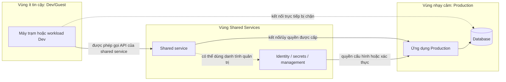
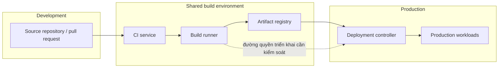
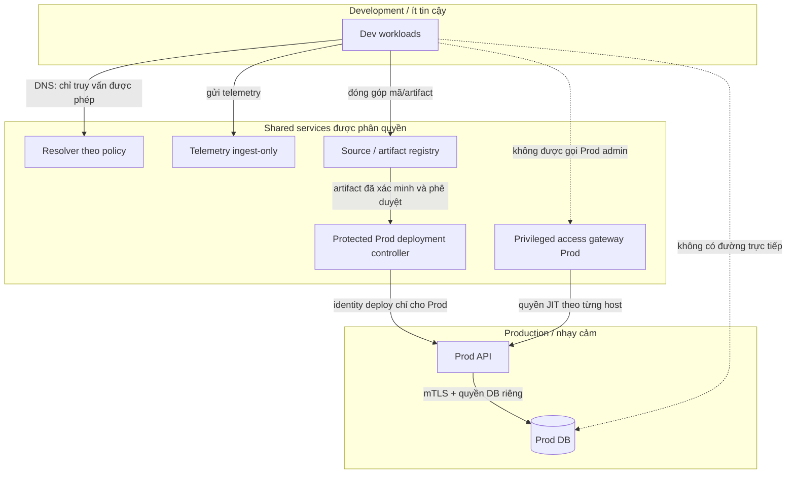

# Vượt segmentation qua shared service: đường truy cập gián tiếp giữa các vùng mạng

## 1. Đặt vấn đề: mạng đã phân đoạn, vì sao vẫn có đường đi?

**Network segmentation (phân đoạn mạng)** chia hạ tầng thành những vùng có mức tin cậy, nhiệm vụ hoặc độ nhạy khác nhau; các kết nối giữa vùng được kiểm soát bằng firewall, ACL, security group, microsegmentation, chính sách truy cập và danh tính. Mục tiêu là hạn chế bề mặt tấn công, giảm khả năng di chuyển ngang (*lateral movement*) và thu hẹp phạm vi ảnh hưởng nếu một thiết bị hoặc ứng dụng bị xâm nhập.

Tuy nhiên, nhiều hệ thống cần sử dụng **shared service — dịch vụ dùng chung**: DNS resolver, Active Directory/Identity Provider, máy chủ quản trị, proxy, gateway, CI/CD runner, hệ thống log, sao lưu, kho artifact, message broker hoặc hệ thống giám sát. Các dịch vụ này thường nhận kết nối từ **nhiều phân đoạn** hoặc được cấp quyền truy cập tới nhiều phân đoạn để thực hiện nghiệp vụ.

Chính các kết nối hợp lệ ấy có thể tạo ra một **đường truy cập gián tiếp** từ vùng ít tin cậy sang vùng nhạy cảm. Nếu dịch vụ dùng chung bị chiếm quyền, bị cấu hình quá rộng, cho phép yêu cầu không được kiểm soát hoặc cung cấp danh tính có quyền lớn, kẻ tấn công có thể lợi dụng quyền của **dịch vụ trung gian** để tác động tới tài sản mà điểm xuất phát không được phép kết nối trực tiếp.

> **Ý chính:** “Vượt segmentation qua shared service” không nhất thiết là phá được firewall. Nhiều trường hợp, mọi rule mạng vẫn hoạt động đúng như cấu hình, nhưng **quan hệ tin cậy và quyền của một dịch vụ trung gian** đã mở ra một đường đi mà thiết kế phân đoạn chưa tính tới.

### Ví dụ ngắn

- Mạng **Development** không được kết nối trực tiếp tới cơ sở dữ liệu **Production**.
- Một **CI/CD service** dùng chung được phép nhận yêu cầu từ môi trường Development và triển khai phần mềm vào Production.
- Nếu quy trình cấp quyền, phê duyệt bản build và danh tính triển khai của CI/CD không được phân tách, một đầu vào từ Development có thể ảnh hưởng tới Production thông qua CI/CD.

Đây là bài toán **đường tin cậy xuyên vùng**, gồm cả mạng, ứng dụng và danh tính. Đường TCP giữa Development và Production vẫn có thể bị firewall chặn như dự định.

Trong module bảo mật mạng, hiểu hiện tượng này giúp thiết kế phân đoạn, firewall, VPN, IDS/IPS, DNS, kiến trúc cloud, xác thực kết nối và threat modeling một cách nhất quán.

## 2. Nền tảng: segmentation bảo vệ ranh giới gì?

Một phân đoạn có thể được xác định bằng VLAN, subnet, VRF, VPC/VNet, security group, namespace, nhóm workload, zone của firewall hoặc lớp danh tính. Các khái niệm này **không tương đương**:

| Cơ chế | Chức năng chính | Điều cần nhớ |
|---|---|---|
| **VLAN/subnet** | Gom thiết bị vào một miền mạng ở lớp liên kết/địa chỉ | Tự nó chưa phải chính sách kiểm soát truy cập hoàn chỉnh; còn routing và ACL/firewall |
| **VRF** | Tách bảng định tuyến | Route leaking hoặc gateway được phê duyệt có thể nối các VRF |
| **Firewall/ACL** | Cho phép/chặn những lưu lượng phù hợp rule | Phải xét cả hướng đi, chính sách khác, NAT, stateful connection và thứ tự nếu có |
| **Cloud VPC/VNet** | Phạm vi mạng logic và các tài nguyên kết nối | Peering, transit hub, private endpoint và dịch vụ dùng chung tạo kết nối liên phạm vi |
| **Security group/NSG** | Lọc luồng đến/đi tài nguyên theo ngữ nghĩa cloud | Hiệu lực phụ thuộc nền tảng, quan hệ gắn chính sách và routing |
| **Microsegmentation** | Áp chính sách chi tiết giữa workload | Cần danh tính/nhãn tin cậy và bao phủ đủ workload, host, dịch vụ |
| **Zero Trust access** | Quyết định quyền theo danh tính và ngữ cảnh, thường theo từng ứng dụng | Không thay thế hoàn toàn firewall, kiểm soát đường đi và bảo vệ dịch vụ trung gian |

Có ít nhất ba dạng ranh giới nên kiểm tra:

1. **Data plane:** lưu lượng ứng dụng bình thường, chẳng hạn HTTPS từ người dùng tới API hoặc kết nối từ API tới database.
2. **Control/management plane:** những quyền **thay đổi** cấu hình hoặc điều khiển workload: quản lý cloud, pipeline triển khai, Kubernetes API, hypervisor, hệ thống quản lý firewall.
3. **Identity/trust plane:** hệ thống xác thực, cấp token/chứng chỉ, quản lý khóa, IAM role, service account, danh sách nhóm và policy phân quyền.

Một mạng có thể phân đoạn chặt trên **data plane** nhưng mở rộng đáng kể quyền ở **management** hoặc **identity plane**. Khi đánh giá nguy cơ, phải kiểm tra cả ba.

### 2.1. Phân biệt “đến được”, “được phép sử dụng” và “được phép điều khiển”

Đối với một ứng dụng, cần phân biệt:

- **Network reachable:** có đường mạng và firewall cho gói tin tới một listener.
- **Authenticated:** kết nối/đối tượng đã chứng minh danh tính phù hợp.
- **Authorized:** danh tính được phép thực hiện thao tác cụ thể trên tài nguyên.
- **Privileged control:** danh tính có thể cấu hình, cập nhật, chạy job hoặc cấp quyền cho thành phần khác.

Một shared service có thể **nhận** yêu cầu từ mạng ít tin cậy và có **quyền riêng** để ghi dữ liệu hoặc triển khai vào mạng nhạy cảm. Khả năng gửi yêu cầu tới service **không tự động** chuyển thành quyền điều khiển các tài nguyên mà service truy cập; nguy cơ xuất hiện khi service thiếu kiểm soát ủy quyền, thực thi đầu vào nguy hiểm, sở hữu quyền quá rộng hoặc bị chiếm quyền.

## 3. Mô hình đường truy cập gián tiếp qua dịch vụ dùng chung

Xét ba vùng:



Ở mức đồ thị, có thể viết:

```text
Dev --(cho phép gọi service)--> Shared
Shared --(được phép thao tác Prod)--> Production
Dev --(bị chặn trực tiếp)----X-----> Production
```

Đây là **đường hai bước cần kiểm tra**, không phải chứng minh rằng Dev tự động truy cập được Production. Để một yêu cầu từ Dev trở thành hành động trong Production, cần ít nhất một trong các điều kiện:

- Shared service cung cấp chức năng hợp lệ có **khả năng tác động tới Production** và không giới hạn người gọi đủ chặt.
- Shared service bị xâm nhập; từ đó tác nhân lợi dụng quyền và kết nối outbound của chính service.
- Một **danh tính/secret/token** có quyền tác động tới Production bị lộ, bị cấp sai hoặc được sử dụng không đúng ngữ cảnh.
- Cấu hình ủy quyền, chuyển tiếp, định tuyến, định danh workload hoặc pipeline tạo ra **ủy quyền bắc cầu không chủ đích**.

Nếu shared service chỉ là DNS resolver chuẩn, chỉ trả lời truy vấn DNS và không có chức năng chuyển tiếp kết nối ứng dụng, riêng việc Dev truy vấn DNS **không khiến Dev có đường TCP đến Production**. Cần đánh giá chức năng thật của từng loại shared service.

## 4. Các dạng shared service thường tạo ra rủi ro xuyên phân đoạn

| Dịch vụ dùng chung | Vì sao nhiều vùng cần truy cập | Đường rủi ro cần mô hình hóa | Kiểm soát chính |
|---|---|---|---|
| **DNS resolver/forwarder** | Phân giải tên nội bộ và Internet | lộ metadata tên nội bộ, sai phạm vi zone, forwarding quá rộng; DNS có thể trở thành kênh giao tiếp ngoài dự kiến nếu chính sách cho phép | chia scope/zone, kiểm soát resolver và egress DNS, giám sát truy vấn |
| **Active Directory/IdP/LDAP** | Xác thực tập trung, group, Kerberos/OIDC | danh tính/quyền nhóm của một vùng được dùng ngoài vùng dự kiến | tiered administration, điều kiện cấp quyền, bảo vệ controller, audit thay đổi |
| **PKI/CA hoặc secret manager** | Cấp chứng chỉ, credential, secret cho workload | cấp phát nhầm danh tính/khóa cho workload ít tin cậy, role quá rộng | policy cấp phát, định danh máy, scope secret, rotation, audit |
| **Jump server/bastion/remote management** | Quản trị server nhiều mạng | người hoặc host không phù hợp có quyền điều khiển máy ở vùng cao | MFA, JIT/JEA, policy theo đích, session log, tách bastion |
| **Forward proxy/API gateway** | Truy cập dịch vụ hoặc Internet qua điểm chung | proxy cho phép truy cập đích ngoài whitelist, SSRF trong ứng dụng dùng chung, mất thông tin danh tính nguồn | allowlist theo ứng dụng, xác thực, chặn đích nhạy cảm, egress policy |
| **CI/CD runner / artifact registry** | Build và triển khai tới nhiều môi trường | job từ nhánh/tenant ít tin cậy dùng credential triển khai Production | runner riêng, môi trường được bảo vệ, ký artifact, tách secret |
| **Backup/restore và storage dùng chung** | Sao lưu/khôi phục nhiều vùng | một danh tính có quyền đọc hoặc ghi bản backup của nhiều tầng | quyền riêng theo tenant, immutable backup, phê duyệt restore, giám sát |
| **Monitoring/SIEM/EDR management** | Thu thập telemetry và quản trị agent | agent/console quản lý có quyền cao qua nhiều vùng; pipeline log không được cách ly | tách quyền đọc/điều khiển, kiểm soát agent management, phân quyền tenant |
| **Message broker, queue, event bus** | Kết nối dịch vụ không gọi trực tiếp | producer không được phép đẩy lệnh/đầu vào tới consumer ở vùng nhạy cảm | authorization theo topic/queue, xác thực producer, schema và validation |
| **Cloud shared VPC/Transit/Hub** | Định tuyến, DNS, firewall, NAT tập trung | peering/transit route và chính sách quá rộng, route leak | kiểm soát route/attachment, phân tách tài khoản và policy theo luồng |
| **Kubernetes shared cluster/control plane** | Chạy workload nhiều nhóm, cung cấp DNS, ingress và API | quyền namespace/RBAC, service account, node hoặc control plane liên thông vượt chính sách pod | NetworkPolicy, RBAC, admission, tách tenant/cluster khi cần |

**Quan trọng:** không phải cứ tồn tại một dịch vụ dùng chung là thiết kế sai. Đó có thể là lựa chọn hợp lý để giảm trùng lặp vận hành. Rủi ro phụ thuộc **khách hàng nào được gọi nó, nó có thể làm gì, với danh tính nào, và có thể nhìn thấy những tài sản nào**.

## 5. Ví dụ 1 — Jump host chung cho Dev và Production

### 5.1. Thiết kế có nguy cơ

Một tổ chức dùng một bastion quản trị truy cập cả hai môi trường:

```text
User/Dev network ──(SSH hoặc RDP qua VPN)──> Shared bastion
                                                  ├──> Dev servers
                                                  └──> Production servers

User/Dev network ───────────────X──────────────> Production servers
```

Firewall chỉ cho máy chủ Production nhận kết nối quản trị từ **bastion**. Về mặt lưu lượng mạng, quy tắc phân đoạn đang hoạt động đúng. Nhưng nếu bastion cấp phiên quản trị Production cho quá nhiều nhóm người dùng, lưu trữ credential không được bảo vệ hoặc không cô lập phiên, ranh giới truy cập thực tế phụ thuộc mạnh vào bastion.

### 5.2. Threat model

| Yếu tố | Nội dung |
|---|---|
| Tài sản quan trọng | quyền quản trị máy chủ Production và dữ liệu do chúng xử lý |
| Điểm vào | VPN/ZTNA/bastion từ mạng người dùng |
| Đường bắc cầu | user → bastion → server Production |
| Giả định tin cậy cần kiểm tra | bastion xác thực danh tính, ràng buộc quyền theo từng đích và ngăn một phiên ảnh hưởng phiên khác |
| Tác động tiềm năng | truy cập quản trị ngoài dự kiến, lateral movement, gián đoạn dịch vụ |
| Phòng vệ | tách bastion theo tier, MFA, quản trị đặc quyền đúng phạm vi, JIT, session recording phù hợp |
| Bằng chứng | danh sách entitlement, log cấp quyền, session tới từng đích, thử nghiệm truy cập trái quyền trong môi trường được phép |

**Biện pháp tốt hơn:** quản trị Production qua bastion hoặc giải pháp truy cập đặc quyền **riêng**; chỉ danh tính đã xác minh và được cấp quyền theo đích/khung thời gian mới có phiên. Tách tài khoản quản trị Production khỏi tài khoản thường ngày, hạn chế đường chuyển file/clipboard nếu không cần và ghi dấu sự kiện quản trị quan trọng.

Đừng chỉ sửa firewall từ “bastion → Production” thành allow theo IP mới mà không xem lại **ai có quyền yêu cầu bastion mở phiên**. Quyền thực tế nằm ở sự kết hợp giữa network allow và authorization của bastion.

## 6. Ví dụ 2 — CI/CD và dịch vụ triển khai dùng chung

### 6.1. Vì sao CI/CD là cầu nối giữa nhiều vùng?

Hệ thống build và deployment thường cần lấy mã từ kho phát triển, nhận webhook, tải package từ artifact registry và triển khai vào nhiều môi trường. Vì thế nó có thể giữ **token**, quyền cloud hoặc danh tính máy đủ để tác động tới Production.



Một pipeline làm việc đúng có thể là **đường được phê duyệt** từ Development tới Production. Vấn đề xuất hiện nếu một job từ nhánh không tin cậy được chạy trên runner giữ secret Production, nếu người gửi thay đổi chưa được duyệt có thể kích hoạt triển khai, hoặc nếu artifact được dùng mà không xác minh nguồn gốc.

### 6.2. Phân tách theo mức tin cậy

- Dùng **runner và credential tách biệt** cho công việc nhận input không tin cậy so với job triển khai Production.
- Không đưa secret Production vào job của nhánh, pull request hoặc workspace mà chủ thể ít tin cậy có thể sửa.
- Cấp quyền triển khai cho **danh tính máy** theo một project, môi trường và tác vụ cụ thể; ưu tiên credential ngắn hạn khi nền tảng hỗ trợ.
- Dùng **protected environment**, yêu cầu xét duyệt và điều kiện nhánh/tag khi đưa phiên bản vào Production.
- Kiểm soát artifact: lưu provenance, checksum/chữ ký phù hợp, quyền publish và promote tách biệt.
- Ghi lại **ai phê duyệt, artifact nào được triển khai, runner/danh tính nào thực hiện** để phát hiện sai lệch.

Kể cả khi subnet Development hoàn toàn không có route tới Production, **quyền của CI/CD vẫn phải được threat model như một luồng quản trị xuyên vùng**.

## 7. Ví dụ 3 — DNS, proxy và dịch vụ trung gian có quyền egress

### 7.1. DNS chung không đương nhiên phá được phân đoạn

Nhiều VPC/VLAN sử dụng cùng DNS resolver để tìm tên máy, dịch vụ cloud hoặc zone nội bộ. Cho client ít tin cậy hỏi resolver **khác** với cho client kết nối trực tiếp tới địa chỉ được DNS trả về. Firewall/route vẫn quyết định luồng ứng dụng.

Nhưng DNS có thể tạo các rủi ro riêng:

- **Lộ cấu trúc tên nội bộ:** trả lời không phù hợp phạm vi có thể tiết lộ hostname và service name nhạy cảm.
- **Phân quyền cập nhật DNS quá rộng:** workload ít tin cậy có thể tác động tới ánh xạ tên phục vụ vùng quan trọng nếu kiểm soát ghi kém.
- **Resolver/forwarder bị khai thác hoặc quản trị sai:** thay đổi resolution, tạo sai hướng kết nối hoặc khiến dịch vụ quan trọng phụ thuộc một điểm lỗi.
- **Kênh liên lạc qua DNS:** khi egress DNS không được quản lý, một số lưu lượng truy vấn bất thường có thể trở thành kênh dữ liệu; cần kiểm soát theo chính sách và phân tích tín hiệu, không suy luận từ mọi truy vấn TXT là độc hại.

Kiểm soát: phân quyền zone và quyền dynamic update, giới hạn client được truy vấn resolver theo nhu cầu, ghi log đủ dùng, đánh giá split-horizon DNS, resolver forwarding, egress DNS và trách nhiệm vận hành. Với DNSSEC, cần nhớ cơ chế này giúp xác thực dữ liệu DNS theo thiết kế, **không thay thế** phân đoạn hay kiểm soát ủy quyền truy vấn nội bộ.

### 7.2. Proxy làm trung gian có thể tiếp cận nhiều đích

Xét mô hình:

```text
Untrusted client → Shared HTTP proxy → Internal API
Untrusted client ─────────X──────────→ Internal API
```

Nếu proxy chấp nhận lệnh truy cập tới các đích nội bộ mà client không được phép gọi, nó có thể làm mất ý nghĩa của chính sách phân đoạn ở tầng ứng dụng. Trường hợp một ứng dụng máy chủ cho phép người dùng chỉ định URL đích tùy ý còn liên quan đến **SSRF (Server-Side Request Forgery)**.

Phòng vệ phải nằm tại chính proxy/ứng dụng:

1. Xác thực người gọi và quyết định quyền **theo đích và thao tác**, không chỉ “đã được phép gọi proxy”.
2. Giới hạn đích kết nối theo hostname/địa chỉ/dịch vụ đã phê duyệt; xét DNS resolution, redirect và mọi giao thức proxy thực sự hỗ trợ.
3. Chặn đường tới endpoint quản trị, metadata service, loopback hoặc mạng không nên được truy cập từ workload đó, theo kiến trúc.
4. Phân quyền danh tính outbound; không dùng một credential quyền rộng cho mọi client.
5. Log cả **original principal**, đích yêu cầu, kết quả policy và đích kết nối hiệu lực, với biện pháp bảo vệ dữ liệu nhạy cảm.

**Lưu ý:** cấu hình allowlist theo DNS name có thể chịu thay đổi ánh xạ DNS; cần phương thức xác minh/revalidation phù hợp với hành vi proxy và yêu cầu ứng dụng. Chỉ dựa vào blacklist một số địa chỉ không đủ cho một proxy được phép gọi đích tùy ý.

## 8. Ví dụ 4 — Identity Provider, thư mục và hệ thống secret dùng chung

### 8.1. Ranh giới danh tính quan trọng ngang ranh giới IP

Một hệ thống Active Directory, IdP hoặc IAM được dùng cho Dev và Production có thể quản lý tài khoản, nhóm, quyền đăng nhập, service account và chứng chỉ của cả hai bên. Nếu nhóm người dùng ở tier ít tin cậy được gán role có quyền quản trị Production, phân đoạn IP không ngăn được **việc sử dụng hợp lệ của một danh tính quá đặc quyền** qua một đường quản trị được cho phép.

Các câu hỏi cần hỏi:

- Có **tài khoản và vai trò quản trị riêng** cho hệ thống nhạy cảm không?
- Một credential dùng cho Development có được phép dùng ở máy Production không?
- Dịch vụ nào có quyền tạo/cấp token, thêm thành viên vào nhóm hoặc sửa policy cho Production?
- CA/secret manager có phân quyền phát hành, đọc, xoay vòng và thu hồi credential theo môi trường không?
- Có cơ chế xác minh thiết bị, MFA, thời hạn phiên và đánh giá nhóm quyền định kỳ không?

### 8.2. Shared secret là cầu nối ngầm

Ví dụ một hệ thống cấu hình tập trung phục vụ cả Dev và Prod. Nếu service account của workload Dev có quyền đọc secret chứa credential DB Prod, tác nhân có quyền trên Dev có thể tìm cách sử dụng credential đó ở một **đường kết nối khác** được cho phép. Firewall chặn trực tiếp Dev→DB vẫn giảm rủi ro, nhưng không bảo vệ được hoàn toàn credential bị cấp sai.

Kiểm soát là kết hợp **quyền IAM tối thiểu, ràng buộc workload identity, tách secret theo môi trường, giám sát hoạt động đọc secret và xoay vòng credential khi cần**. Không nên lưu cùng một mật khẩu quản trị trong nhiều vùng tin cậy.

### 8.3. AD, PKI và hạ tầng định danh là tài sản trọng yếu

Identity service phục vụ nhiều vùng có **blast radius** lớn khi bị lỗi hoặc xâm nhập. Cần tách hệ thống quản trị đặc quyền, giới hạn quyền giữa các tier, bảo vệ kênh kết nối, thiết kế khả năng phục hồi và ưu tiên giám sát thay đổi nhóm quyền, cấp chứng chỉ, policy, trust và tạo service principal mới.

## 9. Ví dụ 5 — Message broker, log pipeline và backup

Đường ảnh hưởng không nhất thiết là một phiên TCP từ mạng thấp vào mạng cao. **Dữ liệu hoặc lệnh** có thể đi qua các hệ thống được dùng chung.

### 9.1. Message broker và hàng đợi

Ví dụ một queue nhận thông điệp từ Development và được một consumer có quyền Production xử lý. Nếu consumer tin rằng mọi thông điệp đều được phê duyệt, một thông điệp không tin cậy có thể ảnh hưởng xử lý Production dù Development không có route trực tiếp đến máy chủ Production.

Kiểm soát theo **producer identity, topic/queue authorization, schema validation, nguồn gốc sự kiện, idempotency, kiểm soát tác vụ có tác động cao và quyền của consumer**. Tách queue theo trust tier khi nhu cầu nghiệp vụ không đòi hỏi dùng chung.

### 9.2. Logging/monitoring và plane điều khiển

Log collector có thể **nhận dữ liệu** từ nhiều vùng, nhưng đó không mặc nhiên cho phép người gửi log điều khiển thiết bị trong vùng khác. Rủi ro sẽ tăng nếu cùng nền tảng có chức năng **remote command**, deploy agent, thay config hoặc dashboard cung cấp quyền thao tác cao mà không phân quyền theo môi trường.

Phân tách rõ **ingest-only telemetry** với **agent management**, hạn chế quyền từ collector tới host, bảo vệ khóa/credential, chống giả mạo nguồn log và kiểm soát dữ liệu log nhạy cảm. Một tài khoản chỉ được xem log của Dev không nên có khả năng ra lệnh cho agent Production.

### 9.3. Backup và restore

Dịch vụ backup có thể đọc hoặc ghi dữ liệu trong nhiều vùng và giữ bản sao tập trung. Nếu chung credential hoặc hệ thống điều khiển restore được quyền rộng, một sự cố ở vùng ít tin cậy có thể ảnh hưởng vùng quan trọng.

Giải pháp: cấp quyền **read/write/restore riêng**, tách tenant và kho dữ liệu, yêu cầu phê duyệt với restore vào Production, giữ bản sao bất biến hoặc tách biệt phù hợp, kiểm thử khôi phục và theo dõi thao tác xóa/thay đổi retention.

## 10. Cloud và Kubernetes: shared service xuyên nhiều account, VPC hoặc namespace

### 10.1. AWS: shared services VPC và quyền liên account

Một kiến trúc cloud có thể đặt DNS, proxy, firewall, VPN hoặc công cụ quản trị trong **shared services VPC**, kết nối với các VPC khác qua Transit Gateway, peering hoặc thành phần kết nối thích hợp. Cần xét:

- **Route table và attachment:** đường nào thực sự được quảng bá/cho phép giữa các VPC và account?
- **Security group/NACL/firewall:** rule nào áp dụng ở điểm bắt đầu, trung gian và đích?
- **Identity:** IAM role nào có thể giả định role ở account khác hoặc đổi chính sách mạng?
- **Shared resource:** DNS resolver rule, RAM share, endpoint service, private connectivity được cho ai sử dụng?
- **Logging:** VPC Flow Logs, CloudTrail và log của từng shared service có bao phủ đường đi cần giám sát không?

Không được mặc định chỉ vì VPC peering hay Transit Gateway nối mạng thì mọi lưu lượng đều được thông qua; cũng không được coi các VPC độc lập hoàn toàn nếu có route, dịch vụ trung gian hoặc quyền IAM tạo ra luồng xuyên account.

### 10.2. Azure: hub–spoke, shared gateway và quản trị trung tâm

Trong kiến trúc **hub–spoke**, hub thường chứa VPN gateway, Azure Firewall, DNS/private resolver, Bastion và dịch vụ quản trị chung; spoke chạy ứng dụng với mức tin cậy khác nhau.

Khi review cần xem **VNet peering, UDR/effective routes, NSG, Azure Firewall policy, Private Endpoint, Azure RBAC và các danh tính quản trị**. Một hub được cấp đường đi đến nhiều spoke không có nghĩa người dùng của spoke A phải được phép gọi mọi dịch vụ của spoke B; phải kiểm soát quyền **tại hub và tại tài nguyên đích**.

### 10.3. Google Cloud: Shared VPC và dự án dịch vụ

**Shared VPC** cho phép nhiều project dịch vụ sử dụng tài nguyên mạng do project chủ quản cung cấp. Các đường mạng có thể dùng chung dù ứng dụng thuộc project và nhóm quản trị khác nhau.

Cần đánh giá **quyền IAM trong host/service project, VPC firewall policies, service account, route, Cloud NAT/Load Balancing, Private Service Connect và các kết nối hybrid**. Mức tin cậy của project phụ thuộc cả policy mạng lẫn quyền cấp phát, triển khai và quản trị service.

### 10.4. Kubernetes: DNS, ingress, service mesh và control plane

Trong cluster, pod của nhiều namespace thường dùng chung CoreDNS, ingress controller, control plane, node và hệ thống monitoring. **Namespace không tự tạo ra một hàng rào mạng hoàn chỉnh**. Kubernetes NetworkPolicy chỉ có tác dụng khi CNI thực thi tính năng, và **nhiều NetworkPolicy có thể hợp nhất quyền allow** cho cùng pod.

Phòng vệ bao gồm:

- Thiết lập **default deny ingress/egress** cho các namespace/workload thích hợp, sau đó cấp luồng cần thiết.
- Cho phép DNS tới **resolver được phê duyệt**, tránh mở egress tràn lan chỉ vì cần phân giải tên.
- Bảo vệ Kubernetes API bằng **RBAC**, service account tối thiểu, admission policy và tách workload có độ tin cậy khác nhau.
- Đối với ingress/service mesh, kiểm tra quyền của gateway, mTLS và policy authorization theo danh tính dịch vụ.
- Không mặc định NetworkPolicy tiêu chuẩn bảo vệ được mọi lưu lượng hostNetwork/node, control plane hoặc loại endpoint đặc thù; cần đối chiếu CNI và kiến trúc thực tế.

Nếu tenant có yêu cầu cô lập rất cao, **tách cluster hoặc control plane** có thể cần thiết thay vì chỉ dùng namespace và label.

## 11. Mô hình hóa mối đe dọa: từ sơ đồ mạng tới đường tin cậy

Trong **STRIDE**, rủi ro vượt segmentation qua shared service có thể liên quan:

| Nhóm STRIDE | Câu hỏi đặc trưng |
|---|---|
| **Spoofing** | Shared service có phân biệt danh tính máy/người dùng từ các vùng không? Có thể giả mạo client hoặc workload identity không? |
| **Tampering** | Người dùng ở vùng thấp có thể thay đổi artifact, cấu hình, DNS hoặc thông điệp mà service vùng cao sẽ tin dùng không? |
| **Repudiation** | Có log đủ để quy hành động qua proxy/runner/bastion về danh tính và yêu cầu gốc không? |
| **Information Disclosure** | Shared service có thể trả dữ liệu, log, secret hoặc metadata nhạy cảm cho vùng không phù hợp không? |
| **Denial of Service** | Một vùng có thể làm cạn tài nguyên DNS, IdP, proxy, queue hoặc pipeline dùng chung, gây ngừng hoạt động nhiều vùng khác không? |
| **Elevation of Privilege** | Một client ít đặc quyền có thể khiến shared service thực hiện thao tác với quyền cao hơn mức client được phép không? |

### 11.1. Vẽ đồ thị đường đi có điều kiện

Đối với mỗi cạnh giữa hai thành phần, hãy ghi:

```text
source → destination
  network: route / zone / port / protocol / enforcement point
  caller: user, service account hoặc workload identity
  API capability: read, query, deploy, execute, write, administer
  authorization: policy áp dụng tại dịch vụ nhận
  downstream identity: service dùng danh tính nào khi gọi tiếp?
  controls: approval, MFA, mTLS, validation, limit, log
```

**Đường mạng A→S và S→B không chứng minh A→B có quyền ứng dụng.** Cần trả lời liệu yêu cầu từ A có thể khiến S thực hiện tác vụ trên B hay không, điều kiện ủy quyền nào bảo vệ thao tác, và danh tính nào được ghi nhận. Trong phân tích đường truy cập, nhãn cạnh phải giữ cả **khả năng mạng** và **khả năng nghiệp vụ**.

### 11.2. Ví dụ bảng threat model

| Mục | Ví dụ giả định |
|---|---|
| Tài sản cần bảo vệ | cơ sở dữ liệu đơn hàng Production |
| Vùng ít tin cậy | Development và các job CI nhận mã chưa duyệt |
| Shared service | CI/CD controller, runner, artifact registry |
| Đường được cho phép | Dev gửi job; deployment controller nhận artifact và triển khai vào Prod |
| Giả định có rủi ro | job ít tin cậy có thể truy cập secret triển khai hoặc đưa artifact chưa duyệt vào Prod |
| Tác động | sửa mã ứng dụng, sai lệch đơn hàng, mất tính sẵn sàng hoặc lộ dữ liệu |
| Kiểm soát mong muốn | tách runner và credential, protected promotion, review, artifact provenance, log truy vết |
| Bằng chứng xác minh | quyền của runner/service account, cấu hình job và environment, lịch sử deploy, test policy được phép |
| Rủi ro còn lại | tài khoản được phê duyệt bị xâm nhập, cấu hình sai hoặc hệ thống shared service gặp sự cố |

Trong threat modeling mạng, ghi rõ **điểm kết thúc TLS, vị trí proxy, mạng nào cho phép luồng nào và quy tắc xác thực kết nối**. TLS giúp bảo vệ nội dung và danh tính theo cấu hình; nó **không tự giới hạn** quyền của một CI runner hoặc proxy đã được xác thực.

## 12. Thiết kế phòng vệ: giữ lợi ích dùng chung mà hạn chế blast radius

Phân đoạn tốt không đòi hỏi triển khai một bản sao cho mọi ứng dụng trong mọi trường hợp. Mục tiêu là **giới hạn quyền và hành vi của shared service**, sao cho một vùng bị xâm nhập không kéo theo vùng khác một cách dễ dàng.

### 12.1. Tách dịch vụ theo trust tier

Thay vì một shared service có quyền rộng khắp, có thể:

- Dùng **bastion riêng** cho quản trị Production.
- Tách **CI runner/credential** cho nhánh không tin cậy và pipeline triển khai đã được phê duyệt.
- Dùng **queue/topic riêng** theo môi trường và nghiệp vụ.
- Phân tách **secret scope, CA enrollment policy, IAM role, workspace, storage và backup** theo độ nhạy.
- Với yêu cầu cô lập cao, dùng **account/subscription/project/cluster riêng** và giới hạn kết nối liên vùng.

Cần cân bằng chi phí quản trị, khả năng phục hồi và rủi ro. Tách bản sao dịch vụ nhưng giữ chung **quyền quản trị tối cao** hoặc secret dùng lại vẫn có thể duy trì rủi ro bắc cầu.

### 12.2. Quyền theo từng chức năng và điểm đến

Ví dụ một proxy được phép nhận traffic từ hai vùng phải có policy:

- Client của vùng A chỉ truy cập dịch vụ A được phê duyệt.
- Client của vùng B chỉ truy cập dịch vụ B được phê duyệt.
- Tác vụ quản trị được cấp bởi nhóm có thẩm quyền với xác thực mạnh và audit.
- Từ chối các đích đặc quyền hoặc ngoài danh sách cho phép, dù route cấp thấp có thể đi đến đó.

Tương tự, một CI/CD service nên quyết định quyền **theo repo/branch, môi trường, người phê duyệt, identity runner và loại tác vụ**, thay vì cho mọi job dùng chung credential có thể sửa Production.

### 12.3. Kiểm soát mạng hai chiều và lớp ứng dụng

| Lớp | Biện pháp phòng vệ | Tác dụng |
|---|---|---|
| **Routing / network** | route/VRF/VPC được thiết kế rõ, firewall deny theo mặc định khi phù hợp | không để các vùng có đường trực tiếp ngoài nhu cầu |
| **Ingress của shared service** | chỉ cho nguồn hợp lệ tới đúng API/port, xác thực client | giảm bề mặt tấn công lên service trung gian |
| **Egress của shared service** | giới hạn đích/port/chức năng cần thiết, tách service identity | hạn chế service trung gian tác động tài sản khác |
| **Application authorization** | kiểm tra quyền theo principal, hành động, tài nguyên, tenant, môi trường | chặn ủy quyền bắc cầu ngoài dự kiến |
| **Identity / privileged access** | least privilege, JIT, MFA khi phù hợp, token ngắn hạn | giảm tác hại của credential bị lộ |
| **Supply chain** | bảo vệ build/runner, xác minh artifact, kiểm duyệt promotion | tránh lan ảnh hưởng qua pipeline |
| **Observability** | log theo danh tính và đích, flow metadata, alert bất thường | phát hiện đường đi thực và sự cố |
| **Resilience** | quota, rate limit, tách tài nguyên và kế hoạch DR | giảm DoS lan truyền qua dịch vụ dùng chung |

Chặn mọi lưu lượng giữa các vùng là không khả thi đối với một hệ thống cần trao đổi dữ liệu. Thay vào đó, mỗi luồng được chấp nhận phải có **owner, business purpose, phạm vi, danh tính, điều kiện truy cập, thời hạn review và bằng chứng xác minh**.

## 13. Thiết kế tham chiếu cho hệ thống có Production, Development và Shared Services

Sơ đồ dưới là **một thiết kế phòng vệ minh họa**, có thể điều chỉnh tùy công nghệ và yêu cầu vận hành:



Các đặc điểm quan trọng:

1. DNS và logging thực hiện **chức năng hẹp**, không có mặc định quyền thực thi lệnh lên tài nguyên Production.
2. Đường promotion **Development → Production** đi qua các bước bảo vệ source, artifact và approval; không mở Dev→Prod vì “CI/CD cần truy cập”.
3. Đường quản trị Production dùng **gateway riêng**, xác thực mạnh và cấp quyền trong thời gian ngắn, có audit.
4. Ứng dụng Production kết nối DB với **identity và policy** dành riêng cho nghiệp vụ, không dùng secret từ Dev.
5. Egress của shared services được thu hẹp; quản trị hệ thống dùng chung cũng được tách quyền theo tier.
6. Mỗi quy tắc hoặc permission có owner và kỳ review; các ngoại lệ tạm thời có expiration.

Sơ đồ không chứng minh cấu hình triển khai đã an toàn; hiệu quả phụ thuộc **quy tắc thực tế, quyền IAM, cách dịch vụ xử lý yêu cầu và kiểm thử**.

## 14. Giám sát phát hiện đường truy cập bắc cầu

Đường đi qua shared service làm việc truy vết khó hơn: firewall ở Production có thể chỉ thấy **IP của proxy hoặc bastion**, còn danh tính và mục đích ban đầu nằm trong log của dịch vụ trung gian.

### 14.1. Cần ghép các nguồn telemetry

| Nguồn | Cần ghi nhận | Câu hỏi trả lời |
|---|---|---|
| Firewall / router / cloud flow logs | nguồn, đích, cổng, byte, accept/deny, thời điểm | kết nối nào đi qua điểm kiểm soát? |
| Shared proxy / gateway | original principal, requested destination, action, policy result | **ai** yêu cầu proxy làm gì và bị/được chấp thuận vì sao? |
| Bastion / PAM | identity, target host, phiên, quyền được cấp, time window | ai sử dụng đường quản trị xuyên vùng? |
| CI/CD | trigger, commit, branch, runner, artifact, quyền, approval, deployment target | đường Dev→Prod có đúng chuỗi phê duyệt không? |
| IdP / IAM / PKI / secrets | cấp token, assume role, thay nhóm, phát hành chứng chỉ, đọc secret | quyền được cấp cho ai, vào lúc nào? |
| DNS | client, queried name, response, policy decision theo quyền riêng tư | tên nội bộ nào bị truy vấn bất thường? |
| Queue / broker | producer, topic, consumer, action, lỗi authorization | dữ liệu/lệnh từ vùng nào sang vùng nào? |
| Application / DB audit | action, authenticated principal, resource, request/correlation ID | thao tác có được ủy quyền ở điểm đích không? |

Không nên mặc định tất cả nền tảng đều có cùng mức log; **flow logs thường không biết user hoặc rule ID**, trong khi access logs có thể thiếu thông tin mạng. Cần đồng bộ thời gian và dùng correlation ID/request ID khi được hỗ trợ để ghép sự kiện qua nhiều tầng.

### 14.2. Mẫu dấu hiệu phòng thủ

- Một **identity Dev** xuất hiện trong luồng yêu cầu triển khai Production mà không có approval thích hợp.
- Shared proxy bắt đầu truy cập những **đích/quản trị mới** chưa có trong danh sách được phê duyệt.
- Bastion được dùng tới host Production ngoài cửa sổ bảo trì hoặc từ nhóm người dùng bất thường.
- Service account dùng cho telemetry có hành vi mới như **thay đổi cấu hình agent** hay truy cập tài nguyên không liên quan.
- Tăng mạnh yêu cầu DNS tới zone nhạy cảm, hoặc log cho thấy client đang cố dùng resolver ngoài luồng cho phép.
- Một queue dùng chung xuất hiện producer mới hay thay đổi quyền publish vào topic có consumer Production.
- Credential triển khai được dùng từ runner/vị trí không phù hợp với policy.

Đây là **giả thuyết điều tra**, không phải bằng chứng xâm nhập tự thân. Ví dụ thay đổi hợp lệ của hạ tầng có thể làm phát sinh lưu lượng mới. Cảnh báo cần xem cùng ticket, thay đổi được phê duyệt, baseline và tác động kinh doanh.

### 14.3. IDS/IPS khi lưu lượng được mã hóa

TLS/mTLS bảo vệ nội dung và danh tính kết nối theo cấu hình. IDS/IPS đặt trên một tuyến mạng thường chỉ quan sát được metadata khi payload được mã hóa; thiết bị có thể không nhìn thấy ý nghĩa nghiệp vụ của hành động proxy/CI/CD. Để phát hiện lạm dụng quyền shared service cần **log ở điểm kết thúc TLS, quyết định authorization và hành động tại đích**.

Giải mã/kiểm tra TLS, nếu được triển khai, phải có quyền hợp lệ và chính sách bảo vệ dữ liệu. Đây là một lựa chọn kiến trúc có chi phí và rủi ro riêng, không phải điều kiện bắt buộc cho mọi phương án giám sát.

## 15. Kiểm chứng segmentation có hiệu lực trong thực tế

**Một file firewall policy không phải bằng chứng đủ** về việc vùng ít tin cậy đã bị cô lập. Kiểm thử cần bao gồm **luồng trực tiếp** và **chức năng của dịch vụ trung gian**; thực hiện trên các tài sản thuộc phạm vi được phép và theo kế hoạch thay đổi.

### 15.1. Các câu hỏi kiểm tra

1. **Direct access:** từ mạng/vùng A có kết nối trực tiếp được tới địa chỉ và cổng nhạy cảm ở vùng B không?
2. **Shared-service ingress:** các principal thuộc A được gọi API/chức năng nào của S?
3. **Shared-service egress:** S được kết nối tới B bằng những route/port nào và có giới hạn theo client/tenant không?
4. **Delegation:** A có thể yêu cầu S thực hiện hành động trên B không? Nếu được thì có đúng phạm vi, approval và danh tính không?
5. **Identity:** service credential/role của S có quyền tới tài nguyên nào ở B? Có quyền đổi policy hoặc cấp thêm quyền không?
6. **Observability:** khi một hành động hợp lệ được thực hiện, hệ thống có truy lại được **người gọi gốc → shared service → đích** không?
7. **Failure behavior:** nếu S hỏng, bị ngắt hoặc hết token, luồng nào bị ảnh hưởng? Chính sách có fail closed đúng kỳ vọng không?

### 15.2. Ma trận xác minh minh họa

| Nguồn | Dịch vụ trung gian | Đích/hành động | Kỳ vọng | Bằng chứng |
|---|---|---|---|---|
| Dev workload | Không qua trung gian | Prod DB TCP/5432 | **Deny** | route/policy và kết quả kiểm thử kết nối được phép |
| Dev workload | DNS resolver | Query bản ghi được phép | **Allow** | resolver access log và kết quả query |
| Dev workload | Bastion Prod | Mở phiên quản trị | **Deny** | policy IdP/PAM và access log |
| Dev pipeline | Protected deploy controller | Triển khai Prod không có approval | **Deny** | pipeline policy, event bị từ chối |
| Release pipeline được duyệt | Protected deploy controller | Triển khai artifact đã xác minh | **Allow** | approval + artifact ID + deployment audit |
| Prod API | Không qua trung gian | Prod DB đúng quyền | **Allow** | flow và audit DB |
| Dev workload | Shared proxy | Đích nội bộ ngoài allowlist | **Deny** | proxy policy log và xác minh kết quả |

Các endpoint/cổng trong bảng là **ví dụ**, không phải đường đi đã được kiểm chứng của một hạ tầng thật. Kiểm thử phải được thiết kế để **không thực hiện hành động quản trị hoặc truy vấn dữ liệu nhạy cảm** khi không cần thiết: có thể dùng tài khoản thử nghiệm, tài nguyên mẫu và policy simulation khi phù hợp.

### 15.3. Phân biệt ba lớp bằng chứng

- **Configuration evidence:** rule, route, permission, service policy và nguồn IaC.
- **Behavior evidence:** kết quả kiểm tra kết nối/yêu cầu trong môi trường cho phép, log access/deny, flow logs.
- **Business authorization evidence:** owner, ticket, xét duyệt, ngoại lệ có hạn và lý do tồn tại đường đi.

Một allow network được ghi nhận **không chứng minh** có thể thực hiện thao tác nghiệp vụ ở đích. Một thử nghiệm request bị từ chối **không tự chứng minh mọi phương thức, user và đường đi khác đều bị từ chối**. Cần xây test case bao phủ các trust boundary và quyền khác nhau.

### 15.4. Kiểm tra drift và thay đổi

Sau thay đổi VPC peering, mạng Wi-Fi/VLAN, route, security group, Kubernetes NetworkPolicy, IAM role, CI/CD runner hoặc quyền proxy, hãy chạy lại các test liên quan. Đối chiếu **desired state (IaC/policy registry)** với **effective state (running config/control plane)** và với **hành vi quan sát**; ba lớp có thể lệch nhau.

## 16. Ứng phó sự cố khi nghi ngờ shared service bị lợi dụng

Nếu giám sát cho thấy một shared service có hành vi truy cập bất thường tới vùng nhạy cảm, xử lý theo kế hoạch ứng phó sự cố và mức tác động thực:

1. **Xác nhận phạm vi:** service nào, danh tính nào, endpoint nào và thay đổi gì gần thời điểm bất thường? Phân biệt thay đổi hợp lệ với dấu hiệu bị lạm dụng.
2. **Khoanh vùng đường ảnh hưởng:** sử dụng đồ thị route và quyền để liệt kê tài sản mà service có thể tác động; bao gồm cả management và identity plane.
3. **Giảm thiểu theo quyền đã phê duyệt:** hạn chế role, token, kết nối outbound hay chức năng có rủi ro; tránh cắt toàn bộ DNS/IdP nếu chưa đánh giá hậu quả cho hệ thống khác.
4. **Bảo toàn bằng chứng:** lưu audit log, CI job/deployment history, policy diff, session log và metadata luồng theo chính sách.
5. **Khôi phục an toàn:** xoay vòng credential, rà soát cấp quyền, triển khai cấu hình đã kiểm chứng và kiểm tra đường dịch vụ hợp lệ.
6. **Hậu kiểm:** xác định vì sao shared service có thể tác động ngoài dự kiến, cập nhật quyền, vùng tin cậy, cảnh báo và kiểm thử regression.

Không nên suy luận “chỉ có một host bị ảnh hưởng” khi host đó là **bastion, IdP, CI/CD controller hoặc secrets service** phục vụ nhiều môi trường. Phạm vi điều tra phải dựa trên **quyền và kết nối có hiệu lực**, kể cả tác động có thể xảy ra qua các dịch vụ phía sau.

## 17. Các chỉ số và tiêu chí chấp nhận thiết kế

Một chương trình segmentation muốn bền vững nên đo cả **việc chặn đúng** lẫn **khả năng duy trì luồng hợp lệ**.

| Chỉ số | Ý nghĩa | Cách sử dụng |
|---|---|---|
| **Cross-zone flow coverage** | tỷ lệ luồng xuyên vùng có owner, purpose và policy được phê duyệt | ưu tiên điều tra đường đi không rõ |
| **Shared-service privilege scope** | số vùng/đích nhạy cảm và hành động mà mỗi danh tính của S được phép | tìm dịch vụ có blast radius rộng |
| **Denied-path test pass rate** | tỷ lệ test đường cấm thực sự bị từ chối | kiểm tra hiệu lực segmentation |
| **Allowed-path SLO** | kết nối/tác vụ hợp lệ vẫn đáp ứng thời gian và tỷ lệ thành công | tránh chặn nhầm và outage |
| **Identity attribution coverage** | tỷ lệ thao tác có thể liên kết từ principal gốc tới service và đích | tăng khả năng điều tra |
| **Cross-tier exception age** | tuổi và kỳ review của các allow ngoại lệ | giảm quyền tồn tại vô thời hạn |
| **Policy drift detection time** | thời gian nhận biết route/role/policy mới lệch baseline | rút ngắn cửa sổ phơi lộ |
| **Time to revoke shared privilege** | thời gian thu hồi quyền nhạy cảm sau khi hết nhu cầu | đánh giá quy trình IAM và network change |

Không nên tối ưu chỉ số “số rule deny” đơn thuần. Một kiến trúc có ít rule nhưng quyền quản trị dùng chung quá rộng vẫn có nguy cơ cao; một kiến trúc có nhiều rule chi tiết nhưng không ai quản lý cũng dễ xuất hiện sai lệch.

### Mẫu mô tả rủi ro ngắn

```text
Asset:                Production payment service
Trust boundary:       Development → Shared CI/CD → Production
Entry point:          CI job được kích hoạt từ Dev
Shared capability:    Build, publish artifact, deploy
Risk hypothesis:      Job không được duyệt dùng deployment identity của Prod
Required controls:    Runner/secret separation, protected promotion,
                      scoped identity, approval và audit log
Verification:         Unauthorized job cannot deploy;
                      approved release works and is traceable
Owner:                Platform + Application Security
Residual risk:        Compromise of approved deployment principal
Review trigger:       New runner, credential, repository hoặc deployment target
```

## 18. Những ngộ nhận thường gặp

1. **“Firewall chặn Dev→Prod nên không có đường từ Dev sang Prod.”** Có thể vẫn tồn tại đường **ứng dụng/danh tính** qua CI/CD, proxy, bastion hoặc message broker.
2. **“Mọi shared service đều gây bypass.”** Chỉ khi chức năng, quyền hoặc cấu hình của service cho phép ảnh hưởng ngoài dự kiến. DNS resolver thông thường không tự chuyển tiếp phiên DB.
3. **“Có route A→S→B tức A truy cập được B.”** Cần xét service có thực hiện thao tác cho A không và authorization có cho phép không.
4. **“Có mTLS là đủ.”** mTLS xác thực kết nối và bảo vệ dữ liệu, nhưng quyền thao tác với tài nguyên còn phụ thuộc authorization.
5. **“Chỉ cần chặn inbound ở vùng nhạy cảm.”** Nếu shared service ở vùng khác có egress rộng và identity có quyền lớn, vẫn phải xem đường đó.
6. **“Namespace trong Kubernetes tự cô lập mọi pod.”** NetworkPolicy/CNI, RBAC, ingress và các thành phần dùng chung mới quyết định phần lớn hiệu lực.
7. **“Private IP thì không thể truy cập từ vùng khác.”** VPN, peering, proxy, load balancer, hub, shared VPC hoặc control plane có thể tạo đường đến.
8. **“Chỉ nhìn flow logs là đủ.”** Nhiều luồng qua proxy/runner hiện dưới IP của trung gian; cần log danh tính và hành động.
9. **“Dịch vụ log là chỉ đọc nên không có rủi ro.”** Một số nền tảng còn có remote agent management, secret hoặc quyền cấu hình.
10. **“Tách thêm subnet là đã hoàn thành.”** Phải kiểm tra **đường hiệu lực**, identity, chính sách dịch vụ và thử nghiệm theo use case.

## 19. Tình huống thực hành tổng hợp

**Bối cảnh giả định:** doanh nghiệp có ba vùng: **Office/Dev**, **Shared Services** và **Production**. Firewall chặn Office/Dev kết nối trực tiếp vào subnet DB Production. Shared Services chứa DNS, IdP, một proxy và CI/CD. Đội kiểm toán phát hiện Dev có thể khởi động job trên CI/CD, trong khi cùng một hệ thống có quyền deploy tới Production.

### Bài toán

Hãy đánh giá liệu đây là **rủi ro vượt segmentation** và thiết kế phương án giảm thiểu mà không ngăn quy trình phát hành hợp lệ.

**Bước 1 — Vẽ luồng và xác định quyền:** Dev có thể gửi loại job nào? Job chạy trên runner nào? Runner và deployment controller có thể đọc secret nào? Có quyền thay đổi workload, policy cloud hoặc DB Production không?

**Bước 2 — Đặt giả thuyết:** một job không tin cậy có thể tiếp cận credential Production; hoặc một người dùng Dev có thể yêu cầu deploy mà thiếu phê duyệt. Không kết luận điều này đúng chỉ vì CI/CD có route đến Production.

**Bước 3 — Đánh giá hiệu lực hiện tại:** xem cấu hình pipeline, protected environments, permission theo repo/branch, IAM role, artifact registry và nhật ký triển khai. Đối chiếu với firewall/flow logs để xác định đường mạng.

**Bước 4 — Đề xuất thay đổi:** tách runner/secret, chỉ deploy từ artifact được kiểm duyệt, giới hạn quyền dịch vụ theo môi trường, yêu cầu approval theo chính sách và kiểm soát egress tới đích Production.

**Bước 5 — Xác minh bằng test được cấp phép:** một pipeline thử nghiệm không đủ điều kiện **không** thể deploy vào tài nguyên mẫu Production; một pipeline được duyệt có thể triển khai vào môi trường test và mọi bước đều được audit.

**Bước 6 — Duy trì:** đặt owner của luồng Dev→CI→Prod, ngày review và trigger khi thêm runner, đổi IAM role, tạo repository mới hoặc thêm deployment target.

### Câu hỏi tự kiểm tra

1. Vì sao **DNS query tới shared resolver** và **proxy HTTP forward tới internal API** có ý nghĩa khác nhau đối với segmentation?
2. Nếu bastion chỉ chấp nhận MFA nhưng mọi tài khoản nội bộ đều có quyền truy cập Production, vấn đề nằm ở lớp nào?
3. Một service account ở vùng Shared có quyền đọc secret ở cả Dev và Prod. Cần xem những yếu tố nào ngoài firewall?
4. Với Kubernetes, vì sao xóa một allow NetworkPolicy chưa chắc làm ngừng một kết nối?
5. Log firewall của Production chỉ hiện IP của proxy. Làm thế nào liên kết một request tới danh tính client gốc?
6. Khi shared DNS/IdP bị sự cố, vì sao nhiều phân đoạn có thể cùng mất khả năng phục vụ dù không cho phép dữ liệu đi trực tiếp giữa chúng?

**Bài tập thiết kế:** lập bảng tối thiểu 5 dịch vụ dùng chung cho một hệ thống có mạng khách, Dev, QA và Production. Với mỗi dịch vụ, ghi **client nào được gọi, hành động được phép, quyền outbound, danh tính dùng khi gọi tiếp, trust boundary, điểm kiểm soát, log và phương án khôi phục**. Xác định hai luồng bắc cầu có nguy cơ cao nhất và đề xuất kiểm thử cho cả trường hợp **được phép** lẫn **bị từ chối**.

## 20. Tổng kết

**Segmentation** giới hạn đường kết nối và phạm vi ảnh hưởng giữa các vùng. **Shared service** cung cấp chức năng cần thiết cho nhiều vùng, nhưng đồng thời có thể hình thành **đường trung gian của dữ liệu, thao tác quản trị hoặc quyền danh tính**. Một nguy cơ vượt segmentation thường xuất hiện khi dịch vụ trung gian có quyền rộng, xử lý yêu cầu từ vùng ít tin cậy mà không kiểm soát ủy quyền tương ứng, hoặc các chính sách route/firewall/IAM không được đánh giá cùng nhau.

Để bảo vệ hiệu quả, hãy phân tích **đồ thị luồng tin cậy**, xác định cả data plane, management plane và identity plane; giới hạn quyền của DNS, proxy, bastion, IdP, CI/CD, queue, monitoring, backup và dịch vụ cloud dùng chung; triển khai giám sát theo danh tính gốc và kiểm chứng cả **đường bị cấm** lẫn **luồng nghiệp vụ hợp lệ**. Đây là cách kết nối phân đoạn, firewall, VPN, xác thực kết nối, IDS/IPS và threat modeling thành một kiến trúc mạng an toàn có thể duy trì.

**Tài liệu tham khảo để đào sâu:** NIST SP 800-207 (*Zero Trust Architecture*); NIST SP 800-41 Rev.1 (*Guidelines on Firewalls and Firewall Policy*); NIST SP 800-53 Rev.5 (đặc biệt SC-7 *Boundary Protection*, AC-6 *Least Privilege*); MITRE ATT&CK – *Lateral Movement* (TA0008); Kubernetes documentation – *Network Policies*; tài liệu chính thức về AWS VPC/Transit Gateway, Azure hub–spoke networking và Google Cloud Shared VPC.
