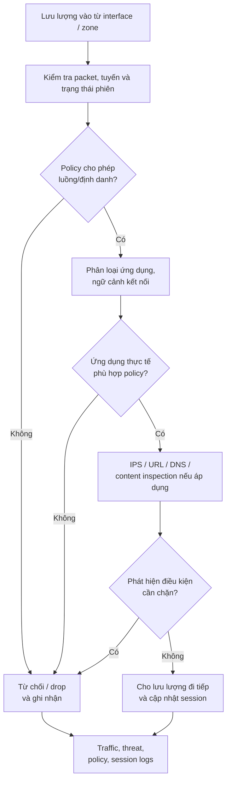
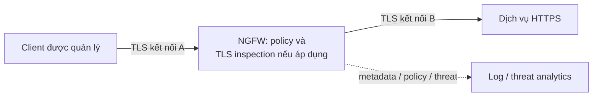
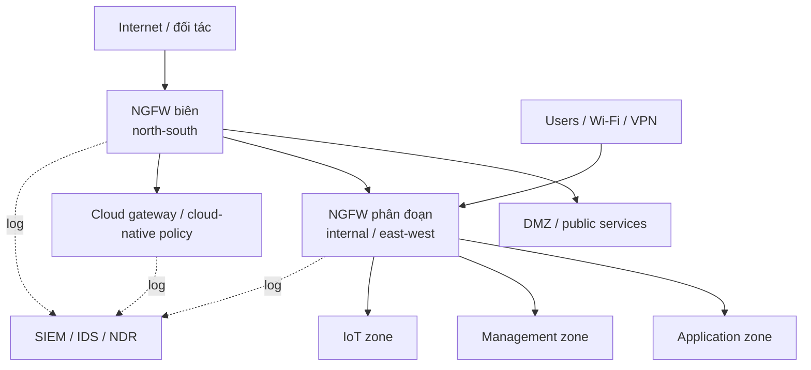

# Next-generation firewall (NGFW) trong kiến trúc bảo mật mạng

**Next-generation firewall (NGFW)** là tường lửa tích hợp khả năng kiểm soát lưu lượng theo địa chỉ, cổng, trạng thái phiên với những ngữ cảnh cao hơn như **ứng dụng, danh tính người dùng, nội dung và dấu hiệu đe dọa**. Mục tiêu của NGFW là trả lời những câu hỏi mà một ACL chỉ dựa trên IP và cổng khó giải đáp: người dùng nào đang truy cập ứng dụng nào, lưu lượng có phù hợp chính sách không, và có dấu hiệu tấn công hoặc phần mềm độc hại trên luồng được cho phép hay không?

Trong mô-đun **SECURITY_NETWORK_SECURITY**, NGFW là một lớp của kiến trúc phòng vệ mạng kết hợp **phân đoạn, VPN, IDS/IPS, bảo vệ DNS, kiểm soát truy cập và giám sát xâm nhập**. NGFW hỗ trợ thực thi chính sách tại ranh giới mạng, nhưng không thay thế phân quyền ứng dụng, bảo vệ điểm cuối, quản lý lỗ hổng, kiểm soát hạ tầng đám mây hoặc giám sát tập trung.

Bài học làm rõ cách hoạt động, cách xây dựng rule, thiết kế điểm đặt thiết bị, ý nghĩa các log và quy trình triển khai NGFW có thể kiểm chứng.

## 1. NGFW giải quyết vấn đề gì?

Một firewall truyền thống thường quyết định cho phép hoặc từ chối dựa trên các thuộc tính như IP nguồn/đích, giao thức, cổng và trạng thái kết nối. Những thuộc tính này vẫn cần thiết nhưng có giới hạn trong mạng hiện đại:

- Nhiều ứng dụng web dùng chung **TCP/443** hoặc **UDP/443**, nên “allow HTTPS” có thể bao phủ rất nhiều dịch vụ có mức rủi ro khác nhau.
- Một ứng dụng có thể dùng **cổng không mặc định**; chỉ dựa vào số cổng không đủ xác định ứng dụng.
- Người dùng có thể chuyển giữa mạng văn phòng, Wi-Fi và VPN với địa chỉ IP thay đổi.
- Lưu lượng được phép có thể chứa hành vi khai thác, mã độc, nội dung độc hại hoặc kết nối đến đích nguy hiểm.
- Dữ liệu lưu chuyển giữa các VLAN, máy ảo, container, hạ tầng cloud và Internet tạo ra nhiều **ranh giới tin cậy** cần kiểm soát.

NGFW giải quyết một phần các giới hạn này thông qua khả năng nhận diện ở lớp ứng dụng, gắn ngữ cảnh danh tính và tích hợp ngăn chặn đe dọa. **Khả năng thực tế phụ thuộc sản phẩm, giấy phép, phiên bản, chính sách giải mã và độ quan sát lưu lượng**; không phải thiết bị nào quảng cáo “NGFW” cũng có cùng mức độ phân tích.

### 1.1. So sánh các lớp chức năng

| Khả năng | ACL/router cơ bản | Stateful firewall | NGFW điển hình |
| --- | --- | --- | --- |
| Lọc IP, giao thức, cổng | Có | Có | Có |
| Theo dõi trạng thái kết nối | Không nhất thiết | Có | Có |
| NAT, zone, chính sách route/VPN | Tùy thiết bị | Thường có tùy sản phẩm | Thường có, tùy sản phẩm |
| Nhận diện ứng dụng thay vì chỉ cổng | Hạn chế | Không phải chức năng cốt lõi | Thường có |
| Gắn policy với user/group/thiết bị | Hạn chế | Tùy tích hợp | Thường hỗ trợ qua nguồn danh tính |
| IPS/phân tích dấu hiệu tấn công trong luồng | Không | Có thể tích hợp | Thường được tích hợp |
| URL/DNS/threat-intelligence filtering | Không phải trọng tâm | Tùy sản phẩm | Có thể tích hợp |
| TLS inspection và kiểm soát ứng dụng mã hóa | Hạn chế | Tùy sản phẩm | Có thể hỗ trợ với điều kiện phù hợp |
| Phân tích log theo ứng dụng, user, mối đe dọa | Cơ bản | Tập trung kết nối/rule | Thường chi tiết hơn |
| Khả năng chống mọi hình thức tấn công | **Không** | **Không** | **Không** |

Các cột chỉ mô tả chức năng thường thấy. Nhiều firewall stateful thương mại đã tích hợp các tính năng tiên tiến trước khi tên gọi NGFW phổ biến; vì vậy đánh giá sản phẩm cần dựa trên **khả năng được triển khai và kiểm thử**, không dựa trên nhãn tiếp thị.

## 2. Các lớp xử lý của một NGFW

Một kết nối có thể đi qua nhiều phép kiểm tra. Mô hình logic:



Sơ đồ khái quát quyết định, **không phải pipeline cố định cho mọi nhà sản xuất**. Trong thực tế có thể có kiểm tra trước phiên, phân loại ứng dụng theo nhiều giai đoạn, NAT, giải mã, tái lắp ráp luồng, công cụ IDS/IPS hoặc tăng tốc phần cứng. Một số kết quả nhận diện ứng dụng chỉ xuất hiện sau khi đã quan sát đủ gói, nên NGFW có thể áp rule dựa trên ứng dụng ban đầu chưa rõ và cập nhật khi nhận diện được.

Có ba nhóm chức năng quan trọng:

- **Data plane:** nơi gói đi qua, được phân loại, lọc, thiết lập session, giải mã/kiểm tra nếu cần, rồi chuyển tiếp hoặc từ chối.
- **Control plane:** định tuyến, trạng thái giao thức điều khiển và các quyết định mạng liên quan; cụ thể phụ thuộc kiến trúc thiết bị.
- **Management/analytics plane:** cấu hình policy, quản lý danh tính, nhận bản cập nhật nhận diện/đe dọa, xuất log, cảnh báo và báo cáo.

Nếu các thành phần này chia sẻ tài nguyên CPU/bộ nhớ, tác vụ logging, phân tích nội dung hoặc cập nhật quy tắc có thể ảnh hưởng thông lượng. Phải kiểm tra thiết kế và số liệu hiệu năng theo **tải thực tế**, không chỉ theo tốc độ cổng mạng.

## 3. Stateful inspection vẫn là nền tảng

NGFW phải hiểu một luồng trước khi đánh giá hành vi ứng dụng. Với TCP, firewall stateful theo dõi thông tin kết nối và trạng thái; với UDP, một “session” có thể được suy ra từ cặp địa chỉ/cổng và timeout.

Ví dụ phiên truy cập HTTPS:

```text
Client 10.10.10.25:53120        NGFW                Web 203.0.113.20:443
        SYN ---------------------> | ---------------------> SYN
        <-------------------- SYN-ACK <---------------------|
        ACK ---------------------> | ---------------------> ACK
                 Phiên được theo dõi, policy được áp dụng
```

Các thuộc tính liên quan gồm **5-tuple** (IP nguồn/đích, cổng nguồn/đích, giao thức), interface/zone, trạng thái TCP, thời gian timeout, NAT mapping và phiên người dùng/ứng dụng khi có.

Tường lửa stateful thường tự cho phép gói **phản hồi hợp lệ của một phiên đã được cho phép** theo quy tắc trạng thái. Điều đó không có nghĩa mọi đường hồi đáp sẽ hoạt động:

- Luồng đi và về qua **hai firewall không chia sẻ session** có thể thất bại.
- Timeout phiên, NAT sai hoặc policy ở thiết bị phía sau vẫn có thể chặn.
- Không phải mọi gói UDP có liên hệ về mặt ứng dụng đều dễ phân loại bằng trạng thái.
- Gói không hợp lệ hoặc không khớp session có thể bị chặn trước kiểm tra ứng dụng.

**Không nhầm “stateful” với “biết toàn bộ nội dung phiên”**. Nó cung cấp ngữ cảnh kết nối, còn khả năng nhận diện/kiểm tra payload phụ thuộc lớp xử lý bổ sung.

## 4. Application awareness: kiểm soát theo ứng dụng

Đặc trưng của NGFW là **application identification**, thường dựa trên một số tín hiệu kết hợp: thông tin giao thức, đặc điểm phiên, mẫu trao đổi, tên miền/hostname, metadata TLS khi nhìn thấy được, phân tích nội dung sau giải mã khi được phép và cơ sở dữ liệu nhận diện ứng dụng.

Ví dụ hai lưu lượng cùng đi qua TCP/443:

| Luồng | Chỉ xét cổng | Nếu nhận diện ứng dụng đủ tin cậy |
| --- | --- | --- |
| Máy nhân viên → cổng ERP doanh nghiệp | HTTPS/TCP 443 | Cho phép ứng dụng ERP đúng resource |
| Máy nhân viên → dịch vụ chia sẻ tệp không được phê duyệt | HTTPS/TCP 443 | Từ chối hoặc giám sát theo chính sách ứng dụng |
| Máy khách → web SaaS được phê duyệt | HTTPS/TCP 443 | Cho phép với các giới hạn danh tính/URL cần thiết |
| Ứng dụng dùng HTTPS trên cổng không chuẩn | Có thể bị nhầm là dịch vụ khác | Có thể nhận diện giao thức nếu engine hỗ trợ và thấy đủ dữ liệu |

Cần phân biệt **ứng dụng** với **cổng** và với **hostname**. Nhận diện một giao thức như HTTPS thường chỉ là nhãn rộng; xác định chính xác một SaaS cụ thể đòi hỏi thông tin khác và có thể không khả thi trong mọi phiên.

### 4.1. Các yếu tố làm giảm độ tin cậy nhận diện

- **TLS/QUIC mã hóa** giới hạn phần payload có thể phân tích khi không giải mã.
- Nhiều ứng dụng chung một IP/CDN, dẫn đến IP allowlist quá rộng hoặc tên miền không phản ánh dịch vụ cuối.
- **Encrypted ClientHello (ECH)** có thể che một số thông tin hostname trong quá trình TLS, nếu cả client và hạ tầng hỗ trợ.
- **HTTP/3 trên QUIC (UDP/443)** có hành vi khác TCP; chính sách chỉ cho TCP/443 có thể khiến ứng dụng chuyển sang đường khác hoặc thất bại.
- **DNS over HTTPS (DoH)** hoặc các resolver ngoài làm giảm hiệu quả suy luận dựa trên DNS truyền thống.
- Phân loại có thể thay đổi trong phiên: *unknown*, *incomplete*, *insufficient-data* hoặc nhãn tương tự tùy thiết bị.
- Bản cập nhật ứng dụng mới hoặc thay đổi bên SaaS có thể làm rule đang chạy không còn nhận diện chính xác.

Vì vậy, quy tắc **allow application X** phải đi kèm quy tắc rõ về *unknown application*, giao thức/cổng đi kèm và phiên bị đánh dấu bất thường. **Không tự động xem unknown là độc hại**, nhưng cũng không mở tất cả unknown để “tránh lỗi người dùng”.

### 4.2. Thiết kế rule ứng dụng theo mức rủi ro

Một ví dụ:

- Nhóm **employee** được dùng ứng dụng ERP qua vùng app nội bộ với giao thức/cổng đã xác minh.
- Nhóm **support** được dùng ứng dụng helpdesk SaaS qua HTTPS.
- **Guest Wi-Fi** chỉ được truy cập dịch vụ Internet thông thường theo chính sách; không vào mạng ứng dụng và quản trị.
- **Management VLAN** chỉ nhận kết nối từ bastion hoặc nhóm được cấp đặc quyền.

Quy tắc có thể kết hợp application identifier với **địa chỉ đích, zone, user group, service/port và lịch sử phiên** để hạn chế phạm vi. Chỉ có nhãn ứng dụng mà không kiểm tra quyền với tài nguyên cụ thể là chưa đủ.

## 5. Identity-aware policy: từ IP đến người dùng và thiết bị

Trong môi trường VPN, Wi-Fi, DHCP và thiết bị di động, IP thay đổi theo phiên. NGFW có thể dùng các nguồn định danh để ánh xạ kết nối đến **user, group, device, posture hoặc workload identity** khi được tích hợp phù hợp.

| Nguồn ngữ cảnh | Thông tin có thể cung cấp | Giới hạn |
| --- | --- | --- |
| IdP / directory | User, group, role, xác thực | Không nhất thiết biết người nào dùng IP nào tại mọi thời điểm |
| VPN / ZTNA gateway | User và địa chỉ được cấp theo session | Thay đổi sau reconnect; cần ID và timestamp |
| 802.1X / RADIUS / NAC | Trạng thái thiết bị, role, VLAN, session | Một số thiết bị dùng MAB hoặc cơ chế fallback |
| EDR / MDM | Danh tính và trạng thái quản lý thiết bị | Chất lượng dữ liệu phụ thuộc agent và đồng bộ |
| Cloud / Kubernetes | Nhãn workload, account, security context | Quyền thực tế phụ thuộc tính năng và tích hợp |
| DHCP / IPAM | IP ↔ MAC/thiết bị theo lease | Không chứng minh danh tính con người; NAT hoặc MAC ngẫu nhiên gây nhiễu |

**IP-to-user mapping có thể sai hoặc hết hạn** khi có NAT, proxy, thiết bị dùng chung, DHCP lease thay đổi, Wi-Fi roaming hoặc máy có nhiều phiên. Khi thiết kế identity-aware policy, phải xác định hành vi khi **không nhận diện được danh tính**: từ chối, giới hạn vào ứng dụng công khai hay cho phép một nhóm dịch vụ dự phòng rõ ràng.

Ví dụ, quyền quản trị không nên dựa đơn thuần vào việc client mang IP thuộc subnet VPN. Cần kết hợp xác thực mạnh, nhóm được phê duyệt, thiết bị phù hợp, bastion, firewall và audit tác vụ.

## 6. Threat prevention: IPS và kiểm soát nội dung

NGFW thường tích hợp hoặc liên kết các bộ máy phòng ngừa đe dọa:

| Năng lực | Mục đích | Điều cần kiểm soát |
| --- | --- | --- |
| **IPS** | Phát hiện/chặn mẫu khai thác hoặc hành vi mạng đáng ngờ | Signature, context, độ tin cậy, hành động alert/drop/reset |
| **URL filtering** | Cho phép/chặn nhóm website hoặc đích web cụ thể theo chính sách | Phân loại, ngoại lệ, hành vi với URL chưa được phân loại |
| **DNS security** | Quan sát/chặn một số truy vấn tới tên miền có mức rủi ro cao | Resolver, DoH/DoT, DNS trong tunnel, false positive |
| **Anti-malware/file inspection** | Kiểm tra tệp hoặc luồng nội dung được quan sát | Loại file, độ lớn, mã hóa và giới hạn engine |
| **Sandbox / phân tích động** | Đánh giá tệp đáng ngờ tại môi trường tách biệt | Độ trễ, dữ liệu gửi phân tích, cập nhật kết quả |
| **Threat intelligence** | Bổ sung thông tin IP/domain/URL hoặc dấu hiệu mới | Độ tươi dữ liệu, độ tin cậy và vòng đời IOC |
| **Data control/DLP** | Hạn chế dữ liệu nhạy cảm đi ra theo chính sách | Giải mã, định dạng, nhận diện nội dung, tuân thủ |

Không nên hiểu mọi chức năng trên đều được bật mặc định. Một số cần giấy phép, gói cập nhật, tích hợp sản phẩm hoặc triển khai chuyên biệt. Một signature IPS có thể phát cảnh báo sai; ngược lại, thiếu alert **không chứng minh** một kết nối an toàn.

### 6.1. IDS khác IPS, và cách xử lý false positive

**IDS** chủ yếu phát hiện/cảnh báo; **IPS** đặt trong đường xử lý có thể ngăn chặn bằng drop/reset/deny tùy sản phẩm và cấu hình. Nhiều NGFW cung cấp chế độ **alert-only**, **block** hoặc các action chi tiết.

Ví dụ, rule IPS ngăn mẫu khai thác thường thấy đối với một ứng dụng public. Nếu engine gắn nhãn một truy vấn hợp lệ là tấn công, ứng dụng có thể bị gián đoạn. Quy trình hợp lý:

1. Ghi signature ID, mục đích nhận diện, phiên bản engine và lưu lượng bị khớp.
2. Xác minh log, ứng dụng, đích, phản hồi và mức độ tin cậy.
3. Nếu là false positive, tạo ngoại lệ **hẹp theo ứng dụng/đích/chữ ký**, có owner, thời hạn và phép kiểm thử.
4. Không tắt toàn bộ IPS profile chỉ vì một cảnh báo chưa được phân tích.
5. Khi cập nhật signature, đánh giá ảnh hưởng đến lưu lượng nhạy cảm trước và sau thay đổi.

Đội vận hành cần phân biệt **threat log** (điều kiện engine nhận diện), **traffic log** (kết nối và kết quả) và **audit/config log** (ai thay đổi policy). Cả ba có vai trò khác nhau khi điều tra sự cố.

## 7. TLS decryption: khả năng, giới hạn và thiết kế phù hợp

Phần lớn ứng dụng hiện đại sử dụng TLS. **Nếu NGFW không giải mã**, nó thường chỉ quan sát được metadata và hành vi kết nối phù hợp với giao thức/triển khai; nó **không tự đọc được toàn bộ URL path, HTTP header bên trong TLS hoặc payload mã hóa**.

Một số giải pháp hỗ trợ:

- **Outbound TLS inspection / forward proxy:** tổ chức chủ động giải mã một số kết nối từ thiết bị được quản lý, kiểm tra rồi thiết lập TLS đến đích, với cơ chế tin cậy chứng chỉ/PKI phù hợp.
- **Inbound TLS inspection / reverse proxy:** dịch vụ do tổ chức quản lý có thể được kiểm tra khi NGFW hoặc thiết bị liên quan có quyền giải mã hợp lệ và kiến trúc đặt đúng vị trí.
- **Metadata-only inspection:** quan sát các trường và thống kê chưa mã hóa hoặc được giao thức để lộ, không giả định nhìn thấy nội dung.
- **Decryption bypass/exclusion:** những luồng không phù hợp giải mã theo chính sách, yêu cầu kỹ thuật hoặc bảo vệ dữ liệu cần đường xử lý/kiểm soát khác.



*Sơ đồ chỉ mô tả cách một forward proxy giải mã và thiết lập hai chân TLS. Không phải tất cả TLS inspection hoạt động đúng kiến trúc này.*

### 7.1. Những điểm cần giải thích rõ

- Client phải tin cậy CA/chứng chỉ của cơ chế inspection theo thiết kế; điều này phải được quản trị chặt, không phải mẹo bỏ qua cảnh báo chứng chỉ.
- **Certificate pinning** hoặc xác thực đầu cuối đặc thù có thể khiến ứng dụng không hoạt động nếu bị proxy giải mã.
- **Mutual TLS (mTLS)**, các ứng dụng bảo mật cao và một số dịch vụ tài chính/y tế có thể cần quy tắc xử lý riêng dựa trên yêu cầu tổ chức.
- **TLS 1.3, QUIC/HTTP3 và ECH** tạo thêm các giới hạn phân tích tùy phiên bản thiết bị và client; không được giả định mọi session đều giải mã được.
- Giải mã làm tăng chi phí CPU, bộ nhớ và độ trễ; thông lượng khi bật threat inspection có thể thấp đáng kể so với số liệu firewall forwarding thuần.
- Truy cập đến thông tin nhạy cảm và việc lưu payload/URL cần được giới hạn theo quy định bảo vệ dữ liệu và quyền truy cập log.

**Giải mã không phải điều kiện bắt buộc cho mọi policy NGFW.** Khi không giải mã, vẫn có thể thực thi segmentation, identity, egress controls, DNS policy, endpoint controls và logging; cần ghi rõ mức độ quan sát còn lại.

## 8. NGFW trong kiến trúc phân đoạn và phòng vệ nhiều lớp

Một thiết bị NGFW có thể đặt tại nhiều loại ranh giới, tùy bề mặt cần bảo vệ:



**North-south** chỉ lưu lượng giữa mạng doanh nghiệp và các miền bên ngoài. **East-west** mô tả lưu lượng ngang giữa các máy chủ, VLAN, workload hoặc vùng nội bộ. Một NGFW tại Internet edge **không nhìn thấy** mọi kết nối giữa các host cùng VLAN; để kiểm soát east-west có thể cần tường lửa nội bộ, microsegmentation hoặc chính sách tại hypervisor/CNI/host.

### 8.1. Thiết kế zone theo mức tin cậy

Ví dụ tổ chức có các vùng:

| Zone | Mô tả | Nguyên tắc |
| --- | --- | --- |
| **internet** | Kết nối từ bên ngoài | Chỉ mở dịch vụ public cần thiết |
| **dmz** | Reverse proxy và máy chủ public | Hạn chế truy cập vào ứng dụng nội bộ |
| **users** | Máy nhân viên | Chỉ ứng dụng cần cho vai trò |
| **guest** | Wi-Fi khách | Cho phép ra Internet theo chính sách, chặn nội bộ |
| **apps** | Ứng dụng nghiệp vụ | Chỉ cổng/đích cần thiết tới data và dịch vụ khác |
| **data** | Cơ sở dữ liệu | Không truy cập trực tiếp từ guest/users nếu không cần |
| **management** | Bastion, hệ thống quản trị | Cho phép nguồn quản trị được phê duyệt, kiểm toán |
| **iot** | Thiết bị IoT/camera | Egress và east-west theo allowlist |
| **vpn-users** | Kết nối từ xa | Phân quyền theo user/group/device, mặc định giới hạn |

**Zone không nhất thiết đồng nghĩa VLAN 1:1**. Một zone có thể gồm nhiều interface, subnet hoặc tunnel; chính sách phải chỉ ra chiều, nguồn, đích và tính năng áp dụng. Nếu cùng VLAN trao đổi trực tiếp ở layer 2, rule trên NGFW ở gateway có thể không nhận traffic.

### 8.2. Các lớp ngoài NGFW

Một rule deny có thể ngăn kết nối nhưng không khắc phục dữ liệu bị lộ trước đó. Một policy URL có thể chặn một domain độc hại nhưng không thay thế MFA trên VPN. Một IPS có thể phát hiện mẫu tấn công mạng nhưng bỏ sót hành vi trên thiết bị đầu cuối.

Vì vậy, thiết kế nên kết hợp NGFW với **802.1X/NAC, DNS protection, EDR, least privilege, MFA, quản lý bản vá, hệ thống giám sát và threat modeling**. Tài nguyên cloud còn cần policy riêng ở security group/network ACL, identity, workload và storage.

## 9. Xây dựng chính sách NGFW theo mục đích nghiệp vụ

Một rule tốt trả lời rõ:

- **Ai?** User/group, device/role hoặc workload identity nào?
- **Từ đâu?** Source zone, subnet, interface, VPN group nào?
- **Đến đâu?** Destination zone, ứng dụng, domain/resource, địa chỉ và dịch vụ nào?
- **Làm gì?** Ứng dụng và loại truy cập được phép là gì?
- **Trong điều kiện nào?** Lịch, posture, threat profile, TLS inspection, logging?
- **Nếu không khớp?** Default deny, allow có điều kiện hay cần exception đã phê duyệt?

Nên thiết kế theo **least privilege** và **default deny** ở ranh giới nhạy cảm, sau đó mở những luồng đã được xác minh phục vụ nghiệp vụ.

### 9.1. Bảng rule mẫu

| Thứ tự logic | Nguồn → đích | Điều kiện | Action / bảo vệ |
| --- | --- | --- | --- |
| 1 | **management/bastion → management** | Nhóm admin, ứng dụng/cổng quản trị đã phê duyệt | Allow, MFA/PAM tại lớp phù hợp, log |
| 2 | **users → apps/ERP** | Nhóm employee, ứng dụng ERP đúng đích | Allow, IPS/threat profile phù hợp |
| 3 | **vpn-users → apps/ERP** | Nhóm employee đã xác thực và posture đạt | Allow, log phiên và user |
| 4 | **guest → Internet** | DNS/HTTPS và dịch vụ được phép theo policy | Allow có lọc phù hợp, log theo chính sách |
| 5 | **iot → app collector** | Chỉ cổng, địa chỉ, giao thức cần thiết | Allow, theo dõi bất thường |
| 6 | **guest/users → management** | Mọi ứng dụng | Deny, log sự kiện đại diện |
| 7 | **Any → Any** | Không khớp rule cho phép | Deny, log theo mức độ phù hợp |

Đây là **thứ tự trình bày mục tiêu**, không bảo đảm mọi NGFW dùng phương thức *first-match* giống nhau. Một số hệ thống có pre-rule/post-rule, implicit rules, policy nhiều tầng và thứ tự riêng cho security/NAT/decryption. Khi triển khai phải đọc quy tắc đánh giá policy của sản phẩm.

### 9.2. Pseudoconfiguration cho một rule

```yaml
# Ví dụ mô tả chính sách, không phải cú pháp cấu hình NGFW cụ thể
policy_id: "NGFW-ERP-EMPLOYEE"
owner: "Security Network + Application ERP"
source:
  zone: users
  groups: ["employee"]
  posture: managed_device
destination:
  zone: apps
  resource: "erp.internal.example"
  service: "tcp/443"
application: "enterprise-erp"
action: allow
security_profiles:
  ips: "balanced-business-app"
  malware: "enabled-when-supported"
tls_inspection: "according-to-approved-policy"
logging:
  session_end: true
  threat_events: true
validation:
  allowed: "employee managed device -> ERP HTTPS"
  denied: "guest or unapproved role -> ERP HTTPS"
expiry_review: "review-on-policy-change"
```

Cần gắn rule với ticket, chủ sở hữu, lý do nghiệp vụ, phép thử, mức độ rủi ro và thời hạn rà soát. Nếu một rule rộng tạm thời được tạo trong sự cố, phải có deadline và người chịu trách nhiệm đóng hoặc thu hẹp.

### 9.3. NAT và thứ tự đánh giá

**NAT không phải cơ chế phân quyền.** DNAT chuyển đích IP/port; SNAT chuyển nguồn; cho phép một kết nối phải được đánh giá bằng chính sách bảo mật phù hợp. Các sản phẩm có thể xét security rule dựa trên địa chỉ **trước NAT hoặc sau NAT**, zone trước/sau định tuyến và cách xác định rule khác nhau.

Vì vậy:

1. Xác định IP/port nhìn từ client và thông tin NAT tại firewall.
2. Tra đúng tài liệu/luật match của sản phẩm.
3. Kiểm tra server nhìn thấy địa chỉ nguồn nào.
4. Ghi cả 5-tuple trước/sau NAT trong log hoặc bảng ánh xạ phù hợp.
5. Kiểm thử cả đường đi và chiều trả về.

Không chép một rule NAT của hãng A sang hãng B rồi giả định security policy vẫn giữ cùng ngữ nghĩa.

## 10. Thực thi chính sách ứng dụng trong lưu lượng mã hóa

Ví dụ một doanh nghiệp muốn **cho phép SaaS quản lý công việc được phê duyệt** và hạn chế dịch vụ chia sẻ tệp không được duyệt. Chỉ dựa trên TCP/443 sẽ không phân biệt được. Với NGFW, có thể thiết kế:

1. Xác định ứng dụng SaaS chính thức, tên miền, dải IP/URL và phụ thuộc được nhà cung cấp công bố.
2. Rà soát ứng dụng khác có thể đi chung CDN/IP hoặc dùng QUIC.
3. Xem NGFW có nhận diện chính xác ứng dụng trong **chế độ không giải mã** hay không; kiểm tra trên môi trường thử.
4. Nếu cần giải mã để thực thi một phần chính sách, đưa phạm vi đó qua quy trình xét duyệt và cấu hình trust/chính sách phù hợp.
5. Quy định hành vi với **unknown/unclassified traffic**, truy cập qua proxy ngoài và các phiên TCP/UDP/443.
6. Ghi log application ID, user/group, policy, dest, action và threat; kiểm thử với luồng cần cho phép lẫn cần chặn.

**Giới hạn quan trọng:** Đích DNS hoặc hostname được phép không bảo đảm mọi hoạt động bên trong ứng dụng SaaS đều được phép. Phân quyền và DLP ở phía SaaS/API, CASB/SSE hoặc endpoint có thể cần thiết khi muốn kiểm soát thao tác cấp tài liệu, tải xuống hay chia sẻ.

## 11. Logging, giám sát và phân tích sự cố trên NGFW

NGFW tạo ra nhiều nhóm log khác nhau. Không nên chỉ xem hành động **allow/deny** rồi coi như đã biết toàn bộ sự kiện.

| Loại log | Dữ kiện thường có | Câu hỏi trả lời |
| --- | --- | --- |
| **Traffic/session** | Thời điểm, IP/port, zone, rule, action, bytes, ứng dụng, session | Luồng nào đã đi qua? Bị chặn ở đâu? |
| **Threat/IPS** | Signature/threat ID, mức nghiêm trọng, ứng dụng, action | Dấu hiệu gì bị phát hiện/chặn? |
| **URL/DNS security** | Domain/URL category, resolver/host, policy, kết quả | Yêu cầu web/DNS nào bị chặn theo chính sách? |
| **Decryption** | Quyết định giải mã/bypass, lỗi chứng chỉ/giao thức | Vì sao không quan sát được payload hoặc ứng dụng lỗi TLS? |
| **Authentication/user mapping** | User, group, nguồn mapping, thời gian | Policy có gắn đúng người/thiết bị không? |
| **System/HA/route** | Link, CPU, HA failover, session sync, route | Có lỗi hạ tầng gây gián đoạn? |
| **Admin/audit/config** | Ai đổi rule, nội dung thay đổi, thời gian | Policy hiện tại có giống khi xảy ra sự cố? |

Một log minh họa không phụ thuộc hãng:

```json
{
  "event_time": "2026-11-28T02:15:32Z",
  "device": "ngfw-internal-a",
  "source_zone": "guest",
  "destination_zone": "management",
  "source_ip": "10.30.0.25",
  "source_port": 53120,
  "destination_ip": "192.0.2.30",
  "destination_port": 443,
  "protocol": "tcp",
  "application": "ssl-or-unknown",
  "user": null,
  "rule_id": "DENY-GUEST-MGMT",
  "action": "deny",
  "reason": "security-policy",
  "session_id": "demo-8842"
}
```

Log này cho biết **một luồng từ guest đến management đã được NGFW ghi nhận deny theo policy**, nhưng chưa chứng minh đích là hệ thống bị tấn công, user cụ thể là ai hoặc có payload độc hại. Application có thể chưa được nhận diện do gói bị chặn sớm. **Không suy diễn ý đồ từ một deny log** nếu chưa kết hợp bối cảnh.

### 11.1. Khi người dùng báo “không vào được ứng dụng”

Thu thập tối thiểu:

1. Thời gian (UTC và timezone), hostname, IP đích, protocol/port.
2. IP nguồn/đích trước và sau NAT, zone, interface, VPN session.
3. Định danh user/device và độ tin cậy của mapping.
4. Rule ID, action, security/threat/decryption profile.
5. DNS result, route, session state, ứng dụng được nhận diện.
6. Packet capture/flow ở client hoặc sau firewall nếu cần chứng minh điểm drop.
7. Event change/HA/route tại cùng thời điểm.
8. Kết quả kiểm thử lại sau khi khắc phục.

**Timeout không đồng nghĩa NGFW deny**. Nếu log có rule deny khớp đúng 5-tuple và thời điểm, đó là bằng chứng trực tiếp hơn. Nếu NGFW ghi allow nhưng ứng dụng trả HTTP 403, cần kiểm tra WAF/API/authz thay vì vội sửa firewall.

### 11.2. Chỉ số vận hành hữu ích

- Tổng session/giây, session đang mở, thông lượng trung bình và đỉnh.
- CPU, memory, khả năng xử lý IPS/TLS, hàng đợi và packet drop.
- Tỷ lệ ứng dụng **unknown** và tỷ lệ TLS session giải mã/bypass/thất bại.
- Số sự kiện high-severity có bằng chứng xác nhận và tỷ lệ false positive.
- Policy có độ bao phủ quá rộng, chưa có owner hoặc lâu không còn hit.
- Thời gian cập nhật ứng dụng/IPS/threat intelligence và lỗi nhận bản cập nhật.
- Độ đầy đủ của log đến SIEM, độ trễ ingestion và dung lượng lưu trữ.
- Tỷ lệ phép thử segmentation/identity pass và thời gian khắc phục sai lệch.

Các chỉ số cần ngưỡng theo baseline của tổ chức. Một đợt tăng số deny có thể xuất phát từ bản cập nhật client, thay đổi tuyến hoặc quét lành tính; nên điều tra dựa trên nhiều nguồn.

## 12. Hiệu năng và sizing: đọc đúng thông số

Các brochure thường có nhiều chỉ số. Chúng không thể thay thế nhau.

| Thông số | Ý nghĩa | Cách sử dụng |
| --- | --- | --- |
| **Firewall throughput** | Thông lượng trong kịch bản lọc mạng cụ thể của nhà sản xuất | Không coi là tốc độ khi bật toàn bộ IPS/TLS inspection |
| **Threat-prevention throughput** | Thông lượng khi bật một bộ chức năng phân tích đe dọa xác định | Xem chính xác profile, kích thước gói và loại traffic khi benchmark |
| **TLS/SSL inspection throughput** | Năng lực khi xử lý luồng giải mã trong điều kiện thử cụ thể | So sánh với tỷ lệ phiên cần giải mã, phiên bản TLS và cipher |
| **New sessions per second** | Tốc độ tạo phiên mới | Quan trọng cho nhiều kết nối ngắn |
| **Concurrent sessions** | Số phiên được duy trì đồng thời | Quan trọng cho ứng dụng giữ kết nối lâu hoặc nhiều thiết bị |
| **Latency** | Độ trễ tăng thêm qua NGFW | Ảnh hưởng thoại, video, ứng dụng thời gian thực |
| **Log rate/capacity** | Năng lực ghi và chuyển log | Liên quan cảnh báo, lưu trữ và quan sát |
| **HA failover/session sync** | Khả năng duy trì dịch vụ khi lỗi thiết bị | Phải thử kịch bản thực tế, không chỉ dựa trên nhãn HA |

Ví dụ tổ chức có đường Internet **2 Gbps**. Không nên chọn NGFW chỉ vì bảng thông số ghi **2 Gbps firewall throughput**. Nếu policy yêu cầu IPS, URL filtering, TLS decryption cho một phần lớn lưu lượng, nhu cầu throughput phải xét theo **đồng thời bật các tính năng**, kích thước gói, loại giao thức và dư địa tăng trưởng.

### 12.1. Ước lượng năng lực bước đầu

Giả sử đo được **1,2 Gbps lưu lượng đỉnh** trong khung cao điểm. Đội vận hành muốn 30% dự phòng tải, nên **mục tiêu xử lý sơ bộ = 1,2 × 1,3 = 1,56 Gbps** ở chính cấu hình bật IPS/TLS thực tế. Con số này **không phải định mức đủ cho mọi mạng**: còn phải xét phiên mới/giây, số phiên đồng thời, độ lớn packet, thuật toán giải mã, tính năng cloud logging và tải tăng trưởng dài hạn.

Đối với hệ thống đòi hỏi HA, cần xác minh **một thiết bị còn lại có chịu được tải dự kiến khi failover** hay không. Thiết kế active/active không mặc nhiên đồng nghĩa khi một node hỏng thì node còn lại có đủ khả năng xử lý toàn bộ tải.

## 13. Tính sẵn sàng cao (HA) và hoạt động khi lỗi

Một NGFW đặt tại ranh giới trọng yếu có thể trở thành điểm gián đoạn nếu triển khai một thiết bị duy nhất. Một số mô hình:

- **Active/passive:** một node xử lý chính, node dự phòng tiếp quản khi lỗi; cần cấu hình HA, đường heartbeat và đồng bộ phiên theo khả năng sản phẩm.
- **Active/active:** nhiều node cùng xử lý, thường yêu cầu thiết kế phân phối lưu lượng và đồng bộ trạng thái phức tạp hơn.
- **Virtual/cloud NGFW:** năng lực scale, load balancing, route failover và kết nối mạng phụ thuộc nền tảng cloud và thiết kế riêng.

### 13.1. Những câu hỏi cần trả lời trước khi bật HA

1. Khi một node hỏng, **session hiện có** có được duy trì hay phải kết nối lại?
2. Có hiện tượng **asymmetric routing** sau failover không?
3. Các cổng upstream/downstream, switch, đường Internet và nguồn điện có độc lập không?
4. Policy, certificate, license và bản cập nhật có đồng nhất giữa các node không?
5. Nếu kênh heartbeat lỗi, hệ thống tránh **split brain** theo cơ chế nào?
6. Log và session ID sau failover có thể đối chiếu được không?
7. Khi thiết bị quá tải, traffic bị chặn, bỏ qua kiểm tra hay chuyển sang đường dự phòng theo chính sách nào?
8. Mạng quản trị có thể truy cập để khôi phục khi đường dữ liệu gặp lỗi không?

**Fail-open** có thể duy trì kết nối nhưng làm giảm mức kiểm soát; **fail-closed** có thể bảo vệ vùng nhạy cảm nhưng tạo nguy cơ gián đoạn. Không có lựa chọn đúng cho mọi hệ thống; phải xác định từ yêu cầu bảo mật và tính sẵn sàng của từng zone, sau đó kiểm thử.

## 14. Quy trình triển khai NGFW có kiểm soát

Một dự án chuyển từ firewall cũ sang NGFW nên đi theo các bước có thể kiểm chứng:

### Bước 1 — Kiểm kê luồng và mục tiêu

Thu thập **tài sản, subnet, VLAN/zone, route, NAT, ứng dụng, người dùng, điểm kết thúc VPN, dependency DNS và các kết nối cloud**. Xác định luồng thật sự cần cho nghiệp vụ bằng log, flow hoặc tài liệu kiến trúc đã được xác nhận.

Đồng thời ghi rủi ro: quản trị ngoài Internet, Wi-Fi khách đi vào mạng nội bộ, thiết bị IoT truy cập ngang, luồng cũ “any-any” và thiếu giám sát.

### Bước 2 — Xác định điểm đặt và chính sách

Vẽ đường **north-south/east-west**; bảo đảm luồng cần kiểm soát thực sự đi qua NGFW. Xây dựng zone, policy theo role/application, NAT, IPS profile, logging và quy định TLS inspection.

**Không đưa rule deny toàn diện vào sản xuất** khi chưa xác minh những phụ thuộc hợp lệ như identity, NTP, DNS, cập nhật hệ điều hành, dịch vụ giám sát hoặc kết nối đối tác.

### Bước 3 — Baseline và thử nghiệm

Thiết lập baseline về thông lượng, độ trễ, số phiên, ứng dụng và log. Dùng **monitor/alert-only** cho một số chức năng phân tích khi thích hợp để xác minh khả năng nhận diện và tác động. Những rule chặn ranh giới rõ ràng cần được test bằng luồng hợp lệ/trái phép.

### Bước 4 — Triển khai theo vùng

Bắt đầu từ một VLAN, nhóm người dùng hoặc ứng dụng có owner. Kiểm tra user mapping, rule hit, NAT, route, TLS và log. Sau đó mở rộng từng vùng và quan sát false positive, độ trễ cùng lỗi ứng dụng.

### Bước 5 — Chuyển đổi và khôi phục

Chuẩn bị sơ đồ đường đi cũ/mới, phiên bản cấu hình, backup và kế hoạch rollback. Thực hiện đổi đường hoặc policy theo cửa sổ thay đổi đã được phê duyệt; kiểm tra kết nối ứng dụng, VPN, DNS, monitoring và đường quản trị.

### Bước 6 — Đo lường và điều chỉnh

Đối chiếu:

- Luồng hợp lệ có hoạt động đúng không?
- Luồng trái phép có bị chặn tại ranh giới mong đợi không?
- Log có định danh rule, ứng dụng, user và hành động đủ cho điều tra không?
- Profile IPS/TLS có làm tăng false positive hoặc quá tải không?
- Một node HA hỏng thì dịch vụ có tiếp tục theo yêu cầu không?
- Các rule tạm thời và quá rộng đã được thu hẹp hoặc lên lịch rà soát chưa?

Một migration thành công nghĩa là **đạt chính sách bảo mật đồng thời giữ hoạt động nghiệp vụ đã phê duyệt**, không chỉ là “đã chuyển dây sang thiết bị mới”.

## 15. Các tình huống thiết kế và phân tích thực tế

### 15.1. Tình huống A — Wi-Fi khách không truy cập mạng quản trị

**Mục tiêu:** khách truy cập Internet theo chính sách nhưng không đến được VLAN 99 (management).

**Thiết kế:** guest zone tách với management zone; rule deny guest → management; DNS/DHCP được cấp đúng; có logging phù hợp tại ranh giới.

**Phép thử:** client thử nghiệm thuộc guest kết nối đến dịch vụ quản trị thử trong môi trường được phép. Đảm bảo luồng bị deny, log hiển thị đúng source zone, destination zone, rule ID và thời gian. Đồng thời xác nhận truy cập web hợp lệ của khách vẫn hoạt động.

**Sai sót thường gặp:** cùng VLAN có đường layer 2 hoặc tuyến phụ không qua NGFW; khi đó rule không thấy gói, dù bảng policy nhìn có vẻ chính xác.

### 15.2. Tình huống B — Chỉ nhân viên đúng role được dùng ERP qua VPN

**Mục tiêu:** employee thuộc nhóm được cấp quyền có thể truy cập ERP, guest/contractor không được phép vào resource nhạy cảm.

**Thiết kế:** IdP/VPN session gắn identity/group, policy giới hạn từ vpn-users đến ERP theo ứng dụng/cổng cần thiết; phân quyền của ERP vẫn hoạt động độc lập. Áp IPS profile khi phù hợp với giao thức.

**Phép thử:** kiểm tra một phiên thuộc employee được allow, một phiên thuộc contractor bị deny có log. Sau đó reconnect VPN để xác minh IP thay đổi không làm gán nhầm quyền người dùng.

**Sai sót thường gặp:** dùng IP VPN làm dấu hiệu duy nhất của quyền thay vì group/posture; quá tin tưởng mapping user khi nhiều phiên cùng chia sẻ NAT.

### 15.3. Tình huống C — NGFW báo app unknown và chặn SaaS hợp lệ

**Triệu chứng:** một ứng dụng SaaS hoạt động trên một trình duyệt nhưng lỗi trên trình duyệt khác; NGFW ghi nhãn unknown khi kết nối qua UDP/443.

**Cách điều tra:** đối chiếu DNS, TCP/443 và QUIC/UDP/443, trạng thái TLS decryption/bypass, application signature, URL category, phiên bản client và security rule. Xác minh lưu lượng ứng dụng trong phạm vi được phép.

**Khắc phục:** sửa policy/nhận diện hoặc phương án kết nối được phê duyệt sau khi chứng minh nguyên nhân; không mở **any-any** hoặc tắt toàn bộ threat prevention chỉ để SaaS hoạt động. Duy trì phép thử cho luồng bị cấm.

### 15.4. Tình huống D — Rule IPS gây chặn nhầm API

**Triệu chứng:** API production nhận 403/reset trong khi firewall traffic policy là allow; threat log ghi signature IPS và action=block.

**Phân tích:** gắn client request ID, thời điểm, session ID, IPS signature, traffic path và log API. Xác nhận có match đúng payload hợp lệ hay không, hoặc payload thực sự đáng ngờ.

**Khắc phục:** nếu false positive, tạo exception hẹp có thời hạn và owner, cập nhật signature/profile khi phù hợp, thử lại API và luồng tấn công mô phỏng được phép. **Không kết luận chỉ từ traffic allow**, bởi IPS có thể tiếp tục chặn sâu trong session.

## 16. Các sai lầm phổ biến

| Cách hiểu sai | Hệ quả | Cách làm đúng |
| --- | --- | --- |
| “Có NGFW nên không cần segmentation” | NGFW edge không nhìn thấy mọi east-west flow | Thiết kế zone, VLAN và microsegmentation theo thực tế |
| “Allow TCP/443 = chỉ cho HTTPS an toàn” | Nhiều ứng dụng và mục đích dùng chung 443 | Xác định application/destination/identity và threat profile |
| “App ID luôn chính xác dù mã hóa” | TLS/ECH/QUIC có thể che nội dung | Kiểm tra khả năng nhận diện thực tế và giới hạn |
| “Bật TLS inspection cho mọi thứ là tốt nhất” | Gián đoạn ứng dụng, độ trễ và rủi ro dữ liệu | Thiết kế phạm vi theo chính sách, loại trừ phù hợp |
| “Access-Accept của NAC = mọi service được phép” | Role có thể là VLAN/ACL hạn chế | Đọc quyền của session và policy NGFW |
| “IPS alert = đã bị xâm nhập” | False positive hoặc bị chặn trước khi thành công | Tương quan log, bối cảnh đích và bằng chứng |
| “Không có threat alert = an toàn” | Engine có thể không nhìn thấy payload hoặc thiếu signature | Kết hợp EDR, logging, quản lý lỗ hổng |
| “Stateful firewall không cần kiểm tra chiều về” | NAT, asymmetry và route làm lỗi kết nối | Xác minh toàn bộ đường đi/return path |
| “Thông lượng cổng = thông lượng khi giải mã TLS” | Dễ quá tải khi bật đầy đủ tính năng | Sizing theo profile và lưu lượng đỉnh thực tế |
| “HA có nghĩa mọi session luôn không gián đoạn” | Thiếu sync/route hoặc lệch policy | Kiểm thử failover, state sync và tải một node |
| “Chỉ cần rule đúng mà không cần log” | Không điều tra được false positive hoặc incident | Thiết kế logging/retention/SIEM và kiểm thử |
| “Đổi tên/cổng quản trị là đủ bảo vệ” | Vẫn còn lộ điểm quản trị | Restrict network, bastion, MFA, PAM và audit |

## 17. Checklist kiểm tra một thiết kế NGFW

- [ ] Có inventory subnet, VLAN/zone, ứng dụng, user group, cloud resource và điểm kết thúc VPN.
- [ ] Đường đi thực sự qua NGFW đối với các luồng mà chính sách phải kiểm soát.
- [ ] Có default deny phù hợp giữa các zone quan trọng và rule cho phép theo nghiệp vụ.
- [ ] Rule giới hạn nguồn, đích, giao thức/cổng, app, user và posture ở mức cần thiết.
- [ ] Quy định hành vi khi không nhận diện được user hoặc application.
- [ ] Có kế hoạch quản lý NAT trước/sau policy, IPv4 và IPv6, đường trả về bất đối xứng.
- [ ] Rule IPS/URL/DNS security được cấu hình, cập nhật và giám sát theo license/năng lực thực tế.
- [ ] Đã xác minh khả năng xử lý QUIC/HTTP3, TLS 1.3, certificate pinning và traffic không giải mã.
- [ ] TLS inspection, bypass và chứng chỉ được thiết kế phù hợp chính sách tổ chức.
- [ ] Thiết bị có đủ thông lượng khi bật profile bảo mật thực tế, sessions/sec và concurrent sessions.
- [ ] HA, session sync, route failover và năng lực một node còn lại được kiểm thử.
- [ ] Log gồm traffic, threat, decryption, identity, policy config và sự kiện hệ thống theo nhu cầu.
- [ ] Có SIEM/giám sát và cảnh báo tình trạng log forwarding, signature update và policy drift.
- [ ] Mọi rule có owner, lý do nghiệp vụ, phép thử, ngày rà soát và ngoại lệ có thời hạn.
- [ ] Thử cả luồng bị từ chối **và** luồng hợp lệ sau mỗi thay đổi trọng yếu.
- [ ] Có phương án backup, rollback và bảo vệ đường quản trị khi sự cố xảy ra.

## 18. Ghi nhớ

**NGFW mở rộng khả năng của stateful firewall bằng ngữ cảnh ứng dụng, danh tính và ngăn chặn đe dọa**, giúp áp dụng chính sách sát nhu cầu nghiệp vụ hơn so với việc chỉ xét IP và cổng. Giá trị thực tế nằm ở **đặt NGFW đúng ranh giới, định nghĩa rule tối thiểu, hiểu giới hạn quan sát của traffic mã hóa, nhận diện đúng user/app, ghi log đủ để giải thích quyết định và kiểm thử liên tục**.

Một kiến trúc mạng an toàn không phụ thuộc duy nhất vào NGFW. Thiết bị này phối hợp với NAC/802.1X, VPN, DNS, segmentation, EDR, bảo mật ứng dụng, cloud-native controls và IDS/IPS. Khi các lớp được thiết kế đồng bộ, NGFW vừa giảm rủi ro truy cập trái phép và khai thác qua mạng, vừa cung cấp bằng chứng cần thiết để vận hành, giám sát và xử lý sự cố có cơ sở.
