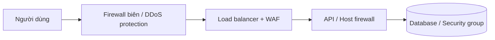
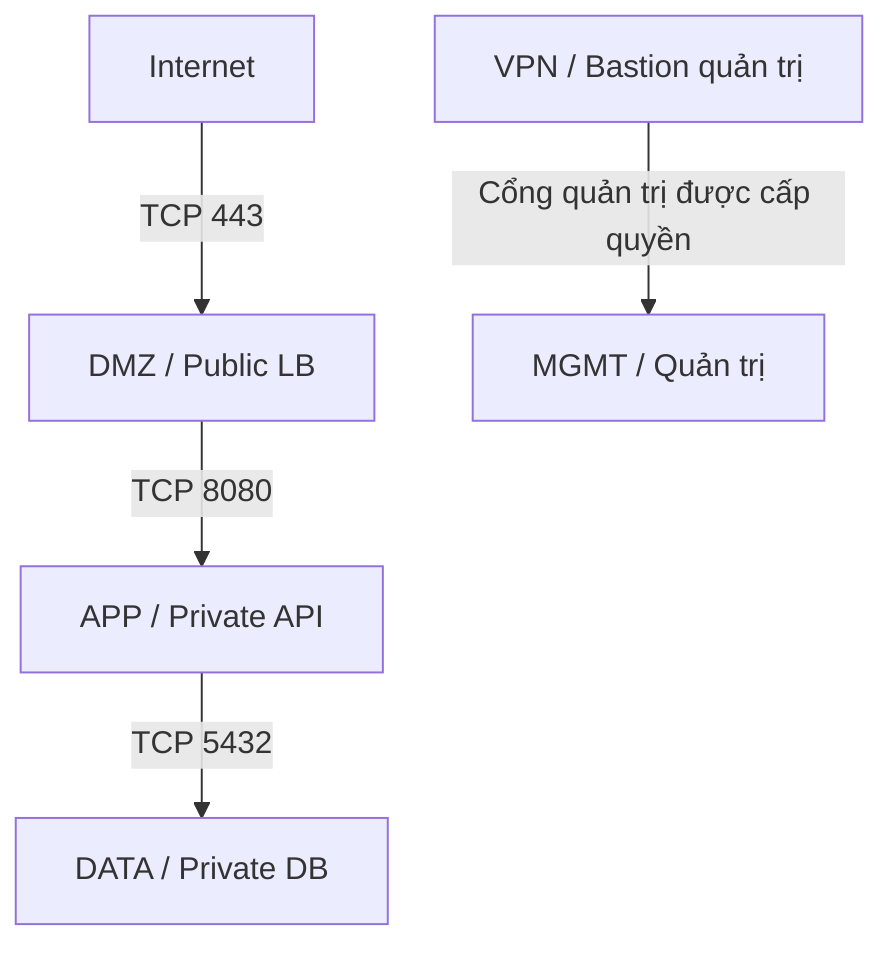
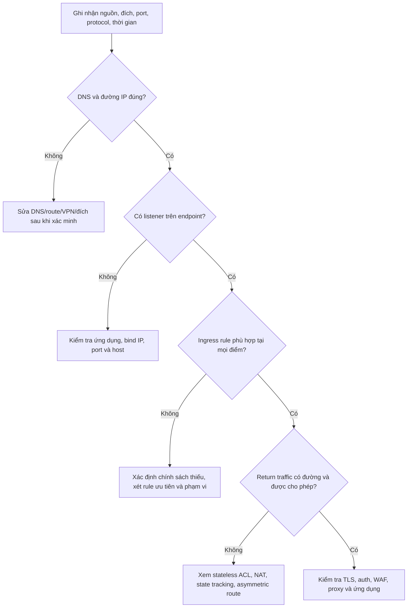

# Ingress firewall: kiểm soát lưu lượng đi vào mạng và dịch vụ

Một dịch vụ web cần nhận HTTPS từ người dùng Internet nhưng database phía sau chỉ nên nhận kết nối từ API. Máy chủ quản trị chỉ nên chấp nhận SSH từ mạng vận hành được cấp quyền. Nếu mọi nguồn đều có thể kết nối đến mọi cổng, chỉ một dịch vụ cấu hình sai hoặc tồn tại lỗ hổng có thể trở thành điểm xâm nhập cho cả hệ thống.

**Ingress firewall** là cơ chế kiểm soát lưu lượng **đi vào một ranh giới bảo vệ**: máy chủ, giao diện mạng, subnet, vùng bảo mật, workload hoặc ứng dụng. Nó đánh giá gói tin/luồng kết nối theo chính sách và quyết định cho phép, từ chối hay ghi nhận. Ranh giới được chọn sẽ quyết định lưu lượng nào được coi là ingress.

Trong module **SECURITY_NETWORK_SECURITY**, hiểu ingress firewall giúp thiết kế phòng vệ nhiều lớp cùng với phân đoạn mạng, VPN, xác thực kết nối, giám sát IDS/IPS, bảo vệ DNS, Wi-Fi và hạ tầng cloud. Ingress filtering thu hẹp **khả năng tiếp cận qua mạng**; việc một kết nối được phép không đồng nghĩa người dùng đã xác thực, ứng dụng an toàn hoặc dữ liệu đã được bảo vệ.

Sau bài học, bạn có thể:

- Phân biệt **ingress**, **egress** và lưu lượng phản hồi của một kết nối.
- Đọc quy tắc theo nguồn, đích, giao thức, cổng, trạng thái và hành động.
- Giải thích khác biệt giữa firewall **stateful** và **stateless**, giữa `DROP` và `REJECT`.
- Thiết kế chính sách **default deny / allowlist** cho web, API, database và đường quản trị.
- Áp dụng nguyên tắc ingress filtering ở máy Linux, cloud security group và Kubernetes NetworkPolicy.
- Dùng log, packet capture và bảng kiểm chứng để xác định firewall có thực sự là nguyên nhân lỗi kết nối hay không.

## 1. Ingress là hướng lưu lượng tương đối với ranh giới bảo vệ

Khái niệm ingress chỉ có ý nghĩa khi biết **đang đứng ở đâu để quan sát**. Cùng một packet có thể là egress của một máy và ingress của máy khác:

```text
Client                 Internet/VPN          Web server
10.0.1.20:53010                                  10.0.2.15:443
    |                                                |
    |------ TCP SYN đến 10.0.2.15:443 --------------->|
    |   egress phía client            ingress phía server
    |                                                |
    |<----- TCP SYN-ACK từ 10.0.2.15:443 -------------|
    |   ingress phía client           egress phía server
```

Ở **host firewall**, ingress thường là packet được gửi tới chính máy đó. Ở **firewall ranh giới**, ingress là packet đi qua giao diện từ vùng bên ngoài vào vùng cần bảo vệ. Ở **cloud security group**, đó là kết nối đi vào tài nguyên/interface được gắn group. Một chính sách Kubernetes **NetworkPolicy Ingress** xét lưu lượng đến các Pod được chọn.

Không nên suy từ từ “inbound” rằng một packet luôn xuất phát từ Internet. Traffic giữa hai subnet nội bộ, giữa workload trên cloud, từ VPN hoặc từ mạng khách Wi-Fi cũng có thể là ingress của vùng nhận.

### 1.1. Ingress khác egress và return traffic

| Loại lưu lượng | Cách nhận biết | Ví dụ |
|---|---|---|
| **Ingress** | Đi **vào** ranh giới đang bảo vệ | Người dùng đến HTTPS của load balancer. |
| **Egress** | Đi **ra** ranh giới đang bảo vệ | API chủ động gọi dịch vụ bên thứ ba. |
| **Response/return traffic** | Phản hồi thuộc một kết nối hoặc luồng đã được khởi tạo | SYN-ACK của web server trả về client đã gửi SYN. |
| **East–west traffic** | Giao tiếp giữa các thành phần nội bộ | Frontend gọi API, API gọi database. |
| **North–south traffic** | Giao tiếp đi vào/ra môi trường hay vùng mạng | Client Internet truy cập web public. |

East–west và north–south là cách mô tả hướng lưu lượng trong kiến trúc, **không thay thế** định nghĩa ingress/egress của từng ranh giới. Một cuộc gọi API → database là egress ở API, đồng thời là ingress ở database.

### 1.2. Xác định chính xác điểm thực thi chính sách



Mỗi điểm có thể áp dụng **một chính sách ingress riêng**:

1. Firewall biên kiểm tra liệu khách từ vùng ngoài có được vào dịch vụ công khai hay không.
2. Load balancer/WAF tiếp nhận và kiểm tra HTTP(S) theo cơ chế hỗ trợ.
3. Host firewall hoặc security group ở API chỉ cho phép nguồn phù hợp, thường là từ load balancer.
4. Database chỉ chấp nhận luồng từ API được cấp quyền, ở đúng protocol và port.

Nếu định tuyến giữa các VLAN diễn ra ngay trên switch lớp 3, còn firewall đặt ở đường ra Internet, traffic giữa VLAN có thể **không đi qua firewall biên**. Thiết kế ingress phải dựa trên **đường đi packet thực tế**, không dựa vào vị trí biểu tượng firewall trên sơ đồ.

## 2. Một quy tắc ingress được đánh giá theo những trường nào?

Một rule phổ biến có thể xét:

| Trường | Ví dụ | Ý nghĩa |
|---|---|---|
| Source | `203.0.113.10/32`, `10.20.0.0/16`, SG/pod selector | Ai được phép bắt đầu luồng tới tài nguyên. |
| Destination | `10.0.2.15`, subnet hoặc interface | Tài nguyên nào đang được bảo vệ. |
| Protocol | TCP, UDP, ICMP, ICMPv6 | Giao thức phù hợp với rule. |
| Destination port | TCP `443`, TCP `22`, UDP `53` | Dịch vụ dự kiến nhận kết nối; port không chứng minh ứng dụng thực sự. |
| Direction/zone | `WAN → DMZ`, `APP → DB` | Luồng đi qua ranh giới nào và theo chiều nào. |
| Connection state | `NEW`, `ESTABLISHED`, `RELATED`, `INVALID` ở nền tảng hỗ trợ | Luồng mới hay gói thuộc kết nối đã theo dõi. |
| Action | `ALLOW`, `DROP`, `REJECT`, log | Firewall phải xử lý packet như thế nào. |
| Priority/order | Rule số `10` trước rule `20`, tùy hệ thống | Rule nào có hiệu lực khi nhiều rule cùng khớp. |

Với TCP và UDP, các thành phần thường được dùng để nhận dạng luồng là **transport protocol, source IP, source port, destination IP, destination port** (5-tuple). Với IPv6, cách biểu diễn địa chỉ và một số header khác IPv4, nhưng nguyên lý kiểm soát nguồn/đích/giao thức vẫn tương tự.

### 2.1. Đọc một quy tắc thành ngôn ngữ dễ kiểm tra

```text
Direction:   INGRESS
Source:      203.0.113.10/32
Destination: 10.0.2.15
Protocol:    TCP
Port:        22
Action:      ALLOW
Purpose:     Quản trị SSH từ địa chỉ egress của VPN/bastion
```

Cách diễn giải: “Cho phép **các kết nối TCP mới** từ `203.0.113.10` đến `10.0.2.15:22` theo đúng điểm thực thi của rule”. Nó **không nói** rằng địa chỉ nguồn đã xác thực người dùng, server có SSH đang lắng nghe, hoặc phía client có quyền đăng nhập. Những điều đó cần kiểm tra ở các lớp tiếp theo.

Địa chỉ `203.0.113.10` và các dải `192.0.2.0/24`, `198.51.100.0/24` trong bài là địa chỉ dành cho tài liệu minh họa. Các IP riêng `10.0.0.0/8` cũng chỉ là ví dụ kiến trúc, không đại diện hệ thống thật.

### 2.2. Quy tắc có thứ tự hay hợp nhất?

**Không có một cơ chế xử lý rule áp dụng cho tất cả firewall.**

- Trong nhiều firewall và ACL, rule được xét theo **thứ tự/priority**, và rule đầu tiên phù hợp hoặc rule có độ ưu tiên cao nhất quyết định kết quả; rule bị che (*shadowed*) có thể không bao giờ được dùng.
- **AWS Security Group** là nhóm quy tắc **allow-only**; nhiều SG gắn với một network interface đóng góp tập quyền được cho phép. Không có deny tường minh trong SG để ghi đè một allow của SG khác.
- **AWS Network ACL** đánh giá theo số rule và hỗ trợ allow/deny; nó là stateless, nên từng chiều phải được xét riêng.
- **Kubernetes NetworkPolicy** với nhiều policy cùng chọn một Pod cũng dùng mô hình cộng gộp các luồng được allow; không có luật deny ưu tiên tuyệt đối trong NetworkPolicy tiêu chuẩn.

Vì vậy, trước khi viết chính sách phải biết **đối tượng nào đang thực thi**, cách đánh giá rule, phạm vi gắn và hành vi khi không có rule phù hợp.

## 3. Stateful và stateless: khác biệt quan trọng khi đọc ingress

### 3.1. Stateful firewall

Firewall **stateful** theo dõi trạng thái kết nối/luồng để nhận biết dữ liệu phản hồi tương ứng với kết nối đã được cho phép. Trong TCP, thiết bị có thể sử dụng 5-tuple, cờ TCP, sequence/ACK và connection tracking tùy sản phẩm. Với UDP, dù transport không bắt tay, firewall có thể theo dõi luồng trong khoảng thời gian nhất định để nhận diện gói phản hồi.

```text
Client:53010             Firewall stateful          Server:443
    | ---- SYN ------------> [allow new flow] ------------> |
    | <--- SYN,ACK --------- [state permits reply] <------- |
    | ---- ACK, data ------> [tracked connection] --------> |
```

Khi inbound TCP `443` được cho phép đến web server, firewall stateful thường cho phép **response traffic** về client mà không cần mở riêng mọi ephemeral port phía client. Ngược lại, nếu server muốn **chủ động tạo kết nối mới** đến client thì đó là một luồng khác, phải xét policy theo chiều tương ứng.

Các tính năng connection tracking có timeout, giới hạn bảng trạng thái và ngoại lệ theo platform. Với thiết bị có đường đi bất đối xứng, một firewall stateful có thể không nhìn thấy đầy đủ hai chiều nên xử lý bất thường.

### 3.2. Stateless firewall

Firewall **stateless** kiểm tra packet theo quy tắc mà không dựa trên trạng thái kết nối theo kiểu stateful. Do đó gói chiều đi và chiều về có thể cần **hai tập quy tắc độc lập**. Ví dụ với network ACL stateless:

```text
Client:53010  →  Server:443    TCP SYN
   inbound phía server: allow TCP destination 443

Server:443  →  Client:53010    TCP SYN-ACK
   outbound phía server: phải allow phản hồi đến port 53010
```

Khoảng port tạm thời (*ephemeral port*) của client **không phải một hằng số giống nhau trên mọi hệ điều hành**. Không nên mặc định một dải port khi thiết kế stateless ACL mà không xác minh các endpoint thực tế và những dịch vụ liên quan.

| Đặc tính | Stateful | Stateless |
|---|---|---|
| Nhận biết luồng/phiên | Có, theo cơ chế và giới hạn của sản phẩm | Không theo dõi phiên như stateful |
| Phản hồi của kết nối đã cho phép | Thường tự được xét theo state | Cần rule phù hợp riêng cho packet chiều về |
| Sử dụng trong cloud | Security group là ví dụ phổ biến | AWS Network ACL là ví dụ phổ biến |
| Rủi ro cấu hình | Hết trạng thái, sai đường về, bảng trạng thái quá tải | Thiếu rule phản hồi, mở port quá rộng để chữa timeout |

**Stateful không đồng nghĩa cho phép mọi packet phản hồi vô điều kiện**: phải đúng luồng đang theo dõi, phù hợp timeout và các giới hạn thiết bị; các policy khác trên đường đi vẫn có thể chặn.

### 3.3. `DROP`, `REJECT` và ghi log

- **`DROP`** loại packet mà thông thường không gửi phản hồi từ chính rule đó. Client TCP có thể thử gửi SYN lại rồi timeout.
- **`REJECT`** từ chối chủ động bằng phản hồi phù hợp như TCP RST hoặc ICMP; ứng dụng có thể nhận lỗi nhanh hơn, ví dụ `connection refused`.
- **`ALLOW`/`ACCEPT`** cho packet qua lớp kiểm soát tại điểm đó. Đây chỉ là một điều kiện để dịch vụ hoạt động.
- **`LOG`** tạo bản ghi về rule/luồng tùy khả năng sản phẩm; thường phối hợp với allow/drop/reject và giới hạn tốc độ ghi để tránh quá tải.

RST/ICMP có thể được sinh bởi firewall, host, router hoặc ứng dụng; chỉ từ client thấy “refused” **chưa thể kết luận** thiết bị nào phát phản hồi. Một phép đo ở một đầu cũng có thể bỏ sót gói do capture filter, offload hoặc mất dữ liệu.

## 4. Ingress và tư duy default deny

Nguyên tắc **least privilege** là chỉ cho phép các kết nối cần cho nhiệm vụ đã xác định. Với một vùng/tài nguyên có thể áp chính sách đầy đủ, mô hình phổ biến là **từ chối kết nối mới theo mặc định, thêm allow có mục đích**, đồng thời giữ những traffic nền thiết yếu.

Chính sách mẫu:

```text
1. Cho phép kết nối đã được theo dõi (established/related) khi phù hợp.
2. Cho phép giao thức hạ tầng cần thiết cho máy và đường mạng.
3. Cho phép nguồn được cấp quyền → đúng dịch vụ/port.
4. Ghi log có giới hạn cho các lần chặn đáng quan tâm.
5. Từ chối các kết nối mới còn lại.
```

Đây là **khung logic**, không phải thứ tự áp dụng trực tiếp trên mọi sản phẩm. Một số hệ thống đã áp dụng implicit deny, một số không có state tracking, một số ưu tiên rule cao trước.

### 4.1. Xây dựng ma trận thay vì mở cổng theo cảm giác

| Nguồn | Đích | Dịch vụ | Quyết định mong muốn | Lý do |
|---|---|---|---|---|
| Internet | Public load balancer | TCP `443` | Allow | Phục vụ HTTPS công khai. |
| Internet | Public load balancer | UDP `443` | Chỉ allow nếu dùng HTTP/3/QUIC | Không mặc định UDP và TCP giống nhau. |
| Load balancer | API private | TCP `8080` | Allow | Luồng upstream đã xác định. |
| Internet | API private | TCP `8080` | Deny | Không cho bỏ qua lớp frontend. |
| API | PostgreSQL | TCP `5432` | Allow | Chỉ API được gọi database. |
| Internet, Guest Wi-Fi | PostgreSQL | TCP `5432` | Deny | Ngăn tiếp cận trực tiếp tài nguyên dữ liệu. |
| VPN/bastion quản trị | Máy chủ cần quản trị | TCP `22` hoặc cổng quản trị thực tế | Allow theo nguồn đã cấp quyền | Quản trị có kiểm soát. |
| Mọi nguồn khác | Tài nguyên nhạy cảm | Mọi kết nối mới không được nêu | Deny | Giảm bề mặt tiếp xúc. |

Đối với nhiều thành phần, một **luồng hoàn chỉnh** đòi hỏi kiểm tra cả egress của nguồn và ingress của đích, route, NAT, DNS, host firewall và listener ứng dụng. Nếu policy của API cho phép đi tới DB nhưng DB không cho nguồn API đi vào, kết nối vẫn không thành công.

### 4.2. Dùng phân đoạn theo vùng tin cậy



Tách các VLAN, subnet, VPC hoặc VRF giúp tổ chức đường đi và giảm phạm vi ảnh hưởng, nhưng **phân đoạn địa chỉ không tự sinh firewall rule**. Nếu thiết bị L3 có thể định tuyến giữa các vùng, phải áp ACL/firewall đúng chỗ để thực thi ma trận. Các workload trong cùng subnet/VLAN có thể trao đổi trực tiếp mà không qua firewall ở ranh giới khác; khi cần cô lập cùng vùng, dùng host firewall, microsegmentation hoặc các cơ chế thích hợp.

### 4.3. Ingress cho dịch vụ nền

Không phải mọi cổng hạ tầng đều được mở cho Internet. Một số ví dụ:

- **DNS:** nếu là DNS server nội bộ, ingress UDP/TCP `53` nên giới hạn resolver/client được cấp quyền. Nếu host chỉ **truy vấn DNS ra ngoài**, đó là egress của host cùng traffic phản hồi; không phải lý do để mở dịch vụ DNS inbound cho cả Internet.
- **DHCP:** trong một mạng có DHCP server/relay, cần xét broadcast, relay và phạm vi interface; không nên tự động mở UDP `67/68` trên mọi host.
- **ICMP/ICMPv6:** cần cho chẩn đoán và một số chức năng mạng, đặc biệt **Neighbor Discovery/Path MTU Discovery trên IPv6**. Chặn toàn bộ ICMPv6 có thể gây lỗi mạng khó nhận thấy.
- **NTP, metrics, health check:** chỉ cho các nguồn/đích thực sự cần. Load balancer có thể health-check ứng dụng ở cổng khác cổng người dùng.

## 5. Thiết kế ingress khi có NAT, proxy, VPN và nhiều địa chỉ

### 5.1. Destination NAT và port forwarding

Giả sử thiết bị biên nhận `203.0.113.5:8443` rồi chuyển tiếp tới server `10.0.2.15:443`.

```text
Client:53010 ---> Public:203.0.113.5:8443
                     |
                   DNAT
                     v
                 Server:10.0.2.15:443
```

Firewall rule ở vị trí **trước DNAT** có thể xét địa chỉ/port public; rule ở vị trí **sau DNAT** có thể xét địa chỉ/port private. Thứ tự xử lý còn phụ thuộc hệ điều hành, hook, chain và thiết bị. **Không áp một giả định NAT/firewall duy nhất** cho mọi mạng.

Khi troubleshooting, phải ghi rõ rule sử dụng địa chỉ/port nào trong từng giai đoạn xử lý. Một service có thể không hề lắng nghe `8443` trên server vì `8443` chỉ xuất hiện ở cổng biên.

### 5.2. Reverse proxy và load balancer

Một reverse proxy thường tạo **hai kết nối độc lập**:

```text
Client 192.0.2.10:53010  -->  Proxy 203.0.113.20:443
Proxy 10.0.1.10:41000    -->  API   10.0.2.15:8080
```

Ở phía API, source IP có thể là proxy/load balancer chứ không còn là IP gốc của client, tùy cách chuyển tiếp. Nếu firewall API chỉ cho phép IP gốc client nhưng backend thực sự thấy IP proxy, policy có thể bị cấu hình sai. Ngược lại, tin rằng mọi packet có header `X-Forwarded-For` chứa IP thật cũng sai: header ứng dụng chỉ đáng tin khi proxy được cấu hình để thiết lập hoặc xác thực nó đúng cách.

**WAF** đọc/đánh giá request HTTP ở tầng ứng dụng; firewall L3/L4 xét địa chỉ và transport. Nhiều hệ thống triển khai cả hai vì chúng giải quyết các loại rủi ro khác nhau.

### 5.3. VPN và đường đi bất đối xứng

Packet trong VPN có địa chỉ outer tunnel và inner client/server khác nhau. Ingress policy tại endpoint VPN có thể áp lên tunnel bên ngoài, còn policy sau khi giải mã áp lên địa chỉ nguồn/đích trong tunnel. Cần vẽ đúng luồng và kiểm tra ở điểm trước/sau giải mã.

Khi response đi qua tuyến khác (**asymmetric routing**), firewall stateful có thể không thấy cả chiều khởi tạo và chiều trả lời. Đó có thể là nguyên nhân kết nối bị loại dù ingress allow rule có vẻ chính xác. Khắc phục cần xem route, NAT/conntrack và thiết kế bất đối xứng của thiết bị, không chỉ mở thêm một port.

### 5.4. IPv4 và IPv6 là hai phạm vi riêng

`0.0.0.0/0` là toàn bộ IPv4; `::/0` là toàn bộ IPv6. Một server dual-stack có thể tiếp cận được qua IPv6 ngay cả khi nhóm vận hành chỉ kiểm tra inbound IPv4. Khi chính sách yêu cầu “chỉ VPN được quản trị”, phải rà soát **cả hai họ địa chỉ**.

Một allow rule TCP `443` không mặc nhiên cho UDP `443`. HTTP/3 chạy trên QUIC/UDP; HTTP/1.1 và HTTP/2 truyền thống qua HTTPS/TCP. Tùy thiết kế, cần mở đúng giao thức hoặc cấu hình client/server fallback theo yêu cầu.

## 6. Ví dụ host ingress firewall trên Linux với nftables

Linux có nhiều cách quản lý firewall như `nftables`, `iptables` và công cụ cấu hình cấp cao. Ví dụ dưới đây minh họa **input filtering của một máy chủ web**; mục tiêu là hiểu rule, không phải một cấu hình dùng ngay cho mọi host.

**Giả định bài thực hành:**

- Web server chấp nhận HTTPS/TCP `443` từ các nguồn được phép truy cập dịch vụ public.
- SSH/TCP `22` chỉ từ địa chỉ quản trị IPv4 `203.0.113.10`.
- Cho phép phản hồi của các kết nối được theo dõi, loopback và ICMP/ICMPv6 thiết yếu.
- Các kết nối ingress mới khác bị từ chối theo policy `drop`.

Tệp cấu hình minh họa:

```nft
table inet ingress_training {
    chain input {
        type filter hook input priority 0; policy drop;

        # Dịch vụ cục bộ và kết nối đã được theo dõi.
        iifname "lo" accept
        ct state invalid drop
        ct state established,related accept

        # ICMP/ICMPv6 hỗ trợ vận hành mạng, đặc biệt IPv6 NDP/PMTU.
        ip protocol icmp accept
        meta l4proto ipv6-icmp accept

        # Quản trị chỉ từ địa chỉ được phê duyệt.
        ip saddr 203.0.113.10 tcp dport 22 accept

        # HTTPS public (cả IPv4 và IPv6 khi host có khả năng lắng nghe).
        tcp dport 443 accept

        # Ghi log các packet còn lại có giới hạn tốc độ.
        limit rate 5/second log prefix "ingress-denied: "
    }
}
```

**Phạm vi và giới hạn của ví dụ:**

1. `table inet` dùng cho IPv4 và IPv6; rule `ip saddr 203.0.113.10` chỉ khớp IPv4, nên SSH IPv6 không được rule này cho phép. `tcp dport 443` không có điều kiện IP nên áp cho hai họ địa chỉ khi được hỗ trợ.
2. Chain `hook input` bảo vệ các packet **đích là host Linux đó**. Nếu Linux đang đóng vai trò router hoặc firewall chuyển tiếp, phải thiết kế `hook forward` và các chain/NAT phù hợp; `input` không bảo vệ mọi packet được forward.
3. Rule ICMP/ICMPv6 ở đây được cho phép rộng để minh họa các giao thức nền. Hệ thống thực có thể hạn chế một số loại ICMP phù hợp với yêu cầu mà vẫn duy trì Neighbor Discovery và PMTU.
4. Một table có thể cùng tồn tại với các table/chain khác; thứ tự hook, priority và cấu hình hiện hữu quyết định hành vi tổng thể. Không thể đọc một snippet rồi kết luận rule sẽ ghi đè toàn bộ firewall đang chạy.
5. `log` có giới hạn tốc độ, sau đó packet vẫn đến policy `drop`. Trong sản phẩm thật phải thiết kế retention, chỉ số và tránh tràn log khi có lưu lượng bất thường.

**Không áp trực tiếp lên máy chủ đang truy cập từ xa nếu chưa có kênh quản trị dự phòng và kiểm tra quyền truy cập.** Một lỗi source IP hoặc interface có thể khóa quyền quản trị của chính người vận hành.

Các lệnh **đọc và kiểm tra cú pháp** thường hữu ích:

```bash
# Kiểm tra cú pháp của một tệp cấu hình do bạn chủ động chuẩn bị;
# -c chỉ kiểm tra, không áp rule.
sudo nft -c -f ingress-example.nft

# Xem ruleset hiện tại.
sudo nft list ruleset

# Liệt kê các socket TCP/UDP đang lắng nghe và PID (nếu đủ quyền).
sudo ss -lntup

# Bắt TCP tới các port liên quan tại interface phù hợp.
sudo tcpdump -ni eth0 'tcp port 22 or tcp port 443'
```

Lệnh `nft -c` yêu cầu một tệp có thật và cú pháp tương thích phiên bản nftables. `eth0` chỉ là tên interface minh họa. Bản thân việc có listener và thấy SYN tại host **không chứng minh** firewall đã cho phép request tới ứng dụng; có thể cần log, conntrack và capture ở nhiều điểm.

## 7. Ingress firewall trên cloud

Khi triển khai workload trên cloud, firewall có thể được quản lý bởi nền tảng thay vì chỉ nằm trong hệ điều hành.

| Môi trường | Cơ chế điển hình | Điểm cần lưu ý |
|---|---|---|
| **AWS VPC** | Security Group tại ENI, Network ACL tại subnet | SG allow-only/stateful; NACL stateless, có allow/deny theo thứ tự. |
| **Azure VNet** | Network Security Group (NSG) | Có security rules theo priority và hành động allow/deny, áp dụng theo phạm vi được gắn; cần xét default rules. |
| **Google Cloud VPC** | VPC firewall rules hoặc firewall policies | Chính sách áp lên tài nguyên/mạng theo cơ chế và mức ưu tiên phù hợp; kiểm tra direction, target, source. |
| **Host/VM** | OS firewall | Có thể bổ sung một lớp lọc độc lập với policy cloud. |

Chức năng và mặc định khác nhau theo nhà cung cấp; trước khi vận hành cần xác minh theo phiên bản/chính sách được triển khai thực tế.

### 7.1. Ví dụ AWS: ingress tới API private

```text
sg-public-lb:
    ingress: TCP/443 từ 0.0.0.0/0
    egress:  TCP/8080 tới sg-api

sg-api:
    ingress: TCP/8080 từ sg-public-lb
    egress:  TCP/5432 tới sg-db

sg-db:
    ingress: TCP/5432 từ sg-api
```

Thiết kế này cho phép frontend public phục vụ khách, nhưng API và database chỉ nhận **kết nối mới** từ nhóm workload phía trước. Các rule thực tế cần phù hợp với tính năng tham chiếu SG, phạm vi VPC, dịch vụ được quản lý, health check, DNS và các kết nối nền. **Tham chiếu SG không tạo route** giữa các VPC và không thay xác thực service-to-service.

Một ENI có thể được gắn nhiều SG; tập rule allow của các SG đó được hợp nhất. Kiểm tra duy nhất `sg-api` là chưa đủ nếu interface đồng thời có một SG khác đang allow rộng. Đối với default SG/outbound, phải đọc **rule đang tồn tại** thay vì suy theo tên.

### 7.2. Security Group khác Network ACL

Ví dụ client từ `10.0.1.20:53123` kết nối tới server `10.0.2.15:443`:

- **SG ở server**: ingress allow TCP `443` từ nguồn được phép; phản hồi của kết nối được theo dõi thường được phép trả về.
- **NACL ở subnet server**: ingress allow TCP `443` phù hợp, **outbound cần rule** cho packet phản hồi tới port tạm thời của client.
- **NACL ở subnet client**: egress cho kết nối tới TCP `443` và ingress cho phản hồi tới ephemeral port, tùy đường đi.

Mở quá rộng một subnet ACL để “chữa” timeout có thể làm mất lớp phân đoạn. Cần xác định chính xác cả hai chiều, khoảng port thực tế và rule đang ưu tiên.

### 7.3. Những điều ingress policy không tự bảo đảm trong cloud

Một allow rule không tự tạo **public IP**, route đến Internet Gateway, target group khỏe mạnh, listener TCP hay DNS record phù hợp. Tương tự, flow log có `ACCEPT` không đồng nghĩa TLS hoặc HTTP đã thành công; nó cho thấy traffic được chấp nhận ở phạm vi mà log quan sát, với những giới hạn ghi nhận của dịch vụ.

Nếu ứng dụng được bảo vệ bởi CDN, reverse proxy, load balancer hoặc VPN, nguồn nhìn thấy ở backend có thể là **địa chỉ của lớp trung gian**. Phải kiểm tra luồng thực tế trước khi chọn CIDR thay cho SG reference hoặc danh sách IP nguồn hợp lệ.

## 8. Kubernetes: NetworkPolicy Ingress khác tài nguyên Ingress

Kubernetes dùng từ *Ingress* trong hai ngữ cảnh rất khác nhau:

- **`NetworkPolicy.spec.ingress`**: định nghĩa những nguồn và port được phép kết nối **đến các Pod được chọn**, nếu hệ thống mạng/CNI thực thi NetworkPolicy.
- **`Ingress` resource**: mô tả việc định tuyến HTTP/HTTPS từ bên ngoài tới Service (host/path/TLS theo khả năng ingress controller). Chỉ tạo Ingress resource **không tự thiết lập chính sách chặn toàn bộ traffic không được phép**.

Giả sử Pod `frontend` và `api` đều trong namespace `production`. Chỉ cho các Pod frontend được kết nối tới API trên TCP `8080`:

```yaml
apiVersion: networking.k8s.io/v1
kind: NetworkPolicy
metadata:
  name: api-ingress-only-from-frontend
  namespace: production
spec:
  podSelector:
    matchLabels:
      app: api
  policyTypes:
    - Ingress
  ingress:
    - from:
        - podSelector:
            matchLabels:
              app: frontend
      ports:
        - protocol: TCP
          port: 8080
```

Trong ví dụ:

1. Policy chọn các Pod có nhãn `app: api` trong namespace `production`; nó không áp cho toàn cluster.
2. `from.podSelector` chỉ chọn các Pod frontend **cùng namespace**. Muốn cho Pod từ namespace khác, phải dùng selector và cấu trúc phù hợp; cần hiểu rõ việc kết hợp `namespaceSelector` với `podSelector`.
3. Pod đã được chọn sẽ được cách ly theo **ingress** và chỉ nhận traffic thỏa ít nhất một rule allow tương ứng, trừ các ngoại lệ theo triển khai mạng.
4. Các **NetworkPolicy cộng dồn quyền allow**. Một policy khác cho phép mọi nguồn tới cùng Pod có thể làm chính sách trên trở nên rộng hơn dự kiến.
5. NetworkPolicy chỉ có hiệu lực khi **CNI/network plugin hỗ trợ thực thi**. Traffic từ node hoặc hostNetwork và một số tình huống NAT có thể có hành vi đặc thù theo môi trường.
6. Policy trên **không tự hạn chế egress** của API hay frontend; cần chính sách egress riêng nếu muốn kiểm soát các luồng mới đi ra.

Ví dụ default-deny ingress cho các Pod thường được biểu diễn bằng `podSelector: {}`, `policyTypes: [Ingress]`, `ingress: []`. Khi triển khai thực tế, phải thêm policy allow thích hợp cho DNS, metrics, health check, ingress controller, service mesh và các thành phần cần giao tiếp; kiểm tra ứng dụng trước/sau thay đổi.

**Đừng nhầm giữa firewall và bảo mật ứng dụng**: ngay cả khi chỉ frontend Pod được truy cập API trên TCP `8080`, API vẫn phải xác thực và phân quyền request, kiểm tra đầu vào và bảo vệ dữ liệu nếu có nguy cơ frontend bị xâm nhập.

## 9. Ingress L3/L4 so với kiểm soát ứng dụng L7

Ingress firewall ở mức IP/TCP/UDP trả lời: “Nguồn nào có thể **tiếp cận endpoint qua transport**?”. Nó không nhất thiết hiểu request HTTP, tên người dùng hoặc hành vi nghiệp vụ.

| Lớp kiểm soát | Ví dụ | Điều nó bảo vệ |
|---|---|---|
| L3/L4 firewall/ACL | `10.0.1.0/24 → 10.0.2.15:443 TCP` | Giới hạn IP, giao thức, port và state. |
| IDS/IPS | Phân tích mẫu/hành vi lưu lượng theo điểm triển khai | Phát hiện hoặc ngăn chặn những dấu hiệu tấn công được hỗ trợ. |
| TLS/mTLS | Chứng chỉ, mã hóa, xác thực hai đầu | Bảo vệ kênh truyền và/hoặc danh tính endpoint. |
| WAF/HTTP gateway | Chặn request theo path, method, header, mẫu khai thác | Kiểm soát yêu cầu ở tầng HTTP. |
| AuthN/AuthZ | OIDC, OAuth, session, RBAC/ABAC | Xác thực danh tính và quyết định quyền thao tác. |
| DDoS mitigation/rate limiting | Lọc volumetric attack, giới hạn tốc độ theo năng lực dịch vụ | Giảm rủi ro quá tải, thường cần hạ tầng phía trước server. |

Ví dụ web firewall cho phép TCP `443` từ Internet nhưng WAF chặn request tới `/admin` từ nguồn không được phép. Nếu có kết nối TCP thành công nhưng ứng dụng trả HTTP `403`, cần xem log WAF/app; **không kết luận ingress TCP firewall đã chặn packet**.

Một `401` hoặc `403` là phản hồi tầng ứng dụng (khi quan sát chính xác), trong khi timeout trước TCP handshake thường chỉ ra vấn đề ở mạng, firewall hoặc listener. Chẩn đoán cần gắn **triệu chứng với lớp đã hoàn tất**.

## 10. Kiểm chứng ingress policy bằng quan sát có giới hạn

Kiểm thử chỉ thực hiện trên các hệ thống/mạng được phép. Trước khi thay đổi rule, xác định một **luồng được phép** và một **luồng phải bị từ chối** để so sánh.

### 10.1. Bảng thử nghiệm đề xuất

| Nguồn thử | Đích/port | Kỳ vọng | Bằng chứng nên thu |
|---|---|---|---|
| Người dùng Internet hợp lệ | Public LB TCP `443` | Kết nối và HTTPS thành công | Client TLS/HTTP, listener, log gateway. |
| Người dùng Internet | API private TCP `8080` | Không thể kết nối trực tiếp | Policy/route/flow log theo đường đi thực tế. |
| API đã cấp quyền | DB TCP `5432` | TCP và xác thực DB thành công | Client app log, SG, DB log. |
| Guest Wi-Fi | DB TCP `5432` | Bị từ chối | Firewall deny log và capture tại các điểm đo. |
| VPN quản trị hợp lệ | Host SSH TCP `22` | Đến SSH được, vẫn cần đăng nhập | VPN identity, rule và auth log. |
| Nguồn ngoài danh sách | Host SSH TCP `22` | Bị chặn | Firewall log hoặc quan sát phản hồi đúng kỳ vọng. |

Một phép thử `ping` đơn lẻ không chứng minh TCP `443` được phép hay bị chặn, vì ICMP có thể có chính sách riêng. Tương tự, `curl` không thành công có thể do DNS, TLS hoặc HTTP, dù TCP đã bắt tay.

### 10.2. Theo dõi một cuộc kết nối TCP

```text
T0 Client → Server: SYN
T1 Server → Client: SYN,ACK
T2 Client → Server: ACK
T3 TLS ClientHello / dữ liệu ứng dụng
```

Nếu client lặp SYN mà không thấy SYN-ACK/RST, các khả năng gồm: packet bị drop, thiếu route, host không phản hồi, đường về bị chặn, hoặc capture không thấy đủ gói. So sánh **hai điểm capture**:

- **Client có SYN, server không thấy SYN:** điều tra từ client đến server qua route/VPN/NAT/firewall; chưa thể khẳng định thiết bị nào chặn.
- **Server thấy SYN và trả SYN-ACK, client không thấy:** kiểm tra đường về, stateful tracking và NAT.
- **Server thấy SYN nhưng không trả:** kiểm tra local ingress firewall, TCP stack, listener, tài nguyên host.
- **Đủ TCP 3-way handshake rồi ứng dụng lỗi:** chuyển sang TLS, proxy, WAF, authentication và log ứng dụng.

### 10.3. Những log cần đối chiếu

- Firewall log: thời gian, rule ID, action, source/destination, protocol/port, interface/zone, connection ID nếu có.
- Flow logs cloud: kết quả allow/reject và 5-tuple ở phạm vi tài nguyên ghi nhận; chú ý khoảng tổng hợp, trường bị thiếu và hạn chế dịch vụ.
- Host socket/conntrack: port đang lắng nghe, luồng đang được theo dõi, lỗi TCP.
- Load balancer/WAF logs: nguồn quan sát, target/backend, TLS error, HTTP status, rule ứng dụng.
- IDS/IPS: cảnh báo quét port, brute force, DoS hoặc hành vi khác; cần đối chiếu với packet và bối cảnh tài sản, tránh coi mọi alert là xâm nhập thành công.

Các bản ghi có thể chứa địa chỉ nội bộ, định danh và thông tin nhạy cảm. Chỉ thu trong phạm vi cho phép, hạn chế quyền truy cập và thời hạn lưu giữ theo quy trình tổ chức.

## 11. Troubleshooting ingress firewall

### 11.1. Chẩn đoán theo triệu chứng

| Triệu chứng | Giả thuyết ưu tiên | Bước tiếp theo |
|---|---|---|
TCP `connect` timeout, SYN lặp lại | Drop, mất route, đích không phản hồi hoặc mất đường về | Kiểm tra nguồn/đích đúng, firewall/flow log, capture hai đầu. |
TCP nhận RST rất sớm | Không có listener, host/middlebox chủ động reject | Xác định bên sinh RST, kiểm tra listener, policy và log. |
TCP thành công, TLS thất bại | Certificate, SNI, phiên bản, mTLS hoặc middlebox TLS | Client/server TLS logs; không sửa allow rule chỉ vì lỗi handshake. |
TLS thành công, HTTP `403` | WAF, ứng dụng hoặc chính sách phân quyền | Xem WAF/auth/app logs, đường proxy–backend. |
HTTPS từ IPv4 được, IPv6 lỗi | Thiếu rule IPv6, route, listener hoặc NDP/ICMPv6 | Đối chiếu A/AAAA, `::/0`, local IPv6 binding và firewall IPv6. |
Một backend hoạt động, backend khác không | SG/host policy khác, listener khác, health check lỗi | Xem từng ENI/pod/instance và cấu hình deploy. |
Sau bật policy default deny, ứng dụng lỗi không rõ ràng | Bỏ sót DNS, DHCP, ICMPv6, quản trị, health check, monitoring | So luồng thực tế với ma trận; xác minh stateful/egress và các phụ thuộc. |
Flow log `ACCEPT` nhưng client timeout | Có thể lỗi sau điểm log hoặc ở chiều về | Kiểm tra packet thật, app listener, TLS, return path và các policy khác. |

### 11.2. Quy trình khoanh vùng theo bằng chứng



Thứ tự có thể thay đổi tùy điểm quan sát: không phải lúc nào cũng đọc được listener ở endpoint từ xa. Mục đích là chuyển từ một triệu chứng mơ hồ sang phép kiểm chứng rõ ràng ở từng lớp.

## 12. Những sai lầm thường gặp khi cấu hình ingress

### 12.1. Mở mọi nguồn vào port quản trị

```text
Ingress TCP/22    source 0.0.0.0/0    # SSH toàn IPv4
Ingress TCP/3389  source ::/0         # RDP toàn IPv6
```

Đây là các rule cần ưu tiên rà soát khi máy chủ không có yêu cầu quản trị public thực sự. Nên giới hạn qua VPN/bastion/trạm quản trị được cấp quyền; sử dụng khóa, MFA/identity và session logging. Đổi SSH từ port `22` sang port lạ **không thay thế** kiểm soát nguồn và xác thực.

### 12.2. Mở “allow all” để chữa kết nối timeout

Nếu API không gọi được DB, một rule tạm `any → any` có thể che giấu vấn đề, đồng thời mở bề mặt tấn công. Hãy kiểm tra DNS, route, NAT, SG/NACL, stateful return traffic, DB listener và chứng thực bằng log/packet trước khi sửa. Nếu cần một ngoại lệ tạm, xác định rõ **nguồn, đích, port, thời hạn và người chịu trách nhiệm**, rồi thu hồi sau phép thử.

### 12.3. Chỉ xem ingress mà bỏ qua egress

Một luồng **được phép tại ingress của đích** vẫn thất bại nếu egress ở nguồn bị chặn, hoặc một thiết bị stateless chặn gói chiều về. Với firewall stateful, phản hồi của kết nối đã theo dõi thường không cần rule mới; với stateless ACL, chiều phản hồi phải được cấu hình phù hợp. Tránh tự mở dải ephemeral port không cần thiết trên host chỉ vì thấy port nguồn động.

### 12.4. Quên IPv6, UDP hoặc giao thức nền

Một rule chỉ áp TCP `443` không cho phép QUIC/UDP `443`. Một rule chỉ áp `0.0.0.0/0` không giải quyết traffic IPv6. Chặn toàn bộ ICMPv6 có thể làm Neighbor Discovery/PMTU lỗi; chặn DNS cần thiết có thể khiến ứng dụng báo “không tìm thấy host” trước khi gửi bất kỳ SYN nào.

### 12.5. Áp rule sai điểm trên đường đi

Với LB/ingress controller, source tới backend khác với source client; với DNAT, đích/port thay đổi; với VPN, outer và inner address khác nhau. Đặt policy cho một gateway không nằm trên đường đi thực tế cũng không kiểm soát được luồng. Phải xác nhận **flow và điểm enforcement** trước khi khẳng định chính sách đang bảo vệ hệ thống.

### 12.6. Coi lọc port là xác thực

Ingress allow cho `10.0.2.0/24 → DB:5432` chỉ giới hạn tập IP mạng. Một host bị chiếm quyền trong subnet ấy có thể thử truy cập database. Cần DB authentication/authorization, TLS, vai trò tối thiểu, audit và bảo vệ host. SG reference, VLAN, IP allowlist hoặc nhãn Pod cũng không phải bằng chứng danh tính người dùng cuối.

## 13. Các tình huống vận hành

### Tình huống A: public web hoạt động, API private bị truy cập trực tiếp

**Hiện trạng:** Public LB đã mở TCP `443`; API có địa chỉ mạng nội bộ và ingress TCP `8080` từ toàn bộ subnet/VPC. Một workload ngoài luồng frontend nhưng cùng mạng có thể gọi API trực tiếp.

**Vấn đề:** API được mở rộng hơn trust boundary dự kiến; các kiểm soát ở frontend có thể bị bỏ qua.

**Cải thiện:** Giới hạn ingress API tới đúng SG/proxy source/workload được cấp quyền, hoặc CIDR nhỏ nhất có thể kiểm chứng. Kiểm tra đường backend nhìn thấy sau NAT, egress frontend, health check và xác thực API. Thử nghiệm từ nguồn hợp lệ và nguồn không hợp lệ để xác nhận.

### Tình huống B: database kết nối bị timeout sau khi thêm NACL

**Dấu hiệu:** API gửi SYN đến TCP `5432`; policy SG hai bên có vẻ đúng; sau khi thay NACL subnet, client chỉ thấy SYN retransmission.

**Giả thuyết:** NACL stateless thiếu allow cho packet chiều đi hoặc phản hồi tới ephemeral port của API. Cũng có thể route, host firewall hay port đích sai.

**Kiểm chứng:** Đối chiếu NACL của **cả subnet nguồn và subnet đích** theo đúng chiều, thời gian và port; quan sát packet tại server; xem flow log và route. Chỉ khi xác nhận thiếu rule mới thêm phạm vi vừa đủ, tránh mở mọi cổng theo mặc định.

### Tình huống C: SSH bị mất sau khi bật default deny trên Linux

**Dấu hiệu:** Console của máy vẫn hoạt động nhưng SSH từ trạm quản trị bị timeout ngay sau khi áp firewall.

**Giả thuyết:** Rule ingress TCP `22` không cho địa chỉ nguồn thực tế (có thể là IP NAT/VPN) hoặc thứ tự chain/priority làm rule allow không có hiệu lực.

**Kiểm chứng:** Dùng kênh quản trị dự phòng được cấp phép, xem `nft list ruleset`, listener và log; đối chiếu source IP thực tế. Khôi phục quản trị rồi kiểm tra cấu hình trong môi trường phù hợp, bảo đảm rule thay đổi có đường rollback.

### Tình huống D: Kubernetes NetworkPolicy có allow frontend nhưng API vẫn bị gọi từ Pod khác

**Dấu hiệu:** Có policy `api-ingress-only-from-frontend` nhưng Pod không thuộc `frontend` vẫn truy cập được API.

**Giả thuyết:** Một NetworkPolicy khác cho phép rộng cùng chọn API; selector nhãn/namespace không như dự kiến; CNI không thực thi policy; hoặc một loại traffic có ngoại lệ theo triển khai.

**Kiểm chứng:** Xem toàn bộ NetworkPolicy chọn các Pod API, nhãn thực tế, namespace, CNI và đường traffic. **Một allow hẹp không ghi đè allow rộng** khi policy cộng dồn.

### Tình huống E: người dùng nhận HTTP `403` dù port `443` đã mở

**Dấu hiệu:** TCP và TLS thành công; log gateway xác nhận HTTP `403`.

**Suy luận:** Ingress L4 đã cho phép kết nối tới thành phần trả phản hồi; lỗi nằm ở tầng WAF/authZ/app hoặc chính sách proxy. **Bước tiếp:** dùng request ID, URL/path, client identity và WAF/app log để tìm rule/hành vi liên quan. Không nên mở thêm TCP ports để xử lý `403` nếu bằng chứng chưa chỉ ra lỗi mạng.

### Tình huống F: HTTPS IPv4 được nhưng IPv6 bị timeout

**Dấu hiệu:** DNS trả cả A và AAAA; nhiều client chọn IPv6 và thất bại.

**Kiểm chứng:** Đối chiếu IPv6 route, ingress rule IPv6, listener bind IPv6, NACL/host firewall IPv6, ICMPv6/PMTU và capture hai đầu. Hãy quyết định rõ hệ thống **có chủ đích hỗ trợ IPv6** hay chỉ trả bản ghi AAAA sai, rồi sửa đúng lớp.

## 14. Threat modeling và kiểm soát thay đổi ingress

Khi phân tích mối đe dọa, hãy đặt câu hỏi “ai có thể **khởi tạo kết nối** tới tài sản nào, bằng đường nào, nếu một thành phần bị xâm nhập thì sao?”.

| Tài sản | Mối đe dọa | Kiểm soát ingress | Kiểm soát bổ sung |
|---|---|---|---|
| Public web | Quét port, khai thác lỗ hổng HTTP | Chỉ mở dịch vụ public cần thiết | WAF, TLS, patching, rate limit, DDoS protection. |
| API private | Bỏ qua frontend để gọi API trực tiếp | Chỉ allow LB/proxy/workload hợp lệ | Service auth/mTLS, input validation, audit. |
| Database | Truy cập trái phép từ Internet hoặc subnet khác | Chỉ allow nguồn ứng dụng trên port DB | DB roles, TLS, secret management, monitoring. |
| SSH/RDP | Brute force và lộ tài khoản quản trị | Chỉ nguồn VPN/bastion quản trị | MFA, SSH key/identity, session recording. |
| Dịch vụ DNS nội bộ | Truy vấn/khai thác từ nguồn ngoài phạm vi | Giới hạn DNS clients/resolvers | DNS access policy, resolver logs, DNS security. |

Quy trình thay đổi rule nên có:

1. **Tài sản và người sở hữu:** rule phục vụ dịch vụ nào, vì sao cần ingress, thời hạn dùng.
2. **Bằng chứng luồng:** source/destination IP hay SG/Pod selector, protocol, port, nơi NAT/proxy và endpoint thực tế.
3. **Đánh giá phạm vi:** nguồn có quá rộng không; rule có ảnh hưởng IPv6, UDP, VLAN/namespace khác không.
4. **Review và audit:** quản lý bằng cấu hình có version/IaC khi phù hợp; giữ rule ID, người thay đổi và lý do.
5. **Triển khai có kiểm soát:** dự trù quyền truy cập quản trị, rollback, sự thay đổi trên các kết nối đang tồn tại và tính sẵn sàng.
6. **Xác minh hai chiều:** chạy phép thử allow và deny đã định nghĩa, đối chiếu log và không chỉ dựa trên “dịch vụ đang chạy”.
7. **Giám sát sau thay đổi:** tăng số lượng deny có thể chỉ ra sai phạm vi hoặc traffic quét; đánh giá trước khi sửa rule.

## 15. Bài tập tự kiểm tra

**Câu 1.** Một máy chủ chỉ mở inbound TCP `443`. Client kết nối HTTPS thành công. Có cần mở inbound toàn bộ ephemeral port để máy chủ gửi phản hồi không?

**Gợi ý:** Với firewall stateful, phản hồi thuộc kết nối được theo dõi thông thường được cho phép; không cần một rule inbound mới cho mọi ephemeral port. Với NACL stateless, phải cấu hình cả chiều phản hồi theo đường đi thực tế.

**Câu 2.** SG database chỉ có inbound từ `sg-api` nhưng database vẫn bị truy cập từ một instance khác. Điều gì cần kiểm tra?

**Gợi ý:** Những SG khác gắn cùng ENI, membership của nguồn, đường NAT/proxy, hỗ trợ SG reference và toàn bộ quyền allow hiệu lực. SG reference không thay auth database.

**Câu 3.** TCP handshake tới load balancer đã hoàn tất và client nhận HTTP `403`. Rule ingress của firewall có chắc là nguyên nhân không?

**Gợi ý:** Chưa. Cần xác định thành phần trả `403`, log WAF/authorization/app và request ID. Ingress L4 đã cho kết nối tới một endpoint đủ để nhận HTTP response.

**Câu 4.** Sau khi bật NACL deny, client thấy SYN retransmission nhưng server thấy SYN và gửi SYN-ACK. Hãy nêu hai giả thuyết.

**Gợi ý:** Lưu lượng chiều về có thể bị chặn bởi NACL/firewall hoặc route không đối xứng; cũng có thể điểm capture client không nhận đúng gói. So sánh hai đầu và log của các thiết bị trên đường về.

**Câu 5.** Vì sao `podSelector` trong Kubernetes NetworkPolicy có thể không đủ để hạn chế mọi nguồn?

**Gợi ý:** Nhiều policy cộng gộp allow, CNI phải hỗ trợ thực thi và một số traffic có hành vi đặc thù theo triển khai. Cần kiểm tra mọi policy chọn Pod và đường mạng thực tế.

**Câu 6.** Vì sao một rule HTTPS TCP `443` hoạt động nhưng trình duyệt vẫn đôi lúc timeout khi bật HTTP/3?

**Gợi ý:** HTTP/3 sử dụng QUIC/UDP `443`. Kiểm tra endpoint có hỗ trợ HTTP/3, rule UDP ingress/egress và quá trình client fallback; không mặc định mở UDP trên mọi dịch vụ nếu không cần.

## 16. Checklist triển khai ingress firewall an toàn

- [ ] Đã xác định đúng ranh giới (host, subnet, VLAN, gateway, ENI, Pod, proxy) và điểm thực thi.
- [ ] Có ma trận **nguồn → đích → giao thức/port → mục đích → hành động** cho các kết nối mới.
- [ ] Nguyên tắc default deny được áp dụng phù hợp khả năng nền tảng; ngoại lệ có lý do rõ ràng.
- [ ] Đã xác minh stateful/stateless và rule phản hồi, route chiều về, NAT/VPN/proxy.
- [ ] Cả IPv4 và IPv6, TCP và UDP, ICMP/ICMPv6 cần thiết đều được xét.
- [ ] SSH/RDP, database và dịch vụ quản trị chỉ tiếp nhận nguồn có quyền; public chỉ mở dịch vụ thật sự cần.
- [ ] Nếu có nhiều SG/NetworkPolicy/ACL, đã kiểm tra chính sách **hiệu lực tổng hợp**.
- [ ] Host firewall, listener, bind address, SG/NACL, routing và chính sách ứng dụng không mâu thuẫn.
- [ ] WAF, TLS/mTLS, xác thực và phân quyền được triển khai ở lớp thích hợp.
- [ ] Có log và flow metrics đủ điều tra, có bảo vệ dữ liệu nhạy cảm và giới hạn tốc độ logging.
- [ ] Đã kiểm thử từ **nguồn được phép** và **nguồn không được phép**, kiểm tra cả kết quả ứng dụng.
- [ ] Có chủ sở hữu rule, review, cơ chế rollback và lịch thu hồi các ngoại lệ tạm.

**Ghi nhớ:** Ingress firewall giúp trả lời **“ai được khởi tạo kết nối tới đâu, bằng giao thức và port nào?”**. Thiết kế tốt cần chính sách tối thiểu tại đúng ranh giới, hiểu stateful return traffic, kiểm tra cả đường mạng và bảo vệ ứng dụng. Khi kết hợp phân đoạn, VPN, giám sát IDS/IPS và xác thực, ingress filtering trở thành một lớp bảo vệ hiệu quả trong kiến trúc mạng an toàn.
