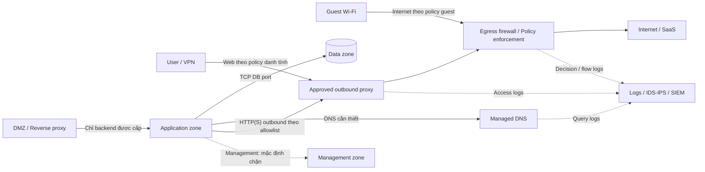
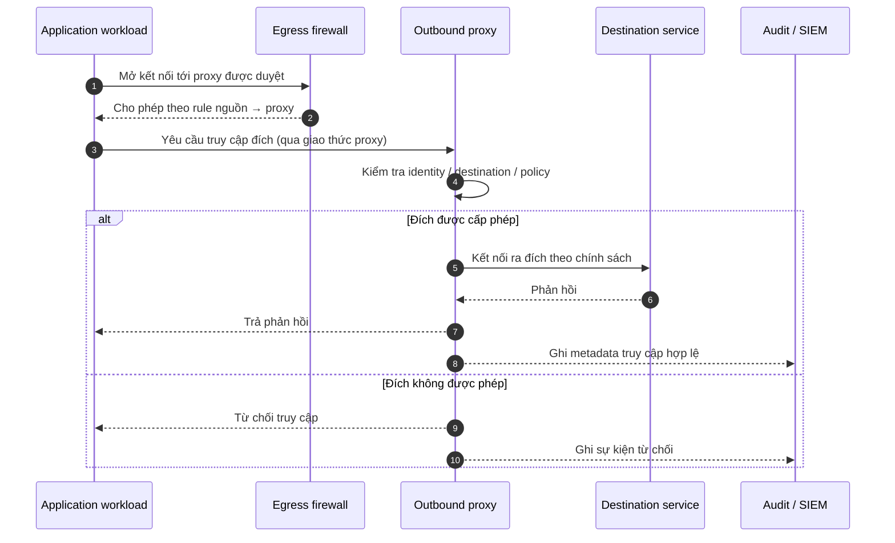
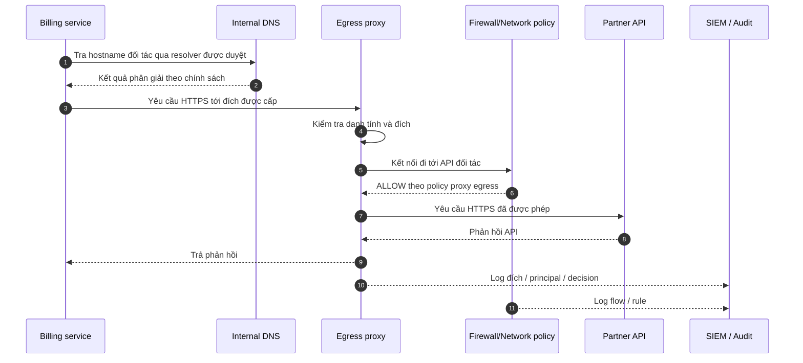

# Egress firewall

> **Học phần:** `SECURITY_NETWORK_SECURITY`  
> **Chương:** Firewall  
> **Trọng tâm:** Kiểm soát lưu lượng **đi ra** từ một thiết bị, workload hoặc vùng mạng; giới hạn đường liên lạc không cần thiết, phòng chống rò rỉ dữ liệu và tăng khả năng giám sát mạng trong kiến trúc phân đoạn, VPN, DNS, IDS/IPS, Wi-Fi và hạ tầng đám mây.

## Mục tiêu học tập

Sau bài học này, người học có thể:

1. Giải thích **egress firewall** và phân biệt egress với ingress theo góc nhìn của từng security zone, interface hoặc workload.
2. Lập **ma trận lưu lượng đi ra** cho máy trạm, máy chủ, DMZ, database, mạng khách, VPN, container và cloud workload.
3. Kết hợp chính sách **allowlist, default deny, kiểm soát DNS, proxy, danh tính và phân đoạn mạng** để giảm kết nối ra ngoài không được phép.
4. Phân tích đường đi thực tế có NAT, stateful filtering, IPv4/IPv6, TCP, UDP, DNS/DoH/DoT, QUIC và mạng overlay.
5. Nhận diện các rủi ro như command-and-control (C2), rò rỉ dữ liệu, SSRF, điểm ra Internet không kiểm soát và false positive.
6. Thiết kế thay đổi chính sách có kiểm thử, quan sát bằng log/IDS/IPS, phương án rollback và quy trình rà soát ngoại lệ.

## 1. Egress firewall là gì?

**Egress** là lưu lượng đi ra khỏi **phạm vi đang xét**: host, subnet, security zone, VPC/VNet, cụm Kubernetes hoặc cả tổ chức. **Egress firewall** áp chính sách với những kết nối hoặc gói tin đi ra phạm vi đó, thường ở thời điểm khởi tạo kết nối, nhằm cho phép hoặc chặn liên lạc dựa trên địa chỉ, dịch vụ, danh tính hay ngữ cảnh mà thiết bị hỗ trợ.

Ví dụ: API nội bộ được phép kết nối tới database trên TCP 5432, resolver DNS được quản lý trên UDP/TCP 53 và một dịch vụ cập nhật có mục đích cụ thể. Nếu API tự mở kết nối ra một IP Internet tùy ý trên TCP 443, egress policy có thể từ chối và ghi log. Chính sách này làm giảm số đích mà workload có thể liên lạc nếu bị khai thác.

**Ingress** là lưu lượng đi **vào** phạm vi được xét. Cùng một kết nối có thể là:

- **Egress** từ zone ứng dụng;
- **Ingress** vào zone dữ liệu;
- Một luồng **east-west** nội bộ, không đi Internet.

Vì vậy, “egress” **không đồng nghĩa** “toàn bộ lưu lượng ra Internet”. Quy tắc egress có thể giới hạn kết nối từ pod sang service khác, từ user zone tới management zone hoặc từ cloud workload sang control plane.

### So sánh ingress và egress

| Góc nhìn | Ingress firewall | Egress firewall |
|---|---|---|
| Câu hỏi chính | Ai được phép đi **vào** zone/tài sản? | Zone/tài sản được phép **đi tới đâu**? |
| Ví dụ | Chỉ reverse proxy được gọi backend TCP 443 | Backend chỉ được gọi DB TCP 5432 và DNS được quản lý |
| Điểm thực thi | Perimeter firewall, host firewall, cloud SG, WAF... | Internal/perimeter firewall, host firewall, SG, proxy, NetworkPolicy... |
| Rủi ro thường giảm | Tấn công từ bên ngoài, truy cập trái phép vào dịch vụ | Rò rỉ dữ liệu, C2, kết nối ra ngoài không kiểm soát, di chuyển ngang |
| Hạn chế | Cho phép đường vào không chứng minh user có quyền ứng dụng | Chặn đường ra không tự ngăn dữ liệu bị lạm dụng qua đích đã cho phép |

**Egress control** là lớp phòng vệ bổ sung. Nó không thay thế vá lỗi, phân quyền, kiểm tra danh tính, bảo vệ endpoint và xác minh TLS. Khi một ứng dụng bị chiếm, egress hạn chế có thể giảm lựa chọn kết nối của kẻ tấn công, nhưng không bảo đảm chặn mọi hình thức lạm dụng.

## 2. Tại sao cần kiểm soát lưu lượng đi ra?

Trong nhiều mạng, firewall biên tập trung vào lưu lượng từ Internet **vào** hệ thống, còn các host nội bộ được kết nối ra Internet khá tự do. Điều này thuận tiện cho vận hành nhưng tạo một số rủi ro:

| Tình huống | Điều kẻ tấn công có thể tận dụng | Vai trò của egress firewall |
|---|---|---|
| Máy trạm bị nhiễm mã độc | Gọi máy chủ C2 hoặc tải thêm thành phần | Giảm đích/protocol được phép; tạo log kết nối bất thường |
| Backend xử lý đầu vào không tin cậy | Gửi request bất ngờ tới mạng quản trị hoặc metadata service | Hạn chế đường outbound của workload; phối hợp chống SSRF và IAM |
| Tài khoản dịch vụ bị lộ | Dùng đường mạng của service để tiếp cận API/cloud khác | Chỉ mở endpoint cần thiết; kiểm tra quyền độc lập tại đích |
| Dữ liệu bị gửi ra ngoài | Tải lên storage, web, DNS hoặc một dịch vụ đã có sẵn | Chặn nhiều kênh không được duyệt, quan sát bất thường; vẫn cần DLP/authorization |
| Thiết bị IoT khó vá | Gọi tên miền hoặc host tùy ý | Khóa kết nối về controller, broker và máy chủ cập nhật được duyệt |
| Cloud workload có route Internet | Kết nối trực tiếp ra mọi đích qua NAT gateway | Đặt policy egress riêng; NAT không mặc nhiên lọc theo nhu cầu |
| Wi-Fi khách hoặc VPN | Thiết bị truy cập vùng nội bộ không cần thiết | Giới hạn luồng giữa guest/VPN và các security zone |

Một nguyên tắc thực tế là **mỗi workload chỉ nên có những đường ra phục vụ nhiệm vụ của nó**. Để áp dụng được, cần biết rõ các dependency thật sự, kể cả DNS, đồng bộ thời gian, xác thực, cập nhật, monitoring và health check.

### Ba mục tiêu bảo mật

1. **Giảm khả năng tiếp cận:** Thu hẹp những địa chỉ, giao thức, vùng và dịch vụ mà nguồn có thể khởi tạo kết nối.
2. **Giảm khả năng thoát dữ liệu:** Hạn chế điểm nhận ngoài dự kiến và khiến việc chuyển dữ liệu ra ngoài khó hơn, dễ quan sát hơn.
3. **Tăng khả năng phát hiện:** Ghi nhận các yêu cầu kết nối bị chặn hoặc lệch baseline để đội vận hành/IDS/IPS điều tra.

Egress firewall chỉ biết những gì nó quan sát được. Một kết nối HTTPS hợp lệ tới đích cho phép vẫn có thể mang dữ liệu ngoài phạm vi nghiệp vụ nếu ứng dụng bị lạm dụng; cần thêm kiểm tra ở tầng ứng dụng, proxy, DLP và chính sách dữ liệu.

## 3. Egress theo security zone và đường đi thực tế

Hãy xét kiến trúc gồm Wi-Fi khách, người dùng nội bộ, dịch vụ public, backend, database, vùng quản trị và cloud.



Sơ đồ thể hiện **đường truy cập được dự kiến**, không phải khẳng định mọi yêu cầu trong một tổ chức đi qua một firewall duy nhất.

Trước khi triển khai, cần kiểm chứng:

- Gói đi qua interface, gateway và thiết bị nào, **trước hay sau NAT**?
- Có đường IPv6, VPN split tunnel, VPC peering, private endpoint hoặc Kubernetes overlay đi **khác** đường dự kiến không?
- Kết nối **east-west** có bị lọc trong cùng subnet, node hoặc VPC không?
- Policy nào áp cho gói **khởi tạo phiên**, policy nào áp cho **lưu lượng phản hồi**?
- User, device hoặc workload được nhận diện bằng IP, chứng chỉ, identity-aware gateway hay dịch vụ ứng dụng?
- DNS và proxy có được áp dụng thống nhất giữa hệ điều hành, trình duyệt, agent và container?

Một rule đúng cú pháp nhưng đặt **sai điểm thực thi** sẽ không ngăn được luồng đi đường khác. Phải rà soát cả routing, NAT, policy của cloud và policy tại host.

## 4. Lập ma trận egress trước khi viết rule

Một ma trận **source → destination → service → reason → action** giúp tách nhu cầu nghiệp vụ khỏi cấu hình của nhà cung cấp. Ví dụ giả lập:

| Nguồn / zone | Đích dự kiến | Giao thức và cổng | Quyết định | Mục đích |
|---|---|---|---|---|
| User zone | DNS nội bộ `10.10.70.53` | UDP/TCP 53 | **ALLOW** | Phân giải tên theo chính sách |
| User zone | Secure web proxy | Proxy port được công bố | **ALLOW** | Truy cập Internet theo danh tính/chính sách |
| User zone | Data/Management | Any trực tiếp | **DENY** | Chặn đường trực tiếp tới vùng nhạy cảm |
| DMZ reverse proxy | Application API `10.10.40.20` | TCP 443 | **ALLOW** | Chuyển tiếp request hợp lệ |
| DMZ | Data zone / Cloud control plane | Any trực tiếp | **DENY** | Tránh tạo bàn đạp sau khi dịch vụ public bị chiếm |
| Reporting API | Reporting DB `10.10.50.30` | TCP 5432 | **ALLOW** | Truy vấn dữ liệu nghiệp vụ |
| Reporting API | DNS resolver nội bộ | UDP/TCP 53 | **ALLOW** | Phân giải tên |
| Reporting API | Proxy outbound | Cổng proxy được duyệt | **ALLOW theo policy đích** | Gọi API đối tác/cập nhật khi cần |
| Reporting API | Internet trực tiếp | Any không nằm trong ngoại lệ | **DENY** | Thu hẹp egress |
| Data zone | Internet trực tiếp | Any nếu không có nhu cầu | **DENY** | Hạn chế rò rỉ và C2 từ DB |
| Guest Wi-Fi | Internal management/data | Any | **DENY** | Cô lập khách |
| Monitoring agent | Collector được quản lý | Đúng cổng telemetry | **ALLOW** | Gửi log/metric |
| Workload cloud | Private service endpoint | Đúng port, identity và policy | **ALLOW có điều kiện** | Kết nối dịch vụ managed |
| Workload không được duyệt | Bất kỳ đích mới nào | Không có rule phù hợp | **DEFAULT DENY** trong phạm vi bảo vệ | Giới hạn luồng không cần thiết |

Các địa chỉ `10.10.0.0/16` là ví dụ mạng riêng. Thực tế cần bổ sung asset owner, IP/cụm workload, TLS/authn, source NAT, phiên dự phòng, IPv6, hướng lưu lượng, ghi log và ngày rà soát.

**Ma trận không được hiểu như một danh sách IP tĩnh vĩnh viễn.** Đích API/cloud hoặc CDN có thể thay địa chỉ. Khi đó cần cơ chế quản lý FQDN, proxy, private endpoint hoặc identity-aware policy có khả năng theo kịp thay đổi, thay vì mở toàn bộ Internet không giới hạn.

### Policy-as-code trung lập với nhà cung cấp

```yaml
policyId: EGRESS-REPORTING-API-001
source:
  zone: application
  workload: reporting-api
destination:
  asset: outbound-proxy
  address: 10.10.80.10/32
service:
  protocol: tcp
  port: 3128
decision: allow
businessReason: "Reporting API gọi API đối tác qua proxy được kiểm soát"
owner: reporting-platform
changeTicket: "CHG-DEMO-001"
reviewBy: "2027-02-28"
logging:
  connectionDecision: true
```

Đây là **mô tả mục tiêu chính sách**, không phải schema cấu hình chạy trực tiếp trên mọi firewall. Một firewall L3/L4 thông thường không thể tự hiểu `workload`, `reviewBy` hoặc tên asset; cần bộ quản lý chính sách, mapping tài sản hoặc lớp danh tính phù hợp.

## 5. Allowlist, blocklist và default deny đối với egress

### 5.1 Allowlist

**Egress allowlist** liệt kê những đích hoặc luồng được phép: ví dụ backend chỉ gọi database, DNS, monitoring và proxy. Khi chính sách tại ranh giới có **default deny**, kết nối mới không khớp rule hợp lệ sẽ bị chặn.

Đây là lựa chọn tốt cho workload có **dependency tương đối rõ**, như server xử lý giao dịch, database, IoT/OT, workload cloud có nhiệm vụ cố định hoặc vùng quản trị. Thách thức là phải nắm đủ dependency để tránh mất dịch vụ.

### 5.2 Blocklist

**Egress blocklist** từ chối các IP, domain, URL hoặc chỉ dấu đã được xác minh có rủi ro. Nó bổ sung cho các môi trường cần truy cập Internet đa dạng như user zone.

Blocklist có hạn chế: IOC chưa biết hoặc thay đổi nhanh, IP dùng chung qua CDN/NAT, domain chuyển nhà cung cấp, dữ liệu feed lỗi hoặc quá cũ. **Không xuất hiện trong blocklist không có nghĩa một đích được tin cậy**; blocklist cũng không tự cấp quyền đi qua các kiểm soát khác.

### 5.3 Đề xuất áp dụng theo vùng

| Zone/workload | Phương án thường phù hợp | Lý do |
|---|---|---|
| Database, backup, control plane | Allowlist rất hẹp / mặc định không ra Internet | Ít dependency ngoại mạng, tác động khi bị chiếm cao |
| Backend/API có tích hợp đối tác | Allowlist endpoint/service hoặc proxy được quản lý | Duy trì chức năng mà vẫn giới hạn đích |
| User zone / laptop | Proxy, DNS/web security, policy theo danh tính và blocklist; hạn chế đường trực tiếp | Nhu cầu web phong phú, không thể dễ liệt kê thủ công mọi đích |
| Guest Wi-Fi | Cô lập nội bộ, Internet theo chính sách, giới hạn hành vi | Không cấp quyền tới mạng doanh nghiệp |
| IoT/OT | Allowlist controller, broker, time sync và update server đã kiểm chứng | Thiết bị có nhiệm vụ cố định, thường khó giám sát |
| Workload Kubernetes/cloud | Egress policy theo workload + private endpoint/IAM | Tách quyền của từng service, giảm lateral movement |

**Default deny** phải được triển khai theo **phạm vi đã định nghĩa**, đặc biệt với production. Khi chưa biết dependency, nên thu thập baseline, kiểm tra chủ sở hữu luồng, thử nghiệm theo giai đoạn và có rollback. Không chỉ sao chép mọi traffic đang quan sát thành rule allow vì traffic có thể đã chứa hành vi sai.

## 6. Hiểu giới hạn của IP, cổng và giao thức

Egress firewall L3/L4 thường lọc theo IP, port, protocol, interface/zone, direction và đôi khi trạng thái kết nối. Cần hiểu điều mà các trường đó **không chứng minh**.

| Tiêu chí | Ý nghĩa có thể kiểm tra | Giới hạn |
|---|---|---|
| IP nguồn | Nguồn kết nối từ địa chỉ/subnet nào | NAT, DHCP, nhiều workload cùng IP |
| IP đích | Địa chỉ mà gói tin đi tới | Một IP có thể dùng chung cho nhiều dịch vụ/tenant |
| TCP 443 | Đích sử dụng cổng thường gặp của HTTPS | Không bảo đảm ứng dụng đúng hoặc dữ liệu trao đổi hợp lệ |
| UDP 443 | Có thể là QUIC/HTTP/3 hoặc giao thức khác | TCP-only policy không bao quát toàn bộ truy cập HTTPS hiện đại |
| UDP/TCP 53 | DNS truyền thống | Không bao quát DoH/DoT/DoQ hoặc IP kết nối trực tiếp |
| TCP 853 / UDP 853 | Thường dùng DoT / DoQ | Không phải mọi giao thức DNS mã hóa đều đi cổng 853 |
| ICMP / ICMPv6 | Chẩn đoán và chức năng mạng | Chặn toàn bộ có thể làm khó vận hành hoặc ảnh hưởng IPv6 |
| IPv4 / IPv6 | Hai họ địa chỉ/đường đi | Policy chỉ có IPv4 có thể bỏ qua hoặc làm hỏng luồng IPv6 |

### Stateful và stateless

**Stateful firewall** theo dõi trạng thái kết nối. Ví dụ, nếu client trong zone A được phép **khởi tạo** TCP tới server zone B, firewall thường cho phép các gói phản hồi tương ứng qua session đã được chấp nhận, tùy cấu hình và chức năng inspection. Không cần mở mọi cổng tạm thời theo chiều ngược lại như một rule mới quá rộng.

**Stateless ACL** quyết định dựa trên từng gói; có thể cần quy tắc cả chiều đi và chiều về hoặc cách phân biệt gói phản hồi. Trong cloud, security group và network ACL có ngữ nghĩa khác nhau theo sản phẩm.

**NAT/SNAT** chuyển đổi địa chỉ, đôi khi cả cổng. Khi tra rule, phải biết firewall nhìn địa chỉ **trước hay sau NAT** và luồng return traffic đi theo đường nào. NAT gateway tạo đường ra, nhưng **bản thân NAT không phải egress allowlist theo danh tính hay FQDN**.

### Những luồng có thể bị bỏ sót

- IPv6 có route ra ngoài trong khi rule chỉ được viết cho IPv4.
- UDP/QUIC trong khi proxy/firewall chỉ kiểm soát TCP.
- VPN split tunnel khiến một phần traffic endpoint đi thẳng theo mạng nhà/Wi-Fi.
- Container/pod, overlay, private route hoặc VPC peering đi khác firewall trung tâm.
- Lưu lượng giữa các workload trong cùng subnet hoặc node không qua thiết bị biên.
- Những phiên tồn tại từ trước khi policy thay đổi; thời điểm rule mới có hiệu lực trên session đang mở tùy nền tảng.

## 7. Kiểm soát DNS và FQDN khi thiết kế egress

DNS hỗ trợ khám phá tên đích, nhưng **kết quả DNS không tự chứng minh ứng dụng được phép truy cập đích đó**.

### 7.1 DNS truyền thống và DNS mã hóa

| Cơ chế | Kênh phổ biến | Điều egress policy cần cân nhắc |
|---|---|---|
| DNS thường | UDP/TCP **53** | Cho client hỏi đúng resolver được duyệt; không bỏ quên TCP 53 |
| DNS over TLS (DoT) | TLS/TCP **853** | Có thể quản lý resolver đích và danh tính khi hỗ trợ |
| DNS over HTTPS (DoH) | HTTPS, thường TCP/QUIC **443** | Khó phân biệt hoàn toàn với web HTTPS chỉ theo cổng |
| DNS over QUIC (DoQ) | QUIC/UDP **853** | Cần chính sách UDP và endpoint được phê duyệt |
| DNSSEC | Xác thực tính đúng đắn DNS | Không mã hóa truy vấn hoặc thay thế egress filtering |

Nếu hệ thống yêu cầu dùng resolver nội bộ cho tên riêng, cần đồng bộ cấu hình DNS trên hệ điều hành, trình duyệt, VPN và runtime workload. Cho phép mọi endpoint hỏi resolver bên ngoài có thể làm lộ hostname nội bộ hoặc khiến chính sách DNS filtering không được áp dụng.

**Không giả định chặn UDP/TCP 53 sẽ buộc mọi DNS qua resolver nội bộ.** DoH dùng 443, kết quả có thể nằm trong cache, ứng dụng có thể kết nối bằng IP trực tiếp hoặc sử dụng resolver riêng. Hãy phối hợp **endpoint configuration + egress rule + DNS policy + proxy**.

### 7.2 FQDN allowlist

FQDN allowlist dùng tên, ví dụ `updates.example.net`, thay vì danh sách IP viết tay. Tùy sản phẩm, firewall có thể tự phân giải tên rồi cập nhật IP; web proxy có thể lọc hostname hoặc URL; DNS policy có thể cho phép/chặn tên được truy vấn. **Ba cơ chế này không tương đương**.

Các vấn đề phải kiểm tra:

- Tên trỏ đến nhiều bản ghi `A`/`AAAA`, nhiều địa chỉ theo vùng, TTL thay đổi hoặc chuỗi `CNAME`.
- CDN và cloud dùng chung IP giữa nhiều tên miền; cho phép một IP không chắc chỉ cho một dịch vụ.
- Ứng dụng có thể đi qua HTTP redirect hoặc gọi thêm API/telemetry endpoint ngoài hostname ban đầu.
- Chính sách dựa vào kết quả DNS ở resolver A có thể lệch so với kết quả ứng dụng sử dụng từ resolver B.
- DNS cache, ECH, QUIC, TLS và proxy làm thay đổi khả năng nhìn thấy hostname ở từng điểm kiểm soát.
- Chỉ nhìn SNI/hostname mà không xác thực kênh và dịch vụ có thể không đáp ứng mức bảo đảm mong muốn.

Không nên cố “lấy toàn bộ IP hiện tại của nhà cung cấp” để tạo rule vĩnh viễn khi nhà cung cấp dùng hạ tầng động. Chọn điểm thực thi phù hợp, kiểm chứng cơ chế cập nhật FQDN và dự phòng khi endpoint đổi.

## 8. Egress proxy và kiểm soát HTTP(S)

Với hệ thống cần gọi API đối tác hoặc Internet qua HTTP(S), **outbound proxy/secure web gateway** có thể gom truy cập ở một điểm kiểm soát. Firewall cho workload tới **proxy đã duyệt**, rồi proxy quyết định đích, phương thức, danh tính, category và logging theo khả năng hệ thống.



Sơ đồ là luồng logic; triển khai thực tế còn gồm DNS, TLS, xác thực proxy và đường truyền phản hồi. Kết nối **CONNECT** có thể tạo tunnel; mức nội dung mà proxy nhìn thấy còn tùy việc proxy có thực hiện TLS inspection hay không, quyền triển khai và chính sách riêng tư.

### Ưu và hạn chế

**Ưu điểm:**

- Dùng policy nhất quán hơn cho nhiều workload/nhóm người dùng.
- Có thể kiểm soát đích theo hostname/URL ở mức mà proxy hỗ trợ.
- Tạo log gắn principal, workload, ứng dụng, domain và quyết định truy cập.
- Giảm đường HTTP(S) ra Internet trực tiếp từ máy chủ nhạy cảm.

**Hạn chế:**

- Không phải mọi ứng dụng hỗ trợ proxy; một số dùng giao thức ngoài HTTP(S).
- Nếu có đường ra trực tiếp ngoài proxy, ứng dụng có thể bỏ qua điểm thực thi được dự kiến.
- TLS inspection có chi phí vận hành, tương thích và quyền riêng tư; không nên giả định luôn bật hoặc luôn phù hợp.
- Lỗi proxy, DNS, certificate trust, xác thực hoặc cấu hình `NO_PROXY` có thể làm gián đoạn dịch vụ.
- Một domain được allow có thể phục vụ nhiều đường dẫn/tài khoản; phải kiểm soát hành động ở ứng dụng hoặc dịch vụ đích.

**Phương án thiết kế:** Firewall giới hạn source chỉ được gọi proxy, proxy giới hạn đích; danh tính workload và authorization phía API đối tác vẫn được kiểm tra. Nếu một dịch vụ cần kết nối trực tiếp do yêu cầu giao thức, mở ngoại lệ **rất cụ thể** và có owner/expiry.

## 9. Egress đối với cloud và Kubernetes

### 9.1 Public egress của workload cloud

Trong nhiều kiến trúc cloud, workload trong subnet riêng vẫn có thể khởi tạo kết nối ra Internet **nếu** route, NAT và security policy cho phép. Nhãn “private subnet” chỉ nói về định tuyến và tính phơi lộ theo kiến trúc cụ thể; không mặc nhiên là **default deny outbound**.

| Thành phần | Vai trò đối với egress | Điểm dễ nhầm |
|---|---|---|
| Route table | Chọn đường tới đích, NAT, private link, transit... | Có route chưa có nghĩa đúng theo policy |
| NAT gateway | Cho phép kết nối ra bằng địa chỉ nguồn dịch theo thiết kế | Không tự thực thi FQDN allowlist hay quyền ứng dụng |
| Security group / NSG | Lọc traffic tại workload/NIC hoặc tài nguyên cloud theo sản phẩm | Mức stateful/default rules cần xem nền tảng cụ thể |
| Network ACL | Lọc ở subnet theo điều kiện hỗ trợ | Có nền tảng áp stateless, cần xét chiều phản hồi |
| Cloud firewall / egress gateway | Điểm kiểm soát tập trung hoặc phân tán cho outbound | Không có tác dụng với đường bypass ngoài route của nó |
| Private endpoint / service endpoint | Cho workload truy cập dịch vụ cloud qua đường riêng theo cấu hình | Vẫn cần IAM/resource policy, không tự cấp quyền |
| IAM / workload identity | Quyền sử dụng API và tài nguyên cloud | Không thay thế giới hạn đường mạng |
| Flow logs / audit | Cung cấp metadata luồng và hành động cloud | Không phải packet capture đầy đủ; giới hạn khác nhau theo dịch vụ |

Khi workload cần object storage hoặc secret manager, có thể ưu tiên private endpoint có policy phù hợp. Nhưng endpoint private **không làm vô hiệu** yêu cầu xác thực/ủy quyền: tài khoản dịch vụ vẫn cần IAM scope tối thiểu.

### 9.2 Kubernetes NetworkPolicy egress

Kubernetes `NetworkPolicy` định nghĩa các kết nối được phép ở mức pod, **nếu CNI/network plugin có hỗ trợ thực thi**. Ví dụ sau cho pod có label `app: reporting-api` trong namespace `demo` kết nối tới database đã gắn label tương ứng trong namespace `data` và tới DNS pod được chỉ định trong `kube-system`.

```yaml
apiVersion: networking.k8s.io/v1
kind: NetworkPolicy
metadata:
  name: reporting-api-egress
  namespace: demo
spec:
  podSelector:
    matchLabels:
      app: reporting-api
  policyTypes:
    - Egress
  egress:
    - to:
        - namespaceSelector:
            matchLabels:
              kubernetes.io/metadata.name: data
          podSelector:
            matchLabels:
              app: reporting-db
      ports:
        - protocol: TCP
          port: 5432
    - to:
        - namespaceSelector:
            matchLabels:
              kubernetes.io/metadata.name: kube-system
          podSelector:
            matchLabels:
              k8s-app: kube-dns
      ports:
        - protocol: UDP
          port: 53
        - protocol: TCP
          port: 53
```

**Giới hạn và điều kiện khi dùng mẫu:**

- Các **namespace/pod label**, dịch vụ DNS thực tế và đường đi đến DNS phải được xác nhận trong cluster. Label `k8s-app: kube-dns` chỉ là ví dụ thường gặp, không phổ quát.
- NetworkPolicy có thể cộng gộp: nếu **policy khác** cũng chọn cùng pod và cho phép thêm egress, các kết nối tương ứng có thể được phép. Mẫu này không phải bảo đảm chặn mọi luồng khác trong mọi cluster.
- Nếu **ingress policy** bảo vệ pod database, phía DB còn cần cho phép ingress tương ứng. NetworkPolicy chỉ giải quyết network reachability, **không tự cấp quyền DB**.
- Mặc định Kubernetes NetworkPolicy chuẩn chọn pod/IP/port; không nên giả định mọi CNI hỗ trợ FQDN filtering, application identity hay proxy routing.
- Truy cập qua **Kubernetes Service IP, NodeLocal DNS cache, NAT, hostNetwork, egress gateway** có thể có ngữ nghĩa khác theo CNI và triển khai. Kiểm thử trên đường lưu lượng thực tế.

Một chính sách **default deny egress** cho toàn bộ pod trong namespace thường dùng `podSelector: {}` cùng `policyTypes: [Egress]` và không có mục egress được phép, nhưng những NetworkPolicy khác chọn cùng pod vẫn có thể cộng thêm các luồng allow. Cần inventory chính sách và kiểm thử theo CNI.

### 9.3 Hybrid, VPN và mạng không dây

- **VPN full tunnel:** Traffic của endpoint có thể đi qua egress kiểm soát tập trung, tùy route và policy.
- **VPN split tunnel:** Một số luồng vẫn đi trực tiếp từ mạng nhà/khách; firewall trong data center không nhất thiết nhìn thấy chúng. Cần endpoint controls và chính sách danh tính phù hợp.
- **Guest Wi-Fi:** Cho Internet theo giới hạn, tách khỏi ứng dụng/dữ liệu/quản trị; theo dõi thiết bị dùng DNS hoặc protocol ngoài dự kiến.
- **Hybrid cloud:** VPC peering, transit, dedicated link và VPN tạo thêm đường east-west; phải rà soát outbound qua mỗi đường, không chỉ một Internet gateway.

## 10. Threat modeling: C2, rò rỉ dữ liệu và SSRF

Egress firewall giúp giảm một số **đường tấn công**, nhưng không phải mọi hoạt động đáng ngờ đều có thể phát hiện bằng IP/port. Khi mô hình hóa, hãy ghi rõ **tác nhân, quyền ban đầu, tài sản, ranh giới mạng, đích không được phép và kiểm soát thiếu**.

### 10.1 Command-and-control (C2)

Một endpoint hoặc workload bị chiếm có thể tìm cách liên hệ hạ tầng điều khiển bên ngoài. Nếu nguồn được tự do kết nối đến Internet trên mọi port, đối tượng có thêm lựa chọn kênh truyền. Egress allowlist, proxy và giám sát có thể giới hạn lựa chọn đó.

**Điểm hạn chế:** Nếu mã độc dùng một dịch vụ cloud hoặc domain đã được phép và không tạo dấu hiệu bất thường rõ ràng, việc cho phép theo port/domain vẫn có thể không phát hiện. Cần kết hợp EDR, phân tích hành vi, IAM, IDS/NDR và kiểm soát dữ liệu.

### 10.2 Data exfiltration

Một dịch vụ có thể bị lạm dụng để gửi dữ liệu ra ngoài qua HTTPS, DNS, storage API hoặc những kênh được phép. **Block toàn bộ Internet trực tiếp từ database** giảm một số đường exfil, nhưng database vẫn có thể trả dữ liệu cho application hợp lệ; nếu application bị chiếm, dữ liệu có thể tiếp tục đi qua các kết nối được cho phép.

Mô hình hóa **đường dữ liệu từ nguồn nhạy cảm tới đích ra ngoài**, không chỉ kiểm tra một firewall biên. Cần kết hợp authorization, token scope, data minimization, DLP khi phù hợp, audit truy vấn và giám sát lưu lượng bất thường.

### 10.3 Server-side request forgery (SSRF)

Nếu API nhận URL do client cung cấp rồi thực hiện yêu cầu mạng, backend có thể bị hướng tới mạng quản trị, metadata service hoặc dịch vụ nội bộ nếu không có kiểm soát.

**Phòng vệ nhiều lớp:**

- Ứng dụng giới hạn đích được chấp nhận theo nghiệp vụ, kiểm tra input và redirect.
- Egress firewall hạn chế các zone, IP, cổng và endpoint mà workload được phép kết nối.
- Kiểm soát DNS resolution và sự thay đổi kết quả có thể gây lệch giữa thời điểm kiểm tra và thời điểm kết nối.
- Cloud metadata endpoint và workload identity được bảo vệ theo cơ chế nền tảng, token/IAM ít quyền.
- Dịch vụ đích vẫn xác thực và kiểm tra quyền.

SSRF **không tự đồng nghĩa** kẻ tấn công có quyền admin; rủi ro leo thang tùy đường kết nối và quyền của thành phần bị lợi dụng.

### Threat statement mẫu

> Một workload xử lý URL do người dùng nhập có egress Internet và mạng nội bộ quá rộng. Nếu bị điều khiển để gửi yêu cầu đến tài nguyên không liên quan nghiệp vụ, nó có thể tiếp cận dịch vụ quản trị hoặc chuyển dữ liệu ra ngoài phạm vi dự kiến. Giảm rủi ro bằng validate đích tại ứng dụng, egress allowlist/deny theo zone, workload identity ít quyền và giám sát yêu cầu bị từ chối.

| Threat / STRIDE | Dấu hiệu rủi ro | Kiểm soát trọng tâm |
|---|---|---|
| **Information disclosure** | DB/app gửi lượng dữ liệu bất thường tới đích mới | Egress restriction, DLP, API authz, log theo resource |
| **Spoofing** | Endpoint giả danh dịch vụ đối tác/DNS | TLS verification, DNS policy, identity-aware proxy |
| **Tampering** | Rule egress bị mở rộng không có change ticket | IAM/PAM, audit cấu hình, review policy |
| **Denial of service** | Thay đổi deny khiến updater/IdP/DNS ngừng hoạt động | Test dependency, canary, rollback |
| **Elevation of privilege** | Workload lợi dụng đường mạng và quyền IAM quá rộng để gọi control plane | Least privilege IAM, egress restriction, authz đích |
| **Repudiation** | Không biết ai sửa rule hoặc export log | Audit độc lập, version/ticket/owner |

## 11. Giám sát egress: firewall, proxy, DNS và IDS/IPS

Log egress giúp trả lời **ai đã cố kết nối đi đâu, lúc nào và chính sách nào xử lý**. Để điều tra đầy đủ, cần liên kết nhiều nguồn.

| Nguồn log | Dữ liệu thường có | Giá trị khi điều tra |
|---|---|---|
| Firewall/SG/ACL | IP/port, hướng, zone, allow/deny, rule ID, bytes | Xác định đường thực thi policy và mẫu lưu lượng |
| Web proxy / SWG | Principal, hostname/URL tùy khả năng, quyết định truy cập, lượng dữ liệu | Phân tích truy cập HTTP(S) theo policy đích |
| DNS resolver | QNAME/QTYPE, client, RCODE, thời điểm | Nối tên đích với luồng khi client dùng DNS được quản lý |
| VPN / ZTNA / Wi-Fi NAC | User/device, session, role, VLAN, kết nối | Liên hệ nguồn mạng với danh tính khi phù hợp |
| Cloud flow logs | Metadata kết nối, interface, action theo dịch vụ | Quan sát outbound private/public trong cloud |
| IDS/IPS / NDR | Alert và đặc trưng lưu lượng khả kiến | Bổ sung phát hiện hành vi hoặc IOC |
| Endpoint / EDR | Process, user, socket và hành vi | Phân biệt ứng dụng nào tạo outbound |
| App/IAM audit | Resource, action, principal, response, token scope | Xác định hành động nghiệp vụ, thay đổi quyền, exfil qua đường hợp lệ |

**Đừng suy luận quá mức từ firewall log:** Một `ALLOW TCP 443` không xác định website hoặc dữ liệu thực tế, và một `DENY` không chứng minh mã độc; đó có thể là ứng dụng cấu hình sai hoặc thiếu dependency.

### Các dấu hiệu cần cảnh báo

- Database/control plane khởi tạo kết nối ra Internet khi workload đó không có nghiệp vụ outbound.
- DMZ hoặc service ít quyền bất ngờ kết nối đến subnet quản trị và nhiều endpoint mới.
- Nhiều yêu cầu outbound bị chặn đến IP/domain chưa từng thấy hoặc không nằm trong các luồng được cấp.
- Khối lượng dữ liệu ra qua proxy/cloud storage tăng đột biến so với baseline theo workload.
- Máy trạm dùng DNS resolver không được phê duyệt hoặc bắt đầu giao tiếp DoT/DoQ/DoH ngoài cấu hình.
- Rule egress bị mở từ nguồn hẹp sang `0.0.0.0/0` hoặc `::/0` mà không có change ticket.
- Sensor/firewall không còn gửi log; “không có alert” có thể là **điểm mù quan sát**.

Tín hiệu phải được đối chiếu với owner, deployment, giờ xử lý batch, lịch vá/cập nhật, ticket, danh tính workload và dữ liệu hệ thống. Lưu log theo thời hạn phù hợp, bảo vệ thông tin người dùng và tránh ghi token/password vào bản ghi truy cập.

### Mẫu thông tin cho một sự kiện

```text
time=2026-11-28T09:10:00Z
source_zone=APP source_asset=reporting-api
source_ip=10.10.40.20 destination_ip=203.0.113.77
protocol=TCP destination_port=443
policy_id=EGRESS-APP-DEFAULT-DENY action=DENY
session_state=NEW identity=workload:reporting-api
context="Unapproved outbound destination"
```

`203.0.113.0/24` là dải tài liệu, không phải IOC thực tế. Sự kiện minh họa cho biết kết nối mới bị chính sách từ chối; cần log và ngữ cảnh khác để xác định đây là phần mềm bị lỗi cấu hình hay hoạt động có rủi ro.

## 12. Từ baseline quan sát đến chính sách có hiệu lực

Bật **default deny ngay lập tức** trong production khi không nắm dependency có thể khiến ứng dụng, DNS, login hoặc monitoring mất kết nối. Quy trình nên theo bước:

1. **Inventory:** Liệt kê workload, owner, nhiệm vụ, môi trường, subnet/VLAN, identity, DNS resolver, proxy và các đường cloud/VPN.
2. **Thu thập flow:** Quan sát đủ chu kỳ nghiệp vụ gồm batch, backup, deploy, failover, update, công tác cuối tuần nếu có; ghi nhận source → destination → protocol.
3. **Phân loại:** Với mỗi luồng, hỏi nó có hợp lệ, cần thiết, được phê duyệt và còn hoạt động không. Đừng xem mọi traffic lịch sử đều đáng allow.
4. **Tạo ma trận:** Xác định đích cụ thể, dịch vụ, TLS/identity, phân vùng và default action; xem cả DNS, time sync, IdP và monitoring.
5. **Kiểm tra kỹ thuật:** Đảm bảo route đi qua PEP, NAT, IPv4/IPv6, proxy/FQDN và stateful session đúng như thiết kế.
6. **Thử nghiệm:** Dùng staging, policy simulator hoặc canary; chạy cả ca được phép và bị chặn.
7. **Triển khai:** Ghi version/ticket/owner, bật log, theo dõi tác động và có sẵn phương án rollback.
8. **Duy trì:** Gỡ rule không còn dùng, đánh giá ngoại lệ, đồng bộ IP/FQDN, kiểm tra thay đổi đích đối tác, rà soát quyền export/log.

Một số sản phẩm có chế độ **monitor-only/audit mode** cho policy hoặc rule đề xuất; không nên mặc định mọi firewall đều có. Mọi log cần được kiểm tra về độ phủ trước khi dùng làm cơ sở quyết định.

### Rule với thời hạn và người sở hữu

```yaml
ruleId: EGRESS-PARTNER-API-TEMP
sourceZone: application
sourceWorkload: billing-service
destinationService: approved-partner-api
protocol: https
direction: outbound
action: allow
owner: billing-platform
businessReason: "Đối tác thanh toán phục vụ đối soát"
expiresAt: "2027-01-31"
changeTicket: "CHG-DEMO-087"
verification:
  positive: "Billing service kết nối API đối tác đã cấp phép"
  negative: "Billing service không truy cập domain ngoài allowlist"
  logDecision: true
```

Mẫu trên là tài liệu mô tả quy trình, không phải rule trực tiếp của firewall L3/L4. `protocol: https` và tên dịch vụ chỉ có ý nghĩa khi được ánh xạ sang cơ chế thực thi phù hợp như proxy/service policy.

## 13. Kịch bản minh họa: ứng dụng cần gọi API đối tác

**Bối cảnh:** Một dịch vụ xuất hóa đơn trong application zone cần gửi dữ liệu đến một API của đối tác qua HTTPS và truy cập DNS, time sync, monitoring. Đội bảo mật muốn chặn Internet trực tiếp từ backend để hạn chế nguy cơ C2 và exfil.

**Thiết kế được đề xuất:**

- Backend được phép truy cập **DNS resolver nội bộ** và **NTP được quản lý**.
- Backend được phép tới **egress proxy**; proxy chỉ cho danh tính dịch vụ gọi **đúng host/path hoặc API đã được phê duyệt**, tùy khả năng.
- Backend không được kết nối trực tiếp đến Internet hoặc management zone bằng đường khác.
- Token tới API đối tác có scope tối thiểu; TLS kiểm tra hostname và chứng chỉ; secret không ghi trong log.
- IDS/NDR, DNS log, proxy log và app audit giúp liên kết từng hoạt động nếu xuất hiện đích lạ hoặc lưu lượng tăng bất thường.

### Dòng sự kiện



Đây là mô hình logic: một HTTP proxy có thể tự thực hiện DNS thay vì backend, và TLS có thể đi xuyên tunnel hoặc được kết thúc ở proxy tùy kiến trúc. Vì vậy cần **đo trên triển khai thực tế** để biết ai giải tên và ai xác minh chứng chỉ.

### Những câu hỏi phải kiểm tra

1. Nếu đối tác đổi IP/CDN, cơ chế proxy/FQDN có cập nhật được không?
2. Nếu API redirect tới tên khác, luồng mới có được phê duyệt và lọc không?
3. Nếu proxy hỏng, ứng dụng có cơ chế retry/failover hay chuyển sang đường trực tiếp không được phép?
4. Nếu một service account bị lộ, nó có thể sử dụng token tới API nào và gửi dữ liệu gì?
5. Khi mở policy tạm cho xử lý sự cố, ai cấp, bao lâu hết hiệu lực và ai kiểm tra lại?

## 14. Kiểm thử egress có kiểm soát

Tất cả tình huống dưới đây dùng trong **lab hoặc môi trường được phép**, với workload và đích kiểm thử do bạn quản lý. Mục tiêu là xác nhận chính sách, không tạo lưu lượng ra các hệ thống bên ngoài không được phép.

### Các bất biến bảo mật

```gherkin
Feature: Application egress follows approved dependencies

  Scenario: Application can reach its internal database
    Given the approved application workload in the application zone
    When it opens a new TCP connection to its database on port 5432
    Then the network path is allowed
    And database authentication is still required

  Scenario: Application cannot connect directly to the Internet
    Given the application workload is assigned to the restricted egress policy
    When it initiates a direct connection to an unapproved test endpoint
    Then the connection is denied by network policy
    And the deny event identifies the applied rule

  Scenario: Application may call an approved partner via proxy
    Given the application uses its authorized proxy identity
    When it requests an approved partner API destination
    Then the proxy allows the request according to policy
    And the destination and principal are recorded in audit

  Scenario: Application may not access management from the application zone
    Given a normal application workload without administrative purpose
    When it opens a new connection to a management endpoint
    Then segmentation policy denies that connection
    And no administrative session is created

  Scenario: DNS must use the approved resolver
    Given the workload is configured to use the approved internal DNS
    When it queries the internal DNS service
    Then the query is permitted
    And unauthorized direct DNS destinations are denied
```

### Đo kết quả đúng cách

| Ca kiểm tra | Tầng được kiểm tra | Kết quả mong đợi | Bằng chứng |
|---|---|---|---|
| App → DB | Network + DB auth | Network allow; DB vẫn xác minh quyền | Firewall/DB audit |
| App → Internet trực tiếp | Firewall/route | Deny hoặc không có đường, theo thiết kế | Policy hit, flow log |
| App → partner qua proxy | Proxy + firewall | Allow theo đích và danh tính được cấp | Proxy rule + app result |
| App → management | Segmentation | Deny, không mở phiên | Firewall/management log |
| App → resolver hợp lệ | DNS + egress | Allow DNS cần thiết | DNS log, policy |
| App → resolver ngoài | Egress | Deny kênh DNS bị cấm theo khả năng | Log DNS/port, endpoint configuration |
| App → đích mới qua IPv6 | IPv6 policy | Quyết định tương đương IPv4 | IPv6 flow/rule |
| App → UDP/443 ngoài chính sách | Protocol policy | Không đi ngoài proxy hoặc exception | UDP policy log |

**Không đồng nhất “timeout” với “bị firewall chặn”.** Timeout có thể do route, DNS, listener hoặc server đích; TCP `connection refused` có thể do host chủ động từ chối. Cần xem **route, policy hit, packet/flow log và phản hồi tầng ứng dụng** để phân loại.

### Các lệnh quan sát cơ bản

Trên host Linux **được phép quản trị**:

```bash
# Xem địa chỉ và route (gồm route IPv4)
ip address
ip route

# Xem route IPv6 khi hệ thống hỗ trợ
ip -6 route

# Kiểm tra phân giải DNS theo cấu hình host
getent hosts partner-api.example.net

# Quan sát kết nối HTTPS đến endpoint thử nghiệm do bạn quản lý
curl -v https://partner-api.example.net/
```

`partner-api.example.net` là tên minh họa; thay bằng endpoint hợp lệ trong lab. `curl -v` hiển thị một số thông tin kết nối/TLS, nhưng không tự chứng minh tất cả rule đã đúng; kết hợp log firewall, proxy, DNS và xác nhận hành vi ứng dụng. Tránh ghi API key/token vào bản chia sẻ log.

## 15. Xử lý sự cố egress

| Triệu chứng | Nguyên nhân có thể | Cách khoanh vùng |
|---|---|---|
| DNS thành công nhưng HTTPS timeout | Route, egress deny, proxy hoặc listener | Xem đường gói, rule, port, NAT, state table |
| Chỉ một đích CDN/API lỗi | FQDN/IP thay đổi, redirect, IP chung, proxy rule | So sánh DNS resolver, hostname, proxy log và endpoint |
| App chỉ lỗi khi dùng HTTP/3 | UDP 443 bị policy chặn; fallback khác nhau | Kiểm tra QUIC/HTTP3 và kỳ vọng giao thức |
| Máy ngoài VPN đi được, trong VPN lỗi | Route/tunnel, DNS/proxy, chính sách khác | Kiểm tra full/split tunnel và đường thực tế |
| Cloud private subnet vẫn ra Internet | NAT/default route và SG/firewall cho phép | Kiểm tra route, NAT, SG/NACL, private endpoint |
| Pod vẫn gọi được đích ngoài dù có NetworkPolicy | CNI không thực thi hoặc policy khác cho phép bổ sung | Kiểm tra CNI, union policy, egress gateway, labels |
| Firewall cho phép nhưng API trả `403` | Network allow, ứng dụng/IAM từ chối | Xem token, role, scope, app audit; không mở rộng firewall |
| Không thấy DNS log cho một ứng dụng | Cache, resolver khác, DoH/DoT hoặc kết nối direct IP | Kiểm tra runtime DNS, egress và endpoint |
| Kết nối cũ tồn tại sau rule deny | State table không hủy phiên ngay | Xem session lifetime, cơ chế reevaluate |
| Lưu lượng bị drop sau thay đổi | Thiếu dependency hoặc thứ tự rule/NAT | So với baseline, owner, rule ID, deploy, rollback |
| Chỉ IPv6 chạy ngoài chính sách | Policy/route dual-stack chưa đồng bộ | Kiểm tra IPv6, DNS AAAA, route và rule tương ứng |

Quy trình thường hiệu quả:

1. Ghi **workload/source identity, source zone, hostname/đích, giao thức/cổng, thời điểm**.
2. Kiểm tra DNS, IP thực sự được dùng, route và proxy configuration.
3. Tìm đúng **PEP** mà traffic phải đi qua và rule có áp dụng không.
4. Đối chiếu session state, NAT, IPv4/IPv6, TCP/UDP, log từ hai đầu.
5. Kiểm tra TLS, HTTP status, token/IAM và quyền ứng dụng sau khi mạng đã cho kết nối.
6. Nếu lỗi gắn với thay đổi mới, dùng change ticket và kế hoạch rollback để khôi phục có kiểm soát.

## 16. Vận hành rule và ngoại lệ theo vòng đời

Một quy tắc “Allow Any → Any để chạy cho xong” thường tồn tại lâu hơn dự kiến và tạo ra quyền egress rộng không có owner. Ngược lại, deny đột ngột không có kiểm thử có thể cắt đường DNS, SSO, cập nhật hệ thống hoặc giám sát.

### Checklist cho một yêu cầu mở outbound

| Cần xác nhận | Ví dụ |
|---|---|
| Người yêu cầu, owner, mục đích | Reporting team, truy cập API đối tác |
| Nguồn chính xác | Workload identity, namespace, subnet |
| Đích chính xác | FQDN/service hoặc CIDR đủ hẹp |
| Protocol/cổng, phương thức | HTTPS 443 qua proxy; DNS từ resolver quản lý |
| Đường đi | Firewall/proxy/NAT/IPv6/cloud egress gateway |
| Danh tính và bảo mật kênh | mTLS/token/TLS validation và scope |
| Phân loại dữ liệu | Có chứa PII/bí mật; cần DLP/audit không? |
| Thời hạn và kế hoạch rà soát | Ngoại lệ 7 ngày, owner xác nhận khi hết hạn |
| Test positive/negative | Có thể gọi API cần thiết, không thể gọi đích khác |
| Log và rollback | Rule ID, SIEM query, cấu hình trước thay đổi |

Đối với blocklist IOC, cũng cần lý do, nguồn, độ tin cậy, ngày hết hạn và cách xử lý false positive. Một IP từng liên quan hoạt động xấu có thể chuyển chủ sở hữu hoặc phục vụ các tenant hợp lệ khác.

### Nguyên tắc giám sát ngoại lệ

- Cảnh báo rule egress mới mở rộng ra `0.0.0.0/0` hoặc `::/0` cho các zone nhạy cảm.
- Phát hiện rule tạm hết hạn nhưng vẫn hoạt động; buộc review theo owner.
- Kiểm tra kết nối thực tế có còn dùng rule không trước khi thu hồi theo quy trình.
- Duy trì audit ai đổi, trước/sau là gì, vì sao đổi và khi nào áp dụng.
- Đo tác động cả **bảo mật** lẫn **sẵn sàng dịch vụ** sau rollout.

## 17. Các hiểu nhầm phổ biến

**“Egress firewall chỉ lọc kết nối ra Internet.”** Không. Egress là lưu lượng rời khỏi phạm vi nguồn đang xét; App → Data hay Pod A → Pod B cũng có góc nhìn egress.

**“Chặn outbound TCP 80/443 sẽ chặn toàn bộ exfiltration.”** Không. Có nhiều giao thức và đường dữ liệu khác; việc chặn có thể làm hỏng ứng dụng. Ngay cả kết nối được cho phép cũng có thể bị lạm dụng nếu thiếu authorization/DLP.

**“NAT gateway là firewall outbound.”** Không mặc nhiên. NAT chuyển đổi địa chỉ và cung cấp đường kết nối; cần policy mạng/proxy/IAM thích hợp để quyết định đích được phép.

**“Đã cho domain trong allowlist thì kết nối luôn an toàn.”** Không. Domain/IP có thể thay đổi, hosting/CDN dùng chung, ứng dụng và dữ liệu tại đích vẫn cần kiểm tra.

**“Chỉ cần chặn DNS port 53 để kiểm soát domain.”** Không. DoH/DoT/DoQ, cache và truy cập IP trực tiếp làm đường đi phức tạp; cần kết hợp quản lý resolver, endpoint và egress policy.

**“NetworkPolicy của Kubernetes chắc chắn chặn toàn bộ outbound khác.”** Chỉ khi CNI thực thi và tổng hợp các policy được tính đúng; chính sách có thể cộng gộp, đường host/overlay phụ thuộc kiến trúc.

**“Firewall ALLOW thì người dùng có quyền thực hiện request.”** Không. Network access và application/IAM authorization là hai lớp riêng.

**“Không có deny log nghĩa là an toàn.”** Không. Có thể lưu lượng đang qua đường không được quan sát, log không bật, hoặc luồng có hại dùng một đích đã cho phép.

## 18. Bài tập thực hành có lời giải

**Bối cảnh:** Một dịch vụ xử lý giao dịch ở zone ứng dụng dùng PostgreSQL trong data zone, cần DNS nội bộ, gửi audit log đến collector và gọi duy nhất API thanh toán đối tác qua HTTPS. Hiện firewall của subnet cho mọi outbound TCP/UDP ra mọi đích. Mạng cloud có NAT gateway và một private endpoint tới storage.

**Yêu cầu:**

1. Xác định các nhóm đích egress hợp lệ của dịch vụ.
2. Lập ma trận allow/deny tối thiểu, chỉ ra nơi cần proxy.
3. Nêu ba đường có thể làm policy thiếu hiệu lực.
4. Đề xuất log và hai kiểm thử phủ định.
5. Phân biệt kiểm soát kết nối outbound tới private storage endpoint với kiểm soát quyền thao tác trên bucket.

### Gợi ý lời giải

**(1)** DNS resolver được duyệt, PostgreSQL, log collector, time sync/identity nếu hệ thống phụ thuộc, outbound proxy và API đối tác theo đường proxy. Không lấy mọi kết nối quan sát được làm quyền hợp lệ khi chưa xác minh owner/nghiệp vụ.

**(2)** Allow DB TCP 5432, DNS UDP/TCP 53, telemetry tới collector theo cổng được định nghĩa, proxy theo cổng chính sách, và private endpoint khi có nhu cầu. Proxy chỉ cho đúng endpoint đối tác và kiểm soát TLS/identity phù hợp. Deny trực tiếp tới Internet, management và subnet không liên quan.

**(3)** Các đường cần xét: IPv6 ngoài policy IPv4; cloud route/peering/private endpoint không đi qua egress gateway; pod/host có policy bổ sung hoặc CNI chưa thực thi. Ngoài ra còn VPN split tunnel hoặc egress từ service được gọi thay cho workload.

**(4)** Thu policy decision log, proxy access, DNS và app/IAM audit. Test phủ định: workload không kết nối trực tiếp tới endpoint Internet ngoài danh sách; workload không mở phiên tới management zone. Test dương cần chứng minh DB, DNS, logging và API đối tác vẫn hoạt động.

**(5)** Private endpoint giới hạn **đường kết nối** tới storage theo policy mạng; quyền tạo/xem/xóa object là **IAM/resource policy** riêng. Một đường mạng private được phép không chứng minh workload có hoặc nên có quyền rộng trên bucket.

## 19. Checklist triển khai egress firewall

- [ ] Đã xác định phạm vi egress là host, pod, subnet, zone, VPC/VNet hay toàn bộ mạng.
- [ ] Có inventory tài sản, ứng dụng, owner, workload identity và dependency phục vụ nghiệp vụ.
- [ ] Có ma trận source → destination → protocol/port → purpose → decision cho từng zone.
- [ ] Ưu tiên allowlist/default deny cho các workload nhạy cảm, với triển khai có kiểm thử.
- [ ] Đã rà soát DNS, TCP/UDP 53, DoH/DoT/DoQ, QUIC, IPv4/IPv6 và luồng kết nối trực tiếp IP.
- [ ] Đã xác nhận route, NAT, private endpoint, peering, VPN, host/overlay và không có đường bypass PEP.
- [ ] Có proxy hoặc cơ chế FQDN/service filtering phù hợp cho endpoint thay đổi IP thường xuyên.
- [ ] Phân biệt network allow với xác thực TLS, authorization, IAM/RBAC và kiểm soát dữ liệu.
- [ ] Chặn các đường outbound không có nhu cầu từ DMZ, DB, control plane và workload ít quyền.
- [ ] Firewall/proxy/DNS/IDS/IPS/endpoint log có thể liên kết theo rule, identity, thời điểm và luồng.
- [ ] Policy được thử cả trường hợp được phép, bị chặn, IPv6/UDP và kết nối đang tồn tại.
- [ ] Rule, exception và IOC có owner, reason, ticket, ngày review/hết hạn và rollback rõ ràng.
- [ ] Đã kiểm tra độ phủ logging và tác động đến DNS, NTP, identity, update, backup, monitoring.

## Kết luận

**Egress firewall** giới hạn những nơi mà một người dùng, máy chủ hoặc workload được phép khởi tạo kết nối, từ Internet đến các zone nội bộ và cloud. Hiệu quả phụ thuộc vào hiểu đúng **luồng nghiệp vụ, điểm thực thi, định tuyến, giao thức, DNS, danh tính và quyền ứng dụng**, thay vì chỉ chặn vài cổng phổ biến. Kết hợp egress allowlist, phân đoạn, proxy/DNS policy, xác thực, IAM, IDS/IPS và log tạo ra những lớp phòng vệ hỗ trợ nhau: giảm đường C2 và rò rỉ dữ liệu, tăng khả năng điều tra, đồng thời duy trì kết nối cần thiết cho hệ thống.

**Tài liệu học sâu:** NIST SP 800-41 Rev. 1 (*Guidelines on Firewalls and Firewall Policy*); NIST SP 800-207 (*Zero Trust Architecture*); NIST SP 800-53 control SC-7 (*Boundary Protection*); RFC 1034/1035 (DNS); RFC 7858 (DNS over TLS), RFC 8484 (DNS over HTTPS), RFC 9250 (DNS over QUIC); Kubernetes documentation về `NetworkPolicy`. Cấu hình egress cụ thể phải được đối chiếu với tài liệu và hành vi thực tế của firewall, proxy, cloud provider và CNI đang vận hành.
